硬件不再自动让程序变快，程序员和架构师都必须理解软硬件接口，并学会在性能、功耗、面积与可靠性之间做量化权衡。本讲先给出计算机体系结构的定义和从应用到工艺的系统栈，再用逻辑/状态/互连三类模块和工程研究循环说明这门学科的方法。随后从真实主板抽象出系统框图，引出内存墙，并用技术趋势和动态功耗公式解释功耗墙，最后归纳频率受限之后的体系结构课题：同频提性能、多核、能效与可靠性。阅读本讲只需要计算机系统导论（ICS）中 CPU、内存与指令执行的基本概念。

---

## 体系结构定义与系统栈

> [!abstract] 本节要点
> - 程序员依靠架构师、编译器作者和芯片工程师“让程序自动变快”的时代已经结束。想让程序高效运行，就必须理解**软硬件接口**。
> - **计算机体系结构**：应用与工艺之间差距太大，无法一步跨越。体系结构开发一系列**抽象层与实现层**，用现有的制造工艺高效执行信息处理应用。
> - 系统栈自顶向下：Application → Algorithm → Programming Language → Operating Systems → ISA → Microarchitecture → RTL → Gate Level → Circuits → Devices → Technology。体系结构覆盖其中 **ISA、微架构、RTL** 三层。
> - ISA 是计算机认识的“词典”：编译器把高级语言翻译成 ISA 中的指令，OS 负责协调硬件资源。微架构描述数据如何流过系统。最底层的 Technology 应理解为**工艺**（硅制程与材料），而不是泛指“技术”。
> - P&H（《计算机组成与设计》）讲基础概念。H&P（《计算机体系结构：量化研究方法》）的核心是**量化**分析设计权衡，并深入讲存储层次和各级并行。

### 为什么要理解软硬件接口

过去，程序员可以不关心底层硬件：工艺进步和架构改进会让同一份代码在新机器上自动跑得更快、更省电。这个前提已经不成立了。

《计算机组成与设计》（P&H）是这样说的：程序员可以不理会这些建议，指望计算机架构师、编译器作者和芯片工程师在不改程序的情况下让程序更快或更节能，但**那个时代已经结束**。至少在未来十年内，大多数程序员想让程序高效运行，就必须理解**软硬件接口**（hardware/software interface）。[^l01-section-1-s1p23]

说得更直接一点：只会用 C 写出正确的程序已经不够。更重要的是理解底层硬件的特性，并针对这些特性写代码。[^l01-section-1-s2b7]

两个具体例子说明理解硬件的价值：

1. **算法工程师的经验**：在大模型公司做算法工程师，所有工作都围绕硬件展开。按照对硬件的理解去开发对应的算法，效率才最高。理解硬件反而成了在竞争中脱颖而出的优势。
2. **厂商提供的两套接口**：一家手机厂商的硬件通常向开发者提供两种接口。第一种面向只会 C 的开发者，调用它的库就能写出正常运行的程序，但一般只能发挥硬件性能的约 **70%**。想跑到 **100%**，就要用第二种接口或调度库。这种库把底层硬件抽象暴露出来，前提是使用者清楚底层硬件的结构和实现。会用后者的通常是公司里最核心的一批人。[^l01-section-1-s2b7]

> [!tip] 课堂强调
> 无论是做软件、大数据还是 AI，只要写代码，以后的工作都需要理解底层硬件特性并据此优化，才能很好地胜任。[^l01-section-1-s2b7]

学完本课程的预期收获是：知道体系结构架构师（architect）做什么，并能开展基于**模拟**（simulation-based）的研究。业界对体系结构相关岗位有持续需求：在招聘网站检索相关职位，可得到超过 4300 条结果（Intel、ARM、AMD、Amazon 等）。[^l01-section-1-s1p24]

### 计算机体系结构的定义（Computer Architecture）

用户手里的是**应用**（Application），最底层能拿到的是**工艺**（Technology），说到底就是一把沙子。怎样把沙子改造成能运行应用的机器？两者之间的差距大到不可能一步跨越。[^l01-section-1-s2b8]

**计算机体系结构**（Computer Architecture）的定义是：为了弥合应用与工艺之间过大的差距，开发一系列**抽象层与实现层**（abstraction and implementation layers），从而**利用可用的制造工艺，高效地执行信息处理应用**。[^l01-section-1-s1p25]

这个定义有三个要素：

- **分层**：差距无法一步弥合，所以拆成多层，每层只需面对相邻两层的接口。
- **约束**：只能使用“可用的”（available）制造工艺，设计受当时工艺水平的限制。
- **目标**：不仅要能执行，还要**高效**（efficiently）执行。后面性能、功耗、面积之间的量化权衡就源于这一点，见 [02 构建模块与研究方法](#构建模块与研究方法)。

### 计算机系统栈（Computer System Stack）

把“分层”具体化，就得到从应用到工艺的**计算机系统栈**，自顶向下共 11 层：

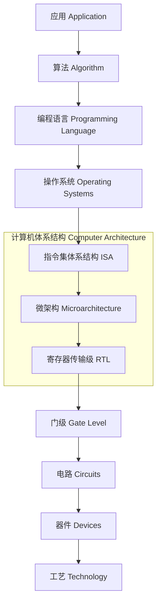

**计算机体系结构**覆盖中间三层，即 **指令集体系结构**（Instruction Set Architecture, ISA）、**微架构**（Microarchitecture）和**寄存器传输级**（Register-Transfer Level, RTL）。[^l01-section-1-s1p26] 体系结构处在底层工艺与上层应用的中间，承担两者之间最主要的衔接。[^l01-section-1-s2b8]

下面用同一个排序任务，自顶向下逐层说明每层的作用。

#### 应用、算法与编程语言

1. **应用**：说明“要做什么”。例：把一组数字从小到大排序，`2,6,3,8,4,5 → 2,3,4,5,6,8`。[^l01-section-1-s1p26]
2. **算法**：说明“怎么做”，用的是人类思维层面的语言。例如 **非原地选择排序**（out-of-place selection sort）：
   1. 在数组中找出最小数 *min*；
   2. 把 *min* 移入输出数组；
   3. 重复步骤 1、2，直到完成。
3. **编程语言**：计算机听不懂用人类语言描述的算法，需要把算法写成高级语言。例：选择排序的 C 实现。[^l01-section-1-s1p26]

```c
void sort( int b[], int a[], int n ) {
    for ( int idx, k = 0; k < n; k++ ) {
        int min = 100;
        for ( int i = 0; i < n; i++ ) {
            if ( a[i] < min ) {
                min = a[i];
                idx = i;
            }
        }
        b[k] = min;
        a[idx] = 100;
    }
}
```

代码与算法步骤一一对应。外层循环 `k` 对应“重复直到完成”，共 $n$ 轮。内层循环 `i` 对应“找最小数”，`idx` 记下它的位置。`b[k] = min` 对应“移入输出数组” `b`。`a[idx] = 100` 把已取走的元素标记为“已用”，使它在后面几轮中不再被选中。

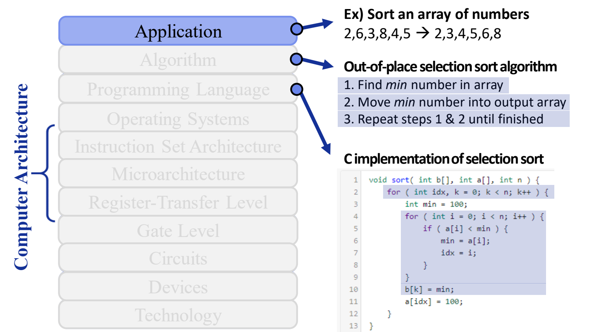

图：计算机系统栈：从 Application 到 Technology 共 11 层，左侧括号标出体系结构覆盖 ISA、微架构与 RTL，右侧以选择排序为例说明应用与算法层。

> [!warning] 易错点
> 这段代码用 `100` 作哨兵值，表示“比所有元素都大”：`min` 的初值是 100，取走的元素也被改写为 100。所以它只在所有输入都**小于 100** 时才正确。另外，“非原地”只是说结果写进另一个数组 `b`；原数组 `a` 照样会被改写，并不是只读的。

#### 操作系统与编译器：为什么高级语言还不够

即使写成了高级语言，计算机仍然不能直接执行，原因有两个：[^l01-section-1-s2b8]

1. **计算机只识别 0/1**：人能读懂的高级语言，机器不认识。所以需要**编译器**（compiler）把编程语言翻译成机器能理解的语言。
2. **计算机里有许多硬件需要协调工作**：所以需要**操作系统**（Operating System）做资源管理，协调各个硬件一起把代码跑起来。Mac OS X、Windows 和 Linux 都属于这一层，它们负责底层硬件管理（handles low-level HW management）。[^l01-section-1-s1p27]

#### 指令集体系结构：计算机的“词典”

编译器要把代码翻译成机器语言，就必须知道底层硬件“认识哪些词”。**指令集体系结构**（ISA）就是计算机认识的这本**词典**。其中每条指令都是计算机知道含义的一个“单词”。ISA 就是机器所执行的指令集合（instructions that machine executes）。[^l01-section-1-s1p27] 以 MIPS32 指令集为例，其中有无符号加（addu）、减、立即数加、取字（load word）、存字（store word）、取字节（load byte）等指令。

因此，编译器的工作可以这样描述：把用户写的代码翻译成计算机认识的“单词”（指令），再把这些单词组织成指令流（flow）。[^l01-section-1-s2b8] 上一节说的“软硬件接口”，在系统栈中的具体位置就是 ISA。指令格式、寻址方式等具体内容在下一讲展开。

#### 微架构与 RTL：指令如何被硬件执行

ISA 只是提供给软件的接口。每条“句子”（指令序列）真正要做的事，要靠一串电路把结果算出来，而计算归根到底都是加减乘除。

- **微架构**描述**数据如何流过系统**（how data flows through system）：数据经过哪些计算模块、沿什么路径流转，最后算出结果。这个过程就是某条指令的执行过程。[^l01-section-1-s1p28]
- **寄存器传输级**（RTL）是一个非常高层、非常宽泛的抽象。人无法直接从半导体和硅的物理操作去理解硬件，能做的是把其中的逻辑抽象成**模块**，画出这些模块，并用它们表示每条指令该怎样完成。RTL 给出硬件设计的大致方案。[^l01-section-1-s2b8]

CPU 内部有哪些模块、指令怎样在其中流动，见 [04 系统框图与内存墙](#系统框图与内存墙)。

#### 门级、电路、器件与工艺

再往下是更细、更接近物理的层次。各层的英文定义如下：[^l01-section-1-s1p28]

| 层次 | 英文定义 | 含义 |
|---|---|---|
| 门级 Gate Level | Boolean logic gates and functions | 布尔逻辑门与函数 |
| 电路 Circuits | Combining devices to do useful work | 把器件组合起来完成有用的工作 |
| 器件 Devices | Transistors and wires | 晶体管与连线 |
| 工艺 Technology | Silicon process technology | 硅工艺（制程） |

逐层解释如下：[^l01-section-1-s2b8]

1. **门级**：最基本的门电路有 AND、OR、NOT 等若干种。把门电路组合起来，就能实现上层 RTL 中的某个模块。由各种门组合成的电路叫**组合逻辑电路**（combinational logic circuit）。
2. **电路与器件**：门电路本身也是对更底层硬件的抽象，它下面是由**晶体管**组成的电路。理论上，可以买来大量分立的晶体管芯片，自己“手搓”一个 CPU，只是非常辛苦。
3. **工艺**：真正的芯片设计从设计**晶体管**本身开始。在硅中掺入各种材料做出晶体管，先确定它的宽度、高度、深度、形态和速度，再据此一层层往上搭，直到搭成 CPU。最底层是硅的**制程**，也就是硅具体怎样排布。[^l01-section-1-s2b9]

> [!warning] 易错点
> 系统栈最底层的 **Technology 应译为“工艺”**，不能理解成泛泛的“技术”。在微电子和集成电路领域，“工艺”有特定含义，指材料和硅制程本身。[^l01-section-1-s2b8]

> [!example] 例：识别晶体管级电路
> 系统栈示意图的电路层画着一张晶体管级电路图。它是什么？一个 AI 聊天助手回答“寄存器（锁存器）”，这是错的。
>
> 1. 这张图的连线没有画完。把电路从中间一分为二，左右两半各是一个**不完整的与非门**（NAND）。
> 2. 因此不能凭局部结构断定它是存储元件；把剩余的晶体管连好，才得到完整的门电路。
>
> 同样的晶体管，连接方式决定它实现什么功能，只看局部结构容易判断错。[^l01-section-1-s2b8]

> [!tip] 课堂强调
> 门级以下的内容，计算机专业的同学不必深入掌握。只要大致知道每层是什么、起什么作用，以后被问到时能答上来就行。[^l01-section-1-s2b9]

> [!note] 补充解释
> 系统栈中相邻两层是“上层看到的接口”和“下层提供的实现”的关系。例如 ISA 规定有哪些指令、每条指令做什么；微架构决定用什么数据通路执行这些指令、执行得多快。同一个 ISA 可以有多种不同的微架构实现。所以 ISA 被看作体系结构中最关键的软硬件接口。

### 两本教材：P&H 与 H&P

本课程参考两本教材，作者是同样的两个人（Patterson 与 Hennessy），只是署名顺序互换，所以分别简称 P&H 和 H&P。[^l01-section-1-s2b1]

| | P&H | H&P |
|---|---|---|
| 书名 | *Computer Organization and Design*（计算机组成与设计） | *Computer Architecture: A Quantitative Approach*（计算机体系结构：量化研究方法，常简称“量化”） |
| 定位 | 偏基础，讲概念与思想 | 偏进阶，讲更高阶的专题 |
| 主要内容 | 计算机与体系的抽象、算术运算、处理器、存储的基本概念，以及多核处理器、集群与云 | 量化分析方法；更复杂的存储层次（memory hierarchy）；并行，包括指令级并行（ILP，与编译和架构相关）、数据级并行（DLP）、线程级并行（TLP，涉及多核） |
| 最新版本 | RISC-V 版 | 第 6 版 |

[^l01-section-1-s2b2]

H&P 的核心关键词是**量化**（quantitative）：它教人用量化方法分析一个设计或架构，因此几乎每位体系结构架构师手头都有一本，工作多年后仍会拿出来查漏补缺。[^l01-section-1-s2b2] 体系结构为什么必须量化、“权衡”具体指什么，见 [02 构建模块与研究方法](#构建模块与研究方法)。

> [!tip] 课堂强调
> 本课程 P&H 和 H&P 两本书的内容都讲，所以比只讲 P&H 的课程更难。另外，所有的书、包括老师讲课都可能有错。H&P 出到第 6 版仍有不少错误，阅读时发现问题欢迎讨论。[^l01-section-1-s2b1][^l01-section-1-s2b2]

> [!question]- 自测：某团队在一款新加速器上只用厂商的“易用” C 库，测得性能约为峰值的 70%。要接近 100%，应改用什么？使用它的前提是什么？
> 改用厂商提供的底层接口或调度库，它把底层硬件抽象直接暴露给开发者。前提是清楚底层硬件的结构和实现，并针对其特性改写代码。这正说明“等硬件自动变快”已不可行，程序员必须理解软硬件接口。

> [!question]- 自测：下面各项分别属于系统栈的哪一层？哪些属于体系结构的范围？(a) Linux 调度 CPU 与内存资源；(b) MIPS32 的 `lw` 指令；(c) 数据在加法器与寄存器之间的流动路径；(d) 晶体管的宽度与掺杂；(e) 用模块图表示每条指令如何完成。
> (a) 操作系统；(b) ISA；(c) 微架构；(d) 工艺/器件（属于设计晶体管和硅制程的范畴）；(e) RTL。属于体系结构的是 (b)(c)(e)，也就是 ISA、微架构、RTL 三层。

> [!question]- 自测：用上面的 C 选择排序代码对 `a = {120, 5, 7}` 排序，结果是什么？
> 结果是错的。`min` 的初值是 100，`120` 永远不会小于 `min`，所以前两轮分别输出 5 和 7。第三轮时 `a` 变成 `{120, 100, 100}`，没有元素小于 100，`min` 保持 100，于是 `b = {5, 7, 100}`，120 丢失了。这段代码默认所有元素都小于 100。

> [!info]- 来源
> - L01.pdf：PDF p.23–28
> - L01.docx：DOCX body 1–85, 298–453

[^l01-section-1-s1p23]: L01.pdf-PDF p.23
[^l01-section-1-s2b7]: L01.docx-DOCX body 298-339
[^l01-section-1-s1p24]: L01.pdf-PDF p.24
[^l01-section-1-s2b8]: L01.docx-DOCX body 340-384
[^l01-section-1-s1p25]: L01.pdf-PDF p.25
[^l01-section-1-s1p26]: L01.pdf-PDF p.26
[^l01-section-1-s1p27]: L01.pdf-PDF p.27
[^l01-section-1-s1p28]: L01.pdf-PDF p.28
[^l01-section-1-s2b9]: L01.docx-DOCX body 385-453
[^l01-section-1-s2b1]: L01.docx-DOCX body 1-51
[^l01-section-1-s2b2]: L01.docx-DOCX body 52-85

---

## 构建模块与研究方法

> [!abstract] 本节要点
> - 任何数字系统都由三类基本模块搭成：**逻辑**处理数据、**状态**存储数据、**互连**在模块之间搬运数据。
> - 到计算机工程（整机）层面，三类模块分别对应**处理器**（计算）、**存储器**（存储）、**网络**（通信）；门电路层面和整机层面是同一个结构。
> - 科学研究循环是“提问 → 假设 → 实验 → 分析”，目标是发现关于自然的真理；计算机工程循环是“设计并建模 baseline → 对系统提问 → 实验 → 分析 → 设计并建模改进系统 → 再提问”，目标是探索新系统的设计空间。
> - 体系结构是工程而不是科学：需求一变，底层系统就要跟着变，所以**不存在最优解**，只有针对某组需求的权衡。
> - 体系结构是**量化**的学科：先量化性能、功耗、面积等指标，再据此决定优化哪些部件、牺牲哪些部件。

### 逻辑、状态与互连（Logic, State, and Interconnect）

在 [01 体系结构定义与系统栈](#体系结构定义与系统栈) 的系统栈里，从应用到工艺共有 11 层，体系结构本身就横跨 ISA、微架构、RTL 三层。层次虽多，组成数字系统的模块种类却很少。抓住这几类模块，看任何一层的设计都知道该问什么：数据在哪里算、存在哪里、怎么送过去。

数字系统由三类基本构建模块（building blocks）实现：[^l01-section-2-s1p29]

1. **逻辑**（Logic）：处理数据，比如组合逻辑电路、运算单元。
2. **状态**（State）：存储数据，保存计算的中间结果和系统当前的状态。
3. **互连**（Interconnect）：在各个模块之间搬运数据，把分散的逻辑块和状态块连成一个系统。

示意图里，多个 Logic 块和多个 State 块交错分布，由一层 Interconnect 把它们连在一起：逻辑块和状态块各自都不能独立完成计算，必须靠互连把数据送到需要它的地方。[^l01-section-2-s1p29]

> [!note] 补充解释
> 门级电路里，与非门这类组合门电路属于“逻辑”，触发器、锁存器、寄存器属于“状态”，导线和总线属于“互连”。一个同步电路的基本节拍就是：从状态元件读出数据 → 经互连送进逻辑 → 逻辑算出结果 → 经互连写回状态元件。

### 处理器、存储器与网络（Processors, Memories, and Networks）

三类模块不只出现在门电路这一层。到通用计算机的整体结构，同样的三分法依然成立，只是每个模块的粒度从“门”变成了“部件”。

计算机工程的三类基本构建模块：[^l01-section-2-s1p30]

| 抽象层次 | 处理数据 | 存储数据 | 搬运数据 |
| --- | --- | --- | --- |
| 数字电路（门级/RTL） | 逻辑 Logic | 状态 State | 互连 Interconnect |
| 计算机工程（整机） | **处理器**（Processor），负责计算 | **存储器**（Memory），如内存、SSD，负责存储 | **网络**（Network），负责通信 |

在整机示意图中，数据作为输入（Input data）进入，由处理器和存储器构成的节点经网络连接，最后产生输出数据（Output data）。[^l01-section-2-s1p30]

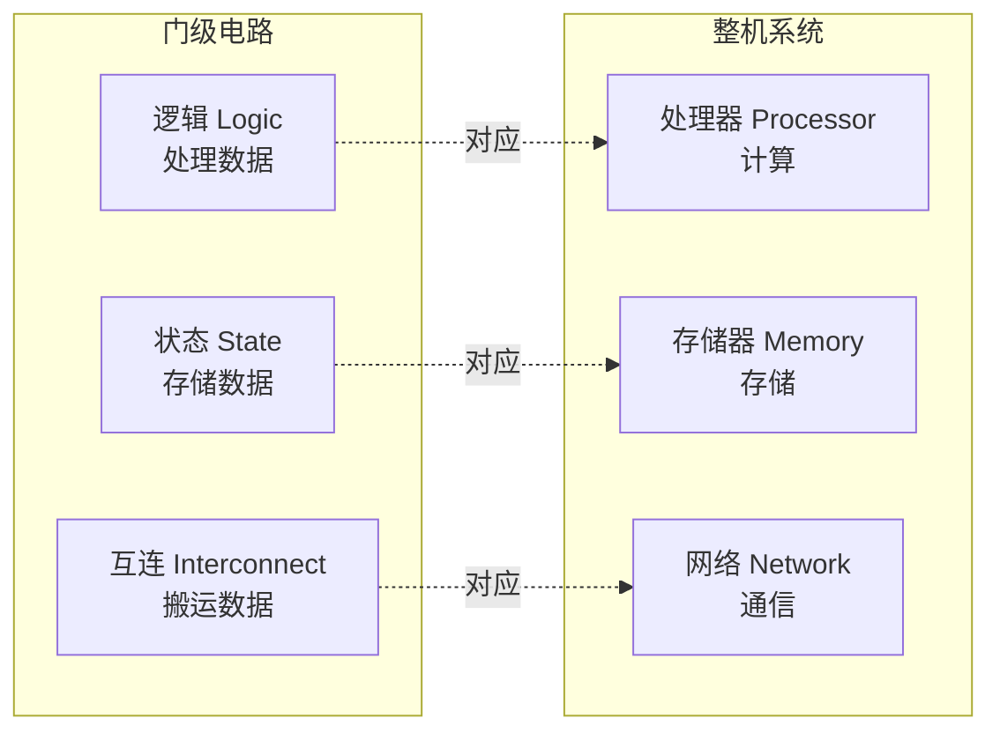

用这个三分法对照计算机专业的必修课：体系结构课主要讲处理器，网络课主要讲互连，对应“状态/存储”的课程往往是缺的，存储系统本身就是一个完整的方向。[^l01-section-2-s2b9] 后面几节看真实系统时也按这三类来分：主板上的 CPU、内存插槽与 M.2 硬盘、PCIe 与芯片组连线，分别是计算、存储和互连，见 [03 主板结构与系统互连](#主板结构与系统互连)；处理器和存储之间的速度差距（内存墙）见 [04 系统框图与内存墙](#系统框图与内存墙)。

> [!warning] 易错点
> “互连”不只是计算机之间的网络。门级的连线、芯片内的总线、主板上 CPU 到内存的走线、PCIe 通道，以及机器之间的网络，都属于搬运数据的模块。判断时看它的作用：只负责把数据从一处送到另一处、自身不改变数据也不长期保存数据的，就是互连。

### 科学研究循环与工程研究循环

研究方法决定了这门学科的“答案”长什么样。如果按自然科学的思路去找“唯一正确的设计”，就会误解体系结构的工作方式。所以先把两种研究循环对比清楚。

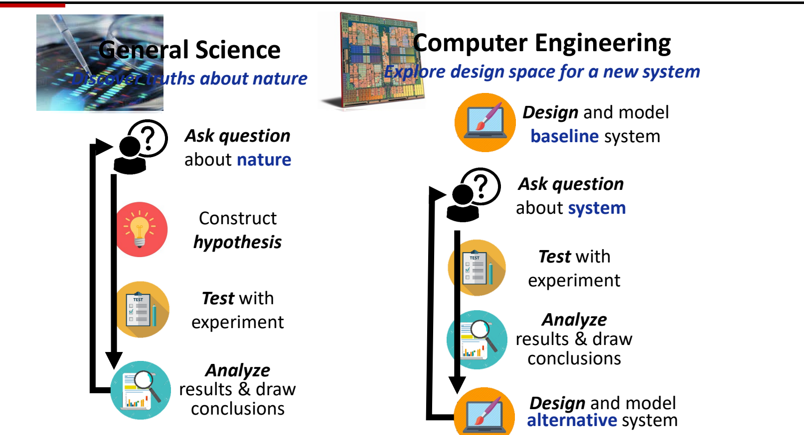

图：科学研究循环与计算机工程研究循环对比：工程先设计并建模 baseline，再提问、实验、分析，最后设计改进系统。

**一般科学**（General Science）的目标是发现关于自然的真理（discover truths about nature）。它的循环是：[^l01-section-2-s1p31]

1. **对自然提问**（Ask question about nature）：例如苹果为什么会落地、为什么所有物体都会下落。
2. **构造假设**（Construct hypothesis）：例如假设存在重力。
3. **用实验检验**（Test with experiment）。
4. **分析结果并得出结论**（Analyze results & draw conclusions）：验证假设是否成立；不成立就回到第 1 步，调整问题和假设，重新循环。

**计算机工程**（Computer Engineering）的目标是为新系统探索设计空间（explore design space for a new system）。它的循环是：[^l01-section-2-s1p31]

1. **设计并建模基准系统**（Design and model baseline system）：baseline 可以是自己搭的系统，也可以是论文中已有的系统。[^l01-section-2-s2b9]
2. **对系统提问**（Ask question about system）：这个系统是否满足实际需求？性能指标达到多少、功耗达到多少，做芯片时面积是否满足要求？
3. **用实验检验**（Test with experiment）：测出这些指标。
4. **分析结果并得出结论**：找出系统的瓶颈和其中的权衡（trade-off）。
5. **设计并建模替代系统**（Design and model alternative system）：根据权衡结果微调 baseline，或者修补它的瓶颈，然后回到第 2 步，再检查新系统是否满足需求。[^l01-section-2-s2b10]

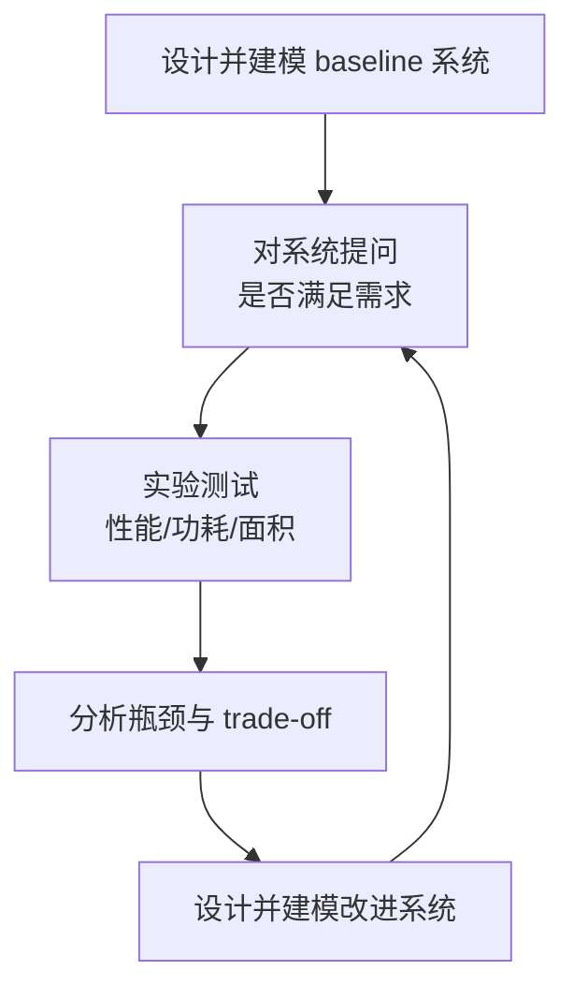

两种循环的区别：

| 对比维度 | 一般科学 | 计算机工程（体系结构） |
| --- | --- | --- |
| 目标 | 发现关于自然的真理 | 探索新系统的设计空间 |
| 起点 | 一个关于自然的问题 | 一个已有的 baseline 系统 |
| 提出的问题 | 自然为什么这样 | 这个系统是否满足需求 |
| 循环产物 | 被验证或推翻的假设 | 改进后的替代系统 |
| 终点 | 找到能完美回答问题的假设 | 没有终点：需求一变，系统就要重新设计 |

> [!warning] 易错点
> 工程循环的第一步不是提问，而是先有一个 baseline。没有基准，“性能是否足够”“瓶颈在哪”这些问题都无从回答；后续每次改进都和上一版系统比较。

### 量化权衡：没有最优解

从工程循环可以直接得出结论：体系结构**永远没有最优解**。科学可以找到一个完美回答问题的假设；体系结构的设计却完全由需求决定，只要需求变了，底层系统为了满足需求就一定会变。这个领域的日常工作是各种微调和各种权衡的考量。[^l01-section-2-s2b10]

**权衡**（trade-off）指的是：把一个方面设计得更强，另一个方面往往就会变差；把那一面补好，这一面又会受损。设计者要在有限资源之间做平衡。[^l01-section-2-s2b2] 典型的三个指标是：

- **性能**（performance）：是否希望性能更强；
- **功耗**（power）：是否希望功耗更低；
- **面积**（area）：在芯片上是否希望面积更小。

所以体系结构是一门**量化**的学科：先量化这些指标，再根据量化结果确定要达到的目标，以及哪些元件（component）需要优化。[^l01-section-2-s2b2] 体系结构岗位通常叫**架构师**（architect），公司一般还设首席架构师。架构师的工作就是接住用户需求或公司的底层需求，在同样的芯片面积内，对手上的处理器设计“这边多做一点、那边少做一点”，达到平衡。[^l01-section-2-s2b2]

> [!example] 例：同一面积预算下的取舍
> 设一个处理器设计在固定芯片面积内，需要在“更大的片上存储”和“更多的运算单元”之间分配面积。
>
> 1. 先建模 baseline，测出其性能、功耗、面积。
> 2. 若需求是“高性能”，分析发现瓶颈在运算能力，就把面积更多分给运算单元，代价是存储变小、功耗可能上升。
> 3. 若需求换成“低功耗”，同一个 baseline 的分析结论就会不同，面积分配也随之改变。
>
> 两种需求下得到的设计不同，各自只在自己的需求下合理，不存在一个对所有需求都最优的设计。

> [!tip] 课堂强调
> 体系结构属于计算机工程，不属于计算机科学意义上的“science”，它是一门偏工程的学科。这也是课程把较大比重放在 project 上的原因：希望通过 lab 亲身体会体系结构设计的过程。[^l01-section-2-s2b2]

> [!question]- 自测：CPU 里的寄存器堆、ALU、片内总线分别属于逻辑、状态、互连中的哪一类？换成整机，SSD、多台服务器之间的以太网又属于哪一类？
> 寄存器堆是状态（存储数据），ALU 是逻辑（处理数据），片内总线是互连（搬运数据）。整机层面，SSD 属于存储器（对应状态），以太网属于网络（对应互连）。判断依据是模块对数据做什么：处理、保存还是搬运。

> [!question]- 自测：一款处理器在台式机需求下经过多轮“测试—分析—改进”，已经性能很好。现在要把它用到手机上，为什么不能直接说“它已经是最优设计”？工程循环应从哪一步重新开始？
> 因为体系结构没有与需求无关的最优解。手机对功耗和面积的要求不同，原设计的权衡点不再合适。可以把现有设计当作新的 baseline，从“对系统提问：是否满足新需求（功耗、面积、性能）”开始，重新测试、分析瓶颈并设计替代系统。

> [!question]- 自测：某研究先提出“所有物体之间存在引力”，再做实验验证；另一项研究先实现论文里的一个缓存设计，再测量它的命中率和功耗并修改。两者分别对应哪种研究循环？关键区别在哪？
> 前者是一般科学循环（问题 → 假设 → 实验 → 分析），目标是验证关于自然的假设；后者是计算机工程循环，从 baseline 系统出发，问的是系统是否满足需求，产物是改进后的替代系统，而不是一个被证实的真理。

> [!info]- 来源
> - L01.pdf：PDF p.29–31
> - L01.docx：DOCX body 52–85, 385–481

[^l01-section-2-s1p29]: L01.pdf-PDF p.29
[^l01-section-2-s1p30]: L01.pdf-PDF p.30
[^l01-section-2-s2b9]: L01.docx-DOCX body 385-453
[^l01-section-2-s1p31]: L01.pdf-PDF p.31
[^l01-section-2-s2b10]: L01.docx-DOCX body 454-481
[^l01-section-2-s2b2]: L01.docx-DOCX body 52-85

---

## 主板结构与系统互连

> [!abstract] 本节要点
> - 主板上的部件可归为 CPU 插座、内存插槽、扩展槽、存储接口和桥接芯片；决定软件能否运行的是指令集体系结构（ISA），而不是插座的物理规格。今天主导的 ISA 是 AMD 提出的 x86-64。
> - 北桥负责协调对主存的访问。内存频率越高，信号就要求走线越短，因此北桥（内存控制器）并入了 CPU；现代 CPU 还直连最高速的 PCIe 插槽和部分 M.2。
> - 南桥（芯片组）把多个慢速外设的数据汇总后再交给 CPU，从而节省 CPU 引脚、简化布线；代价是这些设备之间的**争用**，挂在南桥上的 PCIe 槽往往跑不满标称带宽。
> - 并行接口要求所有线上的信号同时到达，所以频率上不去；串行差分接口没有这种同步约束，可以跑很高的频率。针脚多不等于快（PATA → SATA）。
> - DRAM 仍然采用并行接口，前提是它离 CPU 极近：内存插槽紧贴 CPU 并走蛇形等长线，Apple 统一内存把 DRAM 颗粒贴在处理器旁边，HBM 则贴在 GPU 芯片周围。

### 新旧主板的部件布局

主板是把 CPU、内存、显卡、存储和外设连接在一起的骨架。比较一块约 20 年前的主板和一块现代主板，可以直接看出系统互连是怎样随性能需求演变的。

下图是一块旧式主板（AM3 插座、DDR3 内存）的标注图，从中可以认出这几类部件：[^l01-section-3-s1p33]

- **CPU 插座（CPU socket）**：安装处理器的位置。
- **北桥（North bridge）**：位于 CPU 插座旁边，上面通常压着散热片。
- **内存插槽（RAM slots）**：紧贴 CPU 插座。
- **扩展槽**：一个 PCI 槽，以及图中标为 PCIx16 的几条长槽。
- **南桥（South bridge）**：位于主板下部，负责 I/O。
- **存储接口**：SATA 插座、PATA 插座。
- **USB 插针（USB headers）**：用来引出机箱前面板的 USB 口。

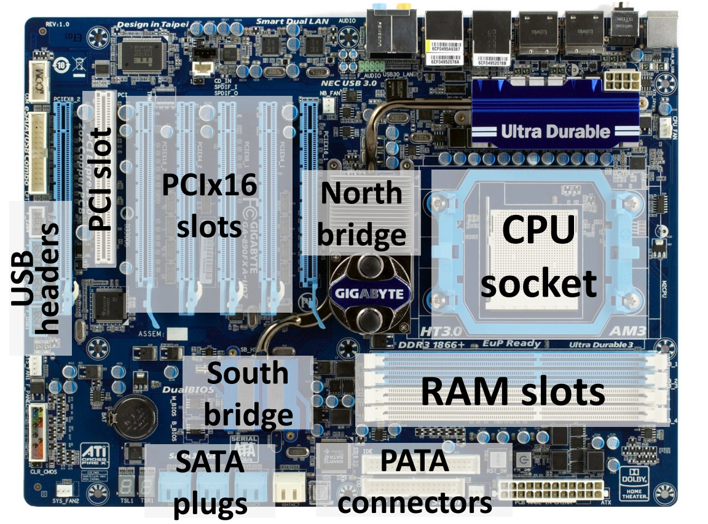

图：一块约 20 年前的主板：标出 CPU 插座、北桥、南桥、RAM 插槽、PCIx16/PCI 插槽、SATA 与 PATA 接口和 USB 插针。

现代主板（以 Intel Z790 芯片组主板为例）大致可以分为六个区域：左上角的 I/O 接口区、正上方的 CPU 区、右侧的内存区、下方的扩展区、右下角的芯片组区，以及四周的接口和针脚区。[^l01-section-3-s2b10] 与旧主板相比，两者的主要区别如下：

| 对比项 | 约 20 年前的主板 | 现代主板 |
|---|---|---|
| 北桥 | 独立芯片，位于 CPU 与内存之间 | 不再独立，功能并入 CPU |
| 内存 | DDR3 及更早的代际 | DDR4 / DDR5（两代插槽互不兼容） |
| 扩展槽 | PCI、PCI-X 等，全部挂在南桥上 | PCIe：高速槽直连 CPU，其余经芯片组 |
| 固态存储接口 | 没有 M.2 | 有 M.2，走 PCIe 通道 |
| 硬盘接口 | PATA 与 SATA 并存 | 只剩 SATA（以及 M.2） |
| CPU 插座 | 插座上是孔，针脚在 CPU 上 | 插座上是针脚（LGA），CPU 上是触点 |
| 键鼠接口 | 有圆形的 PS/2 口 | 改用 USB |

下面各小节解释这些变化背后的原因。数字系统由逻辑、状态和互连三类模块构成，这一视角见 [02 构建模块与研究方法](#构建模块与研究方法)；把主板抽象成系统框图并由此引出内存墙，见 [04 系统框图与内存墙](#系统框图与内存墙)。

### CPU 插座与 x86 指令集

CPU 插座的物理标准有很多种，不同品牌、不同代的 CPU 所用的插座也不相同。例如 Intel LGA1700 插座有 1700 根针脚，支持第 12、13、14 代酷睿处理器，因此选购主板前必须确认插座与 CPU 兼容。[^l01-section-3-s2b10]

不过，**物理标准远不如指令集体系结构（ISA）重要**：插座决定的只是 CPU 能不能装上去，ISA 决定的是软件能不能在这颗 CPU 上运行。ISA 作为软硬件接口的含义见 [01 体系结构定义与系统栈](#体系结构定义与系统栈)。[^l01-section-3-s1p34]

- IBM PC 兼容机都兼容 Intel 80386。幻灯片上写作“80836”，系笔误。[^l01-section-3-s1p34]
- **x86** 是最初由 Intel 设计的指令集，生产 x86 处理器的厂商有 Intel、AMD、VIA 等。约 20 年前，市面上的处理器还有 IBM、TI 等多家的其他架构；今天个人电脑上几乎只剩 x86 及其 64 位扩展。[^l01-section-3-s2b12]
- 今天占主导地位的 ISA 是 **x86-64**，它由 **AMD** 而不是 Intel 提出。[^l01-section-3-s1p34]

#### 针脚为什么从 CPU 移到了插座上

旧主板的插座是“母口”，上面全是孔，针脚长在 CPU 上（PGA 方式）。现代 Intel 主板正好相反：插座上布满针脚，CPU 底面只有平的触点，这就是 LGA（Land Grid Array）。改变的理由是一个简单的成本推理：

1. 针脚容易弯折损坏，孔或触点则不容易损坏。
2. CPU 比主板上的插座贵得多。
3. 所以应当让更贵的 CPU 承担不易坏的那一面，把易坏的针脚放到插座上。[^l01-section-3-s2b12]

> [!warning] 易错点
> 主板之间的兼容性要分两层判断。插座匹配，CPU 才装得上；指令集相同，程序才跑得起来。在 AMD 的 x86-64 处理器和 Intel 的 x86-64 处理器上，同一个程序都能运行，尽管它们的插座完全不同。

### 北桥与主存

**北桥**（North bridge）是负责**协调对主存访问**的芯片。[^l01-section-3-s1p35] 约 20 年前，北桥的任务只有与内存通信这一项。

#### DRAM 的代际

内存插槽里插的是 DRAM，它经历了以下几代：[^l01-section-3-s1p35]

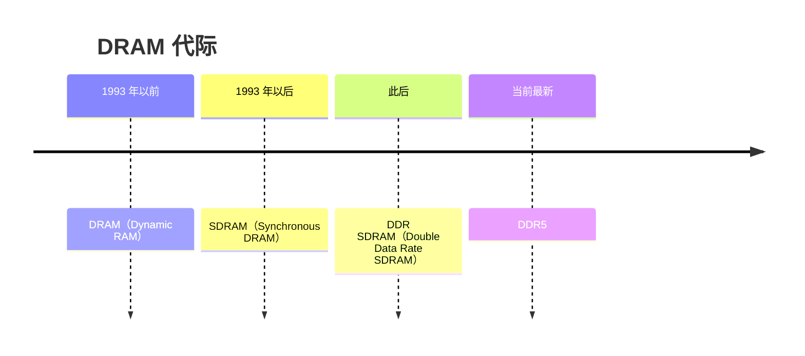

DDR 系列各代之间的差异主要有三点：

1. **频率**：这是最主要的差别，各代相差很多。
2. **针脚数**：金手指的数量不同。
3. **防呆缺口的位置**：内存条金手指中间有一个隔断，例如 DDR4 与 DDR5 的隔断位置不同，所以两代内存插槽互不兼容，插不进去。[^l01-section-3-s2b12]

#### 为什么北桥并入了 CPU

早期把北桥做成一块独立芯片，是为了**方便设计**：CPU 每次迭代时，不必连同北桥一起重新设计。后来北桥不得不并入 CPU，推理链条如下：

1. 内存性能要提升，就要求内存频率提升。
2. 信号频率越高，传得越远受到的干扰越强。所以要么降低频率，要么缩短距离。
3. 有独立北桥时，CPU 访问内存的路径是“内存 → 北桥 → CPU”，走的是一条折线；把北桥移进 CPU 后，内存可以沿直线直接连到 CPU 内的内存控制器，距离更短。
4. 因此，要让内存跑到更高的频率，北桥就必须并入 CPU。[^l01-section-3-s2b11]

视频里描述的现代主板正是这样布局的：内存插槽设计在 CPU 旁边，以尽量缩短线路。CPU 与内存之间的走线不是直线，而是像蛇一样弯弯曲曲，目的是让每条线等长，保证所有信号同时到达（原因见下文“并行与串行传输”）。[^l01-section-3-s2b10]

内存最终能跑到多高的频率，还取决于固件调校、CPU 内存控制器的体质和内存颗粒的品质。厂商给出的是排除其他瓶颈后主板本身的保底值，例如某 Z790 主板标称 7800 MHz，高于当时市售主流的 6800 MHz；这个数是保底值，不代表最高只能跑到 7800 MHz。[^l01-section-3-s2b10]

#### 现代“北桥”还直连高速 PCIe

除了内存，现代 CPU（也就是并入后的北桥）还负责与**部分 PCIe 设备**直接通信：[^l01-section-3-s2b12]

- **PCIe**（PCI Express）通道相当于电脑里的高速公路，版本越新、通道（lane）越多，速度就越快。
- **M.2** 是安装固态硬盘的长方形接口，走的也是 PCIe 通道。PCIe 插槽主要用来装显卡，也可以装 PCIe 固态硬盘、声卡、万兆网卡、采集卡等，还能通过转接卡变成 M.2 接口。
- 以一块 Z790 主板为例：第一个 M.2 接口有 4 条 PCIe 4.0 通道，每秒可传输 8 GB；第一个 PCIe 插槽有 16 条 PCIe 5.0 通道，每秒可传输 64 GB，是前者的 8 倍。这两个接口都直接连到 CPU，速度最快、延迟最低。[^l01-section-3-s2b10]

20 年前不需要这样做，因为当时 PCIe 和 SATA、USB 这类外设都很慢，不必直连 CPU。如今 PCIe 快到必须直连 CPU，才能把带宽跑满。[^l01-section-3-s2b12]

> [!warning] 易错点
> 不是所有 M.2 都直连 CPU。主板介绍视频说第一个 M.2（PCIe 4.0 x4）与 PCIe 5.0 x16 插槽一样直连 CPU；课堂讲解则说该 M.2 连在南桥上。[^l01-section-3-s2b12] 实际的 Z790 平台上，CPU 提供 x16 插槽和一个 x4 M.2 的通道，其余 M.2 挂在芯片组上，所以视频对“第一个 M.2”的说法更准确。判断某个 M.2 是否直连 CPU，要查主板说明书的通道分配图。

> [!info] 可视化资源
> [Wikipedia：Northbridge (computing)](https://en.wikipedia.org/wiki/Northbridge_%28computing%29)：条目中有 2007 年与 2015 年两种芯片组布局示意图，可对照北桥独立存在与北桥并入 CPU 后的连接关系。

### 南桥（芯片组）与争用

**南桥**（South bridge）负责设备、CPU 与主存之间的 I/O。[^l01-section-3-s1p36] 它的任务这些年基本没变，至今仍以**芯片组**（chipset）的形式存在，例如 Intel 的 Z790、B760。由于主板最主要的职责就是提供各种接口，主板通常直接以芯片组命名。芯片组决定了主板扩展能力的上限，但厂商不一定把这些能力全部用上。

#### 为什么需要南桥

为什么不让每个外设都直连 CPU？原因有两个：

1. **外设太慢**：让每个慢速设备独占一条通向 CPU 的连接，是在浪费资源。
2. **CPU 引脚和布线不够**：CPU 的针脚数量有限，不可能给每个设备都分配一组；何况插槽周围的布线也会变得异常复杂。[^l01-section-3-s2b12]

解决办法是设一个**代理**（中介）：南桥先把多个慢速设备的数据汇总起来，再集中发给 CPU，由 CPU 统一处理。南桥本质上就是一个扩展坞，通过它可以扩展出更多的接口和插槽。[^l01-section-3-s2b10] 南桥挂着以下几类设备：

- **I/O 设备插槽**：挂在南桥总线上。较早的标准是 PCI 槽，或 AGP / PCI-X 槽；PCI-X 比 PCI 更好，PCIe 则是更新的标准，它们的底层驱动大体相同。[^l01-section-3-s1p36]
- **板载 I/O**（Built-in I/O）：USB、音频，以及老主板上专门接键盘鼠标的圆形 PS/2 口。
- **存储接口**：见下一小节。

在 PCI 类设备的连接方式上，新旧主板有区别：20 年前所有 PCI 设备都连在南桥上；现在一部分连 CPU（也就是原来北桥的位置），一部分连南桥。

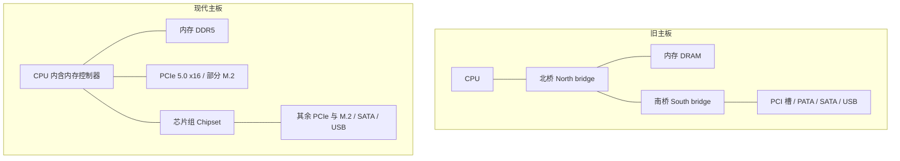

#### 汇聚的代价：争用

南桥把多个设备的流量汇聚成一路再交给 CPU，于是这些设备要**竞争**同一条上行通路。如果南桥上的设备全部插满、同时工作，每个设备实际跑出来的速度会比预期慢得多。[^l01-section-3-s2b12]

> [!example] 例：GPU 插错了槽
> 有人做 GPU 测试时，把 GPU 插在了一个连到南桥的 PCIe 插槽上，结果无论怎样都跑不到预期的 PCIe 带宽。
>
> 1. 这个插槽的流量要先经过南桥，再走南桥与 CPU 之间的共享链路。
> 2. 这条链路被南桥上的所有设备共同分享；挂的设备越多，GPU 分到的带宽就越少。
> 3. 所以在服务器上装 GPU 之前，应先查清主板上哪些插槽直连 CPU、哪些连南桥。直连 CPU 的插槽没有问题；连南桥的插槽，则要看有多少设备在和它竞争。

> [!tip] 课堂强调
> 进实验室使用服务器时，插 GPU 前一定要先看清插槽是直连 CPU 还是连南桥的。

### 存储接口：并行与串行

存储接口由南桥控制。[^l01-section-3-s1p37] 幻灯片列出的标准有：

- **并行 ATA**（Parallel ATA，PATA）：较老的标准，配套 **ATAPI**（AT Attachment Packet Interface），由 **IDE**（Integrated Drive Electronics）标准演变而来。IDE 也常用来指这一套通信协议。
- **串行 ATA**（Serial ATA，SATA）：PATA 的后继者，在现代主板上仍然常见，用来接机械硬盘和 2.5 英寸固态硬盘。
- **SCSI**（Small Computer System Interface）：企业级存储接口，普通台式机上一般看不到。[^l01-section-3-s1p37]

#### 为什么针脚少的 SATA 反而比针脚多的 PATA 快

PATA 的排线和插座又宽又长，针脚很多；SATA 的数据接口很小，只有两对差分线，一对负责发送，一对负责接收，外加接地线。按直觉，针脚越多，同一时刻能传的数据就越多，那么为什么 SATA 反而是 PATA 的升级版，而且快得多？

1. **并行传输**的一个数据字分布在多根线上，只有所有线上的位**同时到达**，接收端拿到的数据才完整。
2. 各条线的长度和受到的干扰不可能完全一致，频率越高，到达时间的偏差（skew）占一个时钟周期的比例就越大，数据也就越容易出错。
3. 所以针脚一多，就只能把频率调得很低，以保证所有位在同一个周期内到齐。PATA 的实际工作频率因此很低。
4. **串行传输**只有一组发送线和一组接收线，不存在多线同步的问题，频率可以提得很高，最终带宽远高于 PATA。[^l01-section-3-s2b13]

结论是：很多设备并不是针脚越多越好，反而常常是越少越好。

> [!warning] 易错点
> 课堂口述称 SATA 带宽是 PATA 的“50–100 倍”，这是夸张说法。按规范，PATA 最高的 ATA/133 约 133 MB/s，SATA 3.0 约 600 MB/s，差距约 4.5 倍。[^l01-section-3-s2b13] 另外，讲解中“PATA 实际频率非常高”一句是口误，按推理应为 PATA 频率**很低**。

> [!note] 补充解释
> SATA 3.0 的线速率为 6 Gb/s，扣除 8b/10b 编码开销后约为 600 MB/s。SATA 每个方向只用一对差分线，每对线以两根导线上的电压差表示一位，抗干扰能力强，这也是它能工作在 GHz 级频率的原因之一。

#### DRAM 为什么还能用并行接口

DRAM 有一百多根数据和地址针脚，同样面临信号完整性问题。它之所以仍能做到“高速 + 并行”，**核心原因是 DRAM 离 CPU 非常近**；一旦距离拉远，同样的问题就会出现。[^l01-section-3-s2b13] 工程上缩短距离的做法有：

- 主板上的内存插槽紧贴 CPU 插座，并采用蛇形等长走线（见上文“北桥与主存”）。
- **Apple 统一内存**：Apple 电脑的 DRAM 不是插在旁边的内存插槽里，而是把 DRAM 芯片直接贴在处理器芯片旁边，这样信号更好，频率也能更高。
- **HBM**（High Bandwidth Memory）：在 GPU 芯片周围贴一圈 HBM 堆叠，连线不走主板上的普通走线。[^l01-section-3-s2b13]

DRAM 内部如何在高速下保持并行传输，留待讲存储器时展开。

> [!note] 补充解释
> HBM 与 GPU 通常封装在同一块硅中介层（interposer）上，通过中介层里极短、极密的连线互连，因此可以用上千位宽的并行总线。

#### SCSI 与 UFS

SCSI 虽然是企业级接口，但大多数人每天都在间接使用它：安卓手机的闪存普遍采用 **UFS**（Universal Flash Storage）接口，三星、小米、OPPO、vivo 等品牌都是如此。UFS 是在 SCSI 协议层面上加了一层封装改良而来的。[^l01-section-3-s2b13] 存储协议栈中的另一个名字 AHCI 不在本讲范围内，留待讲存储时再介绍。

> [!question]- 自测：一块主板的 M.2_1 接口有 4 条 PCIe 4.0 通道，PCIe_1 插槽有 16 条 PCIe 5.0 通道。已知前者带宽为 8 GB/s，后者是多少？为什么 PCIe 5.0 每条通道的带宽是 PCIe 4.0 的两倍，而总带宽却是 8 倍？
> PCIe_1 的带宽为 64 GB/s。PCIe 4.0 每条通道为 $8/4=2$ GB/s；PCIe 5.0 每条通道约为 $64/16=4$ GB/s，是前者的 2 倍。通道数又是前者的 $16/4=4$ 倍，所以总带宽是 $2\times4=8$ 倍。

> [!question]- 自测：某同学在服务器上同时插了 GPU、两块 NVMe 盘和一块万兆网卡，全部插在芯片组提供的插槽上。单独测试每个设备时都正常，同时运行时 GPU 的数据传输明显变慢。最可能的原因是什么？应该怎么调整？
> 原因是南桥/芯片组上的争用。这些设备共享芯片组到 CPU 的同一条上行链路，同时工作时会互相抢带宽。应把 GPU 换到直连 CPU 的 PCIe 插槽（通常是第一条 x16 插槽），并减少同时挂在芯片组上的高带宽设备。

> [!question]- 自测：有人提议，“把 PATA 的线数再翻一倍，同一时刻传的位翻倍，带宽就能超过 SATA”。这个推理错在哪里？
> 这个推理默认频率不变。并行线越多，越难保证所有位同时到达，只能进一步降低频率，所以带宽未必增加。SATA 用一对差分线串行传输，没有多线同步的约束，可以把频率提得很高，因此反而更快。DRAM 能用宽并行总线，是因为它离 CPU 极近。

> [!info]- 来源
> - L01.pdf：PDF p.33–37
> - L01.docx：DOCX body 454–624

[^l01-section-3-s1p33]: L01.pdf-PDF p.33
[^l01-section-3-s2b10]: L01.docx-DOCX body 454-481
[^l01-section-3-s1p34]: L01.pdf-PDF p.34
[^l01-section-3-s2b12]: L01.docx-DOCX body 513-569
[^l01-section-3-s1p35]: L01.pdf-PDF p.35
[^l01-section-3-s2b11]: L01.docx-DOCX body 482-512
[^l01-section-3-s1p36]: L01.pdf-PDF p.36
[^l01-section-3-s1p37]: L01.pdf-PDF p.37
[^l01-section-3-s2b13]: L01.docx-DOCX body 570-624

---

## 系统框图与内存墙

> [!abstract] 本节要点
> - 系统框图把主板抽象为：CPU（自带 L1/L2/L3 Cache）—北/南桥—内存、图形卡（自带显存）和若干 I/O 设备；北桥直连内存与 GPU，南桥连接外围 I/O。
> - CPU、GPU 和外围 I/O 要访问数据都必须经过内存，所有设备竞争内存访问，内存因此成为整个系统的瓶颈。
> - **内存墙**有两层含义：内存的性能增长满足不了其他设备的需求；内存的容量同样跟不上需求。
> - CPU 内部由系统总线接口、Cache、取指、译码、控制单元、ALU/FPU 和寄存器组成。
> - 指令流：内存 →（系统总线）→ Cache → 取指 → 译码 → 控制单元驱动 ALU/FPU → 读写寄存器；load/store 指令经 L1–L3 Cache 在寄存器与内存之间搬运数据。

### 系统框图（System Block Diagram）

真实主板上有插座、插槽、芯片组和大量走线（各部件及其接口见 [03 主板结构与系统互连](#主板结构与系统互连)）。要分析"整个系统的性能卡在哪里"，需要先去掉物理细节，只保留部件以及它们之间的连接关系，这就是系统框图。

**系统框图**（system block diagram）是把计算机中的主要部件画成方框、把它们之间的数据通路画成连线的抽象表示。[^l01-section-4-s1p38] 本讲的框图包含以下部件：

1. **CPU(s)**：一个或多个处理器，旁边连着它自己的 L1、L2、L3 三级 Cache。
2. **北桥/南桥**（North/South Bridge）：CPU 与其他部件之间的中转站。北桥直接连接 GPU 和内存（memory）；南桥负责连接外围 I/O，包括存储设备、网卡、鼠标键盘等。[^l01-section-4-s2b13]
3. **内存**（Memory）：系统的主存，经桥与 CPU 相连。
4. **图形卡**（Graphics）：连接到桥上，并连着自己专用的**显存**（Graphics Memory / video memory）。
5. **I/O 设备**：图中画了两块 I/O 卡，经同一组连线挂在南桥上。

图中在内存旁边标出了一个"冲突"记号，并写着 **All devices compete for access to memory**（所有设备竞争访问内存）。[^l01-section-4-s1p38]

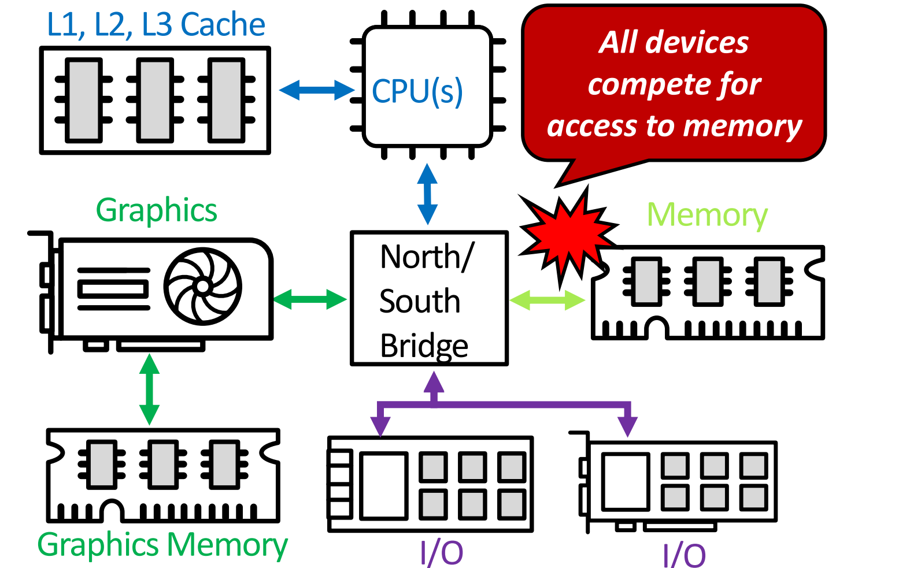

图：系统框图：CPU 与 L1/L2/L3 Cache 经北/南桥连接内存、显卡（显存）和 I/O，红框提示所有设备竞争访问内存。

把框图的连接关系整理成图：

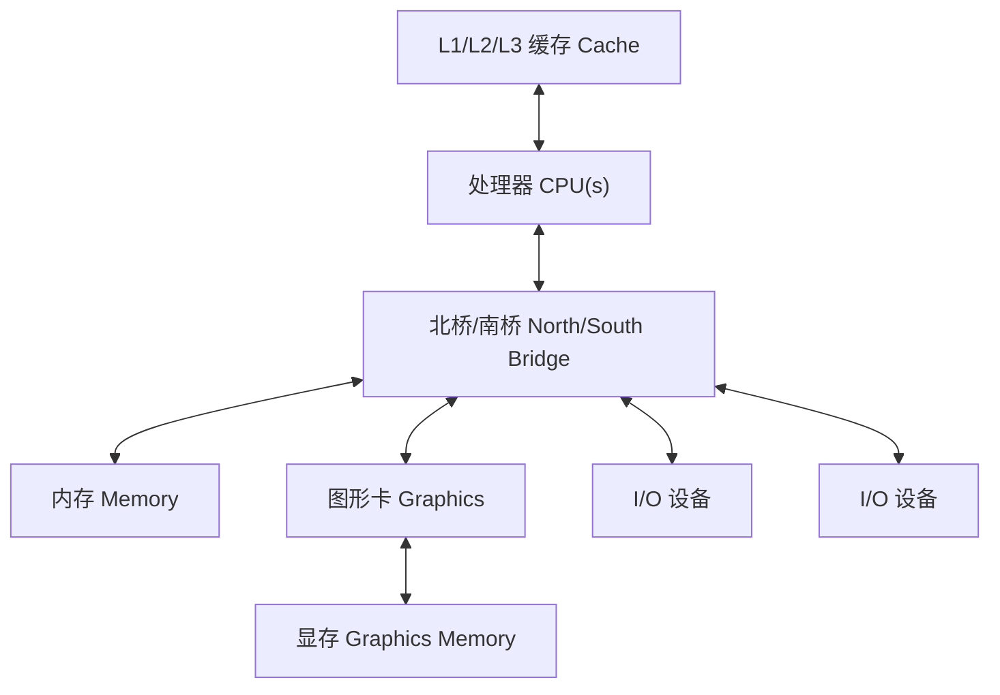

> [!warning] 易错点
> 显存是图形卡自己的存储，挂在图形卡上而不是桥上；它不能替代主存。框图里 CPU、GPU、I/O 的数据最终都要和**主存**（Memory）交换，所以"竞争"发生在主存这一处，而不是在显存或各级 Cache 上。

### 内存墙（Memory Wall）

处理器性能长期以指数速度增长（见 [05 技术趋势与功耗墙](#技术趋势与功耗墙)）。但计算得再快，数据也要先送到计算单元才能用。如果供数据的那一环跟不上，整个系统的速度就由这一环决定。

**为什么内存是瓶颈**：从系统框图可以直接看出，无论是 CPU、GPU 还是外围 I/O 设备，访问数据都要经过内存。内存是所有设备必经的一条路，所有设备都在争用它，因此它成为整个系统的瓶颈。[^l01-section-4-s2b13]

**内存墙**（memory wall）指内存成为系统瓶颈的现象：内存的发展满足不了其他设备对它的需求。它包含两层含义：[^l01-section-4-s2b13]

1. **性能**：内存的性能（速度）增长跟不上计算部件对数据的需求。
2. **容量**：内存的容量同样跟不上需求。（这一层含义在讲解录音中识别不清，按“两层含义”的表述推断为容量也不足。）

可以按下面的链条理解内存墙为什么形成：

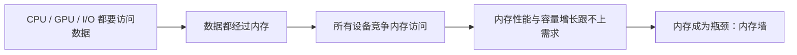

CPU 与 DRAM 各自的具体增长速率在 [05 技术趋势与功耗墙](#技术趋势与功耗墙) 中给出：处理器性能呈指数增长，DRAM 速度增长慢得多。两者之间的差距不断扩大，内存墙就越来越明显。

> [!note] 补充解释
> 框图中 CPU 旁的 L1/L2/L3 Cache 就是缓解内存墙的常见手段：把常用数据放在离处理器更近、速度更快的小容量存储里，减少直接访问主存的次数。Cache 并不能消除主存这条"必经之路"，只是让大多数访问不必真正走到主存。

> [!warning] 易错点
> 内存墙不只是"内存慢"。按本讲的定义，它同时包括**性能**和**容量**两方面跟不上需求；而且它是一个**系统层面**的问题：之所以严重，是因为 CPU、GPU 和 I/O 设备**全部**要经过内存。

### CPU 内部结构

系统框图里的 CPU 只是一个方框。把这个方框放大，就得到 CPU 的基本架构，也是后续几讲的主要内容。

CPU 通过**系统总线**（System Bus）与**主存**（Main Memory）相连：数据和指令经系统总线进入 CPU，结果也经系统总线写回。[^l01-section-4-s1p39] CPU 内部包含以下模块：[^l01-section-4-s1p39]

- **Cache**：L1（以及 L2、L3）缓存，位于系统总线与 CPU 内部其他模块之间。
- **取指**（Instruction Fetch）：从 Cache 中取出下一条指令。
- **译码**（Decode）：解析指令，确定要做什么操作、用哪些操作数。
- **控制单元**（Control Unit）：根据译码结果，指挥运算部件如何操作。
- **算术逻辑单元**（Arithmetic and Logic Unit, ALU）：执行整数算术与逻辑运算；图中画了两个 ALU。
- **浮点单元**（Floating Point Unit, FPU）：执行浮点运算。
- **寄存器**（CPU Registers）：CPU 内部存放操作数和运算结果的存储单元，ALU/FPU 直接从这里读取和写入数据。

### 指令在 CPU 内的流动

知道 CPU 有哪些模块之后，还要知道一条指令依次经过哪些模块、数据在哪些地方读写，才能理解每个模块的作用。

一条指令的完整流程如下：[^l01-section-4-s2b13]

1. **加载到 Cache**：指令从主存经系统总线加载到 CPU 的 Cache 中。
2. **取指**：取指模块从 Cache 中取出这条指令。
3. **译码**：译码模块解析指令。
4. **控制**：译码结果告诉控制单元应当如何操作 ALU 和 FPU。
5. **执行与寄存器读写**：ALU/FPU 按指令的要求从寄存器中读出对应的数据，运算后再把结果写回寄存器。
6. **访存（load/store 指令）**：对于 load/store 这类特殊指令，数据需要在寄存器与内存之间搬运：load 从内存读数据到寄存器，store 把寄存器中的数据写回内存。这种搬运不是直接与主存进行的，而是要经过 L1、L2、L3 Cache，最后才到达主存。


> [!tip] 课堂强调
> 这一流程在计算机系统导论（ICS）课程中已经学过；CPU 的基本架构是本课程后面几讲的主要内容。

> [!warning] 易错点
> ALU/FPU 的操作数来自**寄存器**，而不是直接来自内存。只有 load/store 指令负责在寄存器与内存之间搬运数据，而且这种搬运要经过各级 Cache，不会绕过 Cache 直接读写主存。

> [!example] 例：一条 load 指令经过了哪些部件
> 设程序执行一条 load 指令，把主存中某个数据读到寄存器。
>
> 1. 这条指令本身先从主存经系统总线进入 Cache，再经取指、译码送到控制单元。
> 2. 控制单元识别出它是 load，于是发起访存：要读的数据从主存经系统总线进入 L3、L2、L1 Cache。
> 3. 数据最后写入目标寄存器，后续的 ALU/FPU 指令才能从寄存器中读取它。
>
> 可见一条 load 至少两次用到"主存 → 系统总线 → Cache"这条路：一次取指令，一次取数据。这也说明了内存为什么会成为瓶颈。

> [!question]- 自测：在系统框图中，GPU 运行时读写的数据是否只在显存里，从而不受内存墙影响？
> 不是。显存只是图形卡自己的存储；按本讲的分析，CPU、GPU 和外围 I/O 设备获取数据都要经过（主）内存，GPU 也要与其他设备竞争内存访问，所以同样受内存墙制约。

> [!question]- 自测：一条 ALU 加法指令 `add` 和一条 `store` 指令，哪一条在执行阶段会访问内存？数据走的路径是什么？
> `store` 会访问内存。`add` 的操作数从寄存器读出、结果写回寄存器，不访问内存（取指令本身除外）；`store` 把寄存器中的数据经 L1→L2→L3 Cache 写到主存，而不是直接写入主存。

> [!question]- 自测：假设某计算机的 CPU 速度提高了 10 倍，而内存的速度和容量都不变，整个系统的性能会提高 10 倍吗？为什么？
> 一般不会。所有设备的数据都要经过内存，CPU 变快后仍要等内存提供数据；内存的性能和容量跟不上，系统性能就受内存墙限制，CPU 的提升无法完全转化为系统的提升。

> [!info]- 来源
> - L01.pdf：PDF p.38–39
> - L01.docx：DOCX body 570–624

[^l01-section-4-s1p38]: L01.pdf-PDF p.38
[^l01-section-4-s2b13]: L01.docx-DOCX body 570-624
[^l01-section-4-s1p39]: L01.pdf-PDF p.39

---

## 技术趋势与功耗墙

> [!abstract] 本节要点
> - SPECint 性能图的纵轴是对数坐标：1987–2003 年的散点近似一条直线，说明处理器性能按**指数**增长；早期约每年 +30%，近年降到每年约 10%–15%。
> - 各部件发展速度差别很大：CPU 晶体管数每 1.5 年翻倍；DRAM 容量每 2 年翻倍，但速度每 10 年只提高到 1.5 倍；磁盘容量每年 +60%。CPU 和 DRAM 的速度差距因此越拉越大。
> - 动态功耗 $P \approx \tfrac12 C V^2 A f$。频率大致随电压线性升高，所以 $P \propto V^2 f \propto f^3$：靠提频换来线性的性能，功耗却按三次方增长。
> - 功率密度曲线从“热板”一路逼近“核反应堆、火箭喷口、太阳表面”；Itanium-2 热图上执行核约 120 °C。Intel 在 Pentium/P6 之后不再单纯提频，性能提升只能转向体系结构方案。

### 处理器性能趋势（Processor Performance Trend）

要判断“继续把单个 CPU 做快”这条路还能走多远，先要看清过去性能是怎样增长的、增长速度有没有变。

这张图的横轴是年份（1987–2003），纵轴是 **SPECint** 整数基准测试分数。图中依次标出 SUN-4/260、MIPS M/120、MIPS M2000、IBM RS6000、HP 9000/750、DEC AXP/500、IBM POWER 100、DEC Alpha 系列（4/266、5/300、5/500、21264/600、21264A/667），以及 Intel Xeon/2000 和 Intel Pentium 4/3000。[^l01-section-5-s1p40]

读这张图的关键在纵轴：刻度是 1、10、100、1000、10000，每格相差 10 倍，是**对数坐标**。在对数坐标上，一条直线代表每年按固定**倍数**增长，也就是指数增长，而不是每年增加固定的量。图中散点从约 1 升到 3000 以上，16 年里跨了三个多数量级，基本贴着一条直线。[^l01-section-5-s2b13]

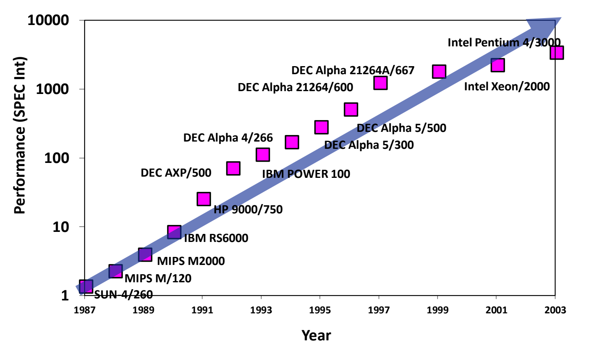

图：1987–2003 年处理器 SPECint 性能（对数纵轴）：近似直线说明性能按指数增长。

增长率本身也在变：早期 CPU 性能约每年 +30%，近几年约每年 10%–15%。增速虽然变慢，仍然在逐年提升。[^l01-section-5-s2b13]

> [!warning] 易错点
> 在对数纵轴上看到“一条直线”，结论是指数增长，不是线性增长。反过来，如果在线性坐标上画指数增长，前期几乎贴着横轴，后期陡然上翘，看上去像突变。

### 技术发展速率（Rates of Technology Change）

计算机系统由 CPU、内存、外存等部件组成，各部件的工艺进步速度并不一致。速度慢的部件会成为整个系统的瓶颈，所以需要分别看各部件的增长率。下表列出各部件的增长率：[^l01-section-5-s1p41]

| 部件 | 指标 | 增长速度 |
| --- | --- | --- |
| CPU | 性能（Performance） | 每年 +30%（近年约 10%–15%） |
| CPU | 容量（Capacity，即晶体管数量） | 每 1.5 年翻倍 |
| DRAM | 容量（Capacity） | 每 2 年翻倍 |
| DRAM | 速度（Speed） | 每 10 年变为 1.5 倍（即十年 +50%） |
| DRAM | 每比特成本（Cost per bit） | 每年下降 25% |
| 磁盘 / 存储 | 容量（Capacity） | 每年 +60%；性能提升很少 |

从表中可以读出三点：

1. **CPU 与 DRAM 的速度差距持续扩大**：CPU 性能按指数增长，DRAM 速度却要十年才提高 50%，增长太慢。这正是内存墙的来源，见 [04 系统框图与内存墙](#系统框图与内存墙)。
2. **DRAM 擅长变大、变便宜，不擅长变快**：容量每 2 年翻倍，每比特成本每年降 25%。近几年内存价格受市场周期影响，并没有严格按这个趋势下降。[^l01-section-5-s2b13]
3. **存储容量增长最快**：存储性能提升很少，容量却每年约 +60%。目前企业级 SSD 单盘已达约 250 TB（如华为），而盘体只有拇指大小。[^l01-section-5-s2b14]

> [!example] 例：十年后 CPU 与 DRAM 的速度差多少倍
> 假设 CPU 性能保持每年 +30%，DRAM 速度保持“每 10 年 1.5 倍”，起点时两者速度相同。
>
> 1. CPU 十年后的性能倍数：$1.3^{10} \approx 13.8$。
> 2. DRAM 十年后的速度倍数：$1.5$。
> 3. 两者之比：$13.8 / 1.5 \approx 9.2$，即十年后 CPU 相对 DRAM 快了约 9 倍。差距按指数累积，每过十年再乘一次，所以只靠 DRAM 工艺追不上 CPU。

> [!example] 例：晶体管数与 DRAM 每比特成本
> 1. 晶体管数每 1.5 年翻倍，10 年共翻 $10/1.5 \approx 6.67$ 次，倍数为 $2^{6.67} \approx 100$。
> 2. DRAM 每比特成本每年降 25%，即每年乘 0.75；3 年后为原来的 $0.75^3 \approx 0.42$，降价约 58%，而不是 $3\times25\%=75\%$。

### 动态功耗公式（Dynamic Power）

提高时钟频率是最直接的提速手段：在结构不变时，性能大致与频率成正比。但频率越高，芯片的发热越多，必须先定量知道功耗由哪些因素决定。

**动态功耗**（dynamic power）是晶体管开关时，给电路电容反复充放电所消耗的功率，近似为：[^l01-section-5-s1p42]

$$
P \approx \frac{1}{2}\, C\, V^2\, A\, f
$$

各符号的含义：

- $C$：**电容**（capacitance），芯片电路本身带的、每次翻转需要充放电的电容，单位法拉（F）；
- $V$：**电源电压**（supply voltage），单位伏特（V）；
- $A$：**活动因子**（activity factor），电路中信号发生 0/1 翻转的比例，无量纲；
- $f$：**时钟频率**（clock frequency），单位赫兹（Hz）；
- $P$：功耗，单位瓦特（W）。

四个量是**乘积**关系（讲解转写中出现的“C 乘以 V 方加 AF”是语音识别错误，公式中没有加法）。降低任意一个量都能降低功耗，其中电压是平方项，影响最大。[^l01-section-5-s2b14]

> [!note] 补充解释
> 活动因子 $A$ 的意义：一个周期里并不是所有晶体管都翻转，只有翻转的那部分电容会被充放电，$A$ 就是这个比例。$\tfrac12 CV^2$ 则是一次充放电过程消耗的能量。所以公式可以理解为“每次翻转的能量 × 每秒翻转次数”。

### 功耗与频率的三次方关系

问题是：频率提高一倍、性能提高一倍时，功耗提高多少？只看公式里的 $f$ 会以为是线性关系，但这忽略了电压也必须跟着升。

下面的推理是一个近似：它假设电压随频率线性变化，而功耗公式本身只给出 $\tfrac12 CV^2Af$。推理分三步：[^l01-section-5-s2b14]

1. **性能 ∝ 频率**：体系结构不变时，频率越高，单位时间完成的工作越多，性能越高。
2. **频率 ∝ 电压（近似）**：电压越高，晶体管开关越快，电路才能稳定地跑在更高频率上。所以提频通常要同时升压。
3. **代入功耗公式**：$C$、$A$ 不变时，

$$
P \propto V^2 f \propto f^2 \cdot f = f^3
$$

结论是：**功耗约与频率（也就是性能）的三次方成正比**。单纯靠提频，性能线性增长，功耗按三次方曲线增长，最终发热会失控。[^l01-section-5-s3b1]

> [!info] 可视化资源
> [Wikipedia：Dennard scaling](https://en.wikipedia.org/wiki/Dennard_scaling)：介绍 Dennard 缩放在 2005–2007 年前后失效、功率密度上升形成功耗墙，以及业界由此转向多核的过程。

超频是这个关系的直观例子。CPU 超频时要先加电压，才能把频率拉上去；电压和频率一起升高后发热剧增，所以极限超频要用液氮散热。[^l01-section-5-s2b14]


> [!example] 例：频率提高 20%，功耗变为多少
> 设 $C$、$A$ 不变，且电压与频率同比例变化。
>
> 1. 新频率 $f' = 1.2f$，新电压 $V' = 1.2V$。
> 2. $P'/P = (V'/V)^2 \cdot (f'/f) = 1.2^2 \times 1.2 = 1.2^3 = 1.728$。
> 3. 性能只提高约 20%，功耗却增加约 73%。
>
> 反过来，频率和电压都降到 0.8 倍时，功耗为 $0.8^3 \approx 0.51$ 倍：牺牲 20% 性能，省下约一半功耗。

> [!warning] 易错点
> “$P \propto f$，所以功耗和性能成线性关系”是错的。这个结论只在电压固定时成立，而提频通常必须同时升压。电压的平方项再乘上频率，才得到三次方。

### 功率密度与热图（Power Density and Thermal Map）

总功耗之外，真正限制芯片的是单位面积上的发热，也就是**功率密度**（power density），单位 $\mathrm{W}/\mathrm{cm}^{2}$。芯片面积很小，功耗集中在几平方厘米内，散热跟不上时，温度会超出器件能承受的范围。

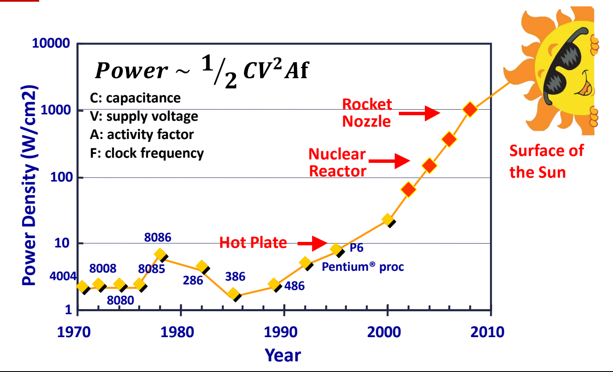

图：功率密度随年份变化（对数纵轴）与公式 $P \approx \frac{1}{2} C V^2 A f$：从 4004 到 P6 逐渐逼近热板，预测将达核反应堆、火箭喷口乃至太阳表面。

图中纵轴是功率密度（$\mathrm{W}/\mathrm{cm}^{2}$，对数坐标 1–10000），横轴是年份 1970–2010。Intel 的 4004、8008、8080、8085、8086、286、386、486、Pentium、P6 依次标在曲线上。曲线在 P6 附近达到**热板**（Hot Plate）的水平，之后按趋势外推，将依次达到**核反应堆**（Nuclear Reactor）、**火箭喷口**（Rocket Nozzle），最终接近**太阳表面**（Surface of the Sun）的功率密度。[^l01-section-5-s1p42] 这条外推是 1990 年前后对 CPU 发热的预测：约 1996 年达到热板水平，2000 年代达到核反应堆水平，再往后是火箭喷口和太阳表面。[^l01-section-5-s2b14]

芯片上的发热也不均匀。1.5 GHz Itanium-2 的热图显示，**执行核**（execution core）是最热的区域，约 120 °C，而缓存（cache）区域温度明显低很多。[^l01-section-5-s1p43] 计算最密集的地方温度最高，这种局部**热点**（hotspot）让芯片在整体功耗还没到极限之前就先撑不住。

实际发展印证了这个预测：Intel 的单纯提频路线基本停在 Pentium/P6 这一阶段，因为当时功耗已经很高，再按原方式提频的设计做不下去了。当时有调侃图说 CPU 热到可以在上面煎鸡蛋。[^l01-section-5-s3b1]

> [!tip] 课堂强调
> 一味靠提高频率来提升性能的时代已经过去了，频率无法再继续往上拉。[^l01-section-5-s3b1]

### 从提频到体系结构方案

提频走不通，并不意味着性能停止增长。结论是：要让性能继续跟上前面的增长趋势，靠提高频率已不可行，需要靠**体系结构方案**（architectural solutions）。[^l01-section-5-s1p44] 具体有两类方向：在相同或相近频率下提升单核效率（执行单元效率、缓存提高执行单元的使用率、指令调度消除气泡），以及使用多核。这些方向及其各自的问题见 [06 多核能效与可靠性挑战](#多核能效与可靠性挑战)。

> [!question]- 自测：某 CPU 功耗 100 W。设计者想把频率从 3 GHz 提到 3.6 GHz，电压随频率同比例升高，$C$、$A$ 不变，新功耗约多少？
> 约 173 W。频率和电压都乘 1.2，$P \propto V^2 f$，所以功耗乘 $1.2^3 = 1.728$。性能约 +20%，功耗约 +73%。

> [!question]- 自测：两种方案。A：电压不变，频率降到 0.5 倍；B：电压和频率都降到 0.5 倍。各自功耗变为原来的多少？为什么 B 省得多？
> A 为 $0.5$ 倍，B 为 $0.5^2 \times 0.5 = 0.125$ 倍。只降频时功耗随 $f$ 线性下降；B 同时降压，电压的平方项又贡献了 $0.25$。这说明电压是功耗中影响最大的因素。

> [!question]- 自测：一张图纵轴刻度为 1、10、100、1000，某指标的散点在图上近似一条直线，每 5 年上升一格。它每年大约增长多少？
> 约 58%。每 5 年乘 10，年增长倍数为 $10^{1/5} \approx 1.585$。对数坐标上的直线表示按固定倍数的指数增长，不是每年增加固定的量。

> [!info]- 来源
> - L01.pdf：PDF p.40–44
> - L01.docx：DOCX body 570–638
> - L02.docx：DOCX body 1–50

[^l01-section-5-s1p40]: L01.pdf-PDF p.40
[^l01-section-5-s2b13]: L01.docx-DOCX body 570-624
[^l01-section-5-s1p41]: L01.pdf-PDF p.41
[^l01-section-5-s2b14]: L01.docx-DOCX body 625-638
[^l01-section-5-s1p42]: L01.pdf-PDF p.42
[^l01-section-5-s3b1]: L02.docx-DOCX body 1-50
[^l01-section-5-s1p43]: L01.pdf-PDF p.43
[^l01-section-5-s1p44]: L01.pdf-PDF p.44

---

## 多核能效与可靠性挑战

> [!abstract] 本节要点
> - 频率无法继续靠"堆"来提升后，体系结构有三条同频提性能的路：更高效的执行单元、用 L1/L2/L3 Cache 让执行单元少等数据、用指令调度消除流水线气泡（bubble）。
> - 多核带来四类新问题：核间互连带宽、共享 Cache 的一致性（由硬件快速维护）、跨核调度与同步、Cache 亲和性；在芯片之外，还要处理共享 DRAM 的大内存占用，并让存储性能跟上核数增长。
> - 2010–2018 年数据中心计算实例增长约 550%，用电量只增长约 6%，说明单位计算的能耗在下降。提升能效的手段包括工艺进步（芯片面积约与制程的平方成正比）、异构计算（xPU）、新型存储、自然冷却和虚拟化。
> - NAND 闪存的单元越小、氧化层越薄、电子越少，噪声越大（电荷陷阱、单元间干扰、随机电报噪声、保持噪声），原始误码率 RBER 越高。
> - RBER $\approx 3\times10^{-3}$ 时，一个 4 KB 页约有 98 个错误位，ECC 必须把 UBER 压到 $10^{-15}$。BCH 解码快但纠错弱，LDPC 解码慢但纠错强，软判决 LDPC 能容忍的 RBER 更高，两者之间的区间叫可靠性裕量。

### 同频下提升性能

动态功耗随频率近似按三次方增长（见 [05 技术趋势与功耗墙](#技术趋势与功耗墙)），所以靠提高主频换性能的路已经走不通了。要在**相同或相近的时钟频率**下继续提升性能，只能从体系结构入手。[^l01-section-6-s1p45]

体系结构给出三条思路：[^l01-section-6-s3b1]

1. **提高执行单元本身的效率**：频率不变，让执行单元（Execution Units）在每个周期内完成更多有用工作。
2. **提高执行单元的利用率**：执行单元经常停下来等数据。用 L1 指令 Cache（L1 I\$）、L1 数据 Cache（L1 D\$）、L2 和 L3 Cache 提高访问速度和带宽，执行单元就不必每次都等内存。内存为什么慢见 [04 系统框图与内存墙](#系统框图与内存墙)。
3. **指令调度（Instruction Scheduling）**：硬件不变，只改变指令的执行顺序，就能填掉流水线里的空泡（bubble），提高吞吐。芯片里与之配套的是指令调度单元和**退休单元**（Retirement）。

现代 CPU 的芯片面积正是按这三类需求划分的：提升数据访问速度的 Cache，提升执行效率的执行单元，以及负责调度的调度与 Retirement 单元。[^l01-section-6-s3b1]

以 Intel Coffee Lake 为例，一颗芯片上集成了：[^l01-section-6-s1p46]

- 多个 **Core**（图中 6 个，上下各 3 个）；
- 位于核心之间的**共享 L3 Cache 与环形互连**（Shared L3 Cache & Ring Interconnect），核心通过环形总线访问共享的 L3，也通过它相互通信；
- **System Agent 与内存控制器**（含 DMI、显示和其他 I/O），以及顶部的 Memory Controller I/O；
- 占据右侧大片面积的**核显**（Processor Graphics）。

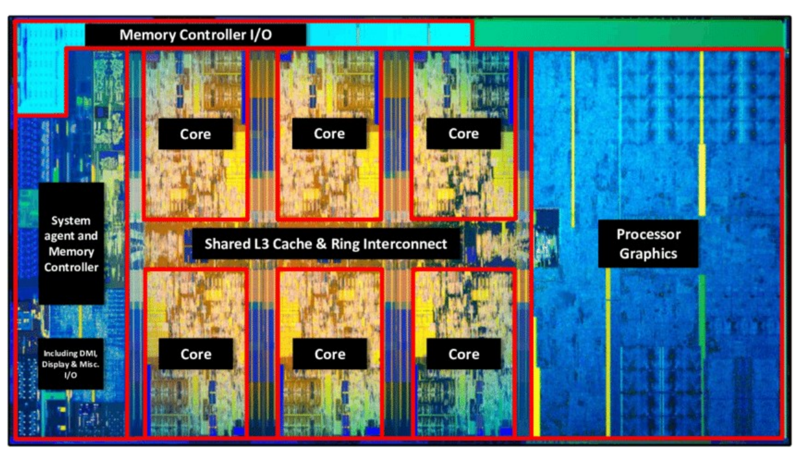

图：Intel Coffee Lake 芯片显微照片：多个核心、共享 L3 Cache 与环形互连、系统代理与内存控制器、核显。

> [!note] 补充解释
> "退休"（retirement，也称 commit）是乱序执行处理器的最后一步：指令可以乱序执行，但必须按程序顺序提交结果，这样异常和中断才是精确的。具体机制在后续讲流水线和乱序执行时展开。

### 多核系统的设计问题

另一条出路是增加核心数：单核性能涨不动，就用更多核心并行。但核心一多，下面这些问题就成了系统设计的核心。[^l01-section-6-s1p47]

#### 芯片内：互连、一致性、调度与亲和性

1. **核间互连**：核心之间怎样相连，带宽多高。对服务器尤其关键，因为服务器程序（比如科学计算）会用满所有核心，核心之间需要频繁通信。
2. **Cache 一致性（Cache Coherence / Consistency）**：为了访问方便，同一份数据会在多个核心的 Cache 中各存一个副本。某个核心修改了自己的副本，其他核心必须知道，否则它们会读到旧值。保证所有副本始终正确，需要核心之间相互通信。[^l01-section-6-s3b1]
3. **跨核调度与同步**：线程如何分配到不同核心，核心之间如何同步和通信。
4. **Cache 亲和性（Cache Affinity）**：数据缓存在 A 核的 Cache 里，B 核却要用它。这时要么把数据搬过去，要么远程访问 A 核的 Cache，两种做法都有额外开销。所以调度线程时，要考虑它的数据在哪个核心上。

> [!tip] 课堂强调
> Cache 一致性通常**由硬件实现**，不靠软件，而且必须在很短时间内完成，要求很高，是 CPU 设计中工程上最复杂的部分之一。后续课程会具体讲。[^l01-section-6-s3b1]

> [!example] 例：为什么服务器偏好"宽互连"
> 两种多核设计思路的对比（核间带宽为早期 AMD 处理器的实测值）：[^l01-section-6-s3b1]
>
> | 方案 | 核心数 | 核间带宽 |
> |---|---|---|
> | 早期 AMD "胶水多核" | 多 | 约 6 GB/s |
> | Intel | 相对少 | 互连做得宽 |
>
> 拿 6 GB/s 和其他部件比：一块 SSD 现在约 7–14 GB/s，一个 DRAM 通道约 50 GB/s（笔记本双通道约 100 GB/s）。可见核心之间通信比读 SSD 还慢。"胶水多核"指把多个核心拼到一颗芯片上，但核心之间只用低带宽互连。桌面负载很少让核心间密集通信，核心多就显得性能强。服务器负载要用满所有核心并频繁交换数据，互连就成了瓶颈，所以服务器端更看重互连带宽。

#### 芯片外：内存与存储

跳出 CPU 芯片看整个系统，内存（DRAM）和外存（SSD，经 PCIe 连接）也被所有核心共享：[^l01-section-6-s1p48]

- DRAM 被所有核心共享后，如何处理**更大的内存占用**（memory footprint）？
- 核心数增加，对 I/O 和数据访问带宽的需求也随之增加。如何让**存储性能跟上核数**，并且能被多个核心共享？

### 数据中心能效

衡量计算机系统不能只看性能，能耗同样重要。数据中心规模扩大后，曾有预测说到 2025 年数据中心会消耗全球电力的 1/5。

实际数据（Masanet 等，Science 2020）：2010–2018 年，全球数据中心**计算实例增长约 550%，用电量只增长约 6%**。[^l01-section-6-s1p49] 实例数大幅增加，总用电量几乎不变，说明**单位计算的能耗在随时间下降**。

散热也是成本。设备一发热就必须降温，所以数据中心常建在寒冷、靠水或山洞里的地点，比如北极圈附近、海底、河边，或苹果建在贵州山洞中的数据中心。实验室里可以没人吹空调，但机器必须有空调，否则容易坏。[^l01-section-6-s3b2]

#### 提升能效的五类手段

能效的提升可以来自器件、计算、存储、散热和软件五个层面。[^l01-section-6-s1p51]

| 手段 | 作用层面 | 原理 |
|---|---|---|
| 晶体管工艺进步 | 器件 | 制程缩小，元器件距离缩短，频率可以更高；导通电压降低，功耗下降 |
| 异构计算（GPU、FPGA、加速器） | 计算 | 为特定任务优化内部计算单元，性能更高、功耗更低 |
| 新型存储器件 | 存储 | 介于 DRAM 与 SSD 之间，弥补两者的缺点 |
| 冷却（Cooling） | 散热 | 用水、低温等自然冷源代替空调，省电 |
| 虚拟化（Virtualization） | 软件 | 把同一硬件分给不同用户分时复用，避免设备空转 |

**工艺**：用 $A_{\mathrm{chip}}$ 表示芯片面积，$\ell$ 表示制程特征尺寸，则 $A_{\mathrm{chip}}\propto\ell^2$，即芯片面积大致与制程的平方成正比。每进一代，制程的平方约减半：$3^2 = 9$，$9/2 \approx 4 \approx 2^2$，所以 3 nm 到 2 nm 正好是一代。[^l01-section-6-s3b2] 制程缩小有两个好处：

1. 元器件靠得更近，可以跑在更高频率上（道理和"DRAM 离 CPU 近频率就能更高"相同）。
2. 开关所需的电压降低，功耗随电压的平方下降。

> [!note] 补充解释
> 原讲解用 $P = V^2/R$ 说明"电压降低，功耗降低"，这是简化说法。CMOS 动态功耗的准确形式是 $\tfrac12 CV^2Af$（见 [05 技术趋势与功耗墙](#技术趋势与功耗墙)），结论相同：功耗与 $V^2$ 成正比，降电压收益最大。

> [!example] 例：工艺差距对性能的影响
> 华为昇腾使用约 12 nm 工艺，英伟达 GPU 使用 3 nm。按 $A_{\mathrm{chip}}\propto\ell^2$ 估算：
>
> $$\frac{12^2}{3^2} = \frac{144}{9} = 16$$
>
> 两者相差约 16 倍（原讲解口述为约 14 倍，是把 $12^2=144$ 近似成 140 后的结果，按算式应为 16 倍）。[^l01-section-6-s3b2] 功耗控制不住，频率也上不去，所以昇腾的性能比英伟达最新 GPU 低约 4–10 倍。

**异构计算**：CPU 适合操作系统和顺序执行的任务，GPU 适合矩阵乘法这类并行计算。此外还有 FPGA、DSP，以及 NPU、DCU 等各种"xPU"。它们都针对特定任务优化了内部计算单元，所以效率更高、功耗更低。[^l01-section-6-s3b2]

**新型存储**：例如 Intel 傲腾（Optane），一种介于 DRAM 和 SSD 之间的介质。它已经停产，但停产是因为公司经营原因，而不是技术不好。数据库领域对它需求很大，国内有公司在接手做类似产品。[^l01-section-6-s3b2]

**虚拟化**：硬件按峰值负载设计，但负载大致符合 80/20 规律：约 20% 的时间很忙，80% 的时间空闲。虚拟化把同一硬件分给使用时间错开的多个用户，提高复用率，减少空转浪费的能耗。[^l01-section-6-s3b2]

### 可靠性与 NAND 闪存噪声

可靠性是性能和功耗之外的另一个系统指标。计算出错也会发生：GPU 长时间运行时，HBM 会发生位翻转（1 变成 0），芯片本身也有难以测出的 bug，出错后往往要整机重启。另一个数据是：昇腾芯片连续运行一年，约有 18% 的概率发生故障。[^l01-section-6-s3b3] 但可靠性最受重视的地方是**存储**：计算出错，重启重跑即可；存储中的数据一旦出错或丢失，往往**无法恢复**，后果是灾难性的。

> [!tip] 课堂强调
> 对存储而言，性能可以不强，但可靠性不能出问题。[^l01-section-6-s3b3]

#### 容量与可靠性的矛盾

NAND 闪存应用越来越广（消费级 → 客户端 → 企业级），制程从约 100 nm（2007 年）缩到约 10 nm（2014 年），价格从约 \$10/GB 降到 \$1/GB，再到 \$0.35/GB。[^l01-section-6-s1p52] SSD 容量也从十几年前的 10–16 GB 增长到单盘最高约 512 TB。代价是**可靠性下降**。[^l01-section-6-s3b3]

闪存单元用**浮栅**（Floating Gate）中存储的电子数表示数据，浮栅与沟道之间由氧化层（Oxide）隔开。**单元越小、氧化层越薄、电子越少，闪存的噪声就越大。**[^l01-section-6-s1p52] 主要噪声源有四种：

1. **电荷陷阱**（Charge Trap）：由反复编程/擦除（P/E cycling）引起的结构老化。比如本应存入 100 个电子，老化后只存进 90 个，读出的值就错了。
2. **单元间干扰**（Cell-to-Cell Interference）：大量单元由字线（WL）和位线（BL）组织成阵列，向一个单元写数据时会干扰相邻的受害单元（victim cell）。
3. **随机电报噪声**（Random Telegraph Noise, RTN）：随机出现的扰动，例如宇宙射线恰好击中存储单元导致出错，这类错误无法恢复。
4. **保持噪声**（Retention Noise）：即使什么都不做，电子也会随时间从浮栅中泄漏，数据逐渐出错。

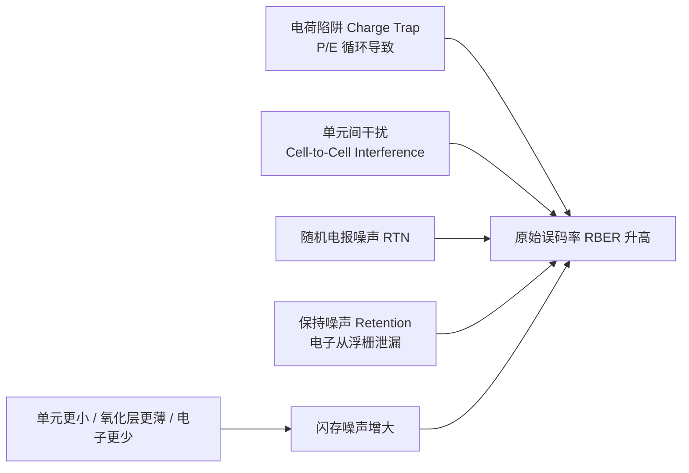

> [!example] 例：断电保存实验
> 一次实测：约 100 块 SSD 写入数据后断电放置 3 个月，重新上电检测，其中 21 块出现了数据错误。[^l01-section-6-s3b3]
>
> 原因：SSD 通电时会在后台自行纠错，断电后保持噪声无人处理，错误不断累积。所以 SSD 即使不用，也最好插在通电的机器上，不要长期断电存放（经验上断电保存一般不宜超过约 3 个月）。

### 纠错码（ECC）

**原始误码率**（Raw Bit Error Rate, RBER）指不经纠错、直接从闪存读出时的出错比例。**不可纠正误码率**（Uncorrectable Bit Error Rate, UBER）指经过 ECC 纠错后仍然错误的比例。**纠错码**（Error Correction Code, ECC）的任务是把前者压到后者的目标值以下。[^l01-section-6-s1p53]

> [!example] 例：一页数据里有多少个错误位
> 已知当前 SSD 的 RBER 约为 $3\times10^{-3}$（每读 1000 位约错 3 位），SSD 按页访问，一页 4 KB（大写 B，即字节）。[^l01-section-6-s3b3]
>
> 1. 一页的位数：$4\,\text{KB} = 4\times1024\times8 = 32\times1024 = 32768$ 位。
> 2. 期望错误位数：$32768 \times 3\times10^{-3} \approx 98$，也就是每读一页约有近 100 个错误位。
> 3. 纠错后的目标 UBER 是 $10^{-15}$，ECC 要把错误率从 $10^{-3}$ 量级降低 12 个数量级。$10^{-15}$ 意味着一台电脑用一辈子，从 SSD 读出的数据可能一位都不会错。

ECC 起作用之前，还可以先**优化读电压**（$V_{\rm READ}$）来降低 RBER 本身。图左：随着 P/E 次数（0k–9k）和保存时间（0–12 周）增加，默认读电压下的最大 RBER 从约 $2\times10^{-4}$ 升到约 $3\times10^{-2}$；采用优化读电压后，最大 RBER 只升到约 $2\times10^{-3}$，大约低一个数量级。[^l01-section-6-s1p53]

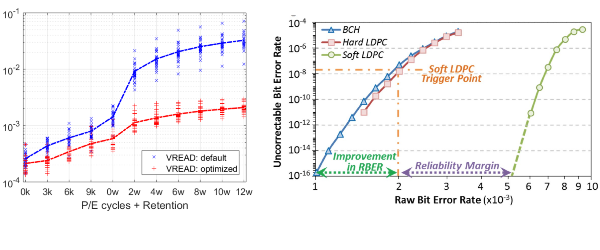

图：左：P/E 次数与保持时间增加时最大 RBER 上升，优化读电压（红）明显低于默认（蓝）；右：BCH、Hard LDPC、Soft LDPC 的纠错后误码率随 RBER 变化，标出改进幅度与可靠性裕量。

#### BCH 与 LDPC

SSD 中常用的两类 ECC 都来自通信领域：[^l01-section-6-s3b4]

| 编码 | 解码速度 | 纠错能力 | 能容忍的 RBER（图右） |
|---|---|---|---|
| BCH | 快 | 较弱 | 最低 |
| Hard LDPC（硬判决） | 较慢 | 强 | 略高于 BCH；到约 $2\times10^{-3}$（触发点）就不够用 |
| Soft LDPC（软判决） | 最慢（额外计算） | 最强 | 约 $5\times10^{-3}$ 以内 UBER 仍低于 $10^{-16}$，约 $7\times10^{-3}$ 时才升到 $10^{-8}$ |

读图右的方法：横轴是 RBER（单位 $10^{-3}$），纵轴是 UBER。曲线越**靠右**，说明在更高的原始误码率下仍能保持低 UBER，纠错能力越强。[^l01-section-6-s1p53]

1. BCH 和 Hard LDPC 的曲线靠左，RBER 一升高，UBER 就迅速变差。
2. 在 RBER 约 $2\times10^{-3}$ 处（**Soft LDPC 触发点**），硬判决已经不够用，改用软判决 LDPC。软判决读取更多信息、做更多计算，纠错能力更强。
3. 软判决 LDPC 的曲线大约到 $5\times10^{-3}$ 才开始抬升。从触发点到这个位置的区间叫**可靠性裕量**（Reliability Margin）。
4. 图中从 $1\times10^{-3}$ 到 $2\times10^{-3}$ 的区间标为 "Improvement in RBER"，表示从 BCH 的可用边界到软判决触发点之间获得的 RBER 容忍度提升。

> [!warning] 易错点
> "纠错能力强"和"速度快"不能兼得。BCH 解码快但纠错弱，LDPC，尤其是软判决 LDPC，纠错强但解码慢。所以通常先用便宜的硬判决解码，RBER 超过触发点后才启用软判决。这再次说明体系结构里只有权衡，没有免费的最优解。

体系结构评价一个系统时要同时考虑性能、功耗、可靠性，以及面积和复杂度等指标。[^l01-section-6-s3b4]

> [!question]- 自测：某 SSD 老化后 RBER 升到 $5\times10^{-3}$，一个 4 KB 页平均有多少错误位？只用 BCH 能否达到 UBER $10^{-15}$？
> 约 $32768\times5\times10^{-3}\approx164$ 个错误位。不能：BCH 曲线在 RBER 超过约 $1\times10^{-3}$ 后，UBER 就高于 $10^{-16}$ 并迅速恶化，到 $5\times10^{-3}$ 时已远超 $10^{-15}$。必须用软判决 LDPC，$5\times10^{-3}$ 大约在它的可靠性裕量边缘，或者先通过优化读电压降低 RBER。

> [!question]- 自测：一个服务器程序在 32 核上做科学计算，核心之间频繁交换中间结果。处理器 A 核多，但核间带宽约 6 GB/s；处理器 B 核少，但互连宽。选哪个？
> 一般选 B。这个负载的瓶颈是核间通信：6 GB/s 比一块 SSD（7–14 GB/s）还慢，比一个 DRAM 通道（约 50 GB/s）低一个数量级，核心越多，等待通信的时间越长。桌面负载核间通信少，A 才显得更强。

> [!question]- 自测：一个线程从核 0 迁移到核 3 后突然变慢，但两个核的频率和负载都相同。可能的原因是什么？
> Cache 亲和性。线程的工作集仍缓存在核 0 的私有 Cache 中，迁移后核 3 要么把数据重新搬过来，要么远程访问核 0 的 Cache，两种做法都有额外开销。如果核 0 上还有数据被修改过，还会引发一致性通信。调度时尽量把线程留在数据所在的核心上。

> [!info]- 来源
> - L01.pdf：PDF p.45–49, 51–53
> - L02.docx：DOCX body 1–160

[^l01-section-6-s1p45]: L01.pdf-PDF p.45
[^l01-section-6-s3b1]: L02.docx-DOCX body 1-50
[^l01-section-6-s1p46]: L01.pdf-PDF p.46
[^l01-section-6-s1p47]: L01.pdf-PDF p.47
[^l01-section-6-s1p48]: L01.pdf-PDF p.48
[^l01-section-6-s1p49]: L01.pdf-PDF p.49
[^l01-section-6-s3b2]: L02.docx-DOCX body 51-90
[^l01-section-6-s1p51]: L01.pdf-PDF p.51
[^l01-section-6-s3b3]: L02.docx-DOCX body 91-123
[^l01-section-6-s1p52]: L01.pdf-PDF p.52
[^l01-section-6-s1p53]: L01.pdf-PDF p.53
[^l01-section-6-s3b4]: L02.docx-DOCX body 124-160

---

## 本讲小结

### 概念主线

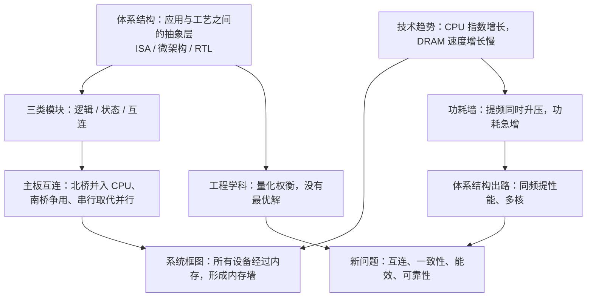

两堵“墙”分别来自状态与逻辑：内存墙是存储跟不上计算，功耗墙是计算本身不能再靠提频加速。两者都把问题推回体系结构，需要用 Cache、调度、多核、异构和 ECC 等手段，在性能、功耗、面积与可靠性之间重新权衡。

### 核心公式

| 公式 | 含义 | 所在章节 |
|---|---|---|
| $P \approx \tfrac12 C V^2 A f$ | 动态功耗；$C$ 电容（F），$V$ 电源电压（V），$A$ 活动因子，$f$ 时钟频率（Hz） | [05 技术趋势与功耗墙](#技术趋势与功耗墙) |
| $P \propto V^2 f \propto f^3$ | 假设 $f \propto V$ 时，功耗约与频率（性能）的三次方成正比 | [05 技术趋势与功耗墙](#技术趋势与功耗墙) |
| $A_{\mathrm{chip}}\propto\ell^2$ | $A_{\mathrm{chip}}$ 为芯片面积，$\ell$ 为制程特征尺寸；工艺每进一代面积约减半；$12^2/3^2 = 16$ | [06 多核能效与可靠性挑战](#多核能效与可靠性挑战) |
| 页错误位数 $= 32768 \times \mathrm{RBER}$ | 4 KB 页，RBER $3\times10^{-3}$ 时约 98 位；ECC 目标 UBER $10^{-15}$ | [06 多核能效与可靠性挑战](#多核能效与可靠性挑战) |

## 不确定事项

- 内存墙的第二层含义（容量）来自识别不清的转写“它的容量没有问题”，按“两层含义”推断为容量也不足
- s1p28 晶体管电路的正确答案在转写中不清晰，笔记只断言 AI 的“锁存器”答案错误、电路由不完整的与非门组成
- 昇腾“每年 18% 故障率”与“性能差 4–10 倍”均为讲解中的口述数据，无公开来源核实
- s1p43 Itanium-2 热图与 s1p44–s1p53 无第一讲录音，仅依据幻灯片和第二讲开头的补讲

> [!info]- 来源
> - L01.pdf：PDF p.23–31, 33–49, 51–53
> - L01.docx：DOCX body 1–85, 298–638
> - L02.docx：DOCX body 1–160
