本讲回答两个问题：怎样定量地说清一台计算机“有多快”，以及软件与硬件之间靠什么“语言”对话。前三章从响应时间、吞吐量和时钟出发，推导性能铁律 $T_{\mathrm{CPU}}=\mathrm{IC}\times\mathrm{CPI}\times\mathrm{CC}$，再讨论跨程序汇总性能的正确平均方法和 Amdahl 定律；后五章从 ISA 作为软硬件契约与 CISC/RISC 之争出发，系统介绍 RISC-V 的指令格式、算术与访存、分支与过程调用、原子同步和寻址方式。阅读前需要熟悉二进制/十六进制、补码与符号扩展，最好在 ICS 中接触过一种汇编语言（如 Y86/x86）和函数调用栈。

---

## 性能指标与时钟

> [!abstract] 本节要点
> - 无论是买机器（购买视角）还是做设计取舍（设计视角），都要先有比较基准和度量指标，才能判断谁性能最好、成本最低、性价比最高。
> - 响应时间（执行时间、延迟）是一个任务从开始到完成的时间；性能定义为其倒数：$\Pi_X = 1/T_X$。
> - “X 比 Y 快 $n$ 倍”指 $T_Y/T_X = n$，不是 $n+1$；“X 的吞吐量是 Y 的 $n$ 倍”同样直接取比值 $n$。
> - 缩短响应时间几乎总能提高吞吐量，反之不成立；流水线等重叠执行使吞吐量 $> 1/L$（汽车装配线：延迟 6 小时，吞吐量 12 辆/小时）。
> - 体系结构以时钟周期而非秒来计时：$\mathrm{CC}=1/\mathrm{CR}$，例如 1 ns ↔ 1 GHz、250 ps ↔ 4 GHz。

### 为什么需要性能指标

评价计算机系统要同时看性能、功耗、可靠性，以及面积、复杂度等多个维度；本节先解决其中最基本的一个问题：怎样用数字说清“哪台机器更快”。没有统一的度量，“这台更好”“这个设计更优”都无从比较。

性能比较出现在两种场景中：[^l02-section-1-s1p3]

1. **购买视角**（purchasing perspective）：面对一组现成机器，要选出
   - 性能最好的；
   - 成本最低的；
   - 性价比（cost/performance）最好的。
2. **设计视角**（design perspective）：面对若干设计选项（例如加入一项新设计），要判断哪一项
   - 带来的性能提升最大；
   - 成本（复杂度、开销）最低；
   - 使整个系统性价比最高。

两种视角都需要两样东西：**比较基准**（basis for comparison）和**评价指标**（metric for evaluation）。学习本课程的目标，是理解体系结构中有哪些因素决定系统整体性能，以及这些因素各自的相对重要性和代价。[^l02-section-1-s1p3] 这些因素如何定量地组合成执行时间，见 [02 CPI与性能铁律](#cpi与性能铁律)；性价比与跨程序的汇总方法见 [03 性能汇总与Amdahl定律](#性能汇总与amdahl定律)。

### 响应时间与性能（Response Time）

单个用户最关心的是“我的这个任务要等多久”，因此第一个指标直接度量单个任务所花的时间。

**响应时间**（response time），也叫**执行时间**（execution time）或**延迟**（latency），是一个任务从开始到完成之间经过的时间，回答“做一次 X 要多长时间”。[^l02-section-1-s1p4] 它对单个用户最重要。

时间越短越好，而“性能”习惯上越大越好，所以把性能定义为执行时间的倒数：[^l02-section-1-s1p4]

$$
\Pi_X = \frac{1}{T_X}
$$

这里 $T_X$ 是机器 X 执行该任务的时间，$\Pi_X$ 是按响应时间定义的性能。于是“最大化性能”与“最小化执行时间”是同一件事。

### 吞吐量（Throughput）

数据中心有大量服务器同时处理大量任务，管理者关心的不是某一个任务多快完成，而是单位时间内总共完成多少工作。

**吞吐量**（throughput）是给定时间内完成的工作总量（例如每小时完成的任务数），回答“多久能做一次 X / 多频繁地做 X”。[^l02-section-1-s1p4] 以下用 $Q$ 表示吞吐量，用 $L$ 表示单个任务的延迟。它关注多个任务的整体产出，对数据中心管理者最重要。

#### 响应时间与吞吐量的关系

两者的关系是单向的：[^l02-section-1-s1p4]

- **缩短响应时间 ⇒ 几乎总能提高吞吐量**：每个任务完成得更快，单位时间内自然能完成更多任务。
- **提高吞吐量 ⇏ 缩短响应时间**：提高吞吐量的方法不止一种。例如改用性能较弱的服务器但多部署几台，总吞吐量上升，而每台服务器完成单个任务的时间反而变长了。[^l02-section-1-s2b4]

> [!example] 例：汽车装配线
> 一条汽车装配线上，造一辆车需要 6 小时，但每 5 分钟就有一辆车下线。[^l02-section-1-s1p6]
>
> 1. 延迟：每辆车从开工到完工 6 小时，即 $L=6$ 小时。
> 2. 吞吐量：每 5 分钟下线一辆，$60/5 = 12$，即 $Q=12$ 辆/小时。
> 3. 若没有重叠、一辆造完再造下一辆，吞吐量只有 $1/L = 1/6$ 辆/小时。
> 4. 装配线让多辆车同时处在不同工序上（重叠执行），因此 $Q > 1/L$：$12 \gg 1/6$。

这个例子说明吞吐量和延迟是两个独立的指标，不能互相推出。流水线 CPU 正是同一个道理：一条指令的延迟不变，但多条指令重叠执行，提高了单位时间完成的指令数。

> [!warning] 易错点
> 不能用 $1/L$ 去算吞吐量，也不能由“吞吐量提高了”推出“单个任务变快了”。只有在任务严格串行、没有任何重叠或并行时，才有 $Q = 1/L$。

### “快 n 倍”的定义（Comparing Performance）

有了性能的定义，就可以给“X 比 Y 快多少”一个精确含义，避免日常说法带来的歧义。

**“X 比 Y 快 $n$ 倍”**（X is $n$ times faster than Y）的定义是：[^l02-section-1-s1p4][^l02-section-1-s1p13]

$$
\frac{\Pi_X}{\Pi_Y} = \frac{T_Y}{T_X} = n
$$

即 Y 的执行时间除以 X 的执行时间等于 $n$。由于性能是时间的倒数，性能之比恰好等于时间的反比。

同理，**“X 的吞吐量是 Y 的 $n$ 倍”**（throughput of X is $n$ times that of Y）定义为：[^l02-section-1-s1p13]

$$
\frac{Q_X}{Q_Y} = n
$$

即 X 单位时间完成的任务数除以 Y 单位时间完成的任务数，同样直接等于 $n$。

> [!tip] 课堂强调
> 英文 “X is $n$ times faster than Y” 中，时间之比就是 $n$，**不是 $n+1$**。中文习惯里“A 比 B 快一倍”常指时间比为 2，与英文定义不同。考试中按英文定义，直接取 $T_Y/T_X = n$，不要写成 $n+1$；吞吐量的“$n$ 倍”也不要写成 $n-1$ 或 $n+1$。[^l02-section-1-s2b6]

> [!example] 例：判断快多少倍
> 程序在 Y 上运行 15 s，在 X 上运行 10 s。
>
> 1. $T_Y/T_X = 15/10 = 1.5$。
> 2. 按定义，X 比 Y 快 1.5 倍（性能是 Y 的 1.5 倍），而不是“快 0.5 倍”或“快 2.5 倍”。

### 时钟周期与时钟频率（Clock Cycle and Clock Rate）

硬件靠注入的时钟驱动，每个时钟周期执行一步动作，所以在体系结构里通常不用秒、小时等绝对时间来度量任务，而是数它用了多少个时钟周期。时钟周期因此是体系结构中最基本的时间单位。[^l02-section-1-s2b4]

**时钟频率**（clock rate，CR，单位 MHz、GHz）是每秒的时钟周期数；**时钟周期**（clock cycle time / clock period，CC）是一个周期的时长。二者互为倒数：[^l02-section-1-s1p5]

$$
\mathrm{CC} = \frac{1}{\mathrm{CR}}
$$

下图中一个时钟周期是时钟波形相邻两个同向边沿之间的时间。

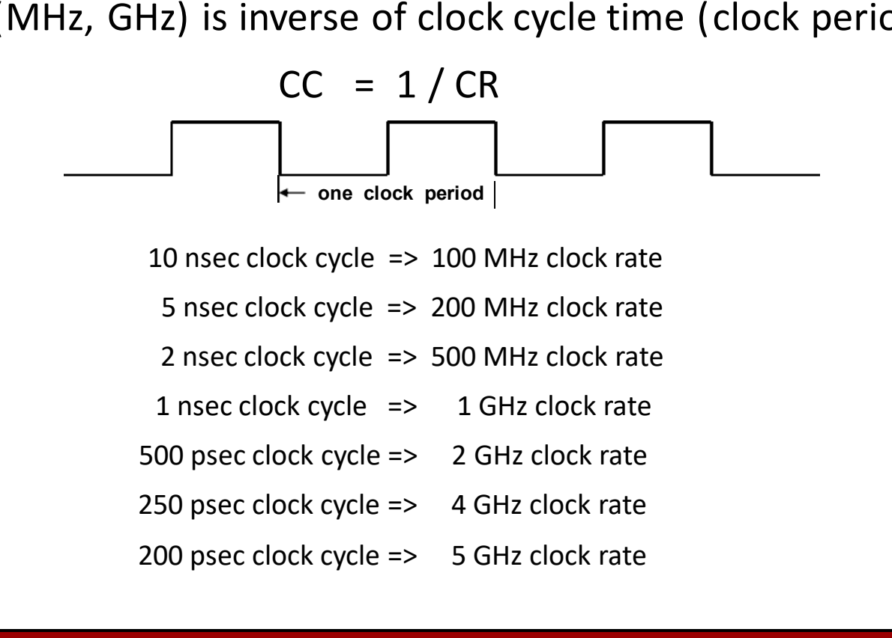

图：时钟波形中一个时钟周期 $\mathrm{CC}$ 与频率 $\mathrm{CR}$ 互为倒数，下方列出 10 ns↔100 MHz 到 200 ps↔5 GHz 的换算。

常用换算（$1\,\text{ns} = 10^{-9}\,\text{s}$，$1\,\text{ps} = 10^{-12}\,\text{s}$）：[^l02-section-1-s1p5]

| 时钟周期 $\mathrm{CC}$ | 时钟频率 $\mathrm{CR}$ |
| --- | --- |
| 10 ns | 100 MHz |
| 5 ns | 200 MHz |
| 2 ns | 500 MHz |
| 1 ns | 1 GHz |
| 500 ps | 2 GHz |
| 250 ps | 4 GHz |
| 200 ps | 5 GHz |

换算方法：周期以 ns 为单位时，$\mathrm{CR}(\mathrm{GHz})=1/\mathrm{CC}(\mathrm{ns})$。例如 $\mathrm{CC} = 250\,\text{ps} = 0.25\,\text{ns}$，$\mathrm{CR} = 1/0.25 = 4\,\text{GHz}$。

以周期计时后，程序的执行时间就可以写成“周期数 × 周期时长”。周期数又取决于指令数和每条指令平均所需周期数（不同指令耗时不同），这一完整关系即性能铁律，见 [02 CPI与性能铁律](#cpi与性能铁律)。

> [!warning] 易错点
> 时钟频率高不等于程序一定跑得更快：执行时间还取决于程序需要多少个周期。只比较 GHz 数，相当于只看了公式中的一个因子。

> [!question]- 自测：机器 X 运行某程序用时 4 s，机器 Y 用时 12 s。按课程定义，X 比 Y 快几倍？若有人答“快 2 倍”，错在哪里？
> X 比 Y 快 3 倍，因为 $T_Y/T_X = 12/4 = 3$。“快 2 倍”是把中文“多出几倍”的习惯套了进来，即用了 $n+1=3$ 反推 $n=2$；英文定义下比值本身就是 $n$。

> [!question]- 自测：某网站把一台服务器换成 4 台更慢的服务器，每个请求的处理时间从 50 ms 变为 80 ms，但每秒处理的请求数增至原来的 2.5 倍。这次改动提高了哪个指标、降低了哪个指标？
> 吞吐量提高到原来的 2.5 倍，响应时间（延迟）变差（50 ms → 80 ms）。这说明提高吞吐量不一定缩短响应时间；反过来，缩短响应时间才几乎总能提高吞吐量。

> [!question]- 自测：一颗处理器的时钟周期为 0.5 ns，另一颗为 200 ps，它们的时钟频率各是多少？
> $1/0.5\,\text{ns} = 2\,\text{GHz}$；$200\,\text{ps} = 0.2\,\text{ns}$，$1/0.2\,\text{ns} = 5\,\text{GHz}$。

> [!info]- 来源
> - L02.pdf：PDF p.3–6, 13
> - L02.docx：DOCX body 124–160, 197–243

[^l02-section-1-s1p3]: L02.pdf-PDF p.3
[^l02-section-1-s1p4]: L02.pdf-PDF p.4
[^l02-section-1-s2b4]: L02.docx-DOCX body 124-160
[^l02-section-1-s1p6]: L02.pdf-PDF p.6
[^l02-section-1-s1p13]: L02.pdf-PDF p.13
[^l02-section-1-s2b6]: L02.docx-DOCX body 197-243
[^l02-section-1-s1p5]: L02.pdf-PDF p.5

---

## CPI与性能铁律

> [!abstract] 本节要点
> - 程序的 CPU 时钟周期数 $C_{\mathrm{tot}}=\mathrm{IC}\times\mathrm{CPI}$；CPI 是每条指令平均消耗的时钟周期数，用来比较**同一 ISA** 的不同实现。
> - 指令分类别时，有效 CPI $\mathrm{CPI}_{\mathrm{eff}}=\sum_i w_i\mathrm{CPI}_i$（$w_i$ 为第 $i$ 类指令的执行占比），它随指令组合（instruction mix）变化。
> - $\mathrm{IPC}=1/\mathrm{CPI}$，表示每周期执行的指令数；IPC 越大越好、CPI 越大越差，厂商发布会常用 IPC 衡量微架构本身的提升。
> - 性能铁律：$T_{\mathrm{CPU}}=\mathrm{IC}\times\mathrm{CPI}\times\mathrm{CC}$；IC 受 ISA 与编译器影响，CPI 受 ISA 与组织影响，时钟周期受组织与工艺影响，架构师的工作是在三者之间权衡。
> - 例题：基准 CPI 2.2；数据 Cache 把 load 降到 2 周期 → CPI 1.6，快 37.5%；分支少 1 周期 → 2.0，快 10%；两条 ALU 指令同时执行 → 1.95，快 12.8%。

### 每条指令的时钟周期数（CPI）

只知道时钟频率还算不出程序运行多久，因为不同指令执行所需的时间并不相同：有的指令一个周期就完成，有的（如乘法、访存）要多个周期。于是需要一个量把"程序有多少条指令"和"程序花多少个周期"联系起来。

一种看待执行时间的方式是：将执行的指令条数乘以每条指令的平均时间，得到总执行时间。换成周期来表述：

$$
C_{\mathrm{tot}}=\mathrm{IC}\times\mathrm{CPI}
$$

其中 $C_{\mathrm{tot}}$ 是总时钟周期数，$\mathrm{IC}$ 是动态执行的指令条数。**每条指令的时钟周期数**（Clock cycles Per Instruction, CPI）是每条指令执行平均所需的时钟周期数。[^l02-section-2-s1p7]

CPI 的主要用途是**比较同一 ISA 的两种不同实现**：同一 ISA、同一程序编译出的指令数相同，此时不必比较整个程序花了多少周期，只看平均 CPI 就能比较两颗 CPU 的微架构好坏。若 ISA 不同，指令数本身就不同，单看 CPI 会产生误导。

CPI 是按指令类别给出的。例如某实现中三类指令的 CPI 为：[^l02-section-2-s1p7]

| 指令类别 | A | B | C |
|---|---|---|---|
| CPI | 1 | 2 | 3 |

不同类别 CPI 不同，是因为各类指令走的硬件不同：乘法单元完成一次运算比加法单元耗时更长，分支则由单独的单元处理。[^l02-section-2-s2b6] 所以"平均 CPI"必须考虑各类指令各占多少。

#### 有效 CPI 与指令组合（Effective CPI, Instruction Mix）

既然每类指令 CPI 不同，整个程序的平均 CPI 就取决于各类指令出现得多频繁。

**有效 CPI**（overall effective CPI）是按各类指令的执行占比对其 CPI 加权平均的结果：[^l02-section-2-s1p8]

$$
\mathrm{CPI}_{\mathrm{eff}}=\sum_{i=1}^{n} w_i\mathrm{CPI}_i
$$

其中：

- $w_i=\mathrm{IC}_i/\mathrm{IC}$：第 $i$ 类指令的动态执行占比，$\sum_i w_i=1$；其中 $\mathrm{IC}_i$ 始终表示该类指令的条数；
- $\mathrm{CPI}_i$：第 $i$ 类指令平均每条所需的时钟周期数；
- $n$：指令类别数。

**指令组合**（instruction mix）是指令在一个或多个程序中的**动态出现频率**的度量。有效 CPI 随指令组合而变：同一颗 CPU 跑访存密集的程序和跑计算密集的程序，有效 CPI 可能差很多。[^l02-section-2-s1p8]

改用第 $i$ 类指令的**条数** $\mathrm{IC}_i$ 加权时，求和得到的就是程序的总周期数，于是可直接写出按类别展开的 CPU 时间公式：[^l02-section-2-s1p12]

$$
T_{\mathrm{CPU}} = \left(\sum_{i=1}^{n} \mathrm{IC}_i \times \mathrm{CPI}_i\right) \times \mathrm{CC}
$$

求和对每一类指令进行：$\mathrm{IC}_i$ 是程序中这类指令有多少条，$\mathrm{CPI}_i$ 是执行一条这类指令要多少周期。

> [!example] 例：用占比算有效 CPI
> 设 A、B、C 三类指令 CPI 分别为 1、2、3，执行占比为 50%、30%、20%。
>
> 1. 有效 CPI $= 1\times0.5 + 2\times0.3 + 3\times0.2 = 0.5+0.6+0.6 = 1.7$
> 2. 若程序共执行 $10^9$ 条指令，总周期数 $=10^9\times1.7=1.7\times10^9$。

> [!warning] 易错点
> 有效 CPI 不是各类 CPI 的简单算术平均（上例中 $(1+2+3)/3=2$ 是错的），必须用**动态执行**占比加权；静态代码里某类指令写了多少行不算数，执行了多少次才算。

### 每周期指令数（IPC）

CPI 越大性能越差，这个方向不够直观；工业界更常用它的倒数。

**每周期指令数**（Instructions Per Cycle, IPC）是每个时钟周期平均执行的指令条数：

$$
\mathrm{IPC} = \frac{1}{\mathrm{CPI}}
$$

IPC 越大性能越好。[^l02-section-2-s1p11]

> [!tip] 课堂强调
> IPC 比 CPI 更直观，也更常见。Intel、AMD 的发布会常同时报两个数字，例如"IPC 提升 10%，整体性能提升 30%"。两者不同，是因为新旧 CPU 的频率可能不同、每颗 CPU 的核心数也可能不同；要衡量**架构本身**带来的提升，看 IPC。[^l02-section-2-s2b6]

两个 IPC 怎样跨程序求平均（不能直接算术平均）属于性能汇总问题，见 [03 性能汇总与Amdahl定律](#性能汇总与amdahl定律)。

### 性能铁律（Iron Law of Performance）

响应时间是最可靠的性能度量（定义见 [01 性能指标与时钟](#性能指标与时钟)），但要改进它，需要把它拆成可以分别优化的因子。

记 $T_{\mathrm{CPU}}$ 为 CPU 执行时间，$\mathrm{CC}$ 为时钟周期。CPU 时间首先等于周期数乘以周期长度，再把周期数拆成指令数 × CPI：[^l02-section-2-s1p9]

$$
T_{\mathrm{CPU}} = C_{\mathrm{tot}} \times \mathrm{CC}
= \mathrm{IC} \times \mathrm{CPI} \times \mathrm{CC}
$$

写成量纲形式，三个因子的单位约掉后正好是"秒/程序"：

$$
\frac{\mathrm{s}}{\text{程序}}
= \frac{\text{指令}}{\text{程序}}\times\frac{\text{周期}}{\text{指令}}\times\frac{\mathrm{s}}{\text{周期}}
$$

这个式子称为**性能铁律**（"iron law" of performance）。[^l02-section-2-s1p9] 若题目给的是频率而非周期，用 $\mathrm{CC}=1/\mathrm{CR}$（$\mathrm{CR}$ 为时钟频率）代入，即 $T_{\mathrm{CPU}}=\mathrm{IC}\times\mathrm{CPI}/\mathrm{CR}$。

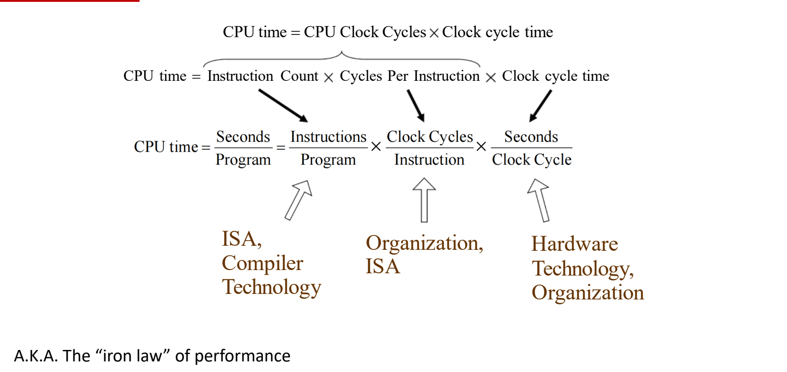

图：性能铁律 $T_{\mathrm{CPU}}=\mathrm{IC}\times\mathrm{CPI}\times\mathrm{CC}$，箭头标出各因子分别受 ISA/编译器、组织/ISA、硬件工艺/组织影响。

#### 各因子受什么影响

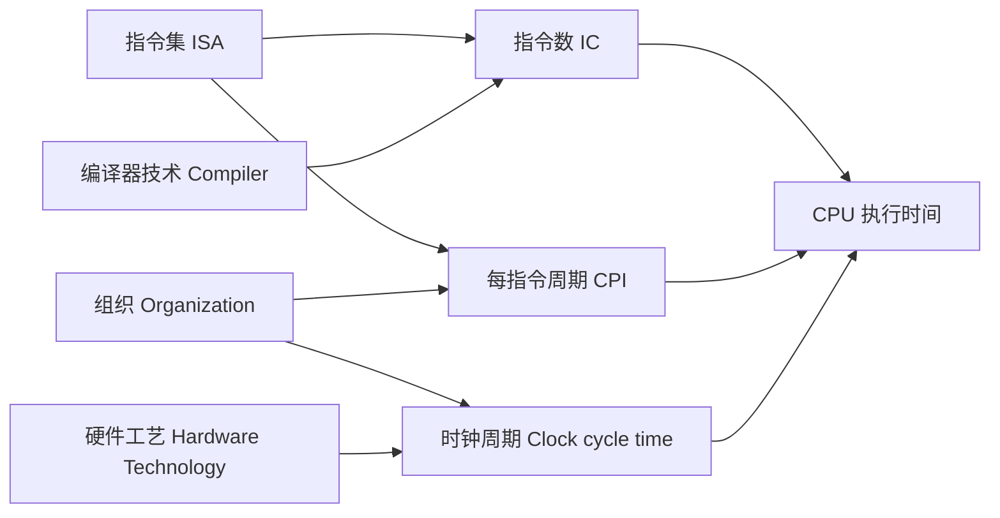

1. **指令数 IC ← ISA、编译器**：同一段逻辑在不同 ISA 上翻译出的指令条数不同；编译器优化方向不同，生成的指令数也不同。例如循环展开（loop unrolling）把循环体复制多份，改变了程序的指令数。[^l02-section-2-s2b5]
2. **CPI ← ISA、组织**：指令集越复杂，单条指令可能需要越多周期；同样的任务，内部组织（微架构）若把它拆成更少的步骤，CPI 就小，拆成更多步骤，CPI 就大。[^l02-section-2-s2b5]
3. **时钟周期 ← 组织、工艺**：时钟周期必须长到足以让一个周期内的全部工作完成，否则这个周期不能用。内部组织越复杂，单周期要做的事越多，周期越长；工艺制程越先进，电路越快，周期可缩短。[^l02-section-2-s2b5]

#### 为什么说架构师在做权衡

ISA 和组织都同时作用于两个因子，而且方向可能相反：[^l02-section-2-s2b5]

- 一套更复杂的 ISA 可能**减少指令数**，却让每条指令**CPI 增大**，乘起来未必有收益；
- 组织上的改动可能**提高时钟频率**，但为此要求每个周期内做的事更少，导致 **CPI 上升**，一项提升、另一项下降。

因此单独优化某一个因子往往没用，因为它会牵连另一个因子。计算机架构师真正做的事，是在 IC、CPI、时钟周期三者之间不断权衡（trade-off），寻找总乘积最小的最佳点。

> [!warning] 易错点
> 铁律中的指令数是**动态执行**的指令条数，不是源代码或二进制里的静态指令数。课堂口述称循环展开会“增加指令数”，这只对静态代码体积成立：展开让静态代码变长，但减少了循环计数与分支指令的执行次数，动态指令数通常**下降**。[^l02-section-2-s2b5] 判断某个优化的效果时，要把它对 IC、CPI、时钟周期的影响都写出来再相乘。

> [!note] 补充解释
> 上面的 $T_{\mathrm{CPU}}$ 只计 CPU 执行该程序本身的时间，不包括等待 I/O 或运行其他程序的时间；铁律分解的是这一部分。

### 用铁律计算（Worked Examples）

#### 开车类比

从 SIT 开车到 Sinchon（韩国仁川到首尔），把铁律的三项对应到开车上：[^l02-section-2-s1p10]

| 铁律因子 | 开车中的对应量 | 数值 |
|---|---|---|
| 指令数 Insts | 路程 | 60 km |
| CPI | 每公里发动机转数 | 5250 转/km（即每转约 0.19 m） |
| 时钟速度 Clock speed | 发动机转速 | 3500 RPM（转/分钟） |

$$
\text{时间} = 60\ \text{km} \times 5250\ \frac{\text{转}}{\text{km}} \div 3500\ \frac{\text{转}}{\text{分钟}} = \frac{315000\ \text{转}}{3500\ \text{转/分钟}} = 90\ \text{分钟}
$$

每转前进距离 $=1000\ \text{m}/5250\approx0.19\ \text{m}$。单位逐项约掉，最后剩下"分钟"，与 $T_{\mathrm{CPU}}$ 公式约掉剩"秒/程序"同理。[^l02-section-2-s1p10]

#### CPU 实例

> [!example] 例：33 billion 条指令要跑多久
> 某程序执行 $33\times10^9$ 条指令，CPU 每条指令平均 2 个周期，时钟频率 3 GHz。
>
> 1. 周期数 $= 33\times10^9 \times 2 = 66\times10^9$
> 2. $T_{\mathrm{CPU}}= \dfrac{66\times10^9\ \text{周期}}{3\times10^9\ \text{周期/秒}} = 22\ \text{s}$
>
> 题目有时直接给时钟周期而非频率，例如周期 $=333\ \text{ps}$（$\approx 1/3\ \text{GHz}$），则 $T_{\mathrm{CPU}}=66\times10^9\times333\times10^{-12}\ \text{s}\approx22\ \text{s}$。题目也可能用 IPC 代替 CPI，此时 IPC $=0.5$，先取倒数再代入。[^l02-section-2-s1p11]

#### 指令组合改进例题

铁律的价值在于：当 IC 和时钟周期不变时，只需比较有效 CPI，就能评估各种微架构改进谁更划算。

某机器的指令组合如下，$T_{\mathrm{CPU}}=\left(\sum \mathrm{IC}_i\times\mathrm{CPI}_i\right)\times\mathrm{CC}$：[^l02-section-2-s1p14]

| 指令类别 | 执行占比 $w_i$ | $\mathrm{CPI}_i$ | $w_i\mathrm{CPI}_i$ |
|---|---|---|---|
| ALU | 50% | 1 | 0.5 |
| Load | 20% | 5 | 1.0 |
| Store | 10% | 3 | 0.3 |
| Branch | 20% | 2 | 0.4 |
| 合计 | | | **2.2** |

基准：$T_{\mathrm{CPU}}=2.2\times\mathrm{IC}\times\mathrm{CC}$（CC 为时钟周期）。用 $T_{\mathrm{CPU}}^{\prime}$ 表示改进后的时间。下面三个改进都不改变 IC 和 CC，所以加速比就是新旧 CPI 之比。

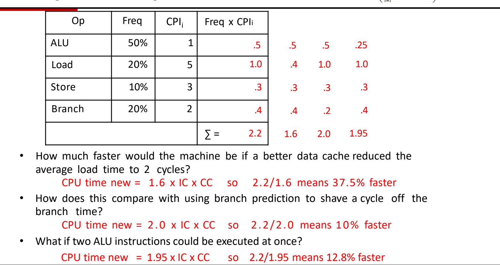

图：指令组合例题：基准 $\sum_i w_i\mathrm{CPI}_i=2.2$（$w_i$ 为执行占比），三种改进分别得 1.6、2.0、1.95，对应快 37.5%、10%、12.8%。

> [!example] 改进一：更好的数据 Cache 把平均 load 时间降到 2 个周期
> 1. Load 一项变为 $0.2\times2=0.4$，其余不变。
> 2. 新 CPI $=0.5+0.4+0.3+0.4=1.6$，$T_{\mathrm{CPU}}^{\prime}=1.6\times\mathrm{IC}\times\mathrm{CC}$。
> 3. $2.2/1.6=1.375$，即快 **37.5%**。[^l02-section-2-s1p14]

> [!example] 改进二：分支预测让分支时间少 1 个周期
> 1. Branch 的 CPI 从 2 降为 1，该项变为 $0.2\times1=0.2$。
> 2. 新 CPI $=0.5+1.0+0.3+0.2=2.0$，$T_{\mathrm{CPU}}^{\prime}=2.0\times\mathrm{IC}\times\mathrm{CC}$。
> 3. $2.2/2.0=1.1$，即快 **10%**。[^l02-section-2-s1p14]

> [!example] 改进三：两条 ALU 指令可同时执行
> 1. 两条 ALU 指令同时执行，相当于 ALU 的等效 CPI 变为 0.5，该项变为 $0.5\times0.5=0.25$。
> 2. 新 CPI $=0.25+1.0+0.3+0.4=1.95$，$T_{\mathrm{CPU}}^{\prime}=1.95\times\mathrm{IC}\times\mathrm{CC}$。
> 3. $2.2/1.95\approx1.128$，即快 **12.8%**。[^l02-section-2-s1p14]

三者对比：改进 Load 收益最大，因为 Load 的 $w_i\mathrm{CPI}_i$ 贡献（1.0）在总 CPI 中占比最高；ALU 虽然占比 50%，但 CPI 本来就只有 1，砍半也只省 0.25。改进应优先瞄准**乘积贡献最大**的那一类，而不是出现最频繁的那一类。"快 n 倍"的严格定义见 [01 性能指标与时钟](#性能指标与时钟)；这里的"快 x%"指时间比减 1。

> [!warning] 易错点
> 例题能直接用 CPI 比值算加速比，前提是 IC 和时钟周期都没变。若某项改进（例如为了双发射 ALU 而延长时钟周期）改变了 CC，必须用完整的 $\mathrm{IC}\times\mathrm{CPI}\times\mathrm{CC}$ 比较。

> [!question]- 自测：同一程序在 ISA 相同的两台机器上运行：M1 为 2 GHz、CPI 1.5；M2 为 2.5 GHz、CPI 2.0。哪台更快？快多少？
> M1 更快，约快 6.7%。IC 相同，比较 CPI/频率：M1 每条指令 $1.5/2=0.75$ ns，M2 每条 $2.0/2.5=0.8$ ns；$0.8/0.75\approx1.067$。频率高的 M2 被更大的 CPI 抵消了，这正是铁律中的权衡。

> [!question]- 自测：在上面的例题机器上，若 Store 的 CPI 从 3 降为 1，新 CPI 和加速比是多少？与改进二相比如何？
> Store 一项从 0.3 变为 0.1，新 CPI $=0.5+1.0+0.1+0.4=2.0$，加速比 $2.2/2.0=1.1$，快 10%。与分支预测的收益相同：两者都让总 CPI 减少 0.2（Store 占 10% × 省 2 周期 = Branch 占 20% × 省 1 周期）。

> [!question]- 自测：编译器新优化让动态指令数减少 20%，但新指令序列的 CPI 从 1.25 升到 1.5，时钟不变。程序变快还是变慢？
> 变快约 4.2%。新旧时间比 $=(0.8\times1.5)/(1\times1.25)=1.2/1.25=0.96$，所以新程序时间为原来的 96%，加速比 $1/0.96\approx1.042$。IC 的收益大部分被 CPI 的上升吃掉了。

> [!info]- 来源
> - L02.pdf：PDF p.7–12, 14
> - L02.docx：DOCX body 161–243

[^l02-section-2-s1p7]: L02.pdf-PDF p.7
[^l02-section-2-s2b6]: L02.docx-DOCX body 197-243
[^l02-section-2-s1p8]: L02.pdf-PDF p.8
[^l02-section-2-s1p12]: L02.pdf-PDF p.12
[^l02-section-2-s1p11]: L02.pdf-PDF p.11
[^l02-section-2-s1p9]: L02.pdf-PDF p.9
[^l02-section-2-s2b5]: L02.docx-DOCX body 161-196
[^l02-section-2-s1p10]: L02.pdf-PDF p.10
[^l02-section-2-s1p14]: L02.pdf-PDF p.14

---

## 性能汇总与Amdahl定律

> [!abstract] 本节要点
> - 跨多个程序汇总性能时：算术平均执行时间偏向长程序；加权算术平均的权重没有客观标准，换权重就能换"赢家"。
> - 归一化执行时间（相对参考机的比值）必须用几何平均 $\sqrt[n]{\prod_{i=1}^{n} r_i}$（$r_i$ 为归一化时间），它的结论与选哪台参考机无关；对归一化时间不能用算术平均。
> - 平均 CPI 用算术平均；平均 IPC 不能直接算术平均，必须用调和平均：$\overline{\mathrm{IPC}}=\dfrac{1}{\overline{\mathrm{CPI}}}=\operatorname{H}(\mathrm{IPC}_1,\dots,\mathrm{IPC}_N)$。
> - Amdahl 定律：$S_{\mathrm{tot}}=\dfrac{1}{(1-F)+F/S}$，$F$ 是**原执行时间**中可被加速部分的比例，$S$ 是该部分的加速比；所以要加速常见情况（约 90% 时间花在 10% 代码上）。
> - 反复加速同一部分收益递减（1.33 → 1.2）；性能提升还要与成本、售价和销量权衡；评估 ISA 有设计期、静态、动态三类指标，最好的指标是程序的执行时间。

### 跨程序汇总性能（Summarizing Performance）

"X 比 Y 快 $n$ 倍"只对**一个**程序有明确含义（定义见 [01 性能指标与时钟](#性能指标与时钟)）。一旦涉及多个程序，就会出现这样的情况：X 在程序 A 上比 Y 快 10 倍、在 B 上快 1.5 倍，而 Y 在 C 上比 X 快 2 倍、在 D 上快 3 倍。[^l02-section-3-s1p15] 那么 X 和 Y 谁的性能更好、该买哪台？这需要一种把多个程序的结果**汇总**成一个数的方法，而不同的汇总方法会给出不同的答案。

#### 算术平均（Arithmetic Mean）

**算术平均**执行时间就是把各程序的执行时间相加再除以程序个数；记第 $i$ 个程序的执行时间为 $T_i$：

$$
\mathrm{AM} = \frac{1}{n}\sum_{i=1}^{n} T_i
$$

它的问题是**偏向运行时间长的程序**：一个程序若指令数多、跑得久（例如 2 B 条指令对 0.5 B 条），它在总和中占的分量就大，短程序上的差别几乎被淹没。[^l02-section-3-s1p16]

#### 加权算术平均（Weighted Arithmetic Mean）

**加权算术平均**给每个程序一个权重 $w_i$（$\sum w_i = 1$）：

$$
\mathrm{WAM} = \sum_{i=1}^{n} w_i \cdot T_i
$$

它的好处是能突出更重要的程序；但问题随之而来——权重该怎么定？权重没有客观标准，而**换一组权重就可能让另一台机器看起来更好**。[^l02-section-3-s1p16]

#### 归一化执行时间与几何平均（Geometric Mean）

为了消除"长程序权重大"的影响，常见做法是先把每个程序的执行时间除以某台**参考机**（reference machine）上的执行时间，得到**归一化执行时间**（normalized execution time），记为 $r_i=T_i/T_{R,i}$，其中 $T_{R,i}$ 是参考机的执行时间，再对这些比值求平均。这时出现一个关键事实，即 **算术平均的加速比 ≠ 加速比的算术平均**（Speedup of arithmetic means $\ne$ arithmetic mean of speedups）。[^l02-section-3-s1p17]

对归一化执行时间应使用**几何平均**（geometric mean）：

$$
\mathrm{GM} = \sqrt[n]{\prod_{i=1}^{n} r_i}
$$

即把 $n$ 个归一化时间相乘再开 $n$ 次方。它有一个很好的性质：**无论选哪台机器作参考机，比较结论都一致**（consistent whatever the reference machine）。因此，**不要对归一化执行时间使用算术平均**。[^l02-section-3-s1p17]

几何平均之所以与参考机无关，是因为比值的乘积可以拆开：机器 X 与 Y 的几何平均之比为

$$
\frac{\mathrm{GM}_X}{\mathrm{GM}_Y}
=\frac{\sqrt[n]{\prod_i T_{X,i}/T_{R,i}}}{\sqrt[n]{\prod_i T_{Y,i}/T_{R,i}}}
=\sqrt[n]{\prod_{i=1}^{n}\frac{T_{X,i}}{T_{Y,i}}}
$$

参考机的时间 $T_{R,i}$ 在分子分母中完全约掉。

> [!example] 例：算术平均为何会被参考机"操纵"（补充算例）
> 两个程序 P1、P2，机器 A 的执行时间为 1 s、1000 s，机器 B 为 10 s、100 s。
>
> 1. **原始时间的算术平均**：A 为 $(1+1000)/2=500.5$ s，B 为 $(10+100)/2=55$ s，结论几乎完全由长程序 P2 决定。
> 2. **以 A 为参考机归一化**：A 为 (1, 1)，B 为 (10, 0.1)。算术平均：$\mathrm{AM}_A=1$，$\mathrm{AM}_B=5.05$，看起来 A 更好。
> 3. **以 B 为参考机归一化**：B 为 (1, 1)，A 为 (0.1, 10)。算术平均：$\mathrm{AM}_B=1$，$\mathrm{AM}_A=5.05$，看起来 B 更好——结论随参考机翻转。
> 4. **几何平均**：无论以谁为参考，$\mathrm{GM}_B/\mathrm{GM}_A=\sqrt{10\times0.1}=1$，两机持平，结论稳定。

> [!warning] 易错点
> "归一化之后求平均"本身没错，错在用算术平均。判断方法：只要被平均的量是**比值**（归一化时间、加速比），就用几何平均；被平均的是**原始时间**，才谈得上算术平均或加权平均。

### 平均 CPI 与调和平均 IPC

在体系结构研究中做比较时，往往两个 CPU 跑的是同一个（或同一组）程序、时钟频率也相同，此时由性能铁律可知执行时间只取决于 CPI，因此可以直接比较 CPI，而且更常用它的倒数 IPC（CPI、IPC 的定义见 [02 CPI与性能铁律](#cpi与性能铁律)）。[^l02-section-3-s1p18] 问题是：多个程序的 CPI 或 IPC 该怎么平均？

用 $\overline{\mathrm{CPI}}$ 表示平均 CPI，$\overline{\mathrm{IPC}}$ 表示其倒数对应的平均 IPC。**平均 CPI** 直接用算术平均：

$$
\overline{\mathrm{CPI}} = \frac{\mathrm{CPI}_1+\mathrm{CPI}_2+\cdots+\mathrm{CPI}_N}{N}
$$

但如果把 IPC 也这样算术平均，

$$
\frac{\mathrm{IPC}_1+\mathrm{IPC}_2+\cdots+\mathrm{IPC}_N}{N} \ne \frac{1}{\overline{\mathrm{CPI}}}
$$

结果**不等于** 1/平均 CPI，也就不再与运行时间保持一致。要让平均 IPC 仍与运行时间相符，必须用**调和平均**（harmonic mean）。[^l02-section-3-s1p19]

记调和平均算子为 $\operatorname{H}$。**调和平均**是"倒数关系量的平均"（average of inverse relationships）：先对各值取倒数，求算术平均，再取倒数：[^l02-section-3-s1p20]

$$
\operatorname{H}(x_1,x_2,\dots,x_n)=\frac{n}{\dfrac{1}{x_1}+\dfrac{1}{x_2}+\cdots+\dfrac{1}{x_n}}
$$

#### 推导：平均 IPC 等于 IPC 的调和平均

由 $\mathrm{IPC}=1/\mathrm{CPI}$ 出发逐步代换：[^l02-section-3-s1p21]

$$
\begin{aligned}
\overline{\mathrm{IPC}} &= \frac{1}{\overline{\mathrm{CPI}}}
= \frac{1}{\dfrac{\mathrm{CPI}_1+\mathrm{CPI}_2+\cdots+\mathrm{CPI}_N}{N}}
= \frac{N}{\mathrm{CPI}_1+\mathrm{CPI}_2+\cdots+\mathrm{CPI}_N} \\
&= \frac{N}{\dfrac{1}{\mathrm{IPC}_1}+\dfrac{1}{\mathrm{IPC}_2}+\cdots+\dfrac{1}{\mathrm{IPC}_N}}
= \operatorname{H}(\mathrm{IPC}_1,\mathrm{IPC}_2,\dots,\mathrm{IPC}_N)
\end{aligned}
$$

1. 第一步：平均 IPC 定义为平均 CPI 的倒数。
2. 第二步：代入平均 CPI 的算术平均式，把分母中的 $1/N$ 翻到分子。
3. 第三步：用 $\mathrm{CPI}_i = 1/\mathrm{IPC}_i$ 替换，恰好得到调和平均的形式。

> [!tip] 课堂强调
> 拿到的数据是 IPC，就直接求调和平均；拿到的是 CPI，就先求 CPI 的算术平均再取倒数。两条路得到同一个平均 IPC。[^l02-section-3-s2b7]

> [!note] 补充解释
> "平均 CPI 用算术平均能代表运行时间"隐含一个前提：各程序的指令数相同（且时钟相同）。此时总周期数 $=\mathrm{IC}\sum_i \mathrm{CPI}_i$，正比于 CPI 之和；而 IPC 的总和没有这样的物理意义，所以它只能借助倒数（调和平均）回到 CPI 上来。

> [!example] 例：两个程序的平均 IPC
> 程序 1 的 $\mathrm{IPC}=2$，程序 2 的 $\mathrm{IPC}=0.5$（指令数相同、时钟相同）。
>
> 1. 错误做法：$(2+0.5)/2 = 1.25$。
> 2. 正确做法：CPI 分别为 0.5 和 2，平均 CPI $=(0.5+2)/2=1.25$，平均 IPC $=1/1.25=0.8$。
> 3. 用调和平均验证：$\operatorname{H}=\dfrac{2}{1/2+1/0.5}=\dfrac{2}{2.5}=0.8$，与第 2 步一致。

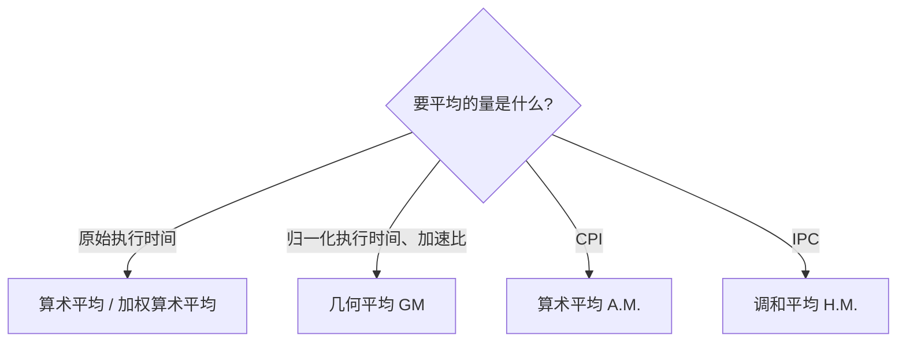

### Amdahl 定律（Amdahl's Law）

一项改进往往只能加速系统的一部分，而不是全部（What if enhancement does not enhance everything?）。Amdahl 定律回答的就是：**局部的加速对整体性能到底有多大影响**。

先回顾**加速比**（speedup）的定义：记改进前后的执行时间为 $T_{\mathrm{old}}$、$T_{\mathrm{new}}$，整体加速比为 $S_{\mathrm{tot}}$：

$$
S_{\mathrm{tot}}=\frac{T_{\mathrm{old}}}{T_{\mathrm{new}}}
$$

当改进只能在部分时间内起作用时，分母是"在可能之处使用改进后的执行时间"（Execution Time using Enhancement when Possible），分子是"完全不使用改进的执行时间"。[^l02-section-3-s1p22]

#### 推导

设 $F$ 为原执行时间中可以被改进的比例，$S$ 为这部分自身的加速比。

1. **不可改进部分**：占原时间的 $1-F$，改进后不变。
2. **可改进部分**：占原时间的 $F$，改进后缩短为 $F/S$。
3. **新执行时间**：两部分相加

$$
T_{\mathrm{new}}=T_{\mathrm{old}}\times\left[(1-F)+\frac{F}{S}\right]
$$

4. **整体加速比**：把 $T_{\mathrm{old}}$ 移到左边并取倒数

$$
S_{\mathrm{tot}}=\frac{T_{\mathrm{old}}}{T_{\mathrm{new}}}=\frac{1}{(1-F)+\dfrac{F}{S}}
$$

[^l02-section-3-s1p22]

> [!warning] 易错点
> 定义中特意提醒"fraction of What?"：$F$ 是**改进前的执行时间**中的比例，不是代码行数比例、不是距离比例，也不是改进后时间中的比例。[^l02-section-3-s1p22] 下面汽车例子中 Turbo 覆盖了 83% 的**距离**，但只覆盖 20% 的**时间**，代入公式的必须是后者。

> [!info] 可视化资源
> [Wikipedia：Amdahl's law](https://en.wikipedia.org/wiki/Amdahl%27s_law) 的首张图（AmdahlsLaw.svg）画出了不同可并行比例（50%～95%）下整体加速比随处理器数增长的曲线（处理器数相当于可并行部分的加速比 $S$）：$S\to\infty$ 时加速比趋近上限 $1/(1-F)$，例如 $F=0.5$ 时最多 2 倍，$F=0.95$ 时最多 20 倍。

#### 加速常见情况（Make the Common Case Fast）

Amdahl 定律最直接的推论是：**让常见情况变快**。比较两种改进：[^l02-section-3-s1p23]

| 方案 | $S$ | $F$ | 整体加速比 |
| --- | --- | --- | --- |
| 大幅加速一个少见部件 | 20 | 0.1 | $\dfrac{1}{(1-0.1)+0.1/20}=\dfrac{1}{0.905}=1.105$ |
| 小幅加速常见部分 | 1.2 | 0.9 | $\dfrac{1}{(1-0.9)+0.9/1.2}=\dfrac{1}{0.85}=1.176$ |

把只占 10% 时间的部件加速 20 倍，整体只快约 10.5%；而把占 90% 时间的部分只加速 20%，整体反而快约 17.6%。

这与**局部性原理**（principle of locality）相呼应：程序大约 **90% 的时间花在 10% 的代码上**。[^l02-section-3-s1p23] 这 10% 的代码量虽小，却占了大部分时间，优化它收益最高；反过来，一项改进即使对 80% 的代码都有效，只要那部分代码不是瓶颈，整体收益也很小。

#### 收益递减（Diminishing Returns）

如果反复只优化同一部分，每一代的收益会越来越小，这就是**收益递减**（diminishing returns）。[^l02-section-3-s1p24] 设程序由绿色阶段（Green Phase）和蓝色阶段（Blue Phase）组成；$F_{\mathrm{g}}$ 和 $S_{\mathrm{g}}$ 分别表示绿色阶段的时间占比与局部加速比：

1. **第 1 代 → 第 2 代**：绿色阶段占总时间 $F_{\mathrm{g}}=1/2$，将其加速 $S_{\mathrm{g}}=2$。
   新时间 $=\tfrac12+\tfrac14=\tfrac34$，$S_{\mathrm{tot}}=\dfrac{1}{(1-\tfrac12)+\tfrac{1/2}{2}}=\dfrac{1}{0.75}=1.33$。
2. **第 2 代 → 第 3 代**：在第 2 代中绿色只剩 $\tfrac{1/4}{3/4}=\tfrac13$，再加速 2 倍。
   $S_{\mathrm{tot}}=\dfrac{1}{(1-\tfrac13)+\tfrac{1/3}{2}}=\dfrac{1}{5/6}=1.2$。
3. **继续下去**：绿色占比越来越小，蓝色逐渐成为主导，同样的"2 倍"带来的整体提升不断下降。

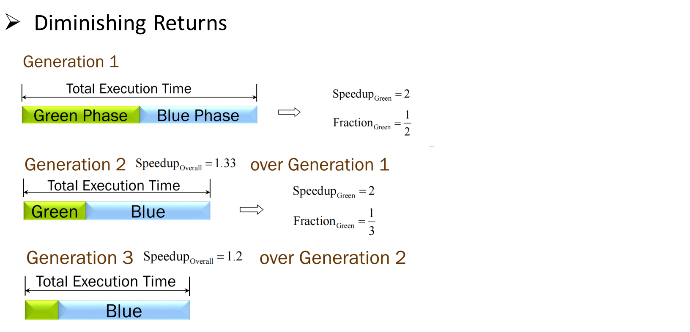

图：收益递减：绿色阶段每代加速 2 倍，但它在总时间中占比从 $\frac{1}{2}$ 降到 $\frac{1}{3}$，整体加速比从 1.33 降到 1.2。

所以不能只盯着一个部分反复优化：第一次效果最好，越往后越小，被优化部分缩小后，原先不起眼的部分会成为新瓶颈。

> [!warning] 易错点
> 第 1 代到第 2 代执行时间从 1 降到 0.75，**减少了 25%**（课堂口述说成“降低了 33%”，混淆了两种百分比），加速比为 1.33；图中的 1/3 是第 2 代里绿色阶段**所占的比例**，不是时间减少量。注意区分"时间减少百分比"$1-1/S_{\mathrm{tot}}$ 与"加速百分比"$S_{\mathrm{tot}}-1$。

> [!example] 例：Turbo 汽车
> 从 SIT 开车到 Sinchon 校区，车上装了 Turbo（涡轮增压），但只能在高速上用。[^l02-section-3-s1p25]
>
> - 高速到城市边界 50 km：平均 100 km/h，用 Turbo 后 200 km/h；
> - 城市边界到校区 10 km：晚高峰堵车，平均 5 km/h。
>
> 1. 无 Turbo：高速 $50/100=0.5$ h，城区 $10/5=2$ h，共 **2.5 h**。
> 2. 有 Turbo：高速 $50/200=0.25$ h，城区仍 2 h，共 **2.25 h**。
> 3. Turbo 在 $50/60\approx83\%$ 的**距离**上带来 100% 的加速（2 倍），但总行程时间只减少 $0.25/2.5=10\%$，加速比 $2.5/2.25=1.111$，即仅 **11.1%** 的加速。
> 4. 用 Amdahl 定律验证：高速段占原**时间**的 $F=0.5/2.5=0.2$，$S=2$，$S_{\mathrm{tot}}=\dfrac{1}{0.8+0.2/2}=\dfrac{1}{0.9}=1.111$。
>
> 结论：时间大部分花在城区，城区才是瓶颈；代码中也是一样，优化非瓶颈部分收益甚微。

> [!note] 补充解释
> 原幻灯片速度单位写作 "km/h MPH"，按题中数据应为 km/h。[^l02-section-3-s1p25]

### 性价比（Price-Performance）

性能提升本身不是目的，计算机架构师需要在性能、成本与市场之间做**权衡**（trade-off）。继续 Turbo 汽车的例子：[^l02-section-3-s1p26]

| | 不带 Turbo | 带 Turbo |
| --- | --- | --- |
| 制造成本 | \$8,000 | \$8,000 + \$3,000 = \$11,000 |
| 售价 | \$12,000 | \$16,000 |
| 单车利润 | \$4K | \$5K |
| 销量 | 10,000 辆 | 400 辆（只有少数发烧友买） |
| 总利润 | **\$40M** | **\$2M** |

单车利润更高，总利润却从 \$40M 跌到 \$2M——而且这个 Turbo 只带来了 11.1% 的实际加速。

CPU 设计同理，加入一项性能改进前要回答：[^l02-section-3-s1p27]

1. 加入这项改进要花多少成本？
2. 实际能得到多少**有效**性能？（汽车例子说明：只在小部分时间里加速 100% 并不划算。）
3. 要为它多收多少钱？——额外的开发、测试、市场推广成本。
4. 能多收多少钱？——市场是否在乎？
5. 价格变化会如何影响销量？

### ISA 的评估指标

评估一个指令集体系结构（ISA）时，不同设计阶段和场景关注不同的指标：[^l02-section-3-s1p28]

- **设计期指标**（design-time metrics）：能否实现、要多久、成本多少？能否编程、是否易于编译？
- **静态指标**（static metrics）：程序在内存中占多少字节（代码体积）？
- **动态指标**（dynamic metrics）：
  - 执行了多少条指令？处理器为执行程序要取多少字节？
  - 每条指令需要多少个时钟周期？
  - 实际可行的时钟周期能做到多"精简"（多短）？

**最好的指标是程序的执行时间**（Time to execute the program），它取决于指令集、处理器组织和编译技术三者。[^l02-section-3-s1p28] 这些因素彼此牵连：例如 ISA 同时影响指令数和 CPI，处理器组织同时影响 CPI 和时钟周期，单独优化一项会波及其他项（各因素的关系见 [02 CPI与性能铁律](#cpi与性能铁律)）。

> [!question]- 自测：某程序中浮点运算占原执行时间的 40%，把浮点单元加速 4 倍，整体加速比是多少？若浮点单元无限快呢？
> 整体加速比 $=1/(0.6+0.4/4)=1/0.7\approx1.43$。浮点单元无限快时 $F/S\to0$，加速比上限为 $1/0.6\approx1.67$——不可加速的 60% 决定了天花板。

> [!question]- 自测：三个程序的 IPC 分别为 1、2、4（指令数与时钟相同），平均 IPC 是多少？算术平均会高估多少？
> 调和平均 $=3/(1+0.5+0.25)=3/1.75\approx1.71$；等价地，平均 CPI $=(1+0.5+0.25)/3\approx0.583$，取倒数得 1.71。算术平均 $(1+2+4)/3\approx2.33$，高估约 36%，因为它让 IPC 大的程序占了过多分量。

> [!question]- 自测：某厂商以机器 R 为参考，报告新机器在一组基准上"归一化执行时间的算术平均更小"，换用另一台参考机后结论反转。应该改用什么平均？为什么能解决？
> 应改用几何平均。两台机器几何平均之比等于 $\sqrt[n]{\prod_i T_{X,i}/T_{Y,i}}$，参考机时间被约掉，所以结论与参考机无关；算术平均没有这个性质。

> [!info]- 来源
> - L02.pdf：PDF p.15–28
> - L02.docx：DOCX body 244–324

[^l02-section-3-s1p15]: L02.pdf-PDF p.15
[^l02-section-3-s1p16]: L02.pdf-PDF p.16
[^l02-section-3-s1p17]: L02.pdf-PDF p.17
[^l02-section-3-s1p18]: L02.pdf-PDF p.18
[^l02-section-3-s1p19]: L02.pdf-PDF p.19
[^l02-section-3-s1p20]: L02.pdf-PDF p.20
[^l02-section-3-s1p21]: L02.pdf-PDF p.21
[^l02-section-3-s2b7]: L02.docx-DOCX body 244-280
[^l02-section-3-s1p22]: L02.pdf-PDF p.22
[^l02-section-3-s1p23]: L02.pdf-PDF p.23
[^l02-section-3-s1p24]: L02.pdf-PDF p.24
[^l02-section-3-s1p25]: L02.pdf-PDF p.25
[^l02-section-3-s1p26]: L02.pdf-PDF p.26
[^l02-section-3-s1p27]: L02.pdf-PDF p.27
[^l02-section-3-s1p28]: L02.pdf-PDF p.28

---

## ISA抽象与RISC思想

> [!abstract] 本节要点
> - ISA 位于操作系统与微架构之间，是软件与硬件的抽象层：对下规定处理器需要哪些资源，对上规定指令如何编码为比特流。
> - ISA 与 OS 都处在软硬件之间，但 OS 宏观地调度硬件资源、服务上层软件；ISA 是编译器与处理器之间的“契约”，多种不同的 CPU 实现可以遵循同一 ISA。
> - 好的抽象（好的 ISA）应当：历经多代仍可用（可移植性）、适用多种场景（通用性）、为上层提供便利功能、允许下层高效实现。
> - 冯·诺依曼处理器 = 数据通路（功能部件 + 存储 + 互连）+ 控制（取指令、发控制信号、管理指令顺序）。
> - CISC 诞生于存储昂贵、手写汇编的年代，指令密集（1–15 字节）、对程序员友好、对硬件不友好；RISC 采用定长指令、load-store、少寻址方式、少操作，指令更多但每条更快，今天 99% 的处理器是 RISC。

### ISA：软件与硬件之间的抽象层

软件希望“不关心处理器内部长什么样”就能写程序，硬件设计者希望“不关心上层跑什么程序”就能放手优化 CPU。两者之间需要一层双方共同遵守的约定，这就是指令集体系结构。这里只关注 ISA 在整个系统层次中的位置与作用。

在从应用软件到物理的抽象层次中，**指令集体系结构**（Instruction Set Architecture, ISA）位于操作系统（线程、文件、异常）之下、微架构（执行流水线）之上：[^l02-section-4-s1p30]

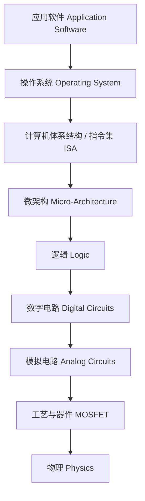

ISA 同时面向两侧，承担两项职责：[^l02-section-4-s1p31]

1. **对硬件**：指明实现上层软件需要处理器提供哪些资源（寄存器、功能部件、存储访问方式等）。硬件一侧回答“需要造什么”（what needs to be built），可以用各种各样的技术让 CPU 更快。
2. **对软件**：说明指令如何编码成比特流（bitstream），让上层软件知道怎样把要实现的功能翻译成下层可执行的形式。软件一侧回答“怎样为机器编程”（how to program a machine）：处理器把指令当作一个按顺序执行的流。

从代码的角度，同一段计算要经过三个层次：

| 层次 | 例子 | 说明 |
| --- | --- | --- |
| 高级语言（C++、Python、Java） | `x = a + b;` | 程序员书写，与具体机器无关 |
| 汇编语言（ARM、MIPS、x86） | `add R1, R2, R3` | 用助记符直接书写 ISA 指令 |
| 机器语言 | `1001 1110 0110 1010` | CPU 真正能识别的 0/1 编码 |

汇编语言本身只是服务于 ISA 的一种书写形式；CPU 真正识别的是机器码。ISA 这条“抽象层”恰好横在汇编与机器码之间、软件与硬件之间。

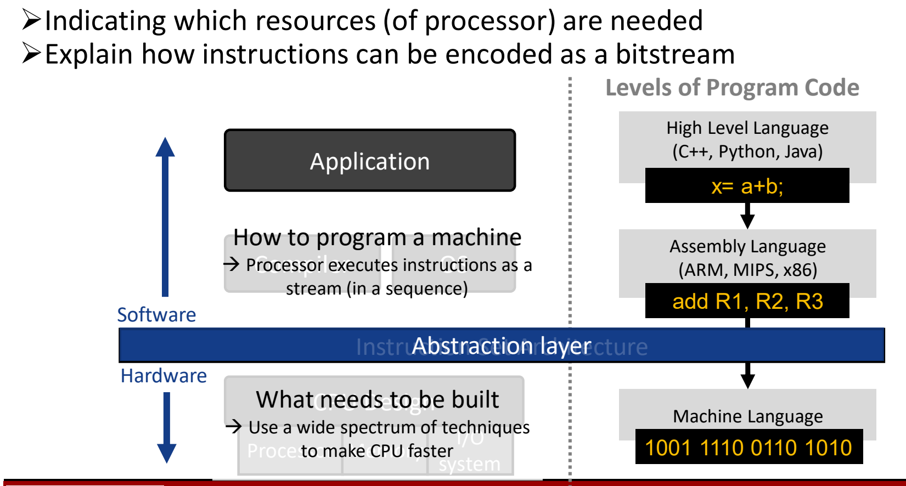

图：ISA 是软硬件之间的抽象层：软件侧关心如何编程，硬件侧关心要构建什么；程序代码从高级语言到汇编再到机器码。

#### ISA 与操作系统的区别

ISA 和 OS 都处在软件与硬件之间，但作用不同：

- **操作系统**更宏观：它调度硬件资源（处理器时间、内存、文件、设备），为上层软件提供服务。
- **ISA** 更贴近处理器：它是编译器（及汇编程序员）与处理器之间的**契约**（contract）。对上，它告诉软件怎样把应用编译成底层硬件“看得懂”的指令；对下，它告诉硬件必须实现哪些功能，硬件据此做具体设计。

“契约”的关键含义是：底层的 CPU 实现可以千差万别，只要都遵循同一个指令集（同一种“语言”、同一本“字典”），上层软件就无需知道处理器内部长什么样，只要把功能表达成这门语言即可。[^l02-section-4-s2b8]

> [!warning] 易错点
> “ISA”与“微架构”不是一回事。ISA 规定指令、寄存器、编码等程序员可见的接口；微架构（如流水线级数、缓存大小）是对 ISA 的某种具体实现。同一 ISA 可以有多种微架构实现，例如不同厂商、不同代际的 x86 处理器运行同一份 x86 机器码。

#### 指令集的定义与好抽象的性质

计算机的“语言”中，单词叫作**指令**（instruction），全部词汇叫作**指令集**（instruction set）：指令集就是这台机器能识别的全部指令。[^l02-section-4-s1p35]

市面上 x86、ARM、MIPS、RISC-V 等指令集看似各不相同，本质却很相似，原因有二：所有计算机都由基于相似原理的硬件技术构建（今天的 CPU 都源自冯·诺依曼结构），并且有少数几种基本操作是所有计算机都必须提供的。计算机设计者的共同目标是：找到一种语言，使**硬件和编译器都容易构建**，同时**性能最大化、成本与能耗最小化**。[^l02-section-4-s1p35]

ISA 是一个关键接口（a critical interface）。一个好的抽象应满足四条性质：[^l02-section-4-s1p34]

1. **历经多代仍然可用**（portability，可移植性）：换了不同的处理器设计、移植到别的处理器上，软件照样能用。
2. **可以多种方式使用**（generality，通用性）：放在不同的应用场景下都能用起来。
3. **为上层提供便利的功能**：软件（编译器、程序员）容易基于它编码。
4. **允许下层高效实现**：芯片设计者能够高效地把它实现出来。

这四条与《人月神话》（*The Mythical Man-Month*, Brooks, p.44）的观点一致：在功能一定的前提下，最好的系统是能以最简单、最直接的方式描述事物的系统；简单直接来自**概念完整性**（conceptual integrity），而易用性要求设计的统一。[^l02-section-4-s1p32] 落到体系结构上，就是一个概念完整的好 ISA 会让整个处理器的设计更简单、更好。

ISA 的设计还会影响性能铁律中的指令数与 CPI 等因素，度量 ISA 优劣的指标见 [03 性能汇总与Amdahl定律](#性能汇总与amdahl定律)。

### 冯·诺依曼处理器组织

各种 ISA 之所以相似，是因为它们都基于**冯·诺依曼结构**（von Neumann architecture）：指令和数据都存放在存储器中，处理器反复从存储器取指令、执行。要理解 ISA 规定的“处理器资源”指什么，先要知道这种处理器由哪些部分组成。

冯·诺依曼处理器由**数据通路**（datapath）和**控制**（control）两部分组成：[^l02-section-4-s1p36]

**数据通路**需要具备：

- **部件**（components）：执行指令所需的**功能单元**（functional units，如 ALU、FPU）和**存储**（storage，如寄存器堆 register file）。
- **互连**（interconnects）：把各部件连接起来，使指令能够完成，并使数据能从存储器载入、存回存储器。

**控制**需要完成三件事：

1. 从存储器取入指令（bring input instructions from Memory）；
2. 根据指令信息发出控制信号，控制数据通路部件之间的信息流动以及各部件执行什么操作；
3. 管理指令的执行顺序（instruction sequencing）。

光有部件和互连还不够，它们都是被动的硬件，必须由控制单元协调才能协同完成一条指令。一条指令在这种组织中的流动顺序是：

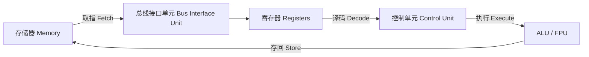

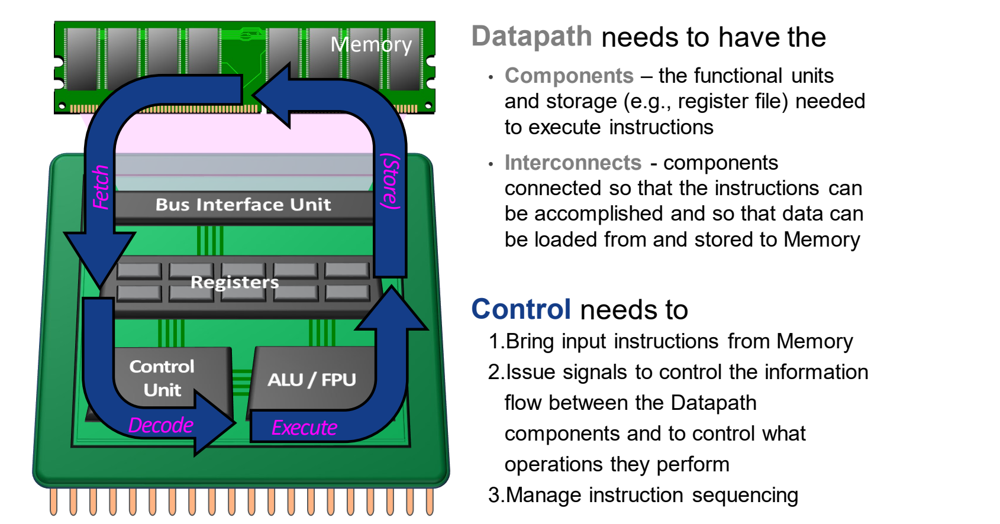

图：冯·诺依曼处理器组织：存储器、总线接口、寄存器、控制单元与 ALU/FPU，按取指→译码→执行（→存储）循环；右侧列出数据通路与控制的职责。

> [!tip] 课堂强调
> 图中的 Fetch → Decode → Execute → (Store) 与熟悉的五级流水线相比少了一步——写回（Write Back）。这是有意留下的：执行结果写回寄存器这一步并未画出。[^l02-section-4-s2b9]

### CISC：资源受限年代的选择

ISA 的设计哲学由当时的技术约束决定。早期计算机面临两个约束：[^l02-section-4-s1p37]

1. **存储器非常昂贵、容量非常小**。例如 IBM 的第一块硬盘装满一个机柜，总容量只有 5 MB，还不如今天一个 U 盘。因此需要尽可能压缩指令和程序的体积。
2. **大多数程序员用汇编语言编程**。当时普遍没有 C 这样的高级语言，程序员直接基于 ISA 写代码，ISA 是否好懂、好写至关重要。

在这两个约束下诞生了**复杂指令集计算机**（Complex Instruction Set Computer, CISC），其特点是：[^l02-section-4-s1p37]

- **指令密集**（dense instruction size），指令长度为 1～15 字节不等，对内存占用做了极致压缩：能用一条指令完成的操作，就压缩成一条指令。
- **对程序员友好**：要做乘法就直接写一条乘法指令，不用管数据在哪里，由硬件自己处理。
- **复杂度不断增长**：几乎每个月新增一条指令。程序员必须持续学习厂商（如 Intel、AMD）每代处理器新增的大量指令，否则拿不到性能提升。
- **对硬件不友好**：复杂指令使编译器、寄存器设计和处理器内部的状态机都变得复杂，硬件代价很大。

> [!example] 例：用 CISC 实现 `a = a * b`
> 设 `a` 存放在存储器位置 `2:3`，`b` 存放在位置 `5:2`。CISC 只需一条指令：
>
> ```asm
> MULT 2:3, 5:2
> ```
>
> 这条指令只含一个操作码和两个存储器操作数，由硬件自己完成“读 a、读 b、相乘、结果写回 a 的位置”的全部步骤，因此程序占用的内存最小。[^l02-section-4-s1p37]

> [!note] 补充解释
> `2:3`、`5:2` 这种写法源自一个常见的教学模型：把存储器看作按“行:列”编号的格子，`2:3` 表示第 2 行第 3 列的存储单元。它不是某个真实 ISA 的语法，仅用于对比两种设计哲学。

> [!tip] 课堂强调
> 手写汇编至今仍有价值。例如国产 AI 加速卡往往按“同一负载下相对英伟达 GPU 的性能”定价，编译器生成的代码效率不够高时，厂商会专门安排工程师手写汇编把硬件性能“吃满”。[^l02-section-4-s2b10]

### RISC：精简指令集的设计哲学

当存储变便宜、编译器取代手写汇编之后，CISC 复杂指令带来的硬件代价就不再划算。**精简指令集计算机**（Reduced Instruction Set Computer, RISC）的设计哲学有四条：[^l02-section-4-s1p38]

1. **定长指令**（fixed instruction lengths）；
2. **load-store 指令集**（load-store instruction sets）：访存（load/store）与计算分开，只有 load/store 访问存储器，运算指令只操作寄存器。这与冯·诺依曼结构中计算部件与存储部件分离的组织方式一致；
3. **有限的寻址方式**（limited addressing modes）；
4. **有限的操作种类**（limited operations）。

> [!example] 例：用 RISC 实现 `a = a * b`
> 同样设 `a` 在 `2:3`、`b` 在 `5:2`。RISC 必须先把操作数载入寄存器，在寄存器间计算，再存回：[^l02-section-4-s1p38]
>
> ```asm
> LOAD  A, 2:3     ; 从存储器 2:3 读 a 到寄存器 A
> LOAD  B, 5:2     ; 从存储器 5:2 读 b 到寄存器 B
> PROD  A, B       ; 寄存器相乘，结果放入 A
> STORE 2:3, A     ; 把 A 写回存储器 2:3
> ```
>
> 对比：CISC 1 条指令，RISC 4 条指令。

只看指令数，RISC 似乎更差。但由性能铁律 $T_{\mathrm{CPU}} = \mathrm{IC} \times \mathrm{CPI} \times \mathrm{CC}$（见 [02 CPI与性能铁律](#cpi与性能铁律)），指令数只是三个因素之一：

- CISC 的一条复杂指令可能需要多个周期（例如 5 个周期）才能执行完；
- RISC 每条简单指令可能只需 1 个周期；
- 指令简单后，硬件更简单，CPU 还可能运行在更高的时钟频率（更短的时钟周期）。

因此 RISC 虽然指令更多，却有机会整体更快。这就是 IC 与 CPI、时钟周期之间的权衡。[^l02-section-4-s2b10]

典型的 RISC 指令集有 ARM、RISC-V、MIPS、Sun SPARC、HP PA-RISC、IBM PowerPC、Intel（Compaq）Alpha 等。[^l02-section-4-s1p38] ARM 几乎用于所有手机；RISC-V 目前在产品中还少见，但开源、前景广阔，详见 [05 RISC-V概览与指令格式](#risc-v概览与指令格式)。[^l02-section-4-s2b10]

下表对比两种设计哲学：

| 维度 | CISC | RISC |
| --- | --- | --- |
| 诞生背景 | 存储昂贵、手写汇编 | 存储便宜、依赖编译器 |
| 指令长度 | 变长，1～15 字节 | 定长 |
| 访存方式 | 运算指令可直接操作存储器 | load-store：只有 load/store 访存 |
| 寻址方式与操作 | 多且复杂，持续新增 | 有限 |
| `a = a * b` 指令数 | 1 条 | 4 条 |
| 每条指令 | 复杂、多周期 | 简单、易做到单周期、利于提频 |
| 友好对象 | 程序员 | 硬件与编译器 |

> [!warning] 易错点
> “RISC 指令数多，所以更慢”是错误推理。比较性能必须同时看 IC、CPI 和时钟周期；RISC 用更多的指令换来更低的 CPI 和更短的时钟周期。

### RISC 的过去、现在与未来

RISC 思想已经主导了今天的处理器市场，分两个时代来看：[^l02-section-4-s1p39]

**PC 时代**：

- x86 硬件在内部把 x86 指令翻译成类 RISC 的微操作（RISC-like micro-instructions），然后在微处理器（MPU）内部使用各种 RISC 技术执行。也就是说，x86 对外支持 CISC 指令，内部实际运行的是 RISC 风格的核心。
- 每年出货量超过 3.5 亿（> 350M / year）；x86 ISA 最终同时统治了服务器和桌面。

**后 PC 时代（PostPC Era：客户端 / 云）**：

- 处理器以 IP 核的形式集成在**片上系统**（System on Chip, SoC）中，而不再是独立的 MPU。手机、嵌入式设备、电视、摄像头等都属于 SoC，其处理单元基本基于 RISC。
- 芯片面积和能耗与性能同等重要。
- 2017 年处理器总出货量超过 200 亿颗（> 20B / year）。
- PC 中的 x86 在 2011 年达到峰值，此后每年下降约 8%（2016 年的出货量低于 2007 年）。
- x86 服务器演变为云，总量约 1000 万台，仅占 200 亿的 0.05%。
- 部分服务器也开始采用 RISC，因为服务器同样需要节能，而 RISC 比 x86 更省能耗、性能也不差。

结论：**今天 99% 的处理器是 RISC**。[^l02-section-4-s1p39] 这也是本课程讲授 RISC-V、而不讲较老的 IA-32/x86 的原因。[^l02-section-4-s2b10]

> [!question]- 自测：某 CISC 机器用 1 条指令完成 `a = a * b`，CPI 为 5；某 RISC 机器用 4 条指令完成，每条 CPI 为 1，且时钟频率是 CISC 机器的 1.5 倍。哪台更快？
> RISC 更快。CISC 时间 $=1\times5\times T=5T$；RISC 时间 $=4\times1\times\frac{T}{1.5}\approx2.67T$。RISC 指令数是 CISC 的 4 倍，但更低的 CPI 和更短的时钟周期足以抵消。

> [!question]- 自测：Intel 和 AMD 的两款 x86 处理器流水线深度、缓存大小都不同，为什么同一个可执行文件能在两者上运行？这说明了 ISA 的什么作用？
> 因为两者实现的是同一个 ISA。ISA 是编译器与处理器之间的契约，只规定指令、资源和编码，不规定内部实现；流水线和缓存属于微架构。这体现了好抽象的“可移植性”。

> [!question]- 自测：在冯·诺依曼处理器中，“根据指令决定 ALU 做加法还是减法”属于数据通路还是控制？寄存器堆又属于哪一部分？
> 前者属于控制：控制单元发出信号，决定数据通路部件执行什么操作。寄存器堆属于数据通路中的部件（存储），与 ALU 等功能单元一起由互连连接。

> [!info]- 来源
> - L02.pdf：PDF p.30–32, 34–39
> - L02.docx：DOCX body 281–407

[^l02-section-4-s1p30]: L02.pdf-PDF p.30
[^l02-section-4-s1p31]: L02.pdf-PDF p.31
[^l02-section-4-s2b8]: L02.docx-DOCX body 281-324
[^l02-section-4-s1p35]: L02.pdf-PDF p.35
[^l02-section-4-s1p34]: L02.pdf-PDF p.34
[^l02-section-4-s1p32]: L02.pdf-PDF p.32
[^l02-section-4-s1p36]: L02.pdf-PDF p.36
[^l02-section-4-s2b9]: L02.docx-DOCX body 325-371
[^l02-section-4-s1p37]: L02.pdf-PDF p.37
[^l02-section-4-s2b10]: L02.docx-DOCX body 372-407
[^l02-section-4-s1p38]: L02.pdf-PDF p.38
[^l02-section-4-s1p39]: L02.pdf-PDF p.39

---

## RISC-V概览与指令格式

> [!abstract] 本节要点
> - RISC-V 是 2010 年起源于 UC Berkeley 的**开放** RISC 指令集标准：任何人都可以据此构造兼容的计算机并使用配套软件，而 x86、ARM、Power、MIPS、SPARC 等都受专利保护。
> - 设计目标：完全开放；不为某种微架构风格或实现技术“过度设计”；采用“小的基础整数 ISA + 可选标准扩展 + 可选自定义扩展”的模块化结构。
> - 命名规则为 RV + 字长 + 扩展，如 RV32I；标准扩展 M/A/F/D/C，$G = \text{IMAFD}$；本课程以 64 位（RV64）为准，但**指令长度固定 32 位**，寄存器/数据宽度为 64 位。
> - 6 种指令格式 R/I/S/SB/U/UJ 全部 32 位宽，opcode 总在 bit 6:0，rd、funct3、rs1、rs2 在各格式中位置固定。
> - 立即数被“打散”是为了让同一立即数位尽量落在同一指令位上（符号位总在 bit 31，imm[10:5] 总在 bit 30:25 等），从而简化译码和符号扩展的硬件。

### RISC-V 的来历、开放性与设计目标

主流 ISA（x86、ARM、Power、MIPS、SPARC）都受商业专利保护，这阻碍了人们实际复现或自行构造与之兼容的计算机系统；基于这些 ISA 做开发需要授权，否则会面临法律风险。RISC-V 就是为打破这一限制而提出的。

**RISC-V**（读作 “risk-five”）是一个 ISA 标准：一个基于精简指令集计算（RISC）思想、开源的指令集体系结构。它**开放**，允许任何个人或团体构造兼容的计算机，并使用相关的软件。[^l02-section-5-s1p40]

- **起源**：2010 年由 UC Berkeley 的 Krste Asanović、David Patterson 及其学生提出。
- **名字中的 “V”**：此前已有 RISC-I、II、III、IV；RISC-V 是这一系列的第五代，但它与之前的 RISC 指令集**不兼容**，指令编码各不相同。
- **2017 年版本**：用户态 ISA 第 2 版固定下来，包括
  - User-Level ISA Specification v2.2
  - Draft Compressed ISA Specification v1.79
  - Draft Privileged ISA Specification v1.10

RISC-V 与 CISC/RISC 哲学的一般对比以及 RISC 的市场现状见 [04 ISA抽象与RISC思想](#isa抽象与risc思想)，这里只关注 RISC-V 本身。

> [!tip] 课堂强调
> RISC-V ISA 是本课程的重点。[^l02-section-5-s2b8] 开放性是 RISC-V 最核心的优点：使用受专利保护的商业 ISA 若未获授权会被起诉，而在中美科技竞争、可能遭遇禁运的背景下，开放的 RISC-V 是可行的替代，同学们将来很可能要为它写编译器或汇编代码。开放也不意味着“只能做开源芯片”：基于 RISC-V 的芯片可以作为商业产品出售，例如 SiFive 专门为客户设计 RISC-V 芯片。为避免受单一国家的长臂管辖，RISC-V 的标准组织迁到了欧洲（瑞士）。[^l02-section-5-s2b10]

#### 设计目标与模块化结构

一个 ISA 如果绑定某种实现方式，就会限制后来者的设计空间；如果把所有功能都设为必选，又会让小型嵌入式芯片背上不必要的负担。RISC-V 的设计目标正是针对这两点：[^l02-section-5-s1p41]

1. **完全开放**：对学术界和工业界都免费可用。
2. **避免“过度架构”**（over-architecting）：不针对某一种
   - 微架构风格（如微码实现 microcoded、顺序 in-order、解耦 decoupled、乱序 out-of-order），
   - 也不针对某一种实现技术（如全定制 full-custom、ASIC、FPGA），

   但又允许在其中任何一种上高效实现。ISA 只规定指令集本身，底层怎么实现由设计者决定。
3. **模块化**：RISC-V ISA 由三部分组成
   - 一个**小的基础整数 ISA**（base integer ISA），本身就可以单独使用，作为定制加速器的基础或用于教学；
   - **可选的标准扩展**（standard extensions），用于支持通用软件开发；
   - **可选的自定义扩展**（custom extensions）。
4. 支持 2008 年修订版 **IEEE-754** 浮点标准。

整体原则是**保持非常简单且可扩展**，并把规范拆成多份独立文档：[^l02-section-5-s1p42]

| 规范 | 内容 | 用途 |
| --- | --- | --- |
| User-Level ISA spec | 计算类指令 | 普通程序的运算、访存、控制 |
| Compressed ISA spec | 16 位指令 | 嵌入式等资源受限场景，压缩代码体积 |
| Privileged ISA spec | 管理态（supervisor-mode）指令 | 操作系统、虚拟化等需要特权的场合；普通用户不能执行 |
| 更多…… | — | — |

压缩指令存在的理由是：嵌入式设备的存储资源有限，能把指令（及代码）体积压小，对它们非常重要。特权指令存在的理由是：有些操作（例如云计算中的虚拟化管理）只能由超级用户执行，必须和普通指令区分开。

### 命名规则与标准扩展

有了“基础 + 扩展”的模块化结构，就需要一种简洁的写法说明某个处理器到底支持哪些模块。

**RISC-V 命名规则**：ISA 支持情况写成 **RV + 字长（word-width）+ 所支持的扩展**。例如 **RV32I** 表示支持 I（Integer，整数）指令集的 32 位 RISC-V。[^l02-section-5-s1p42] 字长决定处理器能处理的数据宽度，常见的是 32 位和 64 位。

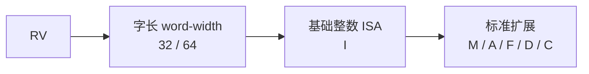

**用户级 ISA**（User-Level ISA）定义普通计算所需的指令，由一个必选的基础整数 ISA 和若干扩展组成：[^l02-section-5-s1p43]

- **I：整数指令**（必选），包括
  - ALU 运算（加减、逻辑等）
  - 分支 / 跳转（branches/jumps）
  - 取数 / 存数（loads/stores）
- **标准扩展**：
  - **M**：整数乘法与除法（Integer Multiplication and Division）
  - **A**：原子指令（Atomic Instructions）
  - **F**：单精度浮点（Single-Precision Floating-Point）
  - **D**：双精度浮点（Double-Precision Floating-Point）
  - **C**：压缩指令（Compressed Instructions，16 位）
- **G = IMAFD**：整数基础 + 四个标准扩展，即“通用”（general-purpose）组合。
- 其他可选扩展。

C 扩展不包含在 G 中：压缩指令的适用范围较窄，主要用于嵌入式系统，所以通用组合默认不加它。

> [!example] 例：解读 ISA 名称
> 1. RV32I：32 位字长，只支持基础整数指令集。
> 2. RV64G：64 位字长，支持 I、M、A、F、D，等价于 RV64IMAFD。
> 3. RV64GC：在 RV64G 的基础上再支持 16 位压缩指令。

> [!tip] 课堂强调
> RISC-V 的字长一般是 32 位或 64 位（规范还允许其他宽度）。本课程后续统一以 **64 位 RISC-V** 为准，因为 64 位更常见。

原子指令（A 扩展中的 lr/sc 等）的语义见 [08 同步指令与寻址方式](#同步指令与寻址方式)。

### 指令的组成与指令分类

在 [04 ISA抽象与RISC思想](#isa抽象与risc思想) 的冯·诺依曼组织中，指令和数据都放在存储器里。落到 RISC-V 上，一条指令要回答两个问题：做什么操作、对谁操作。

**指令**（instruction）= **操作码**（opcode）+ **操作数说明**（operand specifiers）。[^l02-section-5-s1p44]

- **指令在哪里**：默认存放在存储器（memory）中，由**程序计数器**（Program Counter，PC）寄存器指向当前要执行的指令。
- **操作数在哪里**：在存储器或寄存器中；具体访问哪一处（或两处都访问）由寻址方式决定（四种寻址方式见 [08 同步指令与寻址方式](#同步指令与寻址方式)）。
- **操作码分三大类**：
  1. 访存（memory access）
  2. 算术 / 逻辑计算（arithmetic/logical computation）
  3. 控制（control，如分支），控制类又分为跳转与条件分支

> [!note] 补充解释
> 在后续学习的乱序执行处理器中，指令除了存放在存储器里，还会暂存在处理器内部的**指令窗口**（instruction window）中。这里先只考虑存储器。

RISC-V ISA 的基本情况可以总结为：[^l02-section-5-s1p45]

- **指令类别**：算术 / 逻辑 / 移位（Arithmetic, Logical, Shift）；数据传输（Data transfer）；无条件 / 条件分支（Un-/Conditional branch）。
- **寄存器**：32 个通用寄存器 `x0`–`x31`，外加 PC。各寄存器的用途约定见 [06 算术与访存指令](#算术与访存指令)。
- **指令格式**：6 种，**全部 32 位宽**。

> [!warning] 易错点
> “64 位 RISC-V”中的 64 位指的是**寄存器 / 数据宽度**，不是指令长度。RV64 的（非压缩）指令长度仍然是 **32 位**；寄存器长度是 **64 位**。[^l02-section-5-s2b11]

### 6 种 32 位指令格式

所有指令都等长 32 位，硬件取指时不必先判断指令有多长；而把不同类型指令的共同字段放在固定位置，又能让译码器不用先识别格式就开始读寄存器号。6 种格式就是在“定长 32 位”约束下，为不同操作数组合分配字段的方案。

各字段含义：

- **opcode**（7 位，bit 6:0）：操作码，所有格式都在最低 7 位。
- **rd**（5 位，bit 11:7）：目的寄存器。
- **funct3**（3 位，bit 14:12）、**funct7**（7 位，bit 31:25）：附加功能码，与 opcode 一起确定具体操作。
- **rs1**（5 位，bit 19:15）、**rs2**（5 位，bit 24:20）：两个源寄存器。
- **imm / immediate**：立即数，即直接编码在指令里的常数。

R 格式的字段宽度为 $7+5+5+3+5+7=32$ 位。寄存器字段 5 位，恰好能编号 $2^5=32$ 个寄存器 `x0`–`x31`。

各格式从 bit 31 到 bit 0 的字段排布如下（`|` 分隔字段）：[^l02-section-5-s1p45]

| 格式 | bit 31:25 | bit 24:20 | bit 19:15 | bit 14:12 | bit 11:7 | bit 6:0 | 典型用途 |
| --- | --- | --- | --- | --- | --- | --- | --- |
| R | funct7 | rs2 | rs1 | funct3 | rd | opcode | 寄存器-寄存器运算 |
| I | imm[11:0]（占 31:20） | ← | rs1 | funct3 | rd | opcode | 带立即数运算、取数 |
| S | imm[11:5] | rs2 | rs1 | funct3 | imm[4:0] | opcode | 存数 |
| SB | imm[12, 10:5] | rs2 | rs1 | funct3 | imm[4:1, 11] | opcode | 条件分支 |
| U | imm[31:12]（占 31:12） | ← | ← | ← | rd | opcode | 高位立即数 |
| UJ | imm[20, 10:1, 11, 19:12]（占 31:12） | ← | ← | ← | rd | opcode | 无条件跳转 |

（“←”表示该列被左边的立即数字段占用。）

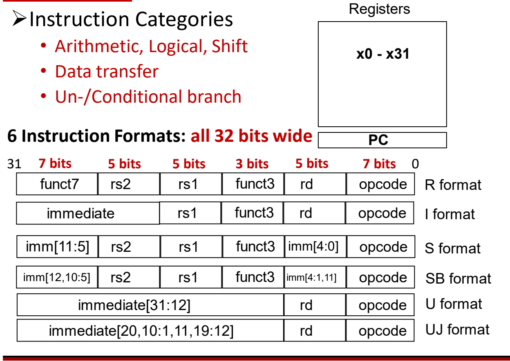

图：RISC-V 六种 32 位指令格式 R/I/S/SB/U/UJ 的字段划分（7|5|5|3|5|7 位）与指令类别、寄存器 x0–x31 和 PC。

从表中可以读出几条规律：

1. **opcode、rd、funct3、rs1、rs2 的位置在用到它们的格式中完全固定**。例如 rs1 总在 bit 19:15，rd 总在 bit 11:7。
2. **S 与 R 的区别**：存数指令不写寄存器、没有 rd，但需要两个源寄存器（地址基址和要存的数据）和一个 12 位偏移，于是把立即数拆成 imm[11:5] 和 imm[4:0]，分别塞进 R 格式中 funct7 和 rd 的位置。
3. **SB 是 S 的变体**，**UJ 是 U 的变体**：字段边界相同，只是立即数各位的摆放顺序不同。
4. **U 格式**提供立即数的高 20 位 imm[31:12]；**UJ 格式**编码 imm[20:1]。

各格式对应的具体指令及其编码，按 R 格式（[06 算术与访存指令](#算术与访存指令)）、分支与跳转（[07 分支过程调用与栈](#分支过程调用与栈)）分别展开；分支 / 跳转立即数能覆盖的地址范围也在 [07 分支过程调用与栈](#分支过程调用与栈) 讨论。

> [!info] 可视化资源
> [rvcodec.js：RISC-V 指令在线编码/解码器](https://luplab.gitlab.io/rvcodecjs/) 输入一条汇编指令（如 `add x5, x6, x7`、`beq x5, x6, 100`）即可看到它的格式、二进制与十六进制编码，也可反过来粘贴十六进制机器码解码，适合对照上表验证各字段与立即数的位置。
>
> 若在线页面无法访问，可用 [Ripes](https://github.com/mortbopet/Ripes) 汇编程序并查看机器码；若需要 rvcodec.js 的逐字段编码展示，可下载[官方源码](https://gitlab.com/luplab/rvcodecjs)，按 README 的 Run locally 说明在本地运行。

> [!note] 补充解释
> SB 和 UJ 的立即数表中都没有 imm[0]：分支和跳转目标总是 2 字节对齐，最低位恒为 0，不必存储。这样 SB 用 12 个指令位表示 13 位立即数 imm[12:1]，UJ 用 20 个指令位表示 21 位立即数 imm[20:1]。参见 [RISC-V 官方非特权规范：RV32I 的 Immediate Encoding Variants](https://docs.riscv.org/reference/isa/v20260120/unpriv/rv32.html)。

### 立即数的“打散”排布

观察 SB 和 UJ 格式会发现，立即数不仅不连续，各位的顺序还很“奇怪”：

- SB：左段依次是 imm[12]、imm[10:5]；右段依次是 imm[4:1]、imm[11]。
- UJ：依次是 imm[20]、imm[10:1]、imm[11]、imm[19:12]。

如果按自然顺序连续存放，编码看起来更直观。之所以拆成这样，是为了**让同一个立即数位在不同格式中尽量出现在同一个指令位上**，即位置对齐。[^l02-section-5-s1p46]

把 6 种格式按指令位逐位对比（对应下图中的虚线分界）：

| 指令位 | I | S | SB | U | UJ | 对齐的内容 |
| --- | --- | --- | --- | --- | --- | --- |
| 31 | imm[11] | imm[11] | imm[12] | imm[31] | imm[20] | 都是立即数的**最高位（符号位）** |
| 30:25 | imm[10:5] | imm[10:5] | imm[10:5] | imm[30:25] | imm[10:5] | I/S/SB/UJ 中均为 **imm[10:5]** |
| 24:21 | imm[4:1] | rs2 | rs2 | imm[24:21] | imm[4:1] | I 与 UJ 中为 imm[4:1] |
| 20 | imm[0] | rs2 | rs2 | imm[20] | imm[11] | — |
| 19:12 | rs1, funct3 | rs1, funct3 | rs1, funct3 | imm[19:12] | imm[19:12] | U 与 UJ 中均为 **imm[19:12]** |
| 11:8 | rd | imm[4:1] | imm[4:1] | rd | rd | S 与 SB 中均为 **imm[4:1]** |
| 7 | rd | imm[0] | imm[11] | rd | rd | — |

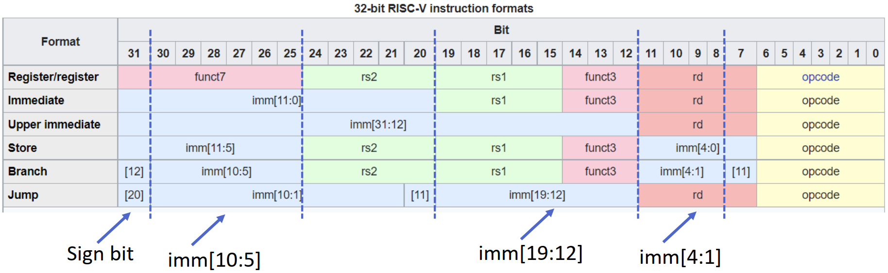

图：各格式立即数的逐位位置：符号位始终在 bit 31，`imm[10:5]`、`imm[19:12]`、`imm[4:1]` 等字段在多个格式中对齐。

由此得到两条设计规则：

1. **主要的立即数位段位置固定**：imm[10:5] 总在 bit 30:25；imm[19:12] 只要出现就在 bit 19:12；imm[4:1] 在 S/SB 中都位于 bit 11:8（在 I/UJ 中都位于 bit 24:21）。无法让所有位都对齐，剩下的零散位（SB 的 imm[11] 放在 bit 7，UJ 的 imm[11] 放在 bit 20）就填进同一格式中原本空出的位置——SB 把 S 格式 imm[0] 的位置（bit 7）让给 imm[11]，UJ 把 I 格式 imm[0] 的位置（bit 20）让给 imm[11]。
2. **最高位（符号位）总在最左边 bit 31**：I 的 imm[11]、S 的 imm[11]、SB 的 imm[12]、U 的 imm[31]、UJ 的 imm[20] 都放在 bit 31。

这样做的好处在硬件上：

- 从指令中拼出立即数时，同一个立即数位基本只来自一两个固定的指令位，生成立即数所需的多路选择器更少、连线更简单，**简化了译码**。
- 符号扩展只需复制 bit 31，而且不必等到判断出指令格式就可以开始，**简化了符号扩展**。

> [!warning] 易错点
> “对齐”并不是说某个位段在全部 6 种格式中都在同一位置。例如 imm[4:1] 在 S/SB 中位于 bit 11:8，在 I/UJ 中位于 bit 24:21；R 格式根本没有立即数。真正对所有含立即数格式成立的只有一条：**符号位总在 bit 31**。判断时应逐位对照格式表，而不是记“全部对齐”这一结论。[^l02-section-5-s1p46]

确定了指令类型（R、I、S、SB、U、UJ）之后，接下来要解决的问题是：[^l02-section-5-s1p47]

1. 如何识别 / 编码这些指令？
2. 如何处理数据：支持哪些数据类型、数据存放在哪里、有哪些寻址方式？

这些问题依次在 [06 算术与访存指令](#算术与访存指令)、[07 分支过程调用与栈](#分支过程调用与栈) 和 [08 同步指令与寻址方式](#同步指令与寻址方式) 中展开。

> [!question]- 自测：某处理器文档写着 “RV64IMAC”。它支持哪些功能？它的普通指令有多长？能否称为 RV64G？
> 支持 64 位字长的基础整数指令（I）、整数乘除（M）、原子指令（A）和 16 位压缩指令（C）；非压缩指令仍为 32 位（压缩指令 16 位）。不能称为 RV64G，因为 $G=\text{IMAFD}$，它缺少单精度 F 和双精度 D 浮点扩展。

> [!question]- 自测：一条 32 位指令的 bit 31 为 1。若它是 S 格式、SB 格式或 UJ 格式，bit 31 分别是立即数的哪一位？对符号扩展意味着什么？
> 分别是 imm[11]、imm[12]、imm[20]，都是各自立即数的最高位即符号位，所以三种情况下立即数都是负数。由于符号位总在 bit 31，硬件不必先判断格式，直接用 bit 31 填充高位即可完成符号扩展。

> [!question]- 自测：设计者想把 SB 格式改成“立即数 imm[12:1] 连续放在 bit 31:25 和 bit 11:7”的自然顺序（高 7 位 imm[12:6] 放左段，低 5 位 imm[5:1] 放右段）。与 S 格式相比，这会带来什么问题？
> S 格式左段放 imm[11:5]、右段放 imm[4:0]；改后 SB 的左段是 imm[12:6]、右段是 imm[5:1]，同一指令位在两种格式中对应的立即数位全部错开一位。立即数生成电路就要为每一位多准备一路选择，译码更复杂；原设计只在 bit 31 和 bit 7 两处不同（imm[12] vs imm[11]、imm[11] vs imm[0]），其余位与 S 完全一致。

> [!info]- 来源
> - L02.pdf：PDF p.40–47
> - L02.docx：DOCX body 281–324, 372–450

[^l02-section-5-s1p40]: L02.pdf-PDF p.40
[^l02-section-5-s2b8]: L02.docx-DOCX body 281-324
[^l02-section-5-s2b10]: L02.docx-DOCX body 372-407
[^l02-section-5-s1p41]: L02.pdf-PDF p.41
[^l02-section-5-s1p42]: L02.pdf-PDF p.42
[^l02-section-5-s1p43]: L02.pdf-PDF p.43
[^l02-section-5-s1p44]: L02.pdf-PDF p.44
[^l02-section-5-s1p45]: L02.pdf-PDF p.45
[^l02-section-5-s2b11]: L02.docx-DOCX body 408-450
[^l02-section-5-s1p46]: L02.pdf-PDF p.46
[^l02-section-5-s1p47]: L02.pdf-PDF p.47

---

## 算术与访存指令

> [!abstract] 本节要点
> - RISC-V 算术指令每条只做 1 个操作、恰好 3 个操作数、目的在前：`add rd, rs1, rs2` 即 $rd \leftarrow rs1 + rs2$，三个操作数都在寄存器堆中。
> - 寄存器堆是 32 个 64 位寄存器，2 个读端口 + 1 个写端口；它快是因为小，项数变多或端口变多都会变慢（端口数对速度的影响是平方级）。
> - R 格式 32 位从高到低为 funct7(7) | rs2(5) | rs1(5) | funct3(3) | rd(5) | opcode(7)；寄存器号 5 位是因为有 32 个寄存器。本课程中 word = 32 位，doubleword = 64 位。
> - `ld/sd` 的地址 = 基址寄存器 + 12 位有符号偏移，偏移以**字节**计，范围约 $\pm2^{11}$ 字节（$\pm256$ 个 doubleword）；`ld` 是 I 格式，`sd` 是 S 格式（立即数拆成 imm[11:5] 和 imm[4:0]）。
> - RISC-V 默认小端；`lb` 把字节放进寄存器低 8 位并把高 56 位做符号扩展，`sb` 只改内存中那 1 个字节；小常量用 `addi` 等立即数指令，32 位大常量用 `lui`（写 bits 31:12）再用 `ori`/`addi` 补低 12 位。

### 算术指令与 R 格式（R Format）

指令集需要一种规整、便于硬件快速译码的方式来表达“取两个值、算一下、存结果”。RISC-V 的做法是让所有算术指令长成同一个样子。

**算术指令**（arithmetic instruction）的汇编形式为：

```asm
add x5, x6, x7    # x5 = x6 + x7
sub x5, x6, x7    # x5 = x6 - x7
```

它满足三条规则：[^l02-section-6-s1p48]

1. **每条指令只执行 1 个操作**（一次加或一次减）。
2. **每条指令长 32 位，恰好指定 3 个操作数**。
3. **操作数顺序固定，目的在前**：`destination ← source1 op source2`，即右边两个源操作数运算后写到最左边的目的操作数；三个操作数（如 x5、x6、x7）全部位于**寄存器堆**（register file）中。

#### R 格式各字段

指令和数据字一样都是 32 位长。算术指令使用 **R 格式**，`add x5, x6, x7` 的各部分映射到如下字段（从高位到低位）：[^l02-section-6-s1p51]

| 字段 | 位数 | 含义 | `add x5, x6, x7` 中的取值 |
| --- | --- | --- | --- |
| funct7 | 7 | 辅助 opcode 的功能码 | 区分 add / sub 等 |
| rs2 | 5 | 第二个源操作数的寄存器号 | x7 |
| rs1 | 5 | 第一个源操作数的寄存器号 | x6 |
| funct3 | 3 | 辅助 opcode 的功能码 | — |
| rd | 5 | 结果目的寄存器号 | x5 |
| opcode | 7 | 指定操作类别 | 算术类 |

字段宽度合计 $7+5+5+3+5+7=32$。两个设计要点：

- **为什么寄存器号是 5 位**：寄存器共 32 个，$\log_2 32 = 5$，所以 rs1、rs2、rd 各需 5 位。
- **为什么除 opcode 外还要 funct3、funct7**：RISC-V 指令数量很多，仅靠 7 位 opcode 不足以区分全部指令；opcode 先确定一大类，funct3 和 funct7 再在这一类中指定具体的子操作。6 种格式的整体排布见 [05 RISC-V概览与指令格式](#risc-v概览与指令格式)。

> [!note] 补充解释
> 幻灯片没有给出具体二进制值。按 RISC-V 规范，`add x5, x6, x7` 的编码为 funct7=`0000000`、rs2=`00111`、rs1=`00110`、funct3=`000`、rd=`00101`、opcode=`0110011`，拼起来是 `0x007302B3`；`sub` 只把 funct7 改为 `0100000`。这正说明 funct7 是在同一 opcode 下区分子操作的。参见 [RISC-V 官方非特权规范：RV32I 的 Integer Register-Register Operations](https://docs.riscv.org/reference/isa/v20260120/unpriv/rv32.html)。

### 寄存器约定与寄存器堆（Register File）

32 个通用寄存器在硬件上彼此等价，但编译器、操作系统和不同人写的函数要协同工作，就必须约定每个寄存器“通常用来放什么”。

**寄存器约定**（register convention）如下：[^l02-section-6-s1p49]

| 名称 | 编号 | 用途 |
| --- | --- | --- |
| x0 | 0 | 恒为常数 0 |
| x1 (ra) | 1 | 返回地址（link register） |
| x2 (sp) | 2 | 栈指针（stack pointer） |
| x3 (gp) | 3 | 全局指针（global pointer） |
| x4 (tp) | 4 | 线程指针（thread pointer） |
| x5–x7 | 5–7 | 临时寄存器（temporaries） |
| x8–x9 | 8–9 | 帧指针 / 保存寄存器（frame pointer / saved） |
| x10–x17 | 10–17 | 参数 / 返回值（arguments / results） |
| x18–x27 | 18–27 | 保存寄存器（saved） |
| x28–x31 | 28–31 | 临时寄存器（temporaries） |

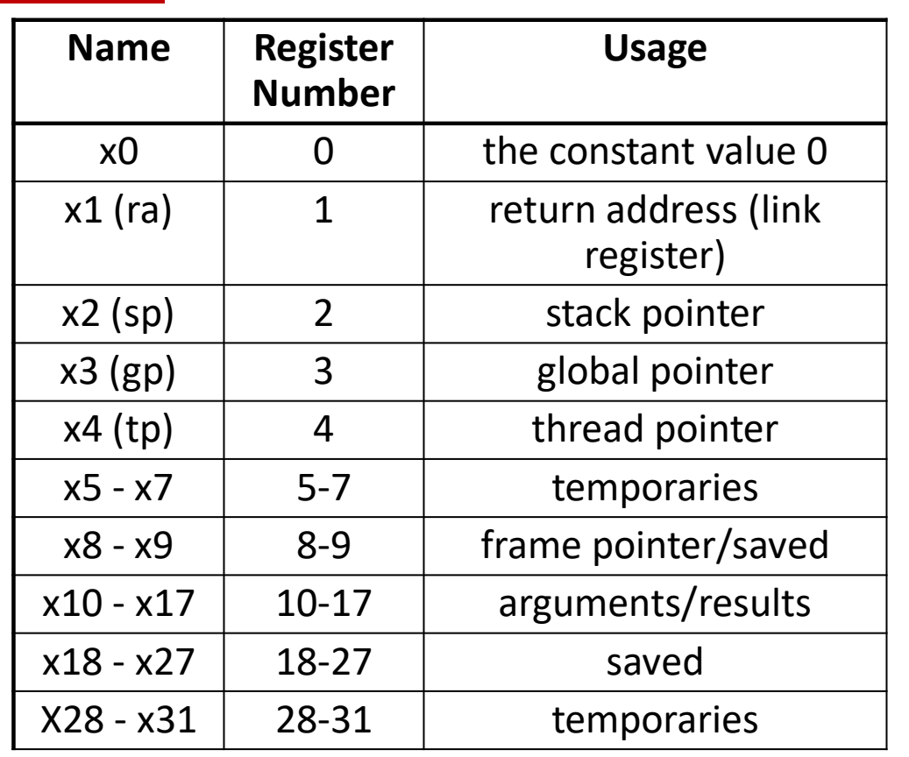

图：RISC-V 寄存器约定：x0 恒为 0，ra、sp、gp、tp，以及临时、保存、参数/返回值寄存器的编号范围。

要点说明：

- **x0**：需要 0 时无需另外装入，直接写 x0 即可，它永远读出 0。
- **ra**：调用函数后要返回到哪里，返回地址就写在 x1 中。
- **sp、gp、tp**：在访问栈、全局数据和线程数据等内存区域时作为基址使用。
- **临时寄存器与保存寄存器**：临时寄存器可以自由放任何数据，函数调用时其中的值不受保护、可被替换；保存寄存器中的值在调用别的函数前后必须保持不变，想用它的函数要先保存原值、返回前恢复。谁负责保存（caller/callee-saved）以及栈的用法见 [07 分支过程调用与栈](#分支过程调用与栈)。
- **参数 / 返回值**：调用函数时用 x10–x17 传参，返回时用它们带回结果。

#### 寄存器堆的结构

**寄存器堆**（register file）保存 32 个 64 位寄存器（32 个位置 × 64 位）。端口数由算术指令的形式决定：[^l02-section-6-s1p50]

1. 算术指令有 **2 个源操作数**，所以需要 **2 个读端口**：输入 src1 addr、src2 addr（各 5 位），输出 src1 data、src2 data（各 64 位）。
2. 有 **1 个目的操作数**，所以需要 **1 个写端口**：输入 des addr 和 write data。
3. 另有一个 **write control（写使能）**：并非每条指令都要写寄存器，所以写需要控制信号；而读在每条指令执行时都会发生，不需要读控制信号。

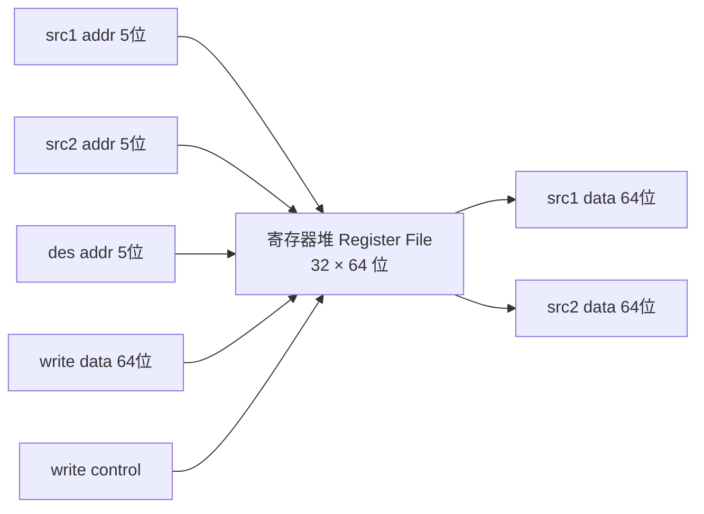

#### 寄存器为什么快，以及何时不快

寄存器比存储层次中的其他各级（各级 cache 和内存）都快，一次访问通常不到 1 ns。但寄存器快的根本原因是**小**：

- **位置越多越慢**：64 项的寄存器堆可能比 32 项的慢多达 50%。[^l02-section-6-s1p50] 如果把寄存器堆做得和 cache 一样大，它就和 cache 一样慢。
- **端口越多越慢**：读写端口数的增加对速度的影响是平方级的，因为端口会显著增加电路与控制的复杂度。

> [!tip] 课堂强调
> 寄存器“不是永远都快”：它快是因为足够小，扩大容量或增加读写端口都会让它变慢。（课堂口述说 64 项会“慢一倍”，幻灯片给出的是“可能慢多达 50%”，以幻灯片为准。）[^l02-section-6-s2b12]

寄存器相对内存或栈式操作数还有两点好处：

- **编译器更容易使用**：例如计算 $(A\times B)-(C\times D)-(E\times F)$，三个乘法可以按任意顺序做并各自放在寄存器中；而栈式机器受后进先出的顺序约束。
- **提高代码密度**：变量放在寄存器中时，指令里只需 5 位寄存器号，而不必编码一个完整的内存地址，指令因此更短。

### 访存指令 ld / sd

算术指令只能操作寄存器，而程序数据（数组、结构体等）大多放在内存中，所以需要专门在内存和寄存器之间搬运数据的指令。

本课程约定：**字**（word）为 32 位，**双字**（doubleword）为 64 位。RV64 的寄存器是 64 位，所以最基本的访存单位是 doubleword。RISC-V 有两条基本数据传送指令：[^l02-section-6-s1p52]

```asm
ld x5, 24(x6)    # load doubleword:  x5 = Memory[x6 + 24]
sd x5, 24(x6)    # store doubleword: Memory[x6 + 24] = x5
```

- 数据装入（`ld`）或取自（`sd`）寄存器堆中的某个寄存器，用 **5 位**寄存器地址指定。
- 内存地址是 **64 位**地址，由**基址寄存器的内容加上偏移量**形成。
- 偏移字段是 **12 位**有符号数，可正可负；因此访问范围限于基址附近 $\pm2^{11}=2048$ **字节**，即 $\pm2^{8}=256$ 个 doubleword。

`ld` 的执行步骤：

1. **算地址**：把立即数 24 符号扩展后与 x6 的内容相加，得到访存地址。
2. **读内存**：从该地址读出一个 doubleword（8 字节）。
3. **写寄存器**：把读到的数据写入 x5。

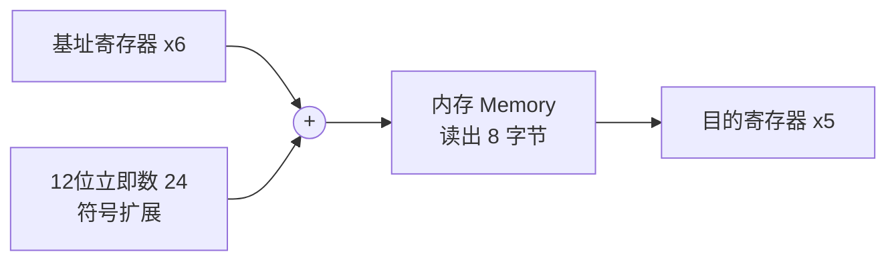

> [!example] 例：计算 `ld x5, 24(x6)` 的访存地址
> 已知 x6 = `0x12004094`，求访存地址。
>
> 1. 偏移 24 的十六进制为 `0x18`。
> 2. 只看最低字节：`0x94 + 0x18 = 0xAC`，无进位。
> 3. 地址 = `0x12004094 + 0x18 = 0x120040AC`。[^l02-section-6-s2b13]
>
> 处理器从 `0x120040AC` 开始读出 8 字节写入 x5。

#### I 格式与 S 格式

`ld` 使用 **I 格式**：immediate | rs1 | funct3 | rd | opcode。`ld x5, 24(x6)` 中，立即数 24 进 immediate 字段，基址 x6 进 rs1，目的 x5 进 rd，`ld` 本身由 opcode 与 funct3 确定。[^l02-section-6-s1p53]

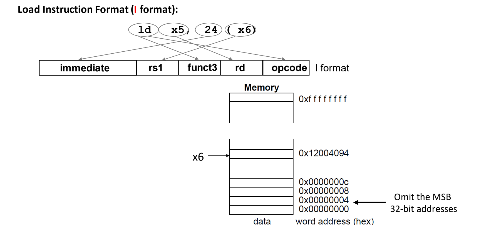

图：`ld x5, 24(x6)` 映射到 I 格式字段，x6 指向 0x12004094，访问地址为基址加偏移 24。

图中内存按 word address（十六进制）标注，地址只画了低 32 位（“Omit the MSB 32-bit addresses”），实际地址是 64 位。

`sd` 使用 **S 格式**：imm[11:5] | rs2 | rs1 | funct3 | imm[4:0] | opcode。[^l02-section-6-s1p54] 与 `ld` 的区别在于：store 不写寄存器，没有 rd，而是要读两个寄存器——rs1 = x6（基址），rs2 = x5（要写入内存的数据）。为了让 rs1、rs2 在各种格式中位置不变，12 位立即数被拆成高 7 位 imm[11:5] 和低 5 位 imm[4:0]，分别放在原来 funct7 和 rd 的位置。

> [!example] 例：`sd x5, 24(x6)` 的立即数如何拆分
> 24 的 12 位二进制为 `0000000 11000`。
>
> 1. imm[11:5] = `0000000`（放在最高 7 位）
> 2. imm[4:0] = `11000`（放在 rd 的位置）
> 3. rs2 = x5（数据），rs1 = x6（基址）

> [!warning] 易错点
> 偏移量的单位是**字节**而不是 doubleword。12 位有符号偏移的精确范围是 $-2048$ 到 $+2047$ 字节；换算成 doubleword 才是约 $\pm256$ 个。所以访问数组第 $i$ 个 doubleword 元素时，偏移是 $8i$，而不是 $i$。

> [!question]- 自测：x6 存数组 `A`（元素为 64 位整数）的基址。读 `A[3]` 的指令是什么？`ld x5, 2048(x6)` 能否直接编码？
> `ld x5, 24(x6)`，因为每个元素 8 字节，$3\times8=24$。2048 超出 12 位有符号偏移的上限 2047，不能直接编码，需要先把基址调整（例如用 `addi` 改基址寄存器）再访存。

### 端序与字节访存（Endianness, lb / sb）

一个多字节数据放进按字节编址的内存时，必须规定哪个字节放在最低地址，否则同一段内存会被不同机器读成不同的数。

**端序**（endianness）是一个字（word）内各字节在内存中的排列方式。以 32 位数据 `0x0E82FF14` 为例（msb 字节为 `0x0E`，lsb 字节为 `0x14`）：[^l02-section-6-s1p55]

| | 字地址处（最低地址）的字节 | 地址 A, A+1, A+2, A+3 中依次存放 | 代表处理器 |
| --- | --- | --- | --- |
| **大端**（Big Endian） | 最左（最高有效）字节 | `0E 82 FF 14` | IBM 360/370、Motorola 68k、MIPS、SPARC、HP PA |
| **小端**（Little Endian） | 最右（最低有效）字节 | `14 FF 82 0E` | Intel 80x86、DEC VAX、DEC Alpha |

可以用书写方向作类比：现代汉语横排从左到右书写，古代汉语竖排书写，同样的内容可以有不同的排列顺序，关键是读写双方约定一致。

> [!tip] 课堂强调
> **RISC-V 默认是小端**，这与 MIPS 等传统 RISC 采用大端不同，需要注意。在少数特殊场景（如网络设备）中可以把它配置成大端，但需要做转换，默认仍是小端。[^l02-section-6-s2b13]

#### lb 与 sb

除了整 doubleword，RISC-V 还提供搬运单个字节的指令：[^l02-section-6-s1p56]

```asm
lb x5, 40(x6)    # load byte:  x5 的低 8 位 = Memory[x6 + 40] 处的 1 字节
sb x5, 40(x6)    # store byte: Memory[x6 + 40] 处的 1 字节 = x5 的低 8 位
```

`lb` 同样是 I 格式（immediate | rs1 | funct3 | rd | opcode），地址计算方式与 `ld` 相同。问题在于寄存器是 64 位而只搬了 8 位，其余位如何处理：

- **`lb`**：把内存中的字节放到目的寄存器的最低 8 位，其余 **56 位做符号扩展**（sign extension），即全部复制该字节的第 7 位（最高位）：第 7 位为 0 则高 56 位全 0，为 1 则全 1。这样装入的有符号字节在 64 位寄存器中数值不变。
- **`sb`**：取寄存器最低 8 位写入内存中的 1 个字节；内存中该字节所在字的其他字节**完全不改**，寄存器的高 56 位直接舍弃。

> [!example] 例：`lb` 的符号扩展
> 若 `Memory[x6+40]` 处的字节为 `0x82`（二进制 `1000 0010`，第 7 位为 1），执行 `lb x5, 40(x6)` 后 x5 = `0xFFFFFFFFFFFFFF82`，按有符号数解释为 $-126$。若该字节为 `0x14`（第 7 位为 0），则 x5 = `0x0000000000000014`。

> [!warning] 易错点
> - 高位既不是“补 0”也不是“保持原值”：`lb` 一定按第 7 位做符号扩展，覆盖整个寄存器的高 56 位。
> - `sb` 不会把内存中相邻的字节清零，只写 1 个字节。

> [!note] 补充解释
> RISC-V 还有 `lbu`（load byte unsigned），它把高 56 位补 0，用于处理无符号字节（如字符）。本讲未涉及，仅作对照。

> [!question]- 自测：在 RISC-V 上把 x5 = `0x0E82FF14` 用 `sd x5, 0(x6)` 存到地址 A，再执行 `lb x7, 1(x6)`，x7 是多少？
> 小端下 A, A+1, A+2, A+3 依次存 `14 FF 82 0E`（之后 4 字节为 0），所以地址 A+1 的字节是 `0xFF`。它的第 7 位为 1，符号扩展后 x7 = `0xFFFFFFFFFFFFFFFF`，即 $-1$。

### 立即数与大常量（Immediates, lui）

程序里经常出现小常量（如循环加 1、指针加偏移）。如果每次都要先从内存把常量读进寄存器，既多一条访存指令又慢。可能的方案有三种：[^l02-section-6-s1p57]

1. 把“常用常量”放在内存中，需要时 load 进来；
2. 设置硬连线的常量寄存器（如 MIPS 的 `$zero`，对应 RISC-V 的 x0）来提供 0、1 这类常数；
3. **设计在指令中直接包含常量的专用指令**。

RISC-V 采用第 3 种方案（同时保留 x0 提供常数 0）。嵌在指令里的常量称为**立即数**（immediate）。例如：

```asm
addi sp, sp, 4    # sp = sp + 4
```

`addi` 使用 I 格式：immediate | rs1 | funct3 | rd | opcode，立即数放在最左边的 12 位，与 `ld`、`lb` 的格式相同。

> [!note] 补充解释
> 幻灯片中 `sp` 每次加 4 沿用了 32 位（MIPS）的习惯。在 RV64 中寄存器是 64 位，压栈或弹栈一个 doubleword 通常按 8 字节调整 `sp`。栈的使用见 [07 分支过程调用与栈](#分支过程调用与栈)。

#### 用 lui 构造 32 位常量

I 格式的立即数只有 12 位，装不下更大的常量。为此 RISC-V 提供 **lui**（load upper immediate），采用 **U 格式**：immediate[31:12] | rd | opcode。[^l02-section-6-s1p58]

**`lui` 的语义**：把 20 位常量装入寄存器的第 12–31 位；最高 32 位（63:32）填充第 31 位的副本（符号扩展），最低 12 位填 0。

构造一个 32 位常量分两步：

1. **`lui x5, 34534`**：把 34534 放到 x5 的 bits 31:12，低 12 位为 0。
2. **`ori x5, x5, 123`**：把 123 或进 bits 11:0，最终 x5 的高 20 位为 34534、低 12 位为 123。

```asm
lui x5, 34534       # x5[31:12] = 34534, x5[11:0] = 0
ori x5, x5, 123     # x5[11:0] = 123
```

> [!example] 例：上述两条指令执行后 x5 的值
> 1. $34534 = \texttt{0x86E6}$，执行 `lui` 后 x5 = $34534\times2^{12}$ = `0x086E6000` = 141451264。bit 31 为 0，所以高 32 位全 0。
> 2. $123 = \texttt{0x07B}$，`ori` 后 x5 = `0x086E607B` = $141451264+123=141451387$。

> [!warning] 易错点
> 低 12 位的立即数在 `ori`/`addi` 中同样会被**符号扩展**。当低 12 位 ≥ `0x800`（第 11 位为 1）时：用 `addi` 相当于减去 4096，需要把 `lui` 的高 20 位预先加 1；用 `ori` 则会把高位全部置 1，结果错误。本例 123 < 2048，所以 `ori` 与 `addi` 都正确。实践中更常用 `lui` + `addi` 的组合。

> [!question]- 自测：用 `lui` + `addi` 把 x5 置为 `0x12345FFF`，两条指令的立即数各是多少？
> 低 12 位 `0xFFF` 的第 11 位为 1，`addi` 会把它当作 $-1$。因此高 20 位要用 `0x12345 + 1 = 0x12346`：`lui x5, 0x12346` 得 `0x12346000`，再 `addi x5, x5, -1` 得 `0x12345FFF`。

> [!info]- 来源
> - L02.pdf：PDF p.48–58
> - L02.docx：DOCX body 451–525

[^l02-section-6-s1p48]: L02.pdf-PDF p.48
[^l02-section-6-s1p51]: L02.pdf-PDF p.51
[^l02-section-6-s1p49]: L02.pdf-PDF p.49
[^l02-section-6-s1p50]: L02.pdf-PDF p.50
[^l02-section-6-s2b12]: L02.docx-DOCX body 451-490
[^l02-section-6-s1p52]: L02.pdf-PDF p.52
[^l02-section-6-s2b13]: L02.docx-DOCX body 491-525
[^l02-section-6-s1p53]: L02.pdf-PDF p.53
[^l02-section-6-s1p54]: L02.pdf-PDF p.54
[^l02-section-6-s1p55]: L02.pdf-PDF p.55
[^l02-section-6-s1p56]: L02.pdf-PDF p.56
[^l02-section-6-s1p57]: L02.pdf-PDF p.57
[^l02-section-6-s1p58]: L02.pdf-PDF p.58

---

## 分支过程调用与栈

> [!abstract] 本节要点
> - `beq rs1, rs2, L` 在 rs1 = rs2 时跳转，`bne` 在不等时跳转；翻译 `if (i==j) h=i+j;` 时用**相反条件**的 `bne` 跳过 then 部分。
> - 条件分支采用 PC 相对寻址：目标 = PC + 符号扩展的 12 位立即数（SB 格式），可达范围约为 $-2^{10}\sim+2^{10}-1$ 个字；硬件用多路选择器在 PC+4 与 PC+imm 之间选择下一个 PC。
> - `jal x1, Proc` 跳到过程并把返回地址 PC+4 写入 x1（ra）；`jalr x0, 0(x1)` 返回；`jal x0, Label` 即无条件跳转（写 x0 等于丢弃链接）；更远的目标用 `lui` + `jalr` 拼出完整地址。
> - 调用者保存（caller-saved）：ra、临时寄存器 x5–x7/x28–x31、参数寄存器 x10–x17；被调用者保存（callee-saved）：sp、x8–x9（fp/saved）、x18–x27。
> - 栈从高地址向低地址增长：push 先减 sp 再存，pop 先取再加 sp；内存自低到高为保留区、代码段（Text）、静态数据、动态数据（堆，向上长）、栈（向下长）。

### 条件分支（Conditional Branch）

程序中的 `if`、循环都要求“根据数据决定下一条执行哪条指令”。顺序执行的算术和访存指令做不到这一点，因此 ISA 需要比较两个寄存器并据此改变 PC 的指令。

RISC-V 的两条基本**条件分支**（conditional branch）指令是：[^l02-section-7-s1p59]

```asm
beq rs1, rs2, L1    # 若 rs1 == rs2，则跳到 L1
bne rs1, rs2, L1    # 若 rs1 != rs2，则跳到 L1
```

条件成立时下一条指令取自标号 `L1`；条件不成立时照常执行紧随其后的那条指令。比较的是两个**源寄存器**中的值。

#### 翻译 if 语句

> [!example] 例：`if (i == j) h = i + j;`
> 设 `i`、`j`、`h` 分别在 x22、x23、x19 中。[^l02-section-7-s1p59]
>
> ```asm
>         bne  x22, x23, L1     # i != j 时跳过赋值
>         add  x19, x22, x23    # h = i + j
> L1:     ...                   # if 之后的代码
> ```
>
> 1. 源代码的条件是“相等时执行赋值”，等价于“**不等时跳过**赋值”。
> 2. 所以用相反条件的 `bne`：x22 ≠ x23 时直接跳到 `L1`，`add` 不执行。
> 3. x22 = x23 时分支不成立，顺序执行 `add`，然后自然落到 `L1`。

> [!warning] 易错点
> 把 `if (cond)` 直译成“`cond` 成立就跳转”会把 then 部分放错位置。分支跳过的是 then 部分，所以分支条件要取源条件的**反**：`==` 用 `bne`，`!=` 用 `beq`。

条件分支使用 **SB 格式**，字段从高位到低位为：

| imm[12,10:5] | rs2 | rs1 | funct3 | imm[4:1,11] | opcode |
| --- | --- | --- | --- | --- | --- |

两个源寄存器占 rs1、rs2 字段，没有 rd 字段；分支偏移量被拆成两段放在原 rd 和 funct7 的位置，共 12 位（imm[12:1]）。[^l02-section-7-s1p59] 立即数为何这样打乱排布，见 [05 RISC-V概览与指令格式](#risc-v概览与指令格式)。

### PC 相对分支目标与范围

分支指令里只剩 12 位放目标信息，不可能直接写下一个 64 位地址。既然大多数分支跳往附近的指令，就可以只编码“离当前位置多远”。

**PC 相对寻址**（PC-relative addressing）：像 `ld`/`sd` 用“基址寄存器 + 12 位偏移”算地址一样，分支也用一个寄存器加 12 位偏移，只不过这个寄存器是**指令地址寄存器**，即**程序计数器**（Program Counter, PC）。PC 的使用由指令隐含，不需要在指令中占寄存器字段。[^l02-section-7-s1p60]

$$
\text{分支目标地址} = \mathrm{PC} + \operatorname{sext}(\mathrm{imm})
$$

其中 $\operatorname{sext}$ 表示符号扩展：偏移量为有符号数，所以既能向前跳也能向后跳（循环的回跳就是负偏移）。

#### 硬件如何选择下一个 PC

1. **取指时**：PC 送往存储器取指令，同时一个加法器计算 PC + 4（下一条顺序指令的地址，指令长 4 字节）。
2. **另一个加法器**：把 SB 格式中拼出的立即数与 PC 相加，得到分支目标。
3. **多路选择器**：两路地址进入二选一 MUX，0 号输入是 PC+4，1 号输入是 PC+imm；选择信号来自分支条件（图中的“?”，即 rs1 与 rs2 的比较结果）。
4. **写回 PC**：MUX 的输出作为下一个 PC。

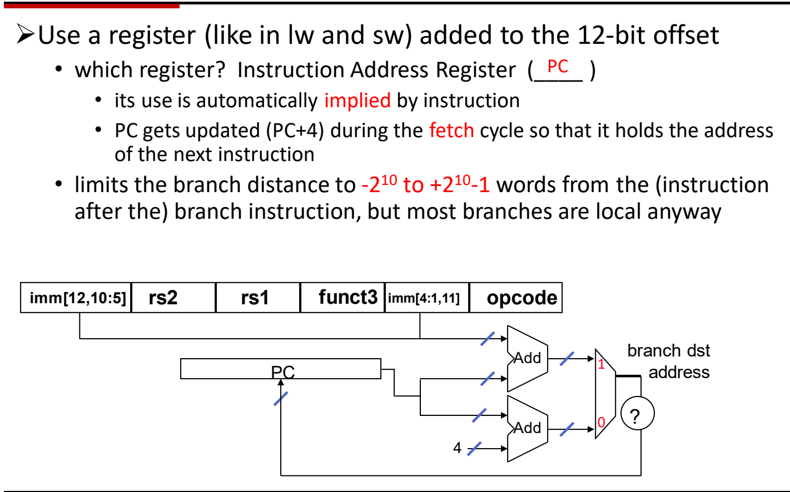

图：分支目标由 PC 与 12 位偏移相加，多路选择器在 $\mathrm{PC}+4$ 与“当前 PC 加偏移”之间按分支条件选择。

#### 跳转范围

12 位有符号偏移限制了分支距离：从分支处出发，可达范围为 $-2^{10}$ 到 $+2^{10}-1$ 个字（word，4 字节）。[^l02-section-7-s1p60] 这个范围不大，但多数分支都是局部的（循环体、if 块），足够使用；超出范围时需要改用跳转指令（见下一节）。

> [!note] 补充解释
> 推导范围：RISC-V 的分支立即数编码的是 imm[12:1]，最低位 imm[0] 恒为 0 不存储，因此 12 位字段实际表示 13 位有符号字节偏移，范围 $-2^{12}\sim2^{12}-2$ 字节，即 $\pm4\,\text{KiB}$，折合约 $-2^{10}\sim+2^{10}$ 个字，与上面的结论一致。
>
> 课件中“PC 在取指周期已更新为 PC+4，偏移从分支的下一条指令算起”是 MIPS 的约定。[^l02-section-7-s1p60]按 [RISC-V 官方非特权规范：RV32I 的 Conditional Branches](https://docs.riscv.org/reference/isa/v20260120/unpriv/rv32.html)，偏移量加到**分支指令自身的地址**上，而不是 PC+4。做题时以 RISC-V 规则为准：`beq x5, x6, 100` 跳到“本条分支地址 + 100”。

### jal/jalr 与过程调用

调用函数（过程）要完成两件事：跳到函数入口，并记住回来的位置。如果只用普通跳转，函数执行完就不知道该回到哪个调用点，因为同一个函数可能被很多地方调用。

**跳转并链接**（jump and link, `jal`）在跳转的同时把返回地址保存进寄存器：[^l02-section-7-s1p61]

```asm
jal  x1, ProcedureAddress   # x1 = PC + 4; PC = 过程入口
jalr x0, 0(x1)              # 返回：PC = x1 + 0; 链接写入 x0（被丢弃）
```

- `jal x1, ProcedureAddress`：把 PC+4（调用指令的下一条指令的地址）存入 x1，作为返回用的“链接”，然后跳到过程地址。x1 因此又名 **ra**（return address，返回地址寄存器）。`jal` 使用 **UJ 格式**：`immediate[20,10:1,11,19:12] | rd | opcode`。[^l02-section-7-s1p61]
- `jalr x0, 0(x1)`（jump and link register）：目标地址 = 寄存器 x1 的值 + 偏移 0，即返回地址。它同样会把 PC+4 写入 rd，但 rd = x0 恒为 0，写入无效，所以这条指令只是一次纯粹的“跳回调用点”。[^l02-section-7-s2b13]

一次完整的调用与返回可以按下面的时序理解（参数和保存寄存器的约定见下一节）：

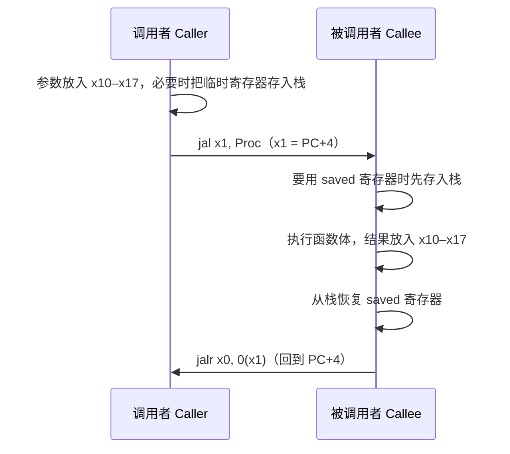

#### 无条件跳转

RISC-V 没有单独的无条件跳转指令，而是借助 x0：[^l02-section-7-s1p62]

```asm
jal x0, Label    # 无条件跳到 Label
```

它与过程调用 `jal x1, Proc` 的唯一区别是链接写到哪里：写进 x1 是为了以后返回；写进 x0 则等于丢弃，因为单纯的跳转不需要返回地址。[^l02-section-7-s2b13]

> [!note] 补充解释
> `jal` 的立即数编码 imm[20:1]（最低位恒 0），可达范围为 $\pm1\,\text{MiB}$（$-2^{20}\sim2^{20}-2$ 字节），比条件分支的 $\pm4\,\text{KiB}$ 大得多，但仍有限。

#### 长跳转：lui + jalr

当目标超出 `jal` 的范围时，可以先把完整的目标地址放进寄存器，再用 `jalr` 跳过去。课件给出的写法是：[^l02-section-7-s1p62]

```asm
lui  x5, 32423        # x5 = 32423 << 12，填入第 31~12 位
jalr x1, 2342(x5)     # 跳到 x5 + 2342，并把 PC+4 写入 x1
```

1. `lui`（load upper immediate）把 20 位立即数放到 x5 的第 31～12 位，低 12 位清零（`lui` 构造常量的细节见 [06 算术与访存指令](#算术与访存指令)）。
2. `jalr` 再把一个 12 位立即数加到 x5 上，补齐低 12 位（第 11～0 位），合成一个 32 位的目标地址。[^l02-section-7-s2b14]
3. 由于 rd = x1，这同时是一次可以返回的“远调用”；若写 x0，则是一次远距离无条件跳转。

> [!warning] 易错点：低 12 位按有符号数相加
> `jalr` 的偏移量是 **12 位有符号数**，可表示 $-2048\sim2047$。课件中的 2342 > 2047，实际**无法编码**进 `jalr`[^l02-section-7-s1p62]，只能理解为“想要的低 12 位是 2342”。
>
> 正确拆分要考虑符号扩展：目标为 $32423\times4096+2342 = 132\,806\,950$（`0x07EA7926`）。低 12 位 `0x926` 的第 11 位是 1，作为有符号数等于 $2342-4096=-1754$。为抵消这个 $-4096$，高 20 位要多加 1：
>
> ```asm
> lui  x5, 32424        # 32424 × 4096 = 132 808 704
> jalr x1, -1754(x5)    # 132 808 704 − 1754 = 132 806 950
> ```
>
> 判断规则：低 12 位的最高位（第 11 位）为 1 时，`lui` 的立即数 +1，低 12 位取“值 − 4096”。

> [!note] 补充解释：`jalr x1, 0(x1)` 的执行顺序
> 当 rd 与 rs1 是同一个寄存器时，结果会不会取决于“先写 rd 还是先算目标”？RISC-V 规范规定：目标地址用**旧的** rs1 值计算（并把结果最低位清 0），之后才把 PC+4 写入 rd。等价于
> `t = PC+4; PC = (x[rs1] + sext(imm)) & ~1; x[rd] = t`。
> 因此 `jalr x1, 0(x1)` 跳到原 x1 指向的地址，同时 x1 变成这条指令的下一条地址。详见 [RISC-V 官方非特权规范：RV32I 的 Unconditional Jumps](https://docs.riscv.org/reference/isa/v20260120/unpriv/rv32.html) 中的 JALR 说明。

### 调用者保存与被调用者保存

一个函数在运行时需要三类信息：1. 参数；2. 调用者的现场信息（返回后还要用的值）；3. 全局变量。[^l02-section-7-s1p63] 调用者和被调用者共享同一组 32 个寄存器，被调用者随便使用寄存器就可能覆盖调用者的数据。所以要约定：每个寄存器在调用前后的值由谁负责保持。

- **调用者保存**（caller-saved）：被调用者可以随意改写。调用者如果认为某个寄存器中的值在调用之后还要用，就必须在调用前自己把它存到栈上，调用返回后再取回。[^l02-section-7-s2b14]
- **被调用者保存**（callee-saved）：调用者默认这些寄存器的值在调用前后**不变**。被调用者如果想使用它们，必须先把原值存到栈上，在返回前恢复。[^l02-section-7-s2b14]

| 寄存器 | 编号 | 用途 | 调用时由谁保存 |
| --- | --- | --- | --- |
| x0 | 0 | 常数 0 | 不适用 |
| x1（ra） | 1 | 返回地址（链接寄存器） | 调用者 |
| x2（sp） | 2 | 栈指针 | 被调用者 |
| x3（gp） | 3 | 全局指针 | — |
| x4（tp） | 4 | 线程指针 | — |
| x5–x7 | 5–7 | 临时寄存器 | 调用者 |
| x8–x9 | 8–9 | 帧指针 / 保存寄存器 | 被调用者 |
| x10–x17 | 10–17 | 参数 / 返回值 | 调用者 |
| x18–x27 | 18–27 | 保存寄存器 | 被调用者 |
| x28–x31 | 28–31 | 临时寄存器 | 调用者 |

几条理解要点（寄存器的一般用途见 [06 算术与访存指令](#算术与访存指令)）：

1. **ra 是调用者保存**：每次执行 `jal x1, …` 都会覆盖 x1。函数 A 若要再调用函数 B（嵌套或递归），必须先把自己的返回地址保存到栈上，否则 A 回不去自己的调用者。[^l02-section-7-s2b14]
2. **sp 是被调用者保存**：调用者期望返回后栈指针恢复原样；被调用者自己移动了 sp，返回前必须移回。
3. **x0、gp、tp 无需保存**：x0 恒为 0；全局指针 gp 指向全局数据区，一般不改变。[^l02-section-7-s2b14]
4. **参数寄存器 x10–x17 是调用者保存**：它们用于向被调用者传参、接收返回值，被调用者当然可以改写。

> [!warning] 易错点
> “caller-saved”并不表示调用者每次都得保存，只有调用后还要用的值才需要保存；“callee-saved”也只要求被调用者在**使用**这些寄存器时保存，没用到的就不必存。约定的目的是让双方各自只保存必要的寄存器。

### 栈与内存布局

寄存器只有 32 个。被调用者需要的寄存器超过空闲数量，或过程是递归的、每一层都要保存自己的返回地址时，就必须把寄存器的值**溢出**（spill）到内存。

**栈**（stack）是内存中一个后进先出（LIFO）的队列，用于传递额外的值，或保存（递归调用的）返回地址。通用寄存器 **sp**（x2）用来寻址栈顶，栈从**高地址向低地址**“增长”。[^l02-section-7-s1p64]

- **入栈**（push）：先 `sp = sp − 4`，再把数据存到新的 sp 指向的位置。
- **出栈**（pop）：先从 sp 指向的位置取出数据，再 `sp = sp + 4`。[^l02-section-7-s1p64]

所以压入数据时 sp 减小，弹出时 sp 增大，与“栈向上长”的直觉方向相反。[^l02-section-7-s2b14]

> [!warning] 易错点：步长是 4 还是 8
> 课件中的 ±4 沿用了 32 位 MIPS 的写法（每个寄存器 4 字节）。[^l02-section-7-s1p64]RV64 的寄存器是 64 位，用 `sd`/`ld` 保存一个寄存器占 8 字节，所以每保存一个寄存器 sp 要移动 8（标准调用约定还要求 sp 保持 16 字节对齐）。

> [!example] 例：被调用者使用 x18、x19（RV64）
> 函数要用两个被调用者保存寄存器，并且自己还要调用别的函数（需保存 ra）。
>
> ```asm
> proc:   addi sp, sp, -24      # 栈向低地址开辟 3 个双字
>         sd   x1, 16(sp)       # 保存返回地址 ra（嵌套调用会覆盖它）
>         sd   x18, 8(sp)       # 保存调用者的 x18
>         sd   x19, 0(sp)       # 保存调用者的 x19
>         ...                   # 函数体，可自由使用 x18、x19，可 jal 调用其他函数
>         ld   x19, 0(sp)       # 逆序恢复
>         ld   x18, 8(sp)
>         ld   x1, 16(sp)
>         addi sp, sp, 24       # 释放栈空间，sp 恢复原值
>         jalr x0, 0(x1)        # 返回
> ```
>
> 1. 开辟空间：sp 减去要保存的字节数 3 × 8 = 24。
> 2. 保存：以 sp 为基址、偏移 0/8/16 存入。
> 3. 恢复与释放的顺序和保存相反，最后 sp 加回 24，这满足“sp 由被调用者保存”的约定。
> （严格遵守 16 字节对齐时应开辟 32 字节。）

#### 内存布局

一个程序的内存从低地址到高地址依次为：[^l02-section-7-s1p65]

1. **保留区**（Reserved）：从地址 0 开始，程序不使用。
2. **代码段**（Text）：存放机器指令，PC 指向这里。
3. **静态数据**（Static Data）：从 $(\mathtt{0000\,0000\,1000\,0000})_{16}$ 开始，存放全局变量和常量；全局指针 gp 指向这里，一般不变。
4. **动态数据**（Dynamic Data，即**堆** heap）：紧接静态数据，**向高地址**增长。
5. **栈**（Stack）：从高地址 $(\mathtt{0000\,003f\,ffff\,fff0})_{16}$（sp 的初值）开始，**向低地址**增长。

栈和堆从两端相向增长，共享中间的空闲空间。[^l02-section-7-s2b14]

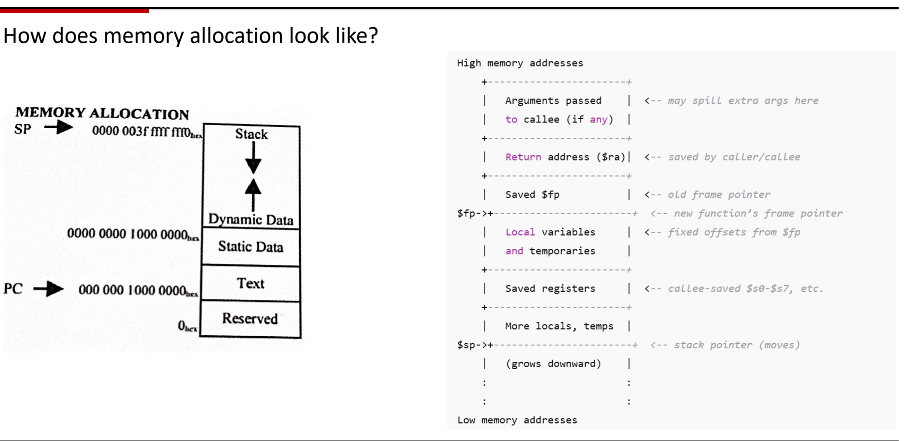

图：左：内存布局从低到高为保留区、代码段、静态数据、动态数据（向上长）与栈（向下长）；右：栈帧中参数、返回地址、旧帧指针、局部变量与保存寄存器的排布。

> [!note] 补充解释
> 图中代码段起始地址扫描不清，在 RISC-V 版教材的约定中是 $(\mathtt{0000\,0000\,0040\,0000})_{16}$。图右侧的栈帧示意使用 MIPS 寄存器名：`$ra` 对应 RISC-V 的 x1，`$fp` 对应 x8，`$sp` 对应 x2，`$s0–$s7` 对应 RISC-V 的 saved 寄存器 x8–x9、x18–x27。

#### 栈帧

每次过程调用在栈上占用的一段区域叫**栈帧**（stack frame）。自高地址向低地址，一个栈帧依次包含：[^l02-section-7-s1p65]

1. 传给被调用者的参数（参数寄存器不够时，多出的参数溢出到这里）；
2. 返回地址 ra（由调用者或被调用者保存）；
3. 保存的旧 fp（上一层函数的帧指针）；此处是新函数的**帧指针**（frame pointer, fp）所指位置；
4. 局部变量和临时值，用相对 fp 的**固定偏移**访问；
5. 保存的被调用者保存寄存器；
6. 更多局部变量/临时值，下端由 sp 指示。sp 会随 push/pop 移动，fp 在函数执行期间保持不变。[^l02-section-7-s2b14]

因为 sp 在函数体内会变动，用 fp 加固定偏移访问局部变量比用 sp 更稳定。

> [!question]- 自测：x5 = 8, x6 = 8 时，下面代码执行后 x7 是多少？把 `bne` 换成 `beq` 呢？
> ```asm
>       addi x7, x0, 1
>       bne  x5, x6, L1
>       addi x7, x7, 10
> L1:   addi x7, x7, 100
> ```
> 原代码 x7 = 111：两数相等，`bne` 不跳，三条 `addi` 都执行（1+10+100）。换成 `beq` 后结果是 101：条件成立，跳过 `addi x7, x7, 10`。

> [!question]- 自测：要用 lui + jalr 跳到地址 `0x00012FFC` 并保存返回地址，两条指令的立即数各是多少？
> `lui x5, 0x13`，`jalr x1, -4(x5)`。低 12 位 `0xFFC` 的第 11 位是 1，作为有符号数为 $4092-4096=-4$，所以高 20 位要由 `0x12` 加 1 变成 `0x13`。验证：$0x13000-4=0x12FFC$。

> [!question]- 自测：函数 A 在 x18 和 x5 中各有一个调用后还要用的值，接着执行 `jal x1, B`。A 自己需要把哪些寄存器存到栈上？B 呢？
> A 要保存 x5（临时寄存器，调用者保存），还要保存 x1：`jal` 会覆盖 A 自己的返回地址，A 之后就回不去了。A 不必保存 x18，因为它是被调用者保存寄存器，由 B 保证不变：B 若要使用 x18，就必须先存入栈、返回前恢复；B 若不用 x18，就什么都不用做。

> [!info]- 来源
> - L02.pdf：PDF p.59–65
> - L02.docx：DOCX body 491–564

[^l02-section-7-s1p59]: L02.pdf-PDF p.59
[^l02-section-7-s1p60]: L02.pdf-PDF p.60
[^l02-section-7-s1p61]: L02.pdf-PDF p.61
[^l02-section-7-s2b13]: L02.docx-DOCX body 491-525
[^l02-section-7-s1p62]: L02.pdf-PDF p.62
[^l02-section-7-s2b14]: L02.docx-DOCX body 526-564
[^l02-section-7-s1p63]: L02.pdf-PDF p.63
[^l02-section-7-s1p64]: L02.pdf-PDF p.64
[^l02-section-7-s1p65]: L02.pdf-PDF p.65

---

## 同步指令与寻址方式

> [!abstract] 本节要点
> - 多核访问同一块内存需要**锁**：值 0 表示空闲、1 表示被占用；"读锁—判断—置 1"必须由硬件保证**原子**完成（原子交换 / 原子 swap），CISC 用一条复杂的 C&S 指令实现。
> - RISC-V 把 C&S 拆成两条 R 型指令：`lr.d` 读取内存并在该地址登记**保留**；`sc.d` 仅当保留仍有效、且写入的字节落在保留集合内时才写内存，结果寄存器 **0 表示成功、非 0 表示失败**。
> - 原子交换 = `lr.d` → `sc.d` → `bne` 失败重试 → 把读到的旧值放回寄存器；失败时内存不被修改，所以重试是安全的。
> - LR/SC 边界规则：地址不在保留集合内则 SC 失败；**无论成功与否，执行任何 SC 都会使本 hart 的保留失效**；一个 hart 同时只持有一个保留，后一条 LR 会取代前一条。
> - RISC-V 有四种寻址方式：寄存器、基址（偏移）、立即数、PC 相对；设计原则是"简单源于规整、好设计需要好折中、越小越快、加速常见情况"。

### 锁与原子操作（Lock and Atomic Operation）

当多个核心要访问同一段数据或同一段内存时，必须保证同一时刻只有一个核心在修改它，否则两个核心各自"读—改—写"会互相覆盖结果。软件的做法是给这段数据配一把锁，用锁的值标记这段代码或数据当前是否已被占用。

**锁**（lock）是最简单的**同步原语**（synchronization primitive）：用一个内存字表示，值 **0 表示锁空闲，1 表示锁不可用**（已被占用）。[^l02-section-8-s1p66]

获取锁的过程是：

1. **读**：读出锁所在地址上的值；
2. **比较**：与期望值比较，期望值是 0（空闲）；
3. **写**：若为 0，就把它置为 1，表示本核心拿到了锁；若为 1，说明别人占着，本核心无法操作，只能不停地轮询（自旋）重复以上步骤。

关键在于"读"和"写"之间不能被其他核心插入：如果两个核心都先读到 0、再各自写 1，就会同时认为自己拿到了锁。因此需要硬件提供**原子交换**（atomic exchange / atomic swap）——把"读出旧值并写入新值"作为一个不可分割的整体完成。[^l02-section-8-s1p66]

在 CISC 中，这一过程可以直接做成一条复杂指令 **C&S**（compare-and-swap，比较并交换）：CISC 本就允许为复杂操作增加专门的指令。RISC 是精简指令集，必须复用已有的指令格式，不能为此引入一条"读—比较—写"三合一的复杂指令，于是 RISC-V 用两条 R 型指令代替它，这就是下一小节的 LR/SC。[^l02-section-8-s1p67]

指令格式本身（R 型等 6 种格式）见 [05 RISC-V概览与指令格式](#risc-v概览与指令格式)。

### 保留加载与条件存储（lr.d / sc.d）

LR/SC 的思路是：不在读写期间"锁住"内存，而是先读、再在写的时候检查"这期间有没有人动过它"，动过就放弃本次写入并重试。

- **`lr.d`**（load-reserved doubleword，保留加载双字）：`lr.d x5, (x6)` 执行 `x5 = Memory[x6]`，这是一次普通的加载；此外它还在地址 `x6` 上登记一个**保留**（reservation），即开始监视这个地址后续是否被其他核心写入。
- **`sc.d`**（store-conditional doubleword，条件存储双字）：`sc.d x7, x5, (x6)` 尝试执行 `Memory[x6] = x5`，并把结果写入 `x7`。[^l02-section-8-s1p67]

**功能规则**：如果在对同一地址执行 store-conditional 之前，load-reserved 所指定的内存单元内容被改变了，那么 store-conditional 失败，并且**不把值写入内存**。[^l02-section-8-s1p67]

`sc.d` 的执行过程：

1. 检查 `x6` 对应地址上的保留是否仍有效（期间没有被其他核心写过）；
2. 若有效，把 `x5` 写入 `Memory[x6]`，并令 `x7 = 0`，表示成功；
3. 若无效，不写内存，令 `x7` 为非 0 值，表示失败。

> [!warning] 易错点：sc.d 的结果是 0 表示成功
> 幻灯片注释只写了 `x7=0/1`。课堂上一开始说"成功置 1、失败置 0"，随后自行更正为**成功是 0、失败是 1**。[^l02-section-8-s2b15] 这与 RISC-V 规范和下面原子交换代码中的 `bne x11, x0, again`（不等于 0 即"store 失败"，跳回重试）一致。判断时记住：结果寄存器是"错误码"，0 = 没有错误。

这对指令可以实现**不加锁的原子内存更新**：`lr.d` 把 `Memory[x6]` 读入 `x5` 后，程序可以在 `x5` 这份副本上任意修改；`sc.d` 只有在你处理副本期间 `Memory[x6]` 没被改动时，才用修改后的 `x5` 覆盖它，`x7` 指示是否成功。[^l02-section-8-s1p68] 失败时内存保持原样，所以只要回到 `lr.d` 重新开始即可。

#### 例：原子交换 x23 与 Memory[x20]

目标：把寄存器 `x23` 的值与内存 `Memory[x20]` 的值原子地互换。[^l02-section-8-s1p67]

```asm
again: lr.d  x10, (x20)        # load-reserved：x10 = Memory[x20]，并在 x20 上登记保留
       sc.d  x11, x23, (x20)   # store-conditional：尝试 Memory[x20] = x23，结果写入 x11
       bne   x11, x0, again    # x11 != 0 表示 store 失败，跳回重试
       addi  x23, x10, 0       # 成功：把读到的旧值放入 x23
```

逐步说明：

1. `lr.d` 把内存旧值读到 `x10`，同时开始监视 `x20` 指向的地址；
2. `sc.d` 尝试把 `x23` 写进该地址，成功与否写入 `x11`；
3. 若 `x11 ≠ 0`，说明在第 1、2 步之间有其他核心改动过该地址，本次写入未发生，回到 `again` 重做；
4. 若 `x11 = 0`，写入已完成，再用 `addi x23, x10, 0` 把旧值移入 `x23`，交换完成。

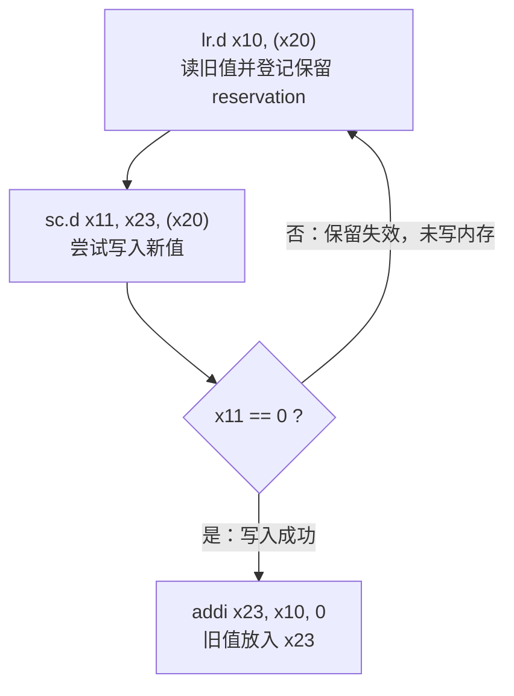

> [!note] 补充解释
> 上面的交换把 `x23` 原来的值写入内存、把内存旧值取回 `x23`。若 `x23` 中放的是 1、`Memory[x20]` 是锁，那么交换后 `x23` 中的旧值为 0 就表示拿到了锁，为 1 就表示锁原本被占用、需要继续轮询——这正是上一小节"读—比较—置 1"的原子实现。

### LR/SC 的边界情况

LR/SC 成对使用时语义直观，但地址不一致、不成对或交错使用时，结果完全由两条规则决定。[^l02-section-8-s1p69] 依据 [RISC-V 官方非特权规范：A 扩展的 Zalrsc（LR/SC）一节](https://docs.riscv.org/reference/isa/v20260120/unpriv/a-st-ext.html)：

1. **成功条件**：`sc.w` 只有在保留仍有效，**并且**保留集合（reservation set）包含它要写入的字节时才成功；
2. **SC 总会清除保留**：无论成功还是失败，执行一条 `sc.w` 都会使本 hart（硬件线程）持有的任何保留失效。[^l02-section-8-s1p69]

此外，规范规定一个 hart 同一时刻只持有一个保留，新的 `lr` 会取代之前的保留。下面三个例子用的是字版本 `lr.w`/`sc.w`，规则与 `.d` 版本相同；结果寄存器 0 为成功、非 0 为失败。

**Case 1：LR/SC 地址不匹配**

```asm
lr.w t0, (a0)
sc.w t1, a1, (a3)
```

保留登记在 `a0` 所在的保留集合上，而 `sc.w` 写的是 `a3`。除非 `a0` 与 `a3` 恰好落在同一个保留集合内，否则不满足规则 1，**SC 失败，`t1 ≠ 0`**，内存不被写入。

**Case 2：不成对的 LR/SC**

```asm
lr.w t0, (a0)
sc.w t1, a1, (a0)
addi a1, a1, 1
sc.w t2, a1, (a0)
```

第一条 `sc.w` 与 `lr.w` 地址相同、保留有效，**成功，`t1 = 0`**。但根据规则 2，这条 SC 执行后保留已被清除；第二条 `sc.w` 前没有新的 `lr.w`，**必然失败，`t2 ≠ 0`**。

**Case 3：同一核心的多条 LR、多条 SC**

```asm
lr.w t0, (a0)
lr.w t1, (a2)
sc.w t2, a1, (a0)
sc.w t3, a1, (a2)
```

1. 第二条 `lr.w` 在 `a2` 上登记保留，**取代**了 `a0` 上的保留（一个 hart 只有一个保留）；
2. `sc.w t2, a1, (a0)`：保留集合是 `a2` 所在的集合，不包含 `a0` 的字节（除非两者同属一个保留集合），**失败，`t2 ≠ 0`**；同时这条 SC 清除了 `a2` 上的保留；
3. `sc.w t3, a1, (a2)`：保留已被上一条 SC 清除，**失败，`t3 ≠ 0`**。

> [!warning] 易错点：课堂讨论中的答案与规范不一致
> Case 2 的课堂答案（`t1` 成功、`t2` 失败）与规范一致。Case 1 的课堂讨论在 0/1 含义上反复，最后说"应该是 0"（成功）；Case 3 课堂答案是"`t2` 成功、`t3` 失败"，理由是"有 `a0` 的保留"。[^l02-section-8-s2b15] 这两处与幻灯片自己列出的规则 1 不符[^l02-section-8-s1p69]：Case 1 写入地址不在保留集合内，应当失败；Case 3 中 `a0` 的保留已被第二条 `lr.w` 取代，`t2`、`t3` 都失败。判断时按上面两条规则加"一个 hart 一个保留"逐条推演，不要凭"之前 LR 过这个地址"下结论。

### 四种寻址方式（Addressing Modes）

指令中的操作数可能在寄存器里、在内存里、在指令本身里，跳转目标又是一个指令地址；**寻址方式**（addressing mode）规定了如何从指令字段得到操作数或目标地址。RISC-V 有 6 种指令格式，但只有 4 种寻址方式：

| 寻址方式 | 操作数 / 目标在哪里 | 地址或值如何得到 | 使用的格式与典型指令 |
| --- | --- | --- | --- |
| **寄存器寻址**（register addressing） | 寄存器 | 字段 rs1/rs2 直接指定寄存器，操作数是寄存器中的双字 | R 型：`add x5, x6, x7` |
| **基址（偏移）寻址**（base / displacement addressing） | 内存 | 地址 = 基址寄存器 + 指令中的 12 位常数 | I 型（加载）：`ld x5, 40(x6)`；操作数可以是双字、字、半字或字节 |
| **立即数寻址**（immediate addressing） | 指令本身 | 操作数就是指令中的 12 位常数 | I 型：`addi x5, x6, 20` |
| **PC 相对寻址**（PC-relative addressing） | 内存中的指令 | 指令地址 = PC + 指令中的 12 位常数 | SB 型：`beq x5, x6, 100`，得到分支目标指令 |

[^l02-section-8-s1p71]

- 寄存器寻址：所有算术运算的源数据都来自寄存器堆，指令里只给寄存器编号。
- 基址寻址：寄存器中存放的是内存地址，再加上一个立即数偏移，才得到真正访问的内存位置。偏移范围与 `ld`/`sd` 的细节见 [06 算术与访存指令](#算术与访存指令)。
- 立即数寻址：一部分源操作数直接编码在指令里，不需要额外访存或占用寄存器。
- PC 相对寻址：目标地址以当前 PC 为基准加上指令中的立即数，用于分支，找到的是"分支目的指令"。[^l02-section-8-s1p72]

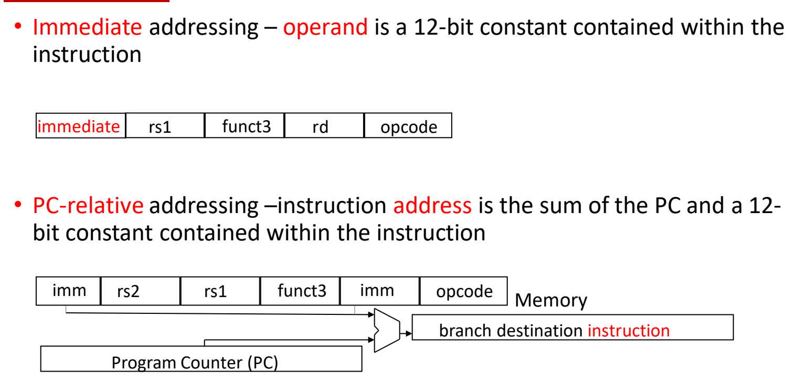

图：立即数寻址的操作数是指令中的 12 位常量；PC 相对寻址的目标指令地址是 PC 加 12 位常量。

PC 相对寻址中，SB 型指令的立即数被拆成两段（`imm | rs2 | rs1 | funct3 | imm | opcode`），拼接后与 PC 相加得到分支目标；其跳转范围与立即数最低位省略的细节见 [07 分支过程调用与栈](#分支过程调用与栈)。

### RISC-V 指令汇总与设计原则

到目前为止学过的指令可以按类别汇总如下。操作码一列**不要求记忆**，重点是知道每条指令的含义和特点（例如 `beq`/`bne` 做什么、load/store 指令的特点）。[^l02-section-8-s2b15]

| 类别（格式） | 指令 | 操作码 | 示例 | 含义 |
| --- | --- | --- | --- | --- |
| 算术（R、I） | add | 0110011 | `add x5, x6, x7` | x5 = x6 + x7 |
| | subtract | 0110011 | `sub x5, x6, x7` | x5 = x6 − x7 |
| | add immediate | 0010011 | `addi x5, x6, 20` | x5 = x6 + 20 |
| | or immediate | 0010011 | `ori x5, x6, 20` | x5 = x6 \| 20 |
| 数据传送（I、S、U） | load doubleword | 0000011 | `ld x5, 40(x6)` | x5 = Memory[x6 + 40] |
| | store doubleword | 0100011 | `sd x5, 40(x6)` | Memory[x6 + 40] = x5 |
| | load byte | 0000011 | `lb x5, 40(x6)` | `x5(7:0) = Memory[x6 + 40](7:0)`，高位符号扩展 |
| | store byte | 0100011 | `sb x5, 40(x6)` | `Memory[x6 + 40](7:0) = x5(7:0)` |
| | load upper imm | 0110111 | `lui x5, 0x12345` | x5 = 0x12345000 |
| 条件分支（SB） | branch on equal | 1100011 | `beq x5, x6, 100` | if (x5 == x6) go to PC+100 |
| | branch on not equal | 1100011 | `bne x5, x6, 100` | if (x5 != x6) go to PC+100 |
| 跳转（UJ、I） | jump and link | 1101111 | `jal x1, imm` | x1 = PC+4; PC = PC + {imm, 1'b0} |
| | jump and link register | 1100111 | `jalr x0, 0(x1)` | 跳到 x1 + 0（此处用于过程返回） |

[^l02-section-8-s1p70]

> [!warning] 易错点：幻灯片操作码表有误
> 原表把 `beq`/`bne` 的操作码写成 `1100111`，正确的 BRANCH 操作码是 **`1100011`**；`jal` 与 `jalr` 的操作码写反了，正确为 **`jal = 1101111`、`jalr = 1100111`**。[^l02-section-8-s1p70] 上表已按 RISC-V 规范更正。另外原表 `lb` 的含义只写了低 8 位，实际加载后高位按符号扩展（见 [06 算术与访存指令](#算术与访存指令)）。

RISC-V 的整体设计可以归结为四条原则，每一条都能在前面学过的内容里找到对应：[^l02-section-8-s1p73]

1. **简单源于规整**（Simplicity favors regularity）：所有指令定长 32 位；指令格式数量少。
2. **好设计需要好折中**（Good design demands good compromises）：在"格式尽量少"和"各类指令都要放得下足够大的立即数"之间折中，最终采用 6 种指令格式（作为对比，MIPS 只有 3 种）。[^l02-section-8-s2b15]
3. **越小越快**（Smaller is faster）：有限的指令集、寄存器堆中有限数量的寄存器、有限的寻址方式（只有上面 4 种）。
4. **加速常见情况**（Make the common case fast）：算术运算的操作数都来自寄存器堆（load-store 结构，只有 load/store 访问内存）；允许指令中直接包含立即数，常用小常数不必先从内存加载，从而减少指令数。

"加速常见情况"与 Amdahl 定律的关系见 [03 性能汇总与Amdahl定律](#性能汇总与amdahl定律)；CISC 与 RISC 的整体对比见 [04 ISA抽象与RISC思想](#isa抽象与risc思想)。

> [!question]- 自测：在原子交换循环中，若另一核心在 `lr.d` 与 `sc.d` 之间写了 `Memory[x20]`，接下来会发生什么？最终 `x23` 和内存中是什么？
> `sc.d` 失败：`Memory[x20]` 不被写入（保持另一核心写入的值），`x11` 为非 0，`bne x11, x0, again` 跳回重新执行 `lr.d`，读到另一核心写入的新值。只有某一轮 `sc.d` 成功（`x11 = 0`）后，内存才变为原 `x23`，而 `x23` 得到该轮 `lr.d` 读到的值，交换仍然是原子的。

> [!question]- 自测：同一 hart 依次执行 `lr.w t0,(a0)`、`sc.w t1,a1,(a0)`、`lr.w t2,(a0)`、`sc.w t3,a1,(a0)`（期间无其他 hart 写 `a0`），`t1`、`t3` 各是多少？
> 都是 0（都成功）。第一条 SC 成功后清除了保留，但第二条 `lr.w` 重新在 `a0` 上登记了保留，所以第二条 SC 的保留有效且地址匹配。与 Case 2 的区别在于两条 SC 之间是否有新的 LR。

> [!question]- 自测：分别指出 `ld x5, 40(x6)`、`addi x5, x6, 20`、`bne x5, x6, 100` 中各操作数用的是哪种寻址方式？
> `ld`：目的 `x5` 为寄存器寻址，内存操作数为基址寻址（地址 = x6 + 40）。`addi`：`x5`、`x6` 为寄存器寻址，20 为立即数寻址。`bne`：比较的 `x5`、`x6` 为寄存器寻址，跳转目标为 PC 相对寻址（PC + 100）。

> [!info]- 来源
> - L02.pdf：PDF p.66–73
> - L02.docx：DOCX body 526–612

[^l02-section-8-s1p66]: L02.pdf-PDF p.66
[^l02-section-8-s1p67]: L02.pdf-PDF p.67
[^l02-section-8-s2b15]: L02.docx-DOCX body 565-612
[^l02-section-8-s1p68]: L02.pdf-PDF p.68
[^l02-section-8-s1p69]: L02.pdf-PDF p.69
[^l02-section-8-s1p71]: L02.pdf-PDF p.71
[^l02-section-8-s1p72]: L02.pdf-PDF p.72
[^l02-section-8-s1p70]: L02.pdf-PDF p.70
[^l02-section-8-s1p73]: L02.pdf-PDF p.73

---

## 本讲小结

本讲的两半由性能铁律串起来：ISA 决定指令数并影响 CPI，组织（微架构）决定 CPI 和时钟周期，RISC 的设计哲学和 RISC-V 的每一个设计取舍（定长 32 位指令、load-store、立即数嵌入指令、少量寻址方式）都可以用“对 IC、CPI、CC 的影响”和“加速常见情况”来解释。

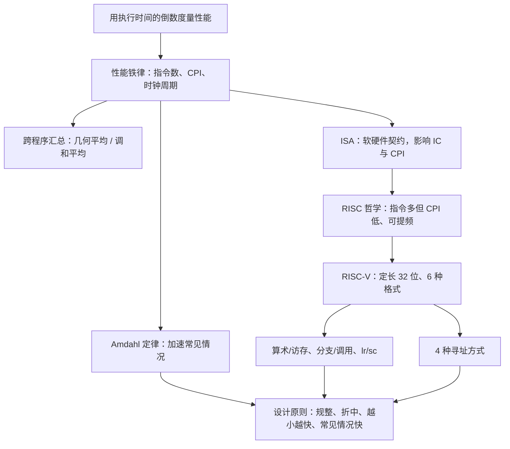

### 核心公式

| 用途 | 公式 | 要点 |
| --- | --- | --- |
| 性能与“快 $n$ 倍” | $\Pi=1/T$；$T_Y/T_X=n$ | 比值就是 $n$，不是 $n+1$ |
| 时钟 | $\mathrm{CC}=1/\mathrm{CR}$ | 1 ns ↔ 1 GHz |
| 有效 CPI | $\mathrm{CPI}_{\mathrm{eff}}=\sum_i w_i\mathrm{CPI}_i$ | $w_i$ 为动态执行占比 |
| 性能铁律 | $T_{\mathrm{CPU}}=\mathrm{IC}\times\mathrm{CPI}\times\mathrm{CC}$ | IC←ISA/编译器，CPI←ISA/组织，CC←组织/工艺 |
| 汇总归一化时间 | $\mathrm{GM}=\sqrt[n]{\prod_i T_i/T_{R,i}}$ | $T_{R,i}$ 为参考机执行时间；与参考机无关 |
| 平均 IPC | $\operatorname{H}(\mathrm{IPC}_i)=1/\overline{\mathrm{CPI}}$ | IPC 不能算术平均 |
| Amdahl 定律 | $\dfrac{1}{(1-F)+F/S}$ | $F$ 是原执行时间中的比例；上限 $1/(1-F)$ |
| 访存地址 | $\mathrm{Reg}[\mathrm{rs1}]+\operatorname{sext}(\mathrm{imm}_{12})$ | 偏移以字节计，$-2048\sim2047$ |
| 分支 / 跳转目标 | $\mathrm{PC}+\operatorname{sext}(\mathrm{imm})$ | 分支约 $\pm2^{10}$ 字，`jal` 约 $\pm1$ MiB |
| 32 位常量 / 长跳转 | `lui` 高 20 位 + `addi`/`jalr` 低 12 位 | 低 12 位第 11 位为 1 时高 20 位加 1 |

## 不确定事项

- 08 Case 1 若 a0 与 a3 恰在同一保留集合内，SC 可能成功；课堂结论“应该是 0”与规范推演不一致，笔记按规范写为失败
- 07 内存布局中代码段起始地址在课件扫描中不清，按 RISC-V 版教材取 $(\mathtt{0000\,0000\,0040\,0000})_{16}$
- 02 课堂提到乘法约 20–30 周期、加法约 10–14 周期的数字来自 ASR 且仅作示意，笔记未采用具体数值

> [!info]- 来源
> - L02.pdf：PDF p.3–28, 30–32, 34–73
> - L02.docx：DOCX body 124–612
