本讲回答“一条 RISC-V 指令在硬件上究竟怎样被执行”。路线是先从补码与全加器搭出能做加减、溢出判断和移位的 ALU，再扩展到乘除法器与 IEEE 754 浮点；然后认识数据通路部件与边沿触发时序，依次搭建单周期、多周期和五级流水线处理器；最后分析流水线中的结构、数据、控制三类冒险，以及停顿、转发、提前判定等解决办法。阅读前需要掌握 L02 的 RISC-V 指令格式（R/I/S/SB）与 CPI、性能铁律，以及数字逻辑中的门电路、多路选择器和寄存器。

---

## ALU与整数加减

> [!abstract] 本节要点
> - ALU 以 A、B 和操作选择 m 为输入，输出 result 及状态位 zero、ovf；后缀 `i` 表示立即数操作数，`u` 表示无符号；RISC-V 对所有算术/逻辑运算**都不检测溢出**，需要时由软件插入额外指令检查。
> - 补码取负 = 按位取反再加 1；4 位补码范围 $-2^3 \sim 2^3-1$，即 $-8 \sim 7$；“取负”与“按位取反”是两回事。
> - 全加器：$S = A\oplus B\oplus C_{\mathrm{in}}$（奇校验函数），$C_{\mathrm{out}} = AB + AC_{\mathrm{in}} + BC_{\mathrm{in}}$（多数函数）；32 个全加器首尾串联得到行波进位加法器。
> - 加/减法器只需一根控制线：control=1 时每个 $B_i$ 经异或门取反，同一根线接到 $c_0$ 提供“+1”，于是 $A-B = A+\overline{B}+1$。
> - 有符号溢出 ⇔ 进入最高位的进位 $\oplus$ 最高位送出的进位 $=1$；逻辑移位补 0，算术右移 `sra` 补符号位，补码下不需要 `sla`；移位由独立于 ALU 的桶形移位器完成。

### RISC-V ALU 的功能与约定

处理器执行的每条算术、逻辑、比较类指令，最终都要落到同一个运算部件上完成，因此 ALU 的功能清单直接由 ISA 决定。

**算术逻辑单元**（Arithmetic Logic Unit，ALU）是根据操作选择信号对两个操作数做运算的组合部件。它的接口为：[^l03-section-1-s1p3]

- **输入**：操作数 A、B，以及操作选择信号 m（operation），m 决定这一次做哪种运算；
- **输出**：运算结果 result；
- **状态位**：zero（结果是否为 0）、ovf（是否溢出）。

RISC-V ALU 必须支持 ISA 中的这些运算：[^l03-section-1-s1p3]

| 类别 | 指令 |
|---|---|
| 加 | `add`、`addi` |
| 减 | `sub` |
| 乘除 | `mul`、`mulh`、`mulhu`、`div`、`divu` |
| 逻辑 | `and`、`andi`、`nor`、`or`、`ori`、`xor`、`xori` |
| 比较/分支 | `beq`、`bne`、`slt`、`slti`、`sltiu`、`sltu` …… |

这些运算在 x86、MIPS 等其他 ISA 的 ALU 中基本相同；乘除法的硬件见 [02 乘除法与浮点数](#乘除法与浮点数)。

#### 指令后缀的含义

- **`i` 后缀**：第二个源操作数是指令中给出的**立即数**（immediate），默认按有符号数处理。例如 `addi x5, x6, -4`。并非每条运算都有 `i` 版本：没有 `subi`，减去一个常数用 `addi` 加它的相反数即可。
- **`u` 后缀**：把操作数当作**无符号数**（unsigned）解释，例如 `sltu`、`divu`、`lbu`。同样的位串按有符号和无符号解释时比较结果不同，所以需要两套指令。[^l03-section-1-s2b1]

#### 扩展方式

立即数或从存储器读出的窄数据要放进 32/64 位寄存器参与运算，高位必须补齐。按指令归类有两种处理：[^l03-section-1-s1p3]

1. **符号扩展**（sign extend）：用最高位（符号位）填充高位，保持有符号数值不变——`addi`、`andi`、`slti`。
2. **零扩展**（zero extend）：高位一律填 0，保持无符号数值不变——`lbu`、`lhu`、`lwu`、`ldu`、`sltiu`、`slli`、`srli`、`srai`。

> [!example] 例：同一个 8 位数据的两种扩展
> 字节 `1111 1100` 扩展到 32 位：
>
> 1. 符号扩展：`1111…1111 1111 1100`，表示 $-4$；
> 2. 零扩展：`0000…0000 1111 1100`，表示 $252$。
>
> 因此用 `lb` 和 `lbu` 读同一个字节，寄存器里会得到不同的值。

> [!note] 补充解释
> 按 RISC-V 官方非特权规范的 [RV32I 基本指令集](https://docs.riscv.org/reference/isa/v20260120/unpriv/rv32.html)与 [RV64I 基本指令集](https://docs.riscv.org/reference/isa/v20260120/unpriv/rv64.html)：`sltiu` 的 12 位立即数实际上也先做符号扩展，然后再按无符号数比较；移位指令 `slli/srli/srai` 的立即数是移位量 shamt，本身就是非负的小整数。RV64 中 64 位载入只有 `ld`，没有 `ldu`；`nor` 也不是 RISC-V 基本指令（来自 MIPS 的写法）。源材料的列表侧重说明“哪些指令需要特殊扩展处理”，细节以规范为准。

#### RISC-V 不检测溢出

传统 ISA（如 MIPS、x86）在有符号运算溢出时会给出提示或触发陷阱（trap），由系统做额外处理。RISC-V 则规定：**所有算术/逻辑运算都不检测溢出**（no overflow detected），溢出时结果直接按低位截断写回，硬件不做任何处理。[^l03-section-1-s1p3] 如果程序需要知道是否溢出，必须在代码中**自己插入额外的指令**来检查。[^l03-section-1-s2b1] 溢出的判断规则见下文“溢出检测”。

> [!tip] 课堂强调
> 不检测溢出是 RISC-V 与传统 ALU/ISA 的区别所在：溢出被忽略，想检查就得由软件补指令。

### 补码表示（Two's Complement）

计算机需要用同一套加法硬件处理正数和负数，而不是另造一套减法器；补码让“减去 B”变成“加上 $-B$”，加法电路无需区分符号。

**补码**（two's complement）用 $n$ 位表示有符号整数，最高位权值为 $-2^{n-1}$，其余位权值为正。$n$ 位补码的表示范围是
$$
-2^{n-1} \;\sim\; 2^{n-1}-1
$$
4 位时为 $-2^3=-8$ 到 $2^3-1=7$。[^l03-section-1-s1p4]

| 补码 | 十进制 | 补码 | 十进制 |
|---|---|---|---|
| `1000` | −8 | `0000` | 0 |
| `1001` | −7 | `0001` | 1 |
| `1010` | −6 | `0010` | 2 |
| `1011` | −5 | `0011` | 3 |
| `1100` | −4 | `0100` | 4 |
| `1101` | −3 | `0101` | 5 |
| `1110` | −2 | `0110` | 6 |
| `1111` | −1 | `0111` | 7 |

**取负**（negate）的规则：

1. **按位取反**（complement all the bits）；
2. **再加 1**。

> [!example] 例：由 5 求 −5
> 1. $5 = 0101_2$；
> 2. 按位取反：$1010$；
> 3. 加 1：$1011$，查表正是 $-5$。[^l03-section-1-s1p4]

> [!warning] 易错点
> **取负与按位取反不同**（negate and invert are different）。$1010$ 只是 $0101$ 的反码，按补码解释是 $-6$；必须再加 1 才得到 $-5$。判断方法：$x + (-x)$ 应为 0（丢弃最高位进位），而 $x + \overline{x}$ 恒为全 1，即 $-1$。

### 全加器（Full Adder）

多位加法可以拆成逐位相加，每一位都要同时处理本位的两个数和低位送来的进位，这个“一位加法”单元就是全加器。

**全加器**（full adder, FA）有三个输入 $A$、$B$、$C_{\mathrm{in}}$ 和两个输出 $S$、$C_{\mathrm{out}}$，其中 $C_{\mathrm{in}}$、$C_{\mathrm{out}}$ 分别表示进位输入与进位输出（电路图中的 `carry_in`、`carry_out`）；**半加器**（half adder）则没有低位进位输入。二者的区别就在于是否接收低位进位。[^l03-section-1-s2b1]

真值表：[^l03-section-1-s1p5]

| $A$ | $B$ | $C_{\mathrm{in}}$ | $C_{\mathrm{out}}$ | $S$ |
|---|---|---|---|---|
| 0 | 0 | 0 | 0 | 0 |
| 0 | 0 | 1 | 0 | 1 |
| 0 | 1 | 0 | 0 | 1 |
| 0 | 1 | 1 | 1 | 0 |
| 1 | 0 | 0 | 0 | 1 |
| 1 | 0 | 1 | 1 | 0 |
| 1 | 1 | 0 | 1 | 0 |
| 1 | 1 | 1 | 1 | 1 |

从真值表读出两个逻辑式：[^l03-section-1-s1p5]
$$
S = A \oplus B \oplus C_{\mathrm{in}}
$$
$$
C_{\mathrm{out}} = A\cdot B + A\cdot C_{\mathrm{in}} + B\cdot C_{\mathrm{in}}
$$

- $S$ 是**奇校验函数**（odd parity function）：三个输入中 1 的个数为奇数时 $S=1$。
- $C_{\mathrm{out}}$ 是**多数函数**（majority function）：三个输入中至少两个为 1 时输出 1。

### 行波进位加法器与加/减法器

有了一位的全加器，接下来要解决两个问题：如何拼出 32 位加法器；如何几乎不加硬件就让它也能做减法。

#### 32 位行波进位加法器（Ripple Carry Adder）

**行波进位加法器**（ripple carry adder）把 32 个一位全加器首尾串联：[^l03-section-1-s1p6]

1. 第 $i$ 个全加器的输入是 $A_i$、$B_i$ 和进位 $c_i$，输出本位和 $S_i$ 与进位 $c_{i+1}$；
2. 每一位的 carry_out 直接接到高一位的 carry_in；
3. 最低位的进位输入 $c_0$ 就是整个加法器的 carry_in，最高位送出的 $c_{32}$ 就是整个加法器的 carry_out。

进位像波一样从最低位逐级传到最高位，这也是它的缺点：最高位要等前面所有进位依次算完，速度慢。更快的加法器结构偏向数字电路设计，本讲不展开。[^l03-section-1-s2b1]

#### 加/减法器（Adder/Subtractor）

减法 $A-B$ 等于 $A+(-B)$，而 $-B$ 的补码是“$B$ 按位取反再加 1”，所以只需在加法器上完成这两件事：

1. **按位取反**：每个 $B_i$ 先与控制信号 control（0=add，1=sub）做异或后再送入全加器。异或门的一个输入为 0 时输出等于另一输入，为 1 时输出取反，所以 control=0 时送入 $B_i$，control=1 时送入 $\overline{B_i}$。
2. **加 1**：把同一根 control 线接到最低位进位 $c_0$。做减法时 control=1，正好让 $c_0=1$，在最低位加上 1。[^l03-section-1-s1p6]

用 $u$ 表示控制信号 `control`（$u=0$ 做加法，$u=1$ 做减法），同一套电路满足
$$
S = A + (B \oplus u) + u =
\begin{cases}
A + B, & u=0 \\
A + \overline{B} + 1 = A - B, & u=1
\end{cases}
$$
其中 $B\oplus u$ 表示 $B$ 的每一位都与控制位 $u$ 异或。

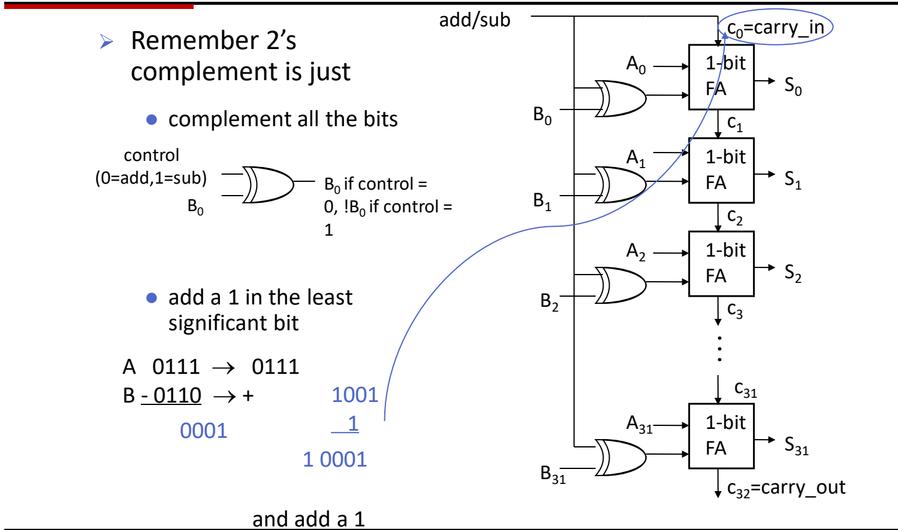

图：32 位行波进位加法/减法器：每位 $B_i$ 与控制信号异或，控制信号同时作为 $c_0$ 提供“+1”，进位逐级传递到 $c_{32}$；左侧示例 $0111_2-0110_2=0001_2$。

> [!example] 例：用加/减法器计算 $0111 - 0110$（4 位）
> 1. control=1，$B=0110$ 逐位取反得 $1001$；
> 2. $c_0=1$，计算 $0111 + 1001 + 1$：
>    $$0111 + 1001 = 1\,0000,\quad 1\,0000 + 1 = 1\,0001$$
> 3. 最高位进位 $c_4=1$ 落在 4 位之外被丢弃，结果为 $0001$，即 $7-6=1$。[^l03-section-1-s1p6]

> [!warning] 易错点
> 做减法时 $C_{\mathrm{out}}=1$ 并不表示溢出。本例 $c_4=1$，但进入最高位的进位 $c_3$ 也是 1，二者异或为 0，结果正确。有符号溢出要用下一节的规则判断。

### 溢出检测（Overflow Detection）

RISC-V 硬件不报告溢出，软件若要检查，就需要一个简单可靠的判断依据。

**溢出**（overflow）指运算结果太大（或太小），无法用 32 位（例中为 4 位）有符号数表示。按操作数符号分为四种情形：[^l03-section-1-s1p7]

| 运算 | 操作数符号 | 溢出时结果符号 |
|---|---|---|
| 加 | 正 + 正 | 负 |
| 加 | 负 + 负 | 正 |
| 减 | 正 − 负 | 负 |
| 减 | 负 − 正 | 正 |

一正一负相加（或同号相减）永远不会溢出，因为结果的绝对值不会超过较大的操作数。

**判断规则**：设 $n$ 位加法中，进入最高位（MSB）的进位为 $c_{n-1}$，最高位送出的进位为 $c_n$，用 $O$ 表示溢出标志，则[^l03-section-1-s1p7]
$$
O = c_{n-1} \oplus c_n
$$
$O=1$ 表示溢出，$O=0$ 表示没有溢出。4 位时就是比较第 4 位的进位输入与第 5 位（carry_out）的值。[^l03-section-1-s2b2]

> [!example] 例 1：$7 + 3$（4 位有符号）
> 逐位相加 $0111 + 0011$：
>
> 1. 位 0：$1+1=10_2$，$S_0=0$，$c_1=1$；
> 2. 位 1：$1+1+1=11_2$，$S_1=1$，$c_2=1$；
> 3. 位 2：$1+0+1=10_2$，$S_2=0$，$c_3=1$；
> 4. 位 3（MSB）：$0+0+1=1$，$S_3=1$，$c_4=0$。
>
> 结果 $1010 = -6$，而真实值 $10 > 7$。进入 MSB 的进位 $c_3=1$，送出的进位 $c_4=0$，$1\oplus0=1$，判定溢出（正 + 正得负）。[^l03-section-1-s1p7]

> [!example] 例 2：$-4 + (-5)$（4 位有符号）
> $1100 + 1011$：
>
> 1. 位 0：$0+1=1$，$c_1=0$；
> 2. 位 1：$0+1=1$，$c_2=0$；
> 3. 位 2：$1+0=1$，$c_3=0$；
> 4. 位 3：$1+1=10_2$，$S_3=0$，$c_4=1$。
>
> 结果 $0111=7$，而真实值 $-9 < -8$。$c_3=0$，$c_4=1$，$0\oplus1=1$，判定溢出（负 + 负得正）。[^l03-section-1-s1p7]

#### 为什么这条规则成立

只看最高位：设两个操作数的符号位为 $a$、$b$，结果符号位 $s = a\oplus b\oplus c_{n-1}$，$c_n = \operatorname{maj}(a,b,c_{n-1})$。

- $a=b=0$（正+正）：$c_n=0$；若 $c_{n-1}=1$，则 $s=1$ 变负，正好溢出，此时 $c_{n-1}\oplus c_n=1$。
- $a=b=1$（负+负）：$c_n=1$；若 $c_{n-1}=0$，则 $s=0$ 变正，正好溢出，此时 $c_{n-1}\oplus c_n=1$。
- $a\ne b$（异号）：$c_n = c_{n-1}$，异或恒为 0，与“异号相加不溢出”一致。

减法在加/减法器中被转换成 $A+\overline{B}+1$ 的加法，同样适用这条规则。这一证明原本留作课后练习（On your own）。[^l03-section-1-s1p7]

> [!warning] 易错点
> 不要用“最高位有进位输出”判断有符号溢出：carry_out 只反映**无符号**加法是否超出范围。有符号溢出看的是进入与送出最高位两个进位是否**不同**。

### 移位运算与桶形移位器

把 8 位字符打包进 32 位字、或从字中拆出某个字节，需要把所有位整体左移或右移；移位还能快速实现乘除 2 的幂。[^l03-section-1-s1p8]

**移位**（shift）把一个字中的所有位向左或向右移动若干位，移出的位丢弃，空出的位按规则填充。

#### 逻辑移位（Logical Shift）

**逻辑移位**在空出的位置一律**补 0**：[^l03-section-1-s1p8]

```asm
sll  x5, x6, x7    # x5 = x6 << x7 位（移位量在寄存器中）
srl  x5, x6, x7    # x5 = x6 >> x7 位
slli x5, x8, 8     # x5 = x8 << 8 位（移位量是立即数）
srli x5, x8, 8     # x5 = x8 >> 8 位
```

#### 算术右移（Arithmetic Shift）

逻辑右移会把负数的符号位变成 0，数值意义被破坏。**算术移位**要保持移位后数值的算术正确性：右移一位应为原值的 $\tfrac12$，左移一位应为原值的 2 倍。因此 `sra` 用最高位（**符号位**）作为移入的位。[^l03-section-1-s1p9]

```asm
sra  x5, x6, x7    # x5 = x6 >> x7 位，高位补符号位
srai x5, x6, 7     # x5 = x6 >> 7 位，高位补符号位
```

> [!example] 例：对 $-8$ 右移 1 位（4 位）
> $-8 = 1000$。
>
> 1. 逻辑右移：$0100 = 4$，数值意义丢失；
> 2. 算术右移：补符号位 1，得 $1100 = -4$，正好是 $-8$ 的一半。

**补码下不需要 `sla`**：左移时空出的是最低位，无论逻辑还是算术都只能补 0，两者效果完全相同，所以 RISC-V 只有 `sll`，没有算术左移。只有右移时，移入的位取决于符号位是 0 还是 1，逻辑与算术结果才会不同。[^l03-section-1-s2b2]

> [!warning] 易错点
> 按符号位填充的是**算术右移** `sra/srai`；**逻辑右移** `srl/srli` 永远补 0。[^l03-section-1-s1p8]

#### 桶形移位器（Barrel Shifter）

移位操作并不在 ALU 内部完成，而是由一个独立于 ALU 的专用电路——**桶形移位器**（barrel shifter）实现。用分立逻辑搭建它需要大量门，但在 VLSI 中实现起来相当容易，结构也比 ALU 简单。[^l03-section-1-s1p9]

> [!note] 补充解释
> 桶形移位器的常见做法是按移位量的各个二进制位分级：第 $k$ 级由一排多路选择器决定“移 $2^k$ 位或不移”，32 位只需 5 级，任意移位量都在固定延迟内一次完成，而不必逐位移动。

> [!question]- 自测：4 位有符号数计算 $5 + 4$ 与 $5 - 4$，各自是否溢出？用进位规则说明。
> $5+4$ 溢出，$5-4$ 不溢出。$0101+0100$：位 2 产生进位，$c_3=1$，位 3 为 $0+0+1$，$c_4=0$，结果 $1001=-7$，$c_3\oplus c_4=1$。$5-4$ 在加/减法器中算 $0101+1011+1$：$c_3=1$、$c_4=1$，结果 $0001$，异或为 0。

> [!question]- 自测：32 位寄存器 x6 的值为 `0xFFFFFFF0`（$-16$），`srli x5, x6, 2` 与 `srai x5, x6, 2` 的结果分别是什么？
> `srli` 补 0：`0x3FFFFFFC`，按有符号解释是一个很大的正数；`srai` 补符号位 1：`0xFFFFFFFC`，即 $-4 = -16/4$。只有算术右移保持了“右移一位减半”的数值意义。

> [!question]- 自测：加/减法器若把 control 只接到异或门、忘了接到 $c_0$，做 $0111 - 0110$ 会得到什么？
> 得到 $0111+1001 = 1\,0000$，截断为 $0000$，比正确结果 $0001$ 少 1。原因是只完成了按位取反（反码），缺少补码所需的“加 1”。

> [!info]- 来源
> - L03.pdf：PDF p.3–9
> - L03.docx：DOCX body 1–75

[^l03-section-1-s1p3]: L03.pdf-PDF p.3
[^l03-section-1-s2b1]: L03.docx-DOCX body 1-39
[^l03-section-1-s1p4]: L03.pdf-PDF p.4
[^l03-section-1-s1p5]: L03.pdf-PDF p.5
[^l03-section-1-s1p6]: L03.pdf-PDF p.6
[^l03-section-1-s1p7]: L03.pdf-PDF p.7
[^l03-section-1-s2b2]: L03.docx-DOCX body 40-75
[^l03-section-1-s1p8]: L03.pdf-PDF p.8
[^l03-section-1-s1p9]: L03.pdf-PDF p.9

---

## 乘除法与浮点数

> [!abstract] 本节要点
> - 二进制乘法 = 用与门生成部分积 $A_iB_j$，错位后相加；4 位阵列乘法器用行波进位加法（RCA）约需 $8T$，改用进位保留加法（CSA，3:2 压缩器）约需 $6T$。
> - P&H 第一版乘法器：128 位被乘数左移、64 位乘数右移、128 位 ALU，重复 64 次；改进版把 ALU 和被乘数缩为 64 位，乘数放进积寄存器右半，积寄存器 129 位并右移。
> - 二进制除法 = 比较 + 减法 + 移位，每位商只能是 0 或 1；$29\div3$ 得商 $1001_2$、余数 $10_2$。P&H 第一版是恢复余数除法，重复 65 次。
> - RISC-V 一条指令只有一个目的寄存器：`mul`/`mulh` 取 128 位积的低/高 64 位，`div`/`rem` 取商/余数；乘除溢出被忽略，除零也没有硬件提示，要由软件检查。乘除比加法慢得多。
> - IEEE 754：$x=(-1)^s\times(1+F)\times2^{E-B}$，单精度 1/8/23 位、偏置 $B=127$，双精度 1/11/52 位、偏置 $B=1023$；RISC-V 浮点寄存器 f0–f31 独立于 x0–x31，f0 不恒为 0，需要 F/D 扩展。

### 二进制乘法与部分积（Partial Product）

逐次相加来做乘法太慢：$7\times9$ 要做 9 次加法。十进制竖式的办法是把乘数拆成各位，分别与被乘数相乘得到**部分积**（partial product），再错位相加。二进制也能这样做，而且更简单，因为乘数每一位只有 0 或 1。

**二进制乘法**：被乘数（multiplicand）与乘数（multiplier）的每一位相乘得到一个部分积，第 $j$ 个部分积左移 $j$ 位，所有部分积相加就是积；求和时的进位同样按二进制处理。$n$ 位乘 $n$ 位，积为 $2n$ 位。[^l03-section-2-s1p124]

> [!example] 例：$5\times3$ 与 $11\times13$
> 1. $5\times3$：$101\times11 = 101\times10 + 101\times1 = 1010 + 101 = 1111_2 = 15$。
> 2. $11\times13$：$1011\times1101$，乘数从低到高为 1、0、1、1，得到 4 个部分积：
>    - $1011$（第 0 位，不移位）
>    - $0000$（第 1 位，左移 1 位）
>    - $101100$（第 2 位，左移 2 位）
>    - $1011000$（第 3 位，左移 3 位）
> 3. 求和：$11+0+44+88 = 143 = 10001111_2$。[^l03-section-2-s2b2]

**部分积的每一位用与门产生**：一位乘一位的真值表是 $0\cdot0=0,\ 0\cdot1=0,\ 1\cdot0=0,\ 1\cdot1=1$，和与门（AND）完全相同。所以被乘数的每一位 $A_i$ 与乘数的某一位 $B_j$ 过一个与门，就得到部分积中的 $A_iB_j$。

### 阵列乘法器与进位保留加法（Carry-Save Adder）

部分积有了，问题是怎么用加法器把它们快速加起来。这里用到两种加法模块（全加器的结构见 [01 ALU与整数加减](#alu与整数加减)）：

- **半加器**（HA）：输入 A、B，输出本位 S 与进位 $C_{\mathrm{out}}$；
- **全加器**（FA）：输入 A、B、$C_{\mathrm{in}}$，输出 S 与 $C_{\mathrm{out}}$；
- 4 位**行波进位加法器**（RCA）= 1 个 HA 打头 + 串联 3 个 FA。

#### 用 RCA 搭成的 4 位阵列乘法器

被乘数 $A_3A_2A_1A_0$，乘数 $B_3B_2B_1B_0$，积为 $S_0\ldots S_7$。

1. $A_0B_0$ 不需要和别的数相加，直接输出为 $S_0$。
2. 第 2 个部分积错开一位，与第 1 个部分积用一个 4 位 RCA 相加；$A_1B_0 + A_0B_1$ 的本位直接输出为 $S_1$；最左边的 FA 缺一个输入，接常数 0。
3. 上一步的和再与错开一位的第 3 个部分积相加（又一个 4 位加法模块），得到 $S_2$。
4. 结果再与第 4 个部分积相加，得到 $S_3,S_4,S_5,S_6,S_7$。

**延迟**：设每个加法器子模块耗时 $T$。RCA 中高位要等低位进位：$A_2B_0$ 与 $A_1B_1$ 求和要等 $A_1B_0+A_0B_1$ 的进位，$A_3B_0$ 与 $A_2B_1$ 又要等前一位的进位。3 行各 4 个模块共 12 个，但从第 3 个周期起，左边的加法器和下一行的加法器可以同时算，所以得到 $S_7$ 实际需要 **$8T$**，不是 $12T$；扩展到 6 位，延迟增加到 $14T$。[^l03-section-2-s2b3] 延迟的根源是进位在每一行里横向传递：三行各传 3 次，共 9 次。

#### 进位保留：先把所有列算完，进位留给下一级

手算乘法是竖着把一列数加起来：本位写下，进位留给下一列。在硬件里，多列可以同时求和，而且进位不必马上传给左边一位，可以作为一个**新的数据输入**交给下一级：

1. 第一级：全加器最多 3 个输入，所以先对前三个部分积的每一列同时求和，得到本位和进位；
2. 第二级：把这些进位作为数据，和上一级的本位、第 4 个部分积一起求和；
3. 最后一级：只剩一行本位和一行进位，用一个普通加法器做一次带进位传递的加法。

这种加法模块叫**进位保留加法器**（carry-save adder，CSA）：模块内部不像 RCA 那样传递进位，而是把进位输入变成一个普通数据输入，相当于输入三个数、输出两个数，所以也叫 **3:2 压缩器**（3:2 compressor）。只有最后的总加法要等进位传递，4 位乘法只需 **$6T$**。[^l03-section-2-s2b3]

> [!warning] 易错点
> CSA 的"快"不是减少了加法次数，而是去掉了中间各级的进位传播等待：中间各级只输出"本位 + 进位"两个数，进位传播只在最后一级发生一次。

#### 快速乘法器（备份页内容）

部分积可以**并行生成、并行相加**来加速乘法。[^l03-section-2-s1p124] P&H 的快速乘法器把循环"展开"：不再把一个 64 位加法器用 63 次，而是用 63 个加法器，并把它们组织成能让延迟最小的结构（加法树）。[^l03-section-2-s1p125]

### 移位相加乘法器（Shift-and-Add Multiplier）

阵列乘法器每个部分积都要一行加法器，64 位时硬件开销很大。P&H 的顺序乘法器只用一个 ALU，每个周期处理乘数的一位。

**第一版**（被乘数 128 位、左移；乘数 64 位、右移；ALU 128 位；积 128 位；控制单元检测乘数最低位）：

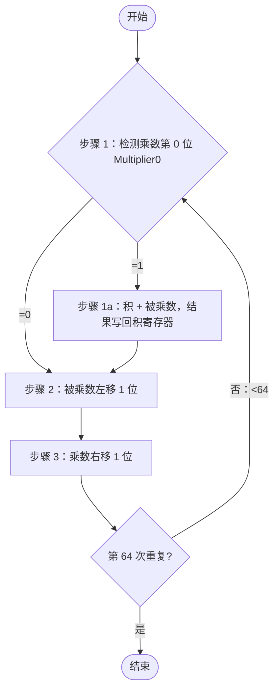

被乘数每次左移 1 位，正好对应"第 $j$ 个部分积左移 $j$ 位"；乘数为 1 的位才加。部分积是一个接一个地加到积里、每次加法都要完整的进位传递，所以这一版的思路属于 RCA 式，不是 CSA。[^l03-section-2-s2b3]

**改进版**：任何时刻 128 位被乘数寄存器里只有 64 位有用，积寄存器也有一半是空的，于是把它们合并：

- 被乘数寄存器和 ALU 缩为 **64 位**；
- 不再左移被乘数，而是把**积右移**；
- 去掉独立的乘数寄存器，乘数放进**积寄存器的右半**；
- 积寄存器加 1 位变成 **129 位**，用来存加法器的进位输出；
- 只剩一个移位器。[^l03-section-2-s1p12]

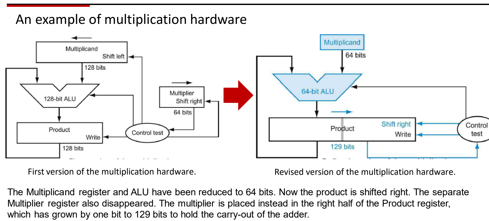

图：乘法器第一版（128 位被乘数左移、64 位乘数右移、128 位 ALU）与改进版（64 位 ALU、129 位积寄存器右移、乘数放在积寄存器右半）。

> [!note] 补充解释
> 改进版每一步的做法（P&H）：检测积寄存器最低位（即乘数当前位），为 1 就把被乘数加到积的左半；然后整个积寄存器右移 1 位；重复 64 次。乘数位被检测后随右移移出，空出的位置正好由积的低位填入。

> [!example] 例：用 4 位改进版乘法器计算 $0101\times0011$
> 积寄存器 9 位 = 进位 | 左半 4 位 | 右半 4 位，初值 `0 0000 0011`（乘数放右半）。
>
> 1. 最低位 1：左半 $0000+0101$ → `0 0101 0011`；右移 → `0 0010 1001`
> 2. 最低位 1：左半 $0010+0101=0111$ → `0 0111 1001`；右移 → `0 0011 1100`
> 3. 最低位 0：只右移 → `0 0001 1110`
> 4. 最低位 0：只右移 → `0 0000 1111`
>
> 积 $00001111_2=15$，与 $5\times3$ 的结果一致。

### 二进制除法与除法硬件

除法是试商、移位、相减的重复。[^l03-section-2-s1p15] 十进制要心算"让余数小于除数的最大商"（$29\div3$ 要想到 $3\times9=27$），二进制没有这个负担：每位商只能是 0 或 1，够减就是 1，不够减就是 0。所以**二进制除法只需要比较和减法，不需要乘法**。[^l03-section-2-s2b4]

> [!example] 例：$29\div3$（$11101_2\div11_2$）
> 从被除数高位开始，看当前部分余数能否减去除数：
>
> 1. 最高位 `1` < `11` → 商位 0；
> 2. 前两位 `11` ≥ `11` → 商位 1，相减（实际减的是 $11000_2$），余数 `101`；
> 3. 再看下一位 `01` < `11` → 商位 0；
> 4. `10` < `11` → 商位 0；
> 5. `101` ≥ `11` → 商位 1，$101-11=10$。
>
> 商 $1001_2=9$，余数 $10_2=2$，与十进制结果一致。[^l03-section-2-s2b4]

#### 比较后再减的除法电路（课堂视频）

硬件需要：存除数的寄存器、减法器、存被除数/余数的寄存器、存商的寄存器，以及一个比较大小并决定写回的**控制单元**（control unit）。被除数和余数放在同一个寄存器，因为够减时下一步的被减数就是这次减出来的余数。

以 8 位数为例：除数寄存器、被除数/余数寄存器各 16 位，商寄存器 8 位。

1. **初始化**：29 放在余数寄存器的低 8 位；3 放在除数寄存器的**高 8 位**；商全 0。
2. **比较**：余数寄存器与除数寄存器比较。
3. **够减**：商从右端移入 1（最左位被挤出，商寄存器整体左移），余数寄存器改写为差。
4. **不够减**：商移入 0，余数寄存器不变。
5. **除数右移 1 位**，模拟"往下看一位"，回到第 2 步。

用 $3\cdot2^k$ 表示除数当前的位置：$k\ge4$ 时 $3\cdot2^k\ge48>29$，商位都是 0；$k=3$ 时 $24\le29$，商位 1，余数改为 $5=101_2$；$k=2,1$ 时 $12,6>5$，商位 0；$k=0$ 时 $3\le5$，商位 1，余数改为 $10_2$。除数从高 8 位移到低 8 位共右移 **8 次**，得到商 `00001001`、余数 `10`。[^l03-section-2-s2b4] 这一版每次先比较，只有够减才写回差。

#### P&H 第一版：恢复余数除法（Restoring Division）

P&H 第一版除法硬件：除数寄存器 128 位、右移；ALU 128 位；余数寄存器 128 位；商寄存器 64 位、左移。它不先比较，而是**先减、看符号、不够减再加回来**：

1. 余数寄存器 ← 余数 − 除数；
2. 检测余数：
   - **2a**（余数 ≥ 0）：商左移，新的最低位置 1；
   - **2b**（余数 < 0）：把除数加回余数寄存器，**恢复**原值；商左移，新的最低位置 0；
3. 除数右移 1 位；
4. 未到第 65 次重复就回到第 1 步，第 65 次后结束。[^l03-section-2-s1p16]

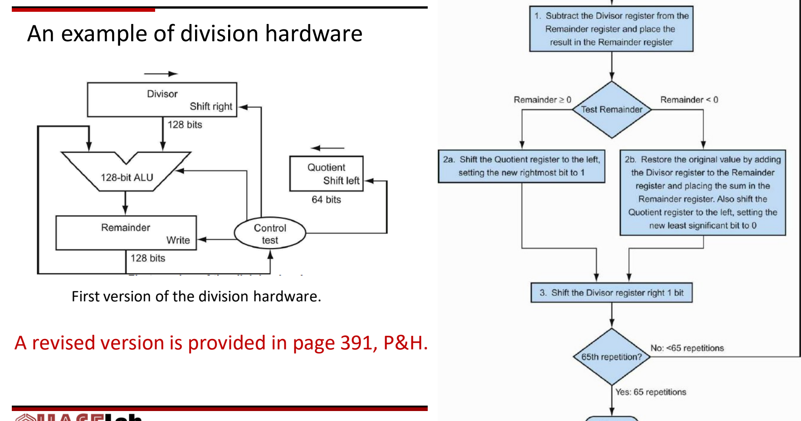

图：除法器第一版硬件（128 位除数右移、128 位余数、64 位商左移）与恢复余数除法流程：先减，结果为负则恢复并商 0，重复 65 次。

P&H 第 391 页另有改进版除法硬件。[^l03-section-2-s1p16]

> [!note] 补充解释
> 重复 65 次而不是 64 次，是因为除数一开始放在 128 位寄存器的左半（相当于左移了 64 位），要从位置 64 一直对齐到位置 0，共 65 个位置。课堂视频里除数放在 16 位寄存器的高 8 位，也是同样的安排。

> [!warning] 易错点
> 视频电路和 P&H 流程图是两种做法：视频是"先比较，够减才减"，P&H 是"先减，减成负数再加回"（恢复余数）。两者商和余数相同，但 P&H 每步不够减时多一次加法。不要把视频里的 8 次与流程图的 65 次混为一谈，它们的位宽也不同。

### RISC-V 乘除指令与溢出处理

两个 64 位数相乘得到 128 位积，整数除法同时产生商和余数，但 RISC-V 的 R 型格式（funct7 rs2 rs1 funct3 rd opcode）只有一个目的寄存器 rd，所以每种结果各用一条指令：

```asm
mul  x5, x7, x8   # x5 = x7 * x8 的低 64 位
mulh x6, x7, x8   # x6 = x7 * x8 的高 64 位
div  x5, x7, x8   # x5 = x7 / x8（商）
rem  x6, x7, x8   # x6 = x7 % x8（余数）
```

128 位积两半都要时就执行两条指令，这是只有一个目的寄存器带来的代价。[^l03-section-2-s1p13][^l03-section-2-s1p17]

**性能**：乘法本质上是多次加法加移位，即使用快速专用硬件，也比加法器复杂、慢得多；除法器更复杂、更慢。[^l03-section-2-s1p13] 设计处理器时要考虑这一点。

**溢出与除零**：RISC-V 的除法和乘法一样**忽略溢出**，商是否过大要由软件判断；除数为 0 时也没有硬件机制通知，软件（或编译器生成的代码）必须先显式检查除数。[^l03-section-2-s1p17]

> [!warning] 易错点
> 课堂口头说乘法"不会溢出"，这不准确。`mul` 只把 128 位积的低 64 位写回，真实积超出 64 位就是溢出，只是 RISC-V 不检测。[^l03-section-2-s1p17] 软件可以用 `mulh` 取高 64 位来检查：有符号乘法的高 64 位不等于低 64 位符号位的扩展时，就发生了溢出。

> [!note] 补充解释
> RISC-V M 扩展还有 `mulhu`（无符号 × 无符号的高位）、`mulhsu`（有符号 × 无符号的高位）和 `divu`/`remu`。规范规定除以 0 不触发异常：商为全 1，余数等于被除数；有符号溢出 $-2^{63}\div(-1)$ 的商为 $-2^{63}$，余数为 0。见 [RISC-V 官方非特权规范：M 扩展](https://docs.riscv.org/reference/isa/v20260120/unpriv/m-st-ext.html)。

### IEEE 754 浮点表示（Floating Point）

地球年龄约 $4\,600\,000\,000 = 4.6\times10^9$ 年，1 个原子质量单位约 $1.6\times10^{-27}$ kg，两者都无法用 32 位整数编码。**浮点数**借用科学计数法，把数写成 $(-1)^{s}\times F\times2^E$；基数 2 固化在浮点运算单元（FPALU）的设计里，不需要存储。[^l03-section-2-s1p18]

单精度仍要放进 32 位：

| 字段 | 符号 $s$ | 指数 $E$ | 小数 $F$ |
|---|---|---|---|
| 单精度（32 位） | 1 位 | 8 位 | 23 位 |
| 双精度（64 位） | 1 位 | 11 位 | 52 位 |

总位数固定时，多给 $F$ 就提高**精度**（数有多准），多给 $E$ 就扩大**范围**（数能有多大或多小），两者此消彼长。[^l03-section-2-s1p18]

#### IEEE 754 编码规则

绝大多数计算机遵循 **IEEE 754 标准**，规格化数的值为

$$
x = (-1)^{s} \times (1+F) \times 2^{E-B}
$$

- **隐藏位**（hidden bit）：有效数字规格化为 $1.xxx$ 的形式，最高位一定是 1，所以不存储；$F$ 只存小数点后的部分。
- **偏置表示**（excess/biased notation）：$E$ 按无符号数存储，以 $B$ 表示指数偏置，实际指数为 $E-B$，这样不需要符号位也能表示负指数。单精度 $B=127$，双精度 $B=1023$。[^l03-section-2-s1p19]
- **$E$ 放在 $F$ 前面**：这是为了方便浮点数排序，同号时位串的大小顺序与数值顺序一致，可以按整数比较。[^l03-section-2-s1p19]

> [!warning] 易错点
> 课堂口头把双精度偏置说成"1027"，正确值是 $1023=2^{11-1}-1$（单精度 $127=2^{8-1}-1$）。[^l03-section-2-s2b5]

特殊编码由 $E$ 的全 0、全 1 两端给出：[^l03-section-2-s1p19]

| 单精度 $E$（8 位） | 单精度 $F$（23 位） | 双精度 $E$（11 位） | 双精度 $F$（52 位） | 表示 |
|---|---|---|---|---|
| 0 | 0 | 0 | 0 | 真零（true zero） |
| 0 | 非零 | 0 | 非零 | 非规格化数（denormalized） |
| 1–254 | 任意 | 1–2046 | 任意 | 规格化浮点数 |
| 255 | 0 | 2047 | 0 | 无穷（infinity） |
| 255 | 非零 | 2047 | 非零 | 非数（NaN） |

> [!note] 补充解释
> 非规格化数没有隐藏位，值按 $(-1)^s\times(0+F)\times2^{1-B}$ 计算，用来表示比最小规格化数更接近 0 的数。

> [!example] 例：把 $-0.75$ 编码成单精度
> 1. $0.75 = 0.11_2 = 1.1_2\times2^{-1}$，所以 $s=1$。
> 2. $E = -1+127 = 126 = 01111110_2$。
> 3. $F$ 去掉隐藏位后是 $.1$，即 `10000000000000000000000`。
> 4. 位串：`1 01111110 10000000000000000000000`。

> [!tip] 课堂强调
> 单精度 32 位和双精度 64 位之外，AI 计算中更常用 NVIDIA 推动的 8 位、4 位等低精度格式：精度更低，但计算更快。[^l03-section-2-s2b5]

#### 浮点加法步骤（备份页内容）

计算 $(F_1\times2^{E_1}) + (F_2\times2^{E_2}) = F_3\times2^{E_3}$：[^l03-section-2-s1p126]

1. 恢复 $F_1$、$F_2$ 的隐藏位。
2. **对阶**：设 $E_1\ge E_2$，把 $F_2$ 右移 $E_1-E_2$ 位，移出的位用舍入位（round）、保护位（guard）和粘滞位（sticky）三位记录。
3. 把对阶后的 $F_2$ 加到 $F_1$，得到 $F_3$。
4. **规格化** $F_3$，使其为 $1.XXXX\ldots$ 的形式：
   - $F_1$、$F_2$ 同号时 $F_3\in[1,4)$，最多右移 1 位，同时 $E_3$ 加 1；
   - 异号时 $F_3$ 可能需要左移很多位，每左移一位 $E_3$ 减 1。
5. **舍入** $F_3$，舍入后可能需要再规格化一次。
6. 存储前把 $F_3$ 的最高位重新隐藏。

如何进一步提高精度，见 P&H 第 427–429 页。[^l03-section-2-s1p126]

### RISC-V 浮点指令

RISC-V 有**独立的浮点寄存器堆** f0–f31，与整数寄存器 x0–x31 分开，并用专门的指令在它们和内存之间传数据。[^l03-section-2-s1p20]

```asm
flw   f1, 54(x5)     # f1 = Memory[x5+54]（读 32 位字）
fsw   f1, 58(x5)     # Memory[x5+58] = f1
fadd.s f2, f4, f6    # 单精度加法 f2 = f4 + f6
fadd.d f2, f4, f6    # 双精度加法
flt.s x5, f2, f4     # if (f2 < f4) x5 = 1; else x5 = 0
flt.d x5, f2, f4     # 双精度比较，语义相同
```

同理还有 `fsub.s`、`fsub.d`、`fmul.s`、`fmul.d`、`fdiv.s`、`fdiv.d`；比较中的 `lt` 也可以换成 `eq`、`le`（`feq.s`、`fle.s`、`feq.d`、`fle.d`）。

命名规律：在整数指令前加 `f`，后缀 `.s` 表示单精度、`.d` 表示双精度。比较指令读两个浮点寄存器，结果写入**整数**寄存器 x5。[^l03-section-2-s1p21]

> [!tip] 课堂强调
> - 基本 RISC-V 指令集**不支持浮点**。要用浮点，设计处理器时就要配置相应的扩展和硬件模块：单精度是 F 扩展，双精度是 D 扩展。
> - x0 恒为常数 0，但 **f0 不恒为 0**，它就是一个普通浮点寄存器。[^l03-section-2-s2b5]

> [!note] 补充解释
> `flw`/`fsw` 中的 w 指 32 位字；双精度对应的加载/存储指令是 `fld`/`fsd`（d 指 64 位双字）。

> [!question]- 自测：用 4 位改进版乘法器计算 $0110\times0101$，写出每步之后积寄存器（9 位）的值。
> 初值 `0 0000 0101`。① 最低位 1：加 0110 → `0 0110 0101`，右移 → `0 0011 0010`；② 最低位 0：右移 → `0 0001 1001`；③ 最低位 1：$0001+0110=0111$ → `0 0111 1001`，右移 → `0 0011 1100`；④ 最低位 0：右移 → `0 0001 1110`。积 $00011110_2=30=6\times5$。

> [!question]- 自测：单精度位串 `0 10000010 01000000000000000000000` 表示多少？如果是双精度，指数字段要存多少才能表示同一个实际指数？
> $E=130$，实际指数 $130-127=3$；有效数字 $1.01_2=1.25$，值为 $1.25\times2^3=10$。双精度偏置 1023，指数字段存 $3+1023=1026$。

> [!question]- 自测：一段 RISC-V 程序先执行 `mul x5,x7,x8`，然后要判断 x7×x8 有没有超出 64 位有符号范围，还要计算 x7/x8。需要哪些额外指令或检查？
> 先用 `mulh x6,x7,x8` 取高 64 位，检查 x6 是否等于 x5 符号位的扩展（全 0 或全 1，与 x5 的符号一致），不等就是溢出，因为 `mul` 本身不报溢出。除法前要用分支指令检查 x8 是否为 0，因为 RISC-V 除零没有硬件提示；商用 `div`，需要余数时另加一条 `rem`。

> [!info]- 来源
> - L03.pdf：PDF p.10–13, 15–21, 124–126
> - L03.docx：DOCX body 40–211

[^l03-section-2-s1p124]: L03.pdf-PDF p.124
[^l03-section-2-s2b2]: L03.docx-DOCX body 40-75
[^l03-section-2-s2b3]: L03.docx-DOCX body 76-112
[^l03-section-2-s1p125]: L03.pdf-PDF p.125
[^l03-section-2-s1p12]: L03.pdf-PDF p.12
[^l03-section-2-s1p15]: L03.pdf-PDF p.15
[^l03-section-2-s2b4]: L03.docx-DOCX body 113-150
[^l03-section-2-s1p16]: L03.pdf-PDF p.16
[^l03-section-2-s1p13]: L03.pdf-PDF p.13
[^l03-section-2-s1p17]: L03.pdf-PDF p.17
[^l03-section-2-s1p18]: L03.pdf-PDF p.18
[^l03-section-2-s1p19]: L03.pdf-PDF p.19
[^l03-section-2-s2b5]: L03.docx-DOCX body 151-211
[^l03-section-2-s1p126]: L03.pdf-PDF p.126
[^l03-section-2-s1p20]: L03.pdf-PDF p.20
[^l03-section-2-s1p21]: L03.pdf-PDF p.21

---

## 数据通路部件与时钟

> [!abstract] 本节要点
> - 数据通路由部件（运算与存储单元）和互连组成；控制负责从存储器取指令、发出控制信号、管理指令顺序。RTL 用“寄存器 ← 表达式”描述每条指令的含义，所有指令都从地址 PC 处取出。
> - 部件分两类：组合元件（扩展器、ALU、多路选择器）只对数据做运算；存储元件（PC、寄存器堆、指令存储器、数据存储器）保存状态。控制信号包括 ExtOp、ALU control、mux select、Write Enable、MemRead/MemWrite。
> - CPU 时钟由石英晶振产生正弦波，整形成方波；晶振频率低，再由锁相环 PLL 倍频到 GHz 级。
> - 边沿触发下，一个周期内完成“读状态元件 → 经组合逻辑 → 写状态元件”，周期须满足 $T_{\rm cycle}\ge T_{\rm clk\_q}+T_{\rm max\_comb}+T_s$；保持时间 $T_h$ 通常因 $T_{\rm clk\_q}>T_h$ 自然满足。
> - 不是每周期都写的状态元件需要显式写使能，只有“写使能有效且时钟沿到来”时才写入；PC 每周期都写、指令存储器只读，二者都不需要写控制信号。

### 处理器组织与寄存器传输级（RTL）

处理器分为**数据通路**（Datapath）和**控制**（Control）两部分，完整的组织结构见 L02《04 ISA抽象与RISC思想》，这里只回顾本讲要用到的分工：[^l03-section-3-s1p23]

- **数据通路**：由**部件**（components，执行指令所需的运算单元和存储单元，如寄存器堆）和**互连**（interconnects，把部件连起来，使指令能够完成，并能从存储器取数、向存储器存数）组成。互连既包括处理器内部的连接，也包括处理器与外部存储器之间的连接。
- **控制**：① 从存储器取入指令（Fetch）；② 译码后发出信号，控制数据在各部件之间的流动以及各部件执行什么操作；③ 管理指令执行的先后顺序。

本讲要实现的 RISC-V 指令分三类：访存（ld/sd）、算术/逻辑（add 等）和控制流（beq）。

要设计硬件，先得精确写出每条指令“做什么”。**寄存器传输级**（Register Transfer Level, RTL）就是描述寄存器之间数据流动的语言，它给每条指令赋予确切含义。所有指令都从地址 PC 处取出，取指后顺序执行时 $PC \leftarrow PC + 4$（每条指令 32 位 = 4 字节）。[^l03-section-3-s1p24]

用 RISC-V 的字段名（rs1、rs2、rd，12 位立即数 imm）写出四类典型指令：

| 指令 | RTL 描述 |
| --- | --- |
| 公共取指 | $PC \leftarrow PC + 4$ |
| add | $\mathrm{Reg}[rd] \leftarrow \mathrm{Reg}[rs1] + \mathrm{Reg}[rs2]$ |
| ld（load） | $\mathrm{Reg}[rd] \leftarrow \mathrm{MEM}[\mathrm{Reg}[rs1] + \operatorname{sext}(imm)]$ |
| sd（store） | $\mathrm{MEM}[\mathrm{Reg}[rs1] + \operatorname{sext}(imm)] \leftarrow \mathrm{Reg}[rs2]$ |
| beq | 若 $\mathrm{Reg}[rs1] = \mathrm{Reg}[rs2]$，则 $PC \leftarrow PC + (\operatorname{sext}(imm) \ll 1)$；否则 $PC \leftarrow PC + 4$ |

其中 sext 表示符号扩展，访存地址 = 基址寄存器 + 符号扩展后的偏移量。

> [!warning] 易错点
> 源材料的 RTL 表格和部件图沿用了 MIPS 写法：寄存器字段写成 Rs/Rt/Rd，立即数写成 Imm16（16 位），扩展器标为 Extend 16→64，load 的目的寄存器写成 Rt，分支目标写成 $PC + 4 + 4\times\operatorname{sext}(Imm16)$。[^l03-section-3-s1p24] 这些是 MIPS 的语义。RISC-V 中：源/目的寄存器字段是 rs1、rs2、rd；I/S/B 型立即数是 12 位；分支目标以**当前指令的 PC** 为基准，偏移以 2 字节为单位，即 $PC + (\operatorname{sext}(imm)\ll1)$，不是“PC+4 再加 4 倍偏移”。做题时按 RISC-V 语义计算。

RTL 之外还有更底层的**门级**（gate-level）视角：直接展示每个时钟周期里各个逻辑门怎样翻转、互相传递信号，从而实现处理功能，ARM1 处理器的门级仿真就是这样的例子。[^l03-section-3-s1p25] 本讲从 RTL 这一层出发，把处理器拆成部件，再一步步组装成逻辑层面的处理器。

### 组合元件与存储元件

数据通路里的硬件按“是否保存状态”分成两类。[^l03-section-3-s1p26]

**组合元件**（combinational element）只对数据做运算：输出完全由当前输入决定，不记忆任何东西。

- **扩展器**（Extend）：把指令中的立即数扩展成 64 位数据（部件图沿用 MIPS 标注 16→64，RISC-V 实际是 12 位立即数扩展到 64 位）。扩展方式见 [01 ALU与整数加减](#alu与整数加减)。
- **ALU**：对两个 64 位输入做运算，输出 ALU result，同时给出状态输出 **zero**（结果是否为 0）和 **overflow**（是否溢出）。ALU 支持的运算见 [01 ALU与整数加减](#alu与整数加减)。
- **多路选择器**（multiplexor, Mux）：一种简单的多功能逻辑单元，根据选择信号让输入 0 或输入 1 之一通过。当同一个部件的输入可能来自不同来源时，就用 Mux 选择。[^l03-section-3-s1p27]

**存储元件**（storage / state element）保存数据，即处理器的状态：

| 存储元件 | 端口与位宽 | 作用 |
| --- | --- | --- |
| PC（程序计数器） | 输入、输出各 32 位（图中标注） | 存放下一条要取的指令地址 |
| 寄存器堆（Register file） | Read Addr1、Read Addr2、Write Addr 各 5 位；Read Data1、Read Data2、Write Data 各 64 位 | 32 个 64 位通用寄存器，可同时读两个、写一个 |
| 指令存储器（Instruction Memory） | Address 输入，Instruction 输出 32 位 | 按地址给出指令 |
| 数据存储器（Data Memory） | Address、Data_in、Data_out（64 位） | load/store 访问的数据 |

寄存器地址是 5 位，因为 $2^5 = 32$ 正好寻址 32 个寄存器；指令长 32 位，数据通路宽 64 位（RV64）。

### 数据通路的控制信号

部件本身只提供“能做什么”，还需要控制信号决定“这一条指令让它做什么”，即选择操作、控制数据流向。[^l03-section-3-s1p28] 部件图上的控制信号如下：

| 控制信号 | 作用于 | 含义 |
| --- | --- | --- |
| ExtOp | 扩展器 | 选择扩展方式（如符号扩展还是零扩展） |
| ALU control | ALU | 选择 ALU 做哪种运算（加、减等） |
| select | 多路选择器 | 选择让输入 0 还是输入 1 通过 |
| Write Enable | 寄存器堆 | 是否把 Write Data 写入 Write Addr 指定的寄存器 |
| MemRead / MemWrite | 数据存储器 | 是否读 / 是否写数据存储器 |

此外 ALU 的 zero、overflow 是反向输出给控制逻辑的状态信号（例如 beq 用 zero 判断两数是否相等）。这些信号由控制单元根据指令的 opcode、funct 等字段产生，具体取值和控制表见 [04 单周期数据通路](#单周期数据通路)。

### CPU 时钟与边沿触发

各部件必须在硬件层面同步：何时读取、何时写入，需要一个统一的时间基准，这就是**时钟**（clock, Clk）。时钟接到 PC、寄存器堆和数据存储器这些需要同步写入的存储元件上。[^l03-section-3-s1p29] 在本讲的模型里，指令存储器不接时钟：给它地址就直接输出指令，行为像组合逻辑。[^l03-section-3-s2b6]

#### 时钟从哪里来

CPU 时钟是处理器内部的计时器件，用石英晶体给处理器提供持续、稳定的脉冲流。[^l03-section-3-s1p30] 产生过程：

1. **石英晶振**（quartz crystal）通电后振荡，输出频率固定的正弦波。
2. **整形**：数字电路按方波工作，所以要把正弦波整形（模拟到数字转换）成方波。
3. **倍频**：晶振本身频率较低（课上给出的量级是一百多 kHz 到 1 MHz），而现代 CPU 约 3 GHz，因此在晶振之后接**锁相环**（Phase-Locked Loop, PLL），按需要把频率调高。[^l03-section-3-s2b6] 时钟频率与功耗的长期趋势见 L01《05 技术趋势与功耗墙》。

#### 边沿触发计时方法（Edge-Triggered Clocking）

**计时方法**（clocking methodology）规定信号何时可以被读、何时被写。[^l03-section-3-s1p31] 时钟信号从低电平跳到高电平的时刻叫**上升沿**，从高跳到低叫**下降沿**，统称**边沿**（edge）。**边沿触发**是指存储元件只在时钟边沿更新内容，大多数电路采用这种方法。

一个时钟周期内的典型执行过程：[^l03-section-3-s1p128]

1. **读**：时钟沿到来后，状态元件 1 输出其内容。
2. **算**：这些值流经组合逻辑，被处理。
3. **写**：在下一个时钟沿，把结果写入一个或多个状态元件（状态元件 2）。


几乎所有同步电路都满足这个结构：每个周期都从存储元件出发，经组合逻辑，回到存储元件。这样每个周期的计算结果都能被保存下来，下一个周期可以接着做新的计算。所谓“单周期”，就是一条指令的读—算—写全部在一个时钟周期内完成。

### 单周期时序约束

既然一个周期内要把数据从一个寄存器读出、穿过组合逻辑、再写进另一个寄存器，周期就必须**足够长**，能容纳这条路径上最慢的情况。[^l03-section-3-s1p32] 涉及四个时间参数：

- $T_{\rm clk\_q}$：时钟沿到达后，寄存器输出端出现新值的延迟（clock-to-output）。
- $T_{\rm max\_comb}$：信号穿过组合逻辑的**最长**延迟（关键路径）。
- $T_s$：**建立时间**（setup time），时钟沿到来**之前**，寄存器输入必须保持稳定的时间。
- $T_h$：**保持时间**（hold time），时钟沿到来**之后**，寄存器输入还必须继续保持稳定的时间。

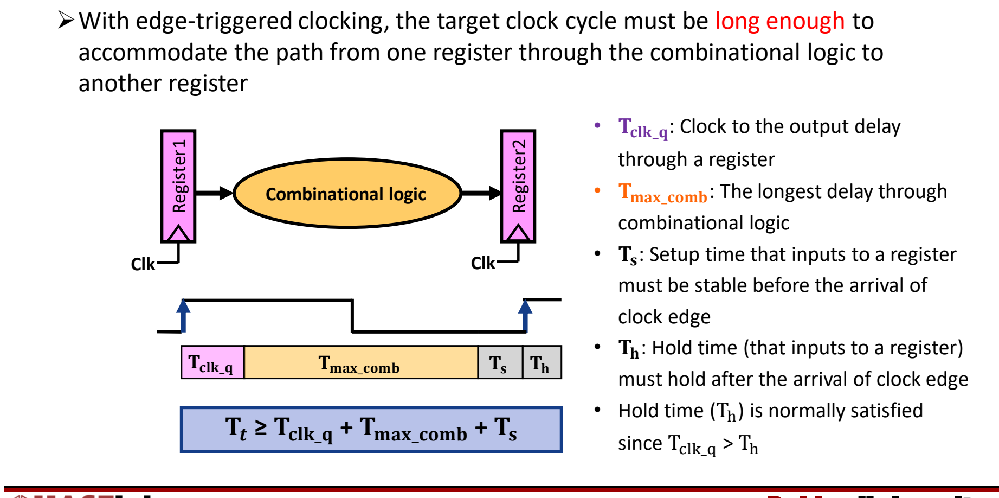

图：边沿触发下一个周期必须覆盖寄存器输出延迟、最长组合逻辑延迟与建立时间：$T_{\mathrm{cycle}}\ge T_{\mathrm{clk\_q}}+T_{\mathrm{max\_comb}}+T_s$。

时序图上，从第一个上升沿开始依次是 $T_{\rm clk\_q}$、$T_{\rm max\_comb}$、$T_s$，它们必须在下一个上升沿之前全部结束；$T_h$ 跨在下一个上升沿之后。因此时钟周期 $T_{\rm cycle}$（源材料记为 $T_t$）必须满足：[^l03-section-3-s1p32]

$$
T_{\rm cycle} \ge T_{\rm clk\_q} + T_{\rm max\_comb} + T_s
$$

保持时间通常自然满足，因为 $T_{\rm clk\_q} > T_h$：时钟沿过后，上游寄存器至少要经过 $T_{\rm clk\_q}$ 才输出新值，这时下游寄存器的保持窗口 $T_h$ 已经过去，旧输入不会被提前改掉。所以设计时钟周期时一般只考虑上式。

> [!tip] 课堂强调
> 时钟周期必须大于等于 $T_{\rm clk\_q}+T_{\rm max\_comb}+T_s$，课上明确说这是大家需要注意的。[^l03-section-3-s2b7]

> [!example] 例：由各段延迟求最高时钟频率（数值为示意）
> 设寄存器 $T_{\rm clk\_q}=30\,\text{ps}$，组合逻辑最长路径 $T_{\rm max\_comb}=600\,\text{ps}$，$T_s=20\,\text{ps}$，$T_h=10\,\text{ps}$。
>
> 1. 最短周期：$T_{\rm cycle}\ge 30+600+20=650\,\text{ps}$。
> 2. 最高频率：$f_{\max}=1/650\,\text{ps}\approx1.54\,\text{GHz}$。
> 3. $T_h=10\,\text{ps}<T_{\rm clk\_q}=30\,\text{ps}$，保持时间自然满足，不进入公式。

> [!warning] 易错点
> - 公式里用的是组合逻辑的**最长**延迟，不是平均延迟。单周期处理器中所有指令共用一个周期，周期由最慢的指令路径决定（这正是单周期“$\mathrm{CPI}=1$ 但周期长”的原因，见 [04 单周期数据通路](#单周期数据通路)）。
> - $T_h$ 不加进周期公式。$T_s$ 约束的是时钟沿**之前**，$T_h$ 约束的是时钟沿**之后**，二者不要混淆。

### 写控制信号

上面的计时方法默认状态元件**每个时钟周期都写入**。如果某个状态元件不是每周期都写，就必须给它一个显式的**写控制信号**（write control signal，写使能）。[^l03-section-3-s1p33] 规则是 **只有写控制信号有效、并且时钟沿到来时，才发生写入**；二者缺一不可。[^l03-section-3-s1p128]

按这个规则检查各存储元件：[^l03-section-3-s2b7]

| 存储元件 | 读写情况 | 是否需要写控制信号 |
| --- | --- | --- |
| PC | 每个周期都读、都写（写入下一条指令地址） | 不需要 |
| 指令存储器 | 每个周期都读，执行过程中不写 | 不需要 |
| 寄存器堆 | 每周期读；只有部分指令写回（如 add、ld 写，sd、beq 不写） | 需要 Write Enable |
| 数据存储器 | 只有 load 读、只有 store 写 | 需要 MemRead / MemWrite |

> [!warning] 易错点
> 写使能有效但时钟沿没到，不会写入；时钟沿到了但写使能无效，也不会写入。sd 和 beq 执行时如果寄存器堆的 Write Enable 误置为有效，就会在时钟沿把无意义的数据写进 Write Addr 指定的寄存器，破坏程序状态。

> [!question]- 自测：某单周期设计中 $T_{\rm clk\_q}=50\,\text{ps}$，各指令经过组合逻辑的延迟分别为 R 型 400 ps、load 700 ps、store 600 ps、beq 450 ps，$T_s=30\,\text{ps}$。最短时钟周期是多少？
> 780 ps。所有指令共用同一个周期，$T_{\rm max\_comb}$ 取最慢的 load 路径 700 ps，所以 $T_{\rm cycle}\ge50+700+30=780\,\text{ps}$，即使 R 型指令只需要 480 ps。

> [!question]- 自测：RISC-V 指令 `beq x5, x6, L` 位于 PC = 0x1000，B 型 12 位立即数字段值为 0x008，且 x5 = x6。新 PC 是多少？如果误用源材料中的 MIPS 公式会得到多少？
> RISC-V：偏移 = sext(0x008) ≪ 1 = 16，新 PC = 0x1000 + 0x10 = 0x1010。MIPS 公式 $PC+4+4\times8$ 会得到 0x1024，基准和偏移单位都不对。

> [!question]- 自测：执行 `sd` 的那个周期里，寄存器堆的 Write Enable 因毛刺在周期中间短暂变为 1，并在下一个时钟上升沿到来前回到 0。寄存器会被改写吗？如果毛刺恰好跨过时钟沿呢？
> 前一种情况不会改写：写入要求“写使能有效**且**时钟沿到来”同时成立，周期中间的高电平没有遇到时钟沿。若写使能在时钟沿时为 1，就会把无意义的 Write Data 写进 Write Addr（对 `sd` 而言是其 imm[4:0] 字段对应的寄存器），破坏状态，所以 `sd` 的 Write Enable 必须在整个周期稳定为 0。

> [!info]- 来源
> - L03.pdf：PDF p.23–33, 128
> - L03.docx：DOCX body 212–295

[^l03-section-3-s1p23]: L03.pdf-PDF p.23
[^l03-section-3-s1p24]: L03.pdf-PDF p.24
[^l03-section-3-s1p25]: L03.pdf-PDF p.25
[^l03-section-3-s1p26]: L03.pdf-PDF p.26
[^l03-section-3-s1p27]: L03.pdf-PDF p.27
[^l03-section-3-s1p28]: L03.pdf-PDF p.28
[^l03-section-3-s1p29]: L03.pdf-PDF p.29
[^l03-section-3-s2b6]: L03.docx-DOCX body 212-254
[^l03-section-3-s1p30]: L03.pdf-PDF p.30
[^l03-section-3-s1p31]: L03.pdf-PDF p.31
[^l03-section-3-s1p128]: L03.pdf-PDF p.128
[^l03-section-3-s1p32]: L03.pdf-PDF p.32
[^l03-section-3-s2b7]: L03.docx-DOCX body 255-295
[^l03-section-3-s1p33]: L03.pdf-PDF p.33

---

## 单周期数据通路

> [!abstract] 本节要点
> - 单周期处理器在**一个时钟周期**内完成一条指令的取指、译码、执行，CPI 恒为 1；时钟周期必须覆盖最长路径（通常是 `ld`）。
> - 取指：PC 读指令存储器，同时用专用加法器算 PC+4；译码：opcode（bits 6-0）送控制单元，按 rs1（19-15）、rs2（24-20）读寄存器堆，rd（11-7）给出写地址。
> - `ld/sd` 地址 = 基址寄存器 + 符号扩展的 12 位偏移；`beq` 用 ALU 的 zero 判等，目标 = PC + (sext(imm) << 1)，PCSrc = Branch AND zero。
> - 每个部件一周期只能用一次，所以要复制部件（分开的 IM/DM、三个加法器），在共享输入处加多路选择器 ALUSrc、MemtoReg、PCSrc。
> - 控制表（ALUSrc/MemtoReg/RegWrite/MemRead/MemWrite/Branch/ALUOp）：R 型 0/0/1/0/0/0/10，ld 1/1/1/1/0/0/00，sd 1/X/0/0/1/0/00，beq 0/X/0/0/0/1/01。

### 单周期设计的思路

要让处理器真正执行指令，需要把上一节的组合元件、状态元件和控制信号（见 [03 数据通路部件与时钟](#数据通路部件与时钟)）连成一条完整的数据通路。最简单的连法是让每条指令在一个时钟周期内走完全部步骤。

**单周期数据通路**（single-cycle datapath）是指每条指令的取指（Fetch）、译码（Decode）、执行（Execute）都在同一个时钟周期内完成的设计。[^l03-section-4-s1p40] 本节实现的是一个简化的 RISC-V 子集：[^l03-section-4-s1p127]

- 访存指令：`ld`、`sd`
- 算术逻辑指令：`add`、`sub`、`and`、`or`
- 控制流指令：`beq`

通用的执行流程是：用 PC 提供指令地址，从存储器取指并更新 PC；译码并读寄存器；执行。所有指令在读完寄存器后都会用到 ALU，只是用途不同：算术指令用它做运算，访存指令用它算地址，分支指令用它做比较。

三个阶段对应的部件如下：[^l03-section-4-s1p34]

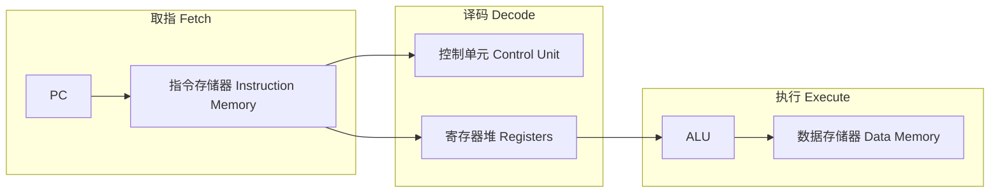

### 取指与译码

#### 取指（Fetch）

取指要做两件事：[^l03-section-4-s1p35]

1. **读指令**：把 PC 作为地址送入指令存储器（Instruction Memory），读出 32 位指令 `Instr[31-0]`。
2. **更新 PC**：用一个专用加法器计算 PC+4，作为顺序执行时下一条指令的地址。

这两个部件都不需要显式控制信号：

- PC 每个周期都被更新，所以**不需要写控制信号**；
- 指令存储器每个周期都被读，所以**不需要读控制信号**。

#### 译码（Decode）

译码同样分两部分：[^l03-section-4-s1p36]

1. 把指令中的 opcode 和 funct 字段送入**控制单元**（Control Unit），由它产生后续各部件的控制信号。
2. 从**寄存器堆**（Register File）读出两个源操作数；寄存器地址直接取自指令字段。

RISC-V 的编码让字段位置在各格式间尽量固定，这使控制单元和寄存器堆可以直接从固定位上取值，不必先判断指令类型：[^l03-section-4-s1p42]

- opcode 总在 bits 6-0；
- 要读的寄存器总由 rs1（bits 19-15）和 rs2（bits 24-20）给出；
- 要写的寄存器总在 rd（bits 11-7）；
- 另一个操作数也可能是 12 位偏移量，用于分支或 load/store。

| 格式 | 31–25 | 24–20 | 19–15 | 14–12 | 11–7 | 6–0 |
|---|---|---|---|---|---|---|
| R | funct7 | rs2 | rs1 | funct3 | rd | opcode |
| I | imm[11:5] | imm[4:0] | rs1 | funct3 | rd | opcode |
| S | imm[11:5] | rs2 | rs1 | funct3 | imm[4:0] | opcode |
| SB | imm[12,10:5] | rs2 | rs1 | funct3 | imm[4:1,11] | opcode |

S 和 SB 格式没有 rd，于是把立即数拆开放在 rd 原来的位置（bits 11-7），这样 rs1、rs2 的位置保持不变。

> [!tip] 课堂强调
> 指令本身做了“对齐”：opcode 固定在 0–6 位，源寄存器固定在 rs1/rs2 位置，目标寄存器固定在 11–7 位，目的就是方便控制。

### 三类指令的数据通路

在取指和译码之后，不同指令在执行阶段需要的部件不同。下面逐类搭建。

#### R 型指令

R 型指令（`add`、`sub`、`and`、`or`）对 rs1、rs2 中的值执行由 op 和 funct 决定的运算，结果写回寄存器堆的 rd。[^l03-section-4-s1p37]

1. 寄存器堆的 Read Data 1、Read Data 2 送入 ALU 两个输入端。
2. **ALU 控制**（ALU control）决定做哪种运算；ALU 还输出 zero 和 overflow 标志。
3. ALU 结果送回寄存器堆的 Write Data，写地址为 rd。

寄存器堆并非每个周期都被写（例如 `sd` 就不写），因此需要显式写控制信号 **RegWrite**。[^l03-section-4-s1p37]

#### Load 与 Store

访存指令的三个动作：[^l03-section-4-s1p38]

1. **算地址**：基址寄存器（译码时从寄存器堆读出）+ 指令中**符号扩展**的 12 位偏移。
2. **store**：把译码时读出的另一个寄存器值（rs2）写入数据存储器（Data Memory）。
3. **load**：从数据存储器读出数据，写回寄存器堆（rd）。

为此新增两个部件：

- **立即数生成器**（Imm Gen）：从 32 位指令中取出立即数字段，**符号扩展**成 64 位（图中标为 32 → 64，signed）。
- **数据存储器**：输入 Address、Write Data，输出 Read Data；由 **MemRead**、**MemWrite** 两个信号控制读写。

例如 `ld x5, 40(x6)`，若 `x6 = 0x2000`，则 ALU 计算 `0x2000 + 40 = 0x2028`，从该地址读出 8 字节写入 `x5`。

#### 分支 beq

分支指令要完成两件事：[^l03-section-4-s1p39]

1. **判等**：把译码时读出的两个寄存器值送入 ALU 相减，用 ALU 的 **zero** 输出判断是否相等——相等时 zero = 1。
2. **算目标地址**：Imm Gen 把 12 位偏移符号扩展到 64 位，经 **Shift left 1** 左移一位，再由**一个独立的加法器**与 PC 相加：

$$
\mathrm{PC}_{\mathrm{target}} = \mathrm{PC} + \big(\operatorname{sext}(\mathrm{imm}) \ll 1\big)
$$

左移 1 位是因为 SB 格式不存储 imm[0]（偏移总是 2 的倍数），存储的 12 位实际是 imm[12:1]。

最后由分支控制逻辑在两个候选中选新 PC：

$$
\mathrm{PCSrc} = \mathrm{Branch} \land \mathrm{zero}
$$

PCSrc = 0 选 PC+4，PCSrc = 1 选分支目标。[^l03-section-4-s1p43]

> [!warning] 易错点
> - RISC-V 的分支目标基于**当前指令的 PC**，不是 PC+4。源材料文字说“updated PC 加偏移”，措辞不准确；带控制单元的数据通路图中，分支加法器的输入正是当前 PC。[^l03-section-4-s1p39]
> - 偏移只左移 **1** 位（半字对齐），不是 MIPS 的左移 2 位；立即数扩展是 **32 → 64** 位。部分示意图残留的 “Sign Extend 16→32” 是 MIPS 版本的遗留，应按 RISC-V 理解为 Imm Gen 32→64。[^l03-section-4-s1p51]

> [!example] 例：计算 beq 的下一 PC
> `beq x1, x2, L` 位于 PC = `0x1000`，指令中存储的 imm[12:1] = $000000001000_2=8$。
>
> 1. sext 后仍为 8，左移 1 位得 16 = `0x10`。
> 2. 分支目标 = `0x1000 + 0x10 = 0x1010`；PC+4 = `0x1004`。
> 3. 若 `x1 = x2`：ALU 相减得 0，zero = 1，Branch = 1，PCSrc = 1，下一 PC = `0x1010`。
> 4. 若 `x1 ≠ x2`：zero = 0，PCSrc = 0，下一 PC = `0x1004`。

### 组装完整数据通路与多路选择器

把上述片段合成一条数据通路时，要加入控制线和多路选择器。[^l03-section-4-s1p40] 单周期设计带来三条约束：

1. **每个资源每条指令只能用一次**，因此必须复制一些部件：指令存储器与数据存储器分开；用三个加法器（ALU、PC+4 加法器、分支目标加法器）而不是共用一个。
2. **共享部件的输入端需要多路选择器**（multiplexor），由控制线选择数据来源。
3. **写信号**控制是否写寄存器堆和数据存储器。

时钟周期由**最长路径**决定。[^l03-section-4-s1p40]

R 型与访存指令共用 ALU 和寄存器堆写端口，但数据来源不同，于是加入两个选择器；[^l03-section-4-s1p41] 再加上分支的 PC 选择器，共三个：

| 选择器 | 位置 | 输入 0 | 输入 1 |
|---|---|---|---|
| **ALUSrc** | ALU 第二个输入 | 寄存器 Read Data 2（R 型、beq） | Imm Gen 输出的 64 位立即数（ld、sd） |
| **MemtoReg** | 寄存器堆 Write Data | ALU 结果（R 型） | 数据存储器 Read Data（ld） |
| **PCSrc** | PC 输入 | PC+4 | 分支目标地址 |

完整的单周期数据通路如下：控制单元读入 `Instr[6-0]`，输出 Branch、MemRead、MemtoReg、MemWrite、ALUSrc、RegWrite 和 2 位 ALUOp；ALU 控制单元根据 ALUOp 和 `Instr[30,14-12]`（funct7 的第 30 位与 funct3）产生具体的 ALU 操作；Branch 与 zero 经与门得到 PCSrc。[^l03-section-4-s1p43]

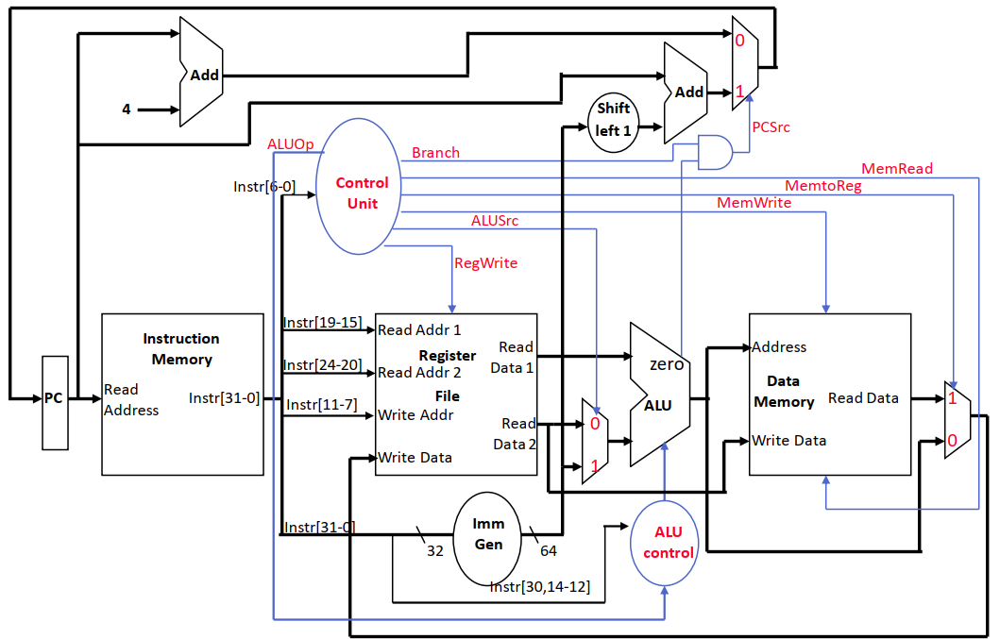

图：带控制单元的单周期数据通路：控制单元由 `Instr[6-0]` 产生 RegWrite、ALUSrc、MemRead/MemWrite、MemtoReg、Branch，Branch 与 zero 相与得到 PCSrc。

> [!tip] 课堂强调
> 这张数据通路图、后面的控制表以及多周期的带控制数据通路图都**不要求死记或默画**，看懂其中的逻辑即可；实际处理器的控制要复杂得多，这里只是最简单的一套控制逻辑。[^l03-section-4-s2b8]

> [!info] 可视化资源
> [Ripes：可视化 RISC-V 处理器模拟器](https://github.com/mortbopet/Ripes)——可在单周期、五级流水线等微架构上运行 RISC-V 程序，逐周期观察数据通路中各条线的取值和控制信号。

### 控制单元与控制表

控制信号负责两件事：选择要执行的操作（ALU 运算、寄存器堆与存储器的读写），以及控制数据流向（多路选择器的输入）。[^l03-section-4-s1p42] 控制单元只看 opcode 就能确定这些信号，下表给出四类指令的取值：[^l03-section-4-s1p49]

| 指令 | ALUSrc | MemtoReg | RegWrite | MemRead | MemWrite | Branch | ALUOp1 | ALUOp0 |
|---|---|---|---|---|---|---|---|---|
| R-format | 0 | 0 | 1 | 0 | 0 | 0 | 1 | 0 |
| ld | 1 | 1 | 1 | 1 | 0 | 0 | 0 | 0 |
| sd | 1 | X | 0 | 0 | 1 | 0 | 0 | 0 |
| beq | 0 | X | 0 | 0 | 0 | 1 | 0 | 1 |

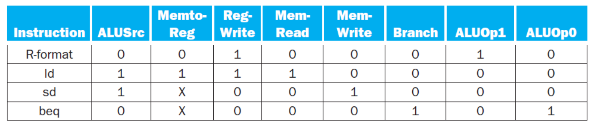

图：R-format、ld、sd、beq 四类指令的单周期控制信号取值表。

X 表示“无关”（don't care）：`sd` 和 `beq` 不写寄存器堆（RegWrite = 0），所以 MemtoReg 选哪一路都不影响结果。

每一行都可以从数据流推出来：

1. **R 型**：[^l03-section-4-s1p44] PC 选 PC+4；结果要写回 rd，RegWrite = 1；第二操作数来自寄存器，ALUSrc = 0；不访问数据存储器，MemRead = MemWrite = 0；写回数据取 ALU 结果，MemtoReg = 0；ALU 运算由 funct 字段决定，ALUOp = 10。
2. **ld**：[^l03-section-4-s1p45] PC 选 PC+4；ALU 一端是基址寄存器、另一端是扩展到 64 位的立即数，ALUSrc = 1；读数据存储器，MemRead = 1；读出的数据经 MemtoReg = 1 写回寄存器堆，RegWrite = 1；ALU 做加法，ALUOp = 00。
3. **sd**：ALU 同样算“基址 + 立即数”，ALUSrc = 1，ALUOp = 00；MemWrite = 1 把 rs2 写入存储器；不写寄存器，RegWrite = 0，MemtoReg = X。
4. **beq**：[^l03-section-4-s1p47] 两个寄存器值比较，ALUSrc = 0；ALU 做减法，ALUOp = 01；Branch = 1，与 zero 相与决定 PCSrc；不访存、不写寄存器。

> [!note] 补充解释
> ALUOp 是主控制单元交给 ALU 控制单元的 2 位“粗分类”：00 表示做加法（访存算地址），01 表示做减法（beq 比较），10 表示由指令的 funct7/funct3 字段（`Instr[30,14-12]`）决定具体运算（R 型）。这种两级译码让主控制单元不必关心 funct 字段。ALU 控制编码的完整表格见 Patterson & Hennessy《Computer Organization and Design RISC-V Edition》第 4.4 节。

一条 `ld` 指令的完整路径经过了所有主要部件，它就是单周期设计中最长的路径：


### 单周期设计的优缺点

**优点**：

- **$\mathrm{CPI}=1$**：每条指令恰好一个周期，并且永远是 1。[^l03-section-4-s2b8]
- **简单、易于理解**。[^l03-section-4-s1p129]

$\mathrm{CPI}=1$ 并不是性能上限：后续课程讲到的架构（如每周期完成多条指令的超标量处理器）CPI 一般都**小于 1**。单周期的特点只是 CPI 恒定，代价全部落在时钟周期上。[^l03-section-4-s2b8]

**缺点**：

1. **时钟周期利用率低**。[^l03-section-4-s1p50] 时钟周期必须按最慢的指令来定。`ld` 要依次经过取指、读寄存器堆、ALU、数据存储器、写回，是最长的路径；`sd` 不需要写回，比 `ld` 短，但也只能占用同样长的周期，剩余时间被浪费：时序图上 Load 占满一个周期，Store 之后跟着一段 Waste。对浮点乘法这类更复杂的指令，这个问题更严重：只要指令集中有一条慢指令，所有指令都要跟着变慢。
2. **浪费面积**。[^l03-section-4-s1p51] 由于一个周期内部件不能共享，一些功能单元必须复制：除了 ALU 外还要有专门更新 PC 的加法器；指令存储器和数据存储器也必须分开，而在更好的设计中二者本可以合并。

时钟周期下限的具体约束式（$T_{\rm clk\_q}$、$T_{\rm max\_comb}$、$T_s$）见 [03 数据通路部件与时钟](#数据通路部件与时钟)。为解决这两个问题，下一节把一条指令拆成多个较短的周期并复用部件，见 [05 多周期数据通路](#多周期数据通路)。

> [!question]- 自测：执行 `or x7, x8, x9` 时，若控制单元错误地给出 ALUSrc = 1，会发生什么？
> ALU 第二个输入会选 Imm Gen 的输出而不是 `x9`。R 型指令没有立即数字段，Imm Gen 会把 bits 31-20（即 funct7 和 rs2 字段）当成立即数扩展，结果变成 `x8 OR 某个无意义常数`，写入 `x7` 的值错误。

> [!question]- 自测：为什么 sd 和 beq 的 MemtoReg 可以写 X，而 RegWrite 不能写 X？
> MemtoReg 只决定写回寄存器堆的数据来源；这两条指令 RegWrite = 0，不写寄存器堆，选哪一路都无影响。RegWrite 本身决定寄存器堆是否被改写，若为 X 可能把垃圾写进 rd 位置（对 sd/beq 而言是立即数字段对应的寄存器），破坏架构状态，所以必须明确为 0。

> [!question]- 自测：假设某单周期处理器中各部件延迟为：指令存储器 200 ps、寄存器堆读 100 ps、ALU 150 ps、数据存储器 200 ps、寄存器写回 50 ps（多路选择器等忽略）。时钟周期至少多长？执行 sd 时浪费多少？
> 最长路径是 `ld`：200 + 100 + 150 + 200 + 50 = 700 ps，所以周期至少 700 ps。`sd` 不写回：200 + 100 + 150 + 200 = 650 ps，每条 sd 浪费 50 ps；R 型（200 + 100 + 150 + 50 = 500 ps）浪费 200 ps。这正是“周期由最慢指令决定”的代价。（数值为假设，用于练习。）

> [!info]- 来源
> - L03.pdf：PDF p.34–45, 47, 49–51, 127, 129
> - L03.docx：DOCX body 255–335

[^l03-section-4-s1p40]: L03.pdf-PDF p.40
[^l03-section-4-s1p127]: L03.pdf-PDF p.127
[^l03-section-4-s1p34]: L03.pdf-PDF p.34
[^l03-section-4-s1p35]: L03.pdf-PDF p.35
[^l03-section-4-s1p36]: L03.pdf-PDF p.36
[^l03-section-4-s1p42]: L03.pdf-PDF p.42
[^l03-section-4-s1p37]: L03.pdf-PDF p.37
[^l03-section-4-s1p38]: L03.pdf-PDF p.38
[^l03-section-4-s1p39]: L03.pdf-PDF p.39
[^l03-section-4-s1p43]: L03.pdf-PDF p.43
[^l03-section-4-s1p51]: L03.pdf-PDF p.51
[^l03-section-4-s1p41]: L03.pdf-PDF p.41
[^l03-section-4-s2b8]: L03.docx-DOCX body 296-335
[^l03-section-4-s1p49]: L03.pdf-PDF p.49
[^l03-section-4-s1p44]: L03.pdf-PDF p.44
[^l03-section-4-s1p45]: L03.pdf-PDF p.45
[^l03-section-4-s1p47]: L03.pdf-PDF p.47
[^l03-section-4-s1p129]: L03.pdf-PDF p.129
[^l03-section-4-s1p50]: L03.pdf-PDF p.50

---

## 多周期数据通路

> [!abstract] 本节要点
> - 单周期 $\mathrm{CPI}=1$，但时钟周期必须容纳最慢的指令（load），较短的指令（如 store）在周期剩余时间里白白等待；多周期把指令拆成若干步，每步一个周期，不同指令用不同的周期数。
> - 多周期的时钟周期按“最慢的一步”定，但由于每步之间新增状态寄存器带来的开销，它比单周期时钟的 1/5 还要慢；收益来自短指令少用周期，而不是单条 load 变快。
> - 五步为 IFetch → Dec → Exec → Mem → WB：load 5 个周期，store 4 个，R 型 4 个，分支/跳转 3 个；每步工作量尽量均衡，每个周期只用一个主要功能部件。
> - 每步结果在周期末写入程序员不可见的内部寄存器 IR、MDR、A、B、ALUOut（除 IR 外都只在相邻两个周期间保存数据，无需写控制）；因此只需一个存储器、一个 ALU（ALU 兼做 PC+4）。
> - 控制由有限状态机（FSM）完成：状态寄存器 + 次态函数 + 输出函数，输入是当前状态和 opcode；代价是更多内部寄存器、更多多路选择器和更复杂的控制。

### 多周期的动机：单周期浪费了什么

单周期处理器（见 [04 单周期数据通路](#单周期数据通路)）在一个周期内完成取指、译码、执行，所以大多数指令 **$\mathrm{CPI}=1$**；但这个周期必须足够长，能完成最耗时的那条指令。[^l03-section-5-s1p54]

最长的是 load，所有指令都得陪它用这个长周期，store 等短指令提前做完后只能空等，剩下的时间就是**浪费**（waste）；具体分析见 [04 单周期数据通路](#单周期数据通路) 的“单周期设计的优缺点”。[^l03-section-5-s2b8]

**多周期数据通路**（multicycle datapath）的办法是：把每条指令拆成若干个更短的步骤，每步占一个时钟周期，于是不同指令可以花不同数量的周期完成，短指令不再陪着长指令等待。[^l03-section-5-s1p55]

> [!warning] 易错点：多周期时钟不是单周期的 1/5
> 把 load 拆成 5 步，并不意味着时钟周期变成单周期的 1/5。回顾时序约束（见 [03 数据通路部件与时钟](#数据通路部件与时钟)）：每个周期都必须“从一个状态元件出发、经过组合逻辑、写入另一个状态元件”。拆成 5 个周期就要在中间插入新的状态元件，而每个状态元件都带来 $T_{\rm clk\_q}$ 和 $T_s$ 等额外时间。因此**多周期时钟比单周期时钟的 1/5 还慢**（状态寄存器开销），一条 load 在多周期上的总时间反而比单周期更长。[^l03-section-5-s1p136] 多周期的收益来自另一边：store 只需 4 个周期、分支只需 3 个，省下的周期才是收益。[^l03-section-5-s2b9]

### 三条设计原则

从单周期改成多周期，要回答三个问题：[^l03-section-5-s1p56]

1. **Q1 怎样让一条指令用多于 1 个周期完成？** 把指令拆成小步骤，每步一个周期，依次执行。
2. **Q2 怎样更高效地使用数据通路部件、去掉不必要的重复资源？** 允许同一个功能部件在一条指令内被使用多次，只要这几次落在**不同的周期**。
3. **Q3 单周期的控制信号可以只由 opcode 决定，多周期怎么办？** 用**有限状态机**（finite state machine, FSM）做控制：控制信号既取决于 opcode，也取决于当前处在第几步。

拆分步骤时还有两条约束：[^l03-section-5-s1p130]

- **平衡**每一步的工作量（时钟周期由最慢的一步决定，步骤越不均衡浪费越多）；
- **限制**每个周期只启用一个主要功能部件（存储器、寄存器堆或 ALU 之一），这样部件才能跨周期复用。

### 五个执行步骤与各类指令的周期数

**五步**（five steps）分别是：[^l03-section-5-s1p57]

1. **IFetch**：取指令，并更新 PC（PC+4）。
2. **Dec**：指令译码、读寄存器、对偏移量/立即数做符号扩展。
3. **Exec**：执行 R 型运算；或计算访存地址；或做分支比较。分支和跳转**在这一步完成**。
4. **Mem**：load 读存储器；store 写存储器并**完成**；R 型把结果写回寄存器堆并**完成**。
5. **WB**：load 把从存储器读出的数据写回寄存器堆，load 在这一步完成。

各类指令在第几步结束，就决定了它的周期数：

| 指令类型 | 经过的步骤 | 周期数 | 在哪一步完成 |
|---|---|---|---|
| load（`ld`/`lw`） | IFetch, Dec, Exec, Mem, WB | 5 | WB（寄存器写回） |
| store（`sd`/`sw`） | IFetch, Dec, Exec, Mem | 4 | Mem（存储器写） |
| R 型（如 `add`） | IFetch, Dec, Exec, Mem | 4 | Mem 步内的寄存器写回 |
| 分支 / 跳转 | IFetch, Dec, Exec | 3 | Exec |

所以在这种多周期设计中，**指令需要 3–5 个周期**：load 最长，分支和跳转最短。[^l03-section-5-s1p134]

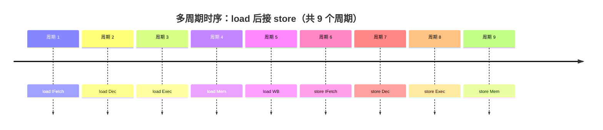

单周期执行同样两条指令要 2 个长周期；多周期则是 5 + 4 = 9 个短周期，下一条指令紧接在上一条指令真正结束之后开始，没有“空等”。[^l03-section-5-s1p64]

> [!example] 例：平均 CPI 与执行时间比较（数据为假设，仅用于练习方法）
> 设单周期时钟周期为 800 ps；多周期把它拆成 5 步，每步约 160 ps，再加上状态寄存器开销 20 ps，得多周期周期为 180 ps（> 800/5，符合“比 1/5 还慢”）。指令比例：load 25%、store 10%、R 型 50%、分支 15%。
>
> 1. 多周期平均 CPI：$0.25\times5 + 0.10\times4 + 0.50\times4 + 0.15\times3 = 1.25+0.4+2.0+0.45 = 4.1$。
> 2. 多周期每条指令平均时间：$4.1\times180 = 738$ ps；单周期为 $1\times800 = 800$ ps。
> 3. 单条 load：多周期 $5\times180 = 900$ ps，比单周期的 800 ps 更慢；多周期总体上更快，是靠 store、R 型和分支少用周期。
>
> 结论：比较两种实现要用“CPI × 时钟周期”，不能只看 CPI（多周期 CPI 更大）或只看周期（多周期周期更短）。

### 内部寄存器与部件复用

一条指令被拆成多个周期后，后一步要用前一步的结果；而组合逻辑在周期末不会“记住”任何东西。因此，按时钟方法学（读状态元件 → 经过组合逻辑 → 写状态元件），**在每个周期末，把下一周期要用的值存进一个内部寄存器**。[^l03-section-5-s1p58]

**内部寄存器**（internal registers）是程序员不可见的寄存器，共五个：[^l03-section-5-s1p59]

- **IR**（Instruction Register，指令寄存器）：保存从存储器读出的指令；
- **MDR**（Memory Data Register，存储器数据寄存器）：保存从存储器读出的数据；
- **A、B**：保存寄存器堆两个读端口读出的数据；
- **ALUOut**（ALU 输出寄存器）：保存 ALU 的运算结果。

除 IR 外，这些寄存器**只在相邻两个周期之间保存数据**，每个周期都可以被覆盖，所以不需要写控制信号；IR 要在整条指令的执行过程中保持指令内容，因此带有写使能 IRWrite。需要留给**后续指令**使用的数据，则存放在程序员可见的状态中：寄存器堆、PC 或存储器。[^l03-section-5-s1p131]

有了内部寄存器，功能部件就能在不同周期复用：[^l03-section-5-s1p59]

- **只需一个存储器**：取指和访存发生在不同周期，同一个存储器既存指令又存数据，但每个周期只能访问一次；
- **只需一个 ALU**：单周期里专门做 PC+4 的加法器被去掉，PC 更新改由 ALU 在 IFetch 周期完成，但每个周期只能做一次 ALU 运算。[^l03-section-5-s2b10]

以 load 为例，数据在各周期之间的流动是：PC → 存储器（读指令）→ IR → 寄存器堆读 → A（及立即数）→ ALU → ALUOut（地址）→ 存储器（读数据）→ MDR → 寄存器堆写。每一个箭头跨过的周期边界上，都有一个内部寄存器把值接住。[^l03-section-5-s1p60]


#### 带控制信号的多周期数据通路

把内部寄存器、多路选择器和控制信号加到一起，就得到完整的多周期数据通路（RISC-V 版本，立即数生成 Imm Gen 输出 64 位，分支偏移左移 1 位）：[^l03-section-5-s1p132]

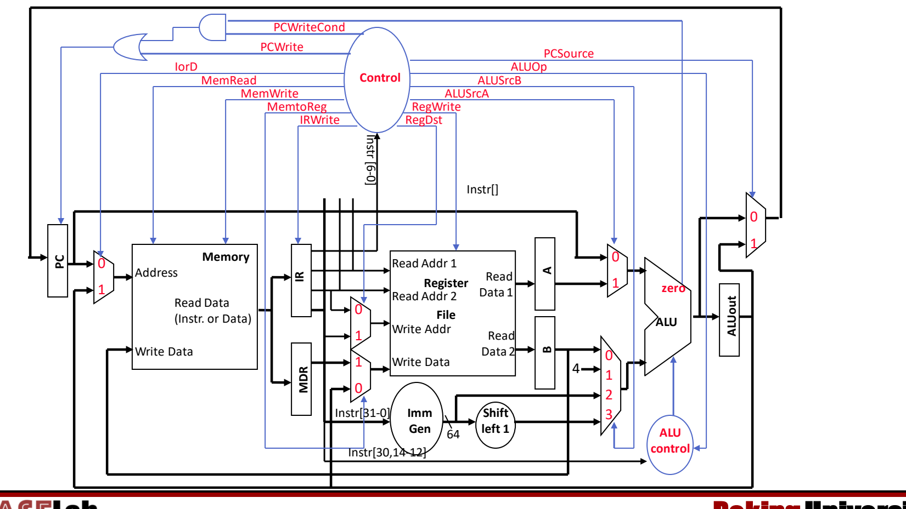

图：RISC-V 多周期数据通路：单一存储器与 ALU，内部寄存器 IR、MDR、A、B、ALUOut，以及 PCWrite、IorD、IRWrite、ALUSrcA/B、PCSource 等控制信号。

图中主要的多路选择器和控制信号：

- **IorD**：存储器地址来自 PC（0，取指）还是 ALUOut（1，访存）——单一存储器的代价；
- **MemRead / MemWrite**：存储器读、写使能；**IRWrite**：把读出的内容写入 IR；
- **MemtoReg**：写回寄存器堆的数据来自 MDR（1，load）还是 ALUOut（0，R 型）；**RegWrite**：寄存器堆写使能；
- **ALUSrcA**：ALU 第一个操作数为 PC（0）或 A（1）；
- **ALUSrcB**：ALU 第二个操作数为 B（0）、常数 4（1）、立即数（2）或左移 1 位的立即数（3）；
- **ALUOp**：送给 ALU control，与指令的 `Instr[30,14-12]`（funct7 的第 30 位和 funct3）共同决定 ALU 操作；
- **PCSource**：新 PC 取 ALU 的直接输出（0，IFetch 的 PC+4）还是 ALUOut（1，分支目标）；
- **PCWrite / PCWriteCond**：PC 无条件写，或在 `zero` 为 1 时条件写（与门 + 或门合成 PC 的写使能）。

与单周期的数据通路图一样，这张图重在看懂各部件和信号的逻辑，而不是默画。[^l03-section-5-s2b10]

### 有限状态机控制

单周期中，opcode 足以决定所有控制信号。多周期中，opcode 只告诉你 ALU 该做什么运算，却**不能告诉你下一个周期该做哪一步**——同一条 load 在第 1 周期要读指令、第 4 周期要读数据，控制信号完全不同。[^l03-section-5-s1p61]

**有限状态机控制**（FSM control）由三部分组成：[^l03-section-5-s1p133]

1. **状态集合**：当前状态保存在**状态寄存器**（State Register）中，每个状态对应一步；
2. **次态函数**（next state function）：由当前状态和输入（opcode）决定下一个状态；
3. **输出函数**（output function）：由当前状态和输入决定这一周期要驱动的数据通路控制信号。

#### 示例 FSM

下面是一个示例 FSM（状态从 0 编号）：[^l03-section-5-s1p62]

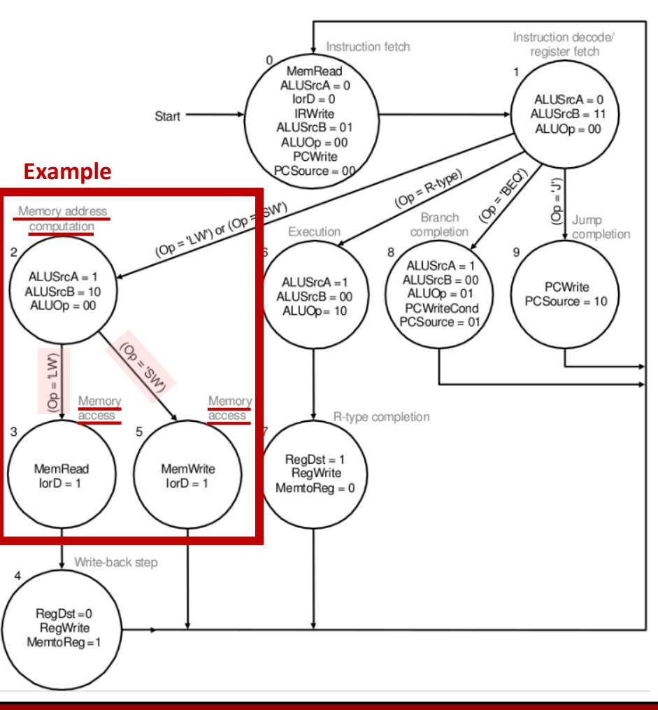

图：多周期控制有限状态机：状态 0 取指、1 译码，按操作码分支到访存地址计算（2→3/5→4）、R 型（6→7）、分支（8）与跳转（9），每个状态标出控制信号。

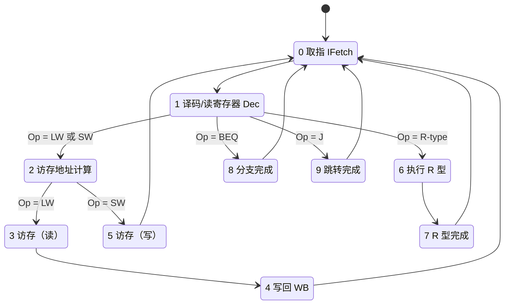

各状态的输出（未列出的写使能为 0）：

| 状态 | 含义 | 控制信号 |
|---|---|---|
| 0 | 取指 | MemRead, ALUSrcA=0, IorD=0, IRWrite, ALUSrcB=01, ALUOp=00, PCWrite, PCSource=00 |
| 1 | 译码 / 读寄存器 | ALUSrcA=0, ALUSrcB=11, ALUOp=00 |
| 2 | 访存地址计算 | ALUSrcA=1, ALUSrcB=10, ALUOp=00 |
| 3 | 访存（load） | MemRead, IorD=1 |
| 4 | 写回（load） | RegDst=0, RegWrite, MemtoReg=1 |
| 5 | 访存（store） | MemWrite, IorD=1 |
| 6 | R 型执行 | ALUSrcA=1, ALUSrcB=00, ALUOp=10 |
| 7 | R 型完成 | RegDst=1, RegWrite, MemtoReg=0 |
| 8 | 分支完成 | ALUSrcA=1, ALUSrcB=00, ALUOp=01, PCWriteCond, PCSource=01 |
| 9 | 跳转完成 | PCWrite, PCSource=10 |

逐状态读出机制：

1. **状态 0**：以 PC 为地址（IorD=0）读存储器，结果写入 IR（IRWrite）；同时 ALU 计算 PC+4（ALUSrcA=0 选 PC，ALUSrcB=01 选常数 4，ALUOp=00 做加法），直接写回 PC（PCWrite，PCSource=00）。存储器和 ALU 在同一周期做不同的事，不冲突。
2. **状态 1**：读寄存器到 A、B；ALU 空闲，顺便用它预先算出分支目标（ALUSrcA=0 选 PC，ALUSrcB=11 选移位后的立即数），存入 ALUOut。此时还不知道是不是分支，算了也无妨。
3. **状态 2**（load/store）：ALU 计算 A + 立即数（ALUSrcA=1，ALUSrcB=10）得到访存地址存入 ALUOut。随后按 opcode 分叉：load 去状态 3，store 去状态 5。[^l03-section-5-s2b10]
4. **状态 3 → 4**（load）：以 ALUOut 为地址（IorD=1）读存储器到 MDR；下一周期把 MDR 写回寄存器堆（MemtoReg=1，RegWrite）。共 0→1→2→3→4，5 个周期。
5. **状态 5**（store）：以 ALUOut 为地址写存储器（MemWrite），共 4 个周期。
6. **状态 6 → 7**（R 型）：ALU 对 A、B 运算（ALUSrcB=00，ALUOp=10 表示按 funct 决定运算），结果写回寄存器堆（MemtoReg=0），共 4 个周期。
7. **状态 8**（分支）：ALU 做 A−B 比较（ALUOp=01），若 `zero`=1 则 PCWriteCond 生效，PC 取 ALUOut 中在状态 1 算好的目标（PCSource=01），共 3 个周期。
8. **状态 9**（跳转）：把跳转目标写入 PC（PCSource=10），共 3 个周期。

每条指令完成后都回到状态 0，开始取下一条指令。

> [!note] 补充解释：示例 FSM 与数据通路的 MIPS 来源
> 示例 FSM（以及 MIPS 版的多周期数据通路图）出自 Patterson & Hennessy 教材的 MIPS 版本，信号名 RegDst（选择写回寄存器号来自 rt 还是 rd）、IorD、操作码 LW/SW/BEQ/J 和 PCSource=10（J 型跳转）都是 MIPS 的说法。RISC-V 的目的寄存器总在 `rd` 字段，本不需要 RegDst；RISC-V 的条件分支目标是“分支指令自身的 PC + 符号扩展立即数”（立即数左移 1 位），而状态 0 已把 PC 改成 PC+4，严格的 RISC-V 多周期实现还需保留旧 PC。理解状态划分和信号作用即可。

### 多周期的优缺点

| 维度 | 单周期 | 多周期 |
|---|---|---|
| CPI | 恒为 1 | 3–5（随指令类型变化） |
| 时钟周期 | 按最慢的**指令**定，长 | 按最慢的**步骤**定，短（但慢于单周期的 1/5） |
| 存储器 | 指令存储器 + 数据存储器 | 一个存储器（每周期访问一次） |
| 加法部件 | ALU + 额外 PC 加法器 | 一个 ALU（兼做 PC+4） |
| 内部状态 | 无中间寄存器 | IR、MDR、A、B、ALUOut |
| 控制 | 由 opcode 直接译码的组合逻辑 | 有限状态机 |

**优点**：[^l03-section-5-s1p64]

- 时钟周期利用更高效：每个周期只需容纳一个“步骤”，而不是整条最长指令，不同指令完成时间可以不同；
- 功能部件可以在一条指令内跨周期多次使用，从而节省部件数量（单一存储器，ALU 取代 PC 加法器）。

**缺点**：[^l03-section-5-s1p135]

- 需要额外的内部状态寄存器；
- 需要更多多路选择器（IorD、ALUSrcA、四选一的 ALUSrcB、PCSource 等）；
- 控制更复杂，要用 FSM 实现。

多周期和单周期一样，同一时刻只执行一条指令；让多条指令的步骤重叠执行，就是下一节的流水线，见 [06 流水线设计与性能](#流水线设计与性能)。

> [!question]- 自测：某同学说“多周期把 load 拆成 5 步，所以时钟频率是单周期的 5 倍，load 也快了 5 倍”。错在哪里？
> 两处都错。每个新的周期边界都要插入状态寄存器，带来 $T_{\rm clk\_q}+T_s$ 等开销，且各步难以完全均衡，所以多周期时钟比单周期的 1/5 还慢；load 要 5 个这样的周期，总时间反而比单周期长。多周期的收益在于 store、R 型（4 周期）和分支（3 周期）不必按 load 的长度执行。

> [!question]- 自测：在示例 FSM 中，一条 store 指令依次经过哪些状态？哪个周期用到了 IorD=1，为什么需要这个选择？
> 0 → 1 → 2 → 5，共 4 个周期。状态 5 用 IorD=1，让存储器地址取自 ALUOut（状态 2 算出的 A+立即数）。因为多周期只有一个存储器，取指时地址来自 PC（IorD=0），访存时地址来自 ALUOut，必须用多路选择器在两者间切换。

> [!question]- 自测：多周期中 A、B、ALUOut 没有写使能，IR 却有 IRWrite，为什么？
> A、B、ALUOut、MDR 只需把值从一个周期带到紧邻的下一个周期，每周期覆盖也不影响正确性；IR 中的指令在整条指令执行期间（最多 5 个周期）都要被译码和使用，若每周期都被存储器输出覆盖（访存周期读出的是数据），指令就丢了，所以只在取指周期写入。

> [!info]- 来源
> - L03.pdf：PDF p.54–64, 130–136
> - L03.docx：DOCX body 296–429

[^l03-section-5-s1p54]: L03.pdf-PDF p.54
[^l03-section-5-s2b8]: L03.docx-DOCX body 296-335
[^l03-section-5-s1p55]: L03.pdf-PDF p.55
[^l03-section-5-s1p136]: L03.pdf-PDF p.136
[^l03-section-5-s2b9]: L03.docx-DOCX body 336-383
[^l03-section-5-s1p56]: L03.pdf-PDF p.56
[^l03-section-5-s1p130]: L03.pdf-PDF p.130
[^l03-section-5-s1p57]: L03.pdf-PDF p.57
[^l03-section-5-s1p134]: L03.pdf-PDF p.134
[^l03-section-5-s1p64]: L03.pdf-PDF p.64
[^l03-section-5-s1p58]: L03.pdf-PDF p.58
[^l03-section-5-s1p59]: L03.pdf-PDF p.59
[^l03-section-5-s1p131]: L03.pdf-PDF p.131
[^l03-section-5-s2b10]: L03.docx-DOCX body 384-429
[^l03-section-5-s1p60]: L03.pdf-PDF p.60
[^l03-section-5-s1p132]: L03.pdf-PDF p.132
[^l03-section-5-s1p61]: L03.pdf-PDF p.61
[^l03-section-5-s1p133]: L03.pdf-PDF p.133
[^l03-section-5-s1p62]: L03.pdf-PDF p.62
[^l03-section-5-s1p135]: L03.pdf-PDF p.135

---

## 流水线设计与性能

> [!abstract] 本节要点
> - 流水线（pipelining）让多条指令的不同阶段在同一时钟周期内重叠执行，提高的是**吞吐量**，不缩短、反而延长单条指令的**延迟**。
> - 五级流水线 IF/ID/EX/MEM/WB 的三条设计原则：复制部件避免冲突（IM/DM 分离、两个加法器 + 一个 ALU，寄存器堆前半周期写、后半周期读）；用流水线寄存器 IF/ID、ID/EX、EX/MEM、MEM/WB 保存每条指令的 PC、指令和数据（目的寄存器号 rd 必须一路传到 WB）；控制信号在 ID 产生，按 EX/MEM/WB 分组随指令逐级传递。
> - 流水线周期由最慢一级加锁存开销决定：$T_{\rm cycle}=\max_i t_i\,(+T_{\rm clk\_q}+T_s)$；例题中单周期 4.1 ns、流水线 1.2 ns，单条延迟 $5\times1.2=6.0$ ns，加速比 $4.1/1.2\approx3.42$，理想值 5 达不到是因为各级不平衡。
> - 加深流水线可提高频率，但 Intel x86 深度从 5 级升到约 31 级（Prescott）后回落到 14–16 级，原因是功耗与发热；可用降压（功耗 $\propto V^2$）、时钟门控等手段压功耗。
> - 冒险（hazard）使下一条指令不能在预定周期执行，分为结构冒险、数据冒险、控制冒险三类。

### 吞吐量与延迟：为什么还要流水线

多周期处理器把一条指令拆成若干短周期，但同一时刻仍只有一条指令在数据通路里，大部分部件处于空闲，整体仍然慢。[^l03-section-6-s1p65] 流水线不再追求让单条指令更快，而是从**吞吐量**角度提升性能。

- **吞吐量**（throughput）：单位时间内完成的工作量（例如每周期完成的指令数 IPC）。
- **延迟**（latency）：一条指令从开始到完成所经历的时间，也称执行时间、响应时间。[^l03-section-6-s1p138]

（备份页内容）回顾性能方程 $T_{\mathrm{CPU}} = \mathrm{CPI}\times\mathrm{CC}\times\mathrm{IC}$（CC 为时钟周期，IC 为指令数，见 L02《02 CPI与性能铁律》），想让程序更快有三条路：[^l03-section-6-s1p137]

1. **把指令周期拆得越来越细**：拆到一定程度后收益递减，加载状态寄存器花的时间与真正做事的时间相当。
2. **当前指令尚未完成就开始取下一条并执行**：这就是流水线，现代处理器几乎都采用。
3. **一次取多条指令并执行**：超标量（superscalar），后续课程讨论。

**运油类比**：要把大量石油运走，有三种方案——[^l03-section-6-s1p66]

| 方案 | 做法 | 对应处理器 |
| --- | --- | --- |
| A 油轮 | 一次装 1,000,000 加仑，航行 30 天，卸货再返回 | 单周期：一次干完一整件事，周期极长 |
| B 快艇 | 一次只运 100 加仑，航行 2 天，卸货再返回 | 多周期：每趟很快，但要往返很多次 |
| C 输油管道 | 管道里持续有油在流动，出口源源不断出油 | 流水线：每个"时刻"都有产出 |

食堂打饭也是同理：多周期好比一个学生依次拿完米饭、汤、泡菜、鸡蛋，下一个人才开始；流水线则是第一个人去拿汤时，第二个人已经在拿米饭，各窗口同时有人。[^l03-section-6-s1p67]

（备份页内容）对比三种实现执行 lw、sw、R 型指令的时间轴：单周期每条指令占一个很长的周期，短指令也要等满整个周期（浪费）；多周期按指令所需步数占若干短周期；流水线中每条指令仍走 5 个阶段，但相邻指令错开一个周期重叠执行。[^l03-section-6-s1p139] 流水线前三个周期的重叠情况如下：

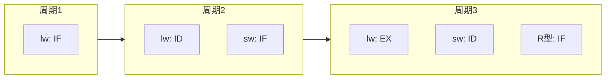

流水线的两个固有代价：时钟周期（即每一级的时间）受**最慢的一级**限制；对某些指令来说部分阶段是空转的（例如 R 型指令的 MEM 级什么也不做）。[^l03-section-6-s1p138]

### 流水线数据通路的三条设计原则

从多周期改成流水线时，核心变化是"多条指令同时在数据通路的不同阶段"，这带来三个问题，对应三条设计原则：[^l03-section-6-s1p68]

1. **Q1 部件冲突**：五个阶段 IF、ID、EX、MEM、WB 在同一周期都要工作，多周期中被复用的部件此时会被同时争用。→ 像单周期那样**重新复制部件**。
2. **Q2 状态保存**：PC 每个周期都在更新，后续阶段却还需要"自己那条指令"的 PC 和指令字。→ 增加**流水线寄存器**记录每条指令的 PC、指令和中间数据。
3. **Q3 控制信号**：不同阶段正在执行的是不同指令，所需控制信号各不相同。→ 让控制信号**随数据一起经流水线寄存器向后传递**。

#### 原则一：复制数据通路部件

复制后的部件组合与原来的单周期数据通路相同：[^l03-section-6-s1p69]

- **指令存储器与数据存储器分离**（IM/DM）：IF 取指与 MEM 访存可在同一周期进行。
- **两个加法器 + 一个 ALU**：一个加法器算 PC+4，一个算分支目标 PC+偏移，ALU 专用于 EX 级运算，不再像多周期那样由 ALU 兼算 PC。

例外是**寄存器堆**：只需一个就能同时服务 ID（读）和 WB（写）。[^l03-section-6-s1p70]

- 读与写使用寄存器堆上不同的端口；
- **写操作发生在周期的前半段，读操作发生在后半段**。这样同一周期内 WB 先写入的值，ID 在后半周期就能读到。

> [!note] 补充解释
> "前半周期写、后半周期读"的直接收益是：相隔 3 条指令的写后读不需要额外处理——WB 级写入的结果在同一周期就被 ID 级的后继指令读到。这一点在 [07 结构冒险与数据冒险](#结构冒险与数据冒险) 分析数据冒险时会用到。

#### 原则二：流水线寄存器（Pipeline Register）

**流水线寄存器**是插在相邻两级之间的状态寄存器，用来把各级隔离开：后面阶段需要用到的任何数据，都必须经流水线寄存器逐级传递下去。[^l03-section-6-s1p71] 为简化作图，每两级之间的一组寄存器被看作一个"大"流水线寄存器，按其两侧阶段命名为 **IF/ID、ID/EX、EX/MEM、MEM/WB**。[^l03-section-6-s1p140]

各级寄存器中保存的内容（上标表示该值供哪一级使用）：

| 流水线寄存器 | 保存内容 |
| --- | --- |
| IF/ID | $\mathrm{PC}^{\rm RF}$、$\mathrm{IR}^{\rm RF}$（IR 即指令寄存器 Instruction Register） |
| ID/EX | $\mathrm{PC}^{\rm ALU}$、$\mathrm{IR}^{\rm ALU}$、A（RegData1）、B（RegData2） |
| EX/MEM | $\mathrm{PC}^{\rm MEM}$、$\mathrm{IR}^{\rm MEM}$、$R^{\rm MEM}$（ALU 输出）、$D^{\rm ALU}$（RegData2，作为写存储器的数据） |
| MEM/WB | $\mathrm{PC}^{\rm WB}$、$\mathrm{IR}^{\rm WB}$、$R^{\rm WB}$、$D^{\rm MEM}$（存储器读出数据） |

其中 $R$ 表示沿流水线传递的 ALU 结果，对应图中的 `Out`；上标表示所在阶段。

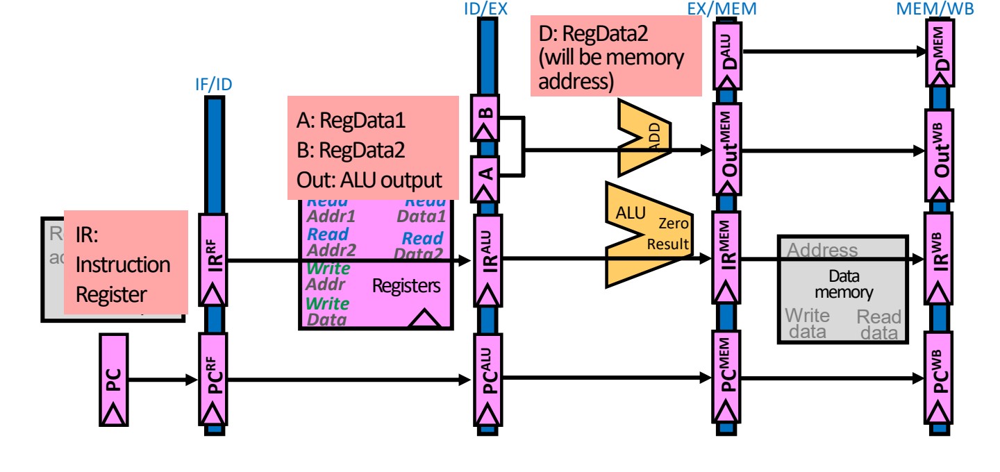

图：四个流水线寄存器 IF/ID、ID/EX、EX/MEM、MEM/WB 把 PC、指令、寄存器读出值与 ALU 结果逐级传递。

可以看到 PC 和指令字一路从 IF/ID 传到 MEM/WB：许多信息在当前阶段用不上，但为了最后一级能用到，必须在各级之间不停地传。

**目的寄存器号必须一路传到 WB**：目的寄存器由 IF 取出的指令中的 rd 字段决定，但寄存器堆的写地址端口工作在 WB 级。如果直接把 IF/ID 中当前指令的 rd 接到写地址上，写入的就是"此刻在 ID 级那条指令"的 rd，而不是正在 WB 的那条指令的。因此 rd 字段必须经 ID/EX → EX/MEM → MEM/WB 逐级传递，在 WB 级再送回寄存器堆的写地址端口。[^l03-section-6-s1p72]

以 load 为例：在 IF 读出指令，ID 读寄存器后送入 ID/EX，EX 算地址后送入 EX/MEM，MEM 读出数据送入 MEM/WB，最后在 WB 把结果（连同一路传来的 rd）写回寄存器堆。

> [!warning] 易错点
> 这部分流水线数据通路图沿用 MIPS 画法：寄存器写成 `$8`、`$29` 形式，目的寄存器由 `Instr[15-11]`（rd）或 `Instr[20-16]`（rt）经 RegDst 选择。[^l03-section-6-s1p72] RISC-V 中目的寄存器固定在 `inst[11:7]`，不需要 RegDst 多路选择器；但"rd 必须随流水线传到 WB"这一原则完全相同。

#### 原则三：控制信号的产生与分组传递

控制信号的产生方式与单周期处理器相同（在 ID 级由控制单元根据操作码产生，见 [04 单周期数据通路](#单周期数据通路)），但某些信号在后续阶段才用得上，而且每一级正在执行的指令不同。[^l03-section-6-s1p73] 因此控制信号在 ID 产生后按使用阶段分成 EX、MEM、WB 三组，存入 ID/EX；每过一级就"用掉"本级那一组，剩余的继续向后传：


正确的分组如下：[^l03-section-6-s1p141]

| 分组 | 使用阶段 | 控制信号 |
| --- | --- | --- |
| EX | 执行/地址计算 | ALUSrc、ALUOp（MIPS 画法中还有 RegDst） |
| MEM | 访存 | MemRead、MemWrite、Branch（决定 PCSrc） |
| WB | 写回 | RegWrite、MemtoReg |

> [!warning] 易错点：控制分组标签错位
> 源材料的控制传递图中，文字标签写成"MEM: ALUSrc, ALUOp, RegDst"与"WB: MemRead, MemWrite, PCSrc"，这是标签整体错位。按信号功能判断：ALUSrc/ALUOp 控制 ALU，属于 EX；MemRead/MemWrite 控制数据存储器、Branch/PCSrc 用 MEM 级的分支结果选择 PC，属于 MEM；RegWrite/MemtoReg 控制写回，属于 WB。以上表为准（与备份页中的流水线控制表一致）。[^l03-section-6-s1p73]

各类 RISC-V 指令在三组中的控制值（备份页内容）：[^l03-section-6-s1p141]

| 指令 | ALUOp | ALUSrc | Branch | MemRead | MemWrite | RegWrite | MemtoReg |
| --- | --- | --- | --- | --- | --- | --- | --- |
| R 型 | 10 | 0 | 0 | 0 | 0 | 1 | 0 |
| ld | 00 | 1 | 0 | 1 | 0 | 1 | 1 |
| sd | 00 | 1 | 0 | 0 | 1 | 0 | X |
| beq | 01 | 0 | 1 | 0 | 0 | 0 | X |

sd 和 beq 不写寄存器（RegWrite=0），所以 MemtoReg 无关（X）。

### 填充、满与排空

**流水线深度**（pipeline depth）是流水线的级数，本讲为 5。以下面 5 条指令为例（MIPS 写法）：[^l03-section-6-s1p74]

```asm
1000: lw  $8, 4($29)
1004: sub $2, $4, $5
1008: and $9, $10, $11
1012: or  $16, $17, $18
1016: add $13, $14, $0
```

逐周期看，第 $k$ 个周期第 1 条指令处于第 $k$ 级，后面的指令依次落后一级：

1. **填充**（filling，周期 1–4）：流水线中还有未被使用的功能部件。周期 1 只有 lw 在 IF；周期 2 lw 在 ID、sub 在 IF；……周期 4 已有 4 条指令在 IF–MEM。[^l03-section-6-s1p75]
2. **满**（full，周期 5）：五级各有一条指令，所有硬件都在使用——lw 在 WB，add 在 IF。[^l03-section-6-s1p79]
3. **排空**（emptying，周期 6–9）：不再有新指令进入时，流水线逐级空出，add 在周期 9 完成写回。若后面还有源源不断的指令，流水线就能每个周期产出一条结果。[^l03-section-6-s1p74]

> [!note] 补充解释
> 由此可得一般规律：$k$ 级流水线执行 $n$ 条指令（无停顿）需要 $k+(n-1)$ 个周期。本例 $5+4=9$ 个周期，与"周期 9 排空结束"一致。$n$ 很大时平均每条指令约 1 个周期。

### 流水线悖论与加速比

**流水线悖论**（pipelining paradox）：流水线并不改善任何单条指令的延迟；事实上，每条指令在流水线中花的时间比在单周期数据通路中还要长。[^l03-section-6-s1p80] 原因有二：

1. **级间锁存增加延迟**：每一级末尾都要经过一个流水线寄存器，数据必须在时钟沿前满足建立时间 $T_s$（并保持 $T_h$），时钟沿后还要经过 $T_{\rm clk\_q}$ 才出现在输出端。单周期只付一次这份开销，$k$ 级流水线要付 $k$ 次。
2. **最长的一级决定时钟周期**：较短的级也必须等满整个周期。[^l03-section-6-s1p81]

于是每级周期满足（时序约束的推导见 [03 数据通路部件与时钟](#数据通路部件与时钟)）：
$$
T_{\rm cycle} \ge \max_i\, t_i + T_{\rm clk\_q} + T_s
$$
其中 $t_i$ 是第 $i$ 级组合逻辑延迟。下面的例题忽略锁存开销，只取 $\max_i t_i$。

> [!example] 例：五级流水线比单周期快多少？
> 已知各级延迟：IF 1.0 ns，ID 0.6 ns，EX 0.9 ns，MEM 1.2 ns，WB 0.4 ns。[^l03-section-6-s1p81]
>
> 1. **单周期**：一个周期要走完全部五级，$T=1.0+0.6+0.9+1.2+0.4=4.1$ ns；每条指令 1 个周期，延迟 4.1 ns。
> 2. **五级流水线**：周期取最长级 $T=\max(1.0,0.6,0.9,1.2,0.4)=1.2$ ns（MEM）；每条指令要 5 个周期，延迟 $5\times1.2=6.0$ ns——比单周期**更长**。
> 3. **吞吐量**：度过最初的填充期后，两者都是每周期完成 1 条指令（$\mathrm{CPI}=1$），区别只在周期长度。[^l03-section-6-s1p82]
> 4. **加速比**（记为 $S$）：
> $$
> S=\frac{\mathrm{CPI}\times T_{\rm single}}{\mathrm{CPI}\times T_{\rm pipe}}=\frac{4.1\ \text{ns}}{1.2\ \text{ns}}\approx 3.42
> $$
>
> | 设计 | 周期 | 每条指令周期数 | 单条延迟 | 吞吐量 |
> | --- | --- | --- | --- | --- |
> | 单周期 | 4.1 ns（各级之和） | 1 | 4.1 ns | 1 条 / 4.1 ns |
> | 五级流水线 | 1.2 ns（各级最大值） | 5 | 6.0 ns | 1 条 / 1.2 ns |

**理想加速比**：流水线最多同时执行 5 条指令，若各级完全平衡（每级都是 $4.1/5=0.82$ ns），周期缩为原来的 1/5，理想加速比等于**流水线深度** 5。[^l03-section-6-s1p83] 实际只有 3.42，是因为**各级不平衡**——MEM 级 1.2 ns 远长于 WB 的 0.4 ns，其他级都要陪着等 1.2 ns。

> [!tip] 课堂强调
> 这类周期/延迟/加速比的计算很简单，课上直接给出结果，并表示不太打算考察这个计算本身；需要真正理解的是"流水线提高吞吐量、不降低延迟"以及"不平衡导致达不到理想加速比"。[^l03-section-6-s2b11]

> [!warning] 易错点
> 加速比要比的是**吞吐量**（同样 CPI 下比周期），不是单条指令延迟。用延迟比会得到 $4.1/6.0<1$，错误地得出"流水线更慢"。

### 流水线深度的极限：功耗

既然加速比理想上等于深度，自然的想法是不断加深流水线来提高吞吐量和主频。Intel x86 的历史正是如此：[^l03-section-6-s1p84]

- i486（1989）与 Pentium（1993）约 5 级，1997 年约 10 级；
- Willamette（2001）约 22 级、主频约 2 GHz，P4 Prescott（2004）达到约 31 级、主频约 3.6 GHz；
- 此后 Core 2 Conroe（2006）回落到 14 级，Core 2 Yorkfield（2008）与 Core i7 Gulftown（2010）约 16 级。

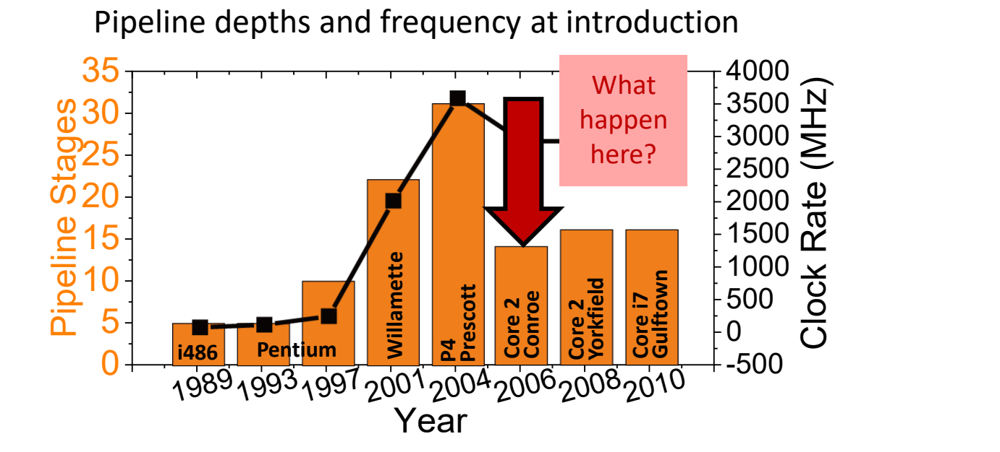

图：Intel x86 流水线深度与频率：从 i486 的 5 级升到 P4 Prescott 约 31 级，随后 Core 系列回落到 14–16 级。

回落的原因是**功耗与发热**：同时进行的事情太多，芯片会"熔化"。[^l03-section-6-s1p85] 必须关掉系统中暂时不用的部分，常见手段有：

1. **时钟门控**（clock gating）：关闭空闲模块的时钟，其组合逻辑不再翻转，从而节省功耗。
2. **异步设计**（asynchronous design）：不依赖全局时钟，需要时才工作。
3. **低电压摆幅**（low voltage swings）/ 降压利用时序余量：若一级的 $T_{\rm clk\_q}$ + 传播延迟 + 建立时间明显短于时钟周期，中间就留有**时间余量**（slack），这段时间电路什么也不做。此时可以降低电源电压 $V_{dd}$，使电路变慢、恰好填满时钟周期，而动态功耗与 $V_{dd}^2$ 成正比，降压带来平方级的功耗下降。[^l03-section-6-s1p85]


动态功耗与电压、频率的关系以及“功耗墙”的来龙去脉见 L01《05 技术趋势与功耗墙》，这里不再展开。

### 冒险与 RISC-V 的易流水化

加深流水线的第二个限制是**冒险**（hazard）：使下一条指令无法在其预定的时钟周期执行的情况。一旦出现冒险，指令只能停顿等待，流水线的吞吐量收益随之损失。[^l03-section-6-s1p86] 冒险分三类：

- **结构冒险**（structural hazard）：硬件资源不够，两条指令同时要用同一部件——例如只有一个存储器时 IF 与 MEM 冲突。
- **数据冒险**（data hazard）：指令的输入操作数依赖于前面指令尚未产生的结果。
- **控制冒险**（control hazard）：分支结果未定，不知道下一条该取哪条指令。[^l03-section-6-s1p142]

结构冒险与数据冒险的具体分析与解决（停顿、转发、load-use）见 [07 结构冒险与数据冒险](#结构冒险与数据冒险)，控制冒险见 [08 控制冒险](#控制冒险)。

（备份页内容）RISC-V 指令集本身是按易于流水化设计的：[^l03-section-6-s1p142]

| ISA 特点 | 对流水线的好处 |
| --- | --- |
| 所有指令等长（32 位） | 第 1 级即可取指，第 2 级即可译码 |
| 指令格式少、字段位置精心安排 | 第 2 级就能开始读寄存器堆（不必等译码完成） |
| 只有 load/store 访问存储器 | 可用 EX 级计算访存地址，MEM 级只做访存 |
| 每条指令最多写一个结果，且在流水线末尾（MEM、WB）写 | 机器状态修改集中在末端，便于控制 |

> [!question]- 自测：五级流水线各级延迟为 IF 0.8、ID 0.5、EX 1.0、MEM 0.9、WB 0.3 ns（忽略锁存开销），单条指令延迟和相对单周期的加速比分别是多少？
> 单周期周期 $=0.8+0.5+1.0+0.9+0.3=3.5$ ns；流水线周期取最大级 $1.0$ ns，单条延迟 $5\times1.0=5.0$ ns（比单周期长）；稳态每周期 1 条，加速比 $3.5/1.0=3.5$，低于理想值 5，因为 EX 级最慢，各级不平衡。

> [!question]- 自测：若流水线设计中把 IF/ID 寄存器里的 rd 字段直接接到寄存器堆写地址端口，执行 `lw x5, 0(x1)` 后紧跟 4 条无关指令，会发生什么？
> lw 的数据在 WB 级（第 5 周期）才写回，此时 IF/ID 里是正在 ID 级的第 3 条后继指令（第 4 条还在 IF），写地址取的是那条指令的 rd，结果被写进错误的寄存器。rd 必须经 ID/EX、EX/MEM、MEM/WB 随 lw 一起传到 WB。

> [!question]- 自测：sd 指令在 ID 产生的控制信号中，哪一组在哪一级被用到？到达 MEM/WB 时还剩哪些？
> EX 组 ALUOp=00、ALUSrc=1 在 EX 级用于算地址；MEM 组 MemWrite=1、MemRead=0、Branch=0 在 MEM 级用于写存储器；MEM/WB 中只剩 WB 组 RegWrite=0、MemtoReg=X，表示 sd 不写回寄存器。

> [!info]- 来源
> - L03.pdf：PDF p.65–86, 137–142
> - L03.docx：DOCX body 384–484

[^l03-section-6-s1p65]: L03.pdf-PDF p.65
[^l03-section-6-s1p138]: L03.pdf-PDF p.138
[^l03-section-6-s1p137]: L03.pdf-PDF p.137
[^l03-section-6-s1p66]: L03.pdf-PDF p.66
[^l03-section-6-s1p67]: L03.pdf-PDF p.67
[^l03-section-6-s1p139]: L03.pdf-PDF p.139
[^l03-section-6-s1p68]: L03.pdf-PDF p.68
[^l03-section-6-s1p69]: L03.pdf-PDF p.69
[^l03-section-6-s1p70]: L03.pdf-PDF p.70
[^l03-section-6-s1p71]: L03.pdf-PDF p.71
[^l03-section-6-s1p140]: L03.pdf-PDF p.140
[^l03-section-6-s1p72]: L03.pdf-PDF p.72
[^l03-section-6-s1p73]: L03.pdf-PDF p.73
[^l03-section-6-s1p141]: L03.pdf-PDF p.141
[^l03-section-6-s1p74]: L03.pdf-PDF p.74
[^l03-section-6-s1p75]: L03.pdf-PDF p.75
[^l03-section-6-s1p79]: L03.pdf-PDF p.79
[^l03-section-6-s1p80]: L03.pdf-PDF p.80
[^l03-section-6-s1p81]: L03.pdf-PDF p.81
[^l03-section-6-s1p82]: L03.pdf-PDF p.82
[^l03-section-6-s1p83]: L03.pdf-PDF p.83
[^l03-section-6-s2b11]: L03.docx-DOCX body 430-484
[^l03-section-6-s1p84]: L03.pdf-PDF p.84
[^l03-section-6-s1p85]: L03.pdf-PDF p.85
[^l03-section-6-s1p86]: L03.pdf-PDF p.86
[^l03-section-6-s1p142]: L03.pdf-PDF p.142

---

## 结构冒险与数据冒险

> [!abstract] 本节要点
> - 流水线图把每条指令画成 IM–Reg–ALU–DM–Reg 五格错开排列；流水线填满后每周期完成一条指令，$\mathrm{CPI}=1$，但会遇到结构、数据、控制三类冒险，最保守的解决办法永远是“等待”。
> - 结构冒险：只有一个存储器时，取指和 load 读数据会在同一周期争用它，所以把指令存储器和数据存储器分开（I-cache / D-cache）；寄存器堆的读写冲突用“前半周期写、后半周期读”解决。
> - WAR（反相关）和 WAW（输出相关）只是寄存器名字被重复使用，在五级流水线中不会发生，也可以靠寄存器重命名消除；RAW 是真相关，必须真正把数据送过去。
> - RAW 的两种解法：停顿（紧邻的相关指令要等 2 个周期）和转发（ALU 结果在 EX 结束时就有）。load-use 即使有转发也要停顿 1 个周期，由 ID 阶段的冒险检测单元冻结 PC 和 IF/ID，并向 ID/EX 插入气泡。
> - 转发条件 = RegWrite ∧ Rd ≠ 0 ∧ Rd 与源寄存器相同；EX/MEM 匹配时 Forward = 10，MEM/WB 匹配时 Forward = 01。出现双重冒险时必须转发最新的 EX/MEM 结果（例题正确结果 4，转发错了得 3）。

这部分源材料沿用 MIPS 写法（`lw $1,4($2)`、Rs/Rt、用 Rt 作 load 的目的寄存器），下面统一改写成 RISC-V：源寄存器记作 rs1/rs2，目的寄存器记作 rd，`$1` 对应 `x1`，`lw` 对应 `ld`。冒险的分类与定义见 [06 流水线设计与性能](#流水线设计与性能)，控制冒险见 [08 控制冒险](#控制冒险)。

### 流水线图（Pipeline Diagram）

分析冒险首先要知道“第几个周期、哪条指令、用的是哪个部件”。**流水线图**（pipeline diagram）就是回答这个问题的工具：横轴是时钟周期，纵轴是按程序顺序排列的指令，每条指令画成 5 个部件符号——IM（取指，指令存储器）、Reg（译码并读寄存器堆）、ALU（执行）、DM（访存，数据存储器）、Reg（写回寄存器堆），下一条指令右移一格。[^l03-section-7-s1p88]

用流水线图可以回答三类问题：[^l03-section-7-s1p88]

1. 这段代码一共要多少个周期？
2. 第 4 个周期 ALU 在为哪条指令工作？
3. 有没有冒险？原因是什么？怎么解决？

5 条指令在五级流水线中没有冒险时占用第 1–9 个周期（$5 + (5-1) = 9$）。前 4 个周期在**填充**流水线；填满以后每个周期都有一条指令完成，所以 $\mathrm{CPI}=1$。[^l03-section-7-s1p89]

流水线会出问题，原因就是三类**流水线冒险**（分类见 [06 流水线设计与性能](#流水线设计与性能)）。所有冒险都可以靠**等待**解决，前提是流水线控制必须**检测**到冒险，再**采取行动**。[^l03-section-7-s1p90]

### 结构冒险（Structural Hazard）

**结构冒险**是两条不同的指令在同一时刻试图使用同一个硬件资源。[^l03-section-7-s1p91] 五级流水线中最典型的两个资源是存储器和寄存器堆。

#### 单一存储器

以下面这段程序为例（下同）：

```asm
ld  x1, 4(x2)    # 指令 1
sub x4, x1, x5   # 指令 2
and x6, x1, x7   # 指令 3
or  x8, x1, x9   # 指令 4
```

在第 4 个周期，`ld` 处于 MEM 阶段，要**从存储器读数据**；同一周期 `or` 处于 IF 阶段，要**从存储器读指令**。如果指令和数据共用一个存储器，这两次访问就会冲突。[^l03-section-7-s1p92]

**解决方法**：把存储器分成**指令存储器/指令缓存**（I-cache）和**数据存储器/数据缓存**（D-cache）。IM 只在 IF 阶段使用，DM 只在 MEM 阶段使用，任何周期每个存储器最多只有一条指令在访问。[^l03-section-7-s1p93]

#### 寄存器堆的读与写

第 5 个周期，`ld` 在 WB 阶段**写**寄存器堆，`or` 在 ID 阶段**读**寄存器堆，两者同时用到寄存器堆。[^l03-section-7-s1p94]

**解决方法**：把一个周期分成两半，**前半周期写寄存器、后半周期读寄存器**（并把读到的值装入流水线寄存器）。这样同一周期里先写进去的值，后半周期就能读到。[^l03-section-7-s1p95] 这个规则后面会反复用到：同一周期内 WB 写、ID 读同一个寄存器，读到的是新值。

| 冲突资源 | 冲突周期 | 冲突双方 | 解决方法 |
|---|---|---|---|
| 存储器 | 第 4 周期 | `ld` 的 MEM 读数据 vs `or` 的 IF 读指令 | 分开 I-cache 与 D-cache |
| 寄存器堆 | 第 5 周期 | `ld` 的 WB 写 vs `or` 的 ID 读 | 前半周期写、后半周期读 |

### 三种数据相关：WAR、WAW 与 RAW

**数据冒险**是指令依赖于仍在流水线中的前一条指令的结果，在数据还没准备好时就去使用它。[^l03-section-7-s1p96] 设指令 I 在前、J 在后，按“哪种读写顺序被破坏”可分三类：[^l03-section-7-s1p97]

| 类型 | 例子 | 被破坏的顺序 | 编译器术语 | 根源 | 五级流水线中 |
|---|---|---|---|---|---|
| **写后读**（Read After Write, RAW） | `I: add r1,r2,r3`<br>`J: sub r4,r1,r3` | J 在 I 写 r1 之前就读了 r1 | **真相关**（true dependence） | 指令之间确实需要传递数据 | 会发生，是本节的重点 |
| **读后写**（Write After Read, WAR） | `I: sub r4,r1,r3`<br>`J: add r1,r2,r3`<br>`K: mul r6,r1,r7` | J 在 I 读 r1 之前就写了 r1 | **反相关**（anti-dependence） | 寄存器名 r1 被重复使用 | 不会发生：读总在第 2 级（ID），写总在第 5 级（WB） |
| **写后写**（Write After Write, WAW） | `I: sub r1,r4,r3`<br>`J: add r1,r2,r3`<br>`K: mul r6,r1,r7` | J 在 I 写 r1 之前就写了 r1 | **输出相关**（output dependence） | 寄存器名 r1 被重复使用 | 不会发生：写总在第 5 级（WB），按程序顺序进行 |

WAR 和 WAW 的两条指令之间其实没有数据依赖，只是碰巧用了同一个寄存器名字。把 J 的目的寄存器换成另一个寄存器，冲突就没了，这就是**寄存器重命名**（register renaming）。在别的实现技术中（或指令间距更长时），这两类冒险可能出现，这时可以用重命名解决。[^l03-section-7-s1p97]

RAW 不同：后一条指令要的是前一条指令**写进寄存器的值**，换名字解决不了，必须让数据真正从生产者送到消费者。下面只讨论 RAW。

> [!tip] 课堂强调
> 在简单的五级流水线里 WAR 和 WAW 都不会出现，到后面讲超标量（superscalar）处理器时，这两类冒险都会出现。[^l03-section-7-s2b12]

### RAW 冒险的时序与停顿（Stall）

#### 两种 RAW 场景

**场景一：寄存器使用（register usage）**。[^l03-section-7-s1p98]

```asm
add x1, x2, x3   # 第 5 周期 WB 才写入 x1
sub x4, x1, x5   # 第 3 周期 ID 读 x1 → 读到旧值
and x6, x1, x7   # 第 4 周期 ID 读 x1 → 读到旧值
or  x8, x1, x9   # 第 5 周期 ID 读 x1 → 前半周期写、后半周期读，正确
xor x4, x1, x5   # 第 6 周期 ID 读 x1 → 正确
```

`add` 的结果要到第 5 个周期才写回 x1，`sub` 和 `and` 却在第 3、第 4 个周期就读寄存器，属于“写之前读”，读到的是错误的旧值。`or` 在第 5 个周期读，靠前半周期写、后半周期读拿到了正确值；`xor` 更晚，也没问题。[^l03-section-7-s1p98]

**场景二：load-use 数据冒险**。把第一条换成 `ld x1, 4(x2)`，情况相同：load 的数据也要到第 5 个周期才写回，`sub`、`and` 读错，`or`、`xor` 读对。[^l03-section-7-s1p99] 两种场景分开讲，是因为它们在转发下的结果不同，见下文。

#### 解法一：停顿

**停顿**（stall）就是让相关指令原地等待，直到数据写回寄存器堆再读。`sub` 本来在第 3 个周期做 ID，必须推迟到与 `add` 的 WB 同一个周期（第 5 周期，靠半周期规则），所以要插入 **2 个停顿周期**；`and` 也随之整体后移。[^l03-section-7-s1p100]

| 指令 | C1 | C2 | C3 | C4 | C5 | C6 | C7 | C8 |
|---|---|---|---|---|---|---|---|---|
| `add x1,x2,x3` | IF | ID | EX | MEM | WB | | | |
| `sub x4,x1,x5` | | IF | stall | stall | ID | EX | MEM | WB |

停顿简单可靠，代价是 CPI 不再等于 1：每次停顿都让流水线空转，CPI 上升。[^l03-section-7-s1p100]

### 数据转发（Forwarding / Bypassing）

停顿浪费的周期其实没有必要：`add` 的结果在 EX 结束时（第 3 周期末）就已经算出来了，只是还没写回。**转发**（forwarding，又称**旁路** bypassing）就是一旦结果产生，立即把它送到需要它的地方，不再等它写回寄存器堆。[^l03-section-7-s1p101]

精确地说：从流水线状态寄存器中**最早出现该结果的位置**取出它，送到这个周期需要它的功能部件（例如 ALU）。对 ALU 来说，输入不再只能来自 ID/EX，而可以来自任一流水线寄存器，硬件上需要：[^l03-section-7-s1p103]

1. 在 ALU 的两个输入端各加一个**多路选择器**；
2. 把 EX/MEM 和 MEM/WB 中准备写入 rd 的数据连到 EX 级 rs1、rs2 两个 ALU 选择器的输入端（可以接其中一个，也可以两个都接）；
3. 加上控制这些新选择器的硬件。

其他功能部件（如数据存储器 DM）可能也需要类似的转发逻辑。有了转发，即使存在数据相关，也能做到 $\mathrm{CPI}=1$。[^l03-section-7-s1p103]

流水线寄存器本来就保存着 ALU 结果：EX/MEM 中存着上一条指令刚算出的结果，下一个周期这个结果移到 MEM/WB。因此在 `add x1,...` 后面：[^l03-section-7-s1p104]

- 紧跟在后的 `sub` 在 EX 时，`add` 在 MEM，x1 的新值在 **EX/MEM** 中 → **EX/MEM 转发**；
- 中间隔一条的 `and` 在 EX 时，`add` 在 WB，x1 的新值已经到了 **MEM/WB** → **MEM/WB 转发**。

#### load-use：转发后仍要停顿 1 周期

load 的数据要到 MEM 阶段结束（第 4 周期末）才从数据存储器读出来，而紧跟其后的 `sub` 在第 4 周期**开始**时就要在 EX 用它。数据不能送回过去，所以即使有转发，也必须**停顿 1 个周期**：`sub` 推迟一拍进入 EX，这时 load 的数据已在 MEM/WB 中，可以转发过去。[^l03-section-7-s1p102] [^l03-section-7-s1p110]

| 指令 | C1 | C2 | C3 | C4 | C5 | C6 | C7 |
|---|---|---|---|---|---|---|---|
| `ld x1,4(x2)` | IF | ID | EX | MEM | WB | | |
| `sub x4,x1,x5` | | IF | ID | 气泡（重复 ID） | EX ← MEM/WB 转发 | MEM | WB |
| `and x6,x1,x7` | | | IF | IF（保持） | ID | EX | MEM |

| 生产者 | 结果可用时刻 | 消费者需要时刻 | 不转发：停顿 | 转发：停顿 |
|---|---|---|---|---|
| ALU 指令（`add`） | 第 3 周期末（EX） | 下一条的第 4 周期 EX | 2 周期 | 0 |
| `ld` | 第 4 周期末（MEM） | 下一条的第 4 周期 EX | 2 周期 | 1 周期 |

> [!tip] 课堂强调
> load 的数据要到第 4 个周期（MEM）才有，下一条指令却在同一个周期一开始就要用它，所以无法满足转发的时间要求，必须在 load 和使用它的指令之间额外加一个停顿周期。[^l03-section-7-s2b12]

### 转发单元与转发条件

#### EX/MEM 转发条件

转发单元在 EX 阶段比较寄存器号，判断 ALU 的某个输入是否应该改用流水线寄存器里的新值。EX/MEM 转发（生产者与使用者相邻，例如 `add x1,x2,x3` 之后紧跟 `and x6,x1,x7`）的条件是：[^l03-section-7-s1p105]

```text
if (EX/MEM.RegWrite
    and (EX/MEM.RegisterRd != 0)
    and (EX/MEM.RegisterRd == ID/EX.RegisterRs1))
        ForwardA = 10

if (EX/MEM.RegWrite
    and (EX/MEM.RegisterRd != 0)
    and (EX/MEM.RegisterRd == ID/EX.RegisterRs2))
        ForwardB = 10
```

三个条件分别回答：[^l03-section-7-s1p105]

1. **`RegWrite`**：EX/MEM 中那条指令的结果真的会写回寄存器堆吗？（`sd`、`beq` 不写寄存器，它们的 rd 位置上的数没有意义。）
2. **`Rd ≠ 0`**：目的寄存器不是 x0 吗？x0 恒为 0，写 x0 的结果会被丢弃，绝不能转发给读 x0 的指令。
3. **`Rd == Rs`**：EX/MEM 中指令的目的寄存器与 ID/EX 中（正在进入 EX 的）指令的源寄存器相同吗？相同才真正构成数据冒险。

ForwardA 控制 ALU 第一个操作数（rs1）的选择器，ForwardB 控制第二个操作数（rs2）的选择器。

#### MEM/WB 转发条件（初版）

生产者与使用者中间隔一条指令（例如 `add x1,x2,x3`、一条无关指令、`sub x4,x1,x5`）时数据已在 MEM/WB，初版条件与上面同构，编码为 01：[^l03-section-7-s1p106]

```text
if (MEM/WB.RegWrite
    and (MEM/WB.RegisterRd != 0)
    and (MEM/WB.RegisterRd == ID/EX.RegisterRs1))
        ForwardA = 01
（Rs2 同理 → ForwardB = 01）
```

这里的 `RegWrite` 问的是“MEM 阶段得到的数据会写回寄存器堆吗”，因此 MEM/WB 转发既能转发 ALU 结果，也能转发 load 读出的数据。

#### 双重数据冒险

当 EX/MEM 和 MEM/WB 中的两条指令**都**要写同一个寄存器、且都与当前指令的源寄存器匹配时，**双重数据冒险**就出现了：该转发 WB 级那条指令的结果，还是 MEM 级那条指令的结果？[^l03-section-7-s1p107]

> [!example] 例：连续累加 x1
> 初始 x1 = x2 = x3 = x4 = 1，执行
>
> ```asm
> add x1, x1, x2   # x1 = 1 + 1 = 2
> add x1, x1, x3   # x1 = 2 + 1 = 3
> add x1, x1, x4   # x1 = 3 + 1 = 4
> ```
>
> 1. 按程序语义，最终 x1 应为 **4**。[^l03-section-7-s1p107]
> 2. 第 5 个周期，第三条 `add` 进入 EX，需要 x1。此时 EX/MEM 中是第二条指令的结果 **3**，MEM/WB 中是第一条指令的结果 **2**，两者的 rd 都是 x1，初版的 EX/MEM 条件和 MEM/WB 条件**同时成立**。
> 3. 如果选了 MEM/WB 的 2，第三条算出 $2+1=3$，结果**错误**；必须选更新的 EX/MEM 值 3，得到 $3+1=4$。
> 4. 结论：两级都匹配时，**EX/MEM 优先**，因为它是最新的结果。

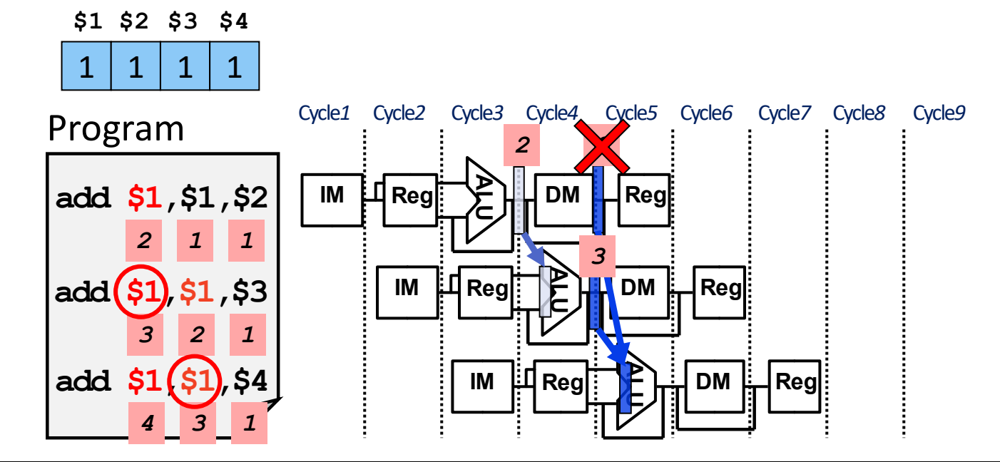

图：双重数据冒险：三条连续 `add` 都写寄存器 `$1`，第三条应转发最新的 EX/MEM 结果 3，而不是更旧的 MEM/WB 结果 2。

因此 MEM/WB 转发要再加一个条件：**只有 EX/MEM 那一级不转发时，才从 MEM/WB 转发**。源材料给出的修正条件只检查了 `EX/MEM.RegisterRd != ID/EX.RegisterRs`，这是简化写法。[^l03-section-7-s1p108] 完整条件（Patterson & Hennessy 版本）把 EX/MEM 转发的全部条件取反：

```text
if (MEM/WB.RegWrite
    and (MEM/WB.RegisterRd != 0)
    and not (EX/MEM.RegWrite
             and (EX/MEM.RegisterRd != 0)
             and (EX/MEM.RegisterRd == ID/EX.RegisterRs1))
    and (MEM/WB.RegisterRd == ID/EX.RegisterRs1))
        ForwardA = 01
（把 Rs1 换成 Rs2 → ForwardB = 01）
```

> [!warning] 易错点
> 只写“EX/MEM.Rd ≠ ID/EX.Rs1”不够。如果 EX/MEM 里是一条不写寄存器的指令（如 `sd`、`beq`），它 rd 位置上的位段可能碰巧等于 rs1，简化条件会错误地屏蔽本该进行的 MEM/WB 转发；同理，EX/MEM 的目的寄存器是 x0 时也不应该屏蔽 MEM/WB。判断方法：屏蔽 MEM/WB 的前提是“EX/MEM 这一级确实在转发”，所以要把 EX/MEM 的三个条件整体取反。

三种选择器编码汇总如下（00 即默认情况，操作数照常取自 ID/EX）：

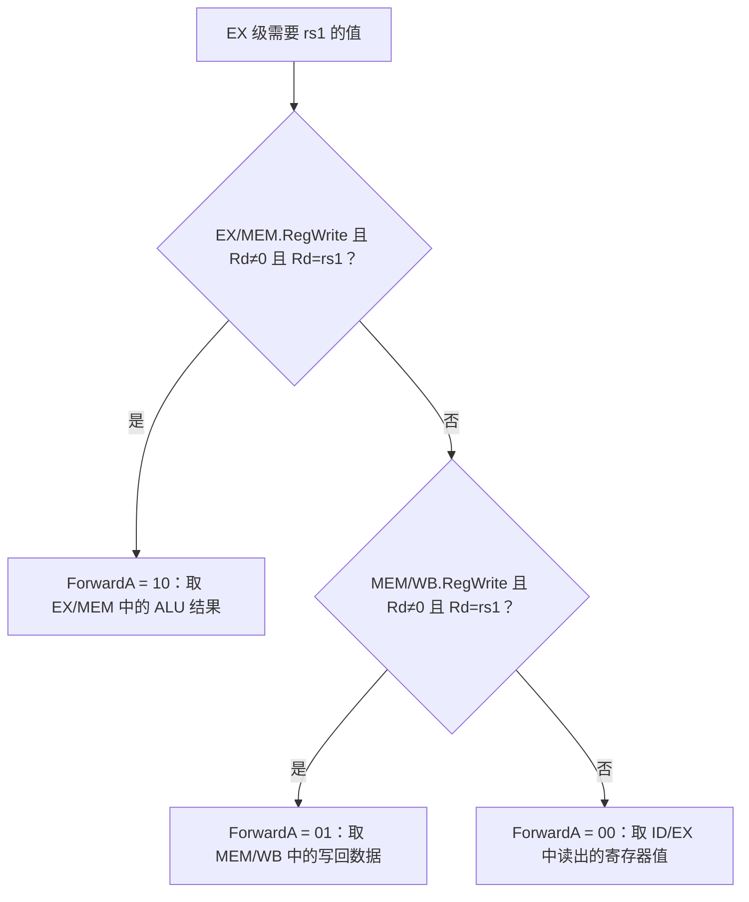

#### 转发硬件

加入转发后，数据通路中多了一个**转发单元**（forwarding unit）。它的输入是 ID/EX.RegisterRs1、ID/EX.RegisterRs2、EX/MEM.RegisterRd、MEM/WB.RegisterRd（以及两级的 RegWrite）；它的输出控制 ALU 两个输入端的三选一选择器（Forward to ALU）。数据通路上还画出了把写回数据转发到数据存储器写数据端的通路（Forward DM data）。[^l03-section-7-s1p109] 转发单元的工作就是比较不同流水线寄存器中的寄存器号，确定有没有冒险；有冒险时，把选择器切换到相应的数据来源。[^l03-section-7-s2b13]

> [!info] 可视化资源
> [Wikipedia：Classic RISC pipeline（五级流水线与转发示意图）](https://en.wikipedia.org/wiki/Classic_RISC_pipeline)——Hazards 一节用图示对比了数据冒险、一级转发，以及 load 后必须插入气泡的两级转发情形。

### load-use 冒险检测与插入气泡

转发单元只能“改选数据来源”，解决不了 load-use 必须多等一拍的问题，因此要在 **ID 阶段**加一个**冒险检测单元**（hazard detection unit），在 load 和使用它的指令之间插入一个停顿。[^l03-section-7-s1p111]

#### 检测条件

此时 load 在 EX 阶段（ID/EX 中），使用者在 ID 阶段（IF/ID 中）。用 RISC-V 字段写出（源材料中的 Rt 即 load 的目的寄存器 rd）：[^l03-section-7-s1p111]

```text
if (ID/EX.MemRead
    and ((ID/EX.RegisterRd == IF/ID.RegisterRs1)
      or (ID/EX.RegisterRd == IF/ID.RegisterRs2)))
        stall the pipeline
```

- `ID/EX.MemRead`：现在 EX 阶段的指令是 load 吗？（只有 load 读数据存储器）
- 寄存器号比较：load 的目的寄存器是否等于 ID 阶段指令的任一源寄存器？两个都要比较。

冒险检测单元需要 ID/EX.MemRead、ID/EX.RegisterRd 以及 IF/ID 中的两个源寄存器号作为输入。[^l03-section-7-s1p112]

#### 停顿硬件：冻结 + 气泡

检测到 load-use 后，硬件做两件事：[^l03-section-7-s1p113]

1. **阻止 IF、ID 中的指令前进**：冒险检测单元把 **PC.Write** 和 **IF/ID.Write** 置 0，PC 和 IF/ID 流水线寄存器保持不变。下一周期重新取同一条指令，ID 中的使用者再译码一次。
2. **插入气泡**（bubble）：在 EX 阶段的 load 和 ID 阶段的使用者之间插入一个空操作。方法是把 ID/EX 流水线寄存器中 EX、MEM、WB 三组控制位全部置 0（nop）。冒险检测单元控制一个选择器，在“控制单元产生的真实控制值”和“全 0”之间选择。

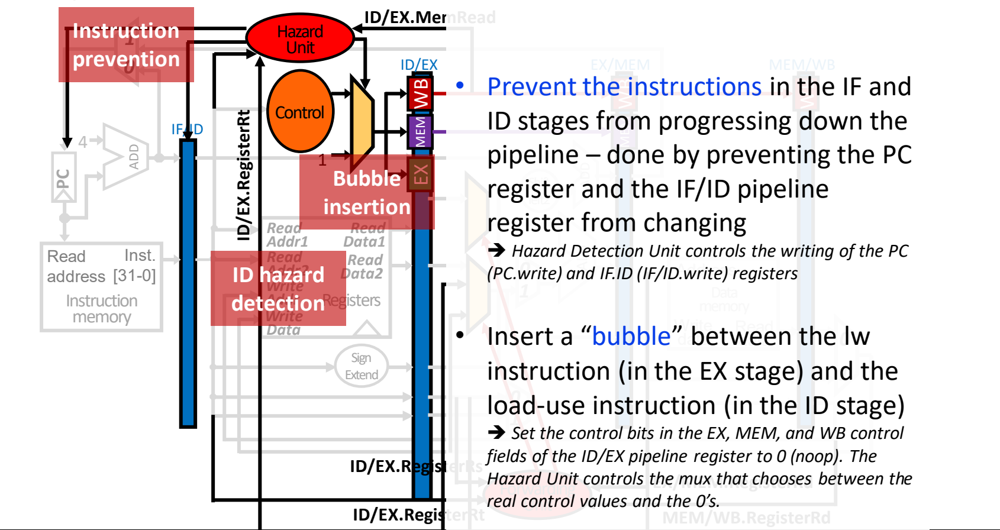

图：停顿硬件：冒险检测单元撤销 PC 与 IF/ID 写使能阻止取指和译码前进，并把 ID/EX 的控制位清零插入气泡。

控制位全为 0 的指令不写寄存器（RegWrite = 0），也不读写存储器（MemRead = MemWrite = 0），沿流水线往下走时不改变任何体系结构状态，相当于一条 nop。下一个周期 load 进入 MEM、气泡在 EX、使用者仍在 ID；再下一个周期 load 进入 WB，使用者进入 EX，通过 MEM/WB 转发得到数据。

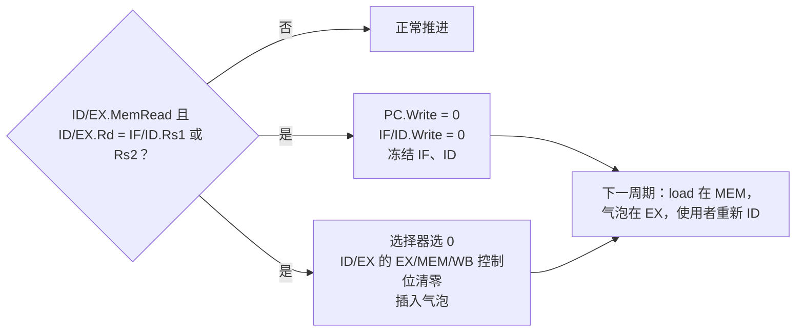

### 存储器到存储器复制（Memory-to-Memory Copy）

把一个存储单元的值搬到另一个存储单元，是很常见的操作，在 RISC-V 中写成 load 紧跟 store：[^l03-section-7-s1p114]

```asm
ld x1, 4(x2)   # 从 M[x2+4] 读到 x1
sd x1, 4(x3)   # 把 x1 写到 M[x3+4]
```

`sd` 真正需要 x1 的地方不是 ALU（ALU 只计算地址 x3+4），而是 **MEM 阶段数据存储器的写数据端**。`sd` 进入 MEM 时，`ld` 刚好在 WB，读出的数据就在 MEM/WB 中。因此只要**从 MEM/WB 寄存器转发到数据存储器输入端**，就能避免停顿。代价是在访存阶段增加一个转发单元和一个选择器。[^l03-section-7-s1p114] 前面的 ALU 转发通路只服务 EX 阶段，覆盖不了 DM 前后的这条路径，所以需要单独加转发和控制逻辑。[^l03-section-7-s2b13]

> [!note] 补充解释
> 这条转发的判断条件源材料没有给出，可以类比 ALU 转发来写：WB 级是 load（MEM/WB 的 MemtoReg/RegWrite 有效）、MEM 级是 store（EX/MEM.MemWrite），并且 MEM/WB.RegisterRd = EX/MEM.RegisterRs2（store 的数据寄存器）、Rd ≠ 0。条件成立时，DM 写数据端改选 MEM/WB 中的 load 数据。要真正省掉这次停顿，load-use 检测单元也不能因为 `sd` 的 rs2 匹配就停顿。

> [!question]- 自测：在有完整转发的五级流水线中，下列两段代码各需要停顿几个周期？(a) `add x1,x2,x3` 后紧跟 `sub x4,x1,x5`；(b) `ld x1,0(x2)` 后紧跟 `sub x4,x1,x5`。如果没有转发呢？
> 有转发时 (a) 0 个，(b) 1 个；没有转发时两者都是 2 个。`add` 的结果在 EX 结束时就在 EX/MEM 中，可以直接送给下一条指令的 EX。`ld` 的数据要到 MEM 结束才出现，晚了一拍，只能停顿 1 周期后从 MEM/WB 转发。没有转发时，两者都要等到第 5 周期写回，再靠“前半周期写、后半周期读”在同一周期读出，所以都要停 2 周期。

> [!question]- 自测：x1=5、x2=x3=x4=10。依次执行 `add x1,x1,x2`、`sub x1,x1,x3`、`add x5,x1,x4`。第三条进入 EX 时，ForwardA 应取何值？如果 MEM/WB 转发条件没有加“EX/MEM 未转发”的限制，会算出什么？
> ForwardA = 10，取 EX/MEM 中 `sub` 的结果 $15-10=5$，所以 x5 = $5+10=15$（正确）。此时 MEM/WB 中是第一条的结果 15，它的 rd 也是 x1，初版条件同样成立。如果硬件让 MEM/WB 覆盖 EX/MEM，就会用到过时的 15，得到 x5 = 25，这就是双重数据冒险。

> [!question]- 自测：`addi x0, x1, 5` 后紧跟 `add x2, x0, x3`。EX/MEM 的 Rd 与下一条的 rs1 都是 0，转发单元会转发吗？为什么要有这个检查？
> 不会转发，因为条件中有 `EX/MEM.RegisterRd != 0`。x0 是恒为 0 的寄存器，对它的写入会被丢弃，`add` 读 x0 必须得到 0。如果把 `x1+5` 转发过去，就破坏了 x0 恒为 0 的语义。

> [!info]- 来源
> - L03.pdf：PDF p.88–114
> - L03.docx：DOCX body 485–575

[^l03-section-7-s1p88]: L03.pdf-PDF p.88
[^l03-section-7-s1p89]: L03.pdf-PDF p.89
[^l03-section-7-s1p90]: L03.pdf-PDF p.90
[^l03-section-7-s1p91]: L03.pdf-PDF p.91
[^l03-section-7-s1p92]: L03.pdf-PDF p.92
[^l03-section-7-s1p93]: L03.pdf-PDF p.93
[^l03-section-7-s1p94]: L03.pdf-PDF p.94
[^l03-section-7-s1p95]: L03.pdf-PDF p.95
[^l03-section-7-s1p96]: L03.pdf-PDF p.96
[^l03-section-7-s1p97]: L03.pdf-PDF p.97
[^l03-section-7-s2b12]: L03.docx-DOCX body 485-528
[^l03-section-7-s1p98]: L03.pdf-PDF p.98
[^l03-section-7-s1p99]: L03.pdf-PDF p.99
[^l03-section-7-s1p100]: L03.pdf-PDF p.100
[^l03-section-7-s1p101]: L03.pdf-PDF p.101
[^l03-section-7-s1p103]: L03.pdf-PDF p.103
[^l03-section-7-s1p104]: L03.pdf-PDF p.104
[^l03-section-7-s1p102]: L03.pdf-PDF p.102
[^l03-section-7-s1p110]: L03.pdf-PDF p.110
[^l03-section-7-s1p105]: L03.pdf-PDF p.105
[^l03-section-7-s1p106]: L03.pdf-PDF p.106
[^l03-section-7-s1p107]: L03.pdf-PDF p.107
[^l03-section-7-s1p108]: L03.pdf-PDF p.108
[^l03-section-7-s1p109]: L03.pdf-PDF p.109
[^l03-section-7-s2b13]: L03.docx-DOCX body 529-575
[^l03-section-7-s1p111]: L03.pdf-PDF p.111
[^l03-section-7-s1p112]: L03.pdf-PDF p.112
[^l03-section-7-s1p113]: L03.pdf-PDF p.113
[^l03-section-7-s1p114]: L03.pdf-PDF p.114

---

## 控制冒险

> [!abstract] 本节要点
> - 指令地址流不再顺序（下一条 PC $\ne$ PC+4）时产生控制冒险，典型来源是条件分支 `beq`：分支条件和目标地址算出之前，流水线就必须决定取哪条指令。
> - 四类应对方法：停顿、把判定点尽量提前、推迟判定（需要编译器支持）、预测。控制冒险比数据冒险少见，但没有像转发之于数据冒险那样有效的手段。
> - 分支在 MEM 判定时需停顿 3 个周期；把目标地址计算与寄存器比较提前到 ID 后只需 1 个周期，代价是 ID 要增加目标地址加法器、比较器、与门、多路选择器以及转发硬件；流水线越深，停顿越多。
> - 分支预测准确率约 92%–94%，准确率每提高 1% 可带来 10% 以上的性能提升（原因与超标量、乱序执行有关，后续讲）。
> - ID 判定分支时：相隔 3 条（在 WB）靠寄存器堆“先写后读”解决；相隔 2 条（在 MEM）从 EX/MEM 转发到比较器（ForwardC/ForwardD）；紧邻的前一条（在 EX）必须停顿 1 周期——冻结 PC 与 IF/ID，并把进入 ID/EX 的控制位清零。

### 控制冒险（Control Hazard）

流水线每个周期都要取一条新指令，而取哪一条取决于 PC。顺序执行时下一条就是 PC+4，取指不必等待；遇到分支指令时，下一条指令的地址要等分支条件求值、目标地址算好之后才能确定，但流水线在此之前已经在取后续指令了。

**控制冒险**（control hazard）是指：在程序控制流的判定条件求值完成、新的 PC 目标地址算出之前，流水线就不得不对控制流作出决定而引起的冒险。[^l03-section-8-s1p115] 它在指令地址流不顺序（即下一条指令的 PC $\ne$ PC+4）时出现，由改变控制流的指令引起，最典型的是条件分支 `beq`。[^l03-section-8-s1p116]

在前面的五级流水线中，`beq` 的比较结果（ALU 的 Zero）在 EX 产生，PCSrc 选择在 MEM 完成，也就是说分支在**第 4 级（MEM）**才判定。如果 `beq` 之后的 `ld`、Inst 3、Inst 4 照常每周期取一条，它们取指时所依赖的“要不要跳转”还没算出来——在流水线图上，这表现为从 `beq` 的 MEM 级指向后续指令 IF 级的依赖箭头**逆着时间方向**，而逆时间的依赖就是冒险。[^l03-section-8-s1p117] 冒险的总体分类见 [06 流水线设计与性能](#流水线设计与性能)，数据冒险的处理见 [07 结构冒险与数据冒险](#结构冒险与数据冒险)。

应对控制冒险有四类方法：[^l03-section-8-s1p116]

1. **停顿**（stall）：等分支结果出来再取下一条指令。最简单，但会增大 CPI。
2. **提前判定**：把判定点在流水线中尽可能前移，从而减少停顿周期数。
3. **推迟判定**（delay decision）：需要编译器支持。典型例子是后续课程要讲的**谓词执行**（predicated execution），思路是把“到底跳不跳”这件事尽量往后拖，与第 2 种“尽早决定”的思路正好相反。[^l03-section-8-s2b13]
4. **预测**（predict）：先猜跳或不跳并按猜测继续执行，“希望一切顺利”；这是硬件中最常见的做法。

> [!tip] 课堂强调
> 对数据冒险，转发几乎可以消除大部分停顿；对控制冒险则没有这样有效的手段。好在控制冒险出现的频率比数据冒险低，所以总体代价尚可接受。[^l03-section-8-s2b14]

### 分支停顿的周期数

最直接的“修复”是停顿：取到 `beq` 后不再取新指令，直到分支结果确定。[^l03-section-8-s1p118]

**判定在 MEM 时**：设 `beq` 在周期 1 取指，则它在周期 2 处于 ID、周期 3 处于 EX、周期 4 处于 MEM，到周期 4 末才知道是否跳转以及目标地址，正确的下一条指令最早在周期 5 取指。周期 2、3、4 本该取的三条指令都只能是气泡，因此**每个分支停顿 3 个周期**。[^l03-section-8-s2b14]

| 周期 | 1 | 2 | 3 | 4 | 5 | 6 |
|---|---|---|---|---|---|---|
| `beq` | IF | ID | EX | **MEM（判定）** | WB | |
| 下一条（`ld` 或目标） | | stall | stall | stall | IF | ID |

**判定在 ID 时**：`beq` 在周期 2 末就已判定，正确的下一条在周期 3 取指，只浪费周期 2 一个取指槽，即**停顿 1 个周期**。[^l03-section-8-s1p119]

停顿会直接抬高 CPI：理想流水线 CPI 为 1，若每条分支都要停顿 $s$ 个周期、分支在指令中所占比例为 $f_{\rm br}$，则

$$
\mathrm{CPI} = 1 + f_{\rm br}\times s
$$

> [!example] 例：判定点位置对 CPI 的影响
> 设程序中分支占 20%，其他冒险忽略，所有分支都停顿等待。
>
> 1. MEM 判定：$s=3$，$\mathrm{CPI}=1+0.2\times3=1.6$。
> 2. ID 判定：$s=1$，$\mathrm{CPI}=1+0.2\times1=1.2$。
> 3. 两者相比，判定提前到 ID 使执行时间降为原来的 $1.2/1.6=75\%$（假设时钟周期不变）。
>
> （20% 是为演示计算而设的假定值，不是课程给出的数据。）

### 把分支判定提前到 ID

停顿周期数等于“分支判定所在级数 − 1”，所以要减少停顿，就要把判定点前移。对 RISC-V 五级流水线，最早可以在 **ID 级**完成分支判定，从而把停顿（冲刷）周期从 3 减到 **1**。[^l03-section-8-s1p119]

要在 ID 完成判定，需要把两件事搬进 ID：

1. **计算分支目标地址**：在 ID 增加一个加法器计算 PC + 立即数偏移。它只依赖 PC 和指令中的立即数，可以与寄存器堆读**并行**进行，不拉长 ID 的时间。
2. **比较两个寄存器**：比较器必须等寄存器堆读出 rs1、rs2 之后才能工作，无法并行。于是“比较并更新 PC”在 ID 的时序路径上串接了一个**比较器**、一个**与门**（Branch 控制信号与“相等”结果相与，产生 PCSrc）和一个**多路选择器**（在 PC+4 与分支目标之间选择下一 PC）。[^l03-section-8-s1p119]

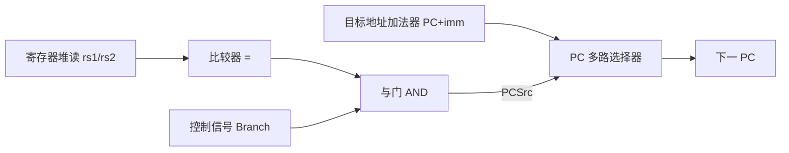

这样做的代价有三：

- **额外硬件**：加法器、比较器、与门、选择器都要在 ID 再放一份。[^l03-section-8-s2b14]
- **ID 时序路径变长**：寄存器读 → 比较 → 与门 → 选择器串行，可能拉长时钟周期。
- **需要 ID 级的转发硬件**：原来比较在 EX 进行，可以复用 EX 的转发单元；现在比较的操作数在 ID 就要用，前面指令尚未写回的结果必须另行转发到 ID 的比较器（见下文）。[^l03-section-8-s1p119]

> [!tip] 课堂强调
> 这里讨论的都是五级教学流水线。真实处理器的流水线约有 14 级（乘除法等指令更长），分支判定点会处在流水线更靠后的位置，停顿也就更多。[^l03-section-8-s2b14]

单周期数据通路中的 PCSrc 选择器与分支数据通路见 [04 单周期数据通路](#单周期数据通路)。

### 分支预测的准确率与影响

停顿和提前判定都只能减少、不能消除分支代价，因此硬件中最常用的是**分支预测**（branch prediction）：先预测跳不跳，按预测继续取指，猜错再纠正。

目前最新处理器的分支预测准确率约为 **92%–94%**。这看似已经很高，但仍需提升：预测命中率每提高 **1%**，CPU 整体性能可提升 **10% 以上**。[^l03-section-8-s2b13]

> [!tip] 课堂强调
> 这与阿姆达尔定律的直觉相反——按阿姆达尔定律，优化一个小部分对整体影响通常有限；而分支预测只改进一点点，整体性能却提升很多。原因在于后续要讲的**超标量**（superscalar）和**乱序执行**（out-of-order execution）设计，这里暂不展开。[^l03-section-8-s2b14]

### ID 级分支操作数的转发与停顿

把比较移到 ID 后，`beq` 的源操作数 rs1/rs2 可能由前面尚未写回的指令产生。按产生者与 `beq` 的距离分三种情况：

| 产生者位置（`beq` 在 ID 时） | 与 `beq` 相隔 | 处理方式 |
|---|---|---|
| WB | 前第 3 条 | 寄存器堆“前半周期写、后半周期读”，无需转发 |
| MEM | 前第 2 条 | 从 EX/MEM 转发到 ID 比较器（ForwardC / ForwardD） |
| EX | 紧邻前一条 | 停顿 1 周期，之后再从 EX/MEM 转发 |

#### 相隔 3 条：寄存器堆先写后读

```asm
add x1, ...        # WB
add x3, ...        # MEM
add x4, ...        # EX
beq x1, x2, Loop   # ID
next_seq_instr     # IF
```

`add x1` 处于 WB，它在本周期前半写寄存器堆，`beq` 在后半读寄存器堆，读到的已经是新值。所以 MEM/WB 的“转发”由正常的寄存器堆先写后读操作自动完成。[^l03-section-8-s1p120]

#### 相隔 2 条：EX/MEM → ID 转发

```asm
add x3, ...        # WB
add x1, ...        # MEM
add x4, ...        # EX
beq x1, x2, Loop   # ID
next_seq_instr     # IF
```

`add x1` 处于 MEM，它的 ALU 结果已在 EX/MEM 流水线寄存器中，但要到下一周期 WB 才写入寄存器堆，`beq` 此刻从寄存器堆读到的是旧值。因此需要一条从 EX/MEM 到 ID 比较器输入的转发通路，把“前第二条指令”的结果送到比较器任一输入端。[^l03-section-8-s1p120]

比较器两个输入各加一个选择器，由 **ForwardC**（对应 rs1）和 **ForwardD**（对应 rs2）控制：为 1 时选 EX/MEM 中的 ALU 结果，为 0 时选寄存器堆读出值。完整的检测条件为：

```c
if (IDcontrol.Branch
    && EX/MEM.RegWrite
    && (EX/MEM.RegisterRd != 0)
    && (EX/MEM.RegisterRd == IF/ID.RegisterRs1))
    ForwardC = 1;

if (IDcontrol.Branch
    && EX/MEM.RegWrite
    && (EX/MEM.RegisterRd != 0)
    && (EX/MEM.RegisterRd == IF/ID.RegisterRs2))
    ForwardD = 1;
```

各条件的含义与 EX 级转发相同：`IDcontrol.Branch` 表示 ID 中确实是分支指令；`EX/MEM.RegWrite` 表示 MEM 中的指令确实要写寄存器；`RegisterRd != 0` 排除写 `x0`（`x0` 恒为 0，不应转发）；最后一项判断目的寄存器与 `beq` 的源寄存器相同。[^l03-section-8-s1p120]

> [!warning] 易错点
> 源材料中的 ForwardC/ForwardD 条件省略了 `EX/MEM.RegWrite`。缺少这一项时，MEM 中的 `sd`、`beq` 等不写寄存器的指令，若其指令字中 rd 字段位置恰好与 `beq` 的 rs1/rs2 相同，就会被误转发。完整条件必须包含 RegWrite 检查。[^l03-section-8-s1p120]

#### 紧邻前一条：必须停顿 1 周期

```asm
add x3, ...        # WB
add x4, ...        # MEM
add x1, ...        # EX
beq x1, x2, Loop   # ID
next_seq_instr     # IF
```

`add x1` 正在 EX 中计算，其结果要到本周期末才写入 EX/MEM；而 `beq` 的比较也在本周期的 ID 中进行（且要等后半周期读完寄存器堆才开始），两者同时发生，结果来不及送到比较器。因此必须在 `beq` 与 `add` 之间插入一个停顿。[^l03-section-8-s1p121]

由 **ID 冒险检测单元**（ID Hazard Unit）完成以下操作：[^l03-section-8-s1p121]

1. **原地保持 `beq` 和下一条指令**：撤销 PC.Write 和 IF/ID.Write，使 PC 不更新、IF/ID 不更新，ID 中的 `beq` 和 IF 中的 `next_seq_instr` 下一周期原样重做（“bounce in place”）。
2. **插入气泡**：把进入 ID/EX 流水线寄存器的控制位全部清零，使流入 EX 的是一条什么都不做的空操作，隔开 EX 中的 `add` 与 ID 中的 `beq`。

停顿一个周期后，`add x1` 进入 MEM，结果位于 EX/MEM，正好落入“相隔 2 条”的情况，由 ForwardC 转发给比较器。[^l03-section-8-s2b14]

由上述规则，ID 冒险检测单元的停顿条件可写为：

```c
if (IDcontrol.Branch
    && ID/EX.RegWrite
    && (ID/EX.RegisterRd != 0)
    && ((ID/EX.RegisterRd == IF/ID.RegisterRs1)
     || (ID/EX.RegisterRd == IF/ID.RegisterRs2)))
    stall;   // PC.Write = 0, IF/ID.Write = 0, ID/EX 控制位清零
```

停顿的实现方式（冻结 PC 与 IF/ID、清零控制位注入气泡）与 load-use 冒险相同，见 [07 结构冒险与数据冒险](#结构冒险与数据冒险)。

> [!note] 补充解释
> 若产生分支操作数的是 `ld` 而非 ALU 指令，数据要到 MEM 末才得到，代价更大：`ld` 紧邻 `beq` 时需停顿 2 个周期，`ld` 与 `beq` 隔一条时需停顿 1 个周期（之后从 MEM/WB 经寄存器堆读到）。这是按本节同样的时序推理得出的结论，源材料未单独讨论。

> [!question]- 自测：五级流水线中，分支在 MEM 判定、程序中分支占 25%，若都改为在 ID 判定，CPI 从多少变为多少（忽略其他冒险，时钟周期不变）？
> 从 1.75 变为 1.25。MEM 判定每个分支停顿 3 周期：$1+0.25\times3=1.75$；ID 判定只停顿 1 周期：$1+0.25\times1=1.25$。

> [!question]- 自测：分支在 ID 判定。指令序列为 `add x5,x6,x7`、`sub x8,x9,x10`、`beq x5,x8,L`，`beq` 需要停顿吗？各操作数如何取得？
> 需要停顿 1 周期。`sub x8` 紧邻 `beq`，`beq` 在 ID 时 `sub` 在 EX，结果来不及，ID 冒险单元冻结 PC 与 IF/ID 并把 ID/EX 控制位清零。停顿后 `sub` 在 MEM，x8 由 ForwardD 从 EX/MEM 转发；`add` 此时在 WB，x5 由寄存器堆先写后读得到，ForwardC = 0。

> [!question]- 自测：`beq` 在 ID，MEM 中是一条 `sd x1, 0(x2)`，其指令字 rd 字段位置的值恰好等于 `beq` 的 rs1。若按源材料的简化条件（无 RegWrite）检测，会发生什么？
> 会错误地置 ForwardC = 1，把 EX/MEM 中 `sd` 的地址计算结果送入比较器，导致分支判断错误。`sd` 不写寄存器，EX/MEM.RegWrite = 0，加入该条件即可避免。

> [!info]- 来源
> - L03.pdf：PDF p.115–121
> - L03.docx：DOCX body 529–611

[^l03-section-8-s1p115]: L03.pdf-PDF p.115
[^l03-section-8-s1p116]: L03.pdf-PDF p.116
[^l03-section-8-s1p117]: L03.pdf-PDF p.117
[^l03-section-8-s2b13]: L03.docx-DOCX body 529-575
[^l03-section-8-s2b14]: L03.docx-DOCX body 576-611
[^l03-section-8-s1p118]: L03.pdf-PDF p.118
[^l03-section-8-s1p119]: L03.pdf-PDF p.119
[^l03-section-8-s1p120]: L03.pdf-PDF p.120
[^l03-section-8-s1p121]: L03.pdf-PDF p.121

---

## 本讲小结

### 概念主线

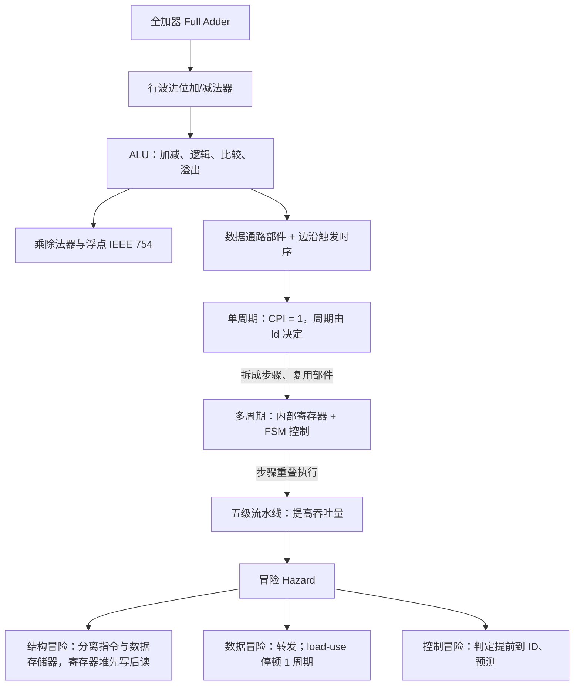

### 三种处理器实现对比

| 维度 | 单周期 | 多周期 | 五级流水线 |
|---|---|---|---|
| CPI | 恒为 1 | 3–5（分支 3、R 型/store 4、load 5） | 理想为 1，冒险停顿会使其上升 |
| 时钟周期 | 最慢指令（ld）的整条路径 | 最慢的一步，但慢于单周期的 1/5 | 最慢的一级 + 锁存开销 |
| 部件 | IM/DM 分离，ALU + 两个加法器 | 单一存储器、单一 ALU | 像单周期一样复制部件 |
| 中间状态 | 无 | IR、MDR、A、B、ALUOut | 流水线寄存器 IF/ID、ID/EX、EX/MEM、MEM/WB |
| 控制 | opcode 组合译码（控制表） | 有限状态机 | ID 产生，按 EX/MEM/WB 分组随指令传递 |

### 核心公式

| 内容 | 公式 / 规则 | 所在章节 |
|---|---|---|
| 全加器 | $S=A\oplus B\oplus C_{\mathrm{in}}$，$C_{\mathrm{out}}=AB+AC_{\mathrm{in}}+BC_{\mathrm{in}}$ | [01 ALU与整数加减](#alu与整数加减) |
| 补码减法 | $A-B=A+\overline{B}+1$（control 同时接异或门与 $c_0$） | [01 ALU与整数加减](#alu与整数加减) |
| 有符号溢出 | $O=c_{n-1}\oplus c_n$，$O=1$ 表示溢出 | [01 ALU与整数加减](#alu与整数加减) |
| IEEE 754 | $(-1)^s\times(1+F)\times2^{E-B}$，偏置 $B$：单精度 127、双精度 1023 | [02 乘除法与浮点数](#乘除法与浮点数) |
| 单周期时序 | $T_{\rm cycle}\ge T_{\rm clk\_q}+T_{\rm max\_comb}+T_s$ | [03 数据通路部件与时钟](#数据通路部件与时钟) |
| 分支目标 | $\mathrm{PC}+(\operatorname{sext}(\mathrm{imm})\ll1)$，$\mathrm{PCSrc}=\mathrm{Branch}\land\mathrm{zero}$ | [04 单周期数据通路](#单周期数据通路) |
| 流水线周期数 | $k$ 级执行 $n$ 条指令：$k+(n-1)$ 个周期 | [06 流水线设计与性能](#流水线设计与性能) |
| 流水线加速比 | $T_{\rm single}/T_{\rm pipe}$，理想值 = 级数（例：$4.1/1.2\approx3.42$） | [06 流水线设计与性能](#流水线设计与性能) |
| 转发条件 | $\mathrm{RegWrite}\land(\mathrm{Rd}\ne0)\land(\mathrm{Rd}=\mathrm{Rs})$；EX/MEM → 10 优先，MEM/WB → 01 | [07 结构冒险与数据冒险](#结构冒险与数据冒险) |
| 分支停顿 | MEM 判定 3 周期，ID 判定 1 周期 | [08 控制冒险](#控制冒险) |

## 不确定事项

- 03 的 PC 端口位宽沿用部件图标注的 32 位，RV64 实际 PC 为 64 位；未改动原图标注
- 05 示例 FSM 与信号编码来自 MIPS 版教材，RISC-V 严格实现需保留旧 PC 计算分支目标，笔记中仅以补充说明指出
- 07 存储器到存储器复制的 DM 转发条件与 08 中 ld 作为分支操作数的停顿周期为按时序推理的补充，源材料未给出

> [!info]- 来源
> - L03.pdf：PDF p.3–13, 15–21, 23–45, 47, 49–51, 54–86, 88–121, 124–142
> - L03.docx：DOCX body 1–611
