分支在程序中极其频繁，而深流水线和多发射又把每次猜错的代价放大成十几个周期，本讲先解决“分支怎么预测”，再回答“流水线加深到头之后怎样继续提高性能”。路径是：从分支的方向与目标出发，依次讲静态预测、动态预测（1 位、2 位、两级、锦标赛）和目标预测（BTB、RAS）；然后从超流水线的最优级数转到指令级并行，比较由硬件动态调度的超标量与由编译器静态调度的 VLIW；最后讲编译器的静态调度与寄存器重命名、循环展开、函数内联。阅读前需要掌握 L03 的五级流水线、转发、load-use 停顿和控制冒险。

---

## 分支预测的动机

> [!abstract] 本节要点
> - 处理一条分支要回答两个问题：**方向**（跳不跳）和**目标**（跳到哪）。按方向分条件/无条件分支，按目标分直接/间接分支。
> - 直接分支的目标 = PC + 指令内立即数，取指时就能算出；间接分支的目标来自运行时的寄存器值（再加偏移），只看指令算不出来。
> - 分支非常频繁：SPEC2006 INT（Core i7，x86）平均 9.4% 的指令是分支，约每 10–11 条一条；SPEC2006 FP（ARM Cortex-A9）平均 12.15%，约每 8 条一条。
> - 长流水线要等 $B$ 个周期才知道分支结果（现代处理器从算 next PC 到分支判定通常超过 10 级；x86 有 14–16 级，误预测约损失 10 个周期）。4–12 路超标量几乎每个周期都会遇到分支，所以停顿等结果不可行。
> - 分支有规律可循（循环、相关分支），因此可以预测。真正需要预测的只有两处：条件分支的**方向**，以及间接跳转和函数返回的**目标**。推测执行要靠三项硬件支持：分支预测器、乱序执行加 ROB、误预测后撤销并重新取指。

### 分支的方向与目标（Direction & Target）

控制冒险的四种基本对策在上一讲已经讲过，见 L03《08 控制冒险》：停顿（stall）、把比较提前到 ID 级判定、用编译器推迟分支判定（延迟分支或谓词执行）、分支预测。本讲专门讨论最后一种。要预测分支，先得搞清楚处理一条分支时到底有哪些未知量。

一条分支指令有两个独立的未知量：[^l04-section-1-s2p3]

- **分支方向**（branch direction）：这条分支跳不跳，即 taken 还是 not taken。
- **分支目标**（branch target）：如果跳，跳到哪个地址。

从这两个角度出发，分支可以分成两组类别：

| 分类角度 | 类别 | 何时 / 何处跳转 | 对应的源代码构造 |
| --- | --- | --- | --- |
| 方向 | **条件分支**（conditional branch） | 条件满足才跳，否则顺序执行下一条 | `for`、`while`、`do`、`until` |
| 方向 | **无条件分支**（unconditional branch） | 总是跳 | `goto`、`jump` |
| 目标 | **直接分支**（direct branch） | 目标地址包含在指令中 | `goto`、`jump` 等 |
| 目标 | **间接分支**（indirect branch） | 目标不在指令中，要到指令之外（寄存器或存储器）去取 | 回调（callback）、过程返回（procedure return）、虚函数调用、C# delegate |

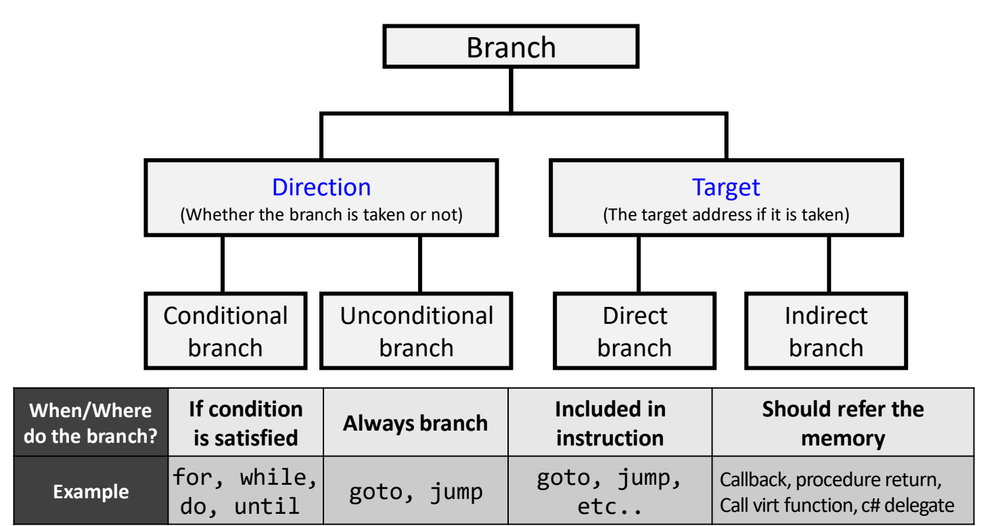

图：分支按方向（条件/无条件）与目标（直接/间接）分类，下表给出各类的判定时机与源代码例子。

两种目标类型的计算方式不同：

- **直接分支**：指令里明确写出了跳转位置，目标地址为
  $$
  \text{Target} = PC + \text{imm}
  $$
  其中 $PC$ 是分支指令自身的地址，$\text{imm}$ 是指令编码里的立即数（偏移）。这个地址编译器在编译时就知道，硬件取指后也能直接算出来。
- **间接分支**：目标地址不是"PC + 立即数"，而是"某个寄存器里的值 + 一个立即数偏移"。寄存器的值只有运行时才知道，所以光看指令本身算不出目标。

> [!warning] 易错点
> 方向和目标是两个相互独立的分类维度，一条分支同时属于其中一类方向和其中一类目标。例如函数返回是无条件的（方向已知），但它是间接的（目标未知）；`beq` 这类条件分支方向未知，但目标是 PC 相对的直接目标。不要把"无条件"等同于"容易处理"。

### 分支的频率与控制流代价（Control Flow Penalty）

如果分支很少出现，或者每次只损失一两个周期，花大量硬件去预测就不划算。下面的统计数据和流水线结构说明，这两个前提在现代处理器里都不成立。

#### 分支极其频繁

在 Blem 等人 [HPCA 2013] 的测量中，动态执行的指令里分支所占比例如下：[^l04-section-1-s2p4]

| SPEC2006 INT（Core i7，x86 ISA） | 总指令数 | 分支 % |
| --- | --- | --- |
| astar | $5.71\times10^{10}$ | 6.9 |
| bzip2 | $4.25\times10^{10}$ | 11.1 |
| hmmer | $2.57\times10^{10}$ | 5.3 |
| gcc | $6.29\times10^{9}$ | 15.1 |
| gobmk | $8.93\times10^{10}$ | 12.1 |
| h264 | $1.09\times10^{11}$ | 7.1 |
| libquantum | $4.18\times10^{8}$ | 13.2 |
| omnetpp | $2.55\times10^{9}$ | 16.4 |
| perlbench | $2.91\times10^{9}$ | 17.3 |
| sjeng | $2.11\times10^{10}$ | 14.8 |
| **平均** | | **9.4** |

| SPEC2006 FP（ARM Cortex-A9，ARMv7 ISA） | 总指令数 | 分支 % |
| --- | --- | --- |
| bwaves | $3.84\times10^{11}$ | 13.5 |
| cactusADM | $1.02\times10^{10}$ | 0.5 |
| leslie3D | $4.92\times10^{10}$ | 6.2 |
| milc | $1.38\times10^{10}$ | 6.5 |
| tonto | $1.30\times10^{10}$ | 10.0 |
| **平均** | | **12.15** |

由此得到两个经验值：整数程序约**每 10–11 条指令**有一条分支（$1/0.094\approx10.6$），浮点程序约**每 8 条**有一条（$1/0.1215\approx8.2$）。只要程序执行一定数量的指令，就一定会频繁遇到分支。

#### 长流水线：结果要等 B 个周期

回顾五级流水线：如果在 ID 级就能判定分支，一条分支只引入 **1 个周期**的停顿（见 L03《08 控制冒险》）。深流水线中这个代价会大得多。

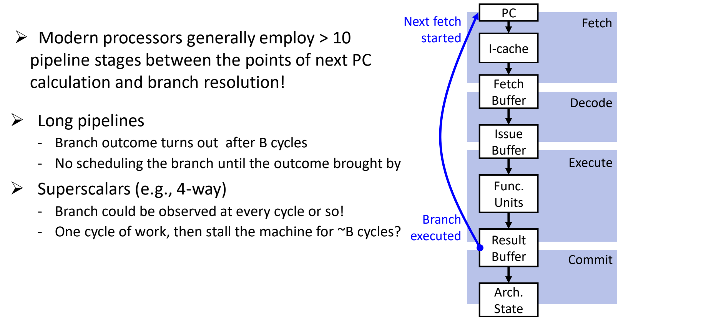

图：从计算下一个 PC 到分支执行之间隔着取指、译码、执行等多级缓冲，分支结果要经过约 $B$ 个周期才返回。

这条流水线骨架是：PC → I-cache → Fetch Buffer（取指）→ Issue Buffer（译码）→ Func. Units（执行）→ Result Buffer → Arch. State（提交）。分支要到执行完成（Branch executed）才知道结果，然后才能回到 PC 开始下一次取指（Next fetch started）。这条蓝色回路跨越的级数，就是分支的判定延迟。

- **长流水线**：分支结果要在 $B$ 个周期之后才出来；结果出来之前，无法确定后续该取哪些指令。[^l04-section-1-s2p5]
- **现代处理器**：从计算 next PC 到分支判定（branch resolution）之间通常有**超过 10 级**流水线。[^l04-section-1-s2p5]
- **x86 的量级**：常见 x86 处理器有 14–16 级流水线，在执行结束后才知道分支的真实结果。若预测错误，之前取进来的错误路径指令要全部冲刷（flush），一次误预测通常损失约 **10 个周期**。[^l04-section-1-s3b1]

#### 超标量：几乎每个周期都碰到分支

**超标量**（superscalar）处理器同时运行多条流水线，常见为 4–12 路，即每周期可以处理 4 到 12 条指令（结构细节见[超标量处理器](#超标量处理器)）。结合上面的频率：整数程序约每 10–11 条一条分支，浮点程序约每 8 条一条。处理器每周期取、发射十几条指令时，**几乎每个周期都会遇到一条分支**。[^l04-section-1-s2p5]

如果遇到分支就停下来等结果，机器的运行模式会变成"干一个周期的活，然后停约 $B$ 个周期"，大部分时间都浪费在等待上。所以对现代处理器来说，"停顿等结果"根本不可行。[^l04-section-1-s3b2]

> [!example] 例：4 路超标量遇到分支就停顿
> 设整数程序每 10 条指令一条分支，处理器每周期取 4 条指令，分支判定延迟 $B=10$ 周期，遇到分支就停顿直到结果出来。
>
> 1. 两条分支之间平均有 10 条指令，取完它们大约需要 $10/4=2.5$ 个周期。
> 2. 之后要停顿约 $B=10$ 个周期等结果，所以每 $2.5+10=12.5$ 个周期只完成 10 条指令。
> 3. 有效吞吐约为 $10/12.5=0.8$ 条/周期，只有峰值 4 条/周期的 20%。即使把 $B$ 降到 1，吞吐也只有 $10/3.5\approx2.9$ 条/周期。

### 分支的可预测性（Predictability）

只看汇编代码，分支的走向似乎很难猜。但分支来自源代码里的循环和判断，这些结构本身有规律，所以可以利用规律去预测，而不必停顿等待。[^l04-section-1-s2p6]

**Program A（循环分支）**：

```c
for (i=0; i<100; i++)
{
    …
}
```

```asm
    addi r10, r0, 100
    addi r1,  r0, r0      ; 意图是 r1 = 0（源码写作 r0, r0）
L1:
    …
    addi r1,  r1, 1
    bne  r1,  r10, L1     ; 在 i < 100 期间一直跳回 L1
    …
```

循环末尾的 `bne` 在 $i<100$ 期间每次都跳回 `L1`，只有最后一次不跳。这条分支的模式是"连续 taken，最后一次 not taken"，非常规律。

**Program B（相关分支）**：

```c
if (aa == 2)
    aa = 0;
if (bb == 2)
    bb = 0;
if (aa != bb)
    …
```

```asm
    addi r2,  r0, 2
    bne  r10, r2, L_bb    ; aa != 2 时跳过清零
    xor  r10, r10, r10    ; aa = 0
L_bb:
    bne  r11, r2, L_xx    ; bb != 2 时跳过清零
    xor  r11, r11, r11    ; bb = 0
L_xx:
    beq  r10, r11, L_exit ; aa == bb 时跳出（不执行 if 体）
    …
L_exit:
```

这里 `aa` 在 `r10`，`bb` 在 `r11`。若前两条 `bne` 都**不跳**，说明 `aa == 2` 且 `bb == 2`，两个变量都被清零，于是 `aa == bb`，第三条 `beq` 一定跳。所以第三条分支的结果取决于前两条分支的结果，只要知道前两条怎么走，就能预测第三条。

这两个例子对应传统分支预测最常见的两种思路：

1. **根据这条分支自己过去的行为来预测**：适用于循环这类重复模式，例如 1 位、2 位预测器，见[动态分支预测](#动态分支预测)。
2. **利用不同分支之间的相关性**：用之前若干条分支的结果来预测当前分支，例如两级相关预测，同样见[动态分支预测](#动态分支预测)。

### 方向预测与目标预测的需求

分支有两个未知量，但并不是每类分支的两个未知量都需要预测。按情形逐一检查，就能把"分支预测"缩小成两个明确的设计目标。[^l04-section-1-s2p7]

| 情形 | 方向（Direction） | 目标（Target） |
| --- | --- | --- |
| 直接跳转、函数调用 | 已知（总是 taken） | 容易计算（指令中给出） |
| 条件分支（通常是 PC 相对） | **难以预测** | 容易计算（$PC+\text{imm}$） |
| 间接跳转、函数返回 | 已知（总是 taken） | **难以确定** |

逐行理解：

1. **直接跳转与函数调用**：一定跳，目标直接写在指令里，取到指令就知道往哪跳，不需要预测。
2. **条件分支**（如 `beq`、`bne`）：跳不跳取决于运行时两个寄存器值的比较结果，方向难以预知；目标是 PC 加指令立即数，编译器都能算出来。
3. **间接跳转与函数返回**：一定跳，但目标是"寄存器值 + 偏移"，要等寄存器值可用才知道，目标难以确定。

由此得出两个设计目标：

- **方向预测器**（direction predictor）：负责预测条件分支跳不跳，静态方法见[静态分支预测](#静态分支预测)，动态方法见[动态分支预测](#动态分支预测)。
- **目标预测器**（target predictor）：负责预测间接跳转和函数返回的目标地址，见[分支目标预测](#分支目标预测)。

> [!note] 补充解释
> "条件分支的目标容易计算"指的是硬件拿到指令后能算出目标，并不等于取指当拍就能得到目标：取指时还没译码，要在同一周期给出下一个取指地址，仍需要借助目标缓存，见[分支目标预测](#分支目标预测)。本表回答的是"哪个信息本质上未知"，目标预测器的主攻对象是间接跳转和函数返回。

### 基于分支预测的推测执行（Speculation）

在五级流水线里，预测的作用只是减少分支带来的停顿。在现代乱序处理器里，预测是整套执行方式的起点：处理器先按预测的路径大量取指、执行，事后再验证。这就是**推测执行**（speculative execution）。它需要三项体系结构支持：[^l04-section-1-s2p8]

1. **支持 ❶：预测未来的执行流**。由**分支预测器**（branch predictor）同时预测方向和目标，提前把将来要执行的指令取进处理器，填入指令缓冲。缓冲里积攒了足够多的指令，后面才能从中找出彼此无依赖的指令并行执行。
2. **支持 ❷：以乱序（O3，out-of-order）方式执行预测路径上的指令**。依赖**重排序缓冲**（ROB，Re-Order Buffer）来处理乱序带来的问题，ROB 的工作方式见后续课程。
3. **支持 ❸：从误预测中恢复**。一旦发现分支预测错误，就撤销（UNDO）错误路径上已执行的指令，把它们全部冲刷掉，再从正确路径重新开始取指。


这三件事是目前所有乱序执行的 x86 处理器（以及苹果处理器）都具备的基本机制。[^l04-section-1-s3b2]

**Intel Skylake 中的位置**：在 Intel Skylake（2016 年前后的处理器）的微架构中，分支预测器位于前端（Frontend）的起始处，紧挨 L1 指令缓存，旁边是取指与预译码（Instruction Fetch & PreDecode）、指令队列和 4 路译码器。它不断把预测路径上的指令（经 μOP Cache 或译码器转成 μOP）送进分配队列（Allocation Queue）。后面的执行引擎（Execution Engine）由 Reorder buffer 和 Scheduler 对这些 μOP 进行乱序调度，再分派给 ALU、Load/Store 等执行单元。前端（预测与取指）对应支持 ❶，ROB 与调度器对应支持 ❷。[^l04-section-1-s2p8]

> [!tip] 课堂强调
> Spectre（幽灵）、Meltdown（熔断）等安全漏洞都源自"基于分支预测的推测执行"这一基本范式：处理器在预测路径上提前执行了不该执行的指令。这些攻击是怎么产生的，后续课程会专门介绍。[^l04-section-1-s3b2]

> [!question]- 自测：给出下面四种构造，各自的方向和目标哪个需要预测？(a) `for` 循环末尾的回跳 (b) `goto` (c) C++ 虚函数调用 (d) 函数返回
> (a) 条件、直接分支：需要预测方向，目标是 $PC+\text{imm}$，容易计算。(b) 无条件、直接分支：方向和目标都已知，无需预测。(c) 无条件、间接分支：方向已知，目标来自寄存器（对象的函数指针），需要预测目标。(d) 无条件、间接分支：方向已知，返回地址在寄存器中，需要预测目标。

> [!question]- 自测：Program B 中，若已知前两条 `bne` 都没有跳转，第三条 `beq r10, r11, L_exit` 怎么走？若第一条跳了而第二条没跳呢？
> 前两条都没跳，说明 `aa == 2` 且 `bb == 2`，两者都被清零，`aa == bb`，所以 `beq` 一定跳（taken）。若第一条跳了而第二条没跳，`aa` 保持原值且不等于 2，`bb` 被清零为 0，此时结果取决于 `aa` 是否为 0，只靠这两条分支的历史不能完全确定。可见相关性能把部分情况变成确定性预测，但不是所有情况。

> [!question]- 自测：某处理器从算 next PC 到分支判定共 12 级，每条分支在判定后才能取正确路径的指令。若改为分支预测，预测正确与预测错误分别损失多少个周期？
> 预测正确时，取指不必等分支结果，几乎没有损失；预测错误时，要冲刷判定点之前已进入流水线的错误路径指令，从正确路径重新取指，损失约等于这段距离，即约 12 个周期（x86 的典型值约 10 个周期）。所以误预测代价随流水线深度增长，预测准确率越高越好。

> [!info]- 来源
> - L04.pdf：PDF p.3–8
> - L04.docx：DOCX body 1–89

[^l04-section-1-s2p3]: L04.pdf-PDF p.3
[^l04-section-1-s2p4]: L04.pdf-PDF p.4
[^l04-section-1-s2p5]: L04.pdf-PDF p.5
[^l04-section-1-s3b1]: L04.docx-DOCX body 1-63
[^l04-section-1-s3b2]: L04.docx-DOCX body 64-89
[^l04-section-1-s2p6]: L04.pdf-PDF p.6
[^l04-section-1-s2p7]: L04.pdf-PDF p.7
[^l04-section-1-s2p8]: L04.pdf-PDF p.8

---

## 静态分支预测

> [!abstract] 本节要点
> - 方向预测器分为静态（编译时决定）和动态（运行时决定）两大类；历史上静态方法在前，在 SPECint92 上的准确率依次为：总不跳 30–40%、总跳 60–70%、BTFNT 约 65%、编译器引导约 75%，75% 大致就是静态方法的上限。
> - Predict not taken 继续顺序取指，真正跳转时才冲刷分支之后的指令：分支逻辑在 MEM 冲刷 3 条，在 EX 冲刷 2 条，在 ID 冲刷 1 条。被冲刷的指令必须还没改动机器状态，五级流水线天然满足这一点。
> - 停顿有两种实现：插入气泡（bubble）时，较早阶段的指令原地保持，在某一级把流水线寄存器的控制位清零；冲刷（squash）把流水线中已有的指令替换成 noop，也就是把某一级之前各级的控制信号清零。
> - Predict taken 的准确率更高，但目标地址要计算，即使把分支目标硬件移到 ID，也总要多停 1 个周期，这引出了缓存目标地址的 BTB。
> - BTFNT 让向后跳（目标地址小于 PC）的分支预测为跳转，向前跳的预测为不跳转，专门照顾循环；编译器引导先用测试数据剖析各分支的典型方向，再重新编译设置预测位；程序员也可以用 likely/unlikely 手工标注。

### 方向预测的发展脉络

条件分支的方向（taken / not taken）只有执行到比较那一步才知道，所以需要一个**方向预测器**（branch direction predictor）先给出猜测。为什么条件分支需要方向预测，见[分支预测的动机](#分支预测的动机)。

方向预测器的演进可以画成一张图[^l04-section-2-s2p9]：

- **X 轴**：方向预测算法的类型，按出现时间排列，左边是静态预测器，右边是动态预测器；
- **Y 轴**：该预测器在 SPECint92（SPEC 1992 整数基准测试）上的预测准确率。

Y 轴最低刻度取 40%，不从 0% 开始。原因是准确率为 0% 的预测器其实是完美的：它每次都猜错，把它的输出取反，就每次都猜对。所以对两种结果的预测来说，真正最差的是 50% 左右的随机猜测，准确率越接近 0 或 1，预测器包含的信息越多。

整张图的趋势是：早期处理器用静态预测，现代处理器基本都用动态预测。本节讲左半部分的四种静态方法，右半部分见[动态分支预测](#动态分支预测)。

### 静态预测（Static Direction Prediction）

早期芯片的晶体管资源很紧张，能用软件解决的问题尽量不用硬件。**静态预测**（static prediction）就是这一思路的产物。

**静态预测**指在编译时就确定每个分支的预测方向，运行时硬件不再根据执行情况调整[^l04-section-2-s2p10]。它的统一做法是：先假定分支取某个结果，按这个假定继续执行，不等分支的实际结果出来；猜错了再把错误路径上的指令清掉。早期处理器采用它，是因为它简单、硬件开销低。

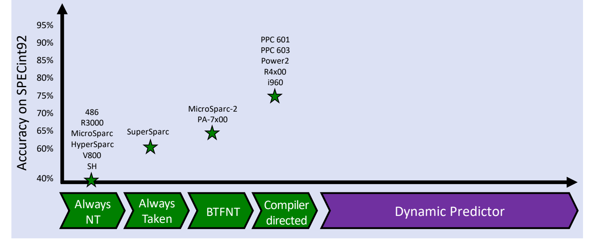

图：四种静态方法在 SPECint92 上的准确率依次上升，编译器引导约 75%，右侧留给动态预测器。

| 方法 | 预测规则 | SPECint92 准确率 | 代表处理器 |
| --- | --- | --- | --- |
| 总预测不跳转（Always Not Taken） | 一律不跳，顺序取指 | 30–40% | 486、R3000、MicroSparc、HyperSparc、V800、SH |
| 总预测跳转（Always Taken） | 一律跳转 | 60–70% | SuperSparc |
| BTFNT | 向后跳则跳，向前跳则不跳 | 约 65%[^l04-section-2-s3b4] | MicroSparc-2、PA-7x00 |
| 编译器引导（Compiler Directed） | 按剖析统计结果设置预测位 | 约 75% | PPC 601、PPC 603、Power2、R4x00、i960 |

### 总预测不跳转（Predict Not Taken）

最省事的做法是当分支不存在：**总预测不跳转**（predict not taken / always not taken）指总是预测分支不跳转，继续从顺序指令流取指，只有分支真正跳转时流水线才会停顿[^l04-section-2-s2p11]。它几乎不需要改动现有硬件，因为流水线本来就在每个周期取 $PC+4$。

分支实际跳转时，处理过程如下：

1. **冲刷**：把分支之后已经进入流水线的指令冲刷掉。这些指令在代码中位于分支之后，在流水线中位于分支前面的阶段。
2. **确认未改状态**：确保被冲刷的指令没有改变机器状态。
3. **重启**：从分支目标地址重新开始取指。

#### 冲刷几条：取决于分支逻辑放在哪一级

分支在哪一级得出结果，它前面各级就各有一条错误路径上的指令，这些都要冲刷[^l04-section-2-s2p11]：

| 分支逻辑所在阶段 | 需冲刷的阶段 | 停顿（冲刷）条数 |
| --- | --- | --- |
| MEM | IF、ID、EX | 3 |
| EX | IF、ID | 2 |
| ID | IF | 1 |

分支判定越早，猜错的代价越小。把分支判定提前到 ID 的硬件改动，见 L03《08 控制冒险》。

#### 被冲刷的指令不能已经改了状态

冲刷之所以安全，是因为被冲刷的指令还没来得及改变机器状态。机器状态有两类：

- **寄存器状态**：错误路径上的指令如果已经写了寄存器，结果就被污染了；
- **存储器状态**：错误路径上的 store 如果已经写进内存，同样无法撤回。

在五级流水线中这一条件**自动满足**：改变机器状态的操作都在流水线尾部，MEM 级的 MemWrite 和 WB 级的 RegWrite[^l04-section-2-s2p11]。分支最晚在 MEM 级判定，此时它后面的指令最多走到 EX，还没到写内存或写寄存器的那一级，清零它们的控制信号即可。

> [!tip] 课堂强调
> 五级流水线不用为此操心，但放到现代复杂的处理器里，被冲刷的指令不能自动保证没有改动状态，需要额外考虑；这一问题在后续课程中讨论。[^l04-section-2-s3b3]

#### 准确率为什么只有 30–40%

总预测不跳转的准确率只有 30–40%[^l04-section-2-s2p12]。原因在于循环：一个执行 100 次的循环，循环分支有 99 次跳转，只有 1 次顺序往下走，总预测不跳转在这类分支上几乎总是猜错。程序中最常见的分支恰好是循环分支，所以整体准确率很低。

> [!warning] 易错点
> 不要把冲刷条数和准确率混为一谈：冲刷条数（1/2/3）是**每次猜错**的代价，由分支逻辑所在阶段决定；30–40% 是**猜对的比例**，由程序的分支行为决定。平均代价要把两者结合起来看。

### 两类停顿：气泡与冲刷

预测失败和 load-use 冒险都会让流水线停下，但两者在硬件上的做法不同[^l04-section-2-s2p13]。

**气泡**（bubble，又称插入 noop）是在流水线中两条指令之间插入一条 noop，load-use 冒险就是这样处理的（见 L03 中 load-use 停顿的内容）：

1. **冻结较早阶段**：让流水线中位置靠前（代码中靠后）的指令停留一个周期，不往下走，即用写控制信号把它们“bounce”在原地（不更新 PC 和对应的流水线寄存器）；
2. **在合适的阶段插入 noop**：把该阶段流水线寄存器中的控制位清零，这一级就变成一条什么都不做的指令；
3. **放行较晚阶段**：流水线中位置靠后（代码中靠前）的指令照常往下执行。

插入 noop 的位置不限于 IF，可以根据需要选在任意一级。

**冲刷**（flush，又称指令作废 instruction squashing）是把流水线中**已经存在**的某条指令替换成 noop。做法是把某一级之前所有各级的控制信号全部清零，这些指令就失效了。

| | 气泡（bubble） | 冲刷（squash） |
| --- | --- | --- |
| 对现有指令的处理 | 较早阶段的指令原地保留，稍后继续执行 | 指令被替换为 noop，不再执行 |
| noop 从哪来 | 在两条指令之间**插入**新的 noop | 原有指令**变成** noop |
| 控制信号操作 | 清零某一级流水线寄存器的控制位，冻结它前面的级 | 清零某一级之前各级的控制信号 |
| 典型场景 | load-use 冒险 | 分支预测错误 |


### 总预测跳转（Predict Taken）

总预测不跳转在循环分支上几乎总是错，自然会想到反过来猜。**总预测跳转**（predict taken / always taken）指总是预测分支跳转，准确率提高到 60–70%[^l04-section-2-s2p14]，恰好与总不跳转的 30–40% 互补。代表处理器是 SuperSparc[^l04-section-2-s2p15]。

它的问题在于：要往目标处取指，就必须先知道目标地址，而条件分支的目标是 $PC$ 加指令中的立即数偏移，需要计算。即使已经把分支目标计算硬件移到 ID 级，取到分支时目标地址也还没有算出来，只能等 ID 算完再从目标处取指。因此 **predict taken 总要付出 1 个周期的停顿**，猜对时也一样[^l04-section-2-s2p14]。

这就引出一个问题：能不能把分支目标指令的地址“缓存”起来，在取指时直接拿到？答案是分支目标缓冲，见[分支目标预测](#分支目标预测)。

> [!warning] 易错点
> predict not taken 猜对时零代价，猜错时冲刷 1–3 条；predict taken 准确率更高，但**无论对错**都至少有 1 个周期的停顿（目标地址在 ID 才算出）。准确率高不等于代价一定小。

### BTFNT（Backward Taken, Forward Not Taken）

总跳转和总不跳转对所有分支一视同仁。其实分支的跳转方向就能透露它是不是循环分支。

**BTFNT**（Backward Taken, Forward Not Taken，向后跳则预测跳转、向前跳则预测不跳转）指：目标地址小于当前 PC 的分支，即偏移量为负、向后跳的分支，预测为跳转；目标地址大于 PC、向前跳的分支，预测为不跳转。换句话说，总是选地址较小的那条路（always take the smaller address）[^l04-section-2-s2p16]。

判断依据是分支目标地址 $=PC+\text{立即数偏移}$：

1. 偏移为负，即向后跳：通常是循环末尾跳回循环开头的分支，大多数时候都跳，预测 taken；
2. 偏移为正，即向前跳：通常是跳过某段代码（如退出循环、if 分支），预测 not taken。

循环的汇编一般是：执行完循环体后检查条件，条件满足就向后跳回循环开头，不满足就顺序往下走。所以 BTFNT 是专门为 for/while 循环设计的，而循环分支正是程序中最常见的分支。

它的局限是对不规则分支效果差：循环以外的分支，方向和跳转是向前还是向后关系不大[^l04-section-2-s2p16]。BTFNT 的准确率约 65%，比 Always Taken 略好，代表处理器为 MicroSparc-2 和 PA-7x00。

### 编译器引导预测（Compiler Directed）

前三种方法都只看分支指令本身，不了解程序实际怎么运行。如果事先跑一遍程序，就能知道每个分支实际倾向于哪个方向。

**编译器引导预测**（compiler-directed prediction）使用称为**剖析**（profiling）或**反馈导向编译**（feedback-directed compilation）的技术[^l04-section-2-s2p17]：

1. **初次编译**程序；
2. **用测试数据运行**，统计每个分支的典型方向，即跳转与不跳转的比例；
3. **重新编译**：根据统计结果调整每条分支指令的预测位，大概率跳转的标为预测跳转，大概率不跳的标为预测不跳转。

这样就利用了先前执行的历史结果，针对具体分支做了定点优化。准确率约 75%[^l04-section-2-s2p17]，代表处理器有 PPC 601、PPC 603、Power2、R4x00 和 i960。

#### 程序员标注：likely / unlikely

另一种静态手段不靠编译器自动剖析，而是**程序员**直接在源代码中给分支标注 likely（可能成立）或 unlikely（不太可能成立），编译器再根据这些提示做优化。Linux 内核源代码中有大量这类标注。这种方法的准确率无法统一评价，取决于程序员的判断是否准确。

> [!note] 补充解释
> 在 Linux 内核中，这类标注写作 `likely(x)` / `unlikely(x)` 宏，基于 GCC 的 `__builtin_expect`。例如：
> ```c
> if (unlikely(ptr == NULL))
>     return -ENOMEM;
> ```
> 编译器据此把大概率执行的路径排成顺序执行的代码。参见 [GCC 文档：`__builtin_expect`](https://gcc.gnu.org/onlinedocs/gcc/Other-Builtins.html)。

总体来看，静态预测的上限大约就是 75%。要进一步提高准确率，就要让 CPU 在运行时根据实际结果学习，即动态预测，见[动态分支预测](#动态分支预测)。

### 附录：分支停顿能否为 0，分支在哪一级完成

> [!info] 依据讲义整理
> 以下两个问题出自附录（Justification 页），课上未讲解，按讲义内容整理。

**问题一：分支和跳转指令的停顿能否降到 0？**[^l04-section-2-s2p103]

按本课程五级流水线的 IF 设计，答案是**不能**。在本课的数据通路中，下一条 PC 的来源（$PC+4$ 或分支目标）由 PCSrc 多路选择器决定，分支目标和比较结果要从后面的流水线寄存器（如 EX/MEM）送回，先写入 PC 寄存器，下一个周期才能用来访问指令存储器（IM），所以至少有一个周期的损失。

助教（TA）的补充说明：如果像其他一些设计（例如 ICS 课程中的 pipe 处理器）那样，把 EX/MEM 寄存器中的结果通过多路选择器直接送给指令存储器，不再经过别的寄存器，就能少一个周期[^l04-section-2-s2p103]。

**问题二：分支和跳转指令在哪一级完成？**[^l04-section-2-s2p104]

L03 中有两种说法：第 57 页的多周期阶段划分写的是在 Exec 阶段完成（Branch Comparison; Branch and Jump Completion）；第 118 页的流水线图中，`beq` 在 MEM 级（DM 处）才决定下一条取指地址，后面跟了 3 个 stall。答案是：**两种都对，甚至 Decode（ID）级也对**。分支在哪一级完成，取决于分支比较逻辑和 PC 更新逻辑放在哪一级。这也正是上面冲刷条数表随分支逻辑位置变化的原因。

> [!question]- 自测：五级流水线采用 predict not taken，分支逻辑在 EX 级。某段代码执行了 100 次分支，其中 70 次实际跳转。由于预测失败共浪费多少个周期？若把分支逻辑移到 ID 呢？
> 分支逻辑在 EX 级时浪费 140 个周期，移到 ID 级后浪费 70 个周期。predict not taken 只在实际跳转时出错，共错 70 次。分支逻辑在 EX 级时每次冲刷 IF、ID 两条指令，共 $70\times2=140$ 个周期；在 ID 级时每次只冲刷 IF 一条，共 $70\times1=70$ 个周期。

> [!question]- 自测：用 BTFNT 预测下面两条分支：(a) 地址 `0x400` 处的 `bne`，目标为 `0x3E0`；(b) 地址 `0x500` 处的 `beq`，目标为 `0x520`。哪条更可能是循环分支？
> (a) 目标地址小于 PC，偏移为负，是向后跳，预测 taken，很可能是循环末尾跳回开头的分支；(b) 目标地址大于 PC，是向前跳，预测 not taken，更像跳过一段代码的条件判断。

> [!question]- 自测：load-use 冒险和分支预测失败都会产生一个“空周期”，为什么前者用插入气泡，后者用冲刷？
> 发生 load-use 冒险时，后面那条使用数据的指令是正确的，只是需要晚一拍执行，所以把它冻结在原地，在中间插入一个 noop，之后它继续执行。预测失败时，已取进来的指令本身就是错误路径上的指令，不能再执行，所以把它们的控制信号清零，变成 noop，也就是冲刷。

> [!info]- 来源
> - L04.pdf：PDF p.9–17, 103–104
> - L04.docx：DOCX body 64–147

[^l04-section-2-s2p9]: L04.pdf-PDF p.9
[^l04-section-2-s2p10]: L04.pdf-PDF p.10
[^l04-section-2-s3b4]: L04.docx-DOCX body 118-147
[^l04-section-2-s2p11]: L04.pdf-PDF p.11
[^l04-section-2-s3b3]: L04.docx-DOCX body 90-117
[^l04-section-2-s2p12]: L04.pdf-PDF p.12
[^l04-section-2-s2p13]: L04.pdf-PDF p.13
[^l04-section-2-s2p14]: L04.pdf-PDF p.14
[^l04-section-2-s2p15]: L04.pdf-PDF p.15
[^l04-section-2-s2p16]: L04.pdf-PDF p.16
[^l04-section-2-s2p17]: L04.pdf-PDF p.17
[^l04-section-2-s2p103]: L04.pdf-PDF p.103
[^l04-section-2-s2p104]: L04.pdf-PDF p.104

---

## 动态分支预测

> [!abstract] 本节要点
> - 动态预测在运行时记录每个分支的实际方向，预测错了就更新记录；静态预测对同一条分支每次都给出相同的预测。
> - 1 位 BHT：32 位 PC 经哈希得到 $K$ 位索引，表有 $2^K$ 项，每项 1 位（0 预测 NT，1 预测 T）；预测错就翻转该位。SPECint92 上准确率约 80%。别名冲突只影响准确率，不影响正确性。
> - 稳定模式中出现一次异常，1 位预测器要错两次：循环每执行一轮（T T T T NT），进入时错一次、退出时错一次，准确率 $3/5=60\%$。
> - 2 位饱和计数器有四个状态：00 SN、01 WN、10 WT、11 ST；MSB 是方向位，LSB 是迟滞位。同一个循环预热后每轮只错 1 次，准确率 $4/5=80\%$。最好情况约 90%。
> - 两级（相关）预测同时用 BHT 和 PHT，利用“分支结果与之前的结果相关”，最好约 96%；锦标赛预测用元预测器挑选当下更准的子预测器，最好约 97%（Alpha 21264）。

### 动态方向预测（Dynamic Direction Prediction）

静态预测（见[静态分支预测](#静态分支预测)）对同一条分支，无论第几次遇到都给出同一个预测，所以准确率在 SPECint92 上停在约 75%（编译器引导）。要再提高，就得用运行时信息。

**动态方向预测**（dynamic direction prediction）指处理器在运行时记录每条分支过去的实际行为，并据此预测下一次的方向：先预测，等方向判定后拿实际结果反馈，预测错了就调整，从错误中学习，让预测贴合每一条分支各自的行为。[^l04-section-3-s2p18] 方向与目标两类预测需求的划分见[分支预测的动机](#分支预测的动机)；本节只讲方向（T/NT），目标地址的预测见[分支目标预测](#分支目标预测)。

四代动态预测器在 SPECint92 上的准确率依次提高，下面逐一展开：

| 预测器 | 每个分支记录的信息 | 最好准确率（SPECint92） | 代表处理器 |
| --- | --- | --- | --- |
| 1 位历史（1-bit history） | 上一次方向，1 位 | 约 80% | 21064、21066、AMD K5、R8000 |
| 2 位历史（2-bit history） | 2 位饱和计数器 | 约 90% | 21064A、21164、Pentium 等 |
| 两级（two level） | 历史模式 + 模式历史表 | 约 96% | Pentium6 |
| 混合 / 锦标赛（hybrid / tournament） | 多个预测器 + 元预测器 | 约 97% | Alpha 21264 |

### 1 位分支历史表（Branch History Table, BHT）

最直接的想法是“上次怎么走，这次就怎么走”。为此需要一张表，给每条分支记下它上一次的方向。

**分支历史表**（Branch History Table, BHT）是一张按分支 PC 索引的表。在 1 位方案中每项只有 1 位，记录该分支上一次的方向：项为 0 预测不跳转（NT），项为 1 预测跳转（T）。它让处理器随时间改进预测，SPECint92 上准确率约 80%。[^l04-section-3-s2p19]

括号中是各处理器 BHT 的表项数：21064（2K）、21066（2K）、AMD K5（1K）、R8000（1K）。在同一类预测器中，表项越多，不同分支挤进同一项的机会越少，命中率越高；1K 项的处理器一般比 2K 项的命中率低。[^l04-section-3-s2p19]

#### 为什么要哈希索引

分支数量太多，不可能每条分支独占一项。SPEC2006 中一个程序动态执行约 $10^9$ 到 $10^{10}$ 条指令，其中约 10% 是分支，也就是约 $10^8$ 次分支执行，硬件无法为它们逐一保存历史。[^l04-section-3-s3b4] PC 有 32 位，硬件也不可能做一张覆盖 $2^{32}$ 个地址的表。

于是 BHT 的索引方式如下：

1. **哈希**：把 32 位 PC 送入哈希函数，得到 $K$ 位索引。
2. **查表**：BHT 共 $2^K$ 项（例如 $K=10,11,12$ 对应 1024、2048、4096 项），每项 1 位，用索引读出该项作为预测。[^l04-section-3-s2p20]
3. **冲突处理**：两条分支哈希到同一项时不做任何避免，后写的直接覆盖先写的。这样做硬件很简单，代价只是准确率下降。

> [!warning] 易错点
> BHT 中没有 tag，读出的位可能是另一条分支留下的。这种别名（aliasing）只会让预测变差，不会让程序出错：方向判定后，错误路径上的指令会被冲刷。不要把它和需要 tag 比较的 BTB（见[分支目标预测](#分支目标预测)）混为一谈。

#### 用有限状态机更新 BHT

BHT 旁边配一个**有限状态机**（Finite State Machine, FSM）更新逻辑，负责在分支方向判定后改写表项：

- **输入**：表项中的原状态（prev. status）和这次的实际结果（actual outcome，T 或 NT）；
- **输出**：写回 BHT 的新状态。

1 位预测器的 FSM 只有两个状态（NT 和 T）：

| 原状态（预测） | 实际 T | 实际 NT |
| --- | --- | --- |
| 0（预测 NT） | 预测错，翻转为 1 | 预测对，保持 0 |
| 1（预测 T） | 预测对，保持 1 | 预测错，翻转为 0 |

规则可以概括为一句话：**预测对则不变，预测错则翻转**，新状态就等于这次的实际结果。[^l04-section-3-s2p21] 下图右半部分中，绿色箭头表示分支实际 T，红色箭头表示实际 NT；红色 0 预测 NT，绿色 1 预测 T。

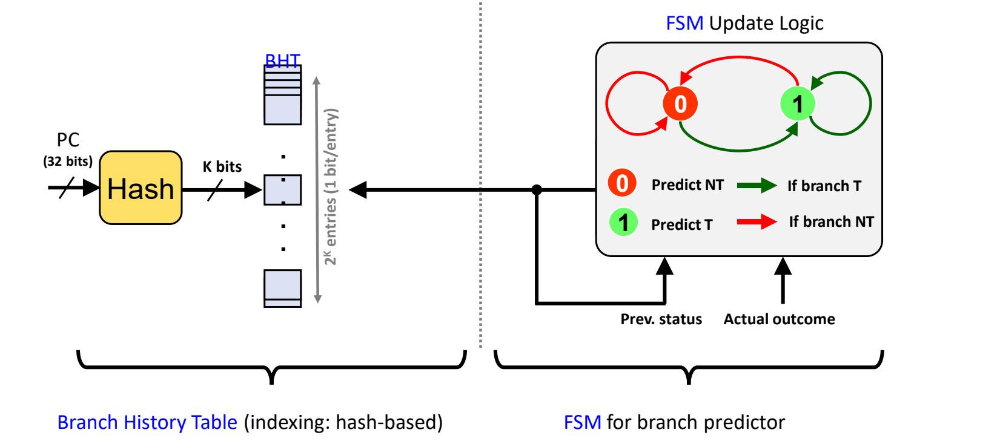

图：32 位 PC 经哈希得到 $K$ 位索引访问 $2^K$ 项、每项 1 位的 BHT；分支判定后由 FSM 根据原状态与实际结果更新表项。

### 1 位预测器的循环例子

1 位方案的弱点在循环上最明显：循环分支几乎总是跳，只在退出时不跳一次，但这一次“例外”会让预测器错两次。

> [!example] 例 1：用 1 位 BHT 预测短循环分支
> 循环尾部的分支是 `bne r1, r10, L1`，代码如下：
>
> ```asm
>     addi r10, r0, 5      # 循环上界
>     addi r1, r1, r0      # 循环变量初始化（讲义原文如此）
> L1: ...
>     addi r1, r1, 1       # r1 自增
>     bne  r1, r10, L1     # r1 != r10 则跳回 L1
>     ...
> ```
>
> 这个循环每执行一轮，该分支的实际结果是 T T T T NT（前 4 次跳回，第 5 次退出），整段循环被反复执行。BHT 中该项初值为 0。求准确率。
>
> 逐次推演（预测值 → 实际 → 新状态）：
>
> | 次序 | 1 | 2 | 3 | 4 | 5 | 6 | 7 | 8 | 9 | 10 | 11 |
> | --- | --- | --- | --- | --- | --- | --- | --- | --- | --- | --- | --- |
> | 预测 | 0 | 1 | 1 | 1 | 1 | 0 | 1 | 1 | 1 | 1 | 0 |
> | 实际 | T | T | T | T | NT | T | T | T | T | NT | T |
> | 对错 | ✗ | ✓ | ✓ | ✓ | ✗ | ✗ | ✓ | ✓ | ✓ | ✗ | ✗ |
>
> 1. 第一轮第 1 次：初值 0 预测 NT，实际 T，错，翻转为 1。
> 2. 第 2 到 4 次：预测 T，实际 T，全对。
> 3. 第 5 次（退出）：预测 T，实际 NT，错，翻转为 0。
> 4. 再次执行这段循环，第 6 次（进入）：上一次结果是 NT，预测 NT，实际 T，又错，翻转为 1。
> 5. 此后每一轮都重复“进入错 1 次、中间对 3 次、退出错 1 次”，所以每轮 5 次只对 3 次，准确率 $3/5 = 60\%$。[^l04-section-3-s2p22]

> [!warning] 易错点
> 讲义上的 C 代码写作 `for (i=1; i<5; i++)`，按字面只循环 4 次。但同页的结果序列和下一页的文字都是“5 次迭代、跳 4 次再不跳 1 次”。[^l04-section-3-s2p23] 计算时以结果序列 T T T T NT 为准。附录版本把代码改成 `for (i=0; i<4; i++)`、`addi r10, r0, 4`，序列和 60% 的结论不变。[^l04-section-3-s2p108]

由此得到 1 位方案的根本问题：[^l04-section-3-s2p23]

- 每轮第一次总是错：上一轮退出时把状态改成了 NT；
- 中间 3 次预测正确；
- 最后一次（退出）总是错：前一次是 T。

稳定模式中的每一次异常，都会导致每轮两次误预测：异常发生时错一次，异常把状态改了，回到正常模式时再错一次。一位只能记住“上一次”，没有办法区分“偶然一次例外”和“行为真的变了”。

### 2 位饱和计数器（2-bit Saturating Counter）

要让偶尔一次例外不至于推翻预测，就需要给每个分支多存一点“把握程度”。两位比一位好。

**2 位饱和加减计数器预测器**（2-bit saturating up/down counter predictor）把 BHT 每项扩成 2 位，FSM 有四个状态 00、01、10、11：[^l04-section-3-s2p24]

| 编码 | 状态 | 预测 |
| --- | --- | --- |
| 00 | 强不跳转 SN（Strongly Not Taken） | NT |
| 01 | 弱不跳转 WN（Weakly Not Taken） | NT |
| 10 | 弱跳转 WT（Weakly Taken） | T |
| 11 | 强跳转 ST（Strongly Taken） | T |

- **方向位**（direction bit）：高位 MSB，直接给出预测，1 为 T，0 为 NT；
- **迟滞位**（hysteresis bit）：低位 LSB，表示把握程度，概念上对应“松弛”（relaxation）：在强状态下错一次只会退到弱状态，方向位不变。[^l04-section-3-s2p25]

更新规则就是一个在 00 和 11 之间饱和的加减计数器：

1. 实际为 T：计数加 1，$00 \to 01 \to 10 \to 11$，到 11 后保持不变；
2. 实际为 NT：计数减 1，$11 \to 10 \to 01 \to 00$，到 00 后保持不变。

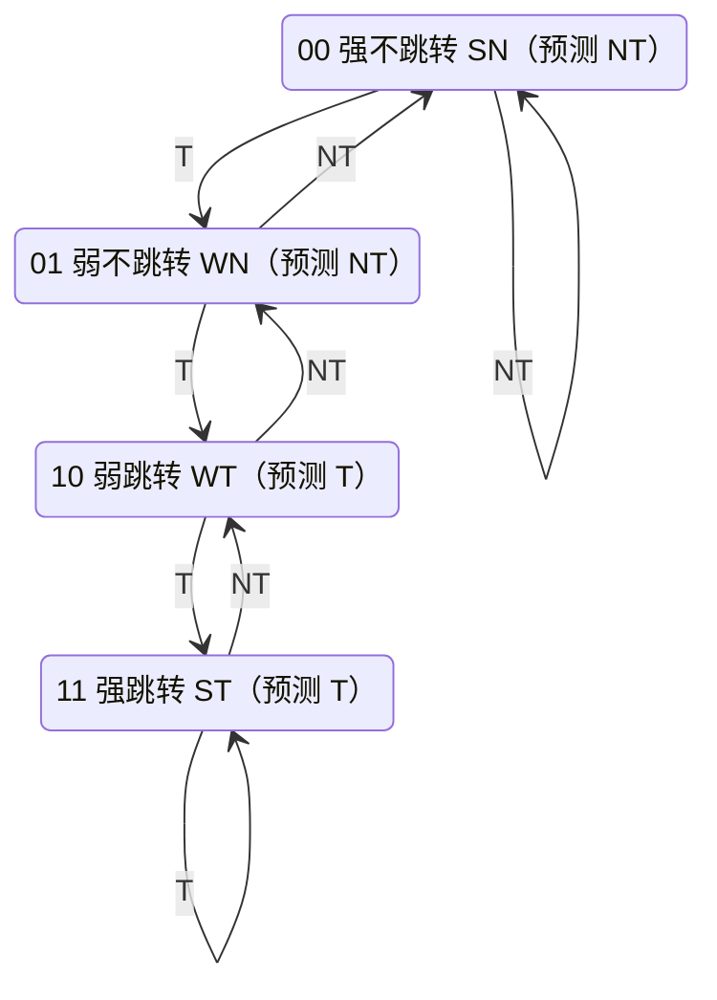

从强状态出发，必须连续错两次方向位才会改变。“有把握”时偶尔错一次只是“信心动摇”（强退成弱），再错一次才真正改口；反之，在弱状态下猜对一次就回到强状态。下图中绿色节点（10、11）预测 T，红色节点（00、01）预测 NT。

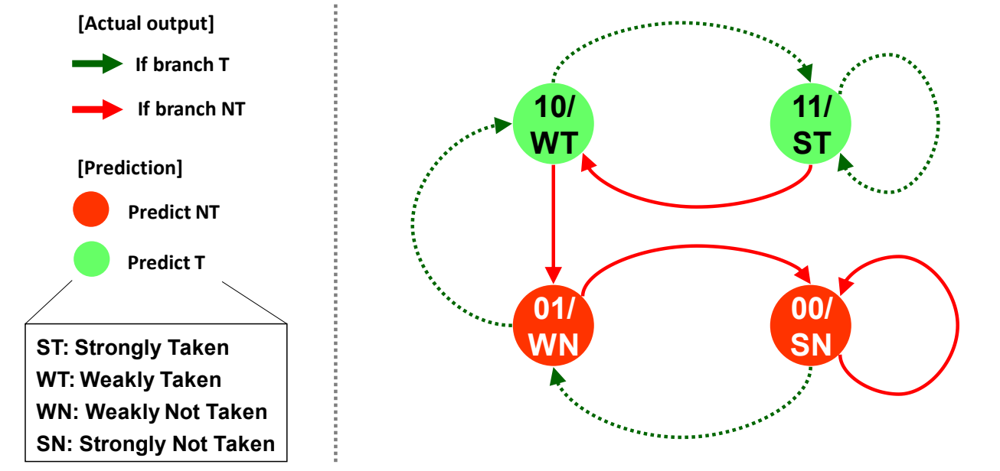

图：绿色虚线为实际跳转、红色实线为实际不跳转，状态在 00 SN、01 WN、10 WT、11 ST 之间逐级移动，两端饱和。

2 位方案在 SPECint92 上最好可达约 90%。[^l04-section-3-s2p24] 采用它的处理器及表项数为：21064A（4K\*）、21164（2K\*）、Nx586（2K\*）、PPC 620（2K）、PPC 604（512）、R10000（512）、UltraSparc（512）、Cyrix M1（256\*）、PA-8000（256）、Pentium（256），带 \* 的处理器还配有返回地址栈（见[分支目标预测](#分支目标预测)）。

> [!example] 例 1（续）：用 2 位 BHT 预测同一个循环
> 分支序列仍为每轮 T T T T NT，该项初值 01（WN）。
>
> | 次序 | 1 | 2 | 3 | 4 | 5 | 6 | 7 | 8 | 9 | 10 | 11 |
> | --- | --- | --- | --- | --- | --- | --- | --- | --- | --- | --- | --- |
> | 状态（预测） | 01（NT） | 10（T） | 11（T） | 11（T） | 11（T） | 10（T） | 11（T） | 11（T） | 11（T） | 11（T） | 10（T） |
> | 实际 | T | T | T | T | NT | T | T | T | T | NT | T |
> | 对错 | ✗ | ✓ | ✓ | ✓ | ✗ | ✓ | ✓ | ✓ | ✓ | ✗ | ✓ |
>
> 1. 第 1 次：01 预测 NT，实际 T，错；计数加 1 变为 10（WT）。
> 2. 第 2 次：10 预测 T，对；变为 11（ST）。第 3、4 次保持 11，都对。
> 3. 第 5 次（退出）：11 预测 T，实际 NT，错；但只减到 10（WT），方向位仍为 1。
> 4. 第 6 次（再次进入）：10 预测 T，实际 T，**对**，回到 11。这正是与 1 位方案的区别：1 位方案在这里会错。
> 5. 此后每轮只在退出时错 1 次，准确率 $4/5 = 80\%$。[^l04-section-3-s2p26]
>
> 讲义序列末尾单独显示的“1”是第 11 次（T）更新之后的状态 11，被截断成了一位，不是预测出错。

把两种方案放在一起比较：第一个位置是初始训练（预热，warm-up），之后 1 位方案每轮在“退出 + 再进入”处连错两次，2 位方案只在退出处错一次，即每 N 个分支（N 为每轮迭代数）只有 1 次误预测；另一组例子（Example2）中，DC08 为 99.999%，DC44 为 99.0%。[^l04-section-3-s2p27]

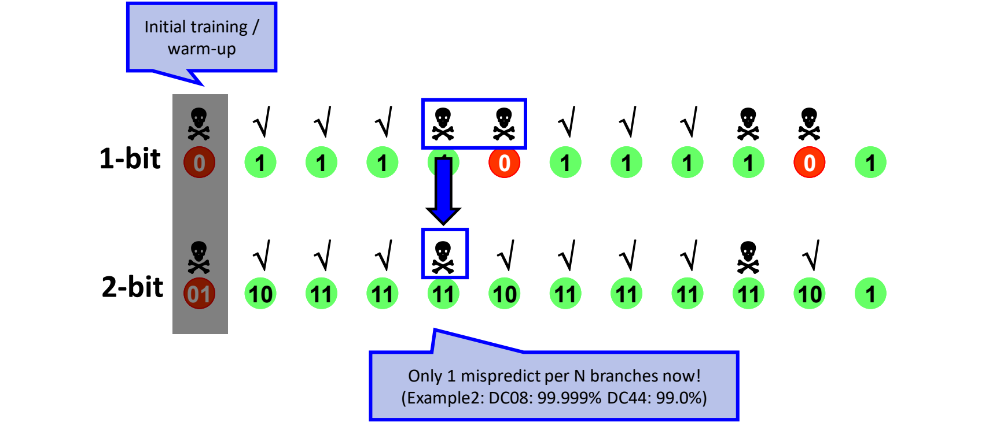

图：同一循环序列上，1 位预测器每轮错两次，2 位预测器预热后每轮只错一次。

> [!warning] 易错点
> 2 位计数器的“2 位”是同一条分支的计数状态，不是“记住最近两次结果”。它分辨不了 T T T T NT 这样的周期模式，只是让一次例外的代价从两次误预测降到一次。所以每轮循环越短，2 位方案相对 1 位方案的收益越大；但这个循环无论如何都会在退出时错一次。

### 两级相关预测与锦标赛预测

1 位和 2 位预测器都只看同一条分支自己的“上一次”或“总体倾向”，看不到更长的模式。要进一步提高，需要利用分支之间的相关性。

#### 两级相关预测（Two-Level / Correlating Predictor）

**分支相关性**（branch correlation）指一条分支的结果往往和之前的若干结果相关。**两级预测器**（two-level predictor）利用这一点，同时使用分支历史表 BHT 和**模式历史表**（Pattern History Table, PHT）：第一级记录最近若干次分支结果构成的历史模式，第二级按这个模式查找对应的预测。最好情况下准确率约 96%（Pentium6）。[^l04-section-3-s2p28]

相关性有两种来源：[^l04-section-3-s3b6]

- **同一分支的自相关**：不只看上一次结果，而是看最近若干次（例如 5 次）结果构成的模式，再预测下一次。对上面的循环，记住“连续 4 次 T 之后是 NT”就能把每轮那一次误预测也消掉。
- **不同分支之间的相关**：前面其他分支的结果也会影响当前分支的方向，这同样可以用于预测。

> [!tip] 课堂强调
> 例 1 那样的循环原则上可以做到 100% 预测，但要靠相关预测。相关预测器的具体结构属于研究生课程内容，本课只讲概念，感兴趣的同学可以看之后整理的补充材料。[^l04-section-3-s3b6]

> [!note] 补充解释
> 教材中常见的两级结构是：用一个移位寄存器记录最近 $m$ 次分支的方向（全局或按分支），把这串历史位（常与 PC 的部分位拼接）作为索引，去 PHT 中选一个 2 位饱和计数器做预测。Hennessy & Patterson《Computer Architecture: A Quantitative Approach》中称为 $(m,n)$ 相关预测器（$m$ 位历史、$n$ 位计数器）。这里只用来说明 BHT 与 PHT 的分工。

#### 混合预测 / 锦标赛预测（Hybrid / Tournament Predictor）

没有一种预测器在所有情况下都最好：不同分支的行为不同，有的适合只看自身历史，有的适合看全局相关性。[^l04-section-3-s2p29]

**锦标赛预测器**（tournament predictor，又称混合预测器 hybrid predictor）同时运行多个不同类型的子预测器，再加一个**元预测器**（meta-predictor），即“预测器的预测器”，用来预测哪一个子预测器这次更准，并采用它的结果。这样就构成两层预测：子预测器预测方向，元预测器预测该信谁。最好情况下准确率约 97%（Alpha 21264）。[^l04-section-3-s2p29]

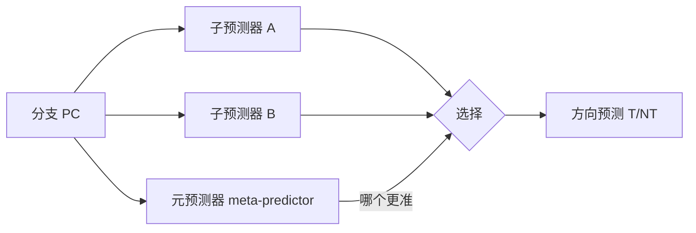

> [!info] 可视化资源
> [Wikipedia：Branch predictor](https://en.wikipedia.org/wiki/Branch_predictor) 给出 2 位饱和计数器的状态图，并介绍两级自适应预测器与带元预测器的混合预测器，可与本节对照阅读。

> [!tip] 课堂强调
> 从 96% 到 97% 只提高 1%，看上去不值得这么复杂的设计。但现在预测器准确率已经很高，能在现有水平上再提高 0.5%，就足以发表顶会论文，甚至拿到最佳论文。[^l04-section-3-s3b6]

### BHT 在五级流水线中的位置

> [!info] 依据讲义整理
> 以下内容来自讲义附录，课上没有讲解。

动态分支预测同样要知道方向与目标两件事，各类分支的难点与正文一致[^l04-section-3-s2p105]，见[分支预测的动机](#分支预测的动机)。下面是 BHT 在五级流水线（见 L03）中的具体工作方式。

**分支预测缓冲**（branch prediction buffer）就是 BHT 的另一个名字。它的工作过程如下：[^l04-section-3-s2p106]

1. **IF 阶段查表**：BHT 位于 IF 阶段，用 PC 的低位寻址，读出一位，表示这条分支上次执行时是否跳转。
2. **随流水线传递**：这一位经 IF/ID 流水线寄存器送到 ID 阶段。
3. **ID 阶段判定**：在确认取到的是分支指令并检查预测位后，分支在 ID 阶段作出决定。
4. **预测错误时恢复**：冲刷流水线中错取的指令，从正确的指令重新开始，并把预测位取反。

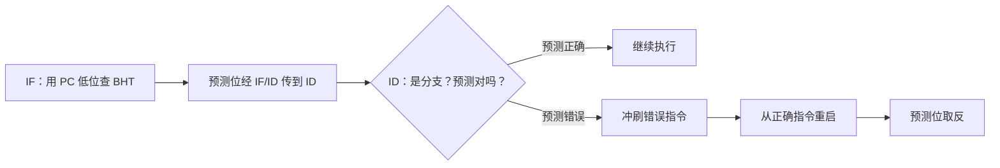

预测位可能出错，原因有两种：这条分支本次的行为确实变了，或者这一位是 PC 低位相同的另一条分支留下的。两种情况都只影响性能，不影响正确性。[^l04-section-3-s2p106] 附录用取模作为哈希的例子：表有 2 项时，$\texttt{0x10} \bmod \texttt{0x2} = \texttt{0x0}$，$\texttt{0x11} \bmod \texttt{0x2} = \texttt{0x1}$，$\texttt{0x22} \bmod \texttt{0x2} = \texttt{0x0}$，所以 0x10 和 0x22 两条分支共用同一项。[^l04-section-3-s2p107] 附录把索引位数记作 $N$、表项数记作 $2^N$，与正文的 $K$、$2^K$ 含义相同；同时把 1 位 FSM 概括为“改主意快”（change mind fast），这正是它在循环例子中连错两次的原因。

一个 4096 位的 BHT，误预测率从 1%（nasa7、tomcatv）到 18%（eqntott）不等。[^l04-section-3-s2p106]

#### 附录中的 2 位预测器

附录给出的 2 位方案约有 80% 准确率，其原则是“预测必须连续错两次，预测位才会改变”，并指出 BHT 中也要存放 FSM 的初始状态。[^l04-section-3-s2p110] 它的状态图与正文的饱和计数器不完全相同：

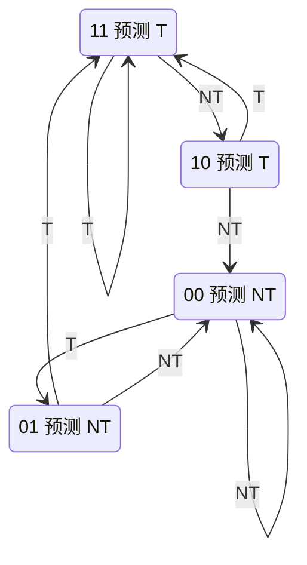

两种 FSM 的对照：

| 转移 | 正文饱和计数器（p25） | 附录方案（p109–p110） |
| --- | --- | --- |
| 10 遇 NT | 降到 01（WN） | 直接到 00 |
| 01 遇 T | 升到 10（WT） | 直接到 11 |
| 11 遇 NT / 00 遇 T | 退到 10 / 升到 01 | 相同 |
| 预测位（MSB）含义 | 1 预测 T，0 预测 NT | 相同 |

两者的共同点是：处在 11 或 00 这样的强状态时，必须连续错两次预测才会翻转。区别在于附录方案中，弱状态一旦再错就直接跳到对方的强状态，而饱和计数器只移动一步。对 T T T T NT 循环，两者结果相同：附录例子从 01 出发，第一次 T 后直接到 11，此后每轮只在退出时错一次，降到 10 后再次进入时预测正确。[^l04-section-3-s2p110] 附录写的约 80% 与正文“最好约 90%”出自不同的统计口径，正文的 90% 指 SPECint92 上的最好情况。

> [!question]- 自测：某分支每轮的结果是 T T NT（跳 2 次、退出 1 次），循环反复执行。稳态下 1 位 BHT 和 2 位饱和计数器的准确率各是多少？
> 1 位：每轮第 1 次（上次是 NT）错，第 2 次对，第 3 次（NT）错，准确率 $1/3 \approx 33\%$。2 位：稳态下进入时状态为 10，T 对 → 11，T 对 → 11，NT 错 → 10，每轮只错 1 次，准确率 $2/3 \approx 67\%$。循环越短，2 位比 1 位的优势越大。

> [!question]- 自测：分支 A 在 PC 0x10、分支 B 在 PC 0x22，BHT 用“PC 对表项数取模”索引且只有 2 项。A 总是跳、B 总是不跳，交替执行。1 位 BHT 会出什么问题？程序结果会错吗？
> 两者都映射到第 0 项，互相覆盖：A 执行后该项为 1，B 读到 1 预测 T 而错，改写为 0；A 再读到 0 又错，因此每次都预测错。但程序结果不会错，误预测的指令会被冲刷，代价只是性能。

> [!question]- 自测：2 位饱和计数器当前为 11，接下来的实际结果依次是 NT、T、NT、NT、T，写出每次的预测和更新后的状态。
> 11 预测 T，NT 错 → 10；10 预测 T，T 对 → 11；11 预测 T，NT 错 → 10；10 预测 T，NT 错 → 01；01 预测 NT，T 错 → 10。共错 4 次。从 11 出发要连续两次 NT（第 3、4 次）才让方向位变为 0。

> [!info]- 来源
> - L04.pdf：PDF p.18–29, 105–110
> - L04.docx：DOCX body 118–204

[^l04-section-3-s2p18]: L04.pdf-PDF p.18
[^l04-section-3-s2p19]: L04.pdf-PDF p.19
[^l04-section-3-s3b4]: L04.docx-DOCX body 118-147
[^l04-section-3-s2p20]: L04.pdf-PDF p.20
[^l04-section-3-s2p21]: L04.pdf-PDF p.21
[^l04-section-3-s2p22]: L04.pdf-PDF p.22
[^l04-section-3-s2p23]: L04.pdf-PDF p.23
[^l04-section-3-s2p108]: L04.pdf-PDF p.108
[^l04-section-3-s2p24]: L04.pdf-PDF p.24
[^l04-section-3-s2p25]: L04.pdf-PDF p.25
[^l04-section-3-s2p26]: L04.pdf-PDF p.26
[^l04-section-3-s2p27]: L04.pdf-PDF p.27
[^l04-section-3-s2p28]: L04.pdf-PDF p.28
[^l04-section-3-s3b6]: L04.docx-DOCX body 174-204
[^l04-section-3-s2p29]: L04.pdf-PDF p.29
[^l04-section-3-s2p105]: L04.pdf-PDF p.105
[^l04-section-3-s2p106]: L04.pdf-PDF p.106
[^l04-section-3-s2p107]: L04.pdf-PDF p.107
[^l04-section-3-s2p110]: L04.pdf-PDF p.110

---

## 分支目标预测

> [!abstract] 本节要点
> - BHT 只回答“跳不跳”，不回答“跳到哪”；**分支目标缓冲 BTB** 在 IF 阶段缓存分支的目标，预测正确时无论分支走哪个方向都不必停顿。
> - BTB 有两种实现：缓存**目标地址**（需要双读端口指令存储器，IF/ID 中的预测位选择下一拍装入哪条“下一条”指令），或缓存**目标处的指令本身**（指令存储器照常顺序取指）。
> - BTB 是带 tag 的类缓存结构：PC 与所有 tag 并行比较（像全相联缓存），命中且预测跳转则 $PC \leftarrow$ BTB 中的目标，否则 $PC \leftarrow PC+4$；为了一个周期查完，比较器很多，通常只有 64 或 128 项。
> - 函数返回地址要等 EX 才算得出，且同一函数从多处被调用，BTB 预测不准；**返回地址栈 RAS** 在调用时压入 $PC_{\rm call}+4$，译码到返回指令时弹出作为预测值。
> - RAS 只需 8–16 项就足够准确；调用过深溢出、或被进程切换/内核/异常打断时会失效，但误预测只影响性能、不影响正确性。

### 为什么还需要目标预测

[BHT](#动态分支预测) 预测的是分支**何时**跳转（when），却不告诉处理器分支跳到**哪里**（where）。[^l04-section-4-s2p30] 方向预测为“跳转”之后，处理器仍需要目标地址才能在下一个周期从正确位置取指；如果目标要等译码、甚至等执行阶段算出，即使方向猜对了，流水线也要白白等上几个周期。分支的方向与目标两类预测需求见[分支预测的动机](#分支预测的动机)。

因此需要第二类预测器，专门在取指阶段直接给出跳转目标，这就是 BTB。

### 分支目标缓冲（Branch Target Buffer, BTB）

**分支目标缓冲**（Branch Target Buffer, BTB）是位于 IF 阶段的一个类缓存（cache-like）存储，记录分支指令的地址及其对应的跳转目标，用指令地址来查找。[^l04-section-4-s2p31] 它的好处是：只要预测正确，**无论分支走哪个方向都可以避免停顿**——预测跳转时，下一条直接取自目标；预测不跳转时，下一条就是顺序指令。[^l04-section-4-s2p30]

#### 两种实现思路

BTB 里到底存什么，有两种做法：[^l04-section-4-s2p30][^l04-section-4-s3b6]

1. **方案一：缓存目标地址**。IF 阶段的 BTB 给出分支目标地址，但同一周期还必须取出顺序的下一条指令（以防预测不跳转）。于是 IF 同时取出两条候选指令，由 IF/ID 中的**预测位**选择在下一个时钟沿把哪一条“下一条”指令装入 IF/ID。代价是指令存储器需要**两个读端口**：一个端口按 $PC+4$ 取顺序指令，另一个端口读出跳转目标地址处的指令。
2. **方案二：缓存目标指令本身**。指令存储器不做改动，每个周期仍只按顺序地址取一条指令；BTB 中存放的不再只是 PC 地址，而是**跳转目标处的那条指令**。取指时，指令存储器输出顺序指令，BTB 输出跳转目标指令，由多路选择器选择其一送入 IF/ID（示意图中该选择器还有一个常数 `0` 输入）。

| 对比项 | 方案一：缓存目标地址 | 方案二：缓存目标指令 |
| --- | --- | --- |
| BTB 表项内容 | 分支目标的地址 | 分支目标处的指令 |
| 指令存储器 | 需要两个读端口（顺序指令 + 目标指令） | 单读端口，只取顺序指令 |
| 每周期的两条候选指令来自 | 都来自指令存储器 | 顺序指令来自指令存储器，目标指令来自 BTB |
| 谁决定装入 IF/ID 的指令 | IF/ID 中的预测位 | 预测结果控制的多路选择器 |

#### 结构与查找过程

BTB 由许多并排的 `Tag | Target` 对组成：`Tag` 记录某条分支指令的 PC，`Target` 记录它发生跳转时的目标。[^l04-section-4-s2p31] 一次查找按以下步骤进行：

1. **并行比较**：当前取指的 PC（图中 Branch PC）同时送到每个表项的比较器 `=`，与**所有** tag 同时比较。
2. **选出目标**：比较结果作为选择信号，把匹配那一项的 `Target` 经多路选择器读出；有匹配即为**命中**（hit），说明 BTB 中确实存有这条分支的目标。
3. **计算顺序地址**：同时用加法器算出 $PC+4$。
4. **按方向选下一 PC**：最后一级二选一由**预测的分支方向**（Predicted Branch Direction，来自方向预测器）控制：选 `1` 输出 Branch Target，选 `0` 输出 $PC+4$。

即：若 BTB 命中且该分支被预测为跳转，则
$$
PC \leftarrow \text{Target}_{\rm BTB}
$$
否则 $PC \leftarrow PC + 4$。[^l04-section-4-s2p31]

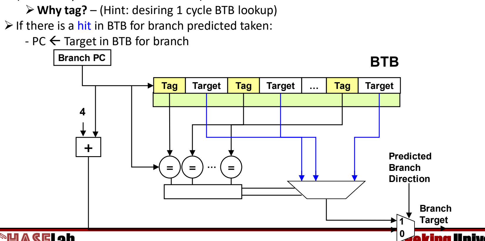

图：分支 PC 同时与所有 Tag 比较，命中项的 Target 经选择器输出，再由预测方向在目标地址与 $PC+4$ 之间二选一。

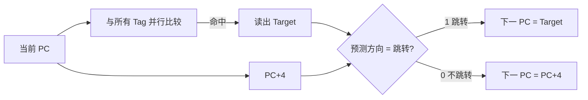

#### 为什么要有 tag

设置 tag 的理由（Hint）是：希望 BTB 查找**在一个周期内完成**。[^l04-section-4-s2p31] BTB 工作在 IF 阶段，此时指令还没有译码，处理器甚至不知道当前取的是不是分支。用 tag 存下分支 PC 并与当前 PC 全部同时比较，命中本身就说明“这是一条记录过的分支、目标就是这个”，于是在一个周期内同时得到“是否为已知分支”和“目标是什么”两条信息，下一周期即可从目标处取指。

这种组织方式与 BHT 完全不同：

| 对比项 | BHT | BTB |
| --- | --- | --- |
| 预测内容 | 方向：跳 / 不跳 | 目标：跳到哪里 |
| 定位表项的方式 | PC 经哈希直接索引到唯一固定的一项 | PC 与所有 tag 并行比较 |
| 是否有 tag | 无 | 有 |
| 结构类比 | 直接索引的表 | 全相联缓存（fully associative cache） |

BTB 的优点是快，一个周期内完成所有 tag 的比较并读出目标；缺点是硬件复杂——每一项都需要一个比较器同时工作，所以表项数不可能很大，一般只有 **64 或 128 项**，超过这个规模对 CPU 设计会带来很大困难。[^l04-section-4-s3b6]

> [!warning] 易错点
> BTB 与 BHT 不能混为一谈：BHT 哈希后直接读一项，不同分支可能共用同一项（别名）；BTB 用 tag 精确匹配，查到的就是这条分支自己的目标。最终的下一 PC 要同时看两者——BTB 命中但方向预测为“不跳转”时，下一 PC 仍是 $PC+4$。

### 函数返回的预测难点

函数返回非常频繁，却恰好是 BTB 难以处理的一类跳转。[^l04-section-4-s2p32] 难点有两个：

1. **地址难算**：返回指令（MIPS 的 `jr $ra`）的目标在寄存器 `$ra` 中，要从寄存器读出地址，必须等到 EX 阶段完成才知道跳到哪里。
2. **地址难用 BTB 预测**：同一个函数可以从多处被调用，每次返回的位置都不同，而 BTB 中一条返回指令只对应一个 Target。

> [!example] 例：同一个 `bar` 的三个返回目标
> 设 `foo` 三次调用 `bar`，`bar` 又调用 `baz`（讲义把返回指令误写成 `jar $ra`，应为 `jr $ra`）：[^l04-section-4-s2p32]
>
> ```asm
> foo:
>   0x10001000  jal bar
>   0x10001004  ...
>   0x10001800  jal bar
>   0x10001804  ...
>   0x10001CE4  jal bar
>   0x10001CE8  ...
> bar:
>   0x1000F0E0  jal baz
>   0x1000F0E4  ...
>               jr  $ra
> baz:
>               jr  $ra
> ```
>
> 1. `jal` 把调用指令地址 $+4$ 作为返回地址，所以 `bar` 中那一条 `jr $ra` 依次要跳回 `0x10001004`、`0x10001804`、`0x10001CE8`。
> 2. BTB 为这条 `jr $ra` 只记一个 Target。第二次返回时它记着上一次的 `0x10001004`，而真实目标是 `0x10001804`；第三次同理，记着 `0x10001804` 而真实目标是 `0x10001CE8`。
> 3. 所以只靠 BTB，每次从不同调用点返回都会预测错。

但只要了解指令语义，返回地址其实很好预测：**每次调用发生时，返回地址就已经知道了**——就是调用指令的地址加 4。[^l04-section-4-s2p32]

### 返回地址栈（Return Address Stack, RAS）

**返回地址栈**（Return Address Stack, RAS）是专门预测函数返回目标的硬件栈：调用时把返回地址压入 RAS，译码到返回指令时从 RAS 弹出预测的返回地址。[^l04-section-4-s2p33]

1. **调用（call）**：调用指令的 PC 照常查 BTB 得到被调函数的入口；同时把 $PC_{\rm call}+4$ 作为返回地址压入（push）RAS。
2. **返回（return）**：返回指令的 PC 同样会查 BTB，但当判断出这是一条返回指令（图中 `Return?` 信号）时，多路选择器改用 RAS 栈顶弹出（pop）的地址作为预测目标，而不用 BTB 的输出。

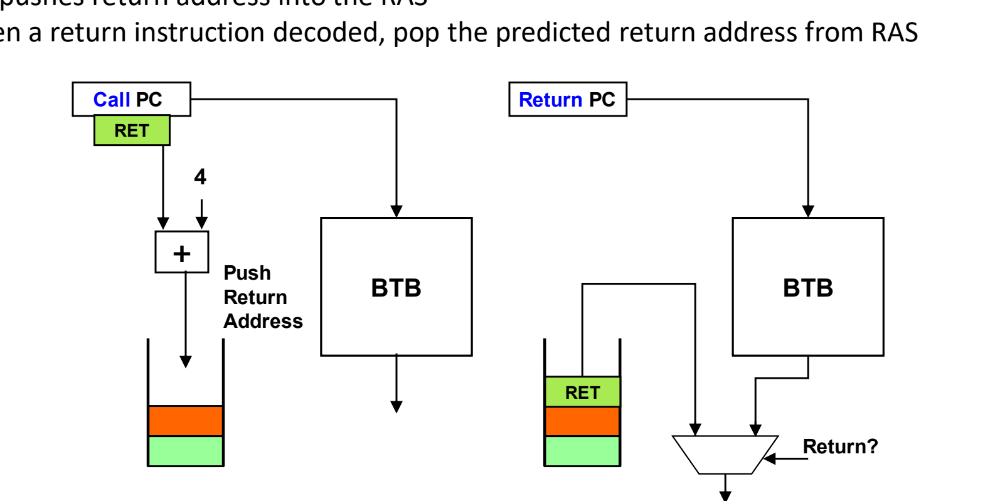

图：调用时把 Call PC + 4 压入 RAS，返回时弹出栈顶 RET 作为预测地址，与 BTB 的输出二选一。

选择栈结构的原因是调用与返回天然是嵌套的：后调用的函数先返回，正好对应栈的后进先出（LIFO）。[^l04-section-4-s3b7]

> [!example] 例：用 RAS 预测上例的返回
> 按上例的执行顺序跟踪 RAS（栈顶写在右侧）：
>
> 1. `0x10001000 jal bar`：压入 `0x10001004` → `[0x10001004]`
> 2. `0x1000F0E0 jal baz`：压入 `0x1000F0E4` → `[0x10001004, 0x1000F0E4]`
> 3. `baz` 的 `jr $ra`：弹出 `0x1000F0E4`，正确返回 `bar` → `[0x10001004]`
> 4. `bar` 的 `jr $ra`：弹出 `0x10001004`，正确返回 `foo` → `[]`
> 5. `0x10001800 jal bar`：压入 `0x10001804`；之后 `bar` 返回时弹出的正是 `0x10001804`。第三次调用同理得到 `0x10001CE8`。
>
> 同一条 `jr $ra` 每次都拿到本次调用压入的地址，BTB 解决不了的“多处调用”问题就消失了。

#### 规模：小栈就够

RAS 不需要很大就能预测得很准，**8–16 项**的返回栈已经足够。[^l04-section-4-s2p34] 返回误预测率随表项数变化的曲线（横轴为返回栈表项数，基准程序为 gcc、fpppp、espresso、doduc、li、tomcatv）显示：没有返回栈时各程序的返回误预测率约在 20%–50%；表项增加到 8 项时，大多数程序的误预测率已降到接近 0；`li` 下降最慢，到 16 项时也只剩很小的误预测率。

真实处理器的 RAS 规模：[^l04-section-4-s2p34]

| 处理器 | RAS 表项数 |
| --- | --- |
| MIPS R10K | 1 |
| DEC Alpha 21164 | 12 |
| Intel P3 | 16 |

早期处理器只有 1 项，是因为当时程序的调用嵌套不深；程序越写越复杂后，后来的处理器把表项增加到 12 或 16。[^l04-section-4-s3b7]

#### 失效情形与正确性

RAS 会在以下情况失效：[^l04-section-4-s3b7]

1. **调用深度超过栈容量**：函数嵌套调用得很深，超出 RAS 的表项数，较早压入的返回地址无法保留，相应的返回就会预测错。
2. **执行流被打断**：程序在调用与返回之间被切换到其他进程，或从应用程序进入操作系统内核执行（例如发生异常），栈中内容会受到干扰。

RAS 和 BTB 一样只是**预测**机制：预测错只影响性能，不影响正确性。返回指令最终仍会解析出真实的返回地址，与预测地址比较；两者不一致就是一次误预测，按误预测的方式处理（冲刷错误路径上的指令，从正确地址重新取指）。[^l04-section-4-s3b7]

> [!tip] 课堂强调
> 往处理器里加入新的硬件设计，往往就会带来安全问题。BTB 和 RAS 带来了很大的性能收益，但幽灵（Spectre）一类攻击正是利用了 BTB 和 RAS 的特性，后续课程会介绍。[^l04-section-4-s3b7] 推测执行本身见[分支预测的动机](#分支预测的动机)。

> [!question]- 自测：某条分支在 BTB 中命中，但方向预测器预测“不跳转”；另一条分支方向预测为“跳转”，但在 BTB 中未命中。两种情况下下一 PC 各是什么？
> 两种情况下一 PC 都是 $PC+4$。按 BTB 的选择逻辑，只有“命中且预测跳转”才令 $PC \leftarrow \text{Target}_{\rm BTB}$：第一种方向选了 `0`；第二种 BTB 拿不出目标，IF 阶段无处可跳，只能先按顺序取指，等分支真正解析后再纠正。

> [!question]- 自测：一个处理器的 RAS 只有 2 项，满时新压入的地址覆盖最老的一项。程序依次执行 `A` 调用 `B`、`B` 调用 `C`、`C` 调用 `D`，然后逐层返回。三次返回中哪几次预测正确？
> 前两次（`D`→`C`、`C`→`B`）正确，第三次（`B`→`A`）错误。三次调用压入 $r_A, r_B, r_C$，容量为 2，$r_A$ 被覆盖；依次弹出 $r_C$、$r_B$ 都正确，第三次返回时栈中已没有 $r_A$。这就是“调用深度超过栈容量”的失效，最终真实地址解析后发现不一致，只损失性能。

> [!question]- 自测：BTB 有 1024 项是否一定比 128 项更好？为什么实际 BTB 通常只有 64 或 128 项？
> 不一定能做出来。BTB 要求一个周期内把 PC 与所有 tag 并行比较（全相联），每项都要一个比较器，项数越多硬件越复杂、越难在一个周期内完成；所以实际设计在命中率与单周期查找之间折中，通常取 64 或 128 项。

> [!info]- 来源
> - L04.pdf：PDF p.30–34
> - L04.docx：DOCX body 174–231

[^l04-section-4-s2p30]: L04.pdf-PDF p.30
[^l04-section-4-s2p31]: L04.pdf-PDF p.31
[^l04-section-4-s3b6]: L04.docx-DOCX body 174-204
[^l04-section-4-s2p32]: L04.pdf-PDF p.32
[^l04-section-4-s2p33]: L04.pdf-PDF p.33
[^l04-section-4-s3b7]: L04.docx-DOCX body 205-231
[^l04-section-4-s2p34]: L04.pdf-PDF p.34

---

## 超流水线与指令级并行

> [!abstract] 本节要点
> - 慢操作有两种处理办法：把整个时钟放慢一倍，或者让它占两个周期、保持时钟频率不变。乘法不用 DM 阶段，可以横跨 ALU 与 DM；访存慢一倍时可拆成 DM1、DM2，五级变六级。
> - 流水线周期由最长一级决定，每级末尾的锁存器还会增加延迟。例：各级 1.0/0.6/0.9/1.2/0.4 ns，单周期 4.1 ns，流水线 1.2 ns，加速比 $4.1/1.2\approx3.42$，没有达到理想的 5。
> - **超流水线**把每级拆成 $m$ 个子级，周期从 $T$ 缩短到 $T/m$，每个小周期可以发射一条新指令。理想情况下每 $T/m$ 出一个结果，加速比约等于级数。
> - 深流水线的代价有两项：一是时钟频率极高、功耗大；二是依赖代价成倍放大。例如 `beq` 第 32 级才比较完，预测错时要冲刷 31 条指令；`LW` 的值第 40 级才到，而 `ADD` 第 25 级就要用，即使有转发也要停 15 个周期。
> - 级数存在最优值，约 15 级，超过后收益递减，甚至降低整体性能。指令级并行有两条正交途径：流水线和并行执行（超标量/VLIW），实际处理器两者兼有。

### 其他流水线结构

教科书上的五级流水线默认每个阶段都能在一个周期内完成。真实的处理器里，乘除法、慢速数据存储器等操作明显比其他阶段长。如果只是简单地让最慢的部件决定时钟周期，所有指令都会跟着变慢。

**多周期乘法（slow multiply）**：乘法器延迟大约是 ALU 的两倍时，有两种选择：[^l04-section-5-s2p35]

1. **把时钟放慢一倍**：乘法能在一个周期内完成，但其他所有指令也都按慢时钟执行。
2. **让乘法占两个周期**：乘法指令不访问数据存储器，不需要 DM 阶段。所以可以在 ALU 旁边并联一个 MUL 单元，让它横跨原来的 ALU 和 DM 两个阶段，结果直接送到写回的 Reg。这样时钟频率不变，乘法也不会多占用流水线的级数。[^l04-section-5-s3b7]

**两级访存（two-cycle data memory）**：如果数据存储器（DM）的访问时间是指令存储器（IM）的两倍，同样有两种选择：

1. **把时钟放慢一倍**，让 DM 在一个周期内完成；
2. **让数据访存占两个周期**，拆成 DM1、DM2 两级，时钟频率保持不变。流水线从五级变成六级：IM → Reg → ALU → DM1 → DM2 → Reg。


两种情况的思路相同：慢操作要么拖慢整个时钟，要么拆成多个周期，后一种保住了时钟频率。下面的超流水线就是把这个思路推广到所有阶段。

### 流水线性能回顾

在讨论“加深流水线”之前，先回顾流水线的收益从哪里来、为什么达不到理想值。五级流水线的原理和冒险见 L03 的相关章节，这里只算性能。

流水线经过最初的填充（warm-up）阶段以后，每个周期完成一条指令，即 $\text{Inst/Cycle}=1$。它的**吞吐率**受两个因素限制：[^l04-section-5-s2p37]

- 每级末尾的**锁存器**（latch）会增加延迟；
- **最长的一级决定时钟周期**。

> [!example] 例：五级流水线的加速比
> 已知各级延迟：IF 1.0 ns，ID 0.6 ns，EX 0.9 ns，MEM 1.2 ns，WB 0.4 ns。求单周期与流水线设计的周期和加速比。
>
> 1. 单周期设计：一个周期要走完全部五步，周期等于各级之和，$1.0+0.6+0.9+1.2+0.4=4.1\ \text{ns}$，每周期完成 1 条指令。
> 2. 流水线设计：周期由最长的一级 MEM 决定，为 $\max=1.2\ \text{ns}$，每周期同样完成 1 条指令。
> 3. 两者每周期完成的指令数相同，所以加速比就是周期之比：
> $$
> \text{Speedup}=\frac{4.1\ \text{ns}}{1.2\ \text{ns}}\approx 3.42
> $$
> 4. 理想值是级数 5。差距来自各级延迟不均：ID 只要 0.6 ns，WB 只要 0.4 ns，却都要等满 1.2 ns。[^l04-section-5-s2p37]

> [!warning] 易错点
> 理想加速比等于级数，前提是各级延迟完全相等，并且忽略锁存器开销。级数增加时，只有每级的延迟同步缩小，周期才会缩短；最慢的一级不拆开，再多的级数也没有用。

### 超流水线（Super-pipelining）

上面的例子说明，加速比的上限大致等于级数。想继续提高性能，最直接的办法是增加级数，让每级的工作变少、周期变短、频率变高。[^l04-section-5-s3b8]

**超流水线**（super-pipelining），又称深流水线（deep pipelining，没有严格定义），目标是让加速比约等于级数，做法是设置很多级，比如超过 30 级的 Pentium 4。它的含义是：[^l04-section-5-s2p38]

1. 把原来的一级拆成 $m$ 个子级（sub-stage），例如 Fetch → F1、F2，Decode → D1、D2，Inst（执行）→ E1、E2；
2. 每个子级的工作量约为原来的 $1/m$，所以时钟周期从 $T$ 缩短为 $T/m$；
3. 机器在每个小周期（minor cycle，长 $T/m$）都可以发射一条新指令。

讲义原文写作 “the clock cycle period T should be reduced by T/m”，结合图中标注的 $T$ 与 $T/m$ 以及“每个小周期发射一条指令”，应理解为周期**缩短为** $T/m$，而不是减少 $T/m$。[^l04-section-5-s2p38]

**理想情况**：超流水线每 $T/m$ 产生一个结果。[^l04-section-5-s2p39] 时序图取 3 个阶段、$m=2$，执行 4 条指令（i 到 i+3）：[^l04-section-5-s2p39]

| 设计 | 时钟周期 | 每条指令占用 | 第 1 条完成 | 第 4 条完成 |
| --- | --- | --- | --- | --- |
| 普通流水线（Fetch/Decode/Inst） | $T$ | $3T$ | $3T$ | $3T+3T=6T$ |
| 超流水线（F1…E2，6 个子级） | $T/2$ | $6\times\frac{T}{2}=3T$ | $3T$ | $3T+3\times\frac{T}{2}=4.5T$ |

单条指令从进入到完成的时间（延迟）没有变，仍是 $3T$。变的是相邻指令的间隔，从 $T$ 缩短到 $T/2$。图中的“Gain”就是 4 条指令总共节省的 $6T-4.5T=1.5T$。

> [!note] 补充解释
> 推广一下：$k$ 级流水线执行 $n$ 条指令需要 $(k+n-1)T$；每级拆成 $m$ 个子级后需要 $(mk+n-1)\frac{T}{m}$。$n$ 很大时两者之比趋近 $m$，也就是相对于不拆分的原始设计，加速比约为总级数 $mk$。这个结论成立的前提是理想情况：子级完全均衡、没有锁存器开销、没有依赖停顿。

### 超流水线的问题

理想分析忽略了两个代价，流水线越深，这两个代价越突出。[^l04-section-5-s2p40]

1. **需要非常高的时钟频率**：周期缩短为 $T/m$，频率就要提高 $m$ 倍，功耗随之升高。[^l04-section-5-s3b8]
2. **指令依赖**（instruction dependences）：道理和普通流水线一样，但后果严重得多（much more critical）。

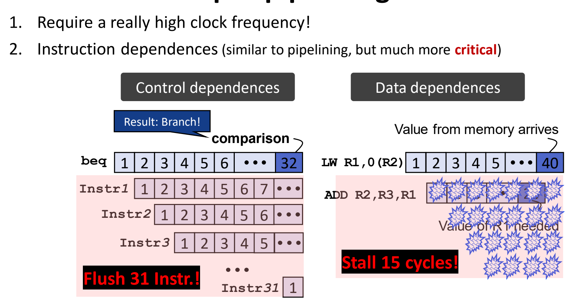

图：左侧 beq 到第 32 级才比较完、需冲刷 31 条指令；右侧 LW 的值第 40 级才到而 ADD 在第 25 级就需要，停顿 15 个周期。

**控制依赖**（control dependences）：设流水线有 32 级，`beq` 到第 32 级才完成比较（comparison），得出“要跳转（Result: Branch!）”。这时 Instr1 到 Instr31 已经依次进入第 1 到第 31 级。如果它们取自错误的路径（预测错误），这 **31 条指令全部要冲刷**（Flush 31 Instr.!）。一般地，分支在第 $k$ 级才得出结果时，误预测的冲刷条数是 $k-1$。[^l04-section-5-s2p40]

**数据依赖**（data dependences）：`LW R1,0(R2)` 从存储器读出的值到第 40 级才拿到（Value from memory arrives），紧随其后的 `ADD R2,R3,R1` 在第 25 级就需要 R1（Value of R1 needed）。转发最早也只能在值产生之后把它送过去，所以 `ADD` 必须等待。按图中的计数，等待 $40-25=15$ 个周期（Stall 15 cycles!）。[^l04-section-5-s2p40]

```asm
LW  R1, 0(R2)    # R1 的值在第 40 级才从存储器到达
ADD R2, R3, R1   # 第 25 级就需要 R1 → 即使转发也要停顿 15 个周期
```

在五级流水线里，级数少，结果产生的位置和需要使用的位置只差一两级，靠转发和把分支判断提前就能把代价压到很小（见 L03《08 控制冒险》及 L03 关于转发的内容）。到了深流水线，产生和使用之间隔着十几甚至几十级，**这些在五级流水线里有效的手段基本失效**。[^l04-section-5-s3b8] 这也是深流水线、超标量处理器格外依赖准确分支预测的原因，见[动态分支预测](#动态分支预测)。

> [!warning] 易错点
> 转发不能消除“值还没产生”造成的等待。它只能省掉“写回寄存器再读出”的那段时间。值在第 40 级才产生，第 25 级需要它的指令无论有没有转发都得等，转发能做的只是在值产生的那一刻立即送过去。

### 最优流水线级数

依赖代价随级数增长，而周期的缩短又受锁存器开销和级间均衡的限制，所以级数存在最优值。[^l04-section-5-s2p41]

- 最优级数**针对给定的体系结构及其指令集**而言；
- 同时**还要考虑负载特性**（workload characteristics）：分支多、依赖多的程序更怕深流水线。

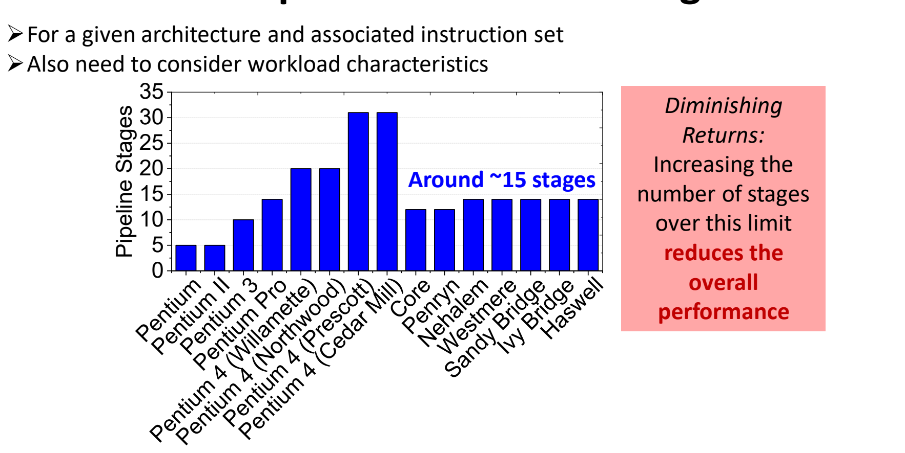

图：Pentium 4 系列超过 30 级后，Core 及以后回落到约 15 级，级数超过上限收益递减。

Intel 各代处理器的流水线级数（数据来源：Mateo Valero，“Runtime Aware Architectures”，HiPEAC CSW 2014）：Pentium、Pentium II 约 5 级，Pentium 3 约 10 级，Pentium Pro 约 14 级，Pentium 4（Willamette、Northwood）约 20 级，Pentium 4（Prescott、Cedar Mill）约 31 级。之后的 Core、Penryn 回落到约 12 级，Nehalem、Westmere、Sandy Bridge、Ivy Bridge、Haswell 稳定在约 14 级。结论是**大约 15 级**最合适。**收益递减**（diminishing returns）：级数超过这个界限后，整体性能反而下降。[^l04-section-5-s2p41]

> [!tip] 课堂强调
> 现在实验得出的结论是，各种负载特性决定了流水线深度大约在 14 到 16 级，平均 15 级，这么多年基本不变，已经是比较理想的深度；再加深，收益逐级降低，最后甚至会影响整体性能。[^l04-section-5-s3b8]

### 指令级并行的两条途径

加深流水线有上限，要继续提高性能就得换一个方向：让多条流水线同时工作。**多发射**（multi-issue）是指处理器每个周期能同时发射（issue，即送入执行）的指令数。现代处理器宣传性能时几乎都会提到自己是几发射，例如新一代处理器性能提升，常归因于支持了更多的发射。[^l04-section-5-s3b7]

**指令级并行**（Instruction-Level Parallelism，ILP）指同时执行多条指令的能力。它有两条途径：[^l04-section-5-s2p42]

1. **流水线操作**（pipelined operation）：同一时刻有多条指令在执行，但它们**处在不同的阶段**。例如一条指令在 EX1，前一条在 EX2，再前一条在 EX3。超流水线属于这条途径。
2. **并行操作**（parallel operation）：设置多条流水线（多套 EX1、EX2、EX3），每条独立执行一条指令，多条指令**在同一个时钟周期处于相同的阶段**。代表是**超标量**（superscalar）处理器和 **VLIW**（Very Long Instruction Word，超长指令字）处理器，二者理念不同。[^l04-section-5-s3b8]

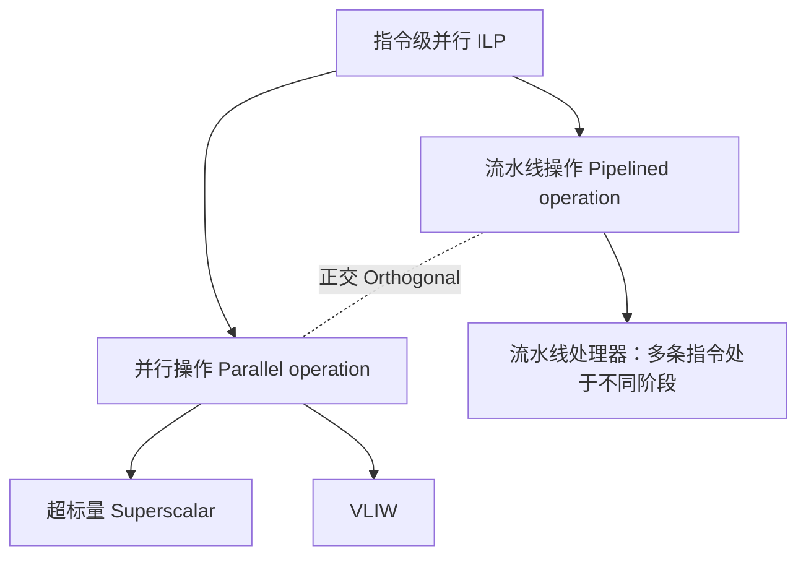

两条途径是**正交**（orthogonal）的，彼此不矛盾：每一条并行的通道本身可以是一条深流水线。所以几乎所有实际处理器都同时具备两者。[^l04-section-5-s2p42] 动态多发射的超标量见[超标量处理器](#超标量处理器)，静态多发射的 VLIW 见[VLIW 与编译技术](#vliw-与编译技术)。

> [!question]- 自测：五级流水线各级延迟为 IF 0.8、ID 0.5、EX 1.0、MEM 0.9、WB 0.3 ns。把 EX 平分成两个 0.5 ns 的子级、变成六级后，加速比（相对单周期）从多少变为多少？
> 从 3.5 变为约 3.89。单周期周期为 $0.8+0.5+1.0+0.9+0.3=3.5$ ns。五级时周期为最长的 EX 1.0 ns，加速比 $3.5/1.0=3.5$。拆分后各级为 0.8、0.5、0.5、0.5、0.9、0.3 ns，最长一级变成 MEM 0.9 ns，加速比 $3.5/0.9\approx3.89$，远不到理想的 6：拆开最慢的一级后，瓶颈转移到次慢的一级。（忽略锁存器开销。）

> [!question]- 自测：某深流水线在第 20 级完成分支比较，另一条 `LW` 的数据第 18 级才到，而紧随其后、依赖它的指令第 12 级就要用。按上面的计数方法，误预测冲刷几条指令？数据依赖停顿几个周期？
> 冲刷 $20-1=19$ 条：分支到第 20 级时，后面 19 条指令已经分别处在第 1 到第 19 级。停顿 $18-12=6$ 个周期：值在第 18 级才产生，转发也无法提前提供。

> [!question]- 自测：一个 4 路超标量处理器，每条通道都是 15 级流水线。它利用的是哪一条 ILP 途径？
> 两条都用了。15 级流水线让同一通道里的指令处于不同阶段（流水线操作）；4 条通道让 4 条指令在同一周期处于相同阶段（并行操作）。两者正交，可以叠加。

> [!info]- 来源
> - L04.pdf：PDF p.35–42
> - L04.docx：DOCX body 205–253

[^l04-section-5-s2p35]: L04.pdf-PDF p.35
[^l04-section-5-s3b7]: L04.docx-DOCX body 205-231
[^l04-section-5-s2p37]: L04.pdf-PDF p.37
[^l04-section-5-s3b8]: L04.docx-DOCX body 232-253
[^l04-section-5-s2p38]: L04.pdf-PDF p.38
[^l04-section-5-s2p39]: L04.pdf-PDF p.39
[^l04-section-5-s2p40]: L04.pdf-PDF p.40
[^l04-section-5-s2p41]: L04.pdf-PDF p.41
[^l04-section-5-s2p42]: L04.pdf-PDF p.42

---

## 超标量处理器

> [!abstract] 本节要点
> - 超标量是**动态**多发射处理器：同一周期能发射并完成多条指令，哪几条一起执行由硬件在运行时决定；$N$ 路超标量每周期最多发射 $N$ 条。
> - 理想情况下所有指令相互独立，加速比为 $N$；如果指令全部相关，超标量就退化成普通流水线，没有加速。核心问题是找出独立指令。
> - 执行策略由**发射顺序**和**完成顺序**刻画，两者都可以是顺序或乱序。乱序的前提是：最终结果必须与严格顺序执行完全一致。
> - 六条指令的例子中：顺序发射加顺序完成需要 8 个周期；编译器交换 I3 和 I6 后需要 6 个周期；乱序发射加乱序完成在第 6 个周期只剩一条写回（“五个半周期”），效果最好。
> - 超标量要检查同时译码的指令之间、以及它们与在途指令之间的数据依赖（RAW、WAR、WAW 都要查）、控制依赖和资源依赖。朴素做法是在译码级比较寄存器后停顿；更好的手段有分支预测、循环展开、记分板、Tomasulo 寄存器重命名、保留站和 ROB，最后由 commit 保证结果正确。

### 超标量的定义与 N 路结构

[超流水线](#超流水线与指令级并行)靠把一级拆成多级来缩短周期，但级数有最优上限。另一条提高指令级并行的路是并排放置多条流水线，让每条流水线各自执行一条指令，这就是超标量。

**超标量处理器**（Superscalar Processor）是**动态多发射**（Dynamic Multiple Issue）处理器：每个时钟周期可以**发射**（issue）并**完成**（complete）多条指令，而且哪些指令同时执行由硬件在运行时决定。它由若干条并行工作的流水线组成，称为 **N 路超标量**（N-way Superscalar），每周期最多发射 $N$ 条指令。[^l04-section-6-s2p44] 典型代表有 IBM Power 3、Pentium 4、MIPS R10K、HP PA 8500。[^l04-section-6-s2p43] 今天能见到的处理器几乎都是超标量。[^l04-section-6-s3b8]

> [!info] 可视化资源
> [Wikipedia：Superscalar processor](https://en.wikipedia.org/wiki/Superscalar_processor) 用示意图对比超标量与流水线，并说明运行时依赖检查的硬件代价。

它和普通流水线的区别：

- **流水线**：多条指令同时在执行，但每条处在**不同**的阶段。
- **超标量**：同一个周期里，多条指令处在**同一个**阶段，例如同时译码、同时执行。

概念性的 N 路结构里，各流水级和单发射时一样（PC、指令存储器、寄存器堆、ALU、数据存储器、写回选择器），差别在于**存储状态的部件要增加端口，运算和选择部件要复制多份**。以两路为例：[^l04-section-6-s2p44]

1. **寄存器堆多端口**：两组读地址 A1、A2 / A4、A5，两组写地址 A3 / A6，对应读口 RD1、RD2 / RD4、RD5，写口 WD3 / WD6。同一周期能为两条指令各读两个源操作数、各写一个结果。
2. **数据存储器多端口**：仍是同一块存储器，但有两组地址（A1、A2）、两组读口（RD1、RD2）和两组写口（WD1、WD2），允许同一周期访问多组数据。
3. **多个 ALU、多组 mux**：每路一份运算器和写回选择器，流水线寄存器和连线也相应加宽。

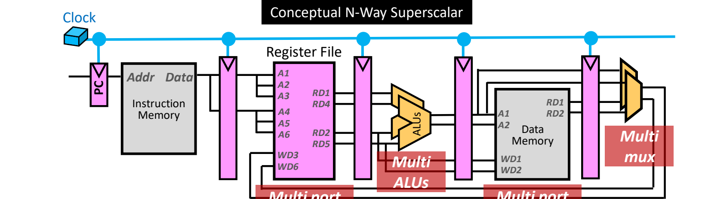

图：寄存器堆和数据存储器改为多端口，并配备多个 ALU 与多组选择器，使每周期可处理多条指令。

超流水线和超标量是**正交**的。[^l04-section-6-s2p45] 用时序图对比：超流水线把 Fetch、Decode、Execute 各拆成两级（F1/F2、D1/D2、E1/E2），每条指令比上一条晚半个原周期进入流水线，收益来自更高的频率；两路超标量则每个周期同时取指、译码、执行两条指令，收益来自并行执行。两者互不矛盾，实际处理器中通常同时采用。

### 理想加速比与依赖退化

超标量的收益取决于同一时刻真正能一起执行的指令有多少。

**超标量度**（Superscalarity）：$N$ 路超标量在理想情况下，即所有指令都相互独立时，加速比为 $N$。[^l04-section-6-s2p46] 反过来，如果所有指令都相互依赖，后一条必须等前一条的结果，多条流水线也只能错开执行。这时超标量带不来任何加速，执行效果和普通流水线一样。

> [!tip] 课堂强调
> 超标量的核心问题是保证同时执行的指令彼此独立。指令一旦有依赖，超标量就失去意义。[^l04-section-6-s3b8]

#### 例：数组求和的依赖分析

C 语句 `sum += a[i--]` 编译成如下循环。为简化，假设 load-use 依赖只需等一个周期。[^l04-section-6-s2p47]

```asm
loop: ld  $r2, 10($r1)     # $r2 <- a[i]
      add $r3, $r3, $r2    # sum += $r2
      sub $r1, $r1, 1      # i--
      bne $r1, $r0, loop   # i != 0 则继续
```

要两两检查哪些指令可以同时执行：

1. **ld 与 add**：add 读 ld 刚写的 `$r2`（RAW），不能并行。
2. **ld 与 sub**：ld 读 `$r1` 作为地址，sub 写 `$r1`（WAR），不能并行。
3. **sub 与 bne**：bne 读 sub 刚写的 `$r1`（RAW），不能并行。
4. **add 与 sub**：add 只涉及 `$r3`、`$r2`，sub 只涉及 `$r1`，彼此独立，**可以并行**。

所以这四条指令里只有 add 和 sub 能放进同一周期。[^l04-section-6-s3b9]在两路超标量的时序中，ld 单独执行，add 与 sub 同时执行，bne 在下一周期执行。四条指令的执行跨度为 3 个周期，单发射流水线需要 4 个周期。超标量本身的设计并不复杂，难点在于**找出独立指令**，并避免依赖带来的影响。实际中这项工作由**编译器**和**处理器硬件**完成。

### 发射顺序与完成顺序

并行执行能力由什么决定？[^l04-section-6-s2p48]

- **A. 并行流水线的数量与性质**：硬件能同时执行几条指令、各功能单元能做什么。
- **B. 处理器找出独立指令的机制**：能找到多少可以并行的独立指令，就有多少并行度。找不到，超标量就和传统流水线一样。

找到的独立指令在程序里未必相邻，可能分散在不同位置，这就涉及执行顺序。执行策略由两个因素刻画：

- **发射顺序**（issue order）：指令送去执行的次序，可以是**顺序**（in-order）或**乱序**（out-of-order）。
- **完成顺序**（completion order）：指令把结果写入寄存器和存储器的次序，同样可以是顺序或乱序。**完成**指结果写入寄存器和存储器的时刻。[^l04-section-6-s2p48]

严格按程序顺序执行和完成，几乎没有并行的机会。为了提高并行度，超标量必须**向前看**（look ahead），在后面的指令里找独立指令提前执行。指令可以按不同于严格顺序的次序执行，但有一条约束，即**结果必须与严格顺序执行的结果完全一致**。[^l04-section-6-s2p49]

> [!tip] 课堂强调
> 后面讨论的所有乱序技术都以这一点为前提：不管以什么次序执行，最终结果都必须与严格顺序执行完全相同，处理器才不会出错。[^l04-section-6-s3b9]

### 执行策略示例：顺序、编译重排与乱序

用同一段六条指令比较不同策略的效果。[^l04-section-6-s2p50]

```asm
I1: ADDF R12, R13, R14   # R12 <- R13 + R14（浮点）
I2: ADD  R1,  R8,  R9    # R1  <- R8 + R9
I3: MUL  R4,  R2,  R3    # R4  <- R2 * R3
I4: MUL  R5,  R6,  R7    # R5  <- R6 * R7
I5: ADD  R10, R5,  R7    # R10 <- R5 + R7
I6: ADD  R11, R2,  R3    # R11 <- R2 + R3
```

约束条件：

- I1 在 ADDF 单元上需要 **2 个周期**执行。
- I3 与 I4 争用同一个功能单元（MUL 单元）。
- I5 需要 I4 产生的 `R5`，I4→I5 是**真数据相关**（RAW）。
- I2、I5、I6 争用同一个功能单元（ADD 单元）。

模型分三级：**Decode/Issue → Execute → Writeback/Complete**。每周期译码两条，写回级每周期可完成两条，有 ADDF、ADD、MUL 三个功能单元。比较两种策略：[^l04-section-6-s2p51]

- **策略 1：顺序发射 + 顺序完成**。指令按顺序执行时的次序发射，也按同样次序写回结果。
- **策略 2：乱序发射 + 乱序完成**。处理器在已译码的一组指令中向前看，只要程序执行正确，可以按任意次序发射其中任意指令。

#### 策略 1：顺序发射 + 顺序完成（8 个周期）

规则：一条指令不能先于它前面的指令发射；一条指令只有在前一条完成后才能完成。逐周期推演：[^l04-section-6-s2p53]

| 周期 | 译码/发射 | 执行：ADDF | 执行：ADD | 执行：MUL | 写回/完成 |
| --- | --- | --- | --- | --- | --- |
| 1 | I1、I2 | | | | |
| 2 | I3、I4 | I1 | I2 | | |
| 3 | I5、I6 | I1 | | | |
| 4 | | | | I3 | I1、I2 |
| 5 | | | | I4 | I3 |
| 6 | | | I5 | | I4 |
| 7 | | | I6 | | I5 |
| 8 | | | | | I6 |

推理要点：

1. I1、I2 在周期 2 开始执行。I1 要两个周期，I2 虽然一个周期就算完，也要等 I1，两者在周期 4 一起写回。
2. I3 要等 I1、I2 完成后才执行，即周期 4。I4 和 I3 争用 MUL 单元，推到周期 5。
3. I5 要 I4 的结果（真相关），在周期 6 执行。I6 与 I5 争用 ADD 单元，而且不能越过 I5，推到周期 7。
4. 写回逐条推进，I6 在周期 8 完成，共 **8 个周期**。

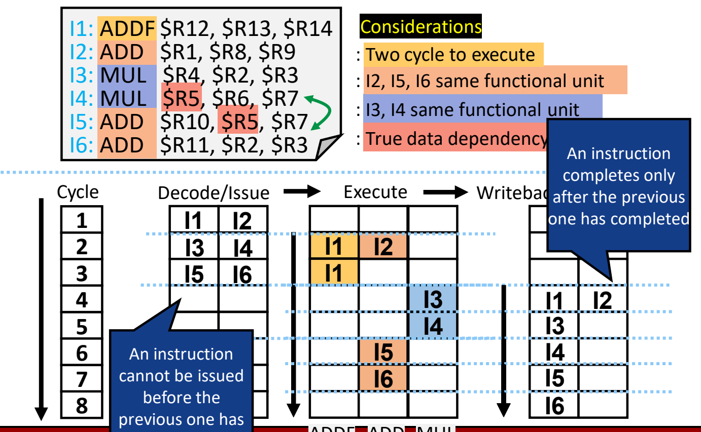

图：顺序发射 + 顺序完成时，六条指令共需 8 个周期，注意 I5 等待 I4、各指令按序写回。

在这种策略下，处理器只能靠**停顿**处理真数据相关和资源冲突。由于发射和完成都严格按序，能达到的并行度在很大程度上取决于**程序的写法和编译方式**。[^l04-section-6-s2p54]

#### 编译器重排：交换 I3 与 I6（6 个周期）

硬件不变，仍是顺序发射加顺序完成，改由软件静态优化：把 I3 和 I6 的位置对调，得到 I1、I2、I6、I4、I5、I3。I6 和 I3 与其他指令都没有数据相关，交换不影响结果。[^l04-section-6-s2p54]

| 周期 | 译码/发射 | 执行：ADDF | 执行：ADD | 执行：MUL | 写回/完成 |
| --- | --- | --- | --- | --- | --- |
| 1 | I1、I2 | | | | |
| 2 | I6、I4 | I1 | I2 | | |
| 3 | I5、I3 | I1 | | | |
| 4 | | | I6 | I4 | I1、I2 |
| 5 | | | I5 | I3 | I6、I4 |
| 6 | | | | | I5、I3 |

交换后 I6（ADD）和 I4（MUL）使用不同功能单元，可以在周期 4 并行；I5（ADD，等 I4 的 `R5`）和 I3（MUL）在周期 5 并行。总时间从 8 个周期降到 **6 个周期**。[^l04-section-6-s2p55]

#### 策略 2：乱序发射 + 乱序完成

恢复原始顺序 I1～I6，但允许乱序：[^l04-section-6-s2p57]

| 周期 | 译码/发射 | 执行：ADDF | 执行：ADD | 执行：MUL | 写回/完成 |
| --- | --- | --- | --- | --- | --- |
| 1 | I1、I2 | | | | |
| 2 | I3、I4 | I1 | I2 | | |
| 3 | I5、I6 | I1 | | I3 | I2 |
| 4 | | | I6 | I4 | I1、I3 |
| 5 | | | I5 | | I4、I6 |
| 6 | | | | | I5 |

1. **乱序发射**：I3 不必等 I1 执行完，MUL 单元在周期 3 空闲，I3 立即执行；I4 接着在周期 4 用 MUL。
2. **真相关仍要等**：I5 依赖 I4 的 `R5`，只能在 I4 之后的周期 5 执行。乱序允许把**独立的 I6** 提前到周期 4，填上 ADD 单元的空档。
3. **乱序完成**：I2 不必等 I1，周期 3 就写回；随后 I1、I3 在周期 4 写回，I4、I6 在周期 5 写回，I5 在周期 6 写回。

第 6 个周期只有 I5 一条写回，所以实际约为“五个半周期”，比编译器重排的完整 6 个周期还好。[^l04-section-6-s3b10]

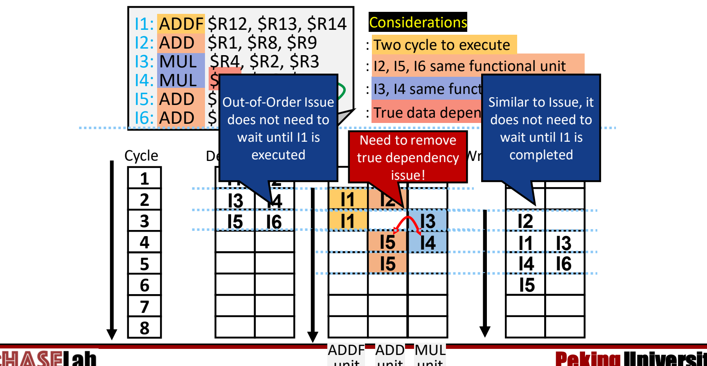

图：乱序发射与完成不必等待 I1，以写回栏为准读取各指令完成周期（执行栏第 4 周期的 I5 标注有误）。

> [!warning] 易错点
> 讲义 s2p57 原表执行栏 ADD 列在周期 4 和周期 5 都写着 I5，这与写回栏矛盾。I4 在周期 4 才执行，I5 不可能同时执行。按写回栏（周期 5 写回 I6，周期 6 写回 I5）推回去，周期 4 在 ADD 单元执行的应是 I6，I5 在周期 5 执行。红框“Need to remove true dependency issue!”说的正是 I4→I5 的真相关：乱序也不能越过它，要提高并行度，还得有专门的技术处理真相关。[^l04-section-6-s2p57]

> [!tip] 课堂强调
> 实际情况也是这样：硬件乱序调度的效果一般好于编译器的静态优化。[^l04-section-6-s3b10]

> [!question]- 自测：如果在策略 1 中把 I1 的执行时间改为 1 个周期，总周期数变成多少？
> 7 个周期。I1、I2 在周期 2 执行、周期 3 写回；I3 周期 3 执行、周期 4 写回；I4 争 MUL，周期 4 执行、周期 5 写回；I5 等 I4，周期 5 执行、周期 6 写回；I6 争 ADD 且不能越过 I5，周期 6 执行、周期 7 写回。整个流程只比原来提前 1 个周期，因为后面的串行瓶颈是 MUL 单元争用和 I4→I5 真相关。

### 超标量的挑战与解决手段

超标量的概念很简单，就是多条流水线同时工作，但依赖问题比单流水线严重得多：多条指令同时译码、同时执行，一处依赖会同时卡住几条通路。

依赖检查的范围包括两类指令：[^l04-section-6-s2p58]

- **同时译码**的指令之间；
- 与**已在流水线中**（例如之前已发射）的在途指令之间。

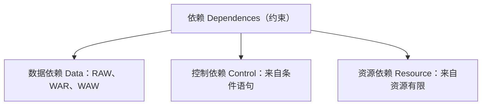

1. **数据依赖**（Data Dependence）：来自对同一数据的先后访问要求，分 RAW、WAR、WAW 三种。普通单发射流水线只需考虑 RAW，另外两种不会发生；超标量里三种都会出现，都要考虑。
2. **控制依赖**（Control Dependence）：来自条件语句（分支）。单流水线里已有，在超标量中影响更大，因为一次分支停顿会耽误多条通路的指令。
3. **资源依赖**（Resource Dependence）：来自资源有限，例如上例中争用同一个功能单元。超标量增加了额外部件，冲突的情形还会更多。

**朴素解法**：在译码级做比较，发现依赖就停顿：[^l04-section-6-s2p58]

1. 新指令的 Rs 与所有在途指令的目标寄存器比较；
2. 新指令的 Rt 与所有在途指令的目标寄存器**和**源寄存器比较；
3. 没有可用的硬件资源时停顿。

> [!note] 补充解释
> Rs 只作源操作数，所以只需与在途目标比较，检查 RAW。Rt 在一些指令里是源、在另一些指令里（例如 I 型指令）是目标，所以还要与在途的源寄存器比较，以覆盖 WAR，与目标比较则覆盖 RAW 和 WAW。

全部停顿当然能保证正确，但会带来**更长的延迟**，而超标量的收益恰恰来自找到并利用独立指令。处理依赖、尤其是与在途指令之间的依赖，有一组更好的解决方案：[^l04-section-6-s2p59]

| 问题 | 解决手段 |
| --- | --- |
| 控制依赖 | 静态调度中的循环展开（见[循环展开基本思想](#vliw-与编译技术)）；分支预测（见[动态分支预测](#动态分支预测)） |
| 数据依赖 | 记分板（Scoreboard）；静态调度（见[静态调度与动态调度](#静态调度与编译优化)）；Tomasulo 算法的硬件寄存器重命名 |
| 指令顺序约束（乱序执行仍保证结果正确） | 保留站（Reservation Station）；重排序缓冲（Reorder Buffer, ROB） |
| 出错时如何处理 | 异常处理（Exception Handling），本课程不讲 |

### 超标量整体架构

把前面的部件组合起来，就是一个更完整的超标量处理器。[^l04-section-6-s2p60] 数据从左到右流动：

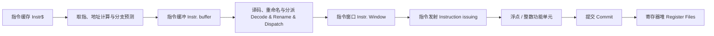

1. **取指、地址计算与分支预测**（Fetch & Addr. Calc. & Branch pred.）：从指令缓存持续取指、算地址、做分支预测，不断把指令填进指令缓冲。
2. **指令缓冲**（Instruction Buffer）：必须**保持充满**。缓冲里有足够多的指令，后级才有指令可挑、可调度；缓冲空了，调度就无从做起。
3. **译码、重命名与分派**（Decode & Rename & Dispatch）：译码后做寄存器重命名，再把指令分派出去。重命名的原理在下节课讲（编译层面的重命名见[寄存器重命名](#静态调度与编译优化)）。
4. **指令窗口**（Instruction Window）：一个宽泛的名称，不同架构里对应的具体模块不同，可能是队列、保留站或其他结构，作用都是暂存待执行指令的信息。
5. **指令发射**（Instruction Issuing）：从窗口中挑出指令，送到浮点单元、整数单元等功能单元，访存则与存储器交互。
6. **提交**（Commit）：处理器内部的“保险”。执行过程是乱序的，commit 保证最终结果正确；提交之后才把数据写入寄存器堆或存储器。

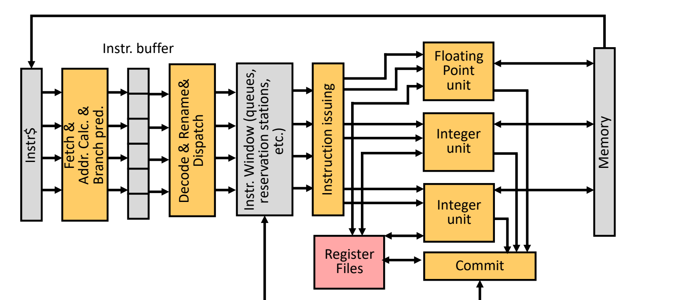

图：指令从指令缓存经取指与分支预测、指令缓冲、译码重命名分派、指令窗口、发射进入各功能单元，最后经提交写回寄存器堆与存储器。

图中功能单元为一个浮点单元和两个整数单元。

### 早期超标量处理器

早期产品已经具备上述特征：[^l04-section-6-s2p61]

- **PowerPC 6XX**：六个独立执行单元，即一个分支执行单元、一个 load/store 单元、三个整数单元、一个浮点单元；支持乱序发射。
- **Pentium I**：三个独立单元。
- **Pentium II**：乱序执行，每周期可发射五条指令。

> [!tip] 课堂强调
> 这里的“乱序”指**执行过程**乱序：指令的计算可以不按程序顺序进行，而发射过程本身常常仍是顺序的。[^l04-section-6-s3b11]

> [!question]- 自测：一个两路超标量每周期译码两条指令。当前正在译码 `ADD R1, R2, R3` 和 `SUB R2, R4, R5`，流水线中有一条在途指令 `MUL R4, R6, R7` 尚未写回。请找出所有依赖，并说明哪种在单发射流水线里不必担心。
> SUB 写 R2 而 ADD 读 R2：同时译码的两条之间存在 WAR。SUB 读 R4 而在途的 MUL 写 R4：与在途指令之间存在 RAW。单发射流水线按序读、按序写，WAR 不会造成错误；超标量里两条指令可能同时或乱序执行，必须检查 WAR，否则 SUB 可能先写 R2，让 ADD 读到错误的值。

> [!question]- 自测：把循环中的 `add $r3, $r3, $r2` 换成与 ld 无关的 `add $r4, $r4, $r5`，在两路超标量上，四条指令的执行跨度能缩到 2 个周期吗？
> 不能，仍是 3 个周期。ld 与 add 现在独立，可以同周期执行，但 ld 与 sub 仍因 `$r1` 冲突不能并行，sub→bne 仍是 RAW。于是只能排成（ld, add）→ sub → bne。瓶颈是 ld→sub→bne 这条依赖链，而不是两路发射的宽度。

> [!info]- 来源
> - L04.pdf：PDF p.43–61
> - L04.docx：DOCX body 232–326

[^l04-section-6-s2p44]: L04.pdf-PDF p.44
[^l04-section-6-s2p43]: L04.pdf-PDF p.43
[^l04-section-6-s3b8]: L04.docx-DOCX body 232-253
[^l04-section-6-s2p45]: L04.pdf-PDF p.45
[^l04-section-6-s2p46]: L04.pdf-PDF p.46
[^l04-section-6-s2p47]: L04.pdf-PDF p.47
[^l04-section-6-s3b9]: L04.docx-DOCX body 254-279
[^l04-section-6-s2p48]: L04.pdf-PDF p.48
[^l04-section-6-s2p49]: L04.pdf-PDF p.49
[^l04-section-6-s2p50]: L04.pdf-PDF p.50
[^l04-section-6-s2p51]: L04.pdf-PDF p.51
[^l04-section-6-s2p53]: L04.pdf-PDF p.53
[^l04-section-6-s2p54]: L04.pdf-PDF p.54
[^l04-section-6-s2p55]: L04.pdf-PDF p.55
[^l04-section-6-s2p57]: L04.pdf-PDF p.57
[^l04-section-6-s3b10]: L04.docx-DOCX body 280-303
[^l04-section-6-s2p58]: L04.pdf-PDF p.58
[^l04-section-6-s2p59]: L04.pdf-PDF p.59
[^l04-section-6-s2p60]: L04.pdf-PDF p.60
[^l04-section-6-s2p61]: L04.pdf-PDF p.61
[^l04-section-6-s3b11]: L04.docx-DOCX body 304-326

---

## VLIW 与编译技术

> [!abstract] 本节要点
> - VLIW 是**静态**多发射：哪些指令同时发射由编译器在编译时决定；超标量则由硬件在运行时动态决定。代表产品是 Intel Itanium（IA-64，EPIC），只有服务器版本。
> - 一条 VLIW 长指令由多条相互独立的子指令打包而成，每个槽位对应一个特定功能单元；凑不满的槽位填 nop。
> - TinyRV1 VLIW 的 F/D/W 宽度为 4，含 4 周期 Y 管（mul）、1 周期 X 管（add）、2 周期 L 管（lw）、2 周期 S 管（sw）；硬件不做冒险检查，各管在写回前同步。
> - 循环展开一次做 $M$ 次迭代，减少分支、暴露 ILP，代价是代码增长且不处理跨迭代依赖；谓词执行把控制依赖转成数据依赖，错误路径只变成 nop、不冲刷流水线，但误预测代价小于其开销时反而更慢。
> - VLIW 硬件简单、可能更省电、易扩展；缺点是编译器负担重、锁步执行、二进制不兼容、程序存储带宽需求大、代码膨胀。四种架构的关键问题依次是：CISC 译码复杂度、RISC 数据转发与冒险、超标量硬件依赖解析、VLIW 编译器代码调度。

### 超长指令字（VLIW）

超标量在运行时用硬件检查依赖、决定一拍发射哪几条指令（见[超标量处理器](#超标量处理器)），这套检查逻辑随发射宽度增加而迅速变复杂。VLIW 的思路相反：既然编译器能看到整个程序，就让它在编译时把可以并行的指令找好、排好，硬件只管照着执行。

**超长指令字**（Very Long Instruction Word, VLIW）处理器是**静态多发射处理器**（static multiple-issue processor）：并行发射的决策在编译时由编译器做出。[^l04-section-7-s2p62] 它有三条结构约定：[^l04-section-7-s2p63]

1. 多条**子指令**（sub-instruction）可以打包成一条长指令；
2. 同一条长指令内的子指令**必须**相互独立；
3. 长指令中的每个**槽位**（slot）对应一个特定的功能单元。

其核心思想是：用新的 ISA 取代传统的顺序 ISA，使编译器能把指令级并行（ILP）**直接编码在软硬件接口中**。[^l04-section-7-s2p63] 传统顺序 ISA 只告诉硬件"按这个顺序做"，并行性要靠硬件自己去挖；VLIW ISA 的一条指令本身就写明"这几件事同时做"。

> [!info] 可视化资源
> [Wikipedia：Very long instruction word](https://en.wikipedia.org/wiki/Very_long_instruction_word) 对比了编译器调度的 VLIW 与硬件调度的超标量，并介绍 IA-64/EPIC 中的谓词执行。

最典型的 VLIW 处理器是 Intel Itanium 系列，采用 IA-64 指令集，Intel 称之为 **EPIC**（Explicit Parallel Instruction Computer，显式并行指令计算）。[^l04-section-7-s2p62] Itanium 只有服务器版本，没有笔记本或台式机版本：普通桌面程序和程序员几乎不会专门为它做优化，在它上面跑这类程序效果很差。[^l04-section-7-s3b11]

> [!tip] 课堂强调
> 超标量与 VLIW 的关键词对比：超标量是**动态**的，在执行过程中由硬件做乱序调度与发射；VLIW 是**静态**的，调度在编译时完成。[^l04-section-7-s3b11]

#### 从 C 程序到 VLIW 执行

以循环 `for(i=0;i<n;i++) dest[i]=src[i]*coeff;` 为例，编译与执行流程如下：[^l04-section-7-s2p63]

1. **找出独立操作**（find independent operations）：编译器分析各操作之间的依赖关系，区分哪些可以同时执行、哪些必须先后执行；
2. **调度操作**（schedule operations）：有依赖的操作分到不同时刻，彼此无关的操作安排到同一时刻；
3. **打包成 VLIW 指令**：把同一时刻、彼此独立的操作装进同一条长指令；某一时刻剩下的操作不够填满所有槽位时，空槽位用**空操作**（nop）填充；
4. **直接执行**（direct execution）：VLIW 处理器依次取出每条长指令，按槽位把子指令送进对应功能单元，不再做任何依赖分析。


这样，两两无依赖的操作被装进同一条长指令，最后剩下的一条操作与一个空槽一起组成最后一条长指令。[^l04-section-7-s3b11]

### TinyRV1 VLIW 处理器

具体看一台 VLIW 机器的硬件长什么样，以及"硬件简单、软件困难"体现在哪里。

**TinyRV1 VLIW** 仍有取指 F、译码 D、写回 W 三个公共阶段，但这三段的宽度都是 4，即一次处理一条含 4 条子指令的长指令。执行部分分成 4 条流水线，每个槽位固定对应一条：[^l04-section-7-s2p64]

| 槽位 | 功能单元 | 典型子指令 | 执行延迟 |
| --- | --- | --- | --- |
| Y-pipe | 乘法（乘除类） | `mul x1,x2,x3` | 4 周期（Y0–Y3） |
| X-pipe | 加法等 ALU 运算 | `add x4,x1,x5` | 1 周期（X0） |
| L-pipe | 取数 | `lw x6,0(x7)` | 2 周期（L0–L1） |
| S-pipe | 存数 | `sw x6,0(x8)` | 2 周期（S0–S1） |

例如一条 VLIW 指令就是 `mul x1,x2,x3 | add x4,x1,x5 | lw x6,0(x7) | sw x6,0(x8)` 四条子指令拼在一起。

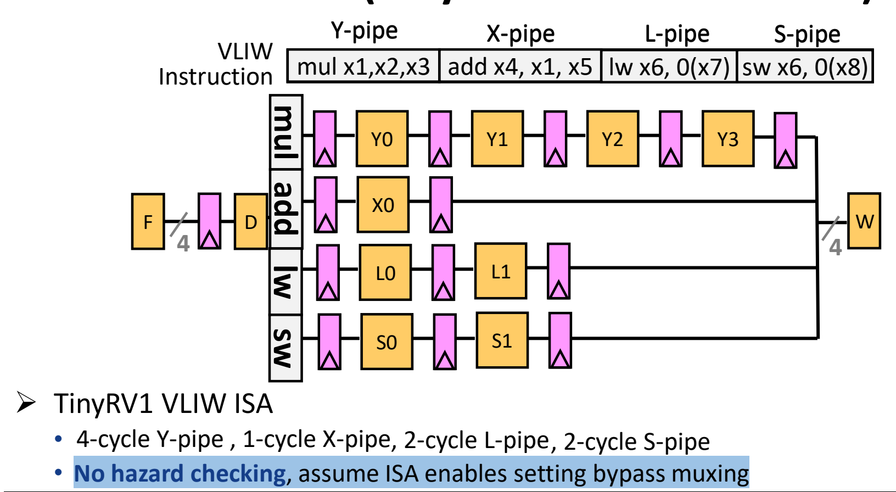

图：一条 VLIW 指令含 mul/add/lw/sw 四个槽，分别进入 4 周期 Y 管、1 周期 X 管、2 周期 L 管和 2 周期 S 管，最后汇合写回。

执行一条长指令的过程：

1. **取指与译码**：F、D 一次处理整条长指令（4 条子指令）。
2. **分槽执行**：4 条子指令同时进入 Y、X、L、S 四条不同的流水线。
3. **写回前同步**：短的流水线不会提前写回，而是等待最长的 Y 管完成。X 管只执行 1 个周期，却要再等 3 个周期；L 管、S 管执行 2 个周期，要再等 2 个周期。[^l04-section-7-s3b11]
4. **统一写回**：4 条子指令一起通过 W 更新寄存器。

硬件的第二个特点是**不做冒险检查**（no hazard checking），并假设 ISA 能够设定旁路多路选择器（bypass muxing）。[^l04-section-7-s2p64] 也就是说，L03 所讲五级流水线中的冒险检测与转发控制逻辑，在这里都没有：

- 同一条长指令内部，编译器已保证子指令彼此独立，硬件默认它们可以无条件并行；
- 依赖只可能出现在**不同的** VLIW 指令之间，同样由编译器负责处理，必要时插入额外的停顿（例如插入整条 nop 长指令）。[^l04-section-7-s3b11]

> [!note] 补充解释
> 上面这条长指令中 `add x4,x1,x5` 读的 `x1` 正是同一束里 `mul` 写的寄存器，`sw` 存的 `x6` 也是同束 `lw` 写的寄存器。按常见的 VLIW 语义，同一束的子指令在译码时一起读寄存器、在写回时一起写寄存器，所以束内的 `add` 读到的是 `mul` 执行**之前**的 `x1` 旧值，两者并不构成束内依赖。若程序确实需要 `mul` 的新结果，编译器必须把 `add` 放到后面的长指令里。

#### 难点在软件

处理器本身几乎没有设计难度，难的是编译器和写代码的人：要把 4 条彼此独立、而且类型恰好匹配 Y/X/L/S 四个槽位的子指令凑到一起，难度很大，程序员也得尽量往这个方向写代码。[^l04-section-7-s3b11]

> [!example] 例：程序里全是加法
> 设某段程序只有一串相互独立的 `add`，在 TinyRV1 VLIW 上如何执行？
>
> 1. 每条长指令只有 X 槽能放 `add`，Y、L、S 三个槽都只能填 nop；
> 2. 程序照样能正确运行，但每条长指令只有 $\frac{1}{4}$ 的槽位在做有用的事；
> 3. 其余 $\frac{3}{4}$ 的功能单元空转，nop 还白白占用指令存储空间。

> [!example] 例：`dest[i]=src[i]*coeff` 的一次迭代
> 一次迭代需要 `lw`（取 `src[i]`）→ `mul`（乘 `coeff`）→ `sw`（存 `dest[i]`），三者形成依赖链。
>
> 1. `mul` 依赖 `lw` 的结果，`sw` 依赖 `mul` 的结果，所以三者不能放进同一条长指令，只能分别放在先后三条长指令里；
> 2. 每条长指令只用到 1 个槽位，其余 3 个填 nop，槽位利用率只有 $\frac{1}{4}$；
> 3. 要填满槽位，就得让不同迭代的操作互相交错，例如把下一次迭代的 `lw` 和本次的 `mul` 放在同一束。这正是下面循环展开等编译技术要做的事。

> [!warning] 易错点
> "VLIW 不需要冒险检测"不等于"VLIW 程序没有依赖"。依赖仍然存在，只是从硬件转给了编译器：束内由编译器保证独立，束间由编译器安排足够的间隔。编译器排错了，硬件不会兜底。

### VLIW 的编译技术

VLIW 的性能完全取决于编译器能否找到足够多的独立指令。软件需要回答两个关键问题：[^l04-section-7-s2p65]

1. 如何找出可以一起取指、执行的独立指令？
2. 如何让编译器能做更多优化？

对应的关键思路有三类：[^l04-section-7-s2p65]

- **消除控制流**（get rid of control flow）：谓词执行、循环展开；
- **优化高频执行路径**：踪迹调度（trace scheduling）；
- 其他：软件流水（software pipelining）。

这些技术并不只服务于 VLIW，一般的编译优化同样会用到。本讲只讲循环展开的基本思想和谓词执行；踪迹调度和软件流水留到后续课程。[^l04-section-7-s3b12]

#### 循环展开（Loop Unrolling）

普通循环每执行一次循环体就要跟一条分支来判断是否跳回，而分支（控制依赖）把循环体切成一小段一小段，编译器很难跨分支找独立指令。

**循环展开**的基本思想是：把循环展开，使一次循环执行 $M$ 次原来的迭代。[^l04-section-7-s2p66] 以 `B[i] = A[i] + C` 展开 4 次为例：

```c
// 原始 C 代码
for (i = 0; i < N; i++)
    B[i] = A[i] + C;

// 展开 4 次后的 C 代码
for (i = 0; i < N; i += 4) {
    B[i]   = A[i]   + C;
    B[i+1] = A[i+1] + C;
    B[i+2] = A[i+2] + C;
    B[i+3] = A[i+3] + C;
}
```

收益有两点：

1. **分支变少**：原来每做一次 `B[i]=A[i]+C` 就判断一次分支，展开后连续做 4 次才判断一次，分支数降为约 $\frac{1}{4}$；
2. **暴露更多 ILP**：循环体内 4 条语句之间没有分支隔开，而且相互独立，编译器可以把它们的 load、add、store 分别打包进同一批长指令。[^l04-section-7-s2p66]

局限也有两点：[^l04-section-7-s2p66]

- **代码增长**：循环体被复制了 $M$ 份；
- **不处理跨迭代依赖**（inter-iteration dependence）：若第 $i+1$ 次迭代要用第 $i$ 次的结果（例如 `A[i+1] = A[i] + C`），展开后的几条语句仍是串行依赖，展开本身无法让它们并行。

上面的展开写法默认 $N$ 是 4 的倍数。展开的具体实现、寄存器使用以及迭代次数不是展开倍数整数倍时的处理，见[静态调度与编译优化](#静态调度与编译优化)。

#### 谓词执行（Predicated Execution）

分支预测器对规律性强的分支很准，但遇到难以预测的分支，误预测就要冲刷流水线。对 VLIW 来说，长指令以锁步方式执行，分支更是难以处理。

**谓词执行**的关键思想是：把**控制依赖**（control dependence）转换成**数据依赖**（data dependence），从而消除难以预测的分支。[^l04-section-7-s2p67]

以如下代码为例：

```c
if (cond) {
    b = 0;
} else {
    b = 1;
}
```

它的控制流图是：基本块 A 计算条件并分支；条件成立（T）走 C（`b = 0`），不成立（N）走 B（`b = 1`）；两路在 D 汇合。

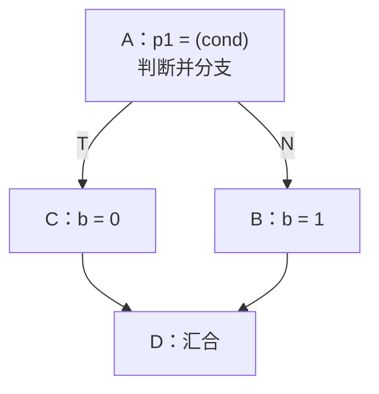

**普通分支代码**：

```text
A:      p1 = (cond)
        branch p1, TARGET    ; p1 为真则跳到 TARGET
B:      mov b, 1
        jmp JOIN
TARGET:
C:      mov b, 0
JOIN:
D:      ...
```

**谓词代码**：

```text
A:      p1 = (cond)
B:      (!p1) mov b, 1       ; 仅当 p1 为假时生效
C:      (p1)  mov b, 0       ; 仅当 p1 为真时生效
D:      ...
```

对比可见，谓词代码里没有 `branch` 和 `jmp`：每条指令前加了一个**谓词**前缀，原来"跳到哪里执行"的控制关系，变成了"B、C 依赖谓词寄存器 `p1` 的值"这一数据关系，程序从跳转变成了顺序执行。[^l04-section-7-s2p67] 剩下要解决的是谓词前缀本身，这由硬件支持：B、C 两条指令都可以进入流水线并行处理，到快要执行完时再根据 `p1` 判断各自是否真正生效，不该生效的那条直接作废。[^l04-section-7-s3b12]

#### 谓词执行与分支预测的比较

下面用 MICRO'06 Diverge-Merge Processor（DMP，UT-Austin）中的例子比较两种方式。程序是控制流图 A →（B 或 C）→ D → E → F，流水线各级依次为 Fetch、Decode、Rename、Schedule、RegisterRead、Execute。[^l04-section-7-s2p68]

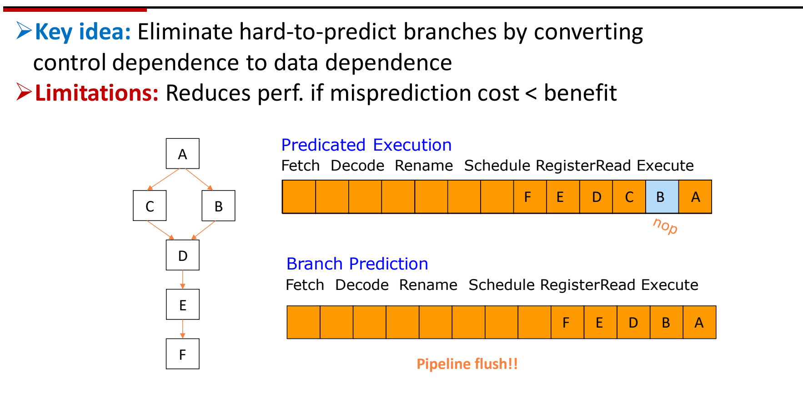

图：谓词执行把 B 变为 nop 继续流动，分支预测误预测时则要冲刷整条流水线。

图中流水线最右端是最早进入的指令。上方的谓词执行流水线里同时装着 A、B、C、D、E、F；下方的分支预测流水线只装着预测路径上的 A、B、D、E、F。

- **谓词执行**：B 和 C 两条路径的指令都进入流水线。A 执行完、得到条件结果后，发现 B 不该执行，只需把 B 变成 nop，后面的 C、D、E、F 照常流动，控制依赖就这样被自然化解。
- **分支预测**：先预测一条路径并只取这条路径的指令。图中假设预测不跳转，流水线里是 A、B、D、E、F。如果 A 执行后发现预测错了（本该走 C），整条流水线都要**冲刷**（pipeline flush），再从 C 重新取指，代价远大于"把一条指令变成 nop"。[^l04-section-7-s3b12]

因此，在控制流对性能影响很大、分支又难以预测时，谓词执行可以避免误预测带来的损失。它的局限是：**如果误预测代价小于谓词执行带来的开销，反而会降低性能**。[^l04-section-7-s2p68] 两条路径的指令都要占用流水线，错误路径的指令虽然最终作废，却白白消耗了取指和执行资源。

> [!tip] 课堂强调
> 上面的例子比较极端：B、C 各只有一条指令。真实程序中 B、C 往往各含多条指令，两路全部执行的开销会变大，收益不一定比分支预测好。所以分支预测并非一无是处，市面上大多数处理器仍然采用分支预测；谓词执行只在部分场景下有收益，需要根据具体情况选择。[^l04-section-7-s3b12]

> [!warning] 易错点
> 谓词执行不是"更好的分支预测"，它根本不预测：两条路径都执行，只是让其中一条的结果不生效。它省掉的是误预测时的冲刷，付出的是错误路径指令占用的流水线资源。分支越难预测、两条路径越短，谓词执行越划算。

### VLIW 的优点与缺点

VLIW 把复杂性从硬件转给编译器，好处和坏处都源于这一点。[^l04-section-7-s2p69]

**优点**：

1. **硬件更简单**：不需要转发控制和冒险检测逻辑，功耗可能更低，这也是服务器青睐这种设计的原因。
2. **可能更容易扩展**：每个 VLIW 束（bundle）可以容纳更多指令，也可以加入更多功能单元。理论上只要不考虑编译器的难度，就可以把指令字做得很长，一次并行做很多事。

**缺点**：

1. **程序员 / 编译器复杂度高，编译时间长**：这是最大的问题。编译器优化做不好，VLIW 的效果就基本体现不出来。
2. **深流水线和长延迟难以把握**：峰值性能很难达到。
3. **锁步执行**（lock step operation）：一旦出现冒险，后续所有发射都要停顿，直到冒险解决。所有子指令必须同步前进，出了问题唯一能做的就是停顿，所以需要谓词执行来消除分支。
4. **目标代码（二进制）不兼容**：编译器是针对具体处理器的功能单元配置（例如 Y/X/L/S，或 Y/Y/L/S）来排槽位的。换一款处理器，硬件配置一变，原来的二进制就无法使用，所有程序都得重新编译。
5. **需要大量程序存储带宽**：以前每次取一条指令就是一条，现在每取一条长指令就包含 3～4 条子指令，取指带宽需求随之升高。
6. **代码膨胀**（code bloat）：凑不满的槽位填 nop，浪费程序存储空间；为了暴露更多 ILP 而做的循环展开也会占用更多程序存储空间。[^l04-section-7-s3b13]

> [!tip] 课堂强调
> VLIW 之所以不适合放进笔记本或台式机，根本原因是现有的桌面程序和程序员没办法为它做优化：要凑满 Y、X、L、S 四类互不依赖的子指令非常难，实际中长指令里往往塞满了 nop。[^l04-section-7-s3b12]

### CISC、RISC、超标量与 VLIW 对比

四种架构可以从指令格式、寄存器、访存方式和各自要解决的关键问题来比较：[^l04-section-7-s2p70]

| | CISC | RISC | 超标量（Superscalar） | VLIW |
| --- | --- | --- | --- | --- |
| 指令长度 | 可变 | 固定 | 固定 | 固定（但很长） |
| 指令格式 | 可变 | 固定 | 固定 | 固定 |
| 寄存器 | 少，部分为专用寄存器 | 多个通用寄存器（GP） | 通用寄存器 + 重命名（RUU） | 非常多的通用寄存器 |
| 访存方式 | 嵌入在许多指令中 | load/store | load/store | load/store |
| 关键问题 | 译码复杂度 | 数据转发、冒险 | 硬件依赖解析 | （编译器）代码调度 |

关键问题一行是该架构最突出的困难，后面的架构同样会遇到前面的问题：CISC 独有的困难是译码复杂；RISC 要处理数据转发和冒险；超标量除了这些，还要用硬件解析多条同时发射指令之间的依赖，依赖问题更严重；VLIW 则把依赖处理全部交给编译器，对代码调度的要求很高。[^l04-section-7-s3b13]

四种架构的指令流水也不同：[^l04-section-7-s2p70]

- **RISC**：每个周期进入一条指令，各自经历 IF、ID、EX、M、WB，依次错开一个周期；
- **超标量**：每个周期进入两条指令，两条指令各自拥有完整的 IF、ID、EX、M、WB；
- **VLIW**：每个周期只取指、译码**一条**长指令（一组 IF、ID），到 EX、M、WB 时才拆成多条子指令，分别在不同功能单元上执行。

超标量的发射与依赖检查机制见[超标量处理器](#超标量处理器)，静态调度与动态调度的系统比较见[静态调度与编译优化](#静态调度与编译优化)。

> [!question]- 自测：TinyRV1 VLIW 上一条长指令的 X 槽是 `add`，其余三槽是 nop。这条 `add` 的结果从进入执行到写回经过几个执行周期？为什么不是 1 个？
> 4 个执行周期后才写回。X 管只需 1 个周期，但各子指令在写回前同步，必须等最长的 4 周期 Y 管完成，所以 X 管的结果要再等 3 个周期才和其他槽一起写回。

> [!question]- 自测：对 `for (i=0;i<100;i++) B[i]=A[i]+C;` 展开 4 次，循环分支执行次数如何变化？若循环体改为 `A[i+1]=A[i]+C;`，展开还能暴露同样多的 ILP 吗？
> 分支执行次数从 100 次降为 25 次。改成 `A[i+1]=A[i]+C` 后，每次迭代都依赖上一次的结果（跨迭代依赖），展开后的 4 条语句仍是串行链，不能放进同一条长指令。分支虽然减少了，ILP 却没有增加，这正是循环展开"不处理跨迭代依赖"的局限。

> [!question]- 自测：某 `if-else` 分支几乎总是同一个方向，而且两个分支各有 20 条指令。应把它改成谓词执行吗？
> 不宜。分支方向稳定，预测器几乎不会误预测，冲刷代价很小；改成谓词执行后，每次都要让两路共 40 条指令流经流水线，其中 20 条最终作废。误预测代价小于谓词执行的开销，性能反而下降。

> [!info]- 来源
> - L04.pdf：PDF p.62–70
> - L04.docx：DOCX body 304–373

[^l04-section-7-s2p62]: L04.pdf-PDF p.62
[^l04-section-7-s2p63]: L04.pdf-PDF p.63
[^l04-section-7-s3b11]: L04.docx-DOCX body 304-326
[^l04-section-7-s2p64]: L04.pdf-PDF p.64
[^l04-section-7-s2p65]: L04.pdf-PDF p.65
[^l04-section-7-s3b12]: L04.docx-DOCX body 327-354
[^l04-section-7-s2p66]: L04.pdf-PDF p.66
[^l04-section-7-s2p67]: L04.pdf-PDF p.67
[^l04-section-7-s2p68]: L04.pdf-PDF p.68
[^l04-section-7-s2p69]: L04.pdf-PDF p.69
[^l04-section-7-s3b13]: L04.docx-DOCX body 355-373
[^l04-section-7-s2p70]: L04.pdf-PDF p.70

---

## 静态调度与编译优化

> [!abstract] 本节要点
> - 数据依赖造成的停顿：单发射流水线主要是 load-use（RAW），另有无旁路、长延迟指令（乘除）；多发射时同一周期执行的指令之间不能有 RAW/WAR，WAW 也受限。
> - 指令调度分两类：**静态调度**在编译时完成，硬件简单但调度保守（VLIW 采用）；**动态调度**在运行时由硬件完成，硬件复杂但调度质量高。
> - $\text{执行时间} = IC \times CPI \times CCT$；编译器影响 $IC$ 和 $CPI$，不影响 $CCT$。常规优化主要减少 $IC$，面向 ILP 的优化主要降低 $CPI$。
> - 简单循环 `x[i]=x[i]+s` 朴素编译每次迭代 10 个周期（5 个停顿）；把 `SUBI` 提前、用 `SD` 填延迟分支槽并把偏移改为 8 后，只剩 1 个停顿。
> - 编译器有充足的分析时间、能看到全程序，但拿不到动态信息（分支行为、缓存缺失）；寄存器重命名、循环展开、函数内联能扩大调度空间，代价分别是寄存器压力和代码膨胀。

### 数据依赖停顿从哪里来

要缩短程序执行时间，L03 用了单发射流水线，本讲又用多发射（超标量）。两条路都绕不开数据依赖：后一条指令需要的值还没算出来，流水线就只能停下来等。[^l04-section-8-s2p72]

**单发射流水线**（L03）里，旁路（forwarding）已经消除了大多数 RAW 停顿，剩下的主要来源是：

1. **load-use（RAW）**：第一条是 load，第二条马上用它的结果，即使有旁路也要停一个周期（L03 讲过的 load-use 冒险）；
2. **没有旁路时**：每个 RAW 都要等到结果写回寄存器堆，停顿更多；
3. **长延迟指令**：乘法、除法等指令的执行要好几个周期，依赖它们的指令等待的时间也更长。

**多发射超标量**（本讲）里还要多一条约束，即**同一周期执行的几条指令之间不能有 RAW 或 WAR 依赖，WAW 也受限制**。[^l04-section-8-s2p72] 一个周期里塞进的指令越多，它们之间互相依赖的可能就越大，依赖关系也更复杂。三类依赖的定义和超标量里的朴素解法见[超标量三类依赖](#超标量处理器)。

### 静态调度与动态调度（Static / Dynamic Scheduling）

停顿是因为相互依赖的指令挨得太近。如果把彼此独立的指令插到中间，停顿的周期就能拿来做有用的工作。这就是**指令调度**（instruction scheduling）：在不改变程序结果的前提下重新排列指令的执行顺序。按调度发生的时间，它分成两类。[^l04-section-8-s2p73]

- **静态调度**（static scheduling）：在**编译时**，由编译器中的静态调度器（static scheduler）对未调度的程序重新排序，然后交给功能部件直接执行，运行时硬件不再调度。VLIW 就是这样做的（见[VLIW 编译关键问题](#vliw-与编译技术)）。
- **动态调度**（dynamic scheduling）：未调度的程序直接交给硬件，由处理器中的动态调度器（dynamic scheduler）在**运行时**决定执行顺序。

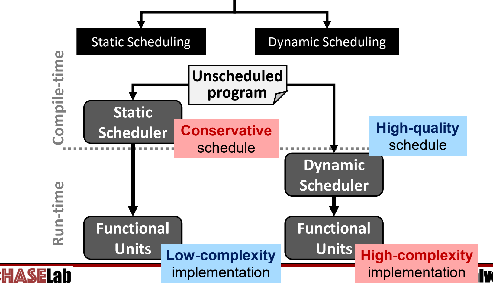

图：静态调度在编译时完成、硬件简单但调度保守；动态调度在运行时完成、调度质量高但硬件复杂。

两者的取舍：

| 维度 | 静态调度 | 动态调度 |
| --- | --- | --- |
| 调度时机 | 编译时（compile-time） | 运行时（run-time） |
| 硬件实现 | 低复杂度（low-complexity implementation） | 高复杂度（high-complexity implementation） |
| 调度质量 | 保守（conservative schedule） | 高质量（high-quality schedule） |
| 复杂度落在 | 编译器 | 硬件 |
| 代表 | VLIW | 乱序超标量 |

静态调度把复杂度从硬件转给了编译器，所以编译器本身会很复杂；又因为编译器不知道运行时的情况，只能按最坏情况排，所以调度偏保守。超标量上怎样实现动态调度（Tomasulo 算法等）是下一讲的内容，本节只讨论编译器能做的静态调度，也就是从编译器的角度为数据依赖重排指令。[^l04-section-8-s2p74]

### 编译器与编译优化的目标

**编译器**（compiler）把高级语言写成的程序翻译成目标语言中**等价**的程序，比如把 `ChaseLab.c` 中的 `printf("Yay!");` 翻译成机器码 `ChaseLab.exe`。[^l04-section-8-s2p75]

编译优化对性能的影响可能很大。Intel 2006 年在 Itanium 2（4 CPU）上的数据如下，以旧系统（legacy system，8 CPU）为基准 1x：[^l04-section-8-s2p76]

| 做法 | 相对性能 |
| --- | --- |
| 旧系统（8 CPU） | 1x |
| 原始源码，默认编译选项 | 1.2x |
| `-O3`，开启高级优化 | 2.5x |
| 加编译指示（compiler directives），少量修改源码 | 4x |
| 再加 OpenMP | 10x |

`-O3` 允许编译器对指令做更激进的重排；源码里加编译指示，相当于给编译器提示，让它能做更进一步的优化；OpenMP 则让程序在多核上并行执行。几层优化叠加起来，性能能提升 10 倍。

**编译优化**（compiler optimization）最常见的要求是**在结果必须正确的前提下，使程序的执行时间最短**。[^l04-section-8-s2p77] 执行时间可以分解为

$$
\text{Execution Time} = IC \times CPI \times CCT
$$

其中 $IC$（Instruction Count）是执行的指令条数，$CPI$（Cycles per Instruction）是平均每条指令的时钟周期数，$CCT$（Clock Cycle Time）是时钟周期长度。

1. **$CCT$**：由硬件电路和流水线划分决定，编译器**改变不了**。
2. **$IC$**：编译器可以减少它，**常规优化技术**（conventional optimization techniques）主要针对这一项。[^l04-section-8-s2p84]
3. **$CPI$**：编译器调整指令顺序后可以减少停顿、提高并行度，这就是**面向 ILP 的优化技术**（optimization techniques for ILP）。

> [!warning] 易错点
> 编译优化提升性能，靠的是减少 $IC$ 和 $CPI$，与 $CCT$ 无关。“编译器让时钟变快”的说法是错的。

### 控制流图与基本块（CFG / Basic Block）

编译器要知道哪些指令可以挪动、能挪到哪里，就需要把程序的控制结构显式表示出来。所以编译优化本质上是一个图问题。[^l04-section-8-s2p78]

**控制流图**（control flow graph, CFG）是编译优化过程的输入。它是一个有向图：

- 每个**节点**表示一条语句；
- **边**表示控制流，即执行完一条语句后可能转到哪条语句。

**基本块**（basic block）是一段**没有分支跳入、也没有分支跳出**的指令序列：一旦进入就从头顺序执行到尾。基本块内的语句之间不存在控制相关，因此可以合并成 CFG 的一个节点，图会简洁得多。[^l04-section-8-s2p78]

以下面的代码为例：

```c
x := a+b;
y := a*b;
while (y > a) {
    a := a+1;
    x := a+b;
}
```

按语句建图有 5 个节点：`x:=a+b`、`y:=a*b`、`y>a`、`a:=a+1`、`x:=a+b`，循环体末尾有一条边回到 `y>a`。合并基本块之后只剩 3 个节点：

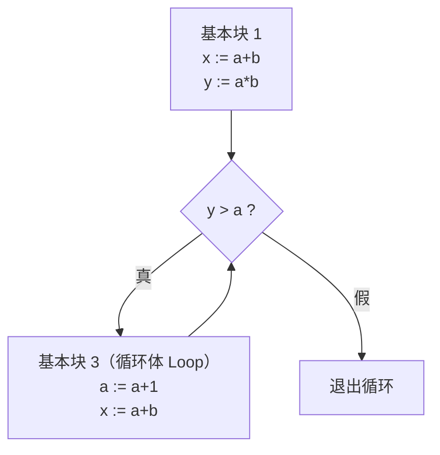

在基本块内部重排指令最安全；要跨基本块移动指令就得考虑分支，后面寄存器重命名中的“动态死代码”问题就是这样产生的。

### 简单循环的调度

下面用一个具体例子说明，编译器在知道机器各类指令延迟的情况下，怎样靠重排指令消除停顿。[^l04-section-8-s2p79]

源程序把常数 `s` 加到数组的每个元素上：

```c
for (i = 1; i <= 1000; i++)
    x[i] = x[i] + s;
```

机器规格：两条指令之间需要隔开的周期数（即后一条紧跟前一条时的停顿数）如下。[^l04-section-8-s2p79]

| 产生结果的指令 | 使用结果的指令 | 延迟（时钟周期） |
| --- | --- | --- |
| FP ALU op | 另一条 FP ALU op | 3 |
| FP ALU op | Store double | 2 |
| Load double | FP ALU op | 1 |
| Load double | Store double | 0 |
| Integer op | Integer op | 0 |
| FP ALU op | Branch | 1 |
| Branch | — | 1 |

最后一行指分支有 1 个周期的延迟：分支后面紧跟的那个周期叫延迟分支槽（delayed branch slot），延迟分支的概念见 L03《08 控制冒险》。

#### 朴素编译：10 个周期，5 个停顿

普通编译器生成的循环体如下（`R1` 是指向当前数组元素的指针，每次减 8 字节，即一个双精度数；`s` 放在 `F2` 中）：

```asm
Loop: LD    F0, 0(R1)      ; F0 = 数组元素
      ADDD  F4, F0, F2     ; 加上 F2 中的标量 s
      SD    F4, 0(R1)      ; 存回结果
      SUBI  R1, R1, #8     ; 指针减 8
      BNEZ  R1, R2, Loop   ; 分支
```

> [!warning] 易错点
> 讲义 s2p79 的编译结果把加法写成 `ADD.D F4,F0,F4`[^l04-section-8-s2p79]，与注释“add scalar in F2”和 s2p80 的 `ADDD F4,F0,F2` 矛盾。标量 `s` 在 `F2` 中，正确写法是 `ADDD F4,F0,F2`。[^l04-section-8-s2p80]

在机器上执行时，每次迭代的时序是：[^l04-section-8-s2p79]

| 周期 | 指令 | 停顿原因 |
| --- | --- | --- |
| 1 | `LD F0,0(R1)` | |
| 2 | stall | Load → FP ALU，延迟 1 |
| 3 | `ADDD F4,F0,F2` | |
| 4 | stall | FP ALU → Store，延迟 2 |
| 5 | stall | （同上） |
| 6 | `SD F4,0(R1)` | |
| 7 | `SUBI R1,R1,#8` | |
| 8 | stall | 分支要用 `SUBI` 刚算出的 `R1` |
| 9 | `BNEZ R1,R2,Loop` | |
| 10 | stall | 分支延迟槽空着 |

每次迭代 **10 个周期，其中 5 个是停顿**，一半时间浪费了。

#### 编译器调度：5 个停顿降到 1 个

编译器静态分析后发现，有些后面的指令可以提前执行，于是做两处改动：[^l04-section-8-s2p80]

1. **把 `SUBI` 提前**到 `LD` 之后，填进 Load → FP ALU 的那个停顿周期。`SUBI` 只依赖 `R1`，与 `LD`、`ADDD` 之间没有数据依赖。
2. **把 `SD` 放进延迟分支槽**：分支后面那个周期无论跳不跳都会执行，正好放 `SD`。
3. **修改 `SD` 的偏移**：`SUBI` 已经先把 `R1` 减了 8，`SD` 执行时 `R1` 比原来小 8，要写回原来的元素，地址必须改成 `8(R1)`，即偏移从 0 改为 8。除此之外，调度对代码没有别的影响。

调度后的循环体：

```asm
Loop: LD    F0, 0(R1)
      SUBI  R1, R1, #8
      ADDD  F4, F0, F2
      stall                ; ADDD → SD 还差一个周期
      BNEZ  R1, R2, Loop
      SD    F4, 8(R1)      ; 延迟分支槽，偏移由 0 改为 8
```

逐对检查延迟：

- `LD`（周期 1）→ `ADDD`（周期 3）：中间隔 1 个周期，满足 Load → FP ALU 延迟 1；
- `SUBI`（周期 2）→ `BNEZ`（周期 5）：`R1` 早已就绪，不再停顿；
- `ADDD`（周期 3）→ `SD`（周期 6）：中间隔周期 4、5 两个周期，满足 FP ALU → Store 延迟 2。由于 `BNEZ` 只能放在周期 5，周期 4 找不到独立指令，只好停顿。

于是每次迭代 6 个周期，**停顿从 5 个降到 1 个**。[^l04-section-8-s2p80]

> [!note] 补充解释
> 讲义 s2p80 右图用箭头和红色的 “8” 标出了“`SUBI` 提前、`SD` 进入延迟分支槽、偏移改为 8”这几处改动，但没有把调度后的时序完整重画。上面 6 周期的排法是按机器延迟表逐对验证后整理的，与图中“5 stalls → 1 stalls”的结论一致。

### 多发射调度的目标与静态调度的边界

上面的例子是单发射。到了多发射处理器上，编译器要为每个周期凑齐多条独立指令。[^l04-section-8-s2p81]

**多发射调度的目标**：

1. **顺序排列尽可能多的独立指令**。“尽可能多”以**执行带宽**为上限：3 宽（3-wide）的机器上，没必要找 7 条互相独立的指令，找出 3 条就够了。
2. **避免流水线停顿**。

如果编译器足够好，**顺序（in-order）超标量**处理器也能达到高性能：硬件提供执行带宽，编译器负责依赖调度。[^l04-section-8-s2p81] 但实际上编译器做不到这么好，原因如下。

#### 为什么静态调度可行

1. **时间充足**：编译器有“充足的时间”（all the time in the world）分析指令；硬件必须在 **< 1 ns** 内完成调度决策，大约只有一个时钟周期。[^l04-section-8-s2p82]
2. **视野更大**：编译器能做复杂的**跨过程分析**（inter-procedural analysis），理解代码和编程语言的高层行为，相当于几乎能看到整个程序（软件窗口，software window）；硬件一次只能看到发射窗口（issue window）中的少量指令。

静态方式由 ILP 编译器在编译时检测并消除依赖；动态方式由处理器的指令发射部件在运行时检测并消除依赖。

> [!tip] 课堂强调
> 硬件能看到的只是指令缓冲中的指令，一般只有几百条，而一个程序执行的指令数在 $10^9$ 条以上，这是两种方式最大的差别。分支预测之所以重要，就是因为它要保证尽可能多的指令被取进指令缓冲，动态调度才有指令可调。尽管硬件看得这么少，动态调度的效果反而通常更好。[^l04-section-8-s3b14]

#### 为什么静态调度可能不行

1. **不能总是绕开分支调度**：编译器对动态信息的了解很有限，只能靠剖析（profile）。剖析数据可能根本没有，也可能不具代表性。例如一个分支在程序前半段总是 T、后半段总是 NT，剖析统计出来像是 50-50 的分支，编译器对它什么也做不了；而运行时的硬件能看到前后两段行为的变化，并据此决策。[^l04-section-8-s2p83] 编译器剖析引导的分支预测见[编译器引导/剖析预测](#静态分支预测)。
2. **并非所有停顿都可预测**：编译器无法应对**数据缓存缺失**这样的动态事件。数据在缓存中时访问约 1 个周期，缺失后去内存约 100 个周期。编译器不知道哪次访问会缺失，没法为此调度；硬件在运行时知道，因此能处理。[^l04-section-8-s2p83]

静态调度虽然有这些限制，仍然有收益可拿。下面三种技术都是在给编译器扩大调度空间。

### 寄存器重命名（Register Renaming）

很多依赖并不是真的数据传递，只是两条指令恰好用了同一个寄存器名。这种**假相关**（false dependence，即 WAR 和 WAW）会限制指令重排。办法是给其中一条指令换一个寄存器名，假相关就消失了。

**寄存器重命名**（register renaming）是指给产生新值的指令及其后续使用者分配另一个寄存器，从而消除 WAR/WAW 假相关、保留 RAW 真相关。它不改变程序的功能。

两个“观察”说明为什么需要以不同方式分配寄存器：[^l04-section-8-s2p85]

1. **观察 1：奇怪的寄存器分配**。分配方式主要受**体系结构寄存器**（architected registers）数量的限制，寄存器不够用时可能产生更多的溢出/填充（spill/fill，把寄存器值存到内存再取回）。
2. **观察 2：动态死代码**（dynamic dead code），由分支造成，它会限制代码移动（code motion）。

观察 2 的例子：上方基本块是 `R1=R2+R3; BEQZ R9`，左分支执行 `R5=R1-R4`，右分支执行 `R1=LOAD 0[R6]`。

1. 编译器想把右分支的 `LOAD` 提到分支之前，让它尽早开始、掩盖访存延迟；
2. 但提上去后 `LOAD` 会覆盖 `R1`，而左分支还要读 `R2+R3` 产生的那个 `R1`，两者冲突。所以必须**换一种方式分配寄存器**：把上方的 `R1=R2+R3` 和左分支的 `R5=R1-R4` 中的 `R1` 改成 `R8`；
3. 即便如此，分支走左边时，提前执行的 `LOAD` 结果根本用不上，这是一次**不必要的** `LOAD` 执行，也就是动态死代码。因此代码移动不能随意进行。

#### 例：重命名后再调度

六条指令如下，假设每周期最多发射两条：[^l04-section-8-s2p86]

```text
A: R1 = R2 + R3
B: R4 = R1 – R5
C: R1 = LOAD 0[R7]
D: R2 = R1 + R6
E: R6 = R3 + R5
F: R5 = R6 – R4
```

**第 1 步，找依赖**（逐个寄存器检查读写顺序）：

- 真相关（RAW）：A→B（`R1`），C→D（`R1`），E→F（`R6`），B→F（`R4`）；
- 假相关：B 读 `R1`、C 写 `R1`，构成 B→C 的 WAR；A、C 都写 `R1`，构成 A→C 的 WAW；D 读 `R6`、E 写 `R6`，构成 D→E 的 WAR。C 与 B 本来不必共用 `R1`，E 与 D 本来也不必共用 `R6`（讲义标注 “No need to same”）。其余假相关（A→D 的 `R2`、B→F 与 E→F 的 `R5`）方向与已有的先后关系一致，不影响下面的排法。

**原分配需要 4 个周期**。这个周期数依赖两条假设，讲义的依赖图（CFG view）正是按它们画的：[^l04-section-8-s2p86]

1. 每周期最多发射 2 条指令；
2. 真相关和 WAW 的两条指令必须分在先后周期，而 WAR 的两条可以放在同一周期（同一周期内先读旧值、后写新值）。

按此排列：A 在第 1 层；B 读 A 的 `R1`，C 与 A 是 WAW，二者都在第 2 层（B、C 之间只有 WAR，可同层）；D 读 C 的 `R1`，E 与 D 只有 WAR，二者都在第 3 层；F 读 E 的 `R6`，只能在第 4 层。得到 A | B C | D E | F，共 4 个周期。[^l04-section-8-s3b14]

**第 2 步，重命名**：把 C、D 中的 `R1` 改为 `R8`，把 E、F 中的 `R6` 改为 `R9`：

```text
A : R1 = R2 + R3
B : R4 = R1 – R5
C': R8 = LOAD 0[R7]
D': R2 = R8 + R6
E': R9 = R3 + R5
F': R5 = R9 – R4
```

B→C、A→C、D→E 这些名字冲突消失，决定顺序的只剩真相关：A→B、C′→D′、E′→F′、B→F′。

**第 3 步，调度**：

| 周期 | 发射槽 1 | 发射槽 2 |
| --- | --- | --- |
| 1 | A | C′ |
| 2 | B | E′ |
| 3 | D′ | F′ |

由 4 个周期降为 **3 个周期**，功能不变，而且没有停顿。[^l04-section-8-s2p86] [^l04-section-8-s3b15] 其中 C′ 是 load，它的使用者 D′ 被隔开了一个周期，load-use 停顿也被躲开了；F′ 需要的 B、E′ 都在第 2 周期完成。

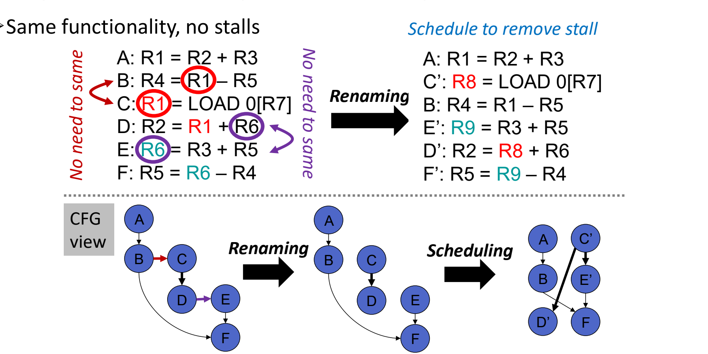

图：把 C、D 的 R1 改为 R8，E、F 的 R6 改为 R9 后，两条假相关边消失，六条指令可排成三层。

> [!warning] 易错点
> 4 个周期这一数字依赖“WAR 两条可同周期发射”的假设。若严格按 s2p72“同一周期执行的指令不能有 RAW/WAR”的约束，原分配下 A→B→C→D→E→F 每一步都有 RAW、WAR 或 WAW，六条指令只能一周期一条，需要 6 个周期。无论采用哪种假设，重命名后的 3 个周期都最短，因为它只受真相关约束。

寄存器重命名不只编译器能做，**硬件也能做**，例如下一讲的 Tomasulo 算法。编译器做重命名的代价是：

- 体系结构寄存器数量有限，不是想用多少就有多少；
- 用多了可能导致溢出（spill），反而增加访存。

> [!warning] 易错点
> 重命名只能消除 WAR、WAW 这类“名字冲突”，消除不了 RAW。上例中 A→B、C′→D′、E′→F′、B→F′ 在重命名之后仍然存在，它们决定了最短需要 3 个周期。

### 循环展开（Loop Unrolling）

循环体通常很短，单次迭代里没有足够多的独立指令可调度，每次迭代还要付出递增、比较、分支的开销。把多次迭代合并到一个循环体里，就能得到更大的指令块。展开的基本思想及其在 VLIW 中的作用见[循环展开基本思想](#vliw-与编译技术)，这里讲它的实现方式和问题。

**循环展开**：把迭代 $M$ 次的循环变换为迭代 $M/N$ 次的循环（每次迭代做原来 $N$ 次的工作），称为把循环**展开 $N$ 次**。[^l04-section-8-s2p87] 可以由编译器完成（如 `gcc -funroll-loops`），也可以手工完成：

```c
// 原循环：100 次迭代
for (i = 0; i < 100; i++)
    a[i] *= 2;

// 展开 4 次：25 次迭代
for (i = 0; i < 100; i += 4) {
    a[i]   *= 2;
    a[i+1] *= 2;
    a[i+2] *= 2;
    a[i+3] *= 2;
}
```

展开后的循环体里有 4 条互相独立的乘法，超标量可以同时执行它们。[^l04-section-8-s3b15]

> [!info] 可视化资源
> [Wikipedia：Loop unrolling](https://en.wikipedia.org/wiki/Loop_unrolling) 列出了展开的收益、代码膨胀与缓存方面的代价，以及迭代次数不能被展开倍数整除时的处理办法。

**存在的问题**：[^l04-section-8-s2p88]

1. **代码膨胀**（code bloat）：程序变大。
2. **迭代次数不是展开倍数**：例如次数 $j$ 不能被 4 整除时，要在主循环后加一个“尾巴”循环处理剩下的迭代：

   ```c
   j1 = j - j % 4;              // 展开到 i 为 4 的倍数为止
   for (i = 0; i < j1; i += 4) {
       a[i]   *= 2;
       a[i+1] *= 2;
       a[i+2] *= 2;
       a[i+3] *= 2;
   }
   for (i = j1; i < j; i++)     // 剩下的交给另一个 for 循环
       a[i] *= 2;
   ```

   尾巴循环带来了额外的代码和麻烦。
3. **迭代次数在编译时未知**：次数要运行时才算出来，编译器很难直接决定怎么展开。
4. **`while` 循环**：没有明确的迭代计数，同样难以展开。
5. **只能解决循环内部的问题**：展开只扩大单个循环体内的调度空间。

> [!warning] 易错点
> 讲义 s2p87 的约定是“$M$ 次迭代的循环展开 $N$ 次，变成 $M/N$ 次迭代”[^l04-section-8-s2p87]，s2p88 的问题 Q1 却写成 “What if N is not a multiple of M?”，字母写反了。按 s2p87 的约定，问题应当是“$M$ 不是 $N$ 的倍数怎么办”，也就是总次数不是展开倍数。[^l04-section-8-s2p88]

### 函数内联（Function Inlining）

函数调用本身有开销，而且调用边界把代码切成小块，编译器很难跨越调用去调度。

**函数内联**（function inlining）是指把被调函数的函数体直接放到调用点，不再执行 call/return，有点像“展开”一个函数。[^l04-section-8-s2p89] 普通函数在执行到 `myfunc();` 时跳到 `myfunc()` 的函数体，执行完再返回；内联后，`myfunc()` 的函数体直接嵌进主函数体，顺序执行下去。

收益有两类：

1. **去掉函数调用开销**：
   - `CALL`/`RET` 指令本身，以及它们可能带来的分支误预测（返回地址预测见[返回地址栈 RAS](#分支目标预测)）；
   - 参数与返回值的传递、栈帧分配，以及调用者保存/被调用者保存寄存器（caller/callee-save registers）相关的 spill/fill 访存。
2. **得到更大的指令块用于调度**：调用点前后的代码与函数体连成一片，编译器有更多独立指令可以重排。

**主要问题**是代码膨胀：每个调用点都复制一份函数体，与循环展开的问题相同。[^l04-section-8-s2p89]

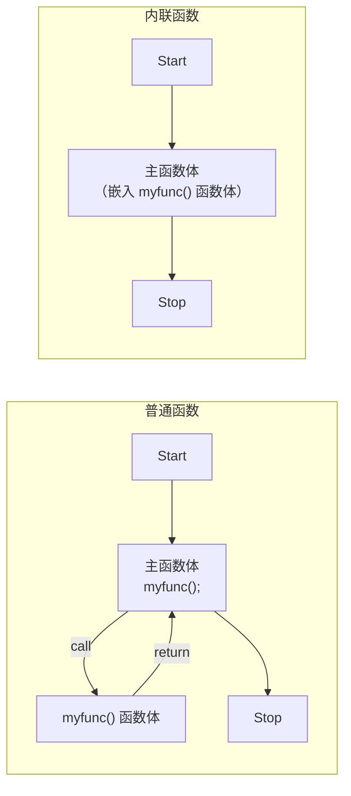

> [!question]- 自测：简单循环调度后，如果把 `SUBI` 提前了，却忘了把 `SD F4,0(R1)` 的偏移改成 8，会发生什么？
> 结果会存错位置。`SD` 执行时 `R1` 已经减了 8，`0(R1)` 指向的是下一次迭代要处理的元素。于是本元素没有被更新，下一个元素被提前覆盖成“本元素 + s”，下一次迭代再 `LD` 时读到的是错误的值。偏移改为 8 才能补偿 `SUBI` 提前造成的指针变化。

> [!question]- 自测：对 `I1: R3=R1*R2`、`I2: R4=R3+R5`、`I3: R3=R6+R7`、`I4: R8=R3+R4` 做依赖分析并重命名，哪些依赖能消除？
> 真相关（RAW）：I1→I2（`R3`）、I3→I4（`R3`）、I2→I4（`R4`），这些不能消除。假相关：I1 与 I3 都写 `R3`，是 WAW；I2 读 `R3`、I3 写 `R3`，是 WAR。把 I3 和 I4 中的 `R3` 改成空闲寄存器（如 `R9`）后，两个假相关都消失，I3 可以和 I1 同周期发射。代价是多占一个寄存器。

> [!question]- 自测：用 s2p88 的方法把 `for(i=0;i<j;i++) a[i]*=2;` 展开 4 次，当 $j=10$ 时主循环和尾巴循环各执行几次迭代？
> $j1 = 10 - 10 \% 4 = 8$。主循环 `i` 取 0、4，共 2 次迭代，处理 `a[0]` 到 `a[7]`；尾巴循环 `i` 取 8、9，共 2 次迭代。循环分支从 10 次降到 4 次，代价是多出一个尾巴循环和更长的代码。

> [!info]- 来源
> - L04.pdf：PDF p.71–89
> - L04.docx：DOCX body 355–418

[^l04-section-8-s2p72]: L04.pdf-PDF p.72
[^l04-section-8-s2p73]: L04.pdf-PDF p.73
[^l04-section-8-s2p74]: L04.pdf-PDF p.74
[^l04-section-8-s2p75]: L04.pdf-PDF p.75
[^l04-section-8-s2p76]: L04.pdf-PDF p.76
[^l04-section-8-s2p77]: L04.pdf-PDF p.77
[^l04-section-8-s2p84]: L04.pdf-PDF p.84
[^l04-section-8-s2p78]: L04.pdf-PDF p.78
[^l04-section-8-s2p79]: L04.pdf-PDF p.79
[^l04-section-8-s2p80]: L04.pdf-PDF p.80
[^l04-section-8-s2p81]: L04.pdf-PDF p.81
[^l04-section-8-s2p82]: L04.pdf-PDF p.82
[^l04-section-8-s3b14]: L04.docx-DOCX body 374-406
[^l04-section-8-s2p83]: L04.pdf-PDF p.83
[^l04-section-8-s2p85]: L04.pdf-PDF p.85
[^l04-section-8-s2p86]: L04.pdf-PDF p.86
[^l04-section-8-s3b15]: L04.docx-DOCX body 407-418
[^l04-section-8-s2p87]: L04.pdf-PDF p.87
[^l04-section-8-s2p88]: L04.pdf-PDF p.88
[^l04-section-8-s2p89]: L04.pdf-PDF p.89

---

## 本讲小结

本讲的两半由同一个问题串起来：要让每个周期完成更多指令，就必须不断取到正确的指令，并找到彼此独立的指令。分支预测保证前者，超标量、VLIW 和编译器调度负责后者。

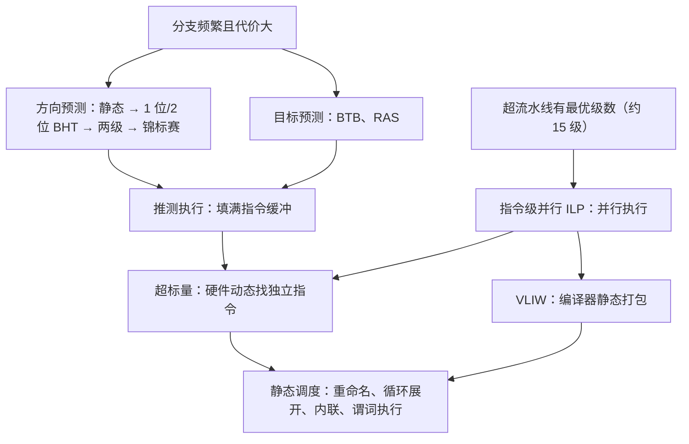

### 如何选择

| 问题 | 硬件动态手段 | 编译器静态手段 |
| --- | --- | --- |
| 分支方向难猜 | 1 位/2 位 BHT、两级、锦标赛预测 | BTFNT、剖析引导、likely/unlikely、谓词执行 |
| 分支目标未知 | BTB、RAS | — |
| 数据依赖与假相关 | 乱序执行、Tomasulo 硬件重命名、ROB | 指令调度、寄存器重命名 |
| 独立指令太少 | 扩大指令窗口、靠分支预测填满指令缓冲 | 循环展开、函数内联 |
| 代价 | 硬件复杂、功耗高 | 视野不含动态信息（缓存缺失、分支行为变化）、代码膨胀 |

### 核心公式

| 公式 | 含义 |
| --- | --- |
| $\text{Target} = PC + \text{imm}$ | 直接分支的目标地址 |
| $\text{Speedup} = \frac{4.1\ \text{ns}}{1.2\ \text{ns}} \approx 3.42$ | 流水线加速比由最长一级决定，理想值为级数 5 |
| $T \to \frac{T}{m}$ | 超流水线把每级拆成 $m$ 个子级后的时钟周期 |
| 冲刷 $k-1$ 条 | 分支在第 $k$ 级才判定时一次误预测的冲刷条数 |
| 1 位 $\frac{3}{5}=60\%$，2 位 $\frac{4}{5}=80\%$ | 每轮 T T T T NT 循环的稳态准确率 |
| $\text{Execution Time} = IC \times CPI \times CCT$ | 编译器影响 $IC$ 与 $CPI$，不影响 $CCT$ |

## 不确定事项

- 08：s2p80 右图没有完整重画调度后的时序，正文中的 6 周期排法（LD；SUBI；ADDD；stall；BNEZ；SD 8(R1)）按延迟表推导得出，与图中“5 stalls → 1 stalls”一致，但图中各指令的具体位置无法逐一核对
- 08：重命名例“4 周期”取决于 WAR 是否允许同周期发射；讲义依赖图隐含允许，而 s2p72 写的是同周期指令不能有 WAR，两者不一致，正文已列出两种情况
- 03：附录 2 位方案约 80% 与正文最好约 90% 的统计口径不同，讲义没有给出附录数据的来源
- 01：4 路超标量停顿吞吐的例题是根据课程数据构造的计算练习，并非讲义原题

> [!info]- 来源
> - L04.pdf：PDF p.3–89, 103–110
> - L04.docx：DOCX body 1–418
