一个只有 `puts` 和 `return` 两条语句的 hello world，从命令行回车到输出结束，背后操作系统究竟做了什么？本讲先确立“运行、设计、实现”三条主线和以流程为抓手的学习方法，再沿 hello world 的加载与运行走完全流程，看程序如何反复进出内核；接着从 Windows、UNIX、Linux、Android、鸿蒙、openEuler 的结构中归纳分层、内核、系统调用接口与硬件抽象层的共性，理解“操作系统”名称的由来与控制硬件之难；最后为实验做准备：xv6 阅读方法、处理器与地址空间模型，以及 RISC-V 上从上电到 shell 的引导链。本讲假设已学过 ICS 中的虚拟内存与缺页、异常控制流、ELF 与链接加载、栈帧等内容。

---

## 课程视角与典型流程

> [!abstract] 本节要点
> - 本课程从三个角度看操作系统：它**怎样运行起来**（动态过程）、**设计**时有哪些考虑、**实现**时有哪些具体做法；学每一部分都要先判断它属于设计思想还是实现细节。
> - 学习对象分三类：**基本概念**（共同术语，不是死记）、**典型流程**、**关键技术**；其中流程是全课的主线。
> - 流程有大有小：“执行一个程序”是全流程，里面嵌套创建进程、exec、缺页、打开文件、I/O 等小流程；每个流程要抓住重要函数和主要步骤。
> - 缺页异常是“硬件发现问题 → 进入内核 → 操作系统解决问题”的典型例子：MMU 转换虚拟地址时发现该页没有映射到物理内存，就产生 page fault。
> - “操作系统做了什么”可以用三个关键词概括：**功能**、**服务**、**状态转换**。

### 三条主线：运行、设计、实现

一门操作系统课的内容很多，如果没有一个统一的视角，很容易学成一堆零散的知识点。本课程用三个问题组织所有内容：[^l01-section-1-s2b1]

1. **操作系统怎么运行起来**：强调动态过程，即一个事件发生后，系统一步一步把它处理完的过程。
2. **设计环节有哪些考虑**：为什么这样分模块、为什么这样分层、要达到什么目标（如可移植、性能）。
3. **实现环节有哪些具体做法**：数据结构、函数、代码路径。

学任何一部分时都可以问：它讲的是**设计思想**还是**实现细节**？设计思想通常跨系统通用，实现细节则随 xv6、Linux、Windows 而不同。

### 构造性的学习方法

操作系统建立在大量先修知识之上（尤其是 ICS 中的处理器、虚拟内存、异常控制流、链接与加载）。如果这些旧知识没有被调出来，新课的很多内容会显得凭空出现。为此，推荐的学习方法有三步：

1. **激活旧知识**：开始一门新课（或新的一章）前，花 10–20 分钟翻一翻先修课的目录，找出与本课相关的部分。花的时间不多，但特别有效。
2. **对接整合**：把新学的内容与旧知识连起来。大学四年的知识最终应当是“一整片”，而不是互不相关的点。
3. **分析、归类、关联**：每学一样东西，分析它是什么，把它归到自己知识体系中合适的位置，再把它与相关内容关联起来。

这个过程不断重复，知识就逐渐变得完整、有条理。这种学习方式称为**构造性思维**：一点点添加、不断迭代，而不是指望一次把所有内容学完。本讲讲的 hello world 流程就是一个粗流程，等各个部件（进程、内存、文件系统、I/O）讲完后，还要回到这个流程中逐步细化。

### 基本概念、典型流程与关键技术

本课程的学习对象可以分为三类：[^l01-section-1-s2b1]

- **基本概念**：一套**术语**，是大家讨论问题时的共同语言，而不是要死记硬背的条文。例如 PCB 这个缩写在化学、电路等领域另有含义，但在计算机专业人士之间，PCB 一定指**进程控制块**（Process Control Block），即操作系统中最重要的数据结构之一。掌握基本概念，就是要让自己描述问题时用的词与同行达成共识。
- **典型流程**：系统处理一件事的动态步骤序列。最大的流程是“执行一个程序”。任何程序的执行全流程都与 hello world 一样，只是实际程序中有更多函数调用、系统调用和分支，因而会在大流程里遇到更多小流程。
- **关键技术**：比较具体的一项机制，例如在 ICS 中学过的**重定向**（redirection）和**信号**（signal）。

流程是嵌套的：执行程序这个大流程依赖创建进程、exec 等小流程，小流程内部又有自己的步骤。学习时要关注两件事：**每个流程中的重要函数**，以及**它的主要步骤**。缺页异常、打开文件、I/O 都是这样的流程，课程后面会逐一梳理。

### 以缺页异常为例的流程

缺页异常是 ICS 已经学过的流程，这里用它来说明“流程”应当怎样理解。

CPU 执行程序时，要先拿到一个地址，再到这个地址去取指令。CPU 拿到的地址是**虚拟地址**（virtual address），它属于**虚拟地址空间**；而真正存放数据的是**物理内存**，二者是两个不同的空间。虚拟地址不能直接用来访问物理内存，必须先转换：

1. **发出虚拟地址**：CPU 把虚拟地址交给硬件部件 **MMU**（内存管理单元，Memory Management Unit）。
2. **查表转换**：MMU 内部有转换机制，但它要用到一个放在内存中的数据结构，即**页表**（page table）。为了加快转换，又设置了 **TLB**（Translation Lookaside Buffer，快表），缓存最近用过的转换结果。
3. **发现问题**：如果这条指令所在的页还没有真正映射到物理内存（仍只存在于虚拟地址空间中），MMU 就产生一个 **缺页异常**（page fault）事件。
4. **进入内核**：异常使 CPU 转入内核，由操作系统接手。
5. **解决问题**：操作系统处理缺页（如分配物理页、把内容读入、建立映射），之后程序继续执行。

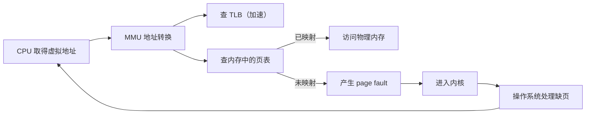

这个流程的骨架是：**硬件发现问题 → 进入内核 → 操作系统解决问题**。后面会看到，系统调用、中断等事件也都有类似的“进内核、处理、出内核”结构。hello world 执行时第一条指令就会触发缺页，具体如何处理、处理完从哪里继续，见[hello world 的运行](#hello-world-的运行)。

### 操作系统做了什么：三个关键词

本讲的主题是“操作系统做了什么”。可以先用三个关键词来概括（它们是重点，但不是全部）：[^l01-section-1-s2b1]

- **功能**：操作系统有许多功能模块，如进程管理、内存管理、文件系统、I/O。
- **服务**：操作系统为用户和程序提供服务，例如用户要打开一个文件，由操作系统代为完成。
- **状态转换**：在提供功能和服务的过程中，系统和程序会不断改变状态，例如在用户态与内核态之间来回切换。

接下来用 hello world 的执行全流程来具体展示这三个关键词，见[hello world 的加载](#hello-world-的加载)。

> [!question]- 自测：程序访问一个合法但尚未调入内存的地址，MMU、页表、操作系统分别扮演什么角色？
> MMU 负责把虚拟地址转换为物理地址，并在转换中发现“该页未映射”；页表是 MMU 转换时查阅的、存放在内存中的数据结构；操作系统在缺页异常进入内核后负责解决问题（分配物理页、读入内容、更新映射）。分工就是“硬件发现问题、操作系统解决问题”。

> [!question]- 自测：学习“ELF 文件头中有 magic number”和“程序加载前要检查文件类型”，各自更接近设计思想还是实现细节？
> “加载前要检查文件是否可执行”是设计层面的要求，任何系统都要做；“用 ELF 头中的 magic number 判断”是 Linux/UNIX 一系的具体实现方式，Windows 使用另一种可执行格式，判断方式也不同。

> [!info]- 来源
> - L01.docx：DOCX body 1–32

[^l01-section-1-s2b1]: L01.docx-DOCX body 1-32

---

## hello world 的加载

> [!abstract] 本节要点
> - hello world 只做两件事：`puts` 和 `return`，二者最终都要通过系统调用进入内核。
> - 第 1 步**告知**：在 shell 中输入可执行文件名并回车；此时运行的是 shell，shell 只是接口（界面），不是操作系统。
> - 第 2 步操作系统接管：经**文件系统**（磁盘的抽象）按文件名找到文件，再根据 **ELF** 文件头中的 **magic number** 检查它是否为可执行文件，并通过头部找到的表算出代码段、数据段、`.bss` 的位置与长度。
> - 第 3 步**创建进程**：新建进程及其 **PCB**，把 hello world 程序映射到 PCB 上；由于虚拟内存按需调入，此时并不把代码读进内存。
> - 程序执行的第一条指令不是 `main` 的代码，可以用 `objdump` 查看。

### hello world 做了什么

hello world 是最小的完整程序，但它的执行过程和任何程序的全流程是一样的，因此适合用来观察操作系统“做了什么”。

```c
#include <stdio.h>

int main(void) {
    puts("hello world");
    return 0;
}
```

不分析语法，只看它做的事情：程序只做了两件事，**`puts`**（输出一个字符串）和 **`return`**（结束）。在操作系统的视角里，这两件事都要通过**系统调用**（system call）进入内核才能完成。[^l01-section-2-s2b2]

> [!note] 补充解释
> 严格说，`puts` 是 C 标准库函数，它在库内部最终调用 `write` 系统调用把字符串写到标准输出；`main` 中的 `return` 会返回到 C 运行时启动代码，由它调用 `exit`，最终发出结束进程的系统调用。所以“二者都是系统调用”指的是它们最终都要进入内核。

> [!question] 思考题：hello world 程序执行时的第一条指令是什么？是 main 函数（输出）的代码吗？
> 一个可执行文件被加载并开始运行时，CPU 执行的第一条用户态指令在哪里？是不是 `main` 中调用 `puts` 的那段代码？
>
> **提示**：回想 ICS 中链接与加载的内容，用 `objdump` 反汇编编译好的可执行文件，看看 ELF 头记录的入口地址对应哪个符号，以及 `main` 是被谁调用的。
>
> > [!success]- 解答（老师课上给出）
> > 结论：第一条指令**肯定不是 `main` 的代码**。可以用 ICS 中要求掌握的工具 `objdump` 查看编译后的可执行文件来验证。[^l01-section-2-s2b2] 另一个旁证来自栈：`main` 的栈帧并不是栈中的第一个栈帧，在 `main` 之前已经有内容被压入栈中，说明 `main` 是被其他代码调用的。[^l01-section-2-s2b8]
> >
> > 以下细节为据此补充（以 Linux + glibc 为例）：
> >
> > 1. `readelf -h hello` 可看到 ELF 头中的 `Entry point address`（入口地址）。
> > 2. `objdump -d hello` 反汇编后会发现，入口地址对应的符号是 `_start`（来自 C 运行时启动文件 `crt1.o`），而不是 `main`。
> > 3. `_start` 整理好栈上的参数后调用 `__libc_start_main`，后者完成库的初始化，再调用 `main`；`main` 返回后由它调用 `exit`。
> > 4. 对动态链接的程序，内核实际先把控制权交给动态链接器（如 `ld-linux`）的入口，由它完成共享库装载后，再跳到程序自己的 `_start`。

### 第 1 步：告知系统

要执行 hello world，首先要“告诉系统：请帮我执行这个程序”。前提是 hello world 已经编译成了**可执行文件**。

最传统的告知方式是**命令行**：在 shell 的提示符下输入可执行文件名并回车。此外也可以在菜单中选择、在 IDE 中创建工程并运行，本质都是“告知”。

这一步要注意：在回车之前，运行的是 **shell**，而不是操作系统。**shell 不是操作系统**，它只是用户与系统交互的**接口**或**界面**（interface）。因此第 1 步处于**用户态**。[^l01-section-2-s2b2]

### 第 2 步：查找并检查可执行文件

告知之后，操作系统接管。它的第一件事是**找到 hello world 程序的相关信息**，这一步包括两部分。

**按文件名查找**：用户给出的是一个文件名，文件实际存放在磁盘上。负责磁盘的是**文件系统**（file system），文件系统是对磁盘的抽象。按文件名查找需要文件系统的若干步骤，这些细节留到文件系统一章再展开。

**检查是否为可执行文件**：找到文件后，必须保证它的类型是可执行文件；而要从文件中取出内容，就必须知道它的格式。本课程以 Linux/UNIX 这一系为背景（xv6 也属于这一系；Windows 是另一大家族），因此可执行格式是 **ELF**（Executable and Linkable Format，可执行与可链接格式），即 ICS 中学过的可链接、可加载的格式。

ELF 按约定分成若干部分，每部分存放特定信息，其中开头最重要的是 **header**（文件头）：[^l01-section-2-s2b2]

1. **检查 magic number**：header 中有一个 **magic number**（魔数），它决定这个文件是不是可执行文件。对上了，才继续往下做（这里不讨论出错的情况）。
2. **找到描述各段的表**：根据 header 中的信息，在文件某个位置找到另一张表（program table 或 section table）。
3. **得到代码与数据的位置**：这张表告诉我们代码从文件中的哪个相对位置开始、长度是多少，这样就能找到程序的全部代码；数据同理，并且可以细分为只读数据 `.rodata`、一般的 `.data`，以及 `.bss` 段。
4. **计算并保存地址信息**：算出这些位置和地址后，把信息保存在某个地方，供后续使用。

这一步实际上“什么都没执行”，只是计算出了一些信息。

> [!note] 补充解释
> - ELF 的 magic number 是文件最开头的 4 个字节 `0x7F 'E' 'L' 'F'`；ELF header 还记录文件类型（可执行文件、目标文件、共享库）、目标体系结构和程序入口地址。
> - ELF 中有两张表：**program header table** 描述加载时要映射到内存的 segment（加载器主要用它），**section header table** 描述 `.text`、`.rodata`、`.data`、`.bss` 等 section（链接器主要用它）。
> - `.bss` 存放未初始化（或初始化为 0）的全局变量和静态变量，文件中只记录它的大小，不占实际文件空间，加载时再分配并清零。

#### header 思想

“大结构前先放一个 header”是计算机中非常普遍的设计：header 规定占多少字节、每几个字节代表什么含义，读的一方按约定解析，就能得到后面内容的信息。网络中的 IPv4、IPv6 报文也是这样：报文就是一串字节，协议规定哪几个字节表示什么，接收方据此解析。这种按约定解析的工作，本质上与计算概论中字符串匹配一类问题相似，只是规则更复杂。

### 第 3 步：创建进程并建立映射

可执行文件只是**程序**，程序真正运行起来才是**进程**（process）。可以用一张图来想象：底下是内核，上面跑的都是进程。

因此，执行 hello world 实际上是**创建一个新进程，并让这个进程与 hello world 程序映射到一起**：

1. **创建进程**：每个进程一创建就要有一个 **PCB**（进程控制块）。这一步由**进程管理**模块负责。
2. **建立映射**：把 hello world 程序映射到 PCB 上，使得通过 PCB 能找到 hello world 的名字或相关信息，进而找到磁盘上的那块代码和数据。[^l01-section-2-s2b2]

这个映射为什么重要？因为有了虚拟内存，程序的内容并不是一下子全部装入内存，而是**需要时再调入**。进程运行中一旦需要某段代码或数据，就顺着这个映射到磁盘上去找。也就是说，第 3 步结束时，进程已经创建好、映射关系已经建立，但代码还在磁盘上，内存中什么都没有装。

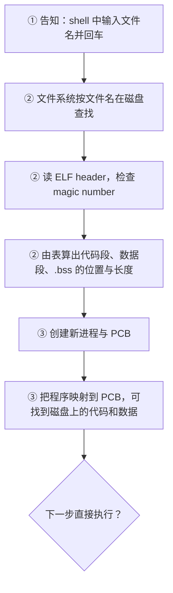

至于建立映射之后是不是马上执行，以及之后如何运行，见[hello world 的运行](#hello-world-的运行)。

> [!warning] 易错点
> - 输入命令并回车时运行的是 shell，不是操作系统；操作系统是在接到请求后才“接管”的。
> - 第 2、3 步结束时程序代码**并没有**读入内存，只是算好了它在文件中的位置并在 PCB 中建立了映射；真正读入发生在运行时的缺页处理中。

> [!question]- 自测：把一个文本文件 `notes.txt` 加上执行权限后在 shell 中直接运行，按本节流程会在哪一步出问题？
> 第 2 步。文件系统能按名字找到它，但检查格式时它的开头不是 ELF 的 magic number，操作系统判定它不是可执行文件，不会进入第 3 步去创建进程并建立映射。（实际系统还可能尝试其他规则，例如 `#!` 开头的脚本，但不满足 ELF 格式就不能按 ELF 加载。）

> [!question]- 自测：一个 2 GB 的程序启动后，第 3 步结束时内存中已经有它的多少代码？为什么启动不必等 2 GB 全部读完？
> 几乎没有。第 2 步只计算了各段在文件中的位置和长度，第 3 步只在 PCB 中建立了到磁盘内容的映射；因为虚拟内存按需调入，代码要等运行中真正访问到某一页时才读入。

> [!info]- 来源
> - L01.docx：DOCX body 33–62, 200–221

[^l01-section-2-s2b2]: L01.docx-DOCX body 33-62
[^l01-section-2-s2b8]: L01.docx-DOCX body 200-221

---

## hello world 的运行

> [!abstract] 本节要点
> - 第 3 步创建好进程后不直接执行，而是统一交给**调度**；调度选中 hello world，才进入第 4 步。
> - 第 4 步**设置 CPU 上下文**并“跳到”程序开始处：本质是设置好 PC 等寄存器，下一个指令周期 CPU 自然到 PC 指向处取指，并没有一条真的跳转指令。
> - 执行第一条指令**必然发生缺页异常**，因为前面的步骤从未把虚拟地址映射到物理地址；缺页处理完后**重新执行**这条出错的指令。
> - 用户态/内核态划分：第 1 步用户态；第 2、3、4 步内核态；第 5 步发生缺页时仍是**用户态**；之后的缺页处理在内核态。
> - `puts`、`return` 又各自通过系统调用进出内核；整个过程中文件系统、进程管理、调度、内存管理、I/O 全部上阵，程序不断进内核、出内核。

### 调度与设置 CPU 上下文

第 3 步已经创建好进程，按直觉下一步就该执行了。但第 3 步做完**并不直接**做第 4 步：系统中有许多进程，创建好的进程都要**统一交给调度**（scheduling），由**调度程序**（scheduler）决定下一个在 CPU 上运行的是谁。[^l01-section-3-s2b3]

- 如果调度程序选中了 hello world，就为 hello world 设置上下文，进入第 4 步；
- 如果选中的是另一个进程，就为那个进程设置上下文。

调度就像一只“看不见的手”，在流程中反复出现：第 3 步与第 4 步之间并不是直通的，中间插着一次调度。下面的讨论都假设调度选中了 hello world。

> [!tip] 课堂强调
> 这个调度插入点是有意标出的重点：不要把“创建好进程”和“开始执行”看成连续的两步，二者之间总隔着一次调度。[^l01-section-3-s2b3]

要让 CPU 执行 hello world，就要**设置 CPU 上下文环境**。一个程序在 CPU 上运行所需的处理器状态称为**上下文**（context），在 ICS 中已经学过，这里称为 CPU（处理器）上下文环境。

第 4 步是“设置好上下文，然后跳到程序开始处”。这里的“跳到”不能理解为执行了一条跳转（jump）指令。回到对处理器最基本的理解：[^l01-section-3-s2b3]

1. CPU 的工作只有一件事：到 **PC**（程序计数器）中取地址，再到这个地址取指令执行；PC 里放的是什么，CPU 就执行什么，它不关心别的。
2. 设置上下文时，把 PC 设成程序开始处的地址（同时设置好其他寄存器）。
3. 下一个指令周期，CPU 自然就到这个地址取指令执行了。

所以“跳到”只是一种说法：设置好 PC，执行就自然发生了。

### 第一条指令与缺页异常

调度选中 hello world、设置好上下文后，CPU 开始执行它的**第一条指令**。这条指令用的是**虚拟地址**，而回顾前面的步骤：第 2 步只计算了代码在文件中的位置，第 3 步只在 PCB 中建立了到磁盘的映射，**没有任何一步把虚拟地址映射到物理地址**。因此执行第一条指令**一定会**发生**缺页异常**（page fault）。[^l01-section-3-s2b3]

缺页可能由多种原因引起，但都走 page fault 的大流程（流程骨架见[课程视角与典型流程](#课程视角与典型流程)）。发生缺页后，又进入内核。

#### 缺页处理与重新执行

第 6 步由操作系统的**内存管理**模块完成：

1. **分配物理页**：为缺页的虚拟页分配一块物理内存页。
2. **从磁盘读入代码**：第 2 步已经算好了代码在可执行文件中的相对位置，而文件在哪里也是已知的，于是把对应内容从磁盘读入刚分配的物理页。一次读一页还是读几页，取决于系统的调入策略。
3. **继续执行**：读入后，hello world 继续执行。

这里的“继续执行”是指从哪一条继续？ICS 的**异常控制流**中讲过，异常（或中断）处理完后有三种返回策略：[^l01-section-3-s2b3]

| 返回策略 | 含义 | 典型情况 |
| --- | --- | --- |
| 返回下一条指令 | 处理完后从下一条指令继续 | 系统调用等 |
| 不再返回 | 出了严重错误，程序无法继续，被终止 | 致命错误 |
| 重新执行当前指令 | 在这条指令上出了问题，处理完后重新执行它 | 缺页异常 |

（“典型情况”一列中，系统调用与致命错误两例按 ICS 异常分类补充。）

缺页属于第三种：要重新执行的正是刚才发生 page fault 的那条指令。问题在于，执行一条指令时 PC 已经指向下一条，不能再从 PC 中取得出错指令的地址。所以发生异常时，**硬件必须把出错指令的地址保存到某个地方**，处理完后再从那里取回。如果由你来设计，也必须这样做；否则就无法重新执行同一条指令。

> [!note] 补充解释
> 两种体系结构中保存位置的例子：x86 发生 page fault 时，硬件把出错指令的地址（EIP/RIP）连同其他状态压入内核栈，并把引起缺页的虚拟地址放入控制寄存器 CR2。RISC-V 在 S 模式处理异常时，出错指令地址保存在 `sepc`，引起缺页的地址保存在 `stval`，异常原因写入 `scause`（例如取指缺页的原因码为 12）。异常返回指令 `sret` 回到 `sepc` 处，若处理程序不修改 `sepc`，就恰好重新执行出错指令。

hello world 很小，一页基本就装下了全部代码，所以通常只缺页一次。若是一个大程序（如大型游戏），读入一页后还可能需要下一页，就会多次发生缺页。

### 用户态与内核态的划分

把前面的步骤按 CPU 所处的状态分开：

| 步骤 | 内容 | 状态 | 负责模块 |
| --- | --- | --- | --- |
| 1 | 在 shell 中告知 | 用户态 | （shell） |
| 2 | 查找文件、检查 ELF、算出地址 | 内核态 | 文件系统 |
| 3 | 创建进程、建立映射 | 内核态 | 进程管理 |
| 4 | 调度选中、设置 CPU 上下文 | 内核态 | 调度 |
| 5 | 执行第一条指令，发生缺页 | **用户态** | — |
| 6 | 分配物理页、读入代码 | 内核态 | 内存管理 |

> [!tip] 课堂强调
> 考试会问哪些步骤在用户态、哪些在内核态（不要求写出细节）：第 1 步是用户态，第 2、3、4 步是内核态，**发生缺页的第 5 步仍是用户态**。不少同学把这一步也看成内核态，但它只是事件发生了，还没有进入内核；进入内核后的缺页处理才是内核态。[^l01-section-3-s2b3]

> [!warning] 易错点
> 判断依据是“此刻 CPU 在执行谁的代码”：第 5 步时 CPU 在执行 hello world 自己的指令，缺页是在这条用户指令上发生的事件；只有异常把 CPU 切换进内核，开始执行操作系统的缺页处理代码，才算进入内核态。

### puts 与 return：再次进出内核

缺页处理完，hello world 的代码已经在内存中，接下来执行 `puts`。执行 hello world 本身的代码时处于**用户态**；一旦执行 `puts`，就通过系统调用**又进入内核**。[^l01-section-3-s2b3]

内核中处理输出的大框架是：

1. **找到显示设备**：`puts` 的输出目标是**标准输出**（standard output）。
2. **交给负责者**：标准输出一般由某个进程（或驱动）负责管理，内核把内容交给它，由它去显示。
3. **与显示硬件约定命令和数据**：与任何设备打交道都要说两件事，一是**命令**（例如“请显示”），二是**数据**（显示什么）。数据放在双方共同约定的**帧缓冲**（frame buffer）中，无论是像素屏、LED 还是其他显示器，只要把内容放进帧缓冲即可。[^l01-section-3-s2b4]
4. **硬件完成显示**：之后的转换由视频硬件或显卡完成，屏幕会不断**刷新**。用相机拍摄投影画面，有时能拍到刷新的痕迹，就说明屏幕在不断刷新。

于是屏幕上出现了 `hello world`。但流程还没结束，还有 `return`：它同样进入内核，内核做相应的结束处理，然后再出来。

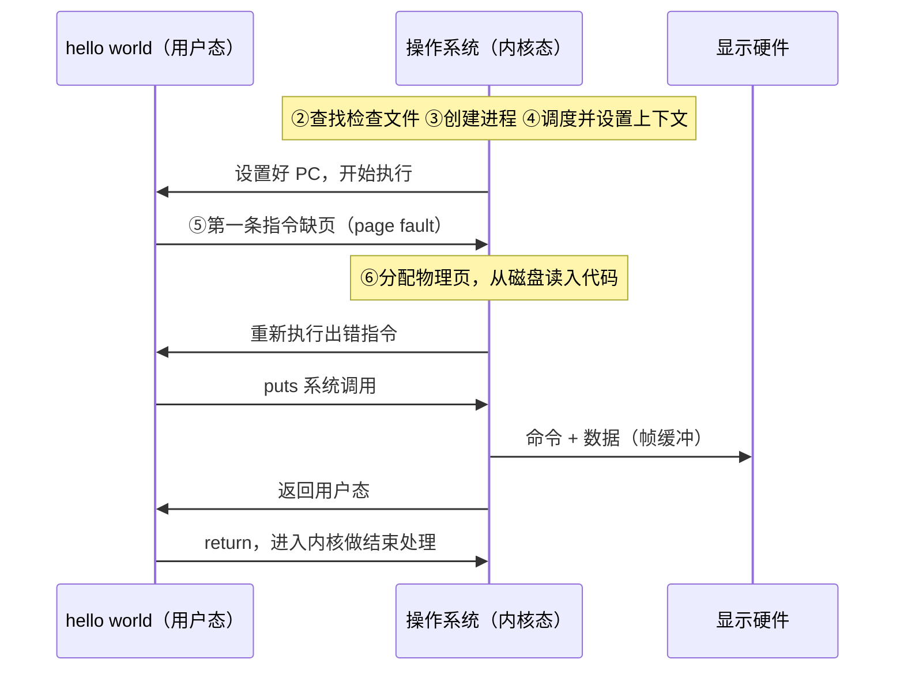

### 麻雀虽小，五脏俱全

回顾整个过程，一个只有两条语句的程序，用到了操作系统的全部几大功能模块：[^l01-section-3-s2b4]

- **文件系统**：按文件名查找可执行文件；
- **进程管理**：创建进程和 PCB；
- **调度**：选中 hello world 并设置上下文；
- **内存管理**：处理缺页、分配物理页；
- **I/O**：把字符串输出到显示器。

同一个过程可以从两个视角看：

- **以 hello world 为中心**：它在执行过程中不断地进内核、出内核；
- **以操作系统为中心**：操作系统一次又一次地调度 hello world 执行。

无论哪个视角，结论都一样：一个程序的执行过程中会反复进出内核。这就是对操作系统工作方式的整体印象。内核里有什么、内核外有什么，通过对比典型操作系统结构来归纳，见[典型操作系统结构](#典型操作系统结构)。

> [!question]- 自测：一个 50 页大小的程序，假设调入策略是每次只读一页且代码顺序执行、无跳转，至少会发生几次取指缺页？每次缺页后从哪里继续？
> 至少 50 次（每页第一次被取指时缺页一次）。每次缺页处理完后，都重新执行发生缺页的那条指令，而不是它的下一条；这依赖硬件在异常时保存了出错指令的地址。

> [!question]- 自测：某同学认为“第 4 步设置上下文后，内核执行了一条 jump 指令跳到 hello world 的入口”。这种说法错在哪里？
> 并不存在专门跳到程序入口的那条跳转。设置上下文就是把 PC 等寄存器设成 hello world 的状态；CPU 只按 PC 取指，下一个指令周期它自然就到入口处取指执行。“跳到”只是对这个效果的描述。

> [!question]- 自测：在 hello world 输出字符串的那一刻之前，CPU 至少经历了几次“用户态 → 内核态”的转换？分别由什么引起？
> 至少三次：第 1 步 shell 把执行请求交给操作系统（第 2–4 步在内核中完成）；第 5 步第一条指令缺页；`puts` 发出系统调用。之后 `return` 还会再进一次内核。

> [!info]- 来源
> - L01.docx：DOCX body 63–114

[^l01-section-3-s2b3]: L01.docx-DOCX body 63-89
[^l01-section-3-s2b4]: L01.docx-DOCX body 90-114

---

## 典型操作系统结构

> [!abstract] 本节要点
> - 看结构图要“看门道”，不是记每个模块：最重要的是 **user mode / kernel mode 分界线**，应用在上、操作系统在下，程序反复穿越它。
> - 应用程序与操作系统之间的接口统称**系统功能调用**（形式有系统调用、DLL 等）；接口下方有**分发**（dispatch），决定由内核哪个功能来服务；出内核时统一经过调度“换人”。
> - 为了**可移植**，硬件相关信息封装在**硬件抽象层 HAL** 中；但调度与上下文切换逃不开硬件，Windows 把这部分放在 Kernel 模块里。
> - 微内核把模块移出内核，但**频繁进出内核必然降低性能**，Windows NT 后来又把图形子系统移回内核。
> - UNIX 把进程、内存、调度、IPC 放在一个**进程控制子系统**中；设备分**字符设备**和**块设备**，为缓和速度差引入了**缓冲缓存**这一早期的软件缓存思想。所有系统的共性是**分层，其中一层是内核**，其上是运行时、库、中间件、应用框架。

hello world 的流程已经展示了程序如何进出内核。接下来要回答：**内核里有什么，内核外有什么**。方法是对比几个典型操作系统的总体结构，然后归纳共性。

看结构图要“内行看门道”：不是去记每个函数、每个模块是干什么的，而是看总体结构，理解为什么这样画、为什么底层有某一层。

### Windows：用户态/内核态与硬件抽象

Windows（NT 架构）的总体结构大约在 1988 年就基本定型。它有几个值得看的门道。[^l01-section-4-s2b4]

**第一，用户态与内核态的分界线**。这是结构中最重要的一条线：上面是 **user mode**（用户态），hello world 这样的程序在这里；下面是 **kernel mode**（内核态），操作系统在这里。程序从上面“掉”进内核，在里面做完事再出来，这个过程反反复复。

**第二，分发**。用户态与内核态之间接口的正下方有一个重要环节：用户态进入内核后，究竟由内核的哪一个功能来服务它？必须有一个**分发**（dispatch）工作来决定转交给谁。

**第三，硬件抽象层**。操作系统是硬件之上的第一层软件，一定要与硬件打交道。但如果每个功能模块都直接操作硬件，那么硬件一换（例如从 x86 换成 RISC-V 或 ARM），很多功能都得改。所以操作系统从设计之初就要追求**可移植性**（portability）。Windows 的做法是：

1. 设一个**硬件抽象层**（HAL，Hardware Abstraction Layer），把与硬件相关的信息封装在这一层里。
2. HAL 之上的 **Kernel 模块**（Windows 内核中一个就叫 Kernel 的模块）负责**调度与上下文切换**：把 A 进程换下、把 B 进程送上 CPU，这一定与具体硬件相关，逃不掉，所以 Kernel 中有一部分硬件相关代码。
3. 除这两处外，其余部分都与硬件无关，不管底下是 x86、ARM、MIPS 还是 RISC-V。

Windows 内核中的 device and file system drivers（设备与文件系统驱动）看名字像是与硬件相关的，但它其实是一层**抽象**，真正与硬件打交道的部分在 HAL 之下。

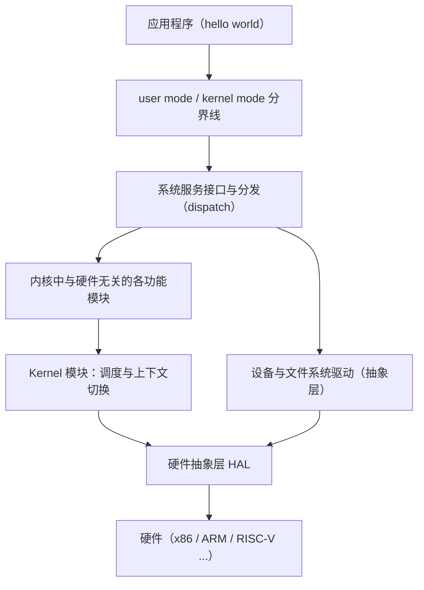

#### 微内核与性能

Windows NT 的设计理念之一是**微内核**（microkernel）思想：20 世纪 80 年代微内核正热，而此前的 Windows 3.1 等版本主要以漂亮的图形界面著称，人们对其底层技术不太了解。为了证明底层技术实力，Windows NT 采用微内核，把图形子系统等放到了内核外（NT 结构图中常以灰色标出这部分）。[^l01-section-4-s2b4]

问题在于，图形界面是用得最频繁的部分，放在核外就要每次进内核、出内核。早就有结论（例如比较用 PV 操作还是加锁哪种性能更好时就涉及）：**反复多次进出内核一定会降低性能**。所以后来 Windows 又把这部分移回了内核。

> [!note] 补充解释
> 这一调整发生在 Windows NT 4.0（1996 年）：原先在用户态子系统进程中实现的窗口管理器和图形设备接口（GDI）被移入内核态（`win32k.sys`）。因此 Windows NT 常被描述为“混合内核”而非纯粹的微内核。

#### 抽象模型：系统功能调用

把 Windows 的结构再抽象一层，可以得到一个适用于所有系统的模型：[^l01-section-4-s2b5]

1. **硬件之上包一层操作系统**。
2. **应用程序与操作系统之间一定有一个接口**，笼统地称为**系统功能调用**。它的形式多种多样（系统调用、DLL 等），但作用相同：连接应用程序和操作系统。应用需要操作系统服务，就按接口编写代码，操作系统按既定路径把事情完成。
3. **出内核时统一经过调度**：从内核出来时要“换人”，由调度决定接下来谁运行。

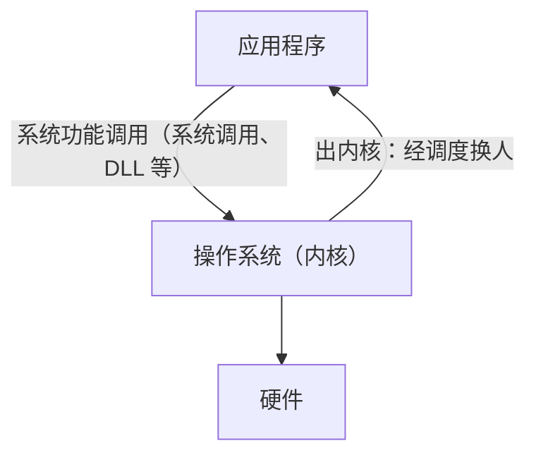

### UNIX：经典的层次结构

UNIX 的结构是最经典的，其结构图一直沿用到现在。最早画成同心圆，现在多画成层层往上叠的形式：[^l01-section-4-s2b5]

1. 最里层（最底层）是**硬件**；
2. 硬件之外是操作系统的**内核**（kernel）；操作系统不只有内核，内核之外还有许多内容；
3. 内核外面一圈是**系统调用接口**，与前面抽象模型中的接口一致；
4. 最外层是内核之外的各种程序。

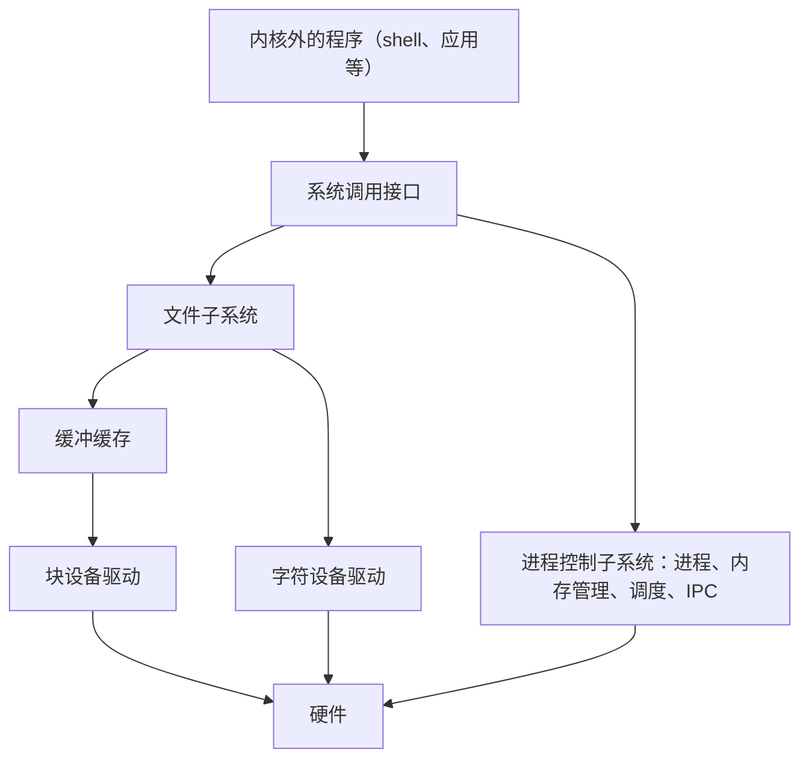

#### 进程控制子系统

UNIX 内核中没有把内存管理单独列为一块，而是把进程、内存管理、调度、进程间通信（IPC）都放在一个**进程控制子系统**中。原因是：

- 内核最主要的任务是**支持进程运行**；进程不运行，内核其实什么都不用做。
- 进程是运行的主体（运行实体），而进程运行必然要有**内存**，不论是虚拟内存还是物理内存，内存是进程的**标配**。我们使用的是冯·诺依曼体系结构，它以内存为核心。
- 进程间通信、创建进程等也都与进程紧密相关。

所以从学习角度虽然要分开讲（先讲进程的创建，再讲调度，再讲虚存），但不能把它们割裂：讲进程不可避免要讲内存，而讲内存时对进程的依赖相对少一些。这与《Operating Systems: Three Easy Pieces》按虚拟化（virtualization）、并发（concurrency）、持久化（persistence）组织内容（另加安全）的思路相呼应。

#### 文件系统、设备与缓冲缓存

UNIX 结构中，**文件系统**在上，**设备**在下。这是因为文件系统是对磁盘的抽象，而磁盘属于设备。

UNIX 最早把设备分成两类：[^l01-section-4-s2b5]

| 类别 | 例子 | 传输单位 | 速度 |
| --- | --- | --- | --- |
| **字符设备**（character device） | 打印机（早期的针式打印机） | 一个字符一个字符地传 | 慢 |
| **块设备**（block device） | 磁盘 | 一次读一块（如一个扇区） | 快、量大 |

两类设备的速度和数据量差异很大，从 I/O 处理的角度就需要考虑如何管理快慢不同的设备。UNIX 的做法是在文件系统与块设备之间引入**缓冲缓存**（buffer cache）：先把大量数据放在内存中的缓冲区里，再按需取用，从而满足文件系统的需求。这是操作系统中很早就引入的**软件缓存**思想；组成原理和 ICS 中讲的 L1、L2 缓存则是**硬件缓存**。

> [!note] 补充解释
> UNIX 诞生于 1969 年前后。硬件缓存的思想通常追溯到 Maurice Wilkes 1965 年提出的“从属存储器”（slave memory），第一台商用带缓存的计算机是 1968 年的 IBM System/360 Model 85。两者出现的时间相近，可课后自行查证比较。

### Linux 与 xv6

Linux 与 UNIX 相比是一种**模块组合**的结构，内核很紧凑，功能很多，功能之间有调用关系。看图时要抓两层：[^l01-section-4-s2b5]

- **与用户态的接口处**：同样是一层**系统调用**，与 Windows 的接口层、UNIX 的系统调用接口作用相同。
- **最底层**：分成 trap/fault（陷阱、故障）和 interrupt（中断）等不同模块，但对我们来说它们是**一套机制**，只是触发原因不同。系统调用走的是 trap 一侧。这一层在 ICS 中已经接触过，课程中很快会讲到（见 L02「08 中断与异常概念」）。

看 Linux 结构时，应当把以前学过的知识（系统调用、trap、中断）在其中找到对应位置。xv6 是简化的类 UNIX 系统，同样有系统调用接口和 trap/中断这一层，阅读 xv6 源码时可以拿它与 Linux 的结构对照（阅读方法见[xv6 阅读与基础模型](#xv6-阅读与基础模型)）。

### Android、鸿蒙与 openEuler

前面的系统都以内核为主。移动设备和服务器上流行的系统，其架构描述的是**整体结构**，内核只是其中一层。[^l01-section-4-s2b6]

**Android**：

1. 底层是 **Linux 内核**，但做了修改：谷歌为移动场景专门增加了 **Binder**（进程间通信机制），以及蓝牙、闪存等驱动。
2. 其上是核心的**运行时系统**（Android runtime）和**库**，库这一层很重要。
3. 再上是**应用程序框架**：开发者按框架编写小应用，再发布到应用商店供下载。

Android 的贡献在于谷歌搭好了运行时、库和应用框架，形成了**生态**。2010 年代移动系统主要是 Android 和苹果两大派，Android 能兴起，一个重要原因是它的开发框架上手门槛比苹果低，很多人都能轻松写出小应用。

**鸿蒙**（开源版本为 OpenHarmony）同样**分为四层**：

- 最底层仍有 Linux 内核的痕迹，另有 LiteOS 等自有内核；
- 有**驱动框架**：一个操作系统要支持大千世界中的各种设备，厂商不可能为每种设备都编写驱动，于是提供框架，由设备厂商按规范编写驱动并注册进来，从而建立生态（驱动编写方式的变化见[操作系统名称与硬件](#操作系统名称与硬件)）；
- 之上有框架层、系统服务层；系统服务层中鸿蒙最得意的是**分布式软总线**。

**openEuler**：定位为**服务器操作系统**，面向大数据、云计算等应用，与 Linux、Windows 的服务器版本处在同一层面。它起源于华为各类产品（如通信产品）和解决方案中多年的积累，逐步发展壮大，最终开源。

### 共性：分层与内核

看过这些结构后，可以归纳出所有架构的共性：[^l01-section-4-s2b6]

1. **分层**：所有系统都是一层一层叠起来的。
2. **其中一层是内核**，这是与操作系统原理最密切相关的部分；内核与应用之间有系统调用（系统功能调用）接口，内核底部用硬件抽象层屏蔽硬件差异。
3. **内核之上**有运行时系统、运行库，再往上是中间件、应用框架等（面向服务器或移动场景的系统尤其如此）。

> [!warning] 易错点
> 不要把整张 Android 或鸿蒙架构图都当成“内核”。这些图画的是整体软件栈，内核只是最底下的一层；运行时、库和应用框架虽然由系统厂商提供，但运行在用户态。

> [!question]- 自测：把一个原本运行在 x86 上的操作系统移植到 RISC-V，按 Windows 的结构设计，哪些部分需要改写？
> 主要是硬件抽象层 HAL，以及 Kernel 模块中与硬件相关的调度、上下文切换部分（保存和恢复哪些寄存器、如何切换都依赖体系结构）；其余与硬件无关的模块原则上不用改。这正是设置 HAL 的目的。

> [!question]- 自测：如果把文件系统做成用户态的服务进程，hello world 打开一个文件时进出内核的次数会怎样变化？这对应本章的哪个故事？
> 次数会增加：应用先进内核，内核再把请求转给用户态的文件服务进程，服务进程处理时自己还要进内核访问磁盘，结果再经内核返回应用。这对应 Windows NT 的微内核故事：模块移出内核会让进出内核更加频繁，降低性能，所以 NT 又把图形子系统移回了内核。

> [!question]- 自测：为什么 UNIX 给磁盘配了缓冲缓存，却没有对打印机做同样的处理？
> 缓冲缓存是为块设备设计的：磁盘按块读写、数据量大，把读出的块缓存在内存里，可以让文件系统重复访问时不必再等慢速的磁盘。打印机是字符设备，逐字符输出、数据只经过一次，不存在“缓存后再次读取”的需求。

> [!info]- 来源
> - L01.docx：DOCX body 90–172

[^l01-section-4-s2b4]: L01.docx-DOCX body 90-114
[^l01-section-4-s2b5]: L01.docx-DOCX body 115-146
[^l01-section-4-s2b6]: L01.docx-DOCX body 147-172

---

## 操作系统名称与硬件

> [!abstract] 本节要点
> - 操作系统是硬件之上的第一层软件，所以设计者和学习者都必须了解硬件。
> - “操作系统”一词出现前，同类软件叫过监督程序 monitor、执行程序 executive、控制程序、管理程序 supervisor、核心程序 kernel；supervisor 一词沿用到今天的特权级“监管级”。
> - Operating 取自“主刀医生”（operating surgeon）：多方协作时只能有一个统一发号施令的主管者，这正是操作系统的角色。
> - 操作系统的工作以“让程序执行起来”为核心，分为硬件相关工作与共性工作；共性工作（写 fork、open）是纯软件问题，真正的难点是控制硬件。
> - 硬件参差不齐（例：一款 NEC 软盘控制器有 16 条长 1–9 字节的指令，read 带 13 个参数），操作系统像在粗糙墙面上抹一层，让上层看到统一平整的接口；如今驱动改由设备厂商按操作系统的驱动框架编写并注册。

### 操作系统是硬件之上的第一层软件

从 hello world 的执行和各种操作系统的结构都能看到同一件事：操作系统直接坐在硬件上，应用程序坐在操作系统上。**操作系统是硬件基础上的第一层软件**，因此要设计或理解操作系统，就绕不开硬件——它要管理的 CPU 寄存器、内存、磁盘、显示器，本身都是硬件。[^l01-section-5-s2b6]

这一层的位置决定了它的两面性：向下，它必须懂得每种硬件的具体控制方式；向上，它必须把这些差异藏起来，给应用程序一套统一的接口（即系统调用接口与硬件抽象层，见[典型操作系统结构](#典型操作系统结构)）。本章后半部分就说明“向下”这一面为什么难。

### 名称的由来

“操作系统”这个名字在中文里并不直观：它“操作”什么？回顾这类软件曾用过的名字，可以看出它的职能是怎样一步步被认识清楚的。[^l01-section-5-s2b6]


各名称强调的侧重点不同：

1. **监督程序（monitor）**：监督设备与作业的运行。
2. **执行程序（executive）**：说明它要亲自做事，而不只是旁观。
3. **控制程序**：控制各种硬件。
4. **管理程序（supervisor）**：用得较多的名字，强调它的权限比一般用户高，好比公司里的管理层。这个词一直沿用到今天：处理器特权级中的**监管级**（supervisor level）就来自这里，内核运行在这一级（RISC-V 的 S 模式见[操作系统的引导与启动](#操作系统的引导与启动)）。
5. **核心程序（kernel）**：今天“内核”一词仍最常用。
6. 最后才定名为**操作系统**（operating system）。

为什么最后选了 operating 这个词？一种溯源说法（只是一个说法，姑且听之）来自外科手术：

- 一台复杂的大手术往往由几位医生共同完成，手术越复杂医生越多。这时不可能七嘴八舌——这个说这里要加压、那个说那里要减压——必须有一位统一发号施令的人，即**主刀医生**（operating surgeon）。
- 美国电影《OP Center》里，白宫有一个名为 OP Center 的决策小组：前苏联的核弹头被恐怖分子盗走、要运往欧洲出售时，由这个小组启动紧急处置，为白宫做决策。

两个故事里 operating 都意味着决策、主刀、主管——权力最大、负责统筹全局的那一方。[^l01-section-5-s2b6] 计算机系统里同时有多个程序、多种设备在争用资源，操作系统就是那位主刀医生：谁先用 CPU、谁占哪块内存、谁访问磁盘，都由它统一安排。

### 操作系统工作的构成

结合 hello world 的完整执行过程，可以把操作系统的工作大致划分如下（这不是严格划分，只为帮助理解）：[^l01-section-5-s2b7]

- **核心工作**：让程序执行起来，支持程序从启动、执行到结束的整个过程。
- 在这个过程中要做两类事：
  - **与硬件相关的工作**：控制磁盘、显示器、时钟等具体设备。操作系统的开发者不必“做”硬件，但必须“控制”硬件，这一步跳不过去，这正是操作系统难的原因。
  - **共性工作**：与具体硬件无关的软件问题，例如怎样实现 fork、怎样实现 open。这些属于熟悉的软件设计问题。
- 此外还有**性能、安全**等方面的问题。

所以，操作系统中相对困难的部分集中在“控制硬件”上。

### 与硬件打交道的复杂性

#### 没有操作系统时

如果没有操作系统，怎样把目标代码送进硬件、又怎样读出结果？最早的办法是手工输入：记住指令的二进制编码，拨入一串 0101，按一个键，再拨下一串、再按一个键，一条一条地把代码送进去。这种完全手工的方式早已一去不复返，但它说明了操作系统最初要替人承担的工作。[^l01-section-5-s2b7]

#### 硬件相关代码的体量

代码里一旦涉及硬件——接口、寄存器、各种控制协议——就会变得复杂而繁琐；而操作系统要支持各种各样的硬件，代码量必然很大。

可以用一个动手实验得到直观印象：取一个最新版本的 Linux 源码给它“减肥”——只保留一种体系结构、每类设备只保留一种，其余全部删掉。剩下的代码会小得多，由此可以估算出与具体硬件相关的代码所占的比例：这一比例非常大。[^l01-section-5-s2b7] 这项实验不难，只是花时间。它也解释了为什么操作系统要设计**硬件抽象层**（HAL）：把与硬件相关的部分尽量屏蔽在这一层里（HAL 的结构见[典型操作系统结构](#典型操作系统结构)）。

#### 两种请求的对比

比较下面两种“读数据”的请求，哪一种更容易下达：

1. **按文件读**：给出文件名，说明从哪里开始、读多长。请求方只需提供这三项信息，就像告诉别人“从第几页读到第几页”。
2. **直接控制磁盘**：文件实际存放在磁盘上，要亲自读它，就得移动磁头到目标磁道，等待磁盘转到要读的扇区（sector）下方，再放下磁头读写。

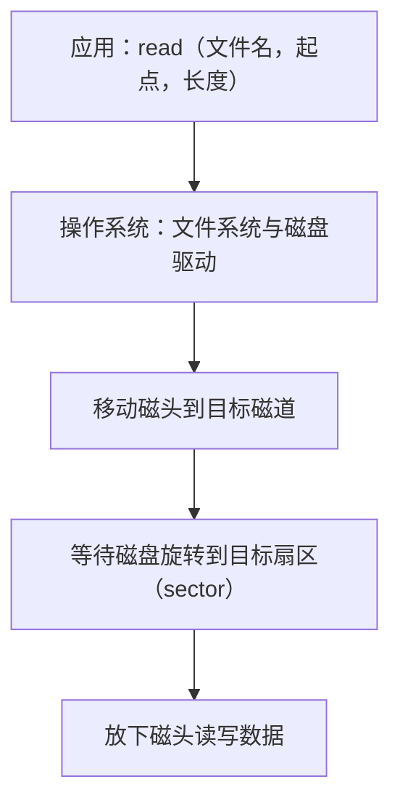

第一种请求简单明了，第二种请求琐碎到让人头疼。操作系统的作用，就是让应用只需要发出第一种请求，第二种由它来完成。[^l01-section-5-s2b7]

#### 软盘控制器的例子

软盘（floppy disk）有过 8 英寸、5.25 英寸、3.5 英寸等规格（俗称八寸、五寸、三寸盘），今天已很难见到实物。要使用软盘，需要软盘驱动器，驱动器里有一个**控制器**（controller）芯片，操作系统实际是与这个控制器打交道。以 NEC 某一型号的软盘控制器为例：[^l01-section-5-s2b7]

- 它有 **16 条指令**。条数看上去不多，但每条指令长度不同，最短 1 个字节，最长 9 个字节，因为指令要携带很多参数。
- 其中的 **read** 指令（读盘，并不是最复杂的一条）有 **13 个参数**。
- 不同品牌、不同型号的控制器，指令可能还互不兼容。

编写驱动程序的人必须掌握这些指令和参数，这是一件很头疼的事。

> [!note] 补充解释
> 这个例子是操作系统教材中的经典例子，见 Tanenbaum《现代操作系统》（Modern Operating Systems）第 1 章，所指芯片通常认为是 IBM PC 时代广泛使用的 NEC PD765 软盘控制器；课程中只说是“NEC 的某一型号”。

#### 驱动框架：编写驱动的责任转移

既然驱动这么难写，由谁来写？这件事的分工发生过变化：[^l01-section-5-s2b7]

| 时期 | 谁编写驱动 | 原因 |
|---|---|---|
| 早期 | 操作系统厂商 | 设备种类不多；为了让自己的系统好卖，来一个设备就编一个驱动 |
| 今天 | 设备厂商 | 设备种类太多，操作系统厂商编不过来；操作系统也足够强大，设备要向它靠拢 |

今天的做法是：操作系统提出一套**驱动框架**，规定驱动怎么写、怎么接入；设备厂商按框架自己编好驱动，再**注册**到操作系统中，操作系统就能支持该设备。这样能支持的设备越来越多，生态也就建立起来了（鸿蒙的驱动框架就是这种思路，见[典型操作系统结构](#典型操作系统结构)）。[^l01-section-5-s2b6]

#### 抹墙比喻

硬件是参差不齐的。新楼刚建好时，墙面砖缝毕露、灰头土脸；抹上一层之后，墙面平整洁白，住在里面的人感觉不到底下的粗糙。操作系统就是抹在参差不齐的硬件上的那一层：经过它的封装，对上、对外呈现的是统一、平整的接口。[^l01-section-5-s2b7]

> [!warning] 易错点
> “操作系统难”不是难在 fork、open 这类共性逻辑上——那是常规的软件设计问题；难点在于要控制种类繁多、接口各异、彼此不兼容的硬件，并把这些差异屏蔽掉。

> [!question]- 自测：一个应用要读取文件 `a.txt` 第 4096 字节起的 512 字节。它需要知道磁头当前在哪个磁道吗？为什么？
> 不需要。应用只发出“文件名 + 起点 + 长度”这种请求；把它换算成磁盘上的磁道、扇区，再移动磁头、等待旋转、读写，都由操作系统的文件系统和驱动完成。这正是操作系统屏蔽硬件复杂性的体现。

> [!question]- 自测：给 Linux 源码“减肥”时，只保留一种体系结构和每类一种设备，为什么代码量会大幅缩小？这个结果说明了什么设计需求？
> 被删掉的正是与具体体系结构、具体设备相关的代码，它们在内核中占很大比例。这说明硬件相关代码量大、变化多，所以需要用硬件抽象层把它们集中屏蔽起来，使其余部分与硬件无关、便于移植。

> [!question]- 自测：一家公司推出了一款全新的摄像头，希望它在某个现代操作系统上即插即用。按今天的分工，谁要做什么？如果这个操作系统没有驱动框架，会出现什么问题？
> 设备厂商按该操作系统驱动框架的规范自己编写驱动，再注册到系统中，操作系统就能支持它。若没有驱动框架，就只能等操作系统厂商为这款设备单独编写驱动；设备种类成千上万，操作系统厂商编不过来，新设备很可能得不到支持，生态也就建不起来。

> [!info]- 来源
> - L01.docx：DOCX body 147–199

[^l01-section-5-s2b6]: L01.docx-DOCX body 147-172
[^l01-section-5-s2b7]: L01.docx-DOCX body 173-199

---

## xv6 阅读与基础模型

> [!abstract] 本节要点
> - 大模型时代读源代码仍是基本功：大模型生成的代码也得人读懂，读码能力越早打牢越好。
> - 课程选用 xv6：规模约一万行、资料充足；读代码前先读 xv6 book 的对应章节。
> - 读法：不通读，按指定文件规划最小阅读路径；从系统调用等入口出发，以系统调用为链画流程图；目标是搞清原理，抓住核心数据结构（PCB 在 xv6 中是 `struct proc`，在 Linux 中是复杂得多的 `task_struct`）。
> - 向大模型提问不能过于宽泛：可以先问“这个文件做什么”，再在结果上对具体函数（如 `allocproc`、`kalloc`）精准追问。
> - 操作系统设计者关注处理器的寄存器（通用寄存器、控制与状态寄存器，尤其是 PC）和进程地址空间：代码、数据来自可执行文件，堆由 malloc 申请，栈运行时动态生成，main 的栈帧并不是栈中的第一个帧。

### 为什么要读源代码

以前要求读操作系统源代码，常被认为工作量太大。有了大模型之后，情况反而倒过来了：大模型帮你生成的代码，你还是得读懂它，因此**读源代码**是应当重新捡起的基本功。读码能力越强越好，而且这是绕不过去的基本功——现在不补，后面也得补，越早打牢越好。[^l01-section-6-s2b7]

### 选择 xv6 与阅读方法

> [!info] 可视化资源
> - [xv6 book（RISC-V 版，MIT 6.1810）](https://pdos.csail.mit.edu/6.1810/2024/xv6/book-riscv-rev4.pdf)：Figure 2.2 列出 xv6 内核源文件及作用，Figure 2.3 给出进程虚拟地址空间布局，可对照本节的阅读路径与地址空间模型。

**xv6** 是 MIT 为教学编写的类 UNIX 操作系统，课程实验以它为对象。选择它的主要原因：[^l01-section-6-s2b7]

1. **代码规模合适**：大约一万行量级，一个学期内读得完重点部分。
2. **资料充足**：配套有 xv6 book，讲解各部分的设计。读某部分源码之前，先把 book 的对应章节好好看一遍，再借助大模型读代码，会很容易抓住要点。

具体的阅读建议：[^l01-section-6-s2b7][^l01-section-6-s2b8]

1. **不通读，有重点地读**：每次实验会指定要读哪些文件，做这个实验往往读这几个文件就够了。
2. **规划最小阅读路径**：只沿着理解当前问题所必需的路线读。
3. **从入口开始**：例如从 `read` 这个系统调用开始，顺着它的调用一路往下看。
4. **以系统调用为链画流程图**：系统调用是一个动态过程，把它经过的函数和步骤画成流程图，就把静态代码还原成了运行过程。
5. **抓住核心数据结构**：读代码的最终目的是搞清原理，而原理的核心是数据结构。

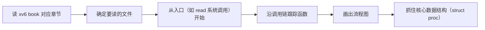

#### struct proc 与 task_struct

最重要的数据结构是**进程控制块**（PCB，Process Control Block）。PCB 是通用概念，在不同系统中名字不同：[^l01-section-6-s2b8]

| 系统 | PCB 的名字 | 特点 |
|---|---|---|
| xv6 | `struct proc` | 教学系统，结构简单，容易看清每个字段的作用 |
| Linux | `task_struct` | 真实系统，字段繁多，复杂得多 |

先从 xv6 的 `struct proc` 入手，弄清 PCB 大致要记录哪些信息，再看 Linux 就容易得多。

> [!note] 补充解释
> 原版 xv6-riscv 的 `struct proc`（`kernel/proc.h`）大致如下，课程所用版本可能略有不同：
>
> ```c
> struct proc {
>   struct spinlock lock;
>   enum procstate state;        // 进程状态：UNUSED、RUNNABLE、RUNNING 等
>   void *chan;                  // 睡眠时等待的对象
>   int killed;                  // 是否被杀死
>   int xstate;                  // 退出状态
>   int pid;                     // 进程号
>   struct proc *parent;         // 父进程
>   uint64 kstack;               // 内核栈的虚拟地址
>   uint64 sz;                   // 用户内存大小（字节）
>   pagetable_t pagetable;       // 用户页表
>   struct trapframe *trapframe; // 陷入内核时保存的用户寄存器
>   struct context context;      // 切换时保存的内核寄存器
>   struct file *ofile[NOFILE];  // 打开的文件
>   struct inode *cwd;           // 当前目录
>   char name[16];               // 进程名
> };
> ```
>
> 对照 hello world 的执行过程看这些字段：页表对应地址映射，trapframe 与 context 对应“进出内核”和“调度换人”时保存的 CPU 上下文，ofile 对应打开的文件（标准输出）。

### 借助大模型精准提问

读代码时建议用大模型辅助，而用好大模型的关键在**提问**。提问不能太宽泛。[^l01-section-6-s2b8]

- **宽泛的提问**：“entry.S 是干嘛的？”“帮我解释一下 proc.c。”proc.c 里放的基本是与进程相关的全部代码，内容太多太泛，大模型给出的结果也特别多，看下来也就那么回事，真正重要的细节没有抓住。
- **改进的做法**：第一步这样问可以，但拿到结果后要做第二次**追问**，而且更精准。例如 proc.c 里有分配进程的 `allocproc`，它内部又调用了分配物理页的 `kalloc`，就可以针对这两个函数分别具体地问。

目标是形成自己的一套提问方式，通过提问把代码中核心的东西提取出来，做到真正理解。

> [!example] 例：从宽泛到精准的一组追问
> 1. 第一问（可以接受的起点）：“xv6 的 proc.c 主要包含哪些功能？”——得到一份函数清单，其中有 `allocproc`。
> 2. 追问：“`allocproc` 在进程表中找空槽时，判断依据是 `struct proc` 的哪个字段？找到后把它设成什么状态？”
> 3. 再追问：“`allocproc` 为什么要调用 `kalloc`？分配到的那一页用来存放什么？分配失败时如何回退？”
> 4. 对照源码核实回答。原版 xv6-riscv 中，`allocproc` 在进程表中找一个 `UNUSED` 的项，分配 pid，用 `kalloc` 分配一页作为 trapframe，再创建空的用户页表，并设置内核上下文使新进程第一次被调度时从 `forkret` 开始执行；任一步失败都会释放已分配的资源。
>
> 每一问都指向具体的函数、字段或步骤，回答才能落到代码细节上。

### 处理器与地址空间模型（ICS 复习）

马上要进入操作系统的具体内容，需要先把 ICS（计算机系统导论）中的基本工作模型找回来。操作系统设计者关注的主要是两样东西：处理器中的寄存器，和内存（地址空间）。[^l01-section-6-s2b8]

#### 寄存器

处理器中操作系统最关心的是**寄存器**：

- **通用寄存器**：保存程序运算的中间值。
- **控制与状态寄存器**：记录处理器的运行状态与控制信息（例如当前特权级、异常原因、页表基址等）。
- 其中最重要的是 **PC**（程序计数器）：CPU 每个指令周期都到 PC 指向的地址取指执行。

前面所说的“设置 CPU 上下文”，本质上就是设置好这一组寄存器，尤其是 PC（见[hello world 的运行](#hello-world-的运行)）。

#### 进程地址空间的布局

一个进程的**地址空间**有固定的分区布局，每个区域的内容有不同的来源：[^l01-section-6-s2b8]

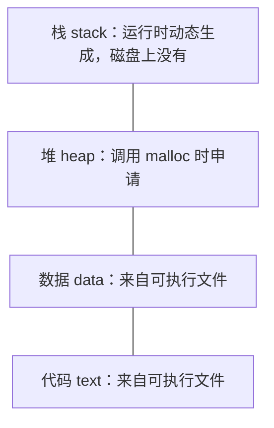

| 区域 | 内容从哪来 | 何时存在 |
|---|---|---|
| 代码 | 可执行文件（ELF 中的代码段） | 加载时建立映射，按需调入 |
| 数据 | 可执行文件（数据段等） | 同上 |
| 堆 | 程序调用 `malloc` 申请的小块空间 | 运行中按需增长 |
| 栈 | 函数调用时动态压入 | 只有运行起来才有内容 |

代码和数据如何从可执行文件映射进来，见[hello world 的加载](#hello-world-的加载)。

**栈**是地址空间中必备的区域，必须有这块区域。它是动态生成的：程序没运行时它不存在，磁盘上的可执行文件里也没有它；只有程序运行起来，栈里才有东西。每调用一个函数就在栈里形成一个**栈帧**（stack frame），函数返回，这个栈帧就结束。

需要特别注意：**main 的栈帧并不是栈中的第一个帧**。在 main 被调用之前，栈中已经压入了内容；之后 main 再调这个、调那个，不断形成新的栈帧。[^l01-section-6-s2b8] 这与“程序执行的第一条指令不是 main 的代码”是同一件事的两面（见[hello world 的加载](#hello-world-的加载)中的思考题）。

> [!tip] 课堂强调
> 寄存器、地址空间布局和栈的工作方式这些最基础的计算机工作模型一定不能忘：忘了这些，会影响对后面内容的理解。[^l01-section-6-s2b8]

> [!note] 补充解释
> exec 时内核先在新栈顶放好 argc、argv、环境变量等信息，之后 C 运行时的启动代码又在 main 之前调用了若干函数，所以 main 之前栈上已有内容。入口代码具体是谁、怎样验证，见[hello world 的加载](#hello-world-的加载)中思考题的解答。

> [!question]- 自测：一个程序声明了全局数组 `int a[100] = {1};`，在 main 里用 `malloc` 申请了 1 KB，又调用了递归函数 `f`。这三者分别位于地址空间的哪个区域？哪一个在磁盘上的可执行文件里找得到？
> 已初始化的全局数组在数据区，内容来自可执行文件；`malloc` 得到的 1 KB 在堆里；`f` 的每一层递归在栈上各形成一个栈帧。只有数据区的初值在可执行文件里，堆和栈都是运行时才产生的。

> [!question]- 自测：要弄清 xv6 中 `fork` 是怎样复制进程的，下面哪种提问方式更好，为什么？A：“解释一下 proc.c。”B：先问 `fork` 调用了哪些函数，再分别追问 `allocproc` 如何找空闲的 `struct proc`、复制用户内存的那一步调用了谁。
> B 更好。A 范围太宽，结果冗长且抓不住细节；B 从入口 `fork` 出发、沿调用链对具体函数逐个精准追问，正是“以系统调用为链、抓数据结构”的读法。

> [!info]- 来源
> - L01.docx：DOCX body 173–221

[^l01-section-6-s2b7]: L01.docx-DOCX body 173-199
[^l01-section-6-s2b8]: L01.docx-DOCX body 200-221

---

## 操作系统的引导与启动

> [!abstract] 本节要点
> - 引导启动链：上电执行 ROM 代码初始化硬件 → bootloader 把内核镜像加载到内存 → 内核初始化各数据结构 → userinit 创建第一个用户进程 init（1 号进程）→ 由 init 派生 shell；最难的是引导加载，内核初始化只是软件行为。
> - 初始化结束后每个核进入自己的 scheduler：永不返回的死循环，选中进程后进入用户态运行，返回内核时又回到这里。
> - RISC-V 有 M（machine）、S（supervisor，内核运行于此）、U（user）三个特权级；启动从最高的 M 模式开始，逐层初始化、逐层下放，直到用户态 shell。
> - SBI 是 S 模式调用 M 模式服务的二进制接口标准，类比应用程序的 ABI。本课程版本在 QEMU 上先运行位于 0x80000000 的 OpenSBI（M 模式），再跳到 0x80200000 的内核入口；entry.S 为每个核建 16 KB 启动栈后进入 C 代码。
> - 真实 Linux 的引导是接力：ROM 自检 → BIOS（现多为 UEFI）→ MBR 中的引导程序 → bootloader（如 GRUB，支持多系统引导）→ 内核镜像。

### 从上电到 shell 的引导启动链

平常开机时，从按下电源到屏幕上出现 shell 提示符，中间经过一条相当长的链。要理解这条链，先要弄清几个概念：引导程序、特权级、SBI 和内核镜像。[^l01-section-7-s2b8]

- **引导程序**（bootloader）：负责把操作系统内核装进内存的程序。这是一个通用概念，在 RISC-V 上具体是什么，要看具体平台。
- **内核镜像**（kernel image）：把内核编译、链接成的一个可加载文件。引导的任务就是把内核镜像加载到内存中约定的位置并转去执行它。
- **特权级**：开机过程中处理器的特权级是在变化的，从最高逐步降到用户级。
- **SBI**：RISC-V 引导中 S 模式与 M 模式之间的接口（下文单独说明）。

整条链如下：[^l01-section-7-s2b8][^l01-section-7-s2b9]

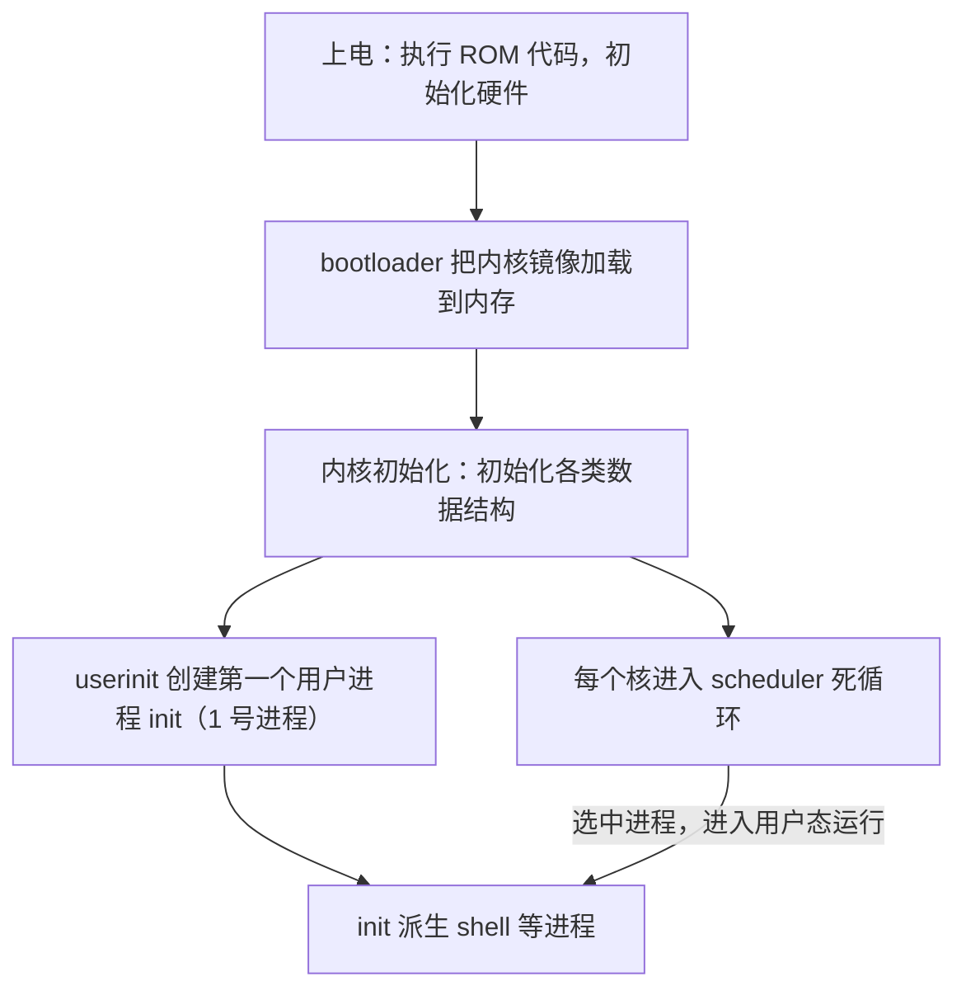

各步要点：

1. **上电执行 ROM 代码**：完成硬件初始化。
2. **加载内核镜像**：把内核镜像加载到内存的约定地址。内核放在什么地址、入口在哪，写在链接脚本（`.ld` 文件）里。
3. **内核初始化**：初始化操作系统内部的各种数据结构。这一步是纯软件行为，代码告诉你初始化了什么，读一遍基本就熟了，相对简单。**整条链中最难的是前面的引导加载部分。**[^l01-section-7-s2b9]
4. **创建第一个用户进程**：第一个用户进程不是用 `fork` 创建的，而是由 `userinit` 创建，称为 **init**。它是 **1 号进程**，所有用户进程的“老祖宗”。按 UNIX 的思路，在它之前还有一个 **0 号进程**。shell 等进程都由 1 号进程派生出来。[^l01-section-7-s2b9]
5. **进入调度器**：最后每个核进入 **scheduler**。scheduler 是一个**永不返回的死循环**，每个核都有自己的 scheduler。它选中一个进程，让它出内核、到用户态运行；该进程回到内核后，又回到这个循环里继续选下一个。[^l01-section-7-s2b9]

这就是从裸机到可以交互对话的界面的完整流程。

> [!note] 补充解释
> 原版 xv6-riscv 中，`userinit` 并不直接装入 init 程序：它构造第一个进程（pid 为 1，xv6 从 1 开始分配 pid，没有显式的 0 号进程），放入一小段手写的 `initcode`，这段代码执行 `exec("/init")`，`/init` 再 `fork` 出 shell。Linux 中则确实有 0 号进程（idle/swapper），1 号进程是 init 或 systemd。
>
> scheduler 的骨架（原版 xv6-riscv `kernel/proc.c`，有删减）：
>
> ```c
> void scheduler(void) {
>   struct cpu *c = mycpu();
>   c->proc = 0;
>   for (;;) {                                // 永不返回
>     intr_on();
>     for (p = proc; p < &proc[NPROC]; p++) {
>       acquire(&p->lock);
>       if (p->state == RUNNABLE) {
>         p->state = RUNNING;                 // 选中它
>         c->proc = p;
>         swtch(&c->context, &p->context);    // 切到该进程；它放弃 CPU 时回到这里
>         c->proc = 0;
>       }
>       release(&p->lock);
>     }
>   }
> }
> ```

### RISC-V 特权级与 SBI

#### 三个特权级

RISC-V 定义了三个特权级（privilege level）：[^l01-section-7-s2b8]

| 特权级 | 名称 | 运行什么 |
|---|---|---|
| M | 机器模式（machine mode） | 最高权限，固件（如 OpenSBI）运行于此，直接面对硬件 |
| S | 监管模式（supervisor mode） | 操作系统内核运行于此；supervisor 即历史名称“管理程序”的那个词（见[操作系统名称与硬件](#操作系统名称与硬件)） |
| U | 用户模式（user mode） | 用户程序（如 shell、hello world）运行于此 |

启动过程是从最高级权限 M 模式开始，逐层完成硬件初始化，再逐层把权限下放，直到用户态的 shell。[^l01-section-7-s2b9]

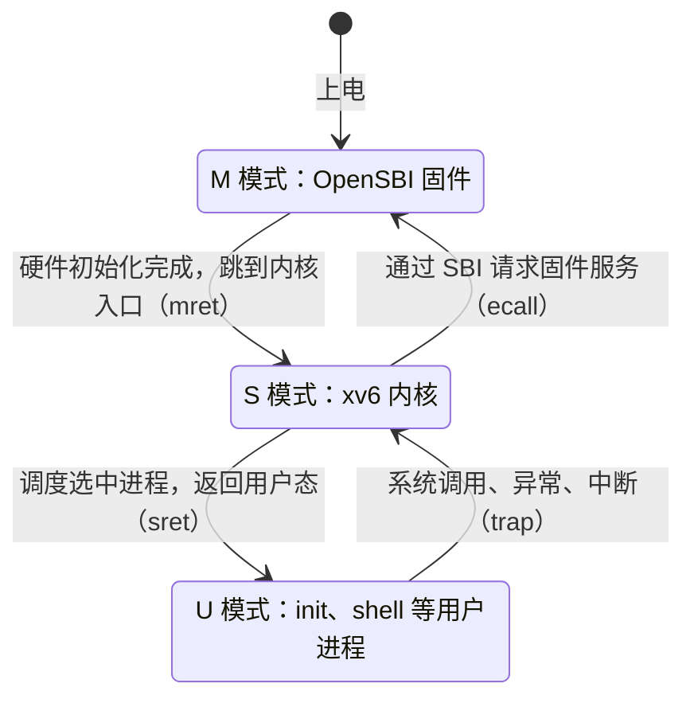

> [!note] 补充解释
> 图中括号里的指令不是课程讲授内容：M 到 S 的下放由 `mret` 完成（OpenSBI 事先把“返回后的特权级”设为 S、返回地址设为内核入口）；S 到 U 由 `sret` 完成；向上进入更高特权级只能通过 trap，即执行 `ecall` 或发生异常、中断。

#### SBI 与 ABI

先回忆 ICS 里的 **ABI**（Application Binary Interface，应用程序二进制接口）：它规定二进制层面的调用规范，例如函数调用时参数放在哪些寄存器、哪些寄存器由调用者（caller）保存、哪些由被调用者（callee）保存。

**SBI**（Supervisor Binary Interface，监管者二进制接口）是同一思路在特权级之间的应用：它是一套**标准规范**，定义 S 模式（内核）与 M 模式（固件）之间的调用接口，即 S 模式可以向 M 模式请求的一组标准函数及其调用约定。[^l01-section-7-s2b8] 内核通过 SBI 使用固件提供的服务，而不必自己直接操作这部分机器相关的硬件。

> [!note] 补充解释
> 按 SBI 规范，S 模式内核把扩展号放在 `a7`、功能号放在 `a6`、参数放在 `a0`–`a5`，然后执行 `ecall` 陷入 M 模式，由固件处理后返回，错误码和返回值在 `a0`、`a1` 中。典型服务有设置定时器、核间中断、启动其他 hart、早期控制台输出等。OpenSBI 是 SBI 的参考实现。规范见 [RISC-V SBI specification](https://github.com/riscv-non-isa/riscv-sbi-doc)。

SBI 的细节留到实验时再深入。

### 本课程 xv6 的启动过程

课程实验在 QEMU 模拟器上运行，没有真实的 BIOS。本课程所用 xv6 版本的启动过程如下：[^l01-section-7-s2b9]

1. **加载 OpenSBI 固件**：OpenSBI 被加载到 **0x80000000**，运行在 M 模式。这个地址可以在链接脚本里看到。
2. **OpenSBI 初始化硬件**：完成硬件初始化后，跳到内核的入口地址 **0x80200000**。
3. **链接脚本 `kernel.ld`**：给出内核的基地址（base address）和入口（entry），代码中可以直接看到。
4. **`entry.S` 建立启动栈**：系统有多个核，要为每个核建立自己的启动栈，每核 **16 KB**；然后调用 main。
5. **`main.c`、`start.c`**：完成一连串初始化，最后每个核进入自己的 scheduler。

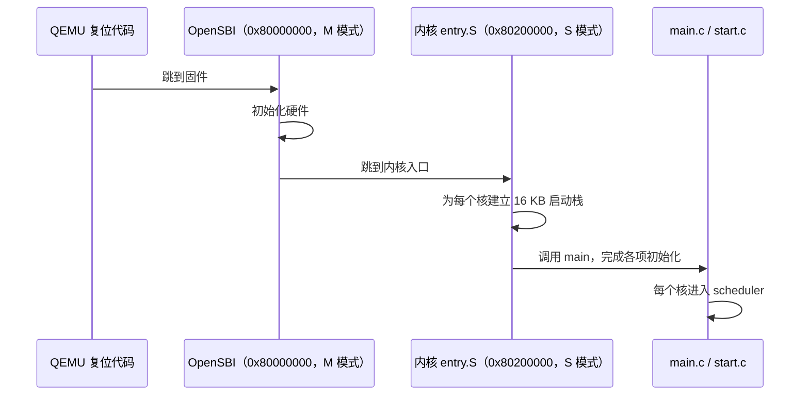

需要重点阅读的文件就这四个：**`entry.S`、`kernel.ld`、`main.c`、`start.c`**。读 `kernel.ld` 等文件中的几处真实代码，就能还原整个启动过程。阅读时可以带着这些问题：内核文件怎样运行起来、如何找到内核文件、从哪个地址开始执行、多核情况下各核的栈怎样排列。[^l01-section-7-s2b9]

> [!note] 补充解释
> 上面的地址与栈大小是本课程所用版本的设置。原版 MIT xv6-riscv 用 `-bios none` 启动 QEMU，不经过 OpenSBI：QEMU 的复位代码直接跳到 0x80000000，`kernel.ld` 把内核放在这里，`entry.S` 在 M 模式下为每个核设置 4 KB 的栈后调用 `start()`；`start.c` 在 M 模式做少量设置，再用 `mret` 降到 S 模式进入 `main()`。原版 `entry.S` 的核心是：
>
> ```asm
> _entry:
>         la sp, stack0          # 所有核的栈连续放在数组 stack0 中
>         li a0, 1024*4          # 每核栈大小
>         csrr a1, mhartid       # 当前核号
>         addi a1, a1, 1
>         mul a0, a0, a1
>         add sp, sp, a0         # sp = stack0 + 栈大小 * (核号 + 1)
>         call start
> ```
>
> 栈向低地址增长，所以每个核的 sp 指向自己那一段的最高地址。

> [!note] 补充解释
> 常听到的“Linux 的栈是 8 兆”需要区分两种栈：8 MB 是 Linux 用户态主线程栈的默认大小上限（`ulimit -s` 默认 8192 KB，glibc 的线程默认栈大小通常也取这个值）；Linux **内核栈**每个线程只有几页，32 位 x86 上为 8 KB，x86-64（Linux 3.15 起）和 64 位 RISC-V 上为 16 KB。与 xv6 每核 16 KB 启动栈对应的是内核栈，不是 8 MB 的用户栈。

> [!note] 补充解释
> RISC-V 版 xv6 的引导比 x86 版 xv6 简单：x86 版要由 BIOS 从磁盘读入 512 字节的引导扇区，引导代码再从 16 位实模式切换到 32 位保护模式，然后才能加载内核。

### 与 Linux 引导的对比

真实的 Linux 引导也从 ROM 自检开始，但链条更长，像接力赛一样一棒接一棒：[^l01-section-7-s2b9]


1. **ROM 自检**。
2. **BIOS 启动**：过去普遍用 BIOS，现在多用 **UEFI** 帮助启动。
3. **MBR**（Master Boot Record，主引导记录）：磁盘上的一块区域，引导程序就放在这里；BIOS 把它加载并执行。
4. **bootloader**：由前一段加载执行后，再把内核镜像加载到内存。
5. **多系统引导**：GRUB 这类工具支持多操作系统引导，开机时选哪个就启动哪个。

每一段只做自己那部分，做完把控制权交给下一段，这就是“接力”。

| 对比项 | 本课程 xv6（QEMU） | 真实 Linux（PC） |
|---|---|---|
| 最初运行的固件 | QEMU 复位代码 + OpenSBI（M 模式） | ROM 自检 + BIOS 或 UEFI |
| 引导程序 | OpenSBI 直接跳到已加载的内核入口 | MBR 引导程序 → bootloader（如 GRUB） |
| 内核位置 | 链接脚本 `kernel.ld` 规定（0x80200000） | bootloader 按内核镜像格式装入 |
| 多系统引导 | 无 | GRUB 等支持 |

> [!note] 补充解释
> MBR 是磁盘的第一个扇区（512 字节），包含一小段引导代码和分区表，是传统 BIOS 的做法。UEFI 不依赖 MBR 中的引导代码，而是从磁盘上的 EFI 系统分区（通常位于 GPT 分区表的磁盘上）读取 bootloader 程序文件来执行。

> [!tip] 课堂强调
> 引导细节不是本课最核心的内容。本讲最核心、要求必须掌握的是 hello world 程序的执行流程，后续课程会在它的基础上不断加深（见[hello world 的运行](#hello-world-的运行)）。[^l01-section-7-s2b9]

> [!question]- 自测：在本课程的 xv6 上，系统有 4 个核，每核启动栈 16 KB，所有栈连续存放在从地址 $B$ 开始的数组中。按原版 xv6 `entry.S` 的算法，核号为 2 的核的初始 sp 是多少？为什么不是 $B + 2 \times 16\,\text{KB}$？
> $sp = B + 16\,\text{KB} \times (2+1) = B + 48\,\text{KB}$。栈向低地址增长，所以 sp 要指向这个核自己那一段 $[B+32\,\text{KB},\ B+48\,\text{KB})$ 的顶端；若取 $B+32\,\text{KB}$，第一次压栈就会写进 1 号核的栈。

> [!question]- 自测：系统启动后，shell 进程是由谁创建的？第一个用户进程又是怎样创建的？
> shell 由 1 号进程 init 派生（fork）出来；而 init 本身不是 fork 出来的，它是内核初始化末尾由 `userinit` 直接构造的第一个用户进程。

> [!question]- 自测：内核初始化完成后，核 0 上运行的 scheduler 选中了 shell，shell 执行 `read` 系统调用等待键盘输入。这期间特权级如何变化？控制最终回到哪里？
> scheduler 在 S 模式选中 shell，让它返回 U 模式运行；`read` 通过 trap 回到 S 模式。shell 需要等待输入时放弃 CPU，控制回到核 0 的 scheduler 循环，由它选下一个进程。scheduler 本身永不返回。

> [!info]- 来源
> - L01.docx：DOCX body 200–243

[^l01-section-7-s2b8]: L01.docx-DOCX body 200-221
[^l01-section-7-s2b9]: L01.docx-DOCX body 222-243

---

## 思考题汇总

- [02 hello world 的加载](#hello-world-的加载)：hello world 执行的第一条指令是什么

## 本讲小结

本讲的核心是 hello world 的执行流程：前两章给出流程本身，后面各章分别回答“内核里有什么”“为什么难”“怎样读到它的代码”“内核自己又是怎样运行起来的”。

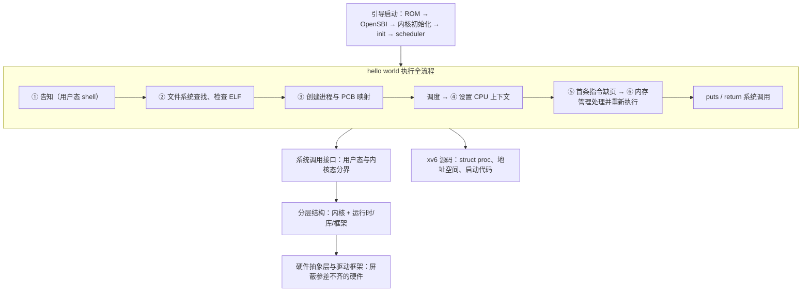

| 问题 | 判断依据 | 对应章节 |
| --- | --- | --- |
| 某一步在用户态还是内核态？ | 此刻 CPU 执行的是用户程序的指令还是操作系统的代码；事件“发生”不等于已进入内核 | [hello world 的运行](#hello-world-的运行) |
| 某个模块该放在内核里还是内核外？ | 是否频繁使用：放在核外会增加进出内核的次数、降低性能 | [典型操作系统结构](#典型操作系统结构) |
| 某段代码是否需要随硬件改写？ | 是否属于 HAL、驱动或调度与上下文切换这类硬件相关部分 | [操作系统名称与硬件](#操作系统名称与硬件) |
| 读一个机制的代码从哪里开始？ | 从系统调用等入口出发，沿调用链画流程图，抓核心数据结构 | [xv6 阅读与基础模型](#xv6-阅读与基础模型) |

## 不确定事项

- L01 本身没有讲授 slides01 的页面（该讲义由 L02 讲授），转录引用的课件（hello world 汇总页、Windows/UNIX/Linux/xv6/Android/鸿蒙/openEuler 结构图、名称溯源手术图、软盘控制器页、抹墙图、ICS 处理器与地址空间图、引导启动链与 RISC-V/Linux 对比页）均未提供；笔记已改写为不依赖这些图的自足表述，各结构的 Mermaid 图是按转录口述重建的，未能与原图核对
- OpenSBI 加载地址 0x80000000、内核入口 0x80200000、每核 16 KB 启动栈来自转录，指本课程所用 xv6 版本；原版 MIT xv6-riscv 不经 OpenSBI、每核 4 KB，笔记已用补充解释区分，但课程版本源码未提供，无法核实
- 转录 ASR 质量较差：“8份”被推断为帧缓冲（frame buffer）；“全省的BIOS”被推断为“没有真实 BIOS”；“XV6 太复杂了，Race five 比 XV6 的引导启动要简单”被理解为 x86 版与 RISC-V 版 xv6 的对比（补充解释中已注明）；“对于这个点B”所指文件无法确定
- Windows NT 图形子系统移回内核（NT 4.0、win32k.sys）、硬件缓存起源（Wilkes 1965、IBM 360/85）、NEC PD765 与 Tanenbaum 教材出处、Linux 内核栈大小等均为编辑/写作者补充的外部事实，已标注为补充解释，课程本身未给出
- 转录中引用的上上节课内容（PCB 首次介绍、“底下是内核、上面跑进程”的图、Three Easy Pieces 组织方式）未提供，只按本讲转录中的复述写入

> [!info]- 来源
> - L01.docx：DOCX body 1–243
