本讲先回答“操作系统是什么”，再从资源管理、进程、虚机器三个角度认识它，并借 MULTICS、UNIX 等历史说明旧思想如何以新名词回归；概述部分的重点是多道批处理和 SPOOLing 技术。下半讲转入 xv6 的 trap 机制：先建立“因事件进入内核、统一经调度离开”的整体模型，再讲控制和状态寄存器、处理器特权模式与陷入指令，最后给出中断与异常的概念、特点和分类。阅读前应熟悉 ICS 中的异常控制流、生产者-消费者模型和虚拟内存，以及 L01「03 hello world 的运行」中程序的执行过程。

---

## 操作系统是什么

> [!abstract] 本节要点
> - 操作系统是计算机系统中**最底层的系统软件**，是一组程序模块的集合，直接建立在硬件之上。
> - 三项职责：以尽量有效、合理的方式管理软硬件资源；组织工作流程、控制程序执行并提供服务；让用户灵活方便地使用计算机，同时让系统高效运行。
> - 三种角色与职责一一对应：资源的管理者（有效、合理）、服务的提供者（方便使用）、机器能力的扩展（易于扩展），虚拟机和容器都是“机器能力扩展”思想的延伸。
> - 三个强调：硬件抽象（屏蔽差异、统一接口）、提供服务（系统调用）、应用隔离（虚拟地址空间 + 独立进程）。
> - 设计目标包括抽象、性能、保护与隔离、可靠性、节能、安全、移动性；不需要背，但设计系统时每一项都要考虑。

### 操作系统的定义

计算机上的软件分为应用软件、支撑软件、工具软件和系统软件等，数据库管理系统这类软件也要依赖下面一层来访问硬件。最下面这一层直接面对硬件，负责整台机器，它就是操作系统。

**操作系统**（Operating System, OS）是计算机系统中的一个系统软件，是一些程序模块的集合，它们：

1. **管理资源**：能以尽量有效、合理的方式组织和管理计算机的软硬件资源；
2. **控制执行、提供服务**：合理地组织计算机的工作流程，控制程序的执行，并向用户提供各种服务功能；
3. **方便且高效**：使用户能够灵活、方便地使用计算机，使整个计算机系统能高效地运行。

#### 为什么写“尽量”有效、合理

“有效”指资源利用率高、性能好；“合理”指分配公平、均衡。两者经常冲突：一味追求利用率，可能让某些程序长期得不到资源，显得不公平；追求均衡，又可能让某些资源闲置，利用率下降。所以定义只说“尽量”。评奖学金也是这样：名额有限，打分和评价机制只能做到尽量合理，不可能绝对合理。

> [!tip] 课堂强调
> 操作系统管理资源这件事，学完这门课之后不能忘。学习过程中要始终记住几项指标：资源利用率、性能、效率、安全。

#### 第二项职责与程序执行

L01「03 hello world 的运行」讲过的 hello world 执行过程，就是操作系统组织 CPU、内存、文件、设备等资源为一个程序服务的完整例子，这正是第二项职责“控制程序执行并提供服务”的具体体现。`open` 等系统调用就是操作系统提供的服务。

### 三种角色

上面三项职责可以概括成操作系统的三种角色，每种角色各有追求的目标：

| 角色 | 对应职责 | 追求的目标 |
| --- | --- | --- |
| 资源的管理者 | 组织和管理软硬件资源 | 有效、合理 |
| 服务的提供者 | 组织工作流程、控制执行、提供服务 | 方便使用 |
| 机器能力的扩展 | 让用户灵活使用、系统高效运行 | 易于扩展 |

- **资源的管理者**：整台计算机的所有资源都归操作系统调度、分派。
- **服务的提供者**：`open` 等各种系统调用都由操作系统提供。
- **机器能力的扩展**：在裸机之上提供一台功能更强、更好用的“机器”。今天的虚拟机、容器都是这一思想的延伸。

### 三个强调

从 L01「04 典型操作系统结构」中的操作系统结构图，可以看出操作系统的三个核心目标：

1. **硬件抽象**（hardware abstraction）：操作系统是硬件之上的第一层软件，负责屏蔽底层硬件的物理差异和复杂细节，向上层应用提供统一、标准化的访问接口。例如把磁盘、键盘、显示器等不同设备抽象为统一的文件操作接口，大大降低应用开发的难度。
2. **提供服务**：通过**系统调用**（system call）为应用程序提供核心基础设施，包括进程调度、内存管理、文件系统管理和网络通信等。这些服务构成应用运行的基础环境。
3. **应用隔离**（isolation）：利用虚拟内存空间和独立进程机制，为每个应用构建相互隔离的运行“沙箱”。这样错误不会扩散，单个程序崩溃不会拖垮整个系统，也保障了系统稳定和数据安全。

本课程实验使用的教学操作系统 **xv6** 用轻量的进程模型、统一的文件描述符接口和极简的文件系统抽象，以很少的代码实现了这三个目标，适合用来理解现代操作系统的设计原理。

> [!note] 补充解释
> 三项职责、三种角色、三个强调是从不同角度对同一事物的描述，并非三套互相独立的定义。例如“硬件抽象”和“机器能力的扩展”说的都是在裸机上搭一台更好用的机器，“应用隔离”则是资源管理中“保护”要求的体现。理解它们之间的对应关系即可。

### 虚拟机、API 与资源管理器

从另一个角度看，操作系统有三个作用：

1. **虚拟机**：操作系统把一个物理资源（处理器、内存或磁盘）转换成更通用、更强大、更易用的虚拟形式。
2. **APIs**：为了接收用户的需求并让用户使用虚拟机的功能（运行程序、分配内存、访问文件等），操作系统提供可供用户调用的接口，也就是应用程序的标准库。
3. **资源管理器**：虚拟化使多个程序可以同时运行（共享 CPU）、并发地访问各自的指令和数据（共享内存）、访问设备（共享磁盘等），操作系统要管理这些共享。

这里的“虚拟机”是广义的：每个程序都觉得自己独占一个 CPU、一块完整的内存，这就是操作系统用物理资源“变”出来的虚拟资源。下一章的[认知操作系统的三种观点](#认知操作系统的三种观点)会从资源管理和虚机器两个角度展开这一点。

### 设计与实现目标

除了上面的基本职责，设计和实现一个操作系统时还要考虑以下目标：

- **抽象**：模块化；用高级语言（C）而不是汇编编写。
- **性能**：尽量减少开销，即尽量少占用额外的时间（指令）和额外的空间（内存、磁盘）。
- **保护**：应用之间、操作系统与应用之间要相互保护，具体手段是隔离进程。
- **可靠性**。
- **节能**。
- **安全性**：保护的扩展，在高度联网的时代尤其要防止恶意应用入侵。
- **移动性**：让操作系统能运行在越来越小的设备上。

这张清单不要求背诵，但设计系统时要从这些角度检查方案。例如做移动设备上的系统要考虑移动性；做任何系统都要考虑能耗不能太大，还要考虑可靠性和安全。

> [!warning] 易错点
> “有效”和“合理”不是同义词。判断一个资源管理策略时要分别问两个问题：资源有没有被充分利用（有效），各个程序拿到的资源是否公平、均衡（合理）。一个策略可能只满足其中之一。

> [!question]- 自测：某系统总是把 CPU 优先分给运行最快、最能提高吞吐量的程序，结果一个慢程序长期得不到运行。这个策略违背了定义中的哪个要求？
> 违背了“合理”。它追求的是“有效”（利用率、吞吐量），但牺牲了公平，体现了有效与合理之间的冲突，这也是定义只写“尽量”的原因。

> [!question]- 自测：应用程序通过统一的 `read`/`write` 接口读写磁盘文件和键盘输入，而不关心设备型号。这体现了三个强调中的哪一个？由哪一类机制提供？
> 体现了**硬件抽象**：操作系统屏蔽设备差异，把不同设备抽象成统一的文件接口。应用通过**系统调用**获得这一服务，所以也是“提供服务”的一部分。

---

## 认知操作系统的三种观点

> [!abstract] 本节要点
> - 认识操作系统要从多个角度入手，常用三种观点：资源管理观点（最重要）、进程观点、虚机器观点。
> - 资源管理的目的是**共享**和**提高利用率**；复用只有**时间**和**空间**两种方式，二者可以互换。
> - 管理资源靠数据结构跟踪资源使用状况，再按分配策略分配和回收；**动态分配**提高利用率，但可能引起死锁，**静态分配**已经过时。
> - 进程观点：任意时刻给系统拍快照，看到的是一个内核加若干可同时、独立运行的进程。
> - 虚机器观点：操作系统分层，每层对上一层是一台机器并屏蔽下层细节；操作系统的四个特征是并发、共享、虚拟、随机性。

### 多个角度认识操作系统

操作系统是个庞然大物，就像盲人摸象，不可能一下摸清全貌，只能从多个角度逐步认识。三种主要观点是：**资源管理的观点**、**进程的观点**和**虚机器的观点**，此外还有许多其他角色：

- **服务提供者**：见[操作系统是什么](#操作系统是什么)。
- **历史教员**：操作系统里积累的设计思想和技术，将来开发应用时还能用上。
- **家长、政府**：什么都管，什么都安排。
- **仲裁者**：两个进程申请同一个资源时，由它决定给谁。
- **魔幻制造者**：把一个物理 CPU 变成多个虚拟 CPU，像变魔术一样。

### 资源管理观点

资源管理观点是自底向上看：操作系统是**资源的管理者**。它管理的资源包括：

- **硬件资源**：CPU、内存、设备（I/O 设备、磁盘、时钟、网络接口等）；
- **软件资源**：磁盘上的文件和信息。

> [!tip] 课堂强调
> 资源管理观点是三种观点中最重要的一条。

本课程正是按资源组织内容的，每类资源对应一个抽象和一个管理模块：

| 资源 | 操作系统提供的抽象 | 课程中的对应内容 |
| --- | --- | --- |
| CPU（处理器） | 进程 | 讲进程，实际上是讲处理器怎么管 |
| 物理内存 | 地址空间 / 虚存 | 虚存可以比物理内存大，会用到磁盘 |
| I/O 设备（磁盘、网卡等） | 文件 | 用文件系统统一管理设备和文件 |

#### 资源管理的目的与两种复用方式

资源管理的目的是**实现资源共享**（不同进程都能用）和**提高资源利用率**。复用（共享）只有两种方式：

1. **时间复用**：多个使用者轮流使用同一资源，主要对应 CPU 时间；
2. **空间复用**：把资源划分成多份同时给多个使用者，主要对应内存，扩展开来就是整个存储体系。

时间和空间可以互相转换，即“时间换空间”或“空间换时间”。一般软件设计的权衡也主要在这两个方面。

#### 怎样管理资源：数据结构与分配策略

管理资源要做两件事：

1. **跟踪记录资源使用状况**：哪些资源空闲、是好是坏、被谁使用、用了多长时间等；
2. **分配和回收资源**：由资源分配策略和算法决定。

资源管理的目标是提高资源利用率、在资源使用时提供保护、协调多个进程对资源请求的冲突等，实现手段就是**数据结构与算法**。

跟踪记录这件事落实到实现上，就是为每种资源定义特定的数据结构，操作系统通过管理数据结构来管理资源：

- 每个进程有一个大的数据结构，操作系统通过管理它来管理进程，进而把 CPU 用起来；
- 文件有 ICS 中学过的 fd 表（文件描述符表）、打开文件表、inode 表等。

> [!note] 补充解释
> 记录进程信息的这个数据结构就是**进程控制块**（Process Control Block, PCB），xv6 中对应 `struct proc`，详见 L04「05 进程控制块 PCB」。

> [!tip] 课堂强调
> 学操作系统的抓手是**数据结构**。算法相对简单，最核心的是数据结构。

#### 静态分配与动态分配

分配策略分两大类：

- **静态分配策略**（static allocation）：进程一创建就拿到运行所需的全部资源，运行过程中不再申请新资源，直到运行结束才归还。这是很早以前的做法，现在已经过时。
- **动态分配策略**（dynamic allocation）：进程运行中需要什么资源时再申请，用完就归还。这是现代操作系统资源分配和回收的典型策略。

以打印机为例：打印机不会一直在打印。静态分配下，进程从开始到结束一直占着打印机，不打印的时候别人也用不上；动态分配下，需要打印时申请，打完就还，别人可以接着用。所以动态分配最大的好处是**提高资源利用率**。

代价是动态申请资源会带来新问题，典型的是 ICS 中学过的**死锁**（deadlock）：几个进程各自持有一部分资源又等待对方的资源，谁都无法继续。很多软件缺陷都来自资源的动态申请。

> [!question]- 自测：进程 P 运行 10 分钟，只在最后 1 分钟用打印机。静态分配和动态分配下，P 分别占用打印机多久？哪种方式有死锁风险？
> 静态分配：P 从创建起就持有打印机，占用约 10 分钟，其中 9 分钟打印机闲置且别人用不上。动态分配：只在最后 1 分钟申请并占用，用完归还。死锁风险来自动态分配，因为进程在持有部分资源的同时还会申请新资源；静态分配一次拿齐所有资源，不会出现“边持有边等待”。

### 进程观点

资源管理观点是静态的，进程观点则从操作系统运行的角度**动态地**观察它。按照这一观点，操作系统由一些**可同时、独立运行的进程**和一个**对这些进程进行协调的核心**（内核）组成。

**进程**（process）是完成某一特定功能的程序的一次执行过程。它是动态的、有生命的：会诞生，也会消亡。

可以这样理解：在某一瞬间给系统拍一张快照，看到的就是一个内核加上若干进程。进程有生有灭，执行期间还会争用资源（例如都想上 CPU）。内核要协调这些冲突，操作系统中的许多问题都在这个过程中解决。L01 中画过的“进程—内核”图正是这个观点，[trap 整体模型](#trap-机制总览)还会再用到它。

### 虚机器观点

从操作系统内部结构看，虚机器观点把操作系统组织成**分层结构**（layered structure）：

1. 把操作系统分成若干层；
2. 每一层完成特定功能，构成一个虚机器，并为上一层提供支持；
3. 通过逐层功能扩充，最终构成整个操作系统虚机器；
4. 操作系统虚机器向用户提供各种功能，完成用户请求。

关键在于，每一层对它上一层来说就是一台“机器”：上一层通过定义好的接口与它交互，只看到它，看不到更下面的层；它则把下面所有层的细节都封装起来。假设分为五层，每层都为上一层提供支持，同时把下层的操作屏蔽掉。

操作系统之上的 API 也是一层封装：应用调用 API，API 需要进入内核时就是系统调用。

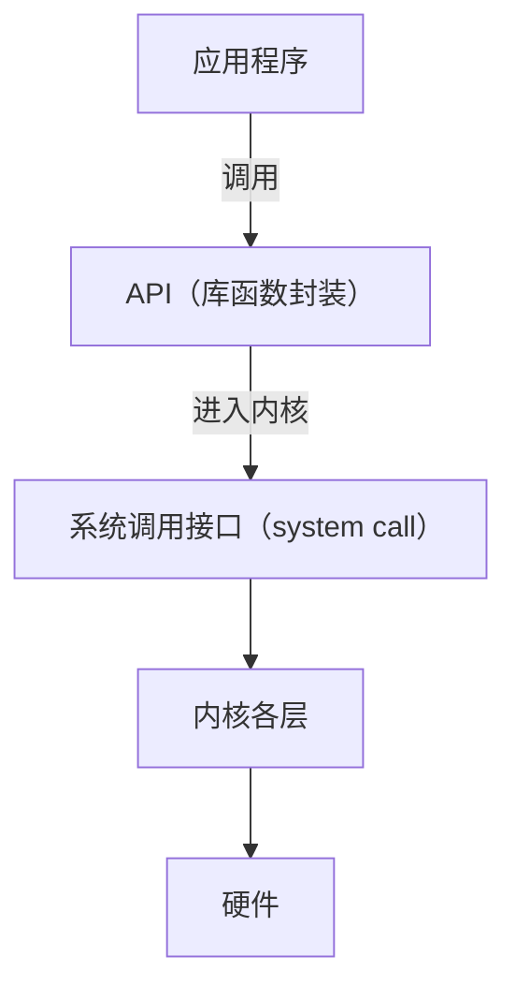

Android、鸿蒙、Windows 等系统都分层，只是层次清晰程度不同，Linux 内部的分层就比较模糊。分层是解决复杂问题最有效的手段之一：任务按层分解，出问题时容易定位到是哪一层出的错。

### 操作系统的特征

> [!info] 依据讲义整理
> 本小节（讲义第 14–19 页）课上未讲解，以下根据讲义整理。

与其他软件相比，操作系统有四个典型特征：**并发、共享、虚拟、随机性**。

#### 并发（Concurrency）

**并发**是指处理多个同时性活动的能力，即计算机系统中同时运行多个程序：

- **宏观上**，这些程序同时在执行；
- **微观上**，在单 CPU 情况下，任何时刻只有一个程序在执行，这些程序在 CPU 上轮流执行。

并发带来的问题包括活动之间的切换、相互保护，以及相互依赖的活动之间的同步。

**并行**（parallel）则要求多个活动在同一时刻真正同时执行，需要多个 CPU（或多个执行部件）。

> [!warning] 易错点
> 并发不等于并行。判断方法是看“同一时刻”：单 CPU 上同一时刻只有一个程序在运行，多个程序只是在一段时间内交替推进，这是并发；多个 CPU 上同一时刻有多个程序在运行，才是并行。并行一定并发，并发不一定并行。

#### 共享（Sharing）

**共享**是指操作系统与多个用户程序共同使用计算机系统中的资源。系统资源有限，操作系统要合理地分配和使用它们，资源在一段时间内交替被多个进程使用。共享分两种：

- **互斥共享**：一段时间内只允许一个进程使用，如打印机；
- **同时共享（访问）**：一段时间内允许多个进程同时访问，如可重入代码、磁盘文件。

共享引发的问题：资源分配很难达到最优，资源使用时还需要保护。

#### 虚拟（Virtual）

**虚拟**是指把一个物理实体映射为若干个对应的逻辑实体，方式是分时或分空间。虚拟技术是操作系统管理资源的重要手段，可以提高资源利用率。例如：

- **CPU**：每个用户（进程）都有一个“虚处理器”；
- **存储器**：每个进程都占有一个地址空间（代码 + 数据 + 堆、栈）；
- **显示设备**：多窗口或虚拟终端。

把虚拟思想推广到整台机器，就得到**虚拟机管理器**（Virtual Machine Monitor, VMM）。没有虚拟机时，单个操作系统拥有全部硬件资源（处理器、内存、图形、网络、存储、键盘/鼠标），通过设备驱动（IDE、NIC、GFX 等）管理它们；有虚拟机时，VMM 直接运行在物理硬件之上，向上提供多个虚拟机 $VM_0, VM_1, \dots$，每个虚拟机里运行自己的客户操作系统（Guest OS）和应用，多个操作系统共享同一套硬件资源。

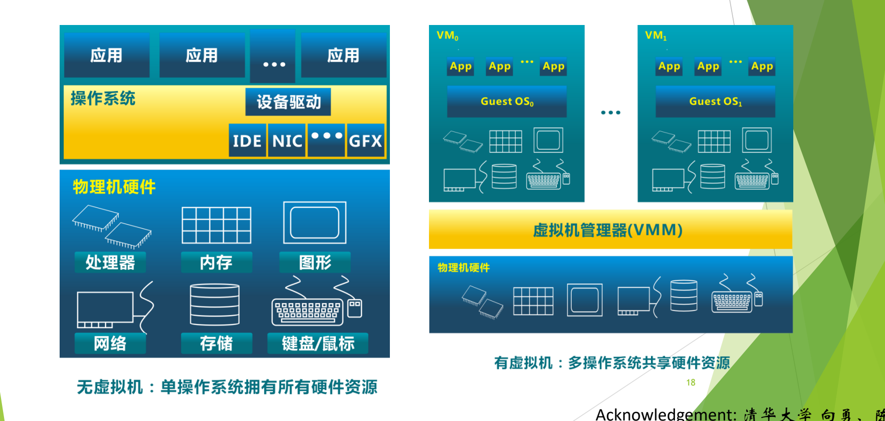

图：左侧是单个操作系统独占全部物理硬件；右侧由虚拟机管理器（VMM）把同一套物理硬件分给多个客户操作系统，每个客户操作系统上再运行各自的应用。

#### 随机性（不确定性）

**随机性**是指操作系统必须随时响应以不可预测的次序发生的事件。它表现为：

- **进程的运行速度不可预知**：多个进程并发执行，“走走停停”，无法预知每个进程推进的快慢；
- **难以重现系统在某个时刻的状态**，包括难以重现运行中出现的错误。

> [!question]- 自测：两位同学在单核笔记本上一边播放音乐一边编辑文档，感觉两者都在“同时”运行。这是并发还是并行？这里体现了操作系统的哪些特征？
> 是并发不是并行：单核任何时刻只有一个程序在 CPU 上执行，两个程序轮流执行，宏观上像同时进行。这体现了**并发**；CPU 被时分复用，每个程序觉得自己有一个处理器，体现了**虚拟**；两者共用内存、磁盘等资源，体现了**共享**。

---

## 历史的启示

> [!abstract] 本节要点
> - 技术变化会让某些思想过时消失，另一种技术变化又会让它们以新名词复活：很多“新技术”是旧思想的升级。
> - 回归的例子：连续文件分配（在只读光盘上回归）、硬件保护、动态链接（MULTICS 首先提出）、计算服务（以集中式 Internet 服务器和云计算形式回归）。
> - MULTICS 设想一台计算机为整个地区提供服务、不能停机，因此提出动态链接以便在线更新软件。
> - UNIX 由 Thompson 和 Ritchie 在贝尔实验室开发，奉行“小即是美”；名字的一种合理猜测是与 MULTICS 对着来（MULTI → UNI）。
> - 操作系统发展可分七个阶段：批处理、分时、个人计算、分布式、移动计算、云计算、泛在计算（人机物融合）。

### 概念的重用与回归

学操作系统的历史，不是为了记年份，而是为了看清一个规律：**技术变化导致某些思想过时并迅速消失，但技术的另一种变化又可能使它们复活**。 复活的东西不是原样照搬，而是经过重新封装，以新概念的形式出现，里面的核心思想基本不变。计算机领域这种情况特别多，所以看到新名词时，要想一想它是哪种旧技术的升级。

操作系统中的几个例子：

1. **磁盘上的文件分配 → 连续文件（CD-ROM 文件系统）**：早期磁盘文件采用连续分配，文件一变大，就得另找一块能容纳整个文件的连续空间，很麻烦，于是改为不连续分配。后来出现了只读光盘，内容写入后不再改变，顺序连续存放反而最好，连续分配又回来了。
2. **硬件保护**：早期机器有硬件保护，后来（例如早期个人计算机）一度不做保护，现在又重新需要保护。
3. **动态链接**：由 MULTICS 首先提出，后来沉寂，现在又被普遍使用。
4. **计算服务**：MULTICS 提出的计算服务模式，以大量附有相对简单用户机器的集中式 Internet 服务器形式回归，进一步发展为**云计算**。

### MULTICS 与动态链接

**MULTICS**（MULTiplexed Information and Computing Service）是 20 世纪 60 年代由 MIT、通用电气（GE）和贝尔实验室合作开发的操作系统，GE 负责提供硬件，系统用 PL/I 语言编写。  项目周期很长，从 1963 年开始，直到 1969 年才发布。 其间贝尔实验室退出了项目，系统最终由其余合作方完成，并在波士顿等地区投入使用。

> [!note] 补充解释
> 课堂口述的版本是“GE 先退出、贝尔实验室随后退出，最后由 MIT 完成”。可核实的史实是：贝尔实验室于 1969 年退出项目；GE 的计算机部门 1970 年卖给 Honeywell，此后由 MIT 和 Honeywell 继续推进。正文按史实表述。PL/I 是 IBM 主导设计的语言，MULTICS 采用了它，并不是合作方之一为 MULTICS 专门设计的。参见 [Multics 官方史料站 multicians.org](https://multicians.org/history.html)。

MULTICS 的设想是让一台大型计算机为整个波士顿地区的用户提供计算服务。这带来一个直接的约束：**系统不能关机**。可是软件总会出错、总要更新，不停机怎么换掉正在使用的代码？MULTICS 的回答是**动态链接**（dynamic linking）：程序运行时才去查找并链接所需的模块，于是更新某个模块不必停掉整个系统。动态链接后来一度不被重视，如今又成为标准做法（例如 ICS 中学过的共享库），这是“回归”的典型例子。

MULTICS 的**计算服务**模式也值得注意：用户插上终端就连到那台大计算机上使用服务，这与今天联网使用远程服务没有本质区别。这种模式以集中式服务器和云计算的形式回归了。

### 重大失败与成功案例

MULTICS 并不是唯一陷入困境的大型项目。早期的大型操作系统都面临重大失败：

- **IBM OS/360** 发布时带着已知的约 1000 个错误。项目负责人 Frederick P. Brooks, Jr. 后来把这段经历写成了《人月神话》（*The Mythical Man-Month*）。
- **Multics** 从 1963 年开始，直到 1969 年才发布。

与之对照的成功案例是 **UNIX**：

- 由贝尔实验室的一群计算机爱好者开发，核心人物是 **Ken Thompson** 和 **Dennis Ritchie**，两人获得 1983 年图灵奖和 1999 年 4 月美国国家技术奖章。
- 初衷很朴素：想在一台没人使用的 DEC PDP-7 小型计算机上玩“星际探险”（Space Travel）游戏。

UNIX 的开发者正是退出 MULTICS 项目的贝尔实验室成员，他们还设计了 **C 语言**。他们认为 MULTICS 太庞大，主张**小即是美**，所以 UNIX 的命令都很短：`ls`、`cat`，创建文件的系统调用 `creat` 甚至少了一个字母 e。少 e 的原因一说是图省事，一说只是个玩笑。

#### UNIX 名字的来历（猜测）

一种比较合理的猜测是：UNIX 有意与 MULTICS 对着来，MULTI（多）对应 UNI（单），再为了读音和拼写改成以 x 结尾，就成了 UNIX。这只是猜测。

> [!note] 补充解释
> 这一猜测与常见的史料说法一致：UNIX 最初被戏称为 UNICS（UNiplexed Information and Computing Service），是对 MULTICS 的反讽式模仿，后来改拼为 Unix。至于 `creat`，Ken Thompson 被问到如果重新设计 UNIX 会改什么时，回答过“我会把 creat 拼上 e”。

### 操作系统发展的七个阶段

> [!info] 依据讲义整理
> 本小节中的发展历程总览和各阶段（讲义第 22–25 页、第 28–32 页）课上没有讲解，以下根据讲义整理。第 26–27 页的失败与成功案例见上一小节。

操作系统随着计算机硬件技术、应用需求和软件新技术的发展而发展，始终围绕两个目标：**充分利用硬件、提供更好的服务**。发展脉络大致是：大型机 → PC 机 → 网络 → 移动计算 → 云计算 → 物联网、大数据分析、人工智能 → 人机物融合（泛在操作系统）。

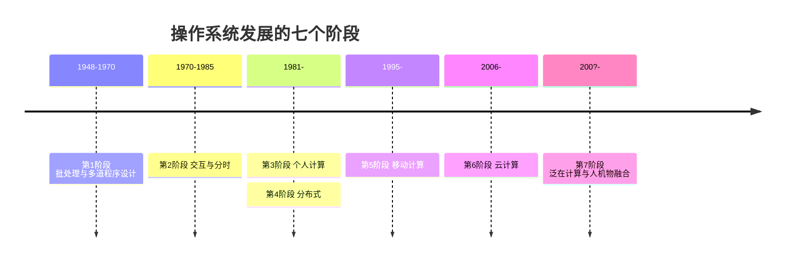

#### 第 1 阶段（1948–1970）：硬件昂贵，人工便宜

目标是更有效地利用硬件资源，代价是用户和计算机之间缺乏交互。

- **控制台**：一次一个用户，独占资源。
- **批处理**：装入程序 → 运行 → 打印输出结果，这时还没有保护。操作系统必须管理所有程序的交接和运行，因而变得复杂。
- **数据通道、中断**：让 I/O 和计算重叠进行。
- **多道程序设计**：多个程序同时运行，多个用户共享系统，因而需要存储保护。
- **SPOOLing 技术**：组织批处理作业的处理流程。

批处理和多道程序设计见[批处理系统与多道程序设计](#批处理系统与多道程序设计)，SPOOLing 见[卫星机与 SPOOLing 技术](#卫星机与-spooling-技术)。

#### 第 2 阶段（1970–1985）：硬件便宜，人工昂贵

重点转向**交互和分时**：利用便宜的终端，让多个用户同时与系统交互；牺牲一些 CPU 时间，换来用户更好的响应时间。用户可以在线开发、调试、编辑。引出的问题是，用户增加时系统性能下降（响应时间变长、出现抖动）。

**第一个分时操作系统 CTSS**：分时的思想 1959 年在 MIT 提出，核心观察是：调试程序的用户通常只发出简短的命令，很少发出长时间运行的命令。所以给每个用户一个联机终端，计算机就能为许多用户提供交互式的快速服务，CPU 空闲时还能在后台运行大作业。

- CTSS 由 MIT 的 Fernando Corbató 等人于 1961 年在一台改装的 IBM 7090/94 上开发成功，支持 32 个交互式用户。
- 指标：内存 32K，其中系统用 5K，用户用 27K；用户的存储映像在内存和一台磁鼓之间来回切换。
- 1962 年，曼彻斯特大学的 Atlas 计算机投入运行（速度 200 kFLOPS），它是第一台具有**虚拟存储器**（virtual memory）和**页面调度**（paging）的机器。

分时系统作为一种操作系统类型的特点，见[卫星机与 SPOOLing 技术](#卫星机与-spooling-技术)中的相关内容。

#### 第 3 阶段（1981–）：个人计算

硬件非常便宜，人工非常昂贵，挑战变成如何利用计算机充分发挥人的时间。

- 开始时 PC 硬件资源有限，一次只运行一个程序，操作系统只是一个例程库，**回归简单**。
- 后来 PC 资源越来越丰富，操作系统又变成庞然大物，**存储保护、多道程序设计再次出现**。这又是“概念回归”的一例。

#### 第 4 阶段（1981–）：分布式

网络让不同机器可以很容易地相互共享资源（打印机、文件服务器、Web 服务器），需要解决的问题是共享和安全。

#### 第 5 阶段（1995–）：移动计算

各种移动终端出现（笔记本、平板、手机、机顶盒、可穿戴设备等），特点是小型、移动、便宜，但能力有限。

#### 第 6 阶段（2006–）：云计算

云计算提供可无限扩展、随时获取、按需使用、按使用付费的资源。

**云计算操作系统**是云计算后台数据中心的整体管理运营系统。它构架在服务器、存储、网络等基础硬件资源，以及单机操作系统、中间件、数据库等基础软件之上，管理海量软硬件资源，是一个云平台综合管理系统。它包括大规模基础软硬件管理、虚拟计算管理、分布式文件系统、业务/资源调度管理、安全管理控制等模块，作用有三：

1. 管理和驱动海量服务器、存储等基础硬件，把一个数据中心的硬件资源在逻辑上整合成一台服务器；
2. 为云应用软件提供统一、标准的接口；
3. 管理海量计算任务和资源调配。

对照[操作系统是什么](#操作系统是什么)可以看出，这三点与单机操作系统的资源管理、提供服务和硬件抽象相对应，只是管理对象从一台机器扩展到了整个数据中心。

#### 第 7 阶段（200?–）：泛在计算

泛在计算、普适计算、物联网：许多联网设备为许多人提供个性化服务，走向**人—机—物**融合。

> [!question]- 自测：个人计算机早期的操作系统只是一个例程库，后来又加回了存储保护和多道程序设计。用本节的规律解释这一现象。
> 这是“概念的重用与回归”：早期 PC 资源有限、一次只跑一个程序，保护和多道失去意义而被丢弃（技术变化使思想过时）；PC 资源丰富后需要同时运行多个程序、互不破坏，大型机时代的存储保护和多道程序设计又被重新引入（另一种技术变化使它们复活）。

> [!question]- 自测：MULTICS 为什么必须提出动态链接？如果它采用静态链接，更新一个库函数会怎样？
> 因为它要让一台计算机持续为整个地区服务，不能停机。静态链接时库代码在链接阶段就被复制进每个可执行程序，更新库函数需要重新链接并重启相关程序，甚至停掉系统；动态链接在运行时才装入模块，可以在线替换模块而不停机。

---

## 批处理系统与多道程序设计

> [!abstract] 本节要点
> - 批处理流程：用户交作业 → 操作员组批输入 → 启动操作系统 → 系统自动依次执行 → 操作员分发结果；用户不直接接触计算机。
> - 作业 = 用户程序 + 数据 + 作业说明书（作业控制语言），早期是一叠卡片（如 FMS JOB）。
> - 单道批处理一次只让一个作业进内存，CPU 和 I/O 交替空闲；多道程序设计让多个作业同时进内存，一个等 I/O 时另一个用 CPU。
> - JOB1/2/3 例子中，多道使总时间从 30 分钟降到 15 分钟，吞吐率从 6 提高到 12 jobs/hr，平均响应时间从 18 降到 10 分钟。
> - 内存里同时有多个程序，才需要决定下一个由谁运行，调度问题由此产生。

### 操作系统的分类与批处理

传统上操作系统分为：批处理操作系统（多道批处理）、分时系统、实时操作系统、个人计算机操作系统、网络操作系统、分布式操作系统、嵌入式操作系统，其中批处理、分时和实时系统合称**通用操作系统**。此外还有 Tanenbaum 的分类。  今天这些类型已经相互融合，分类本身已不常提。最早的**多道批处理系统**仍值得细讲，因为它的许多设计思想至今仍有影响。

其余类型（分时、实时等）的介绍见[卫星机与 SPOOLing 技术](#卫星机与-spooling-技术)。

### 批处理的工作方式

早期计算机非常昂贵，用户不能直接操作，开机也耗电，不能一直空等用户。批处理的做法是把许多用户的程序攒成一批，交给机器连续自动处理。具体步骤是：

1. **交作业**：用户把作业（就是要运行的程序）交给**系统操作员**；
2. **组批**：系统操作员把许多用户的作业组成一批，输入计算机系统，在系统中形成一个自动转接的连续作业流；
3. **启动**：系统操作员启动操作系统；
4. **自动执行**：系统自动、依次执行每个作业；
5. **分发结果**：系统操作员把作业结果交给用户。

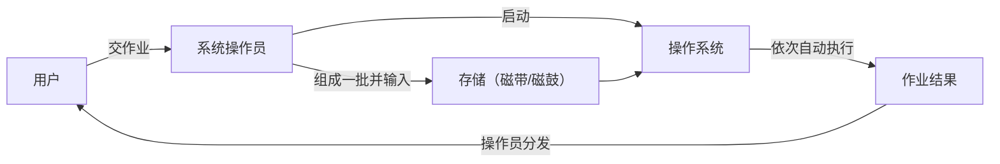

这种方式在国内直到 1991 年前后仍在使用。作业先输入并存放在当时的外存（磁带、磁鼓）上，操作员按下按钮引导启动操作系统，系统依次执行作业并输出结果。在美国，操作员会把结果按编号放进一排格子（类似今天的快递柜），用户自己去取。

#### 批与批作业处理

**批**（batch）是可供一次加载的磁带或磁盘，通常由若干作业组成，处理时使用同一组系统软件（系统带）。

**批作业处理**对批中的每个作业做相同的处理：从磁带读入用户作业和编译链接程序 → 编译链接用户作业，生成可执行程序 → 启动执行 → 输出执行结果。

### 作业的组成

批处理系统中的**作业**（job）由三部分组成，即**用户程序**、**数据**、**作业说明书**。作业说明书用**作业控制语言**（Job Control Language, JCL）写成，告诉系统如何处理这个作业。

早期一个作业由一张张卡片组成，卡片上是命令和程序。典型的 FMS JOB 卡片叠，按读入顺序是：

```text
$JOB, 10,429754, Ned      ← 作业开始：作业参数与用户名
$FORTRAN                  ← 调用 Fortran 编译器
（Fortran 程序卡片）
$LOAD                     ← 装入编译好的目标程序
$RUN                      ← 运行程序
（程序所需的数据卡片）
$END                      ← 作业结束
```

以 `$` 开头的卡片就是作业控制语言，其余是程序和数据。后来载体从卡片逐渐变为纸带、磁带。

> [!note] 补充解释
> 卡片上每条 `$` 命令的含义，是根据卡片名称和批作业处理流程（编译 → 链接装入 → 运行 → 输出）整理的，`$JOB` 后面的字段在讲义中没有逐项说明。

### 单道批处理与多道程序设计

批处理系统分为两类：

- **单道批处理系统**（simple batch processing, uniprogramming）：对应**单道程序设计**；
- **多道批处理系统**（multiprogramming system）：对应**多道程序设计**。

#### 单道批处理的问题

上面描述的就是单道批处理：一批作业送到外存上，操作系统一次只处理一个作业，等它执行完、结果输出后，再执行下一个。

问题在于，一个作业至少用到 CPU 和 I/O 两种资源，而它们交替空闲：作业用 CPU 时 I/O 设备空着，作业等 I/O 时 CPU 空着。单道时间线上，Program A 只有很短的 Run 段，其余大段时间都在 Wait（等待 I/O），这段时间 CPU 无事可做。

#### 多道程序设计

为了提高资源利用率，出现了**多道程序设计**（multiprogramming）：让多个程序同时进入内存，有的在 CPU 上运行，有的在做 I/O，由操作系统在它们之间周转，使 CPU 和 I/O 设备都尽量忙起来。

多道时间线上，Program A、B、C 都在内存里。A 开始等待时 B 运行，B 等待时 C 运行。合起来看（Combined），CPU 在原来的空闲时段里依次运行了 A、B、C，等待时间被其他程序的运行填上了。

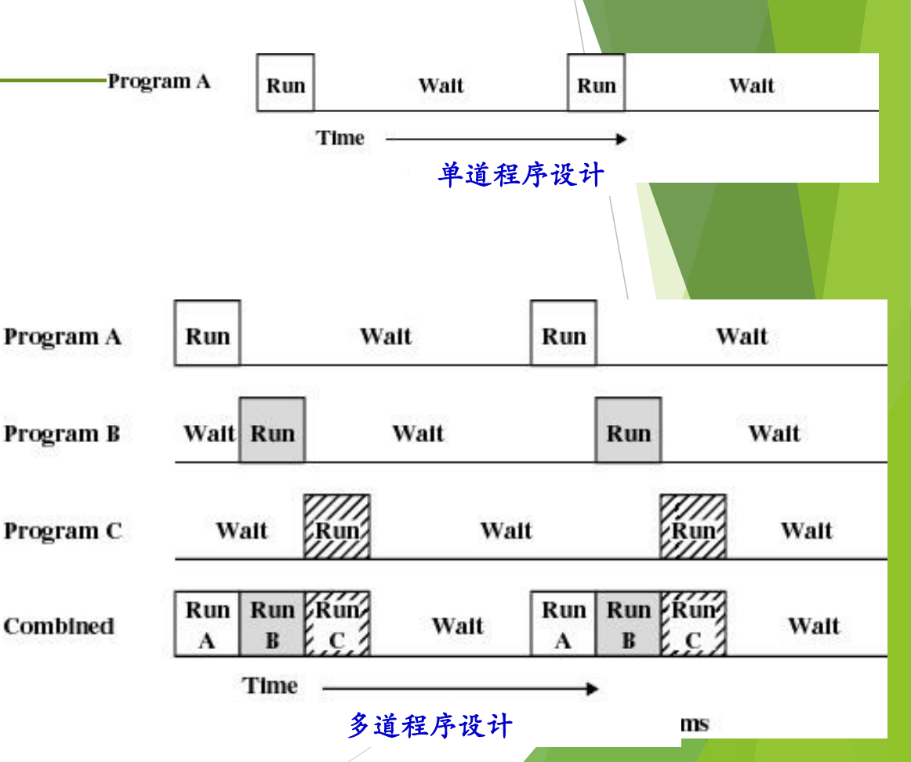

图：单道程序设计中程序 A 运行一段后只能等待 I/O，CPU 空闲；多道程序设计把 A、B、C 的运行段错开，合并后 CPU 在 A 等待时运行 B、C，空闲时间明显减少。

今天这已稀松平常，就像一边听课一边看课件。但在当时，让多个程序同时进内存并协调运行是全新的设计思想，而且它带来一个新问题：**调度**（scheduling）。只有一个程序时没什么好调度的，做完一个再找下一个就行；多个程序同时在内存里，就必须决定下一个由谁上 CPU，于是有了调度算法。

> [!warning] 易错点
> 多道程序设计不等于多个程序在同一时刻同时运行。单 CPU 上任一时刻仍只有一个程序在用 CPU，“多道”提升的是 CPU 和 I/O 的重叠程度，即宏观上的并发（见[认知操作系统的三种观点](#认知操作系统的三种观点)中并发与并行的区别）。

### 多道程序设计的效果：JOB1/2/3 实例

作业按资源需求大致分两类：

- **I/O 密集型**（Heavy I/O）：大部分时间在输入输出；
- **计算密集型**（Heavy compute）：大部分时间在 CPU 上计算，如天气预报计算。

以三个作业为例：

| | JOB1 | JOB2 | JOB3 |
| --- | --- | --- | --- |
| 作业类型 | 计算密集型 | I/O 密集型 | I/O 密集型 |
| 运行时长 | 5 min | 15 min | 10 min |
| 所需内存 | 50K | 100K | 80K |
| 需要磁盘 | 否 | 否 | 是 |
| 需要终端 | 否 | 是 | 否 |
| 需要打印机 | 否 | 否 | 是 |

注意当时的内存很小，作业只需要 50K、100K、80K。三个作业需要的设备几乎不重叠：JOB1 主要用 CPU，JOB2 用终端，JOB3 用磁盘和打印机。分别按单道和多道运行的统计结果如下：

| 指标 | 单道（Uniprogramming） | 多道（Multiprogramming） |
| --- | --- | --- |
| 处理器利用率 | 22% | 43% |
| 内存利用率 | 30% | 67% |
| 磁盘利用率 | 33% | 67% |
| 打印机利用率 | 33% | 67% |
| 总时间（Elapsed time） | 30 min | 15 min |
| 吞吐率（Throughput rate） | 6 jobs/hr | 12 jobs/hr |
| 平均响应时间（Mean response time） | 18 min | 10 min |

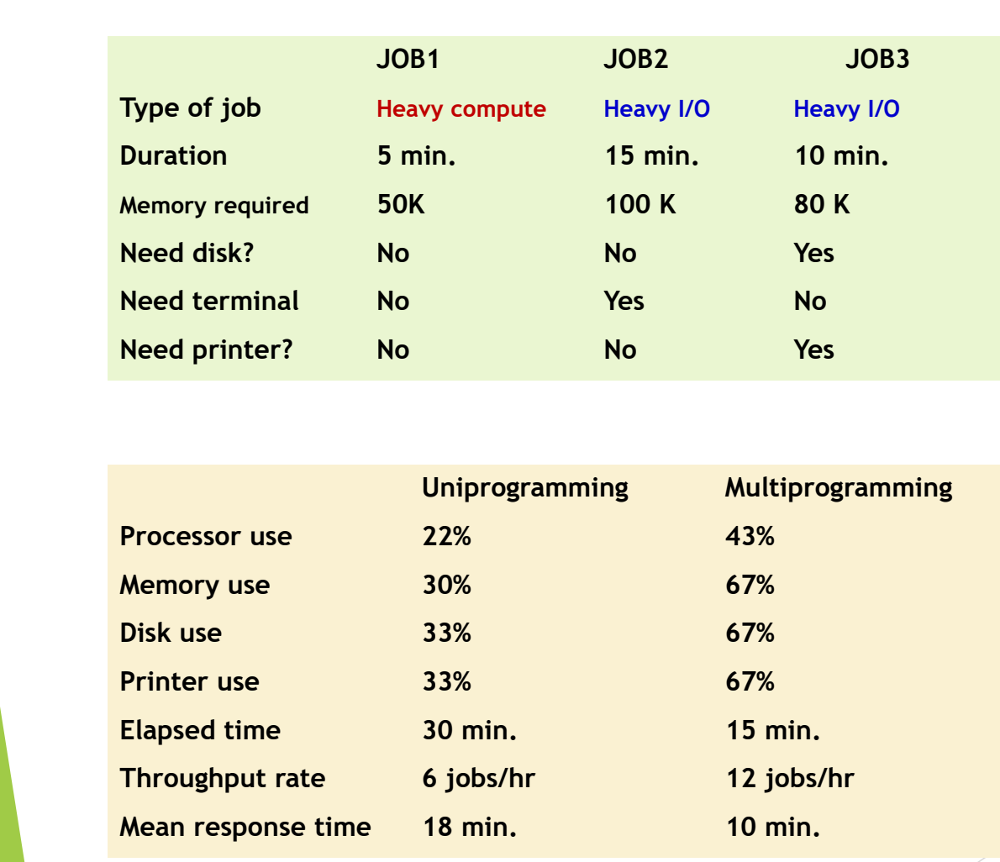

图：JOB1 是计算密集型，JOB2、JOB3 是 I/O 密集型；同一组作业改用多道程序设计后，处理器利用率从 22% 升到 43%，总耗时从 30 分钟降到 15 分钟，吞吐率从每小时 6 个作业升到 12 个。

这张表只要求看懂结果，理解为什么要引入多道即可：在多道方式下，各项资源的利用率都大约翻倍，总时间减半，吞吐率翻倍，平均响应时间也明显缩短。

#### 推导：总时间、吞吐率与平均响应时间

> [!note] 补充解释
> 下面的推导是补充内容，讲义只给出结果。假设多道时三个作业所需设备基本不冲突、可以各自按原时长并行推进，就能用表中数据推出后三行。

**单道**：按 JOB1 → JOB2 → JOB3 依次执行，完成时刻分别为 $5$、$5+15=20$、$20+10=30$ 分钟。

$$
T_{\rm elapsed} = 30\ \text{min},\qquad
\text{吞吐率} = \frac{3\ \text{jobs}}{0.5\ \text{h}} = 6\ \text{jobs/hr},\qquad
\bar{T}_{\rm resp} = \frac{5+20+30}{3} \approx 18.3\ \text{min} \approx 18\ \text{min}
$$

**多道**：三个作业同时开始，完成时刻分别为 $5$、$15$、$10$ 分钟，总时间由最长的 JOB2 决定。

$$
T_{\rm elapsed} = 15\ \text{min},\qquad
\text{吞吐率} = \frac{3\ \text{jobs}}{0.25\ \text{h}} = 12\ \text{jobs/hr},\qquad
\bar{T}_{\rm resp} = \frac{5+15+10}{3} = 10\ \text{min}
$$

其中 $T_{\rm elapsed}$ 是从第一个作业开始到所有作业完成的总时间；吞吐率是单位时间内完成的作业数；平均响应时间 $\bar{T}_{\rm resp}$ 是各作业从提交（这里都在时刻 0）到完成的时间的平均值。

多道程序设计解决了“一个程序等 I/O 时 CPU 空闲”的问题。但如果内存里所有程序都在等慢速 I/O，CPU 仍然只能等，CPU 与 I/O 速度的矛盾依然存在。下一步的解决办法见[卫星机与 SPOOLing 技术](#卫星机与-spooling-技术)。

> [!question]- 自测：单道方式下，如果把执行顺序改为 JOB1 → JOB3 → JOB2，总时间和平均响应时间分别是多少？与原顺序相比说明了什么？
> 完成时刻为 $5$、$15$、$30$ 分钟，总时间仍是 $30$ 分钟，平均响应时间为 $\frac{5+15+30}{3}\approx16.7$ 分钟，比原顺序的约 $18.3$ 分钟短。说明执行顺序不影响单道的总时间，但会影响平均响应时间（短作业先做更好），这已经是调度问题的雏形。

> [!question]- 自测：内存只能放下一个作业的机器，能实现多道程序设计吗？为什么例子要列出每个作业的内存需求？
> 不能。多道程序设计的前提是多个程序同时驻留内存，CPU 才能在一个程序等 I/O 时立即切换到另一个。例子列出 50K、100K、80K 的需求，就是为了说明三个作业能同时放进内存，多道才可行；这也是多道方式下内存利用率从 30% 升到 67% 的原因。

---

## 卫星机与 SPOOLing 技术

> [!abstract] 本节要点
> - CPU 快、I/O 慢的矛盾一直存在；多道程序设计之后，若没有别的程序可运行，CPU 仍要等慢速 I/O。
> - 卫星机（脱机 I/O）：主机 7094 只做计算，两台 1401 分别完成“卡片→磁带”和“磁带→打印机”，靠增加硬件把 I/O 移出主机。
> - SPOOLing（假脱机）是纯软件技术：用磁盘作缓冲（输入井、输出井），把输入、计算、输出组织成三个独立任务流，使 I/O 与计算真正并行。
> - SPOOLing 中输入进程、作业调度、作业控制进程、输出进程两两构成生产者-消费者，三个特点是提高 I/O 速度、独占设备变共享设备、实现虚拟设备。
> - 今天的打印队列 + 打印守护进程（daemon）就是 SPOOLing：文档写进磁盘上的队列就算“打印完成”。

### CPU 与 I/O 的速度矛盾

多道程序设计让一个程序做 I/O 时另一个程序使用 CPU（见[多道程序设计](#批处理系统与多道程序设计)）。但慢速的输入输出仍然**直接由主机完成**：主机做输入输出时很慢，计算时很快；如果此时内存中没有别的程序可以运行，CPU 还是只能等待。

这个矛盾至今没有消失。大模型时代数据量巨大，数据通路比 GPU 慢得多，各种技术都在弥补 CPU（或 GPU）与 I/O 的性能差距，但差距始终存在。 下面两种方案都是在回答同一个问题：怎样让主机不为慢速 I/O 停下来。

### 卫星机与脱机 I/O

第一种办法是用硬件解决：再配一台计算机专门负责面向用户的输入输出。

**卫星机**（satellite computer）是专门完成面向用户的输入输出（纸带或卡片）的小型计算机，中间结果暂存在磁带或磁盘上，主机只与磁带/磁盘交换数据。 因为输入输出脱离了主机进行，这种方式叫**脱机 I/O**（off-line I/O）。

典型场景是 IBM 7094 配两台 IBM 1401：

1. 操作员把一叠作业卡片交给第一台 1401（读卡机），它把卡片内容转录到**输入磁带**上。
2. 操作员把输入磁带拿到 7094 上；7094 能力强，只负责运算，连着多台磁带机，一次读入大量程序和数据，计算结果写到**输出磁带**。
3. 操作员把输出磁带拿到第二台 1401 上，由它把磁带内容送到打印机输出。


这样主机不再等慢速设备，代价是系统变成了好几台计算机，磁带要靠人工搬运。7094、1401、磁带机、宽行针式打印机和卡片输入装置的实物至今仍能在美国的计算机历史博物馆看到。

> [!note] 补充解释
> 计算机历史博物馆（[Computer History Museum](https://computerhistory.org/)）位于美国加州山景城（Mountain View），并不在西雅图（课堂口述有误）；西雅图曾有另一家 Living Computers Museum。

### SPOOLing 假脱机技术

卫星机靠堆硬件，而 SPOOLing 只用软件就在一台主机上做到了同样的效果。

**SPOOLing**（Simultaneous Peripheral Operation On-Line，同时的外围设备联机操作），中文称**假脱机技术**，1961 年出现在英国曼彻斯特大学的 Atlas 计算机上。 它的思想是**利用磁盘作缓冲，把输入、计算、输出分别组织成独立的任务流，使 I/O 和计算真正并行**；做法是在高速设备（磁盘）上开辟**输入井**和**输出井**来传递数据，目的是提高 I/O 效率和设备利用率。

“假脱机”这个名字来自它和卫星机的对比：卫星机方式中 I/O 在 1401 上完成，是真正脱离主机的“脱机”；SPOOLing 把外部设备也交给主机自己用软件管理，实际是**联机**操作，但输入、计算、输出看上去又像脱机那样各干各的，所以叫“假”脱机。它没有借助卫星机之类的额外硬件，是**纯软件**实现。当时还没有“进程并发”这一概念，但三个独立任务流已经是这种思想；最早的批处理操作系统正是用 SPOOLing 实现的。

工作原理分四步：

1. **输入**：作业（经卡片机和通道）进入磁盘上的输入井。
2. **调入**：按某种调度策略从输入井选择几个搭配得当的作业调入内存。
3. **运行输出到井**：作业运行的结果输出到磁盘上的输出井。
4. **打印**：结果从输出井（经通道）送到打印机。

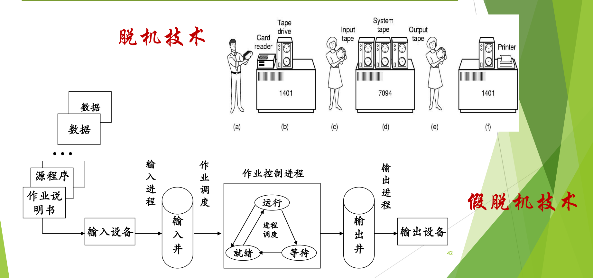

图：上方是早期脱机技术，由 1401 卫星机负责读卡、打印，主机 7094 只与磁带交换数据；下方是假脱机（SPOOLing），由输入进程、输出进程在磁盘上维护输入井和输出井，作业调度与作业控制进程只与“井”打交道。

上图上半部分是卫星机方式（标为“脱机技术”），下半部分是在一台机器上用软件实现的多道批处理（标为“假脱机技术”）：作业说明书、源程序和数据经输入设备由**输入进程**送入输入井；**作业调度**从输入井挑选作业交给**作业控制进程**，作业控制进程内部的进程在运行、就绪、等待三种状态之间由进程调度切换；运行结果进入输出井，再由**输出进程**送往输出设备。

#### 生产者-消费者的原型

图中相邻的两个角色之间都隔着一个数据缓冲区，前者往里放、后者从里取，正是 ICS 中学过的**生产者-消费者**（producer-consumer）结构：

| 生产者 | 缓冲区 | 消费者 |
|---|---|---|
| 输入进程 | 输入井 | 作业调度 |
| 作业调度 | 已选中的作业 | 作业控制进程 |
| 作业控制进程 | 输出井 | 输出进程 |


每个角色各管一段，彼此通过同步协调。理解这一点的关键是：原来需要三台计算机配合的过程，变成了**由软件在一台机器上统一管理**。

#### SPOOLing 的三个特点

1. **提高 I/O 速度**：进程的 I/O 操作变成对输入井或输出井（磁盘）的操作，缓和了 CPU 与低速 I/O 设备速度不匹配的矛盾。
2. **将独占设备改造为共享设备**：系统实际上并没有把设备分配给任何进程，而是在输入井或输出井中为进程分配一个存储区，并建立一张 I/O 请求表。
3. **实现虚拟设备功能**：多个进程同时使用一台独占设备，而每个进程都认为自己独占这台设备，实现了设备的虚拟分配。

> [!warning] 易错点
> SPOOLing 并没有让打印机这类独占设备真的同时为多个进程工作。打印机仍然一次只打一份；被“共享”的是磁盘上的井，进程看到的“独占打印机”是虚拟出来的。

### 今天的打印队列

SPOOLing 的思想至今仍在使用，最常见的就是共享打印机。一个实验室只需要一台打印机，多个同学可以同时提交论文打印：

1. 在 Word 里打印一份 100 页的文档，程序只是把待打印内容送进磁盘上的**打印请求队列**；送完就认为“打印完成”，用户可以关闭文件去做别的事。
2. 队列由一个专门的**打印进程**管理，它是操作系统为用户创建的**守护进程**（daemon，也译“精灵”进程），直接控制打印机。
3. 队列中有内容时，daemon 取出一份交给打印机打印，打印完从队列中清除。
4. 队列为空时 daemon 睡眠；新的打印请求到来时它被唤醒。


图：各进程的打印请求先排进磁盘上的打印请求队列（含要打印的文件），再由打印守护进程（daemon）依次取出交给打印机，从而让多个任务“同时”打印。

上图中多份打印请求（含要打印的文件）排成队列，由打印进程 daemon 依次送往打印机：待打印文档先暂存在磁盘的打印队列中，于是多个任务可以“同时打印”，打印效率得到提高。 这里的打印队列就是输出井，daemon 就是输出进程，生产者是各个提交打印的用户进程。

### 分时及其他操作系统类型

> [!info] 依据讲义整理
> 本小节对应讲义中课上没有讲解的页面（分时系统及其后的各类操作系统、Tanenbaum 分类、智能卡操作系统和本章重点小结），按讲义内容整理。

批处理系统用户不能和自己的程序交互；不同的应用场景（交互、实时控制、联网、嵌入设备）又各自提出了不同的追求目标，于是出现了下面这些类型。今天这些类型已经相互融合。

#### 分时操作系统

**分时操作系统**（time-sharing system）把 CPU 时间划分成若干片段，称为**时间片**（time slice）；操作系统以时间片为单位，轮流为每个终端用户服务，每次服务一个时间片。由于时间片很短，每个用户都感觉不到自己在和别人轮流使用，这是利用了人的错觉。

- **追求目标**：及时响应。
- **衡量依据**：**响应时间**，即从终端发出命令到系统给予回答所经历的时间。

早期的代表是麻省理工学院的 CTSS（Compatible Time-Sharing System）分时系统。

**通用操作系统**把分时系统和批处理系统结合起来，原则是**分时优先，批处理在后**：需要频繁交互的作业作为“前台”，时间性要求不强的作业作为“后台”。

#### 实时操作系统

**实时操作系统**（real-time OS）使计算机能及时响应外部事件的请求，在规定的严格时间内完成对该事件的处理，并控制所有实时设备和实时任务协调一致地工作。 它分两类：

1. **实时过程控制**：工业控制、军事控制等。
2. **实时通信（信息）处理**：电讯（自动交换）、银行、飞机订票、股市行情等。

追求目标是对外部请求在严格时间范围内作出反应，以及高可靠性；关键参数是**时间**。例子是工业过程控制系统，如汽车装配线。 按对时限的要求又分：

- **硬实时系统**（hard real-time）：某个动作绝对必须在规定的时刻或时间范围内完成。
- **软实时系统**（soft real-time）：可以接受偶尔违反最终时限。

> [!note] 补充解释
> 讲义只给出问题“例子？”，没有给答案。常见的硬实时例子有汽车安全气囊控制、飞行控制和工业机器人控制，错过时限就会造成事故；软实时例子有视频播放和网络语音通话，偶尔晚到一帧只会降低体验。

#### 个人计算机、网络、分布式与嵌入式操作系统

- **个人计算机操作系统**：计算机在某一时间内只为单个用户服务；追求界面友好、使用方便，以及丰富的应用软件。
- **网络操作系统**：基于计算机网络，在各种计算机操作系统之上按网络体系结构协议标准开发的软件；功能包括网络管理、通信、安全、资源共享和各种网络应用；追求相互通信与资源共享。
- **分布式操作系统**：分布式系统相对集中式系统而言，以计算机网络为基础，基本特征是**处理的分布**（功能和任务的分布）。分布式操作系统的任何系统任务都可以在任何处理机上运行，并自动在全系统范围内分配任务、调度各处理机的负载。
- **嵌入式操作系统**（Embedded Operating System）：嵌入式系统是嵌在各种设备、装置或系统中、完成特定功能的软硬件系统，它所属的大设备不一定是“计算机”，通常工作在反应式或对处理时间要求较严格的环境中。嵌入式操作系统对整个嵌入式系统及其控制的部件统一协调、调度、指挥和控制。例子是加州大学伯克利分校研制的微型智能传感器，上面运行 TinyOS。

网络操作系统与分布式操作系统都建立在网络之上，区别在于分布式操作系统具备以下特征：

1. 是一个**统一的操作系统**，若干计算机可以相互协作共同完成一项任务；
2. 资源进一步共享；
3. **透明性**：资源共享和分布对用户是不可见的；
4. **自治性**：系统中多个主机地位平等，没有主从关系；
5. 处理能力增强、速度更快、可靠性增强。

#### Tanenbaum 分类与智能卡操作系统

Tanenbaum 在《现代操作系统》1.4 节按硬件平台把操作系统分为：大型机、服务器、多处理机、个人计算机、掌上计算机（移动计算机）、嵌入式、传感器节点、实时和智能卡操作系统。

**智能卡**是包含一块 CPU 芯片的信用卡，运行能耗和存储空间受到非常严格的限制，有些只有电子支付这样的单项功能。有些智能卡面向 Java：ROM 中有一个 Java 虚拟机解释器，Java 小程序下载到卡中由 JVM 解释执行；有的卡能同时处理多个小程序，这就是多道程序，需要调度，资源管理和保护也随之成为卡上操作系统必须处理的问题。 读写器与智能卡之间以“命令-响应对”方式通信：

1. 读写器发出操作命令，智能卡接收；
2. 卡上操作系统解释命令，完成解密与校验；
3. 操作系统调用相应程序处理数据，产生应答信息，加密后送回读写器。

#### 本章复习重点

本章重点为：操作系统的概念；理解操作系统的不同角度；操作系统的主要特征（并发、共享、虚拟、随机性）；典型的、历史上或当前有重要意义的操作系统（如 OS/360、MULTICS，以及麒麟、鸿蒙、openEuler、统信等国产操作系统）；重要的操作系统技术，即多道程序设计、中断、通道、SPOOLing；操作系统的分类。

> [!question]- 自测：某机房有 3 台终端同时提交打印任务，打印机一次只能打一份。在 SPOOLing 方式下，为什么三个用户都几乎立刻看到“打印完成”？
> 因为“打印”只是把文档写进磁盘上的打印请求队列（输出井），写完程序就返回；真正驱动打印机的是 daemon，它按队列顺序逐份打印。用户看到的是虚拟打印机，物理打印机仍然串行工作。

> [!question]- 自测：卫星机方式和 SPOOLing 都让主机不等慢速 I/O，二者的根本区别是什么？
> 卫星机靠额外硬件（1401）在主机之外完成 I/O，并由人工搬运磁带，是真正的脱机；SPOOLing 在同一台主机上用软件（输入进程、输出进程和磁盘上的井）完成同样的分工，是联机操作，只是看起来像脱机。

> [!question]- 自测：银行转账系统要求“大多数请求在 1 秒内完成，偶尔超时可以重试”，它更接近哪类系统？
> 属于实时通信（信息）处理一类，按时限要求是软实时：偶尔违反时限可以接受。若是“必须在规定时刻完成，否则出事故”的控制任务，才是硬实时。

---

## trap 机制总览

> [!abstract] 本节要点
> - trap、中断、异常、陷入在不同教材中含义相近；本课按来源与性质把事件分为**中断**和**异常**，ICS 统称为**异常控制流**（ECF）。
> - trap 整体模型：硬件在下，内核在中，核外全是进程；进程因事件（主动或被动）进入内核，处理完统一经**调度模块**决定下一个上 CPU 的进程。
> - 学习抓手是**数据结构 + 流程**；流程有时间顺序，**先硬件后软件**，硬件做完交给软件，不会软硬交叉。
> - 操作系统初始化与中断的关联在于事先填好数据结构（如中断向量表）；软件异常对应 ICS 中的 signal。
> - 这一部分讲操作系统的两个接口：与硬件的接口（运行环境）和系统调用接口。

### 名词与定位

接下来的内容是 xv6 的 **trap 机制**，它也是实验的重要内容。操作系统中与硬件相关的部分名词特别多，不同的词常常指差不多的东西：xv6 叫 trap，本课叫中断/异常机制，ICS 叫**异常控制流**（ECF，Exceptional Control Flow），还有“陷入”等说法。遇到这类近义词，能对上意思即可。

**控制流转移**在代码层面就有，例如 `if`、`while` 和函数调用。**异常控制流**说的是进程执行过程中发生了某些事件、使控制流发生改变；ICS 把这些事件统称为异常，再在异常中细分出中断。本课的划分方式不同：把它们分成**中断**和**异常**两件事，即来源不同、性质不同的事件，但本质是一致的。 ICS 强调这一部分很重要：理解 ECF，就能理解应用程序如何与操作系统交互、编写有趣的新应用程序、理解并发，以及理解软件异常如何工作。

从操作系统设计者的角度看，操作系统夹在两个接口之间：下面是计算机硬件，上面是通过**系统功能调用**使用它的应用程序。 这一部分先讲**硬件接口**，即操作系统设计者需要了解的硬件环境，再讲**系统调用接口**；两个接口讲完，整个操作系统就能运行起来。所以它承上启下：上承计算机组成原理给出的硬件设计，下接操作系统如何利用这些设计实现自己的功能。

这一部分的大纲是：

- **运行环境**：处理器及寄存器、中断机制、存储系统、I/O 系统、时钟；
- **运行机制**：系统调用；
- **重要设计思想**：机制与策略。

本讲只讲到处理器及寄存器（见[处理器特权模式](#处理器特权模式)）和中断机制的开头（见[中断与异常概念](#中断与异常概念)）；中断处理流程和系统调用见 L03「03 中断处理完整流程」与「06 系统调用机制设计」。

### trap 整体模型

在讲细节之前，先建立一个整体图景，后面所有内容都放在这张图里理解。

1. **底层是硬件**，其上是**内核**，内核是课程的重点。
2. **核外全是进程**，进程不断地创建和结束。它们分两类：
   - 用户创建的进程，例如游戏、Word；
   - 操作系统为帮助用户而创建的进程，例如打印守护进程，平时睡眠，有打印任务时起来工作。它们也在核外运行。
3. **进程进入内核，一定是因为发生了需要处理的事件**。不管是主动进入（如调用系统服务）还是被动进入（如按下 Ctrl+C），都要“兵来将挡”地处理。
4. **处理完统一走一个出口**：先到**调度模块**（调度接口），由它决定下一个上 CPU 的进程。调度模块选谁，就运行谁。

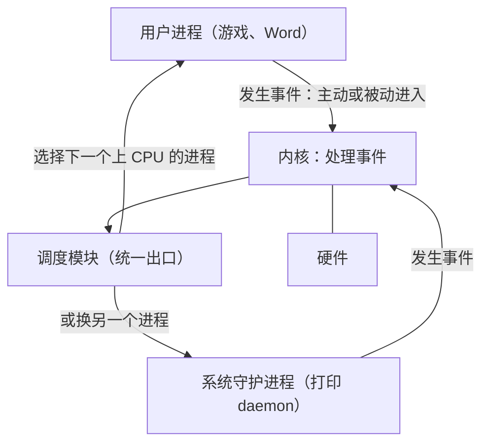

为什么要统一出口？因为系统中不能有不确定因素：进入内核走哪条路、处理完回到哪里，都必须事先规定好。

> [!warning] 易错点
> “处理完事件就回到原程序”不完整。按这个模型，处理完先到调度模块，可能继续原进程，也可能换别的进程；原进程之后仍会回来继续执行。详见[中断与异常概念](#中断与异常概念)。

### 学习问题与考试重点

下面三组问题指出了这部分需要掌握的方向。

**问题 1（中断/异常的整体理解）**：

- 应用程序是如何与操作系统交互的？
- 怎样理解“操作系统是由中断/异常/事件驱动的”？
- 中断/异常的来源有什么不同？处理方式一样吗？（回顾 ICS 对异常的描述及分类）
- 中断/异常处理流程中，哪些工作由硬件（体系结构）负责，哪些由软件（操作系统）负责？
- 从中断响应（硬件）到中断处理程序（软件）执行结束，计算机系统经过了哪些流程？
- 操作系统初始化与中断/异常有哪些关联？
- 什么是软件异常？它是如何工作的？

**问题 2（硬件）**：x86 和 RISC-V 各有哪些控制和状态寄存器、起什么作用；x86 在 Pentium II 之后为什么提供 `sysenter`/`sysexit`、与 `int 0x80`/`iret` 有何不同，x86-64 的系统调用指令是什么；RISC-V 的陷入指令是什么；两种体系结构各有几种处理器模式，模式之间是什么关系。

**问题 3（系统调用）**：基于 x86 的 Linux 中，系统调用入口程序 `system_call()` 与中断描述符表、系统调用表分别是什么关系，系统调用结束后处理器转去执行哪个模块；系统调用与函数/过程调用、与 C 函数调用的区别，以及系统调用与 API 的关系。 这组问题在 L03「05 系统调用概念辨析」至「07 Linux 系统调用执行」中展开。

期中、期末考的都是核心问题，例如应用程序怎样和操作系统打交道、怎样理解操作系统由中断/异常事件驱动；题目不一定是原话。中断与异常来源不同，但处理方式有很多共性。问题 1 中前面几问都是为最后两问做准备：硬件和软件各负责什么，以及从中断响应到处理程序结束经历哪些流程。

> [!tip] 课堂强调
> 中断/异常处理中硬件与软件的分工、从中断响应到处理程序结束的完整流程，这个重点“年年都考”，而很多同学并没有真正理解。

### 数据结构与流程：先硬件后软件

学习操作系统要抓住两样东西。

**第一是数据结构**。操作系统的算法相对简单，ICS 中动态内存分配那一类算法就算复杂的了；调度算法说复杂也复杂，说简单也简单。 初始化与中断的联系也落在数据结构上：操作系统引导初始化时会把许多数据结构填好，其中就包括中断向量表，之后事件发生时硬件和软件都依靠这些表找到处理程序。**软件异常**就是 ICS 中学过的 signal 一类机制。

**第二是流程**。操作系统是动态的，程序随时可能进入、离开内核，处理过程不是一步完成的，而流程一定有时间顺序（就像去一个地方旅游，先要买票到达，才能谈别的）。其中最重要的分工是：

1. **硬件先做前半部分**：硬件是死板的，按固定步骤执行，没有“智能”。
2. **硬件做完，把控制权交给软件**。
3. **软件做后半部分**：由操作系统的处理程序完成。

不存在“硬件做一步、软件做一步、硬件再做一步”的软硬交叉。由软件直接控制设备的情况除外，但中断/异常机制本身一定是先硬件、后软件。

> [!tip] 课堂强调
> “先硬件后软件”这一原则今后答题时都要遵守：分清哪些步骤是硬件做的、哪些是软件做的，不要把两者交叉着写。

硬件部分要把 x86 和 RISC-V 两套对照着学，对照有时比只学一套更清楚。操作系统层面的重点不是通用寄存器，而是：**控制和状态寄存器**（操作系统要读取和设置）、让用户态进程陷入内核态的**陷入指令**，以及**处理器模式**（操作系统只用内核态和用户态，但要知道硬件实际提供了什么）。 这些内容在[处理器特权模式](#处理器特权模式)中展开。

> [!question]- 自测：用户在终端按下 Ctrl+C，按 trap 整体模型，从事件发生到某个进程重新上 CPU 依次经过哪几个环节？
> 进程（被动地）因事件进入内核 → 内核处理该事件 → 统一到调度模块 → 调度模块选出下一个上 CPU 的进程（可能是原进程，也可能是别的进程）。路径是事先规定好的，不存在别的出口。

> [!question]- 自测：有同学这样描述中断处理：“硬件保存部分现场，软件判断类型，硬件再跳转到处理程序，软件处理后返回。”问题出在哪里？
> 违反了“先硬件后软件”：硬件做完自己那部分（包括把控制权交给处理程序）之后才轮到软件，不会出现软件做完一步再交回硬件继续响应的交叉过程。

---

## 处理器特权模式

> [!abstract] 本节要点
> - 寄存器分**用户可见寄存器**和**控制和状态寄存器**（PC、IR、PSW）；操作系统关心的是后者，以及内存中的代码、数据、栈。
> - 保护需要硬件支持：处理器提供多种运行模式，不同模式可执行的指令集合不同；硬件提供几种、软件用几种是两回事。
> - 操作系统只需两种状态：**内核态**可执行全部指令（含特权指令），**用户态**只能执行非特权指令；x86 用 R0/R3，RISC-V 用 S/U（M 模式在操作系统之下）。
> - 用户态 → 内核态的**唯一途径**是中断/异常/陷入机制；内核态 → 用户态靠设置 PSW。
> - **陷入指令**（访管指令）是非特权指令：RISC-V 用 `ecall`，Linux/x86 用 `int 0x80`，后来有 `sysenter`/`sysexit`，x86-64 用 `syscall`。

### 处理器与寄存器

操作系统设计者要回答的第一个硬件问题是：处理器与操作系统的接口是什么？

CPU 有多种示意画法（ICS 的图和其他教材的图），看哪张都不重要，重要的是关注什么：

- **寄存器**，尤其是**程序计数器 PC**（ICS 的一张图里没有把 PC 单独标出来）；
- **内存**中的内容：代码（Code）、数据（Data）、栈（Stack），以及堆（Heap）。

处理器由运算器、控制器、一系列寄存器和高速缓存构成。 运算器之类的硬件部件操作系统管不到，它只管到寄存器这一层。寄存器分为两类：

| 类别 | 包括 | 谁使用 | 访问条件 |
|---|---|---|---|
| **用户可见寄存器** | 数据寄存器（通用寄存器）、地址寄存器、条件码寄存器（保存 CPU 操作结果的各种标记位） | 机器语言（汇编）可直接引用 | 任何程序 |
| **控制和状态寄存器** | 程序计数器 PC（Program Counter）、指令寄存器 IR（Instruction Register）、程序状态字 PSW（Program Status Word） | 用于控制处理器的操作 | 只能在某种特权级别下访问、修改 |

操作系统重点关注控制和状态寄存器，因为要读取和设置它们；x86 和 RISC-V 各有哪些这类寄存器，是后面读 xv6 代码时必须知道的。

### 保护与处理器模式

**保护**的需求来自操作系统的并发与共享特征：多个程序同时在系统中运行、共享资源，就必须实现保护与控制，而这需要**硬件机制**把操作系统与用户程序**隔离**开。

隔离和保护是同一件事的两个角度：**隔离是手段，保护是效果**。虚存是一个典型例子：每个进程有自己的虚拟地址空间，范围一直“顶到头”，程序的地址再怎么乱跑也跑不出这个空间，不可能跑到别的进程或操作系统里去。 需要保护的关系有两层：进程不能干扰操作系统（操作系统可以控制进程，但不会弄坏进程），进程之间也要相互保护。

硬件提供的基本运行机制是：**处理器具有不同的运行模式（mode），不同运行模式下可执行的指令集合不同**，这就是**特权级别**。 操作系统权力最大，可以执行所有指令；一些进程只能执行最小的指令集合。要区分两件事：硬件提供了几种模式、提供到什么程度，是硬件的设计；软件用不用、用哪几种，是软件的选择。

#### PSW 与 x86 的 EFLAGS

现代处理器通常把 CPU 状态划分为两种、三种或四种。处理器在**程序状态字寄存器 PSW** 中专门设置一个位置，根据运行程序对资源和指令的使用权限设置不同的 CPU 状态；x86 的描述符中也设置了权限级别。

“程序状态字”是抽象出来的通用名，不特指某台机器，x86 和 RISC-V 的对应寄存器各有自己的名字；“专门设置一位”中的“一”是虚指，意思是设置这样一个字段，不一定只有 1 位。x86 的例子是 **EFLAGS** 寄存器，其中的 **IOPL**（I/O Privilege Level）字段占两位，可以表示 4 个级别。 EFLAGS 各位的布局见 Intel 手册；可以延伸了解的是：ARM、RISC-V 的状态控制寄存器是什么（可参考 xv6-book 4.1 节）。

> [!note] 补充解释
> 在 x86 中，**当前特权级**（CPL，Current Privilege Level）实际保存在代码段寄存器 CS 的低两位；EFLAGS 中的 IOPL 规定的是执行 I/O 指令（如 `in`、`out`、`cli`、`sti`）所需的特权级，当 CPL 的数值不大于 IOPL 时才允许执行。两者都是 2 位、都对应 R0~R3，上文用 IOPL 举例说明“特权主要体现在 I/O 操作上”，但它不是 CPU 当前所处模式本身。参见 [Intel SDM 第 3 卷](https://www.intel.com/content/www/us/en/developer/articles/technical/intel-sdm.html)。

### 特权指令与两种 CPU 状态

**特权指令**（privileged instruction）是只能由操作系统使用、用户程序不能使用的指令；**非特权指令**是用户程序可以使用的指令。 判断原则是：如果普通用户能随便执行某条指令就会导致系统混乱，它就是特权指令；谁执行都不影响系统的，就是非特权指令。

硬件可能提供多种模式，但操作系统只需要**两种 CPU 状态**：

- **内核态**（Kernel Mode）：运行操作系统程序，可以执行全部指令，包括特权指令；
- **用户态**（User Mode）：运行用户程序，只能执行非特权指令。

内核态也称 **supervisor mode**（监管态），supervisor 是操作系统的传统称呼。

> [!example] 例：下列功能对应的指令哪些是特权指令？
> 启动 I/O、控制转移、内存清零、修改程序状态字、设置时钟、算术运算、允许/禁止中断、访管指令、取数指令、停机。
>
> 1. **特权指令**：启动 I/O、内存清零、修改程序状态字、设置时钟、允许/禁止中断、停机。它们一旦被普通程序随意执行，就会破坏设备、他人数据、保护机制或整个系统的运行。用户修改系统时间，也是通过接口请操作系统去改，而不是自己直接执行设置时钟的指令。
> 2. **非特权指令**：控制转移、算术运算、取数指令、访管指令。
> 3. 访管指令是刻意安排的一项：它的作用正是让用户程序从用户态进入内核态，是用户程序请求操作系统服务的“敲门砖”，所以用户态必须能执行它，它是**非特权指令**。

> [!warning] 易错点
> 访管指令（陷入指令）会让 CPU 进入内核态，但它本身是**非特权指令**。如果它是特权指令，用户程序就永远无法请求系统服务。

### x86 特权环与 RISC-V 特权模式

**x86** 支持 4 个处理器特权级别，称为**特权环** R0、R1、R2、R3，特权能力从 R0 到 R3 由高到低。R0 相当于内核态，运行操作系统；R3 相当于用户态，运行用户进程；R1、R2 介于两者之间。不同级别能运行的指令集合不同，目前大多数基于 x86 的操作系统只用了 R0 和 R3。

模式切换还牵涉到**栈**。用户进程运行时用自己的栈，操作系统运行时也要用栈，两者不能混用，否则会相互破坏。因此 x86 为特权级准备了各自的栈指针（SS0:ESP0、SS1:ESP1 ……），**模式一切换，栈也要跟着切换**，这由硬件保证。

> [!note] 补充解释
> 更准确地说，x86 在任务状态段（TSS）中只保存 R0、R1、R2 三套栈指针（SS0:ESP0、SS1:ESP1、SS2:ESP2）；R3 的栈就是用户程序当前使用的 SS:ESP。从低特权级进入高特权级时，硬件从 TSS 取出目标级别的栈指针，并把原来的 SS:ESP 压入新栈，返回时再恢复。“四套栈指针”是概括说法。

**RISC-V** 定义了三种特权模式：

- **用户模式**（U 模式，User/Application）：等同于用户态；
- **监管模式**（S 模式，Supervisor）：就是操作系统所在的内核态；
- **机器模式**（M 模式，Machine）：在操作系统之下，操作系统控制不了它，只能向它发出请求，就像用户程序向操作系统发请求一样。

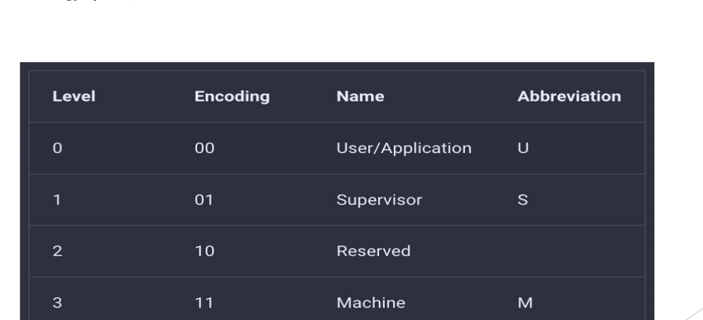

图：RISC-V 用 2 位编码特权级：00 为用户模式 U，01 为监管模式 S，10 保留，11 为机器模式 M。

RISC-V 用 2 位编码特权级，四种取值中 `10` 暂未使用（保留），编码数值越大特权越高。

| 对比项 | x86 | RISC-V |
|---|---|---|
| 硬件提供的级别 | 4 个：R0~R3 | 3 个：U、S、M（另有 1 个保留编码） |
| 特权最高 | R0 | M 模式 |
| 操作系统运行在 | R0 | S 模式 |
| 用户程序运行在 | R3 | U 模式 |
| 很少使用 / 操作系统之下 | R1、R2 很少使用 | M 模式在操作系统之下 |

注意编号方向相反：x86 数字越小特权越高，RISC-V 数字越大特权越高。

### 用户态与内核态的转换

系统时时刻刻都在发生用户态与内核态之间的转换，转换路径是固定的：

1. **用户态 → 内核态**：**唯一途径**是中断/异常/陷入机制。叫中断、异常还是陷入都可以：广义的“中断”包括异常和陷入，ICS 统称异常，xv6 叫 trap。
2. **内核态 → 用户态**：通过**设置程序状态字 PSW**。进程进入内核办完事就要离开，不能一直留在内核里，就像去银行办完业务就走。

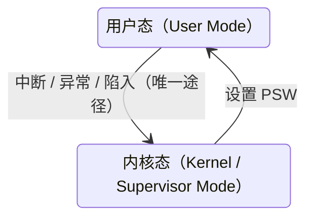

#### 陷入指令

用户程序主动请求操作系统服务时，需要一条特殊的指令：**陷入指令**，又称**访管指令**。它是提供给用户程序的接口，用于调用操作系统的功能（服务）；用它进入内核是一种**主动**行为。 常见的陷入指令有 `int`、`trap`、`syscall`、`sysenter`/`sysexit`、`ecall`，它们分别属于：

- **RISC-V**：`ecall`。
- **x86 + Linux**：`int 0x80`。Intel 处理器共有 256 个中断向量，Linux 选定 `0x80` 作为系统调用入口；Windows 等系统可以选别的号。
- **x86（Pentium II 之后）**：增加了 `sysenter`/`sysexit` 这一对指令。此前没有它们，只能用 `int` 经过中断描述符表进入内核；之后硬件提供了这对指令，有的系统用，有的不用。
- **x86-64**：`syscall`。

进入和退出总是成对的，例如 `int` 与 `iret`、`sysenter` 与 `sysexit`。为什么 x86 已有 `int 0x80` 还要增加 `sysenter`/`sysexit`、二者有何不同，是[问题 2](#trap-机制总览) 中留待 L03「07 Linux 系统调用执行」回答的问题。

硬件和软件的这种协作就像跳华尔兹的一对舞伴：你进我退，必须协调，不能两个人同时向前。硬件提供机制，软件选择用或不用。

> [!note] 补充解释
> 从内核态返回用户态时，“设置 PSW”通常由专门的返回指令完成：x86 的 `iret` 从内核栈恢复 EIP、CS、EFLAGS 等（CS 低两位决定返回后的特权级），`sysexit` 直接切换回 R3；RISC-V 的 `sret` 依据 `sstatus` 中记录的先前模式（SPP 位）回到 U 模式。`sysexit` 和 `sret` 只能在内核态执行；`iret` 在用户态也能执行，但不能借它提升特权级。

> [!question]- 自测：一个用户程序想关闭中断以防止被打断，于是直接执行“禁止中断”指令，会发生什么？
> “允许/禁止中断”是特权指令，用户态不能执行。CPU 检测到用户态执行特权指令会产生异常，控制权经异常机制转入内核，由操作系统处理（通常终止该程序）。

> [!question]- 自测：某操作系统运行在 RISC-V 上，内核要读取机器的一些底层信息，但这些信息只有 M 模式能访问。内核能直接修改 M 模式的状态吗？
> 不能。M 模式在操作系统（S 模式）之下，操作系统控制不了它，只能向它发出请求，类似用户程序向操作系统发请求。

> [!question]- 自测：为什么 x86 切换到 R0 时必须同时切换栈？
> 用户进程的栈不可信，也不能和内核共用，否则内核数据可能被用户破坏，或用户栈不够用导致内核出错。因此硬件在模式切换时自动换到该特权级预设的内核栈。

---

## 中断与异常概念

> [!abstract] 本节要点
> - 中断之于操作系统，如同发动机之于汽车、引擎之于飞机：操作系统是**中断驱动**（事件驱动）的，没有事件时它可以什么都不做。
> - 中断机制的三个主要作用：及时处理设备的中断请求、捕获用户程序的服务请求（系统调用）、防止用户程序的破坏性活动。
> - **中断/异常**是 CPU 对系统中发生的事件作出的反应：暂停当前程序 → 保存现场 → **自动**（硬件）转去事件处理程序（软件）→ 处理完返回断点；它改变了处理器的控制流。
> - 特点：随机发生、自动处理、可恢复。
> - 来源不同：**中断**来自 CPU 之外（I/O、时钟、硬件故障），为 CPU 与设备并行而引入；**异常**来自 CPU 执行指令本身（系统调用、缺页、保护性异常、断点、算术溢出）。

### 中断与事件驱动

如果设计 CPU，就一定要设计中断/异常机制；它是硬件设计者交给操作系统的一套基础设施。对操作系统来说，中断的重要性就如同汽车的发动机、飞机的引擎：有了它，飞机才能飞、汽车才能跑。因此说操作系统是由“**中断驱动**”或“**事件驱动**”的。 中断是中断事件，异常是异常事件，统称**事件**也可以。

“事件驱动”的含义可以这样体会：早上开机后去吃早点，这段时间没有任何事件，操作系统基本不干活；动了鼠标或键盘，这就是一个中断，操作系统才可能干活；随便晃动鼠标它不予理会，点击某个图标，它才帮你办事。**没有事件时，操作系统可以什么都不做**。时钟一直在走，定时器到时也会驱动某个进程开始工作，这同样是一种驱动方式。

#### 中断机制的三个主要作用

中断机制的主要作用有以下三点（不止这些）：

1. **及时处理设备发来的中断请求**。例如磁盘由磁盘控制器/DMA 控制，CPU 只是布置任务（把某个文件读到某处），然后去做别的事；磁盘做完后必须向 CPU 汇报。键盘、鼠标、打印机的正常或异常结束、扫描仪等 CPU 之外的设备发来的请求，统称**中断请求**。
2. **使操作系统能捕获用户程序提出的服务请求**。`open`、`fork`、打印等系统调用最终都由操作系统完成，用户程序只是发起请求，例如 `fork` 是操作系统替你创建进程；操作系统必须能捕获这些调用。
3. **防止用户程序执行过程中的破坏性活动**。例如某块内存被标记为只读，页表项中有一位表示 read-only；用户程序对它做写操作时，硬件检查发现违规就报错，阻止这种破坏性活动。

### 中断/异常的概念与特点

**中断/异常**是 CPU 对系统中发生的某个事件作出的一种反应：CPU 暂停正在执行的程序，保留现场后**自动**转去执行相应事件的处理程序，处理完成后返回断点，继续执行被打断的程序。事件的发生**改变了处理器的控制流**，这和 ICS 中“异常控制流”强调控制流改变的含义完全一致。

按定义中的关键词拆成步骤：

1. **暂停当前程序**：控制流改变了，PC 要换成别的地址，CPU 不能再接着执行原程序。
2. **保存现场**：不能停下就直接换别人，必须保存寄存器等上下文。
3. **自动转去处理程序**：“自动”指这一步由**硬件**完成，即硬件做完一系列动作后把控制权交给软件。
4. **执行处理程序**：处理程序是**软件**；不同事件对应不同处理程序，例如键盘的 Ctrl+C/Ctrl+Z、网卡到来的数据、`fork`/`open` 调用。
5. **返回断点**：处理完后被打断的程序继续执行。

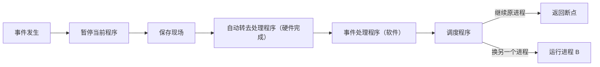

#### “返回断点”的准确含义

按照[trap 整体模型](#trap-机制总览)，处理完事件后统一先回到**调度程序**，由它决定：继续原进程，就返回断点；或者换成进程 B。所以“处理完返回断点”并不总是立刻发生。但这句话也没错：除非发生了严重错误导致程序被终止，被打断的程序之后总能回到断点继续执行，只是可能要等一会儿（“让子弹飞一会儿”）。整个模型是闭环的。

#### 三个特点

中断/异常有三个特点，并要琢磨它**何时**发生、**何处**发生：

- **随机发生**：无法预知用户何时按鼠标、何时敲键盘、网卡何时来数据。
- **自动处理**：由硬件先响应，兵来将挡、水来土掩，硬件完成转交控制权的过程。
- **可恢复**：处理完后在以后某个时刻回到被打断的地方继续执行。

> [!warning] 易错点
> “自动”不是“由操作系统自动处理”，而是指从暂停到转入处理程序这一段由**硬件**完成；处理程序本身是软件。这正是[先硬件后软件](#trap-机制总览)的体现。

### 为什么分中断和异常

“中断”和“异常”两个词是术语演化的结果。两者来源确实不同，处理方式却大同小异。

**中断的引入：为了支持 CPU 与设备之间的并行操作**。最早只有中断。I/O 慢、CPU 快，为了让 CPU 摆脱 I/O，每个设备配一个控制器（如 DMA），CPU 只和控制器打交道。CPU 启动设备进行输入/输出后，设备独立工作，CPU 转去处理与这次 I/O 无关的事情；设备完成后向 CPU 发出中断，报告这次 I/O 的结果，由 CPU 决定接下来如何处理。

**异常的引入：表示 CPU 执行指令时自身出现的问题**。后来发现，CPU 执行指令本身也会出问题，例如算术溢出、除零、取数时的奇偶错、访存地址越界（当时的地址保护不像今天的虚存这样完善），或者执行了“陷入指令”。这时硬件改变 CPU 当前的执行流程，转到相应的错误处理程序、异常处理程序，或者去执行系统调用。 这些事件不是外部设备发来的，而是执行这条指令本身产生的，所以另称**异常**。

| 对比项 | 中断（interrupt） | 异常（exception） |
|---|---|---|
| 引入原因 | 支持 CPU 与设备并行 | 表示 CPU 执行指令时自身出现的问题 |
| 来源 | CPU 之外：设备控制器、时钟、其他硬件部件 | CPU 内部：正在执行的指令 |
| 典型例子 | 磁盘完成读写、键盘输入、时钟到时 | 算术溢出、除零、缺页、越界、陷入指令 |

### 事件分类

把中断和异常统称为**事件**，可以分为两大类：

- **中断**（外中断）：
  - **I/O 中断**：打印机、扫描仪、键盘、鼠标等设备发来的中断；
  - **时钟中断**：比较特殊的一类；
  - **硬件故障**：如笔记本电量低时提醒赶紧保存、奇偶校验错、内存过热（有的老机器内存一热就会报告甚至宕机）。
- **异常**（内中断、例外）：
  - **系统调用**；
  - **页错误 / 页故障**（page fault）；
  - **保护性异常**；
  - **断点指令**；
  - **其他程序性异常**，如算术溢出。


图：左侧把事件分为中断（I/O、时钟、硬件故障）和异常（系统调用、页错误、保护性异常、断点指令等）；右上按同步/异步与有意/意外两维划分 fault、syscall trap、interrupt、software interrupt；下方表格对比各类事件的原因、同步性和返回行为。

上图左侧是本课的事件分类树；右侧是 ICS 的分类，它把异常细分为**中断**（Interrupt）、**陷入**（Trap）、**故障**（Fault）、**终止**（Abort）四类，与本课的分法大同小异，其中中断来自 I/O 设备和其他硬件部件，是**异步**的。 图中各类的同步/异步属性、返回行为（返回下一条指令、返回当前指令或不返回）以及 Unexpected/Deliberate 对照表，见 L03「01 中断异常事件分类」。

> [!warning] 易错点
> 系统调用是由用户程序执行陷入指令**有意**引起的，归入**异常**而不是中断，尽管它的处理方式和中断很相似。另外，奇偶错要看它在哪里被发现：“取数时的奇偶错”是执行指令时出现的异常示例，而奇偶校验错也可作为硬件故障类中断的例子；按本课的分类原则，判断依据始终是事件来自 CPU 执行的指令本身，还是来自 CPU 之外的部件。

> [!question]- 自测：判断下列事件属于中断还是异常：①磁盘 DMA 传输结束；②程序执行 `ecall`；③程序访问一个尚未调入内存的页；④定时器到时；⑤程序执行除零。
> 中断：①（I/O 中断）、④（时钟中断），它们来自 CPU 之外。异常：②（系统调用）、③（页故障）、⑤（算术类程序性异常），它们由正在执行的指令引起。

> [!question]- 自测：进程 A 执行时被时钟中断打断，处理结束后调度程序选择了进程 B。A 的“断点”丢失了吗？
> 没有。A 的现场在中断时已经保存；之后调度程序再次选中 A 时，A 从断点继续执行。“返回断点”不一定立刻发生，但只要 A 没有因严重错误被终止，就一定会回到断点。

> [!question]- 自测：用户程序向只读页写数据，这一事件由谁发现、属于哪一类？
> 由硬件根据页表项中的只读权限位检查发现，属于异常（保护性异常），对应中断机制“防止破坏性活动”的作用；随后控制权转给操作系统的处理程序。

---

## 本讲小结

本讲有两条线。概述部分沿着“资源管理”展开：为了提高利用率，CPU 与 I/O 要重叠，于是出现多道程序设计，再到用纯软件组织输入、计算、输出的 SPOOLing；多个程序同时驻留内存，又带来调度和保护两个新问题。trap 部分接住“保护”这条线：硬件提供特权模式，用户态只能经中断、异常或陷入进入内核，处理完统一经调度模块离开，所以说操作系统是事件驱动的。

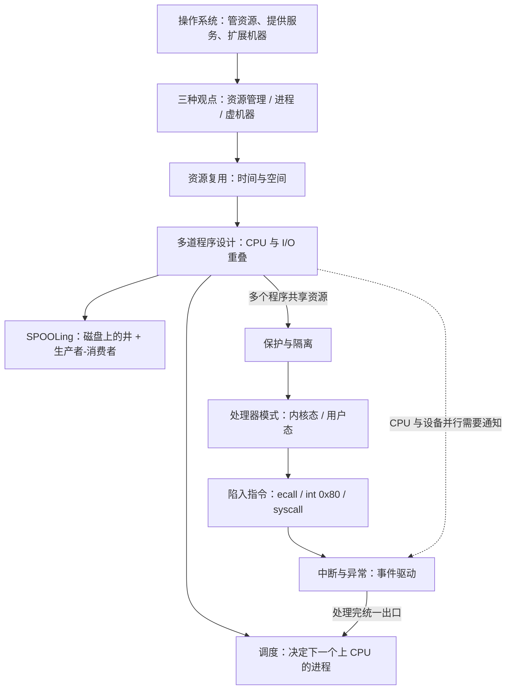
