CPU 既要及时应对外部设备和程序执行中随时出现的事件，又要让用户程序经一个受控的入口请求内核服务；本讲讲清中断异常机制，以及建在它之上的系统调用。路线是：先给事件分类，再沿中断响应与中断向量、中断处理完整流程弄清“硬件先做、做完交给软件”的分工，并用 x86 的 IDT/GDT 验证；然后辨析系统调用的概念、设计它的静态部分，以 Linux x86 的 `int $0x80` 走完执行全过程，最后用低层工作步骤与机制策略分离原则收束。前置知识是 L02「07 处理器特权模式」「08 中断与异常概念」中的用户态/内核态与中断概念，以及 ICS 中的栈、跳转表和信号。

---

## 中断异常事件分类

> [!abstract] 本节要点
> - **中断**来自 CPU 之外的 I/O 设备、时钟、硬件故障等，与当前指令无关，是**异步**的；**异常**由正在执行的指令引发，是**同步**的，必须立即处理。
> - 异常分三类：**陷入**（trap）是有意安排的（如系统调用），返回下一条指令；**故障**（fault）可恢复（如缺页），返回当前指令重新执行；**终止**（abort）不可恢复，不返回。
> - 中断总是返回到被打断程序的下一条指令。
> - 中断/异常机制靠软硬件配合：硬件负责**响应**（捕获请求、记录、把控制权交给处理程序），软件负责**处理**（识别类型、完成处理）。硬件做完再交给软件，两者的步骤不能交叉。
> - 请求必须先记录在中断寄存器里；同类请求在处理前再次到来可能会丢失。

### 事件分类：中断与异常

上一讲已经介绍了中断和异常的概念、引入原因，以及事件的初步划分（见 L02「08 中断与异常概念」）。本讲把这张分类表补全：每类事件从哪里来，是否与当前指令同步，处理完后回到哪里。统一术语是为了讨论问题时大家说的是同一件事。[^l03-section-1-s4b1]

系统运行中发生的各种需要 CPU 暂停当前工作去应对的情况，笼统称为**事件**。按产生原因可分为两大类：[^l03-section-1-s2p21]

- **中断**（Interrupt，又称外中断）：来自 CPU 之外的部件，如 I/O 中断（网卡、硬盘、键盘、鼠标、打印机）、时钟中断，以及硬件故障（如即将掉电）。
- **异常**（Exception，又称内中断、例外）：在 CPU 执行某条指令的过程中由这条指令本身引发，如系统调用、页错误/页故障、保护性异常、断点指令，以及算术溢出等其他程序性异常。

可以用课堂作类比：CPU 是正在讲课的老师。有人举手、门口来人、手机响，都是讲课之外的事，相当于中断；异常则是 CPU 执行当前这条指令的过程中，由这条指令本身引发的内部事件。判断一个事件属于哪一类，只需问一句：它是不是由当前执行的这条指令引起的？[^l03-section-1-s4b1]

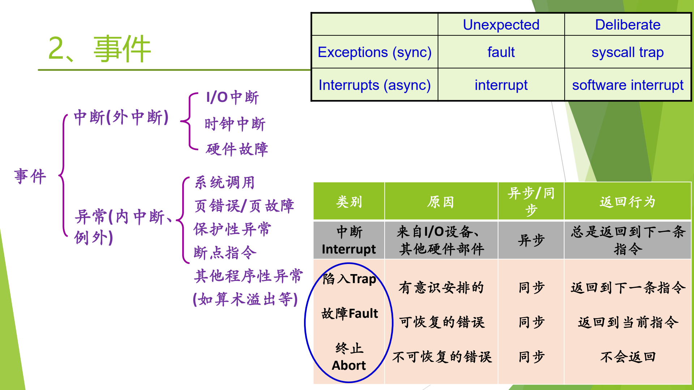

图：事件按来源分为中断与异常；表格从同步/异步、有意/意外两个维度区分 interrupt、fault、syscall trap，并给出每类事件处理完后的返回位置。

分类图给出了事件的层次：事件分为中断（I/O 中断、时钟中断、硬件故障）和异常（系统调用、页故障、保护性异常、断点指令、其他程序性异常）；下方的表按“原因、同步/异步、返回行为”比较中断与三类异常；右上角的小表则从“是否预期”的角度给出另一种划分。

### 同步、异步与返回行为

分类之所以重要，是因为它决定了两件事：事件能不能等一等再处理，以及处理完以后回到哪里继续执行。

| 类别 | 原因 | 同步/异步 | 返回行为 |
| --- | --- | --- | --- |
| 中断（Interrupt） | 来自 I/O 设备、其他硬件部件 | 异步 | 总是返回到下一条指令 |
| 陷入（Trap） | 有意识安排的 | 同步 | 返回到下一条指令 |
| 故障（Fault） | 可恢复的错误 | 同步 | 返回到当前指令 |
| 终止（Abort） | 不可恢复的错误 | 同步 | 不会返回 |

[^l03-section-1-s2p21]

**异步**（asynchronous）事件与当前指令无关，到达时刻不可预测，因此可以稍后处理；**同步**（synchronous）事件正是当前指令造成的，这条指令不处理完就无法继续，因此必须立刻处理。一个生活类比是：微信消息是异步的，可以过一会儿再看；电话打来时必须马上决定接不接，不接对方就无法与你通话，这像同步。[^l03-section-1-s4b1]

三类异常的区别集中体现在返回行为上：

1. **陷入**（trap）是程序有意安排的，最典型的是系统调用。请求的服务完成后，这条陷入指令的任务就完成了，所以返回到**下一条指令**。
2. **故障**（fault）是出了错、但能修复的情况，最典型的是缺页（page fault）。操作系统把缺的页调入内存后，引发故障的那条指令还没有真正完成，所以要返回到**当前指令**重新执行。
3. **终止**（abort）是不可恢复的错误，处理程序不会返回到原程序。

中断则总是返回到下一条指令：CPU 是在一条指令执行完之后才去响应中断的，被打断的那条指令已经完成。下一章会讲到，CPU 在指令周期末尾才检查中断（见 [中断周期](#中断响应与中断向量)）。

> [!example] 例：判断事件类别与返回位置
> 1. 用户按下键盘：来自 CPU 外部的 I/O 设备，属于中断，异步，处理完返回到下一条指令。
> 2. 程序执行 `int 0x80` 请求 `write`：当前指令有意引发，属于陷入，同步，返回到 `int 0x80` 之后的那条指令。
> 3. 程序访问一个尚未调入内存的页：当前指令引发、可修复，属于故障，同步，调页完成后重新执行这条访存指令。
> 4. 打印机发出“打印结束”信号：来自外部设备，属于中断。

#### 与 ICS 及其他教材的术语对照

ICS（计算机系统导论）把这些事件统称为“异常”（exception），在异常之下再分出中断、陷入、故障、终止四类，其中中断来自 I/O 设备等硬件。本课先分“中断/异常”两大类，再把异常细分为三类。两种叫法只是总称不同，划分方式一致，互不矛盾。[^l03-section-1-s4b1]

另一种角度是按“是否预期”划分：[^l03-section-1-s2p21]

| | Unexpected（非预期） | Deliberate（有意安排） |
| --- | --- | --- |
| Exceptions（sync） | fault | syscall trap |
| Interrupts（async） | interrupt | software interrupt |

系统调用、主动发出的软件中断是程序有意安排的；缺页、外设中断则不在程序的预期之内。同一组概念从同步/异步、是否预期等不同角度去看，在不同课程里遇到时就能对上号。

### 中断/异常机制的软硬件分工

中断/异常机制是现代计算机系统的核心机制之一，要靠硬件和软件相互配合才能发挥作用。[^l03-section-1-s2p22] 很多同学学完组成原理和 ICS 仍分不清哪些步骤由谁完成，考试时总有人把软硬件步骤交叉着写。这里先确立总原则：**硬件先做，做完转给软件，剩下的由软件做**。[^l03-section-1-s4b1]

- **硬件做什么——中断/异常响应**：捕获中断源发出的中断/异常请求，以一定方式响应，把处理器控制权交给特定的处理程序。[^l03-section-1-s2p22] 响应相当于决定“这件事管不管”：电话来了接不接，微信来了看不看。
- **软件做什么——中断/异常处理程序**：识别中断/异常的类型，并完成相应的处理。[^l03-section-1-s2p22]

两部分的具体步骤分别在 [中断响应与中断向量](#中断响应与中断向量) 和 [中断处理完整流程](#中断处理完整流程) 展开。


#### 请求必须被记录

硬件捕获请求的方式是设置一个**中断寄存器**：磁盘、网卡等设备发来中断时，经电路把寄存器中对应的位置为 1，表示来了一个事件。不记录，请求就丢了。

这一点可以与 ICS 学过的**信号**（signal）对照：内核用一个位向量记录发给进程的各种信号，信号**不排队**，同一类信号在前一个还没处理时又来一个，后来的就丢了。中断寄存器按位记录请求，同样只能表示“有没有”，表示不了“来了几次”，因此同类请求在处理之前再次到来时可能丢失。[^l03-section-1-s4b1]

#### 软件处理：兵来将挡

软件处理部分的逻辑并不复杂：什么样的事件，就做什么样的处理。以打印机中断为例，同样是打印机发来的中断信号，原因可能是：

- 打印正常结束；
- 缺纸；
- 缺墨（墨粉用完）；
- 卡纸。

原因不同，处理办法就不同，例如缺纸时显示提示，让用户加纸。每一种中断都要有人写这样一段处理代码，但具体怎么处理各自清楚，本课不再细讲，重点放在软硬件如何交接。[^l03-section-1-s4b1]

> [!warning] 易错点
> 整个过程中“硬件做的部分”和“软件做的部分”有时被口头称为“上半段”和“下半段”。这与 Linux 中断处理程序的**上半部/下半部**（top half / bottom half）不是一回事：后者是把**软件**处理程序再拆成关中断的紧急部分和开中断的非紧急部分，见 [中断处理完整流程](#中断处理完整流程) 中的思考题。

> [!question]- 自测：执行除法指令时除数为 0，与键盘按键，各属于哪一类？处理完分别返回哪里？
> 除零由当前指令引发，是异常（同步），属于程序性异常；按键来自外部设备，是中断（异步），返回下一条指令。除零是程序错误，操作系统无法像缺页那样把缺的东西补上，重新执行同一条指令也不会得到正确结果。

> [!question]- 自测：为什么缺页处理完要“返回当前指令”，而系统调用处理完要“返回下一条指令”？
> 缺页是故障：引发它的访存指令没有完成，调页修复后必须重新执行这条指令。系统调用是陷入：陷入指令的任务就是请求服务，服务完成即这条指令完成，所以继续执行下一条。

> [!question]- 自测：设备在同一中断请求尚未被处理时又发了一次同样的请求，会发生什么？
> 可能丢失。中断寄存器按位记录请求，位已经是 1，再置位不会多记一次，与信号用位向量记录、不排队的道理相同。

> [!info]- 来源
> - slides02.pdf：PDF p.21–22
> - L03.docx：DOCX body 1–41

[^l03-section-1-s4b1]: L03.docx-DOCX body 1-41
[^l03-section-1-s2p21]: slides02.pdf-PDF p.21
[^l03-section-1-s2p22]: slides02.pdf-PDF p.22

---

## 中断响应与中断向量

> [!abstract] 本节要点
> - 在取指周期、执行周期之后增加**中断周期**：开中断时，硬件在每条指令执行周期的最后时刻扫描中断寄存器；没有中断就继续取下一条指令。
> - 有中断时，硬件把中断触发器的内容编码为**中断码**送入 PSW 的相应位，再用中断码查**中断向量表**，交换中断向量，引出中断处理程序。这些全由硬件完成。
> - **中断向量**是存放中断处理程序入口地址和所需 PSW 的内存单元；中断向量表本质上是一张由硬件查找的跳转表，由软硬件共同约定。
> - 操作系统在引导初始化时编好各处理程序、放到内存固定位置，并把入口地址填入中断向量表。
> - x86 向量表共 256 项：0–19 由硬件定义（0 除零、1 单步调试、4 溢出、14 缺页等），Linux 选用 128（0x80）号作为系统调用入口。

### 中断周期：硬件如何发现中断

CPU 的基本工作就是周而复始地取指令、执行指令。要让外部事件能打断这个循环，硬件必须在某个固定时刻主动去看一眼有没有请求。为此，在指令周期中增加一个环节：

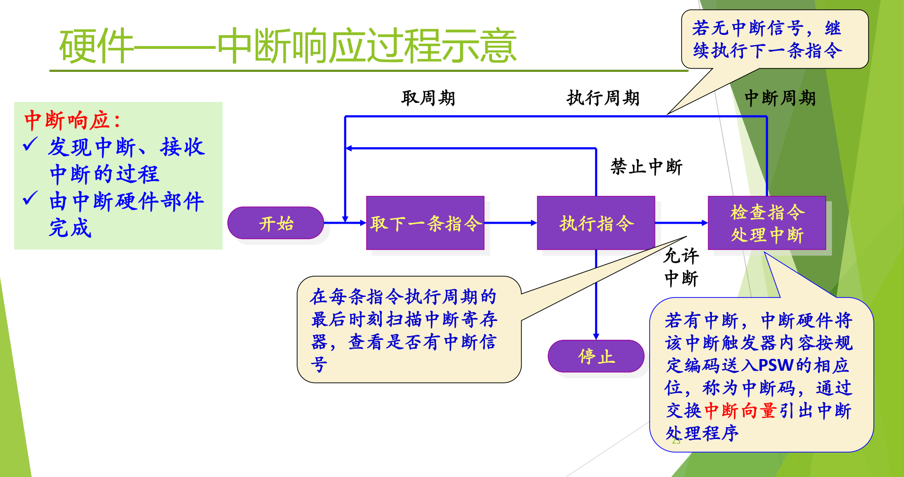

图：指令周期由取指、执行和中断周期组成；在允许中断时，每条指令执行完都会扫描中断寄存器，有中断就把中断码送入 PSW、经中断向量转入处理程序，没有中断就继续取下一条指令。

示意图把一条指令的处理分成三个阶段：**取周期**（取下一条指令）、**执行周期**（执行指令）和**中断周期**（检查中断）。“检查中断”这一步受开关控制：禁止中断时直接回到取指；允许中断时才去检查，有中断就转入“处理中断”。

**中断响应**是发现中断、接收中断的过程，由中断硬件部件完成。[^l03-section-2-s2p23] 具体过程如下：

1. **判断是否允许中断**：只有处于开中断（允许中断）状态，硬件才去检查。中断可以不响应，就像手机响了也可以不接。[^l03-section-2-s4b2]
2. **扫描中断寄存器**：在每条指令执行周期的最后时刻扫描中断寄存器，查看是否有中断信号。
3. **无中断**：继续执行下一条指令。
4. **有中断**：中断硬件把该中断触发器的内容按规定编码，送入 PSW 的相应位，这个编码称为**中断码**；然后通过交换中断向量，引出中断处理程序。[^l03-section-2-s2p23]

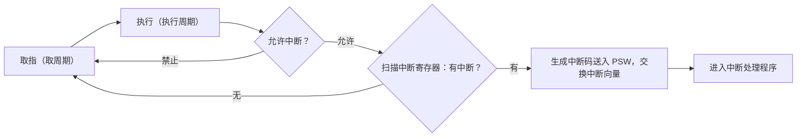

**中断码为什么要先存下来**：中断码标识“是哪一个设备、哪一类事件”，例如打印机中断有它的编码。它必须放在硬件和软件以后都找得到的地方（这里是 PSW），否则中断寄存器的状态一变，就无从知道刚才响应的是哪个中断。[^l03-section-2-s4b2]

检查中断是在一条指令执行完之后进行的，这也解释了上一章的结论：中断总是返回到下一条指令（见 [中断异常事件分类](#中断异常事件分类)）。

### 中断向量与中断向量表

硬件拿到中断码之后，要知道“该跳到哪段代码去”。不同的中断/异常需要不同的处理程序，硬件不可能把每段程序的地址都固化在电路里，于是用一张表在两者之间搭桥。

**中断向量**（interrupt vector）是一个内存单元，存放中断处理程序的入口地址和程序运行所需的处理机状态字（PSW）。把所有中断向量按中断号排成一张表，就是**中断向量表**。硬件按中断号/异常类型的不同，通过中断向量表把控制权转移给相应的中断处理程序。[^l03-section-2-s2p24]

所谓“交换中断向量”，就是把表中这一项给出的新 PSW 和处理程序入口地址装入处理器，取代被打断程序当时的 PSW 和 PC。从这个角度看，中断向量表实质上是一张**跳转表**：表的每一行给出一个目标地址，查到哪一行就跳到哪里。与程序里的跳转表不同的是，查表和跳转由**硬件**完成。这张表由软件填写、由硬件读取，是软硬件共同约定的数据结构。[^l03-section-2-s4b2]

### 操作系统初始化与中断向量表

操作系统初始化与中断/异常有什么关联？[^l03-section-2-s2p24] 答案就是这张表。

硬件只会“按中断码查表、按表项跳转”，表里的内容必须由操作系统事先准备好：

1. **编写处理程序**：设计操作系统时，为每一类中断/异常事件编好相应的处理程序。
2. **放入内存固定位置**：引导启动初始化时，把这些处理程序装到内存中固定的位置，每段程序因此有了确定的入口地址。
3. **填表**：把各处理程序的入口地址（以及所需的 PSW）填入中断向量表，并把表的起始地址放在硬件找得到的地方。

此后系统运行中一旦响应中断，硬件就能直接查表跳转。读操作系统的引导代码时要留意建立这张表的那一段，不必看得太细，知道有这件事即可。[^l03-section-2-s4b2]

中断向量表是本课正式讲解的第一个内核数据结构（此前只非正式地提过进程控制块 PCB）。后面讲系统调用时还会出现第二张表，即系统调用表，两张表不能混为一谈（见 [系统调用机制设计](#系统调用机制设计)）。

> [!warning] 易错点
> 中断向量表由操作系统在初始化时**填写**，由硬件在响应中断时**查找**。说“硬件建立中断向量表”或“软件查中断向量表找到处理程序”都不对。

### Linux 在 x86 上的中断向量分配

中断向量表的具体格式与硬件架构有关。以 x86 为例，表共有 256 项，多年来一直够用。前面若干项由硬件定义，各操作系统直接沿用；其余由操作系统自行分配。[^l03-section-2-s4b2]

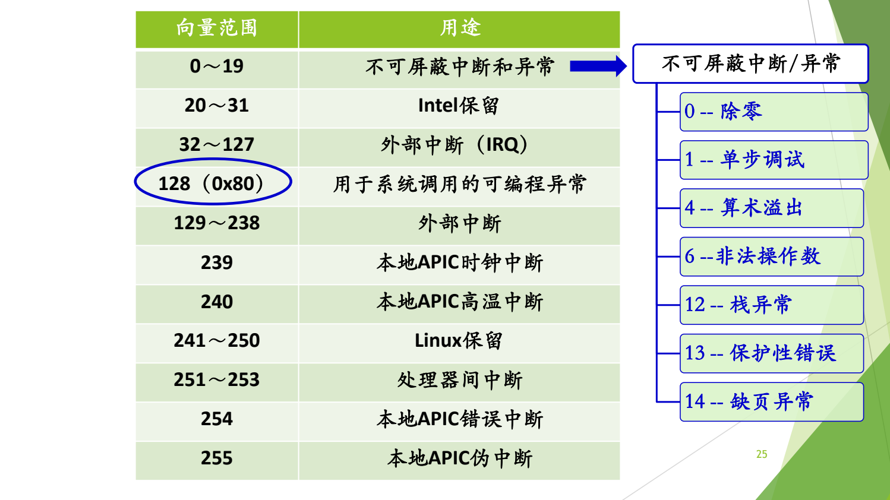

图：x86 上 Linux 的 256 个向量中，0～19 为不可屏蔽中断和异常（如 0 除零、14 缺页异常），32～127 为外部中断，128（0x80）专用于系统调用。

| 向量范围 | 用途 |
| --- | --- |
| 0～19 | 不可屏蔽中断和异常 |
| 20～31 | Intel 保留 |
| 32～127 | 外部中断（IRQ） |
| 128（0x80） | 用于系统调用的可编程异常 |
| 129～238 | 外部中断 |
| 239 | 本地 APIC 时钟中断 |
| 240 | 本地 APIC 高温中断 |
| 241～250 | Linux 保留 |
| 251～253 | 处理器间中断 |
| 254 | 本地 APIC 错误中断 |
| 255 | 本地 APIC 伪中断 |

[^l03-section-2-s2p25]

0～19 号中较常见的几项是：0 除零，1 单步调试，4 算术溢出，6 非法操作数，12 栈异常，13 保护性错误，14 缺页异常。[^l03-section-2-s2p25] 这些项的含义由硬件规定，大家公认，因此汇编里常说“int 0 是除零”“int 1 是调试”“int 14 是缺页”。

**0x80 的来历**：128 号不是硬件规定的，而是 Linux 在表中间一段空闲位置自己选定的，专门用作系统调用入口。[^l03-section-2-s4b2] 这一项在 IDT 中如何初始化、用户程序怎样通过它进入内核，见 [Linux 系统调用执行](#linux-系统调用执行)。

5–12、16–17 号向量只要求了解。[^l03-section-2-s2p26]

> [!note] 补充解释
> 按 Intel 手册，5–12、16–17 号向量依次大致为：5 BOUND 越界，6 无效操作码（即上表的“非法操作数”），7 设备不可用（无数学协处理器），8 双重故障，9 协处理器段越界（已不使用），10 无效 TSS，11 段不存在，12 栈段故障，16 x87 浮点错误，17 对齐检查。详细定义见 [Intel SDM 第 3 卷](https://www.intel.com/content/www/us/en/developer/articles/technical/intel-sdm.html) 的中断与异常一章。

> [!question]- 自测：CPU 处于关中断状态时，磁盘发出了中断请求。会发生什么？
> 硬件在指令周期末不去检查中断，CPU 继续取下一条指令；请求仍记录在中断寄存器里，等到开中断后的某个指令周期末才被发现和响应（同类请求重复到来则可能丢失）。

> [!question]- 自测：如果操作系统没有填写中断向量表的第 14 项，程序第一次缺页时会怎样？
> 硬件照样用 14 去查表，但表项里没有有效的处理程序入口，控制无法转到缺页处理程序，缺页得不到处理。这说明中断机制能工作，依赖操作系统在初始化时把表准备好。

> [!info]- 来源
> - slides02.pdf：PDF p.23–26
> - L03.docx：DOCX body 1–67

[^l03-section-2-s2p23]: slides02.pdf-PDF p.23
[^l03-section-2-s4b2]: L03.docx-DOCX body 42-67
[^l03-section-2-s2p24]: slides02.pdf-PDF p.24
[^l03-section-2-s2p25]: slides02.pdf-PDF p.25
[^l03-section-2-s2p26]: slides02.pdf-PDF p.26

---

## 中断处理完整流程

> [!abstract] 本节要点
> - 中断响应五步：① 设备发中断信号；② 硬件保存现场；③ 根据中断码查表；④ 把处理程序入口地址等推送到相应寄存器；⑤ 执行中断处理程序。①–④ 是硬件，⑤ 是软件。
> - 软硬交接的约定是**改写 PC**：硬件把 PC 设为处理程序入口，下一个指令周期执行的就必然是软件。
> - 硬件保存现场时先切换到内核态，在**系统栈**（内核栈，不同于用户栈）中只保存 PC、PSW 等少数关键寄存器。
> - 软件处理程序的第一件事是**继续保存其余全部上下文**，然后分析原因、执行处理、恢复现场；最后由一条中断返回指令（硬件）恢复 PSW 和 PC。
> - Linux 把中断处理分为**上半部**（关中断，立即做紧急部分）和**下半部**（开中断，做不紧急部分）。

### 中断响应五步流程

上一章讲了硬件在何时发现中断、凭什么找到处理程序。把这些动作按时间顺序连起来，就是完整的中断响应流程。画这个流程的目的是弄清三件事：哪部分由硬件做；硬件交给软件后软件做什么；为了让流程走通，必须事先准备什么（初始化中断向量表）。步骤的编号就是顺序，不能颠倒。[^l03-section-3-s4b2]

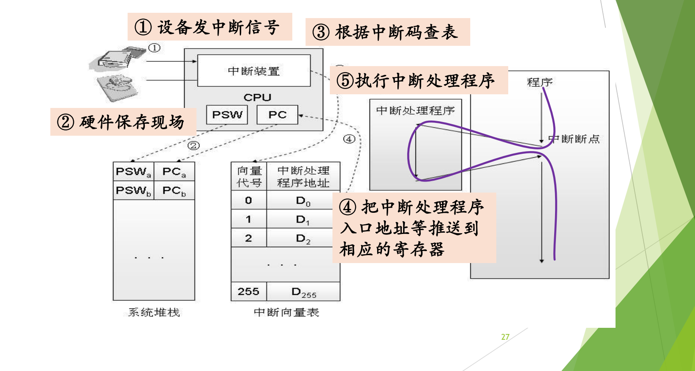

图：按编号顺序追踪一次中断：①设备发出中断信号，②硬件把 PSW 和 PC 压入系统栈保存现场，③根据中断码查中断向量表，④把处理程序入口送入寄存器，⑤执行中断处理程序后返回断点。

图中左侧是设备和 CPU（含中断装置、PSW、PC），下方是系统堆栈和中断向量表（向量代号 0～255，每项是处理程序地址 $D_0, D_1, \ldots, D_{255}$），右侧是被打断的程序和中断处理程序。紫色曲线表示控制流：程序在“中断断点”处离开，执行完处理程序后回到断点继续执行。[^l03-section-3-s2p27]

1. **① 设备发中断信号**：例如磁盘完成了一次传输，向 CPU 的中断装置发出信号，中断装置把它记录下来。这是一个异步事件。
2. **② 硬件保存现场**：硬件响应中断，首先切换到内核态（原本就在内核态则不必切换）；然后把被打断程序的 PSW 和 PC（图中的 $\mathrm{PSW}_a, \mathrm{PC}_a$）压入**系统堆栈**。[^l03-section-3-s4b2]
3. **③ 根据中断码查表**：用中断码作下标查中断向量表。表已在初始化时建好，表的起始地址也放在硬件找得到的地方。[^l03-section-3-s4b3]
4. **④ 把中断处理程序入口地址等推送到相应的寄存器**：把查到的入口地址装入 PC（以及新的 PSW）。
5. **⑤ 执行中断处理程序**：下一个指令周期开始，CPU 执行的就是处理程序的第一条指令。

其中 ①–④ 由硬件完成，⑤ 由软件完成。[^l03-section-3-s4b3]

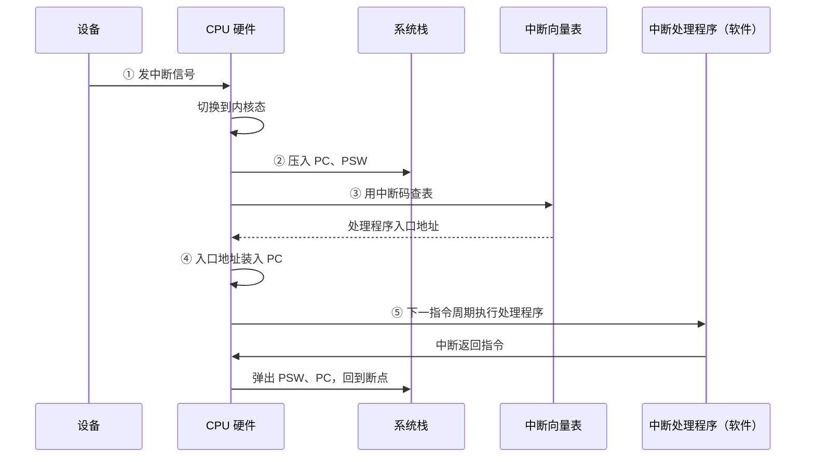

#### 硬件保存现场：为什么只存少数寄存器

处理器里有大量寄存器：通用寄存器、各种控制寄存器等，硬件不可能全部保存。硬件只保存最重要的几个，至少是 PC 和 PSW，有的架构会再多存一两个。[^l03-section-3-s4b2] 这两个之所以必须由硬件保存，是因为接下来硬件自己就要改写它们（第 ④ 步把新的入口地址装入 PC），不先存下来，被打断的程序就再也回不去了。

#### 用户栈与系统栈

硬件压栈用的是**系统栈**（内核栈），而不是用户程序正在使用的用户栈，两者是不同的栈。处理器在用户态运行时栈指针指向用户栈，进入内核态时栈指针要切换到内核栈。[^l03-section-3-s4b2] 这也是第 ② 步要先切换到内核态、再压栈的原因。x86 上栈指针从哪里取得，见 [Linux 系统调用执行](#linux-系统调用执行) 中 TSS 的部分。

### 软硬交接：改写 PC

软件和硬件之间怎么“交接”？约定非常简单：**硬件只要把 PC 改成中断处理程序的入口地址，下一个指令周期执行的就一定是这段代码**。[^l03-section-3-s4b3] 硬件不需要“调用”软件，也不需要通知软件；改写 PC 这一个动作就完成了控制权的移交。

所以第 ④ 步是硬件的最后一步，第 ⑤ 步是软件的第一步。从这里开始到处理结束，都是软件的事；只有最后的返回，又是一条硬件指令。[^l03-section-3-s4b3]

> [!tip] 课堂强调
> 每次考试总有同学把软硬件步骤交叉着写。下面的小结表为每一步都标出了由硬件还是软件完成，对照记住这个分工，就不会把步骤交来交去。[^l03-section-3-s4b3]

### 中断处理程序做什么

软件部分的逻辑是“兵来将挡”：什么样的事件，就做什么样的处理，结构并不复杂。[^l03-section-3-s2p28]

**事先准备**：设计操作系统时，为每一类中断/异常事件编好相应的处理程序，并设置好中断向量表。操作系统引导启动之后，这些准备就已经完成。

**运行时**：硬件响应中断、把 CPU 控制权转给中断处理程序后，处理程序依次：[^l03-section-3-s2p28]

1. **保存相关寄存器信息**：硬件只保存了 PC、PSW 等少数寄存器，软件要把其余的全部上下文（context）继续保存到系统栈中。这是软件的**第一件事**，一定要记清，它体现的正是软硬件的分工。[^l03-section-3-s4b3]
2. **分析中断/异常的具体原因**：例如打印机中断，到底是打印结束、缺纸、缺墨还是卡纸。
3. **执行对应的处理功能**：例如缺纸时显示提示，让用户加纸。
4. **恢复现场，返回被事件打断的程序**：把软件保存的寄存器恢复，再执行中断返回指令。

> [!warning] 易错点
> “保存现场”分两段：硬件在第 ② 步保存 PC、PSW 等少数关键寄存器；软件处理程序开头再保存其余全部寄存器。只写其中一段，或说“硬件保存全部寄存器”，都是错的。

### 以打印机中断为例的完整小结

把上面的步骤套到一个具体设备上，并标出每一步由谁完成：[^l03-section-3-s2p29] [^l03-section-3-s2p30]

| 阶段 | 动作 | 执行者 |
| --- | --- | --- |
| 发出请求 | 打印机给 CPU 发中断信号 | 设备 |
| 检测与确认 | CPU 处理完当前指令后检测到中断，判断中断来源，向相关设备发确认信号 | 硬件 |
| 准备 | 处理器状态切换到内核态；在系统栈中保存被中断程序的重要上下文，主要是 PC 和 PSW | 硬件 |
| 查表转移 | 根据中断码查中断向量表，取得处理程序入口地址，把 PC 设置成该地址；新的指令周期开始时，控制转到中断处理程序 | 硬件 |
| 处理 | 在系统栈中保存现场信息；检查 I/O 设备的状态信息，操纵 I/O 设备或在设备和内存之间传送数据等 | 软件 |
| 返回 | CPU 检测到中断返回指令，从系统栈中恢复被中断程序的上下文，CPU 状态恢复，PSW 和 PC 恢复成中断前的值，开始新的指令周期 | 硬件 |

注意“检测到中断”发生在 CPU **处理完当前指令之后**，与 [中断周期](#中断响应与中断向量) 一致。返回时恢复的 PSW 中包含原来的处理器状态，因此程序回到中断前的特权级（例如用户态）继续执行。

这一流程以后还会在 x86 硬件（[x86 中断支持](#x86-中断支持)）、系统调用（[Linux 系统调用执行](#linux-系统调用执行)）等场景下反复出现，最后在 [低层步骤与机制策略](#低层步骤与机制策略) 中按硬件、汇编、C 三层总结。

### 上半部与下半部

前面说第 ⑤ 步“执行中断处理程序”，好像处理程序是一口气执行完的。实际上 Linux 的中断处理程序又分成两部分：**上半部**（top half）和**下半部**（bottom half）。[^l03-section-3-s4b3]

- **上半部**：在关中断状态下，立即完成特别重要、特别紧急的工作。此时 CPU 不再理会其他中断，必须把这部分做完。
- **下半部**：打开中断以后，再去完成不那么紧急的工作。这期间即使再被别的中断打断，也没有关系。

可以用战地救护作类比：前线打仗时随队的医生、护士遇到伤员，第一步是做紧急包扎处理，然后把伤员抬下战场，送到医院再做手术。不可能一上来就在战场上做手术。把一件事分成“先紧急处理、再从容完成”两步，这种思路在日常决策中也很常见。[^l03-section-3-s4b3]

> [!question] 思考题：为什么 Linux 的中断处理要引入上半部和下半部？
> 理解 Linux 的中断处理流程，解释为什么引入上半部和下半部处理？
>
> **提示**：从“中断处理期间中断是开还是关”入手，想一想关中断的时间太长会对其他设备的中断造成什么影响。
>
> > [!success]- 解答（老师课上给出）
> > Linux 把一次中断处理分成两部分：**上半部**在关中断状态下立即完成特别重要、紧急的事，这期间 CPU 不理会其他中断，必须把这部分做完；做完后打开中断，由**下半部**完成其余不那么紧急的工作，期间即使被新的中断打断也没有关系。这就像战地救护：先在前线做紧急包扎，再把伤员抬下战场送到医院做手术，不可能一上来就在战场上做手术。
> >
> > 这样分的原因在于关中断的代价：关中断期间 CPU 不响应任何其他中断，如果整个处理程序都关着中断执行，其他设备的请求就要长时间等待，同类请求重复到来时还可能丢失（见 [中断异常事件分类](#中断异常事件分类)）。只在上半部关中断，既保证紧急工作及时、完整地完成，又让系统能尽快响应其他中断。

> [!question]- 自测：有人写出中断响应流程为“设备发信号 → 硬件保存全部寄存器 → 软件查中断向量表 → 软件改写 PC → 执行处理程序”。指出错误。
> 有三处错误：硬件只保存 PC、PSW 等少数寄存器，其余由软件处理程序保存；查中断向量表是硬件做的；改写 PC 也是硬件做的，它正是软硬交接的那一步。①–④ 都是硬件，只有 ⑤ 是软件。

> [!question]- 自测：中断处理程序的第一条指令执行时，栈指针指向哪个栈？栈顶附近存着什么？
> 指向系统栈（内核栈）。硬件在第 ② 步已切换到内核态并把被打断程序的 PC、PSW 压入系统栈，所以栈顶附近是这些由硬件保存的少数关键寄存器；软件接下来要把其余寄存器继续压到这个栈上。

> [!info]- 来源
> - slides02.pdf：PDF p.27–30
> - L03.docx：DOCX body 42–96

[^l03-section-3-s4b2]: L03.docx-DOCX body 42-67
[^l03-section-3-s2p27]: slides02.pdf-PDF p.27
[^l03-section-3-s4b3]: L03.docx-DOCX body 68-96
[^l03-section-3-s2p28]: slides02.pdf-PDF p.28
[^l03-section-3-s2p29]: slides02.pdf-PDF p.29
[^l03-section-3-s2p30]: slides02.pdf-PDF p.30

---

## x86 中断支持

> [!abstract] 本节要点
> - x86 中断由硬件信号引发，分可屏蔽和不可屏蔽；异常由指令执行引发，约 20 种，其中部分异常会产生硬件**出错码**压入内核栈，导致栈帧大小不一，需要对齐；系统调用是异常的一种。
> - 中断控制器（PIC/APIC）把硬件中断信号转换为中断向量。实模式用中断向量表（入口 = 段地址左移 4 位 + 偏移，不切换 CPU 状态），保护模式用**中断描述符表 IDT**，表项是**门描述符**。
> - 四种门：任务门（Linux 不用）、**中断门**（通过后自动关中断）、**陷阱门**（不自动关中断）、调用门。选哪种门取决于处理期间是否接受新中断。
> - 查找过程：IDTR 给出 IDT 起址，以向量号为下标取门描述符；其中的段选择符作 GDT 下标取段描述符得段基址；段基址 + 门描述符中的偏移 = 处理程序入口。
> - 查表全由硬件完成，表由操作系统事先建好。这个例子用来验证前面的通用流程，细节不要求掌握。

### 用 IA32 验证通用流程

前三章讲的是与具体硬件无关的通用模型。这里以 IA32（x86 32 位）为例看真实处理器怎么实现它。这个例子比较复杂，数据结构的名称也和前面不同，**不要求掌握**；看完它只为确认前面讲的流程没有问题。[^l03-section-4-s4b3] [^l03-section-4-s2p31]

x86 中与中断相关的基本概念如下：[^l03-section-4-s2p32]

- **中断**：由硬件信号引发，分为**可屏蔽中断**和**不可屏蔽中断**。屏蔽了的中断来了也不处理；不可屏蔽的中断来了必须处理。
- **异常**：由指令执行引发，比如除零异常。80x86 处理器定义了大约 20 种不同的异常。
- **硬件出错码**：对于某些异常，CPU 会在执行异常处理程序之前产生一个硬件出错码，并压入内核态堆栈。
- **系统调用**：异常的一种，是用户态到系统态的唯一入口。

#### 出错码与栈帧对齐

中断都有中断码：中断请求记录在寄存器中，多个请求按优先级先后响应，必须靠编码区分。异常则是当前指令当场出的问题、立即处理，一般不需要额外的码；但有些异常需要报告错误细节，于是有的异常有出错码、有的没有。[^l03-section-4-s4b3]

这就带来**不对齐**的问题：同样是进入异常处理程序，有出错码的异常在内核栈上比没有出错码的多压一项，栈帧大小不一致，处理程序就不知道从哪个位置取保存的现场。解决办法是对齐，让所有栈帧形状一致。[^l03-section-4-s4b3]

> [!note] 补充解释
> 源材料只说“对齐就行”。Linux 的常见做法是：对于硬件不压出错码的异常，处理程序入口先由软件压入一个占位值（如 0），使所有异常的栈帧布局相同，后续代码就能用统一的偏移取出各个字段。

### 中断控制器与两种表

**中断控制器**（PIC 或 APIC）负责把硬件的中断信号转换为**中断向量**，引发 CPU 中断。[^l03-section-4-s2p33] 它就是前面通用模型中的“中断装置”。

x86 有实模式和保护模式两种运行模式，两种模式下的表不同：[^l03-section-4-s2p33]

| | 实模式 | 保护模式 |
| --- | --- | --- |
| 表的名称 | 中断向量表（Interrupt Vector） | 中断描述符表 IDT（Interrupt Descriptor Table） |
| 表项内容 | 中断服务程序的入口地址 | 门（gate）描述符 |
| 入口地址计算 | 段地址左移 4 位 + 偏移地址 | 段基址 + 偏移（段基址经 GDT 取得） |
| CPU 运行状态切换 | 不支持，中断处理与一般的过程调用相似 | 支持，可以进行特权级检查与切换 |

现在的操作系统都运行在保护模式下。名字从“中断向量表”改成“中断描述符表”，作用相同，只是每一项的内容更多。两者本质上都是大数组。[^l03-section-4-s4b3]

实模式入口地址的计算可写成

$$
\text{入口地址} = \text{段地址} \times 16 + \text{偏移地址}
$$

左移 4 位即乘以 16。

### 门描述符与四种门

在 IDT 中，每一项是一个结构，x86 称之为**门描述符**（gate descriptor）。它就是“中断向量表中的一行”，只是换了 x86 自己的术语。[^l03-section-4-s4b4] x86 提供四种类型的门：[^l03-section-4-s2p34]

1. **任务门**（Task Gate）：中断发生时，必须取代当前进程的那个进程的 TSS 选择符存放在任务门中。Linux 没有使用任务门。
2. **中断门**（Interrupt Gate）：给出段选择符（Segment Selector）和中断/异常处理程序的段内偏移量（Offset）。通过中断门后，系统会**自动禁止中断**。
3. **陷阱门**（Trap Gate）：与中断门类似，但通过陷阱门后系统**不会自动关中断**。
4. **调用门**（Call Gate）。

硬件和软件之间既像博弈也像协同：硬件预想软件可能需要什么，提供四种门；软件不必全用。Linux、Windows 主要使用中断门和陷阱门。[^l03-section-4-s4b4]

#### 中断门与陷阱门怎么选

两者唯一的区别在于进入处理程序后中断是否自动关闭：[^l03-section-4-s4b4]

| | 中断门 | 陷阱门 |
| --- | --- | --- |
| 进入后中断状态 | 自动关中断 | 不自动关中断 |
| 处理期间 | 不接受新的中断 | 可能有新的中断或异常进来 |

选哪种门没有硬性规定，选哪个都可以，但要给出理由。基本依据就是：处理这件事期间，是否允许接受新的中断。[^l03-section-4-s4b4] 例如，Linux 的 0x80 系统调用入口用的是陷阱门，进入内核执行系统调用时中断仍然开着（见 [Linux 系统调用执行](#linux-系统调用执行)）。

> [!warning] 易错点
> “中断门”和“陷阱门”的名字不表示它只能用于中断或只能用于陷入。门的类型只决定进入时是否自动关中断，异常、中断都可以选用任意一种，由操作系统按需要设置。

### IDT、GDT 与处理程序入口的查找

保护模式下，处理程序的入口地址不直接写在 IDT 里，而是由“段基址 + 偏移”两部分拼出来，分别从两张表中取得。

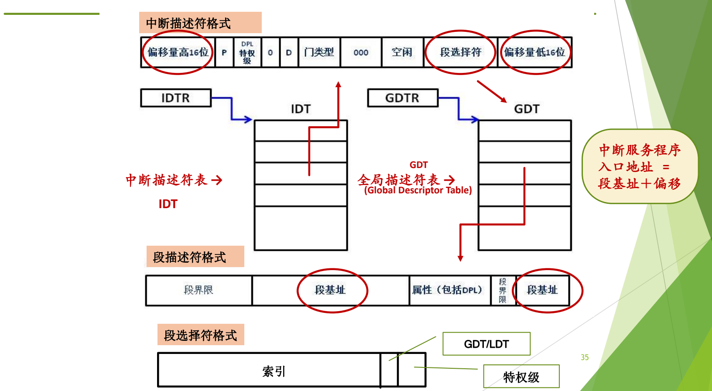

图：IDTR 指向 IDT，中断描述符中的段选择符到 GDT 中找到段描述符取得段基址，再加上描述符中的偏移量，得到中断服务程序入口地址。

图中给出了三种格式和两张表：

- **中断描述符格式**：包含偏移量高 16 位、P、DPL（特权级）、门类型、段选择符、偏移量低 16 位等字段，图中圈出的是段选择符和两段偏移量。
- **段描述符格式**：包含段界限、段基址、属性（包括 DPL）等字段，段基址也分成两段存放。
- **段选择符格式**：由索引、GDT/LDT 选择位和特权级组成，主要当索引用。
- **IDT**（中断描述符表）由寄存器 **IDTR** 给出起始地址；**GDT**（全局描述符表，Global Descriptor Table）由寄存器 **GDTR** 给出起始地址。

中断服务程序入口地址 = 段基址 + 偏移。[^l03-section-4-s2p35]

段基址和偏移分开存放，偏移又拆成高、低两个 16 位，是 x86 从 8086 起一路向后兼容、不断扩展留下的痕迹：原有字段不变，扩展的位就另找位置添上。[^l03-section-4-s4b4]

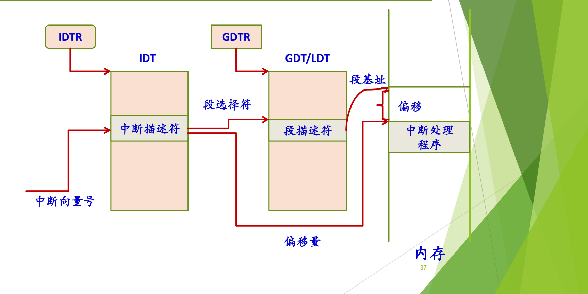

图：中断向量号索引 IDT 中的中断描述符，其段选择符索引 GDT/LDT 中的段描述符得到段基址，段基址加偏移量即内存中的中断处理程序。

查找过程是一条路径：中断向量号 → IDTR 指向的 IDT 中的中断描述符 → 其中的段选择符 → GDTR 指向的 GDT 中的段描述符 → 段基址；段基址加上中断描述符中的偏移量，指向内存中的中断处理程序。[^l03-section-4-s2p37]

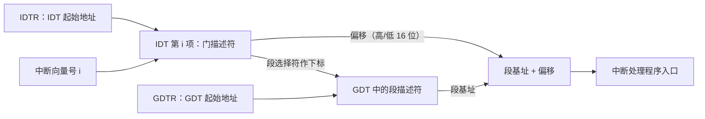

查找可写成

$$
\text{入口地址} = \mathrm{GDT}\big[\,\mathrm{IDT}[i].\text{段选择符}\,\big].\text{段基址} + \mathrm{IDT}[i].\text{偏移}
$$

其中 $i$ 是中断向量号，$\mathrm{IDT}[i]$ 表示以 $i$ 为下标、从 IDTR 给出的起始地址处取出的门描述符。向量号、中断号、中断码在这里指同一个东西，就是这张表的下标。[^l03-section-4-s4b4]

**所有处理程序共用一个段基址**：各中断处理程序的门描述符通常选中同一个内核代码段，段基址只有一个，各处理程序靠不同的偏移区分。这相当于把所有中断处理程序连续放在内存中一块固定的区域里，记好基址和各自的偏移就都能找到。[^l03-section-4-s4b4]

**查表是硬件做的**：系统运行前，操作系统已经建好 IDT 和 GDT，并把它们的起始地址装入 IDTR 和 GDTR；之后来了中断，整个查表过程都由硬件完成，不需要软件参与。[^l03-section-4-s4b4] 这与通用模型中“操作系统初始化时建表、硬件响应时查表”完全一致。

### x86 中断/异常的硬件处理过程

把查表和前面的“硬件保存现场”合起来，x86 硬件处理一次中断或异常的完整步骤如下（这是上图查找过程的文字版，图和文字看懂一种即可）：[^l03-section-4-s2p36]

1. 确定与中断或异常关联的向量 $i$。
2. 通过 IDTR 寄存器找到 IDT，取得中断描述符（表中第 $i$ 项）。
3. 从 GDTR 寄存器获得 GDT 的地址；结合中断描述符中的段选择符，在 GDT 中取得对应的段描述符，从中得到处理程序所在段的段基址。
4. **特权级检查**。
5. 检查是否发生了特权级变化；如果是，进行**堆栈切换**，必须使用与新特权级相关的栈。
6. **硬件压栈**，保存上下文环境；如果异常产生了硬件出错码，也把它保存在栈中。
7. 如果是经中断门进入，清 IF 位（关中断）。
8. 通过中断描述符中的段内偏移量和段描述符中的段基址，找到处理程序的入口地址，执行其第一条指令。

与通用模型对照：第 1 步对应“得到中断码”，第 2、3、8 步对应“查表并改写 PC”，第 5、6 步对应“切换到内核态、在系统栈中保存 PC/PSW”（x86 中 PSW 对应 EFLAGS 寄存器）。第 8 步执行处理程序的第一条指令，就是交给软件的时刻。系统调用 `int 0x80` 时硬件具体压入哪些寄存器、从哪里取内核栈指针，见 [Linux 系统调用执行](#linux-系统调用执行)。

> [!note] 补充解释
> 讲义原文第 7 步写作“如果是中断，清 IF 位”。按 Intel 规范，是否清 IF 取决于**门的类型**而不是事件是中断还是异常：经中断门进入时处理器清 IF，经陷阱门进入时 IF 保持不变。这与上文对两种门的描述一致，此处已按门类型改写。参见 [Intel SDM 第 3 卷](https://www.intel.com/content/www/us/en/developer/articles/technical/intel-sdm.html) 中断与异常处理一章。

> [!question]- 自测：某处理程序要求处理期间不能被其他中断打断，它在 IDT 中应设成哪种门？为什么？
> 中断门。经中断门进入时硬件自动清 IF、关中断，处理期间不接受新的中断；陷阱门不会自动关中断。

> [!question]- 自测：已知某门描述符的段选择符指向 GDT 中段基址为 $B$ 的代码段，偏移量高 16 位为 $H$、低 16 位为 $L$。处理程序入口地址是多少？
> 偏移 $= H \times 2^{16} + L$，入口地址 $= B + H \times 2^{16} + L$。偏移拆成两段存放是向后兼容造成的，拼接时高 16 位要左移 16 位。

> [!question]- 自测：为什么同一个处理程序框架要处理“有出错码”和“无出错码”两种异常时，必须先做对齐？
> 有出错码的异常比无出错码的在内核栈上多一项，栈帧大小不同，后续代码无法用固定偏移找到保存的寄存器。补齐成统一的栈帧后，才能用同一套代码访问现场。

> [!info]- 来源
> - slides02.pdf：PDF p.31–37
> - L03.docx：DOCX body 68–119

[^l03-section-4-s4b3]: L03.docx-DOCX body 68-96
[^l03-section-4-s2p31]: slides02.pdf-PDF p.31
[^l03-section-4-s2p32]: slides02.pdf-PDF p.32
[^l03-section-4-s2p33]: slides02.pdf-PDF p.33
[^l03-section-4-s4b4]: L03.docx-DOCX body 97-119
[^l03-section-4-s2p34]: slides02.pdf-PDF p.34
[^l03-section-4-s2p35]: slides02.pdf-PDF p.35
[^l03-section-4-s2p37]: slides02.pdf-PDF p.37
[^l03-section-4-s2p36]: slides02.pdf-PDF p.36

---

## 系统调用概念辨析

> [!abstract] 本节要点
> - **系统调用**是用户编程时调用的操作系统功能，是操作系统提供给编程人员的唯一接口；它的作用是让 CPU 从用户态陷入内核态。
> - 命令行里敲的命令不是系统调用；系统调用出现在程序代码里（如 `fork`、`open`、`read`、`write`）。
> - 层次关系：内核函数（内核里的一段代码）→ 封装为系统调用 → 再封装进 C 库/API；应用程序既可直接调用系统调用，也可调用库函数。
> - `printf` 是 C 库函数，不是系统调用，但它最终一定调用 `write` 系统调用，可用 `strace -e trace=write ./hello` 验证。

### 为什么需要系统调用

用户程序运行在用户态，不能执行特权指令，也不能直接操作设备和内核数据（见 L02「07 处理器特权模式」）。可程序又确实需要读文件、创建进程、向屏幕输出，这些工作只能由操作系统在内核态完成。系统调用就是用户程序“请求操作系统替我做事”的那条受控通道。

**系统调用**（system call）是用户在编程时可以调用的操作系统功能。[^l03-section-5-s2p40] 它原名“操作系统功能调用”，因为名字太长才简称为系统调用。它有两个要点：

1. **唯一接口**：系统调用是操作系统提供给编程人员的唯一接口。程序想用操作系统的服务，最终都要走这条路。
2. **改变 CPU 状态**：系统调用使 CPU 状态从用户态陷入内核态。设计它的根本目的，就是让程序经由这条路径进入内核态。[^l03-section-5-s4b4]

每个操作系统都提供几百种系统调用，按功能大致分为进程控制、进程通信、文件使用、目录操作、设备管理、信息维护等类别。[^l03-section-5-s2p40]

> [!warning] 易错点
> 系统调用是**编程时**在代码里调用的（如 `fork`、`open`）；在命令行里敲的 `ls`、`cp` 是**命令**，不是系统调用。命令对应的程序在运行时会去调用系统调用，但命令本身不是。[^l03-section-5-s4b4]

> [!note] 补充解释
> 两个课后自学问题：Linux 提供多少个系统调用？怎样新增一个系统调用？以当前 x86-64 Linux 为例，系统调用表大约有四百多项；新增一个系统调用，大致要实现内核函数（用 `SYSCALL_DEFINEn` 宏定义）、在体系结构的系统调用表中登记一个新编号、补充头文件声明，再重新编译内核。具体步骤见内核文档 [Adding a New System Call](https://docs.kernel.org/process/adding-syscalls.html)。

### 系统调用、库函数、API 与内核函数

这四个概念经常混用，面试也爱问它们的区别。[^l03-section-5-s4b4] 理解它们的关键是：每个系统调用在内核里都对应**一段代码**。

1. **内核函数**：内核中真正干活的那段代码。它的名字和系统调用不完全一样，通常加了前缀或下划线，例如 `write` 对应内核里的 `sys_write`。
2. **系统调用**：内核函数经过一层封装后，对外提供的入口。
3. **库函数 / API**：系统调用再被封装进 C 函数库或 API 接口。例如 `fopen` 是对 `open` 的封装，`printf` 是 libc 中的库函数。[^l03-section-5-s4b5]

应用程序有两条路：可以直接在 C 代码里写 `open`、`fork` 这样的系统调用，也可以调用 `fopen`、`printf` 这样的库函数，由库函数再去调用系统调用。[^l03-section-5-s2p42]

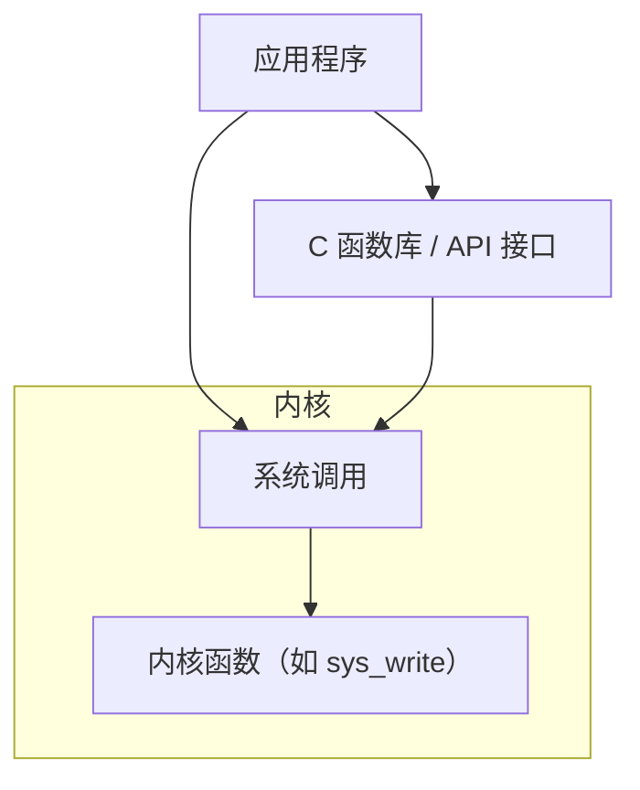

| 概念 | 在哪里 | 运行在什么状态 | 例子 |
| --- | --- | --- | --- |
| 库函数 / API | C 库等用户空间库 | 用户态 | `printf`、`fopen` |
| 系统调用 | 用户与内核的边界 | 由用户态陷入内核态 | `write`、`open`、`fork` |
| 内核函数 | 内核代码 | 内核态 | `sys_write`、`sys_open` |

> [!warning] 易错点
> 库函数不一定调用系统调用：例如 `strlen`、`abs` 只在用户态做计算，不需要内核服务。只有涉及 I/O、进程、内存分配等需要操作系统参与的库函数，才会在内部发出系统调用。

### printf 与 write

`printf` 是最常见的例子。应用程序调用 `printf()` 时，会触发系统调用 `write()`。[^l03-section-5-s2p43] 过程如下：

1. 用户程序调用标准 C 库中的 `printf("greetings")`，格式化工作在用户态的库里完成。
2. C 库内部调用 `write()`，通过系统调用接口从用户态进入内核态。
3. 在内核中，系统调用接口根据 `write` 的编号（图中的 $i$）找到 `write()` 的系统调用实现并执行。
4. 执行完毕后 `return`，从内核态回到用户态，再回到 `printf`，最后回到 `main`。

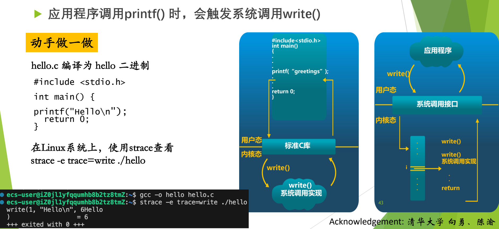

图：hello.c 调用 printf，标准 C 库最终调用 write，经系统调用接口进入内核执行 write 的实现；用 strace -e trace=write 可以看到这次 write 调用及其返回值 6。

图左半部分画的是“应用程序 → 标准 C 库 → `write()` 系统调用实现”这条纵向调用链，用户态和内核态的分界线在 C 库下方；右半部分把系统调用接口画成一张按编号 $i$ 索引的表，`write()` 调用进入接口后在表中第 $i$ 项找到实现，执行后 `return`。

用 `strace` 跟踪程序发出的系统调用，可以直接验证这一点：

```bash
gcc -o hello hello.c
strace -e trace=write ./hello
```

其中 `hello.c` 只有一句 `printf("Hello\n");`。输出为：

```text
write(1, "Hello\n", 6Hello
)                       = 6
+++ exited with 0 +++
```

逐项解读：`strace` 只跟踪 `write` 这一种系统调用；`write(1, "Hello\n", 6)` 表示向文件描述符 1（标准输出）写 6 个字节；`= 6` 是返回值，即实际写出的字节数。中间夹着的 `Hello` 是程序自己真正输出到终端的内容，它和 `strace` 打印的跟踪信息混在了同一个终端上。程序里只写了 `printf`，跟踪到的却是 `write`，说明 `printf` 和 `write` “不是一回事，但又是一回事”。[^l03-section-5-s4b5]

### 系统调用与过程调用的区别

“系统调用与 C 函数调用（过程调用）的区别”是经典问题，也是面试常题。[^l03-section-5-s2p42] 常见的标准答案从四个方面阐述。[^l03-section-5-s4b5]

> [!note] 补充解释
> 常见答案可归纳为四个方面（结合本讲后面的内容）：
> 1. **进入方式**：过程调用用 `call` 指令直接跳到函数地址；系统调用用陷入指令（如 `int $0x80`），先经中断向量表进入总入口，再按编号查系统调用表，调用者不知道内核函数的地址。
> 2. **运行状态**：过程调用前后都在同一特权级（用户态）；系统调用要从用户态切换到内核态，返回时再切回。
> 3. **栈与开销**：过程调用只用用户栈；系统调用要切换到内核栈，并保存全部现场，开销明显更大。
> 4. **返回方式**：过程调用执行完直接返回调用者；系统调用返回用户态前要检查是否需要重新调度、是否有未决信号，调用进程未必马上继续运行（见 [Linux 系统调用执行](#linux-系统调用执行)）。

> [!question]- 自测：在 shell 里输入 `cat a.txt` 并回车，“cat”是系统调用吗？整个过程中有没有系统调用发生？
> `cat` 是命令，不是系统调用。但 `cat` 程序运行时会调用 `open`、`read`、`write` 等系统调用来打开文件、读取内容并输出到终端，所以过程中有系统调用发生。

> [!question]- 自测：程序先调用 `fopen` 打开文件，再调用 `fprintf` 写入。哪些是系统调用？哪些代码在内核态执行？
> `fopen`、`fprintf` 都是 C 库函数，在用户态执行。它们内部分别调用 `open` 和 `write` 系统调用；只有陷入之后执行的内核函数（如 `sys_open`、`sys_write`）运行在内核态。

> [!question]- 自测：把 hello 程序改成 `printf("Hi!\n"); printf("Bye\n");`，用 `strace -e trace=write` 跟踪，你预计会看到几次 `write`？
> 输出到终端时，标准输出按行缓冲，每遇到 `\n` 刷新一次，预计看到两次 `write(1, ...)`，返回值分别是 4。若把输出重定向到文件，变成全缓冲，可能只看到一次 `write`，写入 8 个字节。这说明库函数调用次数和系统调用次数不必一一对应。

> [!info]- 来源
> - slides02.pdf：PDF p.38–43
> - L03.docx：DOCX body 97–148

[^l03-section-5-s2p40]: slides02.pdf-PDF p.40
[^l03-section-5-s4b4]: L03.docx-DOCX body 97-119
[^l03-section-5-s4b5]: L03.docx-DOCX body 120-148
[^l03-section-5-s2p42]: slides02.pdf-PDF p.42
[^l03-section-5-s2p43]: slides02.pdf-PDF p.43

---

## 系统调用机制设计

> [!abstract] 本节要点
> - 系统调用不另建新机制，而是建立在中断/异常机制之上；操作系统要事先准备四样东西：中断异常机制、陷入指令、系统调用号与参数约定、系统调用表。
> - 陷入指令也叫访管指令（“管”指管态，即内核态）：x86 Linux 用 `int $0x80`，RISC-V 用 `ecall`，奔腾 II 之后的 x86 还有 `sysenter`/`sysexit`。
> - 参数传递有三种方法：陷入指令自带、通用寄存器、内存中的专用栈区；最常用的是寄存器，具体放法由编译器生成。
> - x86 Linux 约定：`eax` 放系统调用号（write 为 4，exit 为 1）和返回值，参数依次放 `ebx`、`ecx`、`edx`、`esi`、`edi`。
> - 系统调用表与中断向量表是**两张表**：所有系统调用在中断向量表里只占 0x80 一行，进入后再按调用号查系统调用表。

### 在中断异常机制之上设计

设计系统调用分两部分：**静态部分**是事先设计好、准备好的东西，**动态部分**是程序执行到系统调用时实际发生的过程。[^l03-section-6-s4b5] 本节讲静态部分，动态部分见 [Linux 系统调用执行](#linux-系统调用执行)。

系统调用不需要另造一套新机制。任何一种体系结构都已经提供了中断/异常机制，系统调用只是在它之上实现，属于异常中的陷入（trap）一类，返回到下一条指令（分类见 [中断异常事件分类](#中断异常事件分类)）。在此基础上，还要准备以下几样东西：[^l03-section-6-s2p45]

1. **中断/异常机制**：硬件已经准备好，直接使用。
2. **陷入指令**（亦称访管指令）：选定一条特殊指令，执行它就引发异常，完成用户态到内核态的切换。
3. **系统调用号和参数**：每个系统调用事先给定一个编号（功能号），并约定参数如何传递。
4. **系统调用表**：存放各系统调用服务例程的入口地址。

系统调用是**机制与策略分离**的典型例子：所有系统调用都从同一条途径进入内核，这是机制；进入以后按编号选择不同的服务例程，这是策略。[^l03-section-6-s4b5] 这一原则在 [低层步骤与机制策略](#低层步骤与机制策略) 中展开。

### 陷入指令（访管指令）

**陷入指令**（trap instruction）也叫**访管指令**。“管”指管态，即 supervisor 模式、内核态；“访管”就是访问内核态，这是较老的叫法。[^l03-section-6-s4b5]

不同体系结构选用的指令不同：

- **x86 上的 Linux**：选 `int $0x80`，即 `int` 指令配合 128 号中断向量（向量分配见 [中断响应与中断向量](#中断响应与中断向量)）。
- **RISC-V**：用 `ecall` 指令。
- **奔腾 II 之后的 x86**：新增了 `sysenter`/`sysexit`。它和 `int`/`iret` 一样，是一进一出的一对指令。老代码仍然可以用 `int $0x80`，程序最终编译成哪一种由编译器决定。[^l03-section-6-s4b5]

> [!note] 补充解释
> 在 x86-64 上，Linux 的标准入口是 `syscall`/`sysret` 指令；`int $0x80` 仍保留，用于兼容 32 位程序。本讲的例子都是 32 位 x86。

### 系统调用号与参数传递

**系统调用号**（功能号）告诉内核“要哪一项服务”。支持多少个系统调用、每个用什么编号，有 POSIX 标准可循。按标准编号就符合标准；自己另编也能运行，但就不符合标准了。[^l03-section-6-s4b5]

系统调用是函数，可能带零个、一个或多个参数。参数在用户空间，怎样带进内核？常用的三种方法如下：[^l03-section-6-s2p46]

| 方法 | 做法 | 局限 | 实际使用 |
| --- | --- | --- | --- |
| 陷入指令自带参数 | 参数编码在指令里 | 指令长度有限，还要携带功能号，只能带很少的参数；指令也会变复杂 | 不现实 |
| 通用寄存器 | 把参数放进操作系统和用户程序都能访问的寄存器 | 寄存器个数限制参数数量 | 最常用；64 位机通用寄存器多，已不成问题 |
| 内存中的专用栈区 | 参数多时打包放在内存（栈）中，只把指针传进去 | 内核需要再去内存读取 | 参数太多时使用 |

参数怎样放置，由**编译器**负责生成相应代码。代码中的一个系统调用要变成真正可执行的陷入序列，编译器必须参与。[^l03-section-6-s4b5]

#### 示例：write 与 exit 的汇编

高级语言里的一次 `write()`，编译后会变成“先把调用号放进 `eax`，再执行 `int $0x80`”：[^l03-section-6-s2p47]

```asm
    ……
    movl $4, %eax
    ……
    int  $0x80
    ……
```

看一个完整例子。C 语言版本：[^l03-section-6-s2p48]

```c
#include <unistd.h>
int main(){
    char string[7] = {'H', 'e', 'l', 'l', 'o', '!', '\n'};
    write(1, string, 7);
    return 0;
}
```

它向屏幕输出 `Hello!`。这段代码里有两个系统调用：`write` 和 `return 0` 最终引起的 `exit`。[^l03-section-6-s4b6] 对应的 x86 Linux 汇编（AT&T 语法）如下：[^l03-section-6-s2p49]

```asm
    .section .data
output:
    .ascii "Hello!\n"
output_end:
    .equ len, output_end - output   # 字符串长度 = 7

    .section .text
    .globl _start
_start:
    movl $4, %eax        # eax 存放系统调用号：4 = write
    movl $1, %ebx        # 第 1 个参数：文件描述符 1（标准输出）
    movl $output, %ecx   # 第 2 个参数：字符串首地址
    movl $len, %edx      # 第 3 个参数：字节数
    int  $0x80           # 引发一次系统调用
end:
    movl $1, %eax        # 系统调用号 1 = exit
    movl $0, %ebx        # 参数：退出状态 0
    int  $0x80
```

逐段解释：

1. `.data` 段定义字符串 `"Hello!\n"`，`len` 用两个标号的地址差算出长度 7。
2. 第一次系统调用：编译器按规则先把系统调用号 4（write）放进 `eax`，再把三个参数 `1`、`output`、`len` 依次放进 `ebx`、`ecx`、`edx`，最后执行 `int $0x80`。这正对应 `write(1, string, 7)`。
3. 第二次系统调用：`eax = 1` 是 exit，`ebx = 0` 是退出状态，对应 C 代码里的 `return 0`。代码注释里的问题“1 这个系统调用的作用？”，答案就是 exit。[^l03-section-6-s4b6]

规律是：**先传系统调用号，再传参数，然后陷入**。执行到 `int $0x80` 时，参数已经在寄存器里准备好了。

#### 参数传递的寄存器约定

> [!info] 依据讲义整理
> 本小节的寄存器约定与 C 库封装例程示例没有在课上展开，内容与上面的汇编示例相互印证。

x86 Linux 的系统调用用寄存器传递两类信息：系统调用号，以及系统调用所需的参数。[^l03-section-6-s2p61]

- `eax`：保存系统调用号；系统调用返回时，也用它保存返回值。
- `ebx`、`ecx`、`edx`、`esi`、`edi`：依次保存第 1 到第 5 个参数。
- 进入内核态后，`system_call` 再把这些寄存器保存到内核栈中，参数也就随之进入了内核栈（见 [Linux 系统调用执行](#linux-系统调用执行)）。

> [!note] 补充解释
> 讲义写“参数个数不超过 6 个”，但只列了 5 个寄存器。在后来的 i386 Linux 内核中，第 6 个参数放在 `ebp` 中；参数更多时，就按上表第三种方法打包放进内存，只传指针。

C 库中的封装例程负责把参数从用户栈搬进寄存器。假设 C 库封装了一个系统调用号为 3 的函数（这里只是示意，并不是真实的 3 号调用），原型为：[^l03-section-6-s2p62]

```c
int sys_func(int para1, int para2);
```

C 编译器为它产生的汇编伪码如下：

```asm
    …
    movl 0x8(%esp), %ecx   # 将用户态堆栈中的 para2 放入 ecx
    movl 0x4(%esp), %ebx   # 将用户态堆栈中的 para1 放入 ebx
    movl $0x3, %eax        # 系统调用号保存在 eax 中
    int  $0x80             # 引发系统调用
    …
    movl %eax, errno       # 将结果存入全局变量 errno 中
    movl $-1, %eax         # eax 置为 -1，表示出错
```

逐行解释：

1. 按 C 的调用约定，调用者把参数压在用户栈上；进入封装例程时，`0(%esp)` 是返回地址，`0x4(%esp)` 是第一个参数 `para1`，`0x8(%esp)` 是第二个参数 `para2`。
2. 封装例程把它们分别搬进 `ebx`、`ecx`，这正是系统调用约定的第 1、第 2 个参数寄存器。
3. 把调用号 3 放进 `eax`，执行 `int $0x80` 陷入内核。
4. 返回后，`eax` 中是内核的返回值。省略号之后的两行是出错分支：把错误信息存入全局变量 `errno`，并把 `eax` 置为 $-1$ 作为函数返回值，这就是 C 程序看到“系统调用返回 $-1$、具体原因查 `errno`”的由来。

> [!note] 补充解释
> 讲义的伪码省略了判断，看上去像是无条件执行最后两行。实际的 C 库会先检查返回值：内核出错时返回一个负的错误码（如 $-\text{ENOSYS}$），C 库只在返回值落在 $[-4095, -1]$ 区间时，才把它取反后存入 `errno`（即 `errno` 中是正的错误码），再返回 $-1$；成功时直接把 `eax` 原样返回。

### 系统调用表

操作系统要支持几百个系统调用，每个系统调用都有一段代码。需要一张表，按编号找到每段代码的入口，这就是**系统调用表**（system call table）。它的作用和 ICS 里学过的跳转表一样，是本课正式讲的第二个数据结构（第一个是中断向量表）。[^l03-section-6-s4b5]

关键在于：**系统调用表和中断向量表不是一张表**。几百个系统调用在中断向量表里只占一行（0x80 号）；从这一行进入总入口程序后，再用 `eax` 中的调用号去查第二张表，才能找到具体的服务例程。

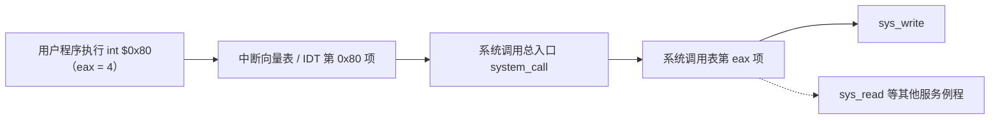

> [!tip] 课堂强调
> 以往考试中至少有百分之三四十的同学认为中断向量表和系统调用表是同一张表。一张表不可能包打天下：中断向量表只负责把所有系统调用引到 0x80 这一个入口，进来之后还要再查系统调用表。[^l03-section-6-s4b5]

在整个设计中，操作系统真正新做的事情只有两件：确定支持哪些系统调用（编号和参数约定），以及在初始化时建好系统调用表。其余都利用现成的中断异常机制。[^l03-section-6-s4b5]

> [!question]- 自测：某 32 位 x86 Linux 程序执行 `int $0x80` 前，`eax = 3`，`ebx = 0`，`ecx` 指向一个缓冲区，`edx = 100`。它在请求什么服务？
> 调用号 3 是 `read`，三个参数依次是文件描述符 0（标准输入）、缓冲区地址、最多读 100 字节，即 `read(0, buf, 100)`。

> [!question]- 自测：同学说“Linux 有三百多个系统调用，所以中断向量表里有三百多项是系统调用”。错在哪里？
> 所有系统调用在中断向量表中只占 0x80 一项。三百多个服务例程的入口放在另一张表，即系统调用表中，由总入口程序按 `eax` 中的调用号查找。

> [!question]- 自测：为什么不把系统调用的参数直接编码在 `int` 指令里？
> 陷入指令长度有限，还要携带功能号，能带的参数很少，指令也会变复杂；改用通用寄存器传参，或在参数多时把参数打包放进内存再传指针，更简单通用。

> [!info]- 来源
> - slides02.pdf：PDF p.44–49, 61–62
> - L03.docx：DOCX body 120–174

[^l03-section-6-s4b5]: L03.docx-DOCX body 120-148
[^l03-section-6-s2p45]: slides02.pdf-PDF p.45
[^l03-section-6-s2p46]: slides02.pdf-PDF p.46
[^l03-section-6-s2p47]: slides02.pdf-PDF p.47
[^l03-section-6-s2p48]: slides02.pdf-PDF p.48
[^l03-section-6-s4b6]: L03.docx-DOCX body 149-174
[^l03-section-6-s2p49]: slides02.pdf-PDF p.49
[^l03-section-6-s2p61]: slides02.pdf-PDF p.61
[^l03-section-6-s2p62]: slides02.pdf-PDF p.62

---

## Linux 系统调用执行

> [!abstract] 本节要点
> - 执行陷入指令后：硬件保存现场并查中断向量表，把控制权交给系统调用总入口 `system_call`；总入口**第一件事是进一步保存现场**（参数随之进入内核栈），再用 `eax` 中的调用号查系统调用表，执行服务例程，最后恢复现场返回。与普通中断相比只多了一步查系统调用表。
> - Linux 在初始化时调用 `set_system_gate(0x80, &system_call)`：门类型 15 是陷阱门（进入后不关中断），DPL 设为 3，用户态才能通过这扇门。
> - `int $0x80` 的硬件动作：从 TSS 装入内核栈指针，压入用户的 SS、ESP、EFLAGS、CS、EIP，复位 TF，IF 不变，再经 IDT/GDT 定位 `system_call`。
> - `system_call` 依次 `push %eax`、`SAVE_ALL`，检查调用号合法后执行 `call *sys_call_table(,%eax,4)`，把返回值写回栈中的 eax 位置。
> - `ret_from_sys_call` 先 `cli` 关中断，再检查 `need_resched`（是否重新调度）和 `sigpending`（是否有未决信号），最后 `RESTORE_ALL` 返回用户态；`read` 等阻塞的系统调用是两段过程。

### 执行过程总览

> [!info] 可视化资源
> - [OSTEP 第 6 章 Limited Direct Execution（PDF）](https://pages.cs.wisc.edu/~remzi/OSTEP/cpu-mechanisms.pdf)：Figure 6.2 以操作系统、硬件、程序三列时间线展示系统调用陷入与返回的协议，可与本节 int $0x80 的执行过程对照。

静态部分都准备好后（见 [系统调用机制设计](#系统调用机制设计)），剩下的是运行。运行的实体是进程：进程执行到 `int $0x80` 时，调用号和参数已经由编译器生成的代码放进寄存器了。[^l03-section-7-s4b6] 接下来的过程是前面中断过程在系统调用场景下的重复：[^l03-section-7-s2p50]

1. **中断/异常机制（硬件）**：保护现场；用 0x80 查中断向量表，把控制权转给**系统调用总入口程序**。
2. **系统调用总入口程序（软件）**：保存现场，把参数保存在内核栈里；然后查系统调用表，把控制权转给相应的系统调用处理例程（内核函数）。
3. **执行系统调用例程**。
4. **恢复现场，返回用户程序**。

“总入口程序”只是提示性的叫法，不是专有名称：所有系统调用都先进入这一个程序，再由它分派到 `read`、`write` 等不同的代码。它本身就是 0x80 号的中断处理程序。[^l03-section-7-s4b6]

> [!tip] 课堂强调
> 中断处理程序（这里就是系统调用总入口程序）的第一件事是**进一步保存现场**。这一点一定不要忘：硬件只保存了极少数寄存器，剩下的现场要由软件保存。保存现场的同时，放在寄存器里的参数也就进入了系统栈。[^l03-section-7-s4b6]

与普通中断处理相比，系统调用只多了一步：在总入口程序里用 `eax` 中的调用号查系统调用表。硬件保存现场与软件保存现场的分工见 [中断处理完整流程](#中断处理完整流程)。

### 0x80 号门与 int $0x80

用户程序能用 `int $0x80` 进入内核，前提是 IDT 第 128 项已经按系统调用的需要设置好；执行这条指令时，硬件再按这一项完成换栈、压栈和跳转。

#### 门描述符的初始化

Linux 在 x86 上选用 `int $0x80`（十进制 128）作为陷入指令。系统初始化时，要对 IDT 的第 128 号门描述符进行初始化，这一步在 `sched_init()` 中完成：[^l03-section-7-s2p52]

```c
set_system_gate(0x80, &system_call);
```

这个门描述符（8 个字节）的关键内容如下（IDT 和门描述符的一般结构见 [x86 中断支持](#x86-中断支持)）：

- **第 2、3 字节**：内核代码段选择符 `__KERNEL_CS`。用它在 GDT 中找到内核代码段，得到段基址。
- **第 0、1、6、7 字节**：偏移量，即 `system_call()` 第一条指令在段内的偏移。段基址加偏移，就是 `system_call` 的入口。
- **门类型 15**：陷阱门。为什么用陷阱门？因为系统调用进来之后仍然可以接受中断，陷阱门不会自动关中断。
- **DPL = 3**：与用户特权级相同，允许用户进程使用这个门描述符。如果 DPL 是 0，用户态权限不够，就进不来了；系统调用本来就是要让用户进入内核，所以必须设 3。[^l03-section-7-s4b6]

这些细节不要求掌握，看代码时能照着认出来即可。

> [!note] 补充解释
> `set_system_gate` 写在 `sched_init()` 中是 Linux 0.11 的代码；Linux 2.x 的 i386 内核把它放在 `arch/i386/kernel/traps.c` 的 `trap_init()` 中，作用相同。

系统调用号在头文件 `include/asm-i386/unistd.h` 中定义：[^l03-section-7-s2p53]

```c
#define __NR_exit      1
#define __NR_fork      2
#define __NR_read      3
#define __NR_write     4
#define __NR_open      5
#define __NR_close     6
#define __NR_waitpid   7
#define __NR_creat     8
#define __NR_link      9
#define __NR_unlink   10
#define __NR_execve   11
#define __NR_chdir    12
#define __NR_time     13
/* … */
```

不同体系结构的编号可能不同，查对应平台的头文件即可。[^l03-section-7-s4b6]

#### int $0x80 的硬件动作

CPU 执行 `int $0x80` 时，硬件依次完成下列动作：[^l03-section-7-s2p54]

1. **切换栈**：特权级从用户态（R3）变为内核态（R0），栈必须从用户栈换成内核栈。CPU 从任务状态段 TSS 中装入新的栈指针 `SS:ESP`，指向内核栈。TSS 中存有四对栈指针（`SS0:ESP0` 到 `SS3:ESP3`），分别对应 R0–R3 四个特权级。[^l03-section-7-s4b7]
2. **压栈保存**：把用户栈的 `SS:ESP`、`EFLAGS`、用户态的 `CS`、`EIP` 压入内核栈，供返回时使用。
3. **修改标志位**：`EFLAGS` 压栈后，复位 TF（单步标志），IF 保持不变（因为走的是陷阱门，不关中断）。
4. **查 IDT**：用 128 在 IDT 中找到门描述符，把其中的段选择符装入代码段寄存器 `CS`。
5. **定位入口**：代码段描述符中的基地址加上陷阱门描述符中的偏移量，得到 `system_call()` 的入口地址。
6. **特权级检查**：规则是代码只能访问相同或较低特权级的数据。[^l03-section-7-s2p55]

这时调用号和参数仍在寄存器里：`EAX` 放调用号，`EBX`、`ECX`、`EDX`、`ESI`、`EDI` 放参数。[^l03-section-7-s2p55] 这些都是 x86 的细节，不要求掌握，但要有“特权级改变就要换栈”的意识。

### system_call 总入口与分派

整个执行流程可以用四段代码串起来：[^l03-section-7-s2p56]

1. **应用程序**（用户态）：`main` 中调用 `write(...)`。
2. **封装例程**（用户态）：C 库中封装后的 `write()` 先做好参数传递工作，然后执行 `int $0x80` 产生一次异常。
3. **陷入处理**（内核态）：CPU 通过 0x80 号在 IDT 中找到 `system_call()` 并调用；`system_call()` 执行 `push %eax`、`SAVE_ALL`，把参数保存在内核栈，再根据系统调用号索引系统调用表，找到入口并 `call sys_write`。
4. **内核函数**（内核态）：`asmlinkage long sys_write()` 执行完毕后 `return`，经过 `ret_from_sys_call()` 的 `restore all` 返回用户程序。

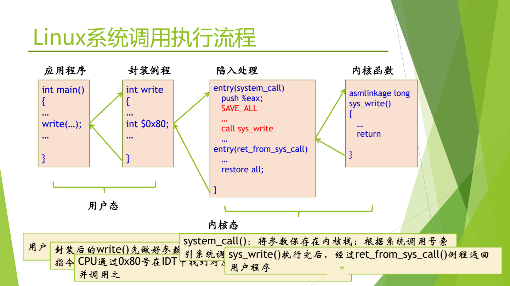

图：用户态的 main 调用封装例程 write，后者把系统调用号放入 eax 并执行 int $0x80；内核入口 system_call 保存现场、按号调用 sys_write，返回时经 ret_from_sys_call 恢复现场回到用户程序。

图中四个方框从左到右是应用程序、封装例程、陷入处理、内核函数，箭头表示调用与返回；前两个属于用户态，后两个属于内核态。红色标出的 `SAVE_ALL` 和 `call sys_write` 是陷入处理中的两个关键动作。

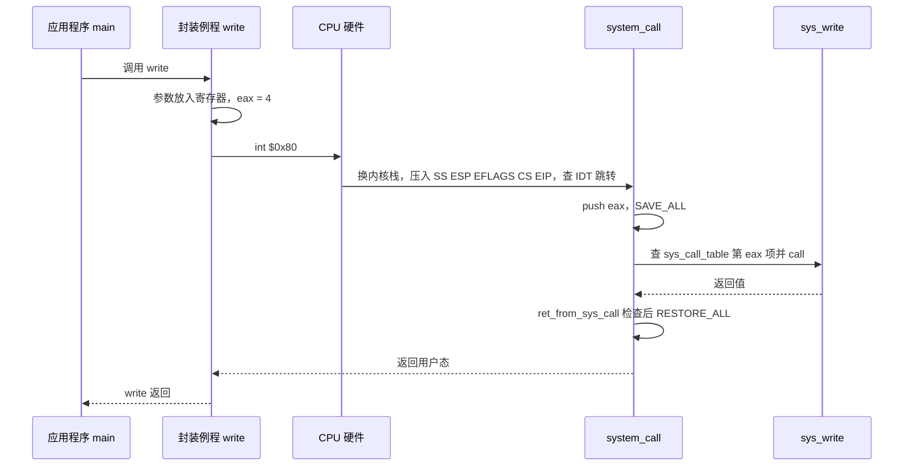

#### SAVE_ALL：软件保存现场

陷入之后，先要用一段汇编保存现场。`system_call` 先执行 `push %eax`，把系统调用号压栈；然后执行宏 `SAVE_ALL`，把其余上下文全部压栈：[^l03-section-7-s2p57]

```asm
#define SAVE_ALL \
    cld;                        \
    pushl %es;                  \
    pushl %ds;                  \
    pushl %eax;                 \
    pushl %ebp;                 \
    pushl %edi;                 \
    pushl %esi;                 \
    pushl %edx;                 \
    pushl %ecx;                 \
    pushl %ebx;                 \
    movl $(__KERNEL_DS), %edx;  \
    movl %edx, %ds;             \
    movl %edx, %es;
```

`cld` 清方向标志；接着依次压入段寄存器 `es`、`ds` 和通用寄存器 `eax`、`ebp`、`edi`、`esi`、`edx`、`ecx`、`ebx`；最后三行把 `ds`、`es` 换成内核数据段 `__KERNEL_DS`，让后续内核代码访问内核数据。

于是内核栈中从高地址到低地址依次是：硬件压入的 `SS`、`ESP`、`EFLAGS`、`CS`、`EIP`，`push %eax` 压入的调用号，然后是 `SAVE_ALL` 压入的内容。[^l03-section-7-s4b7] 按这个顺序可以推算出 `SAVE_ALL` 之后各项相对 `%esp` 的偏移（每项 4 字节）：

| 偏移 | 内容 | 压入者 |
| --- | --- | --- |
| 0 – 20 | `ebx`、`ecx`、`edx`、`esi`、`edi`、`ebp`（每项相差 4） | `SAVE_ALL` |
| 24 | `eax`（之后用来存放返回值） | `SAVE_ALL` |
| 28、32 | `ds`、`es` | `SAVE_ALL` |
| 36 | 系统调用号（原 `eax`） | `push %eax` |
| 40 – 56 | `EIP`、`CS`、`EFLAGS`、用户 `ESP`、用户 `SS` | 硬件 |

注意 `ebx`、`ecx`、`edx`、`esi`、`edi` 正好位于栈顶，并按第 1 到第 5 个参数的顺序排列。这样，内核函数可以像普通 C 函数一样从栈上取参数，这就是“参数保存在内核栈里”的含义。

#### 合法性检查与查表分派

`system_call` 的后续片段如下：[^l03-section-7-s2p63]

```asm
system_call:
    pushl %eax                  # 将系统调用号压栈
    SAVE_ALL
    ...
    cmpl $(NR_syscalls), %eax   # 检查是否是合法的系统调用号
    jb   nobadsys
    movl $(-ENOSYS), 24(%esp)   # 堆栈中的 eax 设置为 -ENOSYS，作为返回值
    jmp  ret_from_sys_call
```

1. `cmpl $(NR_syscalls), %eax` 把调用号与系统调用总数 `NR_syscalls` 比较。表里假如只有 200 项，却要访问第 208 项，就找不到对应代码，所以必须检查。[^l03-section-7-s4b7]
2. `jb nobadsys`：调用号小于总数（`jb` 是无符号比较，负数会被当作很大的数，同样不合法），说明是合法的系统调用（“no bad sys”），跳到 `nobadsys`。
3. 否则把栈中 eax 位置（偏移 24）设为 $-\text{ENOSYS}$（“没有这个系统调用”的错误码），跳到 `ret_from_sys_call` 出错返回。

合法时继续执行：[^l03-section-7-s2p64]

```asm
nobadsys:
    …
    call *SYMBOL_NAME(sys_call_table)(,%eax,4)
                                # 调用系统调用表中调用号为 eax 的系统调用例程
    movl %eax, EAX(%esp)        # 将返回值存入堆栈中 eax 中
    jmp  ret_from_sys_call
```

- `sys_call_table(,%eax,4)` 是 AT&T 语法的寻址方式“基址 + 下标 × 比例”，地址为 `sys_call_table + eax*4`。4 是表中每项的字节数，这是 32 位的痕迹，64 位下应为 8。[^l03-section-7-s4b7]
- 前面的 `*` 表示间接调用：先从这个地址取出函数入口，再跳过去。跳出去一定会回来。
- 返回值在 `eax` 中，`movl %eax, EAX(%esp)` 把它写进栈中保存 eax 的位置（`EAX` 是偏移 24 的符号名）。这样 `RESTORE_ALL` 恢复寄存器时，用户程序拿到的 `eax` 就是系统调用的返回值。

系统调用表本身在 `entry.S` 中定义，描述系统调用号与内核处理函数的对应关系；表中第 $n$ 项（偏移 $4n$ 字节）存放 $n$ 号调用的内核函数地址：[^l03-section-7-s2p59]

```asm
.data
ENTRY(sys_call_table)
    .long SYMBOL_NAME(sys_exit)    # 1
    .long SYMBOL_NAME(sys_fork)    # 2
    .long SYMBOL_NAME(sys_read)    # 3
    .long SYMBOL_NAME(sys_write)   # 4
    … …
```

用文字再串一遍：用户态调用 C 库函数 `func()`，`func()` 做好参数传递后执行 `int $0x80` 产生异常；CPU 用 0x80 在 IDT 中找到 `system_call()` 并调用；`system_call()` 按系统调用号索引系统调用表，找到 `sys_func()`；`sys_func()` 执行完后，经 `ret_from_sys_call()` 返回用户程序。[^l03-section-7-s2p60]

> [!note] 补充解释
> xv6-riscv 中对应的保存寄存器代码在 `trampoline.S`（用户态陷入时）和 `kernelvec.S`（内核态被中断时），系统调用分派在 `syscall.c` 中，可参考 xv6-book 4.2–4.3 节。[^l03-section-7-s2p58] 读 xv6 代码时再细看。

### ret_from_sys_call：返回前的检查

返回用户态不是简单地弹栈，还要和 ICS 学过的内容对上：[^l03-section-7-s2p65]

```asm
ret_from_sys_call:
    cli                          # 关中断
    cmpl $0, need_resched(%ebx)
    jne  reschedule              # 如果进程描述符中的 need_resched 位不为 0，则重新调度
    cmpl $0, sigpending(%ebx)
    jne  signal_return           # 若有未处理完的信号，则处理
restore_all:
    RESTORE_ALL                  # 堆栈弹栈，返回用户态
```

（`%ebx` 此时指向当前进程的进程描述符，`need_resched` 和 `sigpending` 是其中字段的偏移。）

1. **`cli` 关中断**：进来时走的是陷阱门，中断一直开着，前面开着没有问题；但到了返回阶段，检查标志和恢复现场必须一气呵成，不能再被打断。[^l03-section-7-s4b7]
2. **检查 `need_resched`**：如果进程描述符中的 `need_resched` 不为 0（`jne` 即 not equal），说明需要重新调度，跳到 `reschedule` 去调度程序换进程。这印证了一条规律：任何处理做完后都要回到调度，由调度决定谁上 CPU。[^l03-section-7-s4b8]
3. **检查 `sigpending`**：不需要换进程时，当前进程马上要回到用户态继续运行。此前要检查有没有发给它的未决信号，有就跳到 `signal_return` 全部处理完，进程才“轻装上阵”。这正是 ICS 第 8 章讲的：内核在从内核态返回用户态的时刻处理信号。信号用位向量记录，不是队列，每种信号对应一位，所以用 0 比较即可判断有无信号。[^l03-section-7-s4b8]
4. **`RESTORE_ALL`**：既不换进程、也没有信号时，把压栈的内容全部弹回寄存器，执行中断返回指令回到用户态，继续执行 `int $0x80` 的下一条指令。

> [!tip] 课堂强调
> `ret_from_sys_call` 的第一条指令 `cli` 很重要：进入时中断是开着的，返回时必须先关中断。[^l03-section-7-s4b7]

> [!note] 补充解释
> 说跳到 `reschedule` 后“就走了，不回来了”，指的是当前进程交出 CPU，由调度程序选中的另一个进程运行。在 Linux 2.x 中，`reschedule` 的代码是 `call schedule` 后再 `jmp ret_from_sys_call`：等原进程以后再次被调度上 CPU 时，会从 `schedule()` 返回，重新执行一遍返回检查，最终仍经 `RESTORE_ALL` 回到用户态。

### 阻塞的系统调用

前面只讲了从 `int $0x80` 进入到调用具体服务例程这一段。对于 `read`、`write` 这类涉及 I/O 的慢速操作，还有后半段。[^l03-section-7-s4b6]

以进程 A 执行 `read` 为例：读文件的工作（从哪个字节开始、读多长）最终交给 DMA 或设备控制器完成，而不是 CPU。CPU 一碰到 I/O 就把事情交出去，进程 A 只能停下来等待。这类调用称为**阻塞的系统调用**（blocking system call）：执行后进程停在那里，直到 I/O 结束；I/O 结束时设备通过**另一个中断**通知 CPU，进程才能继续。所以 `read` 是**两段**过程。

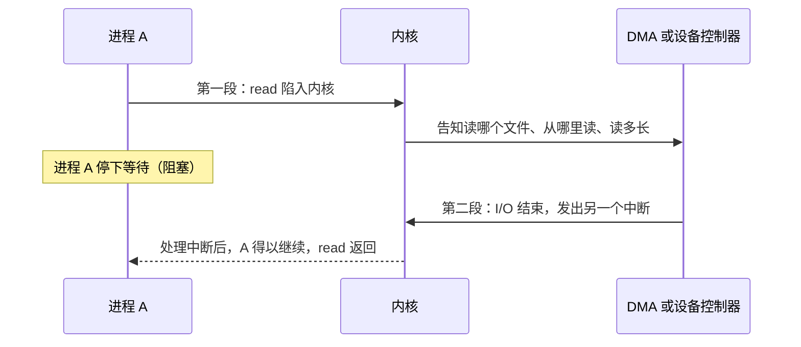

> [!tip] 课堂强调
> 以前考试考过 `read` 的这两段过程，很多同学只写了一段。宁可别的不管，也要把这个细节抠清楚。[^l03-section-7-s4b6]

> [!question]- 自测：用户程序以 `eax = 500` 执行 `int $0x80`，而该内核只有 300 个系统调用。会发生什么？用户程序最终看到什么？
> `cmpl $(NR_syscalls), %eax` 后 `jb` 不成立，不会跳到 `nobadsys`；内核把栈中 eax 位置设为 $-\text{ENOSYS}$，经 `ret_from_sys_call` 返回。`RESTORE_ALL` 后用户的 `eax` 为 $-\text{ENOSYS}$，C 库据此返回 $-1$ 并设置 `errno` 为 `ENOSYS`。

> [!question]- 自测：如果把 0x80 号门的 DPL 设为 0，用户程序执行 `int $0x80` 会怎样？如果把门类型改成中断门呢？
> DPL 为 0 时，用户态（特权级 3）的权限不够，无法通过这扇门，系统调用进不了内核。改成中断门则仍能进入，但进门后会自动关中断，整个系统调用处理期间不响应新的中断。

> [!question]- 自测：进程 A 调用 `write` 后，在 `ret_from_sys_call` 中发现 `need_resched` 为 0、`sigpending` 不为 0。接下来按什么顺序发生什么？
> 不换进程；跳到 `signal_return`，把发给 A 的未决信号全部处理完，然后执行 `RESTORE_ALL`，恢复寄存器并返回用户态，`eax` 中是 `write` 的返回值。

> [!info]- 来源
> - slides02.pdf：PDF p.50–60, 63–65
> - L03.docx：DOCX body 149–224

[^l03-section-7-s4b6]: L03.docx-DOCX body 149-174
[^l03-section-7-s2p50]: slides02.pdf-PDF p.50
[^l03-section-7-s2p52]: slides02.pdf-PDF p.52
[^l03-section-7-s2p53]: slides02.pdf-PDF p.53
[^l03-section-7-s2p54]: slides02.pdf-PDF p.54
[^l03-section-7-s4b7]: L03.docx-DOCX body 175-192
[^l03-section-7-s2p55]: slides02.pdf-PDF p.55
[^l03-section-7-s2p56]: slides02.pdf-PDF p.56
[^l03-section-7-s2p57]: slides02.pdf-PDF p.57
[^l03-section-7-s2p63]: slides02.pdf-PDF p.63
[^l03-section-7-s2p64]: slides02.pdf-PDF p.64
[^l03-section-7-s2p59]: slides02.pdf-PDF p.59
[^l03-section-7-s2p60]: slides02.pdf-PDF p.60
[^l03-section-7-s2p58]: slides02.pdf-PDF p.58
[^l03-section-7-s2p65]: slides02.pdf-PDF p.65
[^l03-section-7-s4b8]: L03.docx-DOCX body 193-224

---

## 低层步骤与机制策略

> [!abstract] 本节要点
> - 系统调用是用户程序调用操作系统子功能的特殊过程调用，由访管指令实现，是唯一接口，使 CPU 从目态（用户态）转入管态（内核态），可用来动态申请和释放系统资源。
> - 完成系统调用的条件分两部分。静态：封装内核函数为库函数/API、访管指令与陷入机制、编译器、OS 初始化（编号与参数约定、系统调用表）。动态：陷入、总入口、保存现场（压栈）、查表分派、执行、返回。
> - 中断后 OS 低层工作八步：1–2 硬件压栈并装入新 PC；3–4 汇编保存寄存器、设置新栈；5 C 语言中断服务程序；6 进程调度；7–8 回到汇编并运行新的当前进程。顺序不能错，软硬件步骤不能交叉。
> - **机制与策略分离**：机制不变（为了性能），策略可调（为了灵活）。中断异常机制是机制，中断向量表及处理程序、系统调用表是策略。

### 系统调用小结

把前三章的内容收拢起来：[^l03-section-8-s2p66]

- **系统调用**是用户在程序中调用操作系统提供的一些子功能，原名“操作系统功能调用”。[^l03-section-8-s4b8]
- 它是一种**特殊的过程调用**，由特殊的机器指令实现。每种机器的指令集都支持这样的指令，即访管指令。
- 它是操作系统提供给编程人员的**唯一接口**。
- 它使 CPU 状态从**目态**转入**管态**（老说法；即从用户态转入内核态）。
- 利用系统调用，可以动态请求和释放系统资源，完成与硬件相关的工作，以及控制程序的执行等。
- 每个操作系统都提供几百种系统调用，编号遵循 POSIX 标准。

系统调用与 C 函数调用的区别见 [系统调用概念辨析](#系统调用概念辨析)。

#### 完成系统调用需要哪些条件

“完成系统调用机制的运行需要什么条件（准备工作）？”可以分静态和动态两部分来回答：[^l03-section-8-s2p67]

**静态部分**（事先准备好）：

1. **封装内核函数**：把内核函数封装成库函数或 API 接口，供程序调用。
2. **访管指令与陷入机制**：选定陷入指令，并借用中断异常机制（见 [系统调用机制设计](#系统调用机制设计)）。
3. **编译器**：把代码中的系统调用编译成符合约定的陷入序列（调用号放哪里、参数怎么传）。
4. **操作系统初始化**：确定系统调用编号及参数传递方式；建好系统调用表，并在中断向量表（IDT）中设置好 0x80 号入口。

**动态部分**（执行时，与中断过程一样）：陷入内核 → 进入总入口程序 → 保存现场（压栈）→ 查表分派 → 执行 → 返回（返回前还要检查调度和信号，见 [Linux 系统调用执行](#linux-系统调用执行)）。

> [!tip] 课堂强调
> 复习时要注意这道题应写哪些内容：静态部分要细化到初始化哪些表、系统调用编号和参数放在哪里、参数怎样传递、系统调用表怎样建立；动态部分要写出陷入、总入口、压栈、分派、执行、返回。[^l03-section-8-s4b8]

### 中断发生后 OS 低层工作步骤

下表用另一种方式概括整个过程：哪些步骤由硬件完成，哪些必须由汇编完成，哪些由 C 这样的高级语言完成。[^l03-section-8-s2p68]

| 步骤 | 内容 | 由谁完成 |
| --- | --- | --- |
| 1 | 硬件压栈：程序计数器等 | 硬件 |
| 2 | 硬件从中断向量装入新的程序计数器等 | 硬件 |
| 3 | 汇编语言过程保存寄存器值 | 汇编 |
| 4 | 汇编语言过程设置新的堆栈 | 汇编 |
| 5 | C 语言中断服务程序运行（例：读并缓冲输入） | C |
| 6 | 进程调度程序决定下一个将运行的进程 | C |
| 7 | C 语言过程返回至汇编代码 | C → 汇编 |
| 8 | 汇编语言过程开始运行新的当前进程 | 汇编 |


几个要点：[^l03-section-8-s4b8]

1. **硬件先做，做完交给软件**：硬件只压入少数重要寄存器，然后把中断处理程序的入口装入 PC，把“接力棒”交给软件。
2. **汇编保存现场**：保存其余寄存器、设置内核栈，这部分只能用汇编写，对应 x86 Linux 中的 `push %eax` 和 `SAVE_ALL`。
3. **中断服务程序用高级语言写**：对应系统调用中的 `sys_write` 等内核函数。
4. **处理完一定转到调度**：不是处理完就直接回去，而是由调度程序决定下一个运行谁，对应 `ret_from_sys_call` 中对 `need_resched` 的检查。
5. **最终停留在汇编层面**：最后要做上下文切换、恢复寄存器，只能由汇编完成，对应 `RESTORE_ALL`。

> [!tip] 课堂强调
> 同一个流程到这里已经在不同场景下重复了六七遍：中断响应流程图、硬件/软件分工的文字、x86 实例、保护模式下的图和表、系统调用、这页小结。顺序绝对不能错，回答时不能把硬件步骤和软件步骤交叉着写，因为每次考试总有人出错。[^l03-section-8-s4b8]

### 机制与策略分离

操作系统设计者经常要回答一个问题：哪些部分应当固定下来，哪些部分应当留给使用者调整？[^l03-section-8-s2p69] **机制与策略分离**（separation of mechanism and policy）是操作系统设计中最常用的原则。**机制**规定“怎么做”，保持不变；**策略**决定“做什么、选哪个”，可以调整。机制不变是为了性能，策略可调是为了灵活。[^l03-section-8-s4b9]

写软件时大家其实都有这种潜意识。最简单的例子是一个加法函数：把 $x$ 和 $y$ 相加是机制；传入不同的 $x$、$y$，结果就不同。[^l03-section-8-s4b8]

本讲中的例子：

| 场景 | 机制（不变） | 策略（可调） |
| --- | --- | --- |
| 中断优先级 | 硬件按优先级固定的响应顺序 | 软件屏蔽高优先级中断、打开低优先级中断，微调实际响应顺序 |
| 中断与异常 | 中断异常机制本身（检测、保存、查表、跳转） | 中断向量表及其中的处理程序，可以替换 |
| 系统调用 | 统一经 `int $0x80` 进入总入口 | 系统调用表，进入后按编号选择不同的服务例程，可以调整 |
| 进程调度 | 基于优先级的调度：谁优先级高就选谁 | 想让某个进程马上上 CPU，就提升它的优先级 |

以中断优先级为例：硬件已经按优先级定好了先响应谁、后响应谁。若想调整顺序，可以把高优先级的中断屏蔽掉、让低一点的开着，硬件只看到开着的中断，就会先响应它。大的调整做不了，微调可以。[^l03-section-8-s4b9]

再如想改变某个中断的处理方式，只需替换那段处理程序，并把新的入口地址填进中断向量表；机制照旧，只是按表跳到了新代码。[^l03-section-8-s4b9]

> [!warning] 易错点
> 不要把“中断向量表”当成机制的一部分。查表、跳转这一动作是机制，由硬件固定；表里填什么、指向哪段处理程序是策略，由操作系统决定，可以更换。系统调用表同理。

### 内核的进入与退出

最后用一张图把应用程序、内核和外部设备之间的所有通道放在一起。[^l03-section-8-s2p70]

进入内核有三条路：

1. **异常**（代码执行出错）：经中断向量表转到**异常服务例程**处理，处理完返回应用程序。
2. **中断**：外部设备发出中断，经中断向量表转到**设备驱动**中的处理程序。
3. **系统调用**：应用程序直接或经函数库调用系统调用接口，陷入后经中断向量表（0x80 项）进入，再查**系统调用表**，转到相应的**系统调用实现**，执行后经系统调用接口返回。

此外，设备驱动与外部设备之间还有设备访问和数据流。

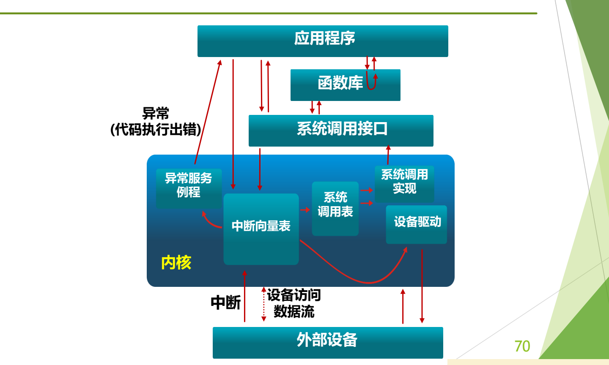

图：应用程序经函数库、系统调用接口进入内核的系统调用实现；外部设备以中断方式经中断向量表进入内核；代码执行出错则以异常方式进入异常服务例程，三条路径最后都从内核返回。

图的上方是应用程序、函数库、系统调用接口，下方是外部设备，中间的方框是内核。可以看到，三条入口都要先经过中断向量表；只有系统调用还要再经过系统调用表，这正是“两张表”的直观体现。

#### xv6-riscv 源代码阅读要求

> [!info] 依据讲义整理
> 这是一份课后源代码阅读作业，课上没有讲解。

这份 xv6-riscv 源代码阅读作业的主题是启动与中断异常机制。[^l03-section-8-s2p71] 参考 xv6-book 第 2.6、4.1–4.5、5.1–5.4 节，以及 `kernel` 目录下的 `entry.S`、`start.c`、`main.c`、`trap.c`、`trampoline.S`、`syscall.h`、`syscall.c`、`kernelvec.S`、`uart.c`、`console.c`。要回答的问题是：

1. **（boot）** xv6-riscv 有几个特权模式，分别是什么？结合 `entry.S`、`start.c`、`main.c` 和 xv6-book 2.6 节，给出启动阶段特权模式的转换过程（在哪个函数内从哪个模式转到哪个模式）。
2. **（syscall）** 进行系统调用时，系统调用号、参数和返回值分别通过哪些寄存器传递？
3. **（trap）** 进程上下文切换时，需要保存和恢复哪些寄存器？
4. **（trap）** 阅读 xv6-book 4.1 节和 `trap.c`，简要说明控制寄存器 `stvec`、`sepc`、`scause`、`sstatus` 的作用。
5. **（interrupt）** 阅读 `uart.c`、`trap.c` 和 xv6-book 5.1–5.2 节，总结 `devintr` 和 `uartintr` 两个函数的内部流程，以及 `devintr` 调用 `uartintr` 的判断条件。

> [!note] 补充解释
> 以下是阅读时可以对照的要点，具体以源码为准。讲义第 4 题把 `sepc` 误写成了 “spec”。
> - RISC-V 有三个特权模式：机器模式（M）、监管者模式（S）、用户模式（U）。xv6 从 `entry.S` 以 M 模式开始，进入 `start()` 后设置 `mstatus` 并执行 `mret`，转到 S 模式运行 `main()`；第一个用户进程经 `sret` 进入 U 模式。
> - 系统调用：调用号放在 `a7`，参数放在 `a0`–`a5`，返回值写回 `a0`；用户态执行 `ecall` 陷入。
> - 上下文切换：`swtch` 只保存和恢复 callee-saved 寄存器 `ra`、`sp`、`s0`–`s11`（`struct context`）；陷入时 `trampoline.S` 则把用户态的全部通用寄存器存入 trapframe。
> - `stvec`：陷阱处理程序的入口地址，相当于 x86 中“查 IDT 得到的入口”；`sepc`：陷入时被打断指令的 PC，`sret` 据此返回；`scause`：陷入原因编码（系统调用、缺页、设备中断等）；`sstatus`：状态位，如 SIE（S 模式中断使能）和 SPP（陷入前处于 U 还是 S 模式）。
> - `devintr()` 读取 `scause` 判断是否为外部设备中断，是则向 PLIC 查询中断号，若为 UART 的中断号就调用 `uartintr()`；`uartintr()` 循环读出 UART 收到的字符交给 `consoleintr()` 处理，再继续发送缓冲区中的待发字符。

> [!question]- 自测：x86 Linux 上一次 `write` 系统调用中，`SAVE_ALL`、`sys_write`、`schedule`、`RESTORE_ALL` 分别对应“低层工作八步”的哪几步？
> `SAVE_ALL` 是第 3–4 步（汇编保存寄存器、内核栈）；`sys_write` 是第 5 步（C 语言服务程序）；`ret_from_sys_call` 中 `need_resched` 置位时调用的 `schedule` 是第 6 步；`RESTORE_ALL` 恢复现场并返回，是第 7–8 步。第 1–2 步是 `int $0x80` 的硬件压栈和跳转。

> [!question]- 自测：某同学这样回答中断处理顺序：“硬件压栈 → 软件保存寄存器 → 硬件查中断向量表改 PC → 运行中断服务程序”。错在哪里？
> 软硬件步骤交叉了。查中断向量表、装入新 PC 是硬件完成的第 2 步，必须在软件保存寄存器（第 3 步）之前；正是硬件改写了 PC，软件处理程序才得以开始执行。

> [!question]- 自测：系统中想让某个后台备份进程尽快运行，又不想修改调度程序代码，该怎么做？这体现了什么原则？
> 提升该进程的优先级即可。基于优先级的调度算法是机制，保持不变；某个进程的优先级取值是策略，可以调整。这体现了机制与策略分离。

> [!info]- 来源
> - slides02.pdf：PDF p.66–71
> - L03.docx：DOCX body 193–249

[^l03-section-8-s2p66]: slides02.pdf-PDF p.66
[^l03-section-8-s4b8]: L03.docx-DOCX body 193-224
[^l03-section-8-s2p67]: slides02.pdf-PDF p.67
[^l03-section-8-s2p68]: slides02.pdf-PDF p.68
[^l03-section-8-s2p69]: slides02.pdf-PDF p.69
[^l03-section-8-s4b9]: L03.docx-DOCX body 225-249
[^l03-section-8-s2p70]: slides02.pdf-PDF p.70
[^l03-section-8-s2p71]: slides02.pdf-PDF p.71

---

## 思考题汇总

- [03 中断处理完整流程](#中断处理完整流程)：为什么引入中断处理的上半部和下半部

## 本讲小结

三类入口（中断、异常、系统调用）共用同一套中断异常机制：硬件负责到“改写 PC”为止，之后全归软件；系统调用只是在这条路上多查一张系统调用表，并在返回前多做调度与信号检查。

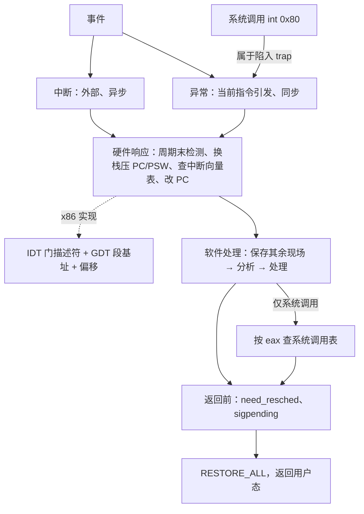

| 对象 | 机制（固定） | 策略（可调） |
| --- | --- | --- |
| 进入内核 | 中断异常机制：检测、保存、查表、跳转 | 中断向量表中的各处理程序 |
| 系统调用 | 统一经 0x80 进入总入口 | 系统调用表中的服务例程 |
| 门的选择 | 中断门自动关中断、陷阱门不关 | 操作系统按“处理期间是否接受新中断”选门 |

### 核心公式

| 场合 | 公式 |
| --- | --- |
| 实模式入口地址 | $\text{入口} = \text{段地址} \times 16 + \text{偏移}$ |
| 保护模式入口地址 | $\text{入口} = \mathrm{GDT}[\mathrm{IDT}[i].\text{段选择符}].\text{段基址} + \mathrm{IDT}[i].\text{偏移}$ |
| 门描述符中的偏移 | $\text{偏移} = H \times 2^{16} + L$（$H$、$L$ 为高、低 16 位） |
| 系统调用表项地址 | $\text{sys\_call\_table} + 4 \times \text{eax}$（64 位每项 8 字节） |

## 不确定事项

- 转写稿把 sysenter 的引入时间说成“奔腾three之后”（ASR 识别结果），笔记沿用 plan 中的 Pentium II（与 Intel 史实一致）；讲义本身没有给出版本。
- s4b2 对“第一/第二个数据结构”的说法前后不一（PCB 算不算正式讲过的第一个）；笔记沿用 plan：中断向量表是正式讲的第一个，系统调用表是第二个。
- p61–62 和 p71 为 slide-only，按讲义整理；xv6 阅读题的参考要点和 Intel/Linux 版本细节属于补充解释，没有经课堂核实。

> [!info]- 来源
> - slides02.pdf：PDF p.21–71
> - L03.docx：DOCX body 1–249
