操作系统管不到 CPU 本身，只能通过寄存器和一份份记录来“运行”程序。本讲回答：进程这个抽象是怎样从多道程序设计中产生的，操作系统又用什么模型和数据结构来描述它。路线依次是：进程与三个抽象、并发与进程概念、三状态模型、扩展状态与 Linux/xv6 的实际状态、进程控制块 PCB，最后是 PCB 中最重要的子结构：进程地址空间。阅读前应熟悉 L02–L03 的中断、异常与系统调用机制，以及 ICS 中链接、虚拟内存和 `fork`/`wait` 的基本用法。

---

## 进程与三个抽象

> [!abstract] 本节要点
> - 操作系统不能直接“控制”CPU，它通过设置寄存器（最关键的是 PC）决定让哪个进程运行，所以说**进程是对 CPU 的抽象**。
> - 课程的三个基本抽象：进程 ↔ CPU，（虚拟）地址空间 ↔ 内存，文件系统 ↔ 磁盘。
> - 进程的“实体”是内核中描述它的数据结构（PCB）和它的上下文；“进程由什么组成”和“如何描述进程”是同一个问题。
> - 进程有生命周期，学习重点是**状态之间的转换**：什么条件、什么操作（如 `fork`、`wait`）或什么事件引起转换。
> - 在有虚存支持的通用计算机上，操作系统给进程的是**虚拟地址空间**，不是物理内存；中断/异常机制是贯穿整个进程模型的主线。

### 进程是对 CPU 的抽象

操作系统是资源管理者，但 CPU 这种资源没法“直接管”：CPU 只会按 PC 取指、执行。操作系统能做的是控制寄存器，其中最重要的是**程序计数器**（Program Counter, PC）。把某个程序的指令地址装进 PC，并让它的代码和数据在内存里，这个程序就开始运行。[^l04-section-1-s4b1]

所以操作系统管理 CPU 的方式是管理一个个**进程**（Process）：每个进程是一个运行实体，操作系统维护它的各种信息，到时把它的现场装回寄存器，它就在 CPU 上跑起来。没有进程，操作系统也就没有存在的意义。这就是“进程是对 CPU 的抽象”。

可以拿学校类比：学校管不到“你这个人”，它管理的是你的学籍、选课、宿舍、食堂等信息，通过这些信息让每个学生的学习生活“运行”起来。操作系统对进程也是这样，它管的是描述进程的数据。

> [!note] 补充解释
> 回忆 L01「02 hello world 的加载」与 L01「03 hello world 的运行」：shell 为程序创建进程、把可执行文件的内容放到内存、设置好 PC 后 CPU 开始取指执行。这正是“通过进程使用 CPU”的具体例子。

### 三个基本抽象

操作系统对三类核心硬件资源各提供一层抽象，用户程序只和抽象打交道：[^l04-section-1-s4b1]

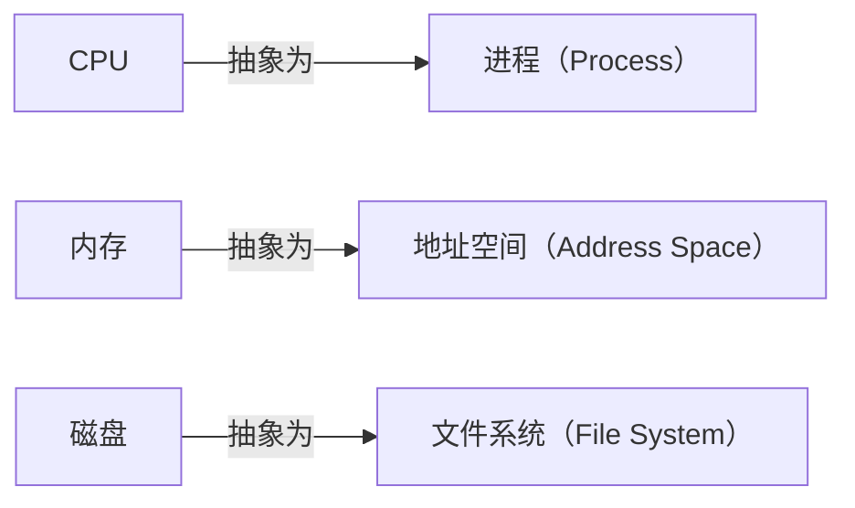

1. **进程是 CPU 的抽象**：每个进程好像独占一个 CPU。
2. **地址空间是内存的抽象**：操作系统不直接把物理内存交给进程，而是给每个进程一个（虚拟）地址空间，进程在这个空间里做事，具体放在物理内存哪里由操作系统和硬件负责转换，用户不用关心。详见[进程地址空间](#进程地址空间)。
3. **文件系统是磁盘的抽象**：进程看到的是文件，不是磁盘块。

学完整门课，应当对这三个抽象有清晰印象。

### 进程的实体与生命周期

**进程有实体吗？** 有。判断一个进程是否存在，要找它在系统里留下的“痕迹”：内核中描述它的数据结构，以及它的上下文（寄存器现场等）。这像学生在校的证据是档案，在读的证据是每学期的注册。[^l04-section-1-s4b1]

“一个进程由哪些要素组成”和“怎样描述一个进程”是同一个问题的两个角度：学生在校的所有活动（宿舍、选课、获奖）都要记录，进程的所有属性也都记在它的数据结构里。这个数据结构就是 PCB，见[进程控制块 PCB](#进程控制块-pcb)。

> [!note] 补充解释
> 问题清单中的**进程映像**（process image）指进程在某一时刻的完整“快照”：内存中的代码、数据、堆、栈，加上内核中的 PCB 与上下文。挂起进程时被整体换出到磁盘的，就是进程映像（见[扩展状态与实际系统](#扩展状态与实际系统)）。

**进程有生命周期**：操作系统引导完成后只创建最原始的一个进程，其余进程都是用户要执行程序时由操作系统创建的（UNIX 类系统用 `fork`）。进程有创建、有变化、有消亡，存在期间会处于不同状态，但状态种类不多。[^l04-section-1-s4b1]

> [!tip] 课堂强调
> 学进程状态时，关注的是**状态之间的转换**：具备什么条件就转换，或者由哪个动作、哪个操作引起。例如 `fork` 让一个进程从无到有；`wait` 让进程停下来等待某个事件发生。[^l04-section-1-s4b1]

### 虚拟地址还是物理地址

“操作系统给进程提供的内存空间，地址是虚拟地址还是物理地址？”这个问题有坑。[^l04-section-1-s2p3]

- 回答“物理地址”一定错。
- 回答“虚拟地址”是对的，但要给出场景：通用计算机、智能手机都有虚存支持，进程拿到的是虚拟地址空间；一些嵌入式等小型系统不一定有虚存。[^l04-section-1-s4b1]

因此，在有虚存的系统里，地址空间本身就是一层抽象：进程只在虚拟地址空间里操作，虚拟地址到物理内存的映射由系统完成。[^l04-section-1-s4b2]

接下来的问题是：**用什么数据结构描述一个进程的地址空间？** ICS 课程给过答案，但没有专门讨论，很多同学没有真正弄懂。这是本讲重点之一，见[进程地址空间](#进程地址空间)。[^l04-section-1-s4b2]

### 本讲的问题地图

进程与线程部分围绕三组问题展开：[^l04-section-1-s2p2] [^l04-section-1-s2p3] [^l04-section-1-s2p4]

| 问题组 | 关注点 | 本讲去向 |
| --- | --- | --- |
| 问题 1 | 进程是 CPU 的抽象；进程映像与实体；描述进程的要素；创建进程做什么；生命周期中的变化；状态及转换的条件与操作；一个转换是否必然引起另一个转换 | 本章、[并发与进程概念](#并发与进程概念)、[三状态模型](#三状态模型)、[扩展状态与实际系统](#扩展状态与实际系统)、[进程控制块 PCB](#进程控制块-pcb) |
| 问题 2 | 地址空间是虚拟还是物理地址；如何描述地址空间；为什么引入线程、如何实现、Pthreads | 地址空间见[进程地址空间](#进程地址空间)；线程本讲不展开，见 L05「04 为什么引入线程」 |
| 问题 3 | 中断/异常机制与进程线程模型的关联；机制与策略分离的体现；协程 | 中断/异常的关联见[三状态模型](#三状态模型)；协程见 L05「07 协程、纤程与可再入」 |

进程部分的内容分为：进程模型（多道程序设计与进程概念；进程状态及转换、进程控制块、进程队列）、进程控制（创建、撤销、阻塞、唤醒等）、线程模型和协程。[^l04-section-1-s2p5] 本讲覆盖进程概念、状态模型、PCB 与地址空间；进程队列、进程控制、线程和协程见 L05「01 进程表与队列模型」至 L05「07 协程、纤程与可再入」。

> [!tip] 课堂强调
> 中断/异常机制和进程线程模型的关系“特别重要”，关系非常密切；把这层关系搞清楚，整个进程模型就“拎起来了”。[^l04-section-1-s4b2]

中断、异常和系统调用见 L02「08 中断与异常概念」和 L03「06 系统调用机制设计」：用户态程序因中断、异常或系统调用进入内核，硬件保存现场，内核查表找到处理程序。本讲在[三状态模型](#三状态模型)里用 `read` 的完整过程说明它们怎样驱动进程状态转换。

> [!note] 补充解释
> 机制与策略分离原则在进程模型中也有体现。一个直接的例子：把进程从 CPU 上换下、再换上另一个进程（保存与恢复现场）是**机制**；从就绪进程中选哪一个上 CPU 是**策略**（调度算法）。两者分开，换调度算法时不必改切换机制。

> [!question]- 自测：同学说“操作系统通过直接控制 CPU 硬件来管理 CPU”，这个说法差在哪里？
> 操作系统没有“直接管 CPU”的手段，CPU 只按 PC 取指执行。操作系统通过设置寄存器（尤其是 PC）和管理进程的数据结构，决定让哪个进程运行，所以说进程是对 CPU 的抽象。

> [!question]- 自测：在一台运行 Linux 的笔记本上，进程打印出某个变量的地址 `0x404028`，这是物理地址吗？如果换成一块没有 MMU 的单片机呢？
> 笔记本有虚存支持，打印出的是该进程虚拟地址空间中的地址，不是物理地址。没有虚存硬件的小型嵌入式系统里，程序使用的地址可能就是物理地址，所以回答这类问题要先说明场景。

> [!info]- 来源
> - slides03.pdf：PDF p.1–5
> - L04.docx：DOCX body 1–54

[^l04-section-1-s4b1]: L04.docx-DOCX body 1-29
[^l04-section-1-s2p3]: slides03.pdf-PDF p.3
[^l04-section-1-s4b2]: L04.docx-DOCX body 30-54
[^l04-section-1-s2p2]: slides03.pdf-PDF p.2
[^l04-section-1-s2p4]: slides03.pdf-PDF p.4
[^l04-section-1-s2p5]: slides03.pdf-PDF p.5

---

## 并发与进程概念

> [!abstract] 本节要点
> - 顺序环境只有一个 PC，程序独占资源、不受外界影响，具有顺序性、封闭性和结果可再现性（结果与执行速度无关）。
> - 多道程序设计允许多个程序同时进入内存并运行，目的是提高系统效率；单 CPU 上相当于多个虚拟 PC 轮流映射到一个物理 PC，这就是虚拟化。
> - 并发环境的特征：结果不可再现、执行间断（执行—停—执行）、资源共享、独立性与制约性、程序和计算不再一一对应。
> - 进程是程序的**一次**执行；是系统进行资源分配和调度的独立单位，但引入线程后调度单位可能变成线程，回答时要说明场景。
> - 进程按作用分系统/用户、前台/后台、CPU 密集/I/O 密集；UNIX 进程构成以 `init` 为根的家族树，Windows 进程地位相同。

### 顺序程序与顺序环境

“进程”这个词的出现有里程碑意义，因为它恰好刻画了从顺序执行到并发执行的变化。要理解进程，先看没有进程概念时的情形。[^l04-section-2-s4b2]

**程序**（Program）是指令或语句的序列，体现某种算法。[^l04-section-2-s2p7]

**顺序环境**（Sequential Environment）满足三点：[^l04-section-2-s2p7]

1. 计算机系统中**只有一个程序在运行**；
2. 该程序**独占**系统中的所有资源；
3. 该程序的执行**不受外界影响**。

在顺序环境里，只需要一个程序计数器。要运行 A，就把 A 第一条指令的地址送入 PC，然后一条接一条执行（中间可以有跳转）；A 结束后，再把 B 第一条指令的地址装入 PC，依此类推：做完 A 做 B，做完 B 做 C。[^l04-section-2-s4b2]

顺序环境有三个特征：[^l04-section-2-s2p7]

- **顺序性**：程序按自己的指令顺序执行。
- **封闭性**：独占资源，执行过程不受外界影响，要什么资源就有什么资源。
- **可再现性**：只要初始条件相同，程序运行结果与执行速度无关。

可以想象一个只有你一个人、门关着的健身房：设备随便用，跑完步歇一会儿再练力量也不影响整体结果。[^l04-section-2-s4b2]

### 多道程序设计（Multiprogramming）

顺序环境很快被打破，起点是一种软件技术：**多道程序设计**（Multiprogramming），即允许多个程序**同时**进入内存并运行，目的是**提高系统效率**。[^l04-section-2-s2p8]

代价是管理变复杂：以前内存里只有一个程序，想占哪就占哪；现在多个程序要分占内存，资源管理难度上升。之所以“自找麻烦”，是因为健身房里有很多设备，一次只放一个人进去太浪费；允许多人同时进入效率高，但跑步机只有几台，就要排队。[^l04-section-2-s4b2]

单 CPU 上，A、B、C、D 四个程序都在内存里“执行”，相当于有四个**虚拟 PC**，但物理 PC 只有一个，一次只把其中一个虚拟 PC 映射到物理 PC，其余的暂时不能运行。这正是 OSTEP（*Operating Systems: Three Easy Pieces*）三部分中的第一部分：**虚拟化**（Virtualization）。[^l04-section-2-s4b2]

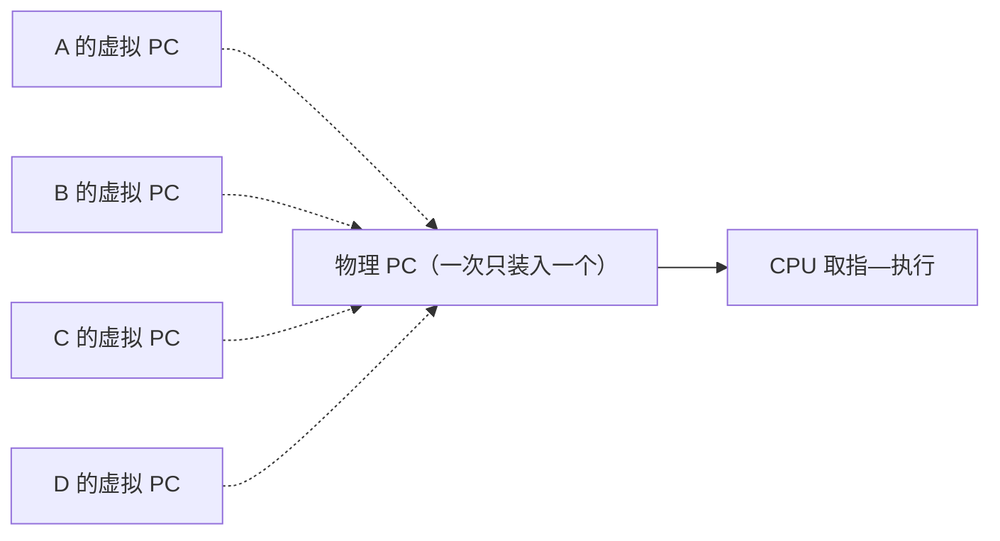

### 并发环境与并发程序

多道程序设计把“顺序环境下的顺序程序”变成了“并发环境下的并发程序”。

**并发环境**（Concurrent Environment）：一段时间间隔内，单处理器上有两个或两个以上的程序**同时处于开始运行但尚未结束的状态**，并且**次序不是事先确定的**。**并发程序**是在并发环境中执行的程序。[^l04-section-2-s2p9]

注意“同时”指的是一段时间间隔内都处于“已开始、未结束”，不是同一时刻都在 CPU 上。单 CPU 上实际是快速切换：某段时间运行 A，切到 B，再切到 C、D，又切回 A。切换很快，A 自己觉得没下过 CPU，其实已经轮转了很多次。人也是这样“并发”的：耳朵听课、眼睛看手机，大脑在不断切换；厨师炒菜也是几件事交替做。[^l04-section-2-s4b2]

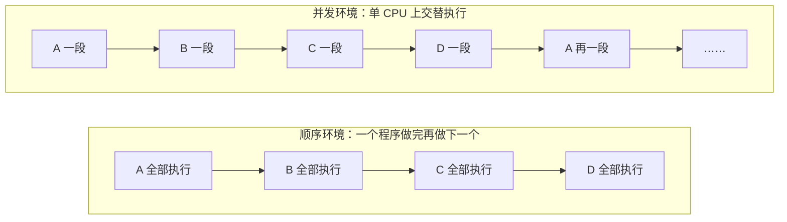

在并发环境的时间轴上，A、B、C、D 各自断续出现，任意时刻只有一个在 CPU 上运行。

#### 并发环境的特征

从顺序到并发，出现了必须由操作系统解决的新问题：[^l04-section-2-s2p9] [^l04-section-2-s4b3]

1. **程序执行结果的不可再现性**：哪怕只运行十个程序，它们的指令之间可以有极多种交错组合，无法保证下次执行还是同一种组合。所以并发系统出了错往往难以复现，设计时就要保证它不出错。
2. **程序执行的间断性**：进程不是一上 CPU 就执行到结束，而是“执行—停—执行”，一会儿在 CPU 上，一会儿下来。
3. **资源共享**：多个进程可能共享一块内存、一个文件，上 CPU 本身也是共享。
4. **独立性和制约性**：每个进程各自完成自己的任务，有独立性；但又受环境中其他进程的影响，有制约性。例如地铁高峰时只剩一个空座，两个人都想坐；ICS 讲过的飞机订票系统卖最后一张票、高铁某车厢的最后一个座位，都是多个执行者争抢同一资源。
5. **程序和计算不再一一对应**：一个程序可以同时有多次执行，每次执行是一个独立的计算。

> [!note] 补充解释
> 顺序环境里一个程序在一段时间内只对应一次计算；并发环境里同一份程序代码可以同时被多次执行（例如两个用户同时运行编译器），每次执行处理不同的数据、进度不同。这正是需要“进程”这个新概念的原因：程序描述不了“某一次执行”。

### 进程的定义

有了并发环境，就需要一个概念来描述“正在执行的某一次程序”。

**进程**（Process，又称任务 Task 或 Job）可以从几个角度定义：[^l04-section-2-s2p10]

1. **程序的一次执行过程**。
2. **正在运行程序的抽象**，也就是对 CPU 的抽象。
3. **把一个 CPU 变换成多个虚拟的 CPU**：通过进程管理，每个进程好像都有自己的 CPU。
4. **系统资源以进程为单位分配**，如内存、文件等；每个进程具有**独立的地址空间**。
5. **操作系统将 CPU 调度给进程**：进程上 CPU 由操作系统负责调度和分配（在引入线程之前）。

如果被问“什么是进程”，至少要答出“程序的一次执行过程”，并且要强调**一次**。同一个程序执行两遍，就是两个进程。[^l04-section-2-s4b3] 这像电影院放数字拷贝：同一部片子，每放映一场就消耗一次授权，每一场都是一次独立的放映。

更严格的定义来自百科全书：[^l04-section-2-s2p10]

> **进程是具有独立功能的程序关于某个数据集合上的一次运行活动，是系统进行资源分配和调度的独立单位。**

这个定义有几个要点：

- **关于某个数据集合**：编译器为你编译程序、同时为另一位同学编译程序，是两个编译进程，因为数据集合（被编译的源程序）不同；你自己编译两次也是两个进程。[^l04-section-2-s4b3]
- **资源分配的独立单位**：进程要打开文件、要内存，是整个进程作为单位申请资源，其中最重要的是独立的地址空间。
- **调度的独立单位**：这一点要看场景。引入线程之后，例如在 Windows 中，进程是资源容器，地址空间、文件都以进程为单位分配，但上 CPU 运行的是进程里的线程，调度单位是线程。[^l04-section-2-s4b3]

> [!tip] 课堂强调
> 定义中“调度的独立单位”要看场景，回答时要给出约束条件（有没有引入线程、是什么系统），而不是笼统地说一句“哪句都没错”的话。[^l04-section-2-s4b3]

这一定义源自 1978 年庐山教学研讨会上老一辈计算机科学家的讨论；引入线程后，定义又有了变化。[^l04-section-2-s4b3]

> [!warning] 易错点
> “进程是调度的基本单位”不是无条件成立的。在只有进程、没有线程的模型里成立；在支持内核线程的系统（如 Windows、Linux）里，资源分配单位仍是进程，但调度单位是线程。

### 进程的分类与家族关系

按作用和行为，进程可以分成几类：[^l04-section-2-s2p11]

- **系统进程与用户进程**：内核之上运行的都是进程。其中一部分是用户进程（你运行的游戏、编辑器等），另一部分是以进程形式在内核外运行、完成操作系统工作的**系统进程**。系统进程优先级一般比用户进程高。[^l04-section-2-s4b3] [^l04-section-2-s4b4]
- **前台进程与后台进程**。
- **CPU 密集型进程与 I/O 密集型进程**：区分它们是为了调度。从一堆进程中挑一个上 CPU 要考虑多种指标，进程的行为类型是参考依据之一。[^l04-section-2-s4b4]

系统进程常以**守护进程**（daemon，也译作“精灵进程”）的形式工作：平时处于睡眠状态，需要时被唤醒来完成任务。[^l04-section-2-s4b3]

> [!example] 例：SPOOLing 打印守护进程
> 办公室里每人一台电脑，共用一台打印机。用户提交的打印任务并不直接送到打印机，而是进入一个打印队列。一个系统守护进程监视这个队列：队列里有待打印的文件就被唤醒去打印，没有就继续睡眠。
>
> 这是 SPOOLing 技术后半段一直沿用到今天的做法。守护进程常驻，不必每次临时创建进程，是很早的**资源池化**思想。[^l04-section-2-s4b4]

**进程之间的关系**：[^l04-section-2-s2p11]

- **UNIX**：进程构成**家族树**，以 `init` 为根（老祖宗进程），每个进程再创建子进程。
- **Windows**：进程地位相同，没有家族、兄弟关系；虽然也有“谁创建了谁”，但关系不密切。[^l04-section-2-s4b4]

> [!note] 补充解释
> 按家族树的直观说法，杀死一个进程，它的子孙也就没了。[^l04-section-2-s4b4] 实际 UNIX/Linux 的默认行为并非如此：父进程终止后，子进程并不会自动终止，而是成为**孤儿进程**，被 `init`（PID 1，或 Linux 中设置的 subreaper）收养，由它负责回收。子孙一起结束的情形出现在信号被发给整个进程组或会话时，例如关闭终端时会话内进程收到 `SIGHUP`。

### 进程与程序的区别

进程与程序的区别可以从五个维度比较：[^l04-section-2-s2p11]

| 比较维度 | 程序 | 进程 |
| --- | --- | --- |
| 对并发的刻画 | 不能准确刻画并发 | 能准确刻画并发（每次执行是一个进程） |
| 静态/动态 | 静态的指令序列 | 动态的执行过程 |
| 生命周期 | 相对长久地保存 | 有诞生、有消亡，是短暂的 |
| 对应关系 | 一个程序可对应多个进程 | 每个进程是某个程序的一次执行 |
| 创建能力 | 无 | 可以创建其他进程 |

> [!question]- 自测：两位同学同时在同一台服务器上用同一个 `gcc` 编译各自的作业，系统中有几个编译进程？为什么程序概念描述不了这个场景？
> 两个。进程是程序关于某个数据集合的一次执行，两次编译的数据集合（源文件）不同，执行进度也不同。程序只有一份 `gcc` 可执行文件，是静态的，区分不了这两次执行，这就是“程序和计算不再一一对应”。

> [!question]- 自测：某程序在单 CPU 系统里单独运行时总输出 100，和其他程序一起运行时偶尔输出 99，而且很难复现。这体现了并发环境的哪些特征？
> 主要是结果不可再现性：多个程序的指令交错方式每次不同。产生它的根源是资源共享和制约性（与其他程序共享了某个数据），间断性使执行可能在任意点被打断。顺序环境下结果与速度无关，不会出现这种情况。

> [!question]- 自测：在 Windows 中说“进程是系统进行资源分配和调度的独立单位”，哪一半需要修正？
> “调度”一半。Windows 中进程是资源容器，资源分配单位仍是进程；真正上 CPU 的是线程，调度单位是线程。

> [!info]- 来源
> - slides03.pdf：PDF p.6–11
> - L04.docx：DOCX body 30–117

[^l04-section-2-s4b2]: L04.docx-DOCX body 30-54
[^l04-section-2-s2p7]: slides03.pdf-PDF p.7
[^l04-section-2-s2p8]: slides03.pdf-PDF p.8
[^l04-section-2-s2p9]: slides03.pdf-PDF p.9
[^l04-section-2-s4b3]: L04.docx-DOCX body 55-84
[^l04-section-2-s2p10]: slides03.pdf-PDF p.10
[^l04-section-2-s2p11]: slides03.pdf-PDF p.11
[^l04-section-2-s4b4]: L04.docx-DOCX body 85-117

---

## 三状态模型

> [!abstract] 本节要点
> - **运行态**：占有 CPU 并在运行；**就绪态**：具备运行条件、只缺 CPU，在就绪队列中等待调度；**等待态**（阻塞态/睡眠态）：等某个事件，CPU 空闲也不能运行。
> - 进程模型 = 状态 + 状态间的转换（条件、动作或事件），像有限状态自动机；进程在消亡前处于且仅处于某一状态。
> - 三个状态理论上有 6 种转换，实际只有 4 种：就绪→运行（调度选中）、运行→就绪（时间片到）、运行→阻塞（等事件，如 `wait`、慢速 I/O）、阻塞→就绪（事件发生）。
> - 没有阻塞→运行：上 CPU 的唯一途径是排就绪队列，保证系统行为确定；也没有就绪→阻塞。
> - 每一次状态转换背后都是一次中断或异常的处理，处理完后内核再决定是否换进程。`read` 的过程：陷入 → 交给 DMA → A 阻塞、B 运行 → DMA 中断 → A 变就绪。

### 三种基本状态

不同操作系统（Windows、Linux、xv6、原理课）的进程状态不完全统一，但不管哪个系统，**三状态基本模型**一定存在。[^l04-section-3-s4b4] 它回答的是：一个进程在生命周期中会处于哪些状态。三种状态的定义如下：[^l04-section-3-s2p12]

| 状态 | 英文 | 含义 | 能否上 CPU |
| --- | --- | --- | --- |
| 运行态 | Running | 占有 CPU，并在 CPU 上运行 | 正在 CPU 上 |
| 就绪态 | Ready | 已经具备运行条件，但没有空闲 CPU，暂时不能运行 | 一旦被调度即可 |
| 等待态 | Waiting / Blocked | 因等待某一事件（如完成 I/O、等待读盘结果）而暂时不能运行 | CPU 空闲也不行 |

- **就绪态**的进程排在**就绪队列**里。排进这个队列就表达了一个意图：“我要上 CPU”。调度就是在这个队列中选择谁上 CPU。[^l04-section-3-s4b4]
- **等待态**又称**阻塞态**、**封锁态**、**睡眠态**，现在多用 blocked；Linux 和 xv6 都叫睡眠（sleep）。它意味着即使 CPU 空着，进程也不能上去，因为它等的事件还没发生。例如父进程创建子进程后调用 `waitpid` 等子进程结束，父进程就停在阻塞态，调度程序不会选它。[^l04-section-3-s4b4]

> [!warning] 易错点
> “等待态”等的是**某个事件**（I/O 完成、子进程结束等），不是等 CPU。等 CPU 的是就绪态。名字里有“等待”，很多同学因此误以为是“等着上 CPU”。

### 状态转换与进程模型

只列出状态还不够。**进程模型**由状态和状态之间的转换共同定义，就像有限状态自动机：要说清在什么条件下、执行了什么操作或发生了什么事件，进程从一个状态变到另一个状态。[^l04-section-3-s4b4]

关于状态，有两条基本约束：[^l04-section-3-s2p13]

- 进程在消亡前**处于且仅处于某一状态**；
- 不同系统设置的进程状态数目不同。

三个状态两两之间理论上有 $3 \times 2 = 6$ 种有向转换，但进程模型只允许其中 **4 种**：[^l04-section-3-s4b4]

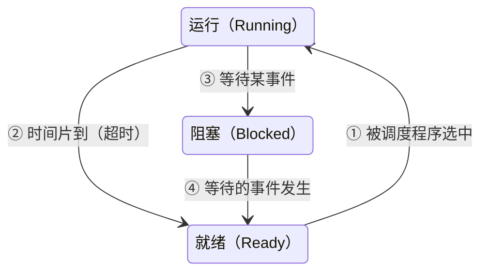

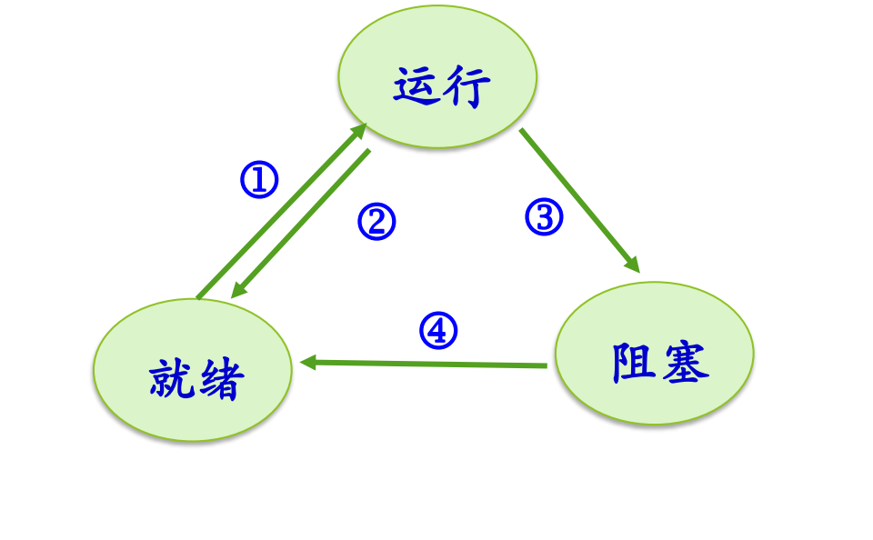

图：运行、就绪、阻塞三状态之间只有四种合法转换：①就绪→运行（被调度），②运行→就绪（时间片到或被抢占），③运行→阻塞（等待事件），④阻塞→就绪（事件发生）。
图中 ①–④ 四条箭头分别对应上面四种转换；阻塞与运行之间、就绪到阻塞都没有箭头。

#### 四种合法转换

> [!info] 可视化资源
> - [OSTEP 第 4 章 The Abstraction: The Process（PDF）](https://pages.cs.wisc.edu/~remzi/OSTEP/cpu-intro.pdf)：Figure 4.2 给出 Running/Ready/Blocked 的状态转换，Figure 4.3–4.4 用 CPU 与 I/O 轨迹演示状态变化。

1. **① 就绪 → 运行**：进程在就绪队列中被调度程序选中，上 CPU。这是操作系统起作用的地方：不是谁都能上 CPU，要先排队，再由调度程序决定。[^l04-section-3-s4b4]
2. **② 运行 → 就绪**：典型原因是**时间片**（time slice）用完，即**超时**。进程上 CPU 只允许运行一个时间片段，时间到了就下来重新排队，不能一直占着 CPU 直到运行完；内存里有很多进程，系统的初衷是让更多进程都能运行。类比旋转木马：到点就停，想再玩得重新付钱排队。运行→就绪还可能有其他原因（如被抢占），见 L06「03 调度时机」。[^l04-section-3-s4b4]
3. **③ 运行 → 阻塞**：进程执行了某个操作，需要等待某个事件。例如父进程调用 `wait`/`waitpid` 等子进程结束；或者执行了 `read`、`write` 这类**慢速系统调用**。[^l04-section-3-s4b4]
4. **④ 阻塞 → 就绪**：进程等待的事件发生（如 I/O 完成），被**唤醒**，进入就绪队列重新排队。

#### 为什么只有四种

- **没有阻塞 → 运行**：系统设计要有**确定性**。上 CPU 的唯一途径是排就绪队列；如果阻塞的进程事件一到就能直接上 CPU，同时就绪进程也在上 CPU，系统就乱了。事件发生后，进程先进入就绪，和大家排同一个队。[^l04-section-3-s4b4]
- **没有就绪 → 阻塞**：就绪进程只是在等 CPU，它没有在执行，不会去执行一个让自己阻塞的操作，“好好等着上 CPU，自己把自己阻塞”没有道理。[^l04-section-3-s4b4]

> [!tip] 课堂强调
> 运行到阻塞“特别重要”：要清楚进程是因为什么操作变成阻塞的。[^l04-section-3-s4b4]

#### 慢速系统调用

`fork`、`open`、`read`、`write` 都是系统调用，但并不是所有系统调用都会让进程阻塞。`fork`、`open` 等不一定导致阻塞；`read`、`write` 等要和 I/O 设备打交道，叫**慢速系统调用**（slow system call），ICS 教材中有这一术语。[^l04-section-3-s4b4]

慢的原因在于计算机系统分成两大块：一块是 CPU 加内存，一块是 I/O。I/O 比 CPU 慢得多，`read`/`write` 往往要等磁盘等设备完成操作，进程只能先阻塞。

### 一次 read 的完整过程

下面用进程 A 执行 `read` 读磁盘的例子，把中断/异常机制（用户程序通过系统调用陷入内核，设备通过中断通知内核，见 L03「03 中断处理完整流程」与 L03「07 Linux 系统调用执行」）和三状态模型串起来。设开始时 A 处于运行态，B 处于就绪态。[^l04-section-3-s4b4] [^l04-section-3-s4b5]

1. **A 发起系统调用**：A 正在运行，执行 `read`。A 立即暂停，硬件保存现场。
2. **进入系统调用入口**：查中断向量表（中断描述符表），所有系统调用都走同一条路进入内核的系统调用处理程序。
3. **找到具体服务例程**：A 传入了参数，其中有系统调用号；内核按系统调用号查**系统调用表**，找到 `read` 对应的内核例程（如 `sys_read`）。
4. **把 I/O 交给 DMA**：内核并不亲自去读盘。它准备好相关数据，把传输任务交给 DMA 控制器完成。
5. **A 由运行变为阻塞**（转换 ③）：A 要等读盘结果，结果回来之前不能继续，于是内核把 A 置为阻塞态。
6. **调度 B 运行**（转换 ①）：CPU 不能闲着，内核从就绪队列选中 B，B 上 CPU 运行，这时已经“换人”了。
7. **DMA 发出中断**：数据传输完成后，DMA 控制器发中断。B 在运行中被打断，内核进入中断处理程序。
8. **A 由阻塞变为就绪**（转换 ④）：内核处理中断时发现是 A 要的数据到了，把数据准备好，把 A 从阻塞态变为就绪态，A 回到就绪队列等待再次调度。

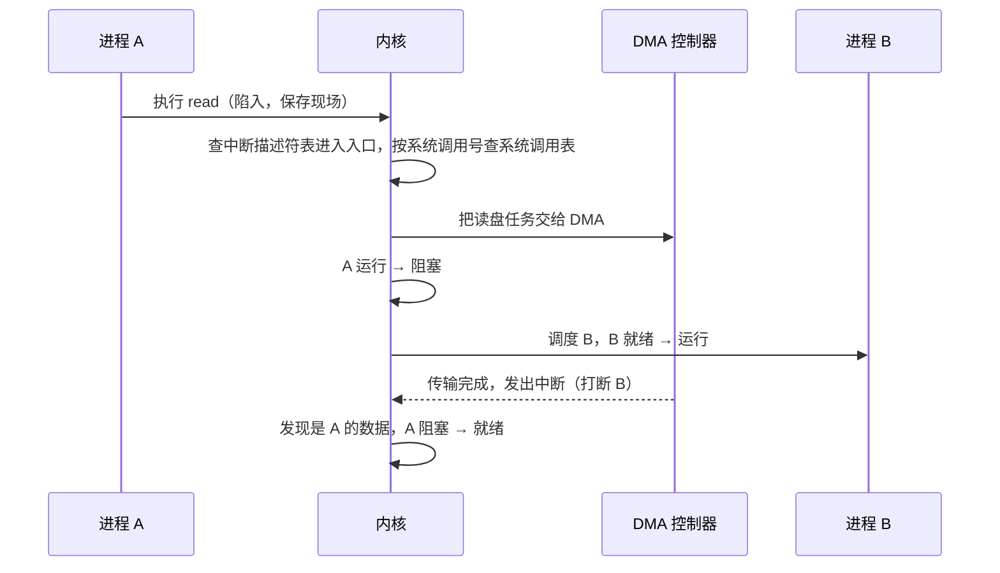

这个过程里，有一次系统调用（进入内核）和一次外设中断，它们分别引发了“运行→阻塞”加“就绪→运行”，以及“阻塞→就绪”。

> [!tip] 课堂强调
> 进程模型与中断/异常机制关系密切：**每一次状态转换的动作，背后都是一次中断或异常的处理**；处理完之后，内核再决定换不换进程。这一点一定要搞清楚。[^l04-section-3-s4b5]

> [!note] 补充解释
> 把四种转换和触发它的内核入口对应起来，可以整理成下表：
>
> | 转换 | 典型触发 | 进入内核的方式 |
> | --- | --- | --- |
> | ③ 运行→阻塞 | `read`、`waitpid` 等需要等待的系统调用 | 系统调用（陷入，属于异常的一种） |
> | ② 运行→就绪 | 时间片用完 | 时钟中断 |
> | ④ 阻塞→就绪 | I/O 完成、子进程结束等事件 | 设备中断（如 DMA 完成中断）或其他进程的系统调用 |
> | ① 就绪→运行 | 当前进程阻塞、超时或结束后，内核调度 | 发生在上述任一处理的末尾 |
>
> 从这张表也能看出：一个转换常常引出另一个转换。③ 或 ② 发生后 CPU 空出来，内核通常紧接着做一次 ①；而 ④ 只是把进程放回就绪队列，不一定立刻引起别的转换。

扩展状态（创建、终止、挂起）以及 Linux、xv6 的实际状态见[扩展状态与实际系统](#扩展状态与实际系统)。

> [!question]- 自测：进程 P 正在等待键盘输入，此时 CPU 空闲、就绪队列为空。用户按下按键后，P 能否直接从阻塞态进入运行态？
> 按模型不能。键盘中断到来后，内核把 P 从阻塞变为就绪（④），再由调度程序把它从就绪变为运行（①）。即使就绪队列里只有 P、CPU 空闲，也要经过就绪这一步，保证“上 CPU 只有排就绪队列一条路”。

> [!question]- 自测：单 CPU 系统中，进程 A 运行时调用 `read` 读磁盘，此时 B、C 在就绪队列。从 A 调用 `read` 到 A 再次上 CPU，至少发生了哪些状态转换、经历了几次进入内核？
> A：运行→阻塞（③）；B 或 C：就绪→运行（①）；DMA 完成后 A：阻塞→就绪（④）；之后 A 还要被调度才能再上 CPU（①，这之前当前运行的进程会因超时或阻塞让出 CPU）。进入内核至少有两次：`read` 系统调用一次，DMA 完成中断一次；A 再次被调度还需要另一次中断或系统调用（如时钟中断）。

> [!question]- 自测：同学认为“调用 `open` 打开文件一定会让进程阻塞，因为它是系统调用”。这个判断对吗？
> 不对。系统调用不等于阻塞。`fork`、`open` 等不一定导致阻塞，只有需要等待慢速事件的调用（如等待 I/O 完成的 `read`/`write`，或等子进程的 `waitpid`）才会使进程从运行变为阻塞。

> [!info]- 来源
> - slides03.pdf：PDF p.12–13
> - L04.docx：DOCX body 85–149

[^l04-section-3-s4b4]: L04.docx-DOCX body 85-117
[^l04-section-3-s2p12]: slides03.pdf-PDF p.12
[^l04-section-3-s2p13]: slides03.pdf-PDF p.13
[^l04-section-3-s4b5]: L04.docx-DOCX body 118-149

---

## 扩展状态与实际系统

> [!abstract] 本节要点
> - 在三状态模型上加状态，并说清它与其他状态之间的转换，就得到一个新的进程模型。
> - **创建态**做完了 PID、PCB 等创建工作但尚未被同意执行，经“提交”才进入就绪，起缓冲/负载控制作用，不是必需的；**终止态**用于统计和资源回收，现代系统一般都有。
> - **挂起态**把整个进程映像从内存换到磁盘，用于调节负载；七状态模型把它细分为就绪挂起和阻塞挂起，现在已很少见。
> - Linux 用同一个 `TASK_RUNNING` 表示“就绪”和“占有 CPU 执行”，睡眠分不可中断（深度）与可中断（浅度），`TASK_ZOMBIE` 对应终止态，`TASK_STOPPED` 用于跟踪调试。
> - xv6 中 `SLEEPING` = 阻塞、`RUNNABLE` = 就绪；`UNUSED`/`USED` 描述的是 PCB 槽位是否被分配，而不是原理模型中的状态。

### 创建、终止与挂起

三状态模型（运行、就绪、阻塞，见[三状态模型](#三状态模型)）只描述进程“活着”时的样子，没有回答进程刚出生、刚结束以及内存不够时处于什么状态。实际系统因此会再加几个状态。给模型加一个状态，并把它与其他状态之间的转换（条件、动作、事件）说清楚，就构成一个新的进程模型。[^l04-section-4-s4b5]

**创建态**（new）：已经完成创建一个进程所必需的工作，例如分配 PID、建立 PCB，但操作系统**尚未同意执行**该进程，原因是资源有限。[^l04-section-4-s2p14]

- 从创建态到就绪态需要一个“提交”动作。这样，“创建”与“允许参与调度”被拆成两道关口。
- 动机是负载控制：就绪意味着可以被调度上 CPU，如果就绪队列已经太拥挤，就先把新进程挡在外面，起到缓冲作用。类比故宫：网上预约成功了，到了门口如果当时人数超限，也要在门口等一等。
- 创建态**不是必需的**，有的系统有，有的系统直接从创建进入就绪。[^l04-section-4-s4b5]

**终止态**（terminated）：进程执行结束后进入该状态，用来完成数据统计、资源回收等善后工作。[^l04-section-4-s2p14] 进程结束并不等于它立刻从系统里消失，善后期间它就处于终止态。类比本科毕业：论文答辩结束后，还要收拾宿舍、归还图书馆的书，领到毕业证才算正式离校。Windows、Linux、xv6 都有终止态。[^l04-section-4-s4b5]

**挂起态**（suspend）：把一个进程从内存转到磁盘，进程不再占用内存空间，其**进程映像**交换到磁盘上，用于调节负载。[^l04-section-4-s2p14]

- 动因是过去内存紧张：进程多、每个都要分内存，内存放不下时，只好把部分进程整体换出到磁盘。
- 被挂起的进程既没有结束，也没有停止，只是暂时搁置；不在内存中的进程当然不能运行，需要时再换回内存。类比公司把前景不明的项目暂停、“束之高阁”，评估后再决定是否重新启动。
- 有了虚存后，这种整进程换出的情况已经很少见。[^l04-section-4-s4b5]

> [!warning] 易错点
> 挂起不是阻塞。阻塞是“在等某个事件”，进程映像仍在内存中；挂起是“被换出到磁盘”，与是否在等事件无关，所以才会有“就绪挂起”和“阻塞挂起”两种组合。

### 五状态与七状态模型

**五状态模型**在三状态之上加入创建和终止：[^l04-section-4-s2p15]

1. 创建 —提交→ 就绪；
2. 就绪 —调度→ 运行，运行 —超时→ 就绪；
3. 运行 —等待事件→ 阻塞，阻塞 —事件发生→ 就绪；
4. 运行 —释放→ 终止。

除了两端多出的创建和终止，中间与三状态模型完全相同。它也是最接近现代实际系统的原理模型。

**七状态模型**再把挂起细分成两种状态，共 $3+2+2=7$ 个状态：运行、就绪、阻塞、创建、终止（图中称“退出”）、**就绪挂起**、**阻塞挂起**。[^l04-section-4-s2p15] 它的转换如下：

| 转换 | 触发 | 含义 |
|---|---|---|
| 创建 → 就绪 / 创建 → 就绪挂起 | 提交 | 新进程可以直接进入内存排队，也可以先放在磁盘上 |
| 就绪 ⇄ 就绪挂起 | 挂起 / 激活 | 就绪进程太多时拿出一部分，暂不参与调度，减轻就绪队列负载 |
| 阻塞 ⇄ 阻塞挂起 | 挂起 / 激活 | 阻塞进程反正在等事件，可以先换出 |
| 阻塞挂起 → 就绪挂起 | 事件出现 | 等的事件到了，但进程仍在磁盘上，所以变成就绪挂起而不是就绪 |
| 运行 → 就绪挂起 | 挂起 | 例如超时本应回就绪，但就绪队列已太满，直接挂起 |
| 就绪 → 运行、运行 → 就绪、运行 → 阻塞、阻塞 → 就绪、运行 → 退出 | 调度、超时、等待事件、事件出现、释放 | 与五状态模型相同 |

“阻塞挂起 → 就绪挂起”和“运行 → 就绪挂起”是七状态模型最值得注意的两条：前者说明事件发生并不要求进程立刻回到内存；后者是一种直接减轻就绪队列负载的手段。[^l04-section-4-s4b5] 至于每个“挂起”“激活”动作由谁、在什么时候完成，要由具体系统赋予含义；七状态模型在实际系统中已不多见。


图：五状态模型在三状态基础上增加创建和终止；七状态模型再引入就绪挂起和阻塞挂起，进程可被挂起到外存，经激活回到内存。
上图上半部分是五状态模型，下半部分是七状态模型（William Stallings 教材的画法）。

### Linux 的进程状态

原理模型中的术语与实际系统中的名称不一定一致，读 Linux 的状态时要先做一次“翻译”。[^l04-section-4-s4b5]

- **`TASK_RUNNING`**：同时覆盖原理中的**就绪**和**运行**。处于就绪队列中的进程和正在 CPU 上执行的进程，状态值都是 `TASK_RUNNING`，区别只在于是否“占有 CPU 执行”。注意这里的 running 不能按字面理解为“正在运行”。
- **`TASK_INTERRUPTIBLE`（浅度睡眠）**：可中断睡眠。资源到位时被唤醒，也可以被**信号**唤醒。
- **`TASK_UNINTERRUPTIBLE`（深度睡眠）**：不可中断睡眠，不接受信号等打断，只能等资源到位后被唤醒。两种睡眠合起来对应原理中的**阻塞态**。[^l04-section-4-s4b6]
- **`TASK_ZOMBIE`（僵尸态）**：“死亡但户口未注销”。进程已经结束，但还有善后工作，对应**终止态**，取“百足之虫，死而不僵”之意。
- **`TASK_STOPPED`（暂停）**：专为跟踪调试设置。`ptrace`、`strace` 等工具可以在程序中插入断点进行跟踪，打印当时的状态。[^l04-section-4-s4b6]

Linux 的状态转换及其调用的内核函数如下：[^l04-section-4-s2p16]

| 转换 | 触发事件 / 函数 |
|---|---|
| 新进程 → `TASK_RUNNING`（就绪） | `fork()` |
| 就绪 → 占有 CPU 执行 | `schedule()` |
| 占有 CPU 执行 → 就绪 | 时间片到 |
| 占有 CPU 执行 → `TASK_INTERRUPTIBLE` | 等待资源到位：`interruptible_sleep_on()`，再 `schedule()` |
| `TASK_INTERRUPTIBLE` → 就绪 | 资源到位 `wake_up_interruptible()`，或收到信号 `wake_up()` |
| 占有 CPU 执行 → `TASK_UNINTERRUPTIBLE` | 等待资源到位：`sleep_on()`，再 `schedule()` |
| `TASK_UNINTERRUPTIBLE` → 就绪 | 资源到位 `wake_up()` |
| 占有 CPU 执行 → `TASK_STOPPED` | `ptrace()`，再 `schedule()` |
| `TASK_STOPPED` → 就绪 | 收到信号 `SIGCONT`，`wake_up()` |
| 占有 CPU 执行 → `TASK_ZOMBIE` | `do_exit()` |

从表中可以看到：每一次进入睡眠之后都紧跟一次 `schedule()`，因为当前进程让出了 CPU，必须选另一个进程上去；所有唤醒都回到 `TASK_RUNNING`（就绪），没有直接从睡眠回到“占有 CPU 执行”的路径，这和三状态模型中“没有阻塞 → 运行”的规则一致。

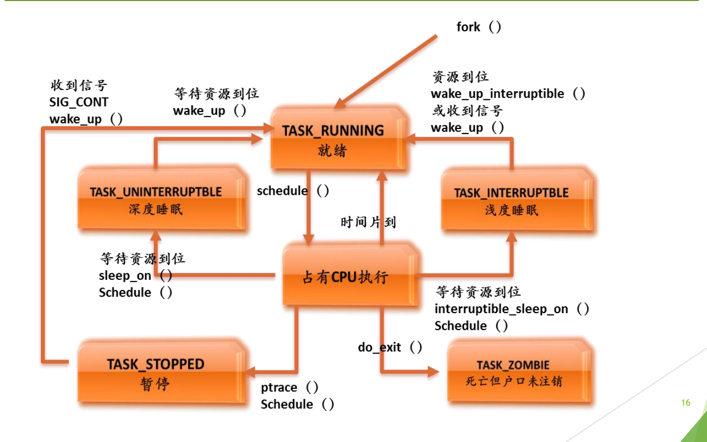

图：Linux 用 TASK_RUNNING 同时表示就绪与运行；等待资源时进入可中断的浅度睡眠 TASK_INTERRUPTIBLE 或不可中断的深度睡眠 TASK_UNINTERRUPTIBLE，另有暂停 TASK_STOPPED 和僵尸 TASK_ZOMBIE。
上图是 Linux 进程状态图（使用较早版本内核的命名，新内核的变化见下方补充解释）。中间“占有 CPU 执行”与上方 `TASK_RUNNING` 是同一个状态值的两种情形。

> [!note] 补充解释
> 新内核中 `TASK_ZOMBIE`、`TASK_STOPPED` 等名称有调整（例如僵尸状态移到 `exit_state` 字段中表示为 `EXIT_ZOMBIE`），但睡眠分两种、就绪与运行共用 `TASK_RUNNING` 这一结构没有变。在 `ps` 命令输出的 STAT 列中，R、S、D、T、Z 分别对应运行/就绪、浅度睡眠、深度睡眠、暂停/跟踪、僵尸。

### xv6 的进程状态

xv6 在 `<kernel/proc.h>` 中用一个枚举定义进程状态：[^l04-section-4-s2p17]

```c
enum procstate { UNUSED, USED, SLEEPING, RUNNABLE, RUNNING, ZOMBIE };
```

它和原理模型的对应关系是：[^l04-section-4-s4b6]

- `RUNNABLE` = 就绪（沿用 UNIX 的叫法“可运行”）；
- `RUNNING` = 运行；
- `SLEEPING` = 阻塞（睡眠）；
- `ZOMBIE` = 终止。

右边这四个状态完全没有脱离原理模型。`UNUSED` 和 `USED` 则与进程的状态转换无关，描述的是**进程创建之前 PCB 槽位的状态**：系统初始化时预先建好一批 PCB，它们都是 `UNUSED`；创建进程时必须先用 `allocproc` 拿到一个空闲 PCB，状态变为 `USED`；之后经 `fork`（或创建第一个用户进程的 `userinit`）把它设为 `RUNNABLE`，进程才真正进入调度。[^l04-section-4-s4b6] 这种“预先分配一批 PCB”的做法见[进程表](#进程控制块-pcb)。

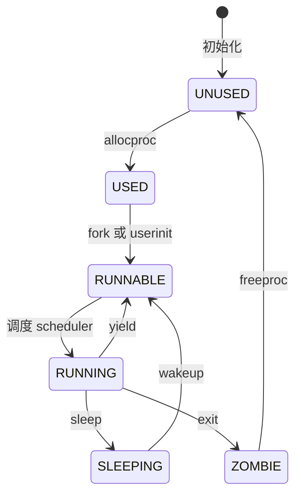

转换函数位于 `<kernel/proc.c>`：`yield` 让出 CPU 回到就绪，`sleep` 在某个等待通道上睡眠，`wakeup` 唤醒在该通道上睡眠的进程，`exit` 使进程变为 `ZOMBIE`，`freeproc` 释放 PCB 槽位使其回到 `UNUSED`。[^l04-section-4-s2p17]

> [!note] 补充解释
> 在 xv6 源码中，时钟中断到来、时间片用完时内核调用 `yield`。`freeproc` 是在父进程调用 `wait` 发现某个子进程处于 `ZOMBIE` 时被调用的：父进程取走子进程的退出状态，再释放它的 PCB 槽位。这正是终止态“善后工作”的一个具体例子。

#### 几种模型的对照

| 原理模型 | Linux | xv6 |
|---|---|---|
| 创建 | （无单独状态，`fork()` 后直接就绪） | `USED`（槽位已分配，尚未可运行） |
| 就绪 | `TASK_RUNNING` | `RUNNABLE` |
| 运行 | `TASK_RUNNING`（占有 CPU） | `RUNNING` |
| 阻塞 | `TASK_INTERRUPTIBLE` / `TASK_UNINTERRUPTIBLE` | `SLEEPING` |
| 终止 | `TASK_ZOMBIE` | `ZOMBIE` |
| 其他 | `TASK_STOPPED`（调试） | `UNUSED`（空闲槽位） |

> [!question]- 自测：在 Linux 上看到某进程的状态值是 `TASK_RUNNING`，能否断定它此刻正在 CPU 上执行？
> 不能。`TASK_RUNNING` 同时表示“在就绪队列中等待”和“占有 CPU 执行”，要判断是否正在执行，还需要看它是不是当前 CPU 上的那个进程。

> [!question]- 自测：七状态模型中，一个阻塞挂起的进程等待的磁盘 I/O 完成了，它会立刻变成就绪吗？
> 不会，它变成就绪挂起。事件出现只解除了“等待”这一条件，进程映像仍在磁盘上；只有经过“激活”换回内存后，它才进入就绪队列。

> [!question]- 自测：xv6 中一个 PCB 的状态从 `UNUSED` 变为 `USED`，是否意味着系统中多了一个可被调度的进程？
> 不是。`USED` 只表示 `allocproc` 分配了这个 PCB 槽位，进程还在创建过程中；要等 `fork`/`userinit` 把它设为 `RUNNABLE`，调度器才会选它。

> [!info]- 来源
> - slides03.pdf：PDF p.14–17
> - L04.docx：DOCX body 118–175

[^l04-section-4-s4b5]: L04.docx-DOCX body 118-149
[^l04-section-4-s2p14]: slides03.pdf-PDF p.14
[^l04-section-4-s2p15]: slides03.pdf-PDF p.15
[^l04-section-4-s4b6]: L04.docx-DOCX body 150-175
[^l04-section-4-s2p16]: slides03.pdf-PDF p.16
[^l04-section-4-s2p17]: slides03.pdf-PDF p.17

---

## 进程控制块 PCB

> [!abstract] 本节要点
> - **PCB** 是操作系统中表示进程的数据结构，记录进程的各种属性及其动态变化；进程与 PCB 一一对应，PCB 是系统感知进程存在的唯一标志。
> - **进程表**是所有 PCB 的集合，通常预先分配在一段连续内存中，大小由系统事先估定。
> - PCB 内容分四类：描述信息（PID、进程名、UID、进程组）、控制信息（状态、优先级、入口地址、可执行文件位置等）、资源（虚拟地址空间、打开文件列表）、CPU 现场（上下文）。
> - 上下文包括通用寄存器、PC、PSW、栈指针和页表指针；下 CPU 时保存，上 CPU 时恢复，换掉 PC 和现场就切换了进程。
> - 必须掌握的三个字段：指向可执行文件的指针、地址空间、打开文件表（子进程继承父进程的打开文件，至少有 0/1/2 三项）。

### 进程控制块与进程表

操作系统的每一项功能都依赖特定的数据结构。到这一讲为止，已经出现了三个关键数据结构：[^l04-section-5-s4b6]

- **中断向量表**、**系统调用表**：在中断与异常机制中使用（见 L03「02 中断响应与中断向量」和 L03「06 系统调用机制设计」），都在操作系统引导、初始化时建好，此后硬件和内核随时可以使用；
- **PCB**：进程的数据结构，也是本节的主角。

> [!tip] 课堂强调
> 遇到一道看不懂在问什么的题目时，冷静下来想一想：这个功能依赖的是哪个数据结构？数据结构确定了，问题也就清楚了。[^l04-section-5-s4b6]

操作系统要管理许多进程，它“看”到一个进程的唯一途径，就是那个进程留在内核中的记录。这份记录就是 PCB。

**进程控制块**（Process Control Block，PCB），又称**进程描述符**、**进程属性**，是操作系统中表示进程的数据结构：[^l04-section-5-s2p18]

- 它记录进程的各种属性，描述进程的动态变化过程（当前状态、优先级、PID、名字等）；
- 操作系统通过 PCB 来控制和管理进程；
- 因此**进程与 PCB 一一对应**，**PCB 是系统感知进程存在的唯一标志**。

名字中的 block 在早期计算机系统中指内存中的“一块区域”，即为控制进程而在内存中划出的一块存放相关数据的区域。PCB 像学生在校四年一直跟着的学籍档案：信息随时补充，学校靠它管理学生；查不到档案，就只能找同学作证。没有 PCB 的进程，就像断了线的风筝，操作系统无法管理它。[^l04-section-5-s4b6]

**进程表**（process table）：所有进程的 PCB 的集合。[^l04-section-5-s2p18] 常见做法是把所有 PCB 放在一段**连续的内存空间**中，表的大小由系统事先估定并预留，而不是每创建一个进程才临时多出一个 PCB。创建进程时先从表中取一个空闲 PCB，这正是 xv6 中 `UNUSED`/`USED` 两个状态的含义（见[xv6 的进程状态](#扩展状态与实际系统)）。[^l04-section-5-s4b6]

不同系统对 PCB 的组织方式不同，没有唯一方案：[^l04-section-5-s2p18]

- Linux：一个 `task_struct` 结构；
- Windows：内容分散在 `EPROCESS`、`KPROCESS`、`PEB` 三个数据结构中，合起来构成 PCB；
- xv6：`struct proc`；Solaris：`proc_t`。

### PCB 的主要内容

PCB 的字段很多，但可以按类别记忆，至少要能说出每一类中的几个字段。[^l04-section-5-s2p19]

**进程描述信息**：

- 进程标识符（process ID，PID），唯一，通常是一个整数；
- 进程名，通常基于可执行文件名，不唯一；
- 用户标识符（user ID，即进程的 owner）；进程组关系。父子进程之间的关系也与这些 ID 有关。[^l04-section-5-s4b7]

**进程控制信息**：

- 当前状态、优先级（priority）；
- 代码执行入口地址；
- 可执行文件名（磁盘地址）；
- 运行统计信息（执行时间、页面调度）；
- 进程间同步和通信信息，阻塞原因；
- 进程的队列指针、进程的消息队列指针。

**所拥有的资源和使用情况**：

- 虚拟地址空间的现状；
- 打开文件列表。

这是进程最重要的两类资源，它们本身都是 PCB 中的**子数据结构**（结构里再套结构）。

**CPU 现场信息**（context）：

- 寄存器值：通用寄存器、程序计数器 PC、程序状态字 PSW、地址类寄存器（如栈指针）；
- 指向赋予该进程的段表/页表的指针。

进程暂时不运行时，操作系统要把该进程的硬件环境保存在这里。[^l04-section-5-s2p19]

### 上下文与进程切换

CPU 像心脏一样从不停歇，它只做一件事：按 PC 取指令、执行指令、更新 PC，再取下一条。[^l04-section-5-s4b7] 它并不知道“进程”的存在。因此，要让 CPU 改去执行另一个进程，只需要把 PC 和其他寄存器换成那个进程的值。

**上下文**（context，旧称“现场”）就是进程在 CPU 上运行时的寄存器状态，其中最重要的是 PC、PSW、栈指针，以及页表指针。[^l04-section-5-s4b7]

1. **下 CPU**：把当前进程的上下文保存到它的 PCB 中；
2. **选择**下一个进程；
3. **上 CPU**：把下一个进程 PCB 中的上下文装回寄存器；
4. CPU 照常按新的 PC 取指执行，对那个进程来说就像什么都没发生过。


类比拍电视剧时的场记：同一场景的不同集可能分几次拍，每次开拍前都要把服装、道具位置、演员站位恢复成上次的样子，否则就会穿帮。[^l04-section-5-s4b7]

> [!warning] 易错点
> 上下文只包括操作系统能够读写的寄存器状态，不包括 cache。cache 的内容和替换完全由硬件自动管理，操作系统切换进程时并不保存、恢复 cache 内容。[^l04-section-5-s4b7]

### 三个必须掌握的字段

以 Solaris 的 `proc_t`（定义在 `<usr/src/uts/common/sys/proc.h>`）为例，可以看到 PCB 中最重要的三个字段。[^l04-section-5-s2p20]

**1. 指向可执行文件的指针**（`p_exec`）。程序是由进程来执行的，所以 PCB 中必须有一个字段能找到磁盘上对应的可执行文件；在 Solaris 中，它经过 vnode / inode 找到可执行文件。字段名不重要，但这个字段**必须有**。回想执行 hello world 的过程：操作系统首先要找到 hello 这个文件，并确认它是可执行文件。[^l04-section-5-s4b7]

**2. 地址空间**（`p_as`）。**创建进程必须立刻给它分配一个地址空间**，这个字段就指向描述该地址空间的数据结构。[^l04-section-5-s4b7] Solaris 用**段的 AVL 树**描述进程地址空间，并通过 HAT 与物理内存建立映射；Linux（ICS 教材的描述）用链表。地址空间的含义、分配方式以及链表与 AVL 树的取舍见[进程地址空间](#进程地址空间)。

**3. 打开文件表**（`u_finfo` → `struct uf_entry[]`）。表中每一项经 vnode / inode 指向一个打开的文件。进程一创建就有打开文件表：在 UNIX 中，子进程**继承父进程的所有打开文件**，父进程打开了文件 A、B，子进程也就打开了 A、B。即使父进程一个文件都没打开，表中也至少有三个缺省项：文件描述符 0、1、2，分别是标准输入、标准输出、标准错误输出，`read`/`write` 中直接使用它们。[^l04-section-5-s4b7]

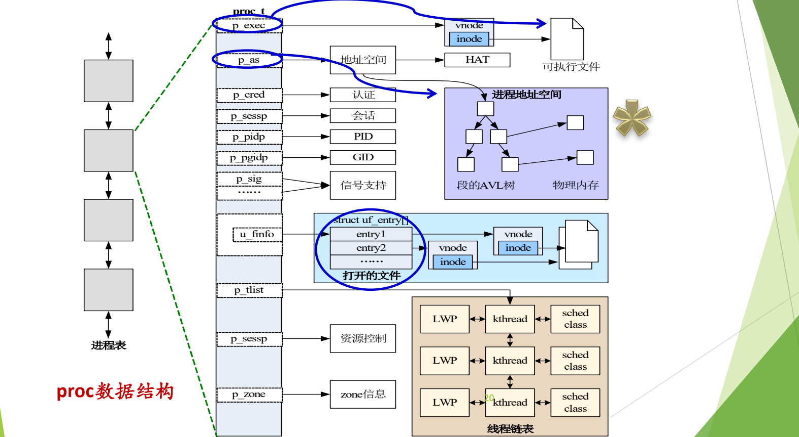

图：Solaris 的进程表由 proc 结构串成；每个 proc 通过指针关联可执行文件（vnode/inode）、地址空间、认证、会话、PID、信号、打开文件表以及由 LWP、kthread 组成的线程链表。
上图左侧的进程表由多个 PCB 串成，其中一个展开为 `proc_t`。三个蓝圈标出 `p_exec`、`p_as` 和打开文件表；其他字段包括 `p_cred`（认证）、`p_sessp`（会话）、`p_pidp`（PID）、`p_pgidp`（进程组 ID）、`p_sig`（信号支持）、`p_tlist`（线程链表，每项由 LWP、kthread、调度类组成）、资源控制和 `p_zone`（zone 信息）。

> [!tip] 课堂强调
> 可执行文件指针“一定要记住，这是必须有的”；创建进程就必须马上分配地址空间，这个概念要“始终特别牢记”；打开文件表及其 0/1/2 三个缺省项“今天就得记住”。[^l04-section-5-s4b7]

> [!note] 补充解释
> HAT 是 Solaris 中的 Hardware Address Translation 层，负责把进程地址空间中的段映射到物理页，作用相当于页表管理。`proc_t` 的完整定义在 `<usr/src/uts/common/sys/proc.h>` 中，字段远多于上图所列。[^l04-section-5-s2p21]

### 实际系统中的 PCB

#### Linux task_struct

Linux 的 PCB 是 `task_struct`。它的字段很多，并且随内核版本变化，具体细节不重要；重要的是能在其中找到前面讲过的那些字段。[^l04-section-5-s4b8] 下面是 Linux 2.6.x 中的节选（完整定义有上百个字段，这里只保留与 PCB 四类内容相关的部分）：[^l04-section-5-s2p22]

```c
struct task_struct {
    volatile long state;    /* -1 unrunnable, 0 runnable, >0 stopped */
    struct thread_info *thread_info;
    unsigned long flags;    /* per process flags */
    int prio, static_prio;
    struct list_head run_list;
    unsigned long policy;
    unsigned int time_slice, first_time_slice;
    struct list_head tasks;
    struct mm_struct *mm, *active_mm;
    int exit_code, exit_signal;
    pid_t pid;
    pid_t tgid;
    struct task_struct *real_parent; /* real parent process (when being debugged) */
    struct task_struct *parent;      /* parent process */
    struct list_head children;       /* list of my children */
    struct list_head sibling;        /* linkage in my parent's children list */
    struct task_struct *group_leader;/* threadgroup leader */
    unsigned long utime, stime, cutime, cstime;
    unsigned long nvcsw, nivcsw, cnvcsw, cnivcsw; /* context switch counts */
    u64 start_time;
    /* ... */
    uid_t uid, euid, suid, fsuid;    /* process credentials */
    gid_t gid, egid, sgid, fsgid;
    char comm[16];
    struct thread_struct thread;     /* CPU-specific state of this task */
    struct fs_struct *fs;            /* filesystem information */
    struct files_struct *files;      /* open file information */
    struct signal_struct *signal;    /* signal handlers */
    struct sighand_struct *sighand;
    sigset_t blocked, real_blocked;
    struct sigpending pending;
    /* ... */
};
```

把它与 PCB 的四类内容对照：`state`、`prio`、`policy`、`time_slice` 是控制信息；`pid`、`uid`、`comm`（进程名）是描述信息；`mm` 指向地址空间，`files` 指向打开文件表，这是两大资源；`thread`（`thread_struct`）保存 CPU 相关的现场；`parent`、`children`、`sibling` 构成进程家族树。[^l04-section-5-s2p23]

按功能分类后，较新版本的 `task_struct` 主要字段如下：[^l04-section-5-s2p24]

```c
struct task_struct {
    struct list_head tasks;              /* 进程列表 */

    /* 任务 ID */
    pid_t pid;
    pid_t tgid;
    struct task_struct *group_leader;

    /* 亲缘关系 */
    struct task_struct __rcu *real_parent;
    struct task_struct __rcu *parent;
    struct list_head children;
    struct list_head sibling;

    /* 任务状态 */
    volatile long state;
    int exit_state;
    unsigned int flags;

    /* 权限 */
    const struct cred __rcu *real_cred;
    const struct cred __rcu *cred;

    /* 运行统计 */
    u64 utime;
    u64 stime;
    unsigned long nvcsw;
    unsigned long nivcsw;
    u64 start_time;
    u64 real_start_time;

    /* 调度相关 */
    int on_rq;
    int prio;
    int static_prio;
    int normal_prio;
    const struct sched_class *sched_class;
    struct sched_entity se;
    unsigned int policy;

    /* 信号处理 */
    struct signal_struct *signal;
    struct sighand_struct *sighand;
    struct sigpending pending;

    /* 内存管理 */
    struct mm_struct *mm;
    struct mm_struct *active_mm;

    /* 文件与文件系统 */
    struct fs_struct *fs;
    struct files_struct *files;

    /* 内核栈 */
    struct thread_info thread_info;
    void *stack;
};
```

各类字段的作用：

- **任务 ID**：`pid` 是进程（任务）号，`tgid` 是线程组号，`group_leader` 指向线程组的领头任务；
- **亲缘关系**：`parent`/`real_parent` 指向父进程，`children` 是子进程链表头，`sibling` 把自己挂进父进程的子进程链表；
- **任务状态**：`state` 即上一节的 `TASK_RUNNING` 等状态，`exit_state` 记录退出状态（如僵尸），`flags` 是进程标志；
- **权限**：`cred` 中保存 UID、GID 等身份与权限信息；
- **运行统计**：用户态时间 `utime`、内核态时间 `stime`，自愿/非自愿上下文切换次数 `nvcsw`/`nivcsw`，启动时间；
- **调度相关**：`prio` 等优先级、调度类 `sched_class`、调度实体 `se`、调度策略 `policy`、是否在运行队列上 `on_rq`；
- **信号处理**、**内存管理**（`mm`，下一节展开）、**文件与文件系统**（`fs` 为当前目录等，`files` 为打开文件表）、**内核栈**（`stack`）。[^l04-section-5-s4b8]

#### xv6 struct proc

xv6 的 PCB 是 `<kernel/proc.h>` 中的 `struct proc`，字段少而精，是阅读真实内核前最好的范本，务必读懂。[^l04-section-5-s4b8]

```c
// Per-process state
struct proc {
  struct spinlock lock;

  // p->lock must be held when using these:
  enum procstate state;        // Process state
  void *chan;                  // If non-zero, sleeping on chan
  int killed;                  // If non-zero, have been killed
  int xstate;                  // Exit status to be returned to parent's wait
  int pid;                     // Process ID

  // wait_lock must be held when using this:
  struct proc *parent;         // Parent process

  // these are private to the process, so p->lock need not be held.
  uint64 kstack;               // Virtual address of kernel stack
  uint64 sz;                   // Size of process memory (bytes)
  pagetable_t pagetable;       // User page table
  struct trapframe *trapframe; // data page for trampoline.S
  struct context context;      // swtch() here to run process
  struct file *ofile[NOFILE];  // Open files
  struct inode *cwd;           // Current directory
  char name[16];               // Process name (debugging)
};
```

逐个对应到 PCB 的类别：

| 字段 | 类别 | 含义 |
|---|---|---|
| `lock` | 同步 | 保护本结构的自旋锁；前面一组字段必须持锁访问 |
| `state` | 控制信息 | 上一节的 `enum procstate` |
| `chan` | 控制信息（阻塞原因） | 非零表示在 `chan` 这个等待通道上睡眠，`wakeup(chan)` 据此唤醒 |
| `killed` | 控制信息 | 非零表示已被杀死 |
| `xstate` | 控制信息 | 退出状态，交给父进程的 `wait` |
| `pid` | 描述信息 | 进程号 |
| `parent` | 描述信息（家族关系） | 父进程；需持 `wait_lock` 访问 |
| `kstack` | 资源 | 内核栈的虚拟地址 |
| `sz` | 资源（地址空间） | 进程内存大小（字节） |
| `pagetable` | 资源 / 现场 | 用户页表，即上下文中的“页表指针” |
| `trapframe` | 现场 | 陷入内核时保存用户态寄存器的页，供 `trampoline.S` 使用 |
| `context` | 现场 | 内核切换进程时 `swtch()` 保存、恢复的寄存器 |
| `ofile[NOFILE]` | 资源（打开文件表） | 打开文件数组，下标即文件描述符 |
| `cwd` | 资源 | 当前目录 |
| `name` | 描述信息 | 进程名，用于调试 |

以上字段及注释取自 xv6 源码。[^l04-section-5-s2p25]

可以看到，前面要求掌握的字段在 xv6 中大多都有：地址空间对应 `sz` 和 `pagetable`，打开文件表对应 `ofile`，上下文对应 `trapframe` 和 `context`。

> [!note] 补充解释
> `struct proc` 中没有单独指向可执行文件的字段：xv6 的 `exec` 在建立地址空间时直接把程序各段读入内存，此后不再需要回到文件。真实系统按需从文件调入页面，所以必须保留指向可执行文件的指针：Solaris 是 `p_exec`，Linux 则放在 `mm_struct` 的 `exe_file` 以及各区域的 `vm_file` 中。

与 `task_struct` 相比，xv6 没有调度优先级、权限位和信号处理等字段：真实场景远比 xv6 复杂。[^l04-section-5-s2p25]

> [!info] 依据讲义整理
> 读懂 `struct proc` 之后，可以结合以下材料自学进程相关源码：[^l04-section-5-s2p73]
>
> 1. xv6-book 第 2.5 节，以及 xv6-riscv 的 `kernel/proc.h`、`kernel/proc.c` 和 `user/sh.c`；
> 2. OSTEP 第 5 章 Process API，以及 xv6 中对应的函数实现。
>
> 阅读目标是弄清 shell 与 `fork()`、`exec()`、`wait()` 之间的关系：shell 先 `fork` 出子进程，子进程 `exec` 要运行的程序，父进程 `wait` 等它结束。还要体会把“创建进程”和“装入程序”拆成两个调用的好处，并用几句话概括这组 API。`fork`/`exec` 的内核实现见 L05「03 fork、exec 与写时复制」。

> [!question]- 自测：父进程没有打开任何文件就 `fork` 了一个子进程，子进程执行 `write(1, "hi", 2)` 会成功吗？为什么？
> 会。子进程继承父进程的打开文件表，而任何进程的打开文件表中至少有 0、1、2 三个缺省项，描述符 1 就是标准输出。

> [!question]- 自测：操作系统要把 CPU 从进程 A 切换给进程 B，至少要改变哪些硬件状态？这些信息存放在哪里？
> 要把 A 的上下文（通用寄存器、PC、PSW、栈指针、页表指针）保存到 A 的 PCB，再把 B 的 PCB 中保存的这些值装入寄存器。PC 一换，CPU 就从 B 上次停下的地方继续取指；cache 不在保存范围内。

> [!question]- 自测：xv6 中一个进程调用 `sleep` 等待磁盘 I/O，`struct proc` 中哪两个字段会变化？
> `state` 变为 `SLEEPING`，`chan` 被设为它等待的通道（非零）。I/O 完成后 `wakeup` 按 `chan` 找到它，把 `state` 改回 `RUNNABLE`。

> [!info]- 来源
> - slides03.pdf：PDF p.18–25, 73
> - L04.docx：DOCX body 150–226

[^l04-section-5-s4b6]: L04.docx-DOCX body 150-175
[^l04-section-5-s2p18]: slides03.pdf-PDF p.18
[^l04-section-5-s2p19]: slides03.pdf-PDF p.19
[^l04-section-5-s4b7]: L04.docx-DOCX body 176-203
[^l04-section-5-s2p20]: slides03.pdf-PDF p.20
[^l04-section-5-s2p21]: slides03.pdf-PDF p.21
[^l04-section-5-s4b8]: L04.docx-DOCX body 204-226
[^l04-section-5-s2p22]: slides03.pdf-PDF p.22
[^l04-section-5-s2p23]: slides03.pdf-PDF p.23
[^l04-section-5-s2p24]: slides03.pdf-PDF p.24
[^l04-section-5-s2p25]: slides03.pdf-PDF p.25
[^l04-section-5-s2p73]: slides03.pdf-PDF p.73

---

## 进程地址空间

> [!abstract] 本节要点
> - **地址空间是对内存的抽象**：创建进程时操作系统立即给它一个虚拟地址空间，再把虚拟地址映射到物理内存。
> - myval 实验：两个并发进程打印的变量地址相同（老机器上均为 `0x804968c`）而值不同，说明打印的是各自虚拟地址空间中的同一位置，映射到不同的物理内存；现代机器地址不同是 **ASLR** 造成的，关闭后又相同。
> - 地址空间有四个特征：巨大（大小取决于体系结构和 OS，Linux x86-64 为 $2^{48}$）、统一一致的布局、安全、稀疏。
> - 建立地址空间时只根据可执行文件为代码、数据建立 area 映射，并不真正装入；堆、栈动态产生。
> - Linux 用 `task_struct→mm→mm_struct` 描述地址空间：`mmap` 指向 `vm_area_struct` 链表（每个区域一个，含起止地址、权限、标志），`pgd` 指向顶级页表。

### 地址空间是对内存的抽象

[进程是对 CPU 的抽象](#进程与三个抽象)，地址空间则是对内存的抽象。操作系统不再直接给进程分配一块物理内存，而是给每个进程分配一个**地址空间**（address space），并在地址空间与具体的物理内存之间加一层映射。两层结构比直接使用物理内存灵活得多。[^l04-section-6-s2p26]

只要创建进程，操作系统就**先**给它分配一个地址空间（PCB 中对应的字段见[三个必须掌握的字段](#进程控制块-pcb)）。很多年前是真的分给它一块物理内存，按需要的大小读进去；有了虚存后，只是**承诺**给它一个地址空间。就像网上预订酒店房间：交了定金，房间一定有，只是到了才知道是 305 还是 408。[^l04-section-6-s4b7] [^l04-section-6-s4b8] 在有虚存支持的通用计算机上，这个地址空间是**虚拟地址空间**。

#### myval 实验与 ASLR

下面的程序用实验说明“每个进程有自己独立的虚拟地址空间”：[^l04-section-6-s2p27]

```c
int myval;

int main(int argc, char *argv[]) {
    myval = atoi(argv[1]);
    while (1)
        printf("myval is %d, loc 0x%lx\n", myval, (long) &myval);
}
```

程序把命令行参数存入全局变量 `myval`，然后在死循环中不停打印它的值和地址。死循环保证进程不会结束。**同时**运行两个实例，例如在后台先启动 `myval 5`，再启动 `myval 6`，系统中就有两个并发进程。

**老机器上的结果**：两个进程打印的值分别是 5 和 6，但打印出的 `myval` 地址**完全相同**，都是 `0x804968c`。[^l04-section-6-s2p28]

```text
myval is 5, loc 0x804968c
myval is 6, loc 0x804968c
```

原因如下：[^l04-section-6-s4b10]

1. 每创建一个进程，就给它一个新的地址空间，因此两个进程各有一个地址空间；
2. `myval` 是全局变量，编译器在编译、链接时就确定了它在数据区中的位置，两个进程运行的是同一个可执行文件，所以在各自地址空间中 `myval` 的**虚拟地址**相同；
3. 运行时，两个进程的这个虚拟地址经地址映射分别对应到**不同的物理内存**，所以各存各的值，互不影响。

类比：小区里每栋楼都有 208 号房间，“208”相同，但它们是不同楼里的不同房间。程序打印的 `&myval` 是虚拟地址，而不是物理地址。

**现代机器上的结果**：两个进程打印的地址**不一样**，例如 `myval 5` 打印 `loc 0x104a40000`，`myval 6` 打印 `loc 0x102098000`；重复运行同一程序，地址也会变化。[^l04-section-6-s2p29]

```text
myval is 5,loc 0x104a40000
myval is 6,loc 0x102098000
```

这仍然是虚拟地址，地址不同是因为**地址空间布局随机化**（Address Space Layout Randomization，ASLR）：为了安全，系统每次创建进程时都随机改变代码、数据、堆、栈、共享库等区域的起始位置，让攻击者难以预测关键数据和代码的地址，从而提高攻击成本。[^l04-section-6-s4b8]

ASLR 是一个开关。在 Linux 上关闭它：[^l04-section-6-s2p30]

```bash
sudo sysctl -w kernel.randomize_va_space=0
```

关闭后再同时运行两个 myval，两个进程打印的地址又相同了，都是 `loc 0x555555558014`：它们仍然是不同地址空间中的同一个位置，对应的物理内存当然不同。[^l04-section-6-s2p30]

| 场景 | `myval 5` 打印的地址 | `myval 6` 打印的地址 | 结论 |
| --- | --- | --- | --- |
| 老机器（无 ASLR） | `0x804968c` | `0x804968c` | 同一虚拟地址，不同物理内存 |
| 现代机器（ASLR 开启） | `0x104a40000` | `0x102098000` | 布局被随机化，地址不同 |
| 现代 Linux，`randomize_va_space=0` | `0x555555558014` | `0x555555558014` | 关闭随机化后又相同 |

> [!note] 补充解释
> `kernel.randomize_va_space` 的取值：0 表示关闭随机化；1 表示随机化栈、`mmap` 区域（共享库）和 vdso 等的位置；2（多数发行版默认）在 1 的基础上再随机化堆的起始位置。做完实验后应执行 `sudo sysctl -w kernel.randomize_va_space=2` 恢复。另外，`myval` 没有初值，严格说位于数据区中的 `.bss` 部分。三组地址的长度也不同：`0x804968c` 只有 32 位，是老式 32 位 x86 可执行文件的典型地址（代码默认从 `0x08048000` 起）；`0x555555558014` 落在 64 位 Linux 关闭随机化后位置无关可执行文件（PIE）的默认装载区附近（`0x555555554000` 起）。

> [!warning] 易错点
> 看到两个进程打印的地址不同，不能得出“打印的是物理地址”的结论；看到地址相同，也不能得出“两个进程共享了这个变量”的结论。两种情况下打印的都是虚拟地址，相同还是不同只取决于 ASLR 是否开启，而两个进程的 `myval` 始终位于不同的物理内存中。

### 进程地址空间的生成与布局

进程地址空间的内容一部分来自可执行文件，一部分在运行时产生：[^l04-section-6-s2p31]


1. 源代码经编译、链接成为可执行文件（见 ICS 第七章），文件中有文件头、代码和初始化数据；
2. 创建进程时，操作系统找到可执行文件，从中找到代码 section 和数据 section，知道它们各占多大空间，然后在虚拟地址空间中分别为它们建立一个 **area**，与文件内容建立映射关系；
3. 此时并**没有**真正把文件内容装入内存，只是建立了映射；
4. 堆、栈和共享库不来自可执行文件，在运行过程中动态产生。[^l04-section-6-s4b9]

所谓“执行程序”，执行的就是这个可执行文件：地址空间中的代码和数据部分正是从它映射而来。

**统一一致的布局**：整个地址空间一分为二，高地址部分（如 `0xFFFF……`）是内核地址空间，低地址部分（`0x0000……`）是用户地址空间。用户部分从低地址到高地址依次是：[^l04-section-6-s2p32]

1. **代码段**：PC 指向这里；
2. **数据段**：全局变量（如 `myval`）在这里；
3. **堆**：从低向高增长；
4. 中间的大片空白：可以放共享库、内存映射文件等其他内容；
5. **栈**：位于高地址，SP 指向栈顶，从高向低增长。

ASLR 只随机化这些区域的位置，不改变这一布局。[^l04-section-6-s4b9]

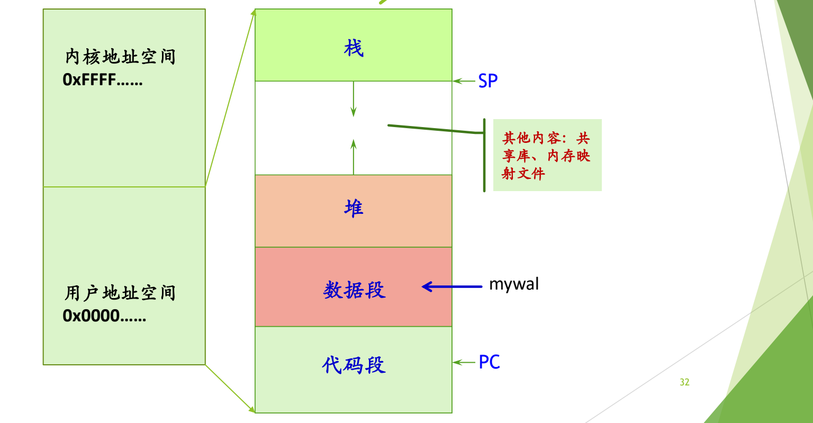

图：用户地址空间自低向高依次是代码段（PC 指向）、数据段（全局变量 myval 所在）、向上增长的堆，以及自高地址向下增长的栈（SP 指向）；高端是内核地址空间，中间还映射共享库、内存映射文件等。
上图左侧是内核与用户两部分地址空间，右侧是用户地址空间的展开，标出了 PC、SP 和 `myval` 所在的位置。可以用 `cat /proc/PID/maps` 查看一个进程实际的地址空间布局。

### 地址空间的四个特征

现代操作系统中，每个进程的地址空间都有以下四个特征：[^l04-section-6-s4b8]

1. **巨大**：地址空间的大小取决于具体的**体系结构和操作系统**，脱离这两者谈“地址空间多大”没有意义。Linux x86-64 上为 $2^{48}$ 字节；xv6 在 RISC-V 上的大小也要记住（见下方补充解释）。ICS 第九章开篇就说，虚拟地址空间是虚存思想与磁盘的完美结合。
2. **统一一致**：每个进程的布局都一样，即上一小节的布局。
3. **安全**：地址空间受到保护，进程之间互相隔离，各区域也有自己的访问权限。
4. **稀疏**：真正有内容的部分很少。

> [!note] 补充解释
> x86-64 目前使用 48 位虚拟地址，整个空间为 $2^{48}$ 字节，其中低半部分 $2^{47}$ 字节（128 TB）给用户，高半部分给内核，对应上一小节的“一分为二”。xv6 运行在 RISC-V 的 Sv39 分页模式下，虚拟地址为 39 位；xv6 只使用其中低 $2^{38}$ 字节（`kernel/riscv.h` 中的 `MAXVA`），以避免处理高位符号扩展。

稀疏性需要放到真实尺寸中才能体会：在 $2^{48}$ 字节的空间里，代码只占几页，数据也不多，栈一般约 8 MB，堆与栈之间是巨大的空白，除了可以放共享库和内存映射文件外，仍有大量空间。就像在内蒙古大草原上走半天才能遇到一个蒙古包。[^l04-section-6-s4b9]

### 用 /proc/PID/maps 观察地址空间

`/proc/PID/maps` 显示进程映射的内存区域及其访问权限。[^l04-section-6-s2p34] 下面的程序用于练习，它满足三个条件：用到了常量（字符串 `"hello, world!"`）、用到了堆（`malloc`）、不会自动退出（`getchar()` 等待输入）。[^l04-section-6-s2p33]

```c
#include <stdio.h>
#include <stdlib.h>
int main() {
    printf("hello, world!");
    int *a = malloc(sizeof(int));
    getchar();
    return 0;
}
```

运行后在另一个终端执行 `cat /proc/<PID>/maps`，得到如下输出：

```text
00400000-00401000 r-xp 00000000 fc:01 925064 /root/tmp/hello
00600000-00601000 r--p 00000000 fc:01 925064 /root/tmp/hello
00601000-00602000 rw-p 00001000 fc:01 925064 /root/tmp/hello
00c0b000-00c2c000 rw-p 00000000 00:00 0 [heap]
7f1aa1c26000-7f1aa1c28000 r-xp 00000000 fc:01 25150 /usr/lib64/libdl-2.17.so
7f1aa1c28000-7f1aa1e28000 ---p 00002000 fc:01 25150 /usr/lib64/libdl-2.17.so
7f1aa1e28000-7f1aa1e29000 r--p 00002000 fc:01 25150 /usr/lib64/libdl-2.17.so
7f1aa1e29000-7f1aa1e2a000 rw-p 00003000 fc:01 25150 /usr/lib64/libdl-2.17.so
7f1aa1e2a000-7f1aa1fe4000 r-xp 00000000 fc:01 25054 /usr/lib64/libc-2.17.so
7f1aa1fe4000-7f1aa21e3000 ---p 001ba000 fc:01 25054 /usr/lib64/libc-2.17.so
7f1aa21e3000-7f1aa21e7000 r--p 001b9000 fc:01 25054 /usr/lib64/libc-2.17.so
7f1aa21e7000-7f1aa21e9000 rw-p 001bd000 fc:01 25054 /usr/lib64/libc-2.17.so
7f1aa21e9000-7f1aa21ee000 rw-p 00000000 00:00 0
7f1aa21ee000-7f1aa220f000 r-xp 00000000 fc:01 24864 /usr/lib64/ld-2.17.so
7f1aa22f2000-7f1aa22f5000 rw-p 00000000 00:00 0
7f1aa2305000-7f1aa2307000 rw-p 00000000 00:00 0
7f1aa2307000-7f1aa230a000 r-xp 00000000 fc:01 25620 /usr/lib64/libonion_security.so.1.0.19
7f1aa230a000-7f1aa240a000 ---p 00003000 fc:01 25620 /usr/lib64/libonion_security.so.1.0.19
7f1aa240a000-7f1aa240b000 rw-p 00003000 fc:01 25620 /usr/lib64/libonion_security.so.1.0.19
7f1aa240b000-7f1aa240f000 rw-p 00000000 00:00 0
7f1aa240f000-7f1aa2410000 r--p 00021000 fc:01 24864 /usr/lib64/ld-2.17.so
7f1aa2410000-7f1aa2411000 rw-p 00022000 fc:01 24864 /usr/lib64/ld-2.17.so
7f1aa2411000-7f1aa2412000 rw-p 00000000 00:00 0
7ffc47264000-7ffc47285000 rw-p 00000000 00:00 0 [stack]
7ffc47337000-7ffc47339000 r-xp 00000000 00:00 0 [vdso]
ffffffffff600000-ffffffffff601000 r-xp 00000000 00:00 0 [vsyscall]
```

每一行描述一个 area，各列依次为：起始–结束地址、权限、在映射文件中的偏移、设备号、inode 号、映射的文件名（或 `[heap]`、`[stack]` 等特殊名称）。

> [!example] 例：读懂 hello 的 maps
> 1. `00400000-00401000 r-xp …/hello`：代码段，从 `0x400000` 开始，可读、可执行、不可写，映射自可执行文件 hello。
> 2. `00600000-00601000 r--p` 与 `00601000-00602000 rw-p`：数据部分，分成只读数据和可读写数据（含 `.bss`），同样映射自 hello。
> 3. `[heap]`：`malloc` 用到的堆，紧接在数据之后，可读写，不对应任何文件（inode 为 0）。
> 4. `7f1a…` 开头的一大片：共享库 `libdl`、`libc`、`ld`、`libonion_security` 等（其中没有文件名的 `rw-p` 行是匿名映射），每个库又分为代码、只读数据、可写数据几个区域；它们位于堆与栈之间的空白中，地址范围很大。
> 5. `[stack]`：`7ffc…` 开头，位于用户空间的最高处，从高地址向低地址增长。
> 6. 从 `0x400000` 到 `0x7ffc…` 之间只有少数几行有内容，这就是稀疏性。[^l04-section-6-s4b9]

> [!note] 补充解释
> 权限列第 4 位的 `p` 表示**私有映射**（private，写时复制：进程写入时得到自己的副本，不影响文件和其他进程），`s` 表示共享映射（shared）。权限为 `---p` 的区域不可读、写、执行，是动态链接器在共享库各段之间留出的保护间隔，访问它会触发段错误。

在内核中，进程的一段地址空间用 `vm_area_struct` 表示，所有区域存储在 `task->mm->mmap` 链表中；一个文件可以映射到进程的一段内存区域中，映射的文件保存在 `vm_area_struct->vm_file` 域中，这种区域叫**有名内存区域**，不对应文件的（如堆、栈）叫**匿名映射内存区域**。[^l04-section-6-s2p34]

#### mmap 的用途

堆与栈之间的大片空白可以用 **`mmap`**（memory map）函数利用起来：把一个文件直接映射到地址空间的空白处，之后像访问内存数组一样访问文件内容。[^l04-section-6-s4b9]

例：一个文件中存有几千万个整数，要求排序。

- 不用 `mmap`：只能 `open` 文件，用 `read` 每次读入一部分到缓冲区，分批排序，再合并结果；
- 用 `mmap`：把整个文件映射进地址空间，得到一个指针，直接在这片区域上排序。哪些页需要访问，由虚存机制按需调入，程序不必自己分批读写。

> [!tip] 课堂强调
> `mmap` 是“特别重要的函数”，后续课程会反复提到它。[^l04-section-6-s4b9]

### 用 vm_area_struct 描述稀疏的地址空间

地址空间是稀疏的，那么该用什么数据结构描述它？最直接的想法是开一个与地址空间一样大的字节数组，但一个 $2^{48}$ 字节的数组根本不可能存在。思路与数据结构课中的**稀疏矩阵**相同：稀疏矩阵用三元组等方式只存非零元素，地址空间也**只描述有内容的区域**：代码段、数据段、堆、栈，以及中间每一个被映射的区域。[^l04-section-6-s4b9]

每个区域用一个结构描述，然后把这些结构连成链表，或组织成 AVL 树。Linux 中这个结构是 **`vm_area_struct`**，主要字段有：[^l04-section-6-s2p35]

- `vm_start`、`vm_end`：区域在地址空间中的起始地址和结束地址，即 maps 中每行开头的地址范围；
- `vm_prot`：本区域的读写权限（protection）。代码区域可执行，数据区域不可执行，只读区域不可写；
- `vm_flags`：本区域的页是与其他进程**共享**的，还是本进程**私有**的；
- `vm_next`：指向下一个区域，把所有区域连成链表。

整个结构的入口在 PCB 中：`task_struct` 的 `mm` 字段指向 **`mm_struct`**，`mm_struct` 中的 `mmap` 指针指向 `vm_area_struct` 链表的表头，`pgd` 字段则指向页表。[^l04-section-6-s4b9]

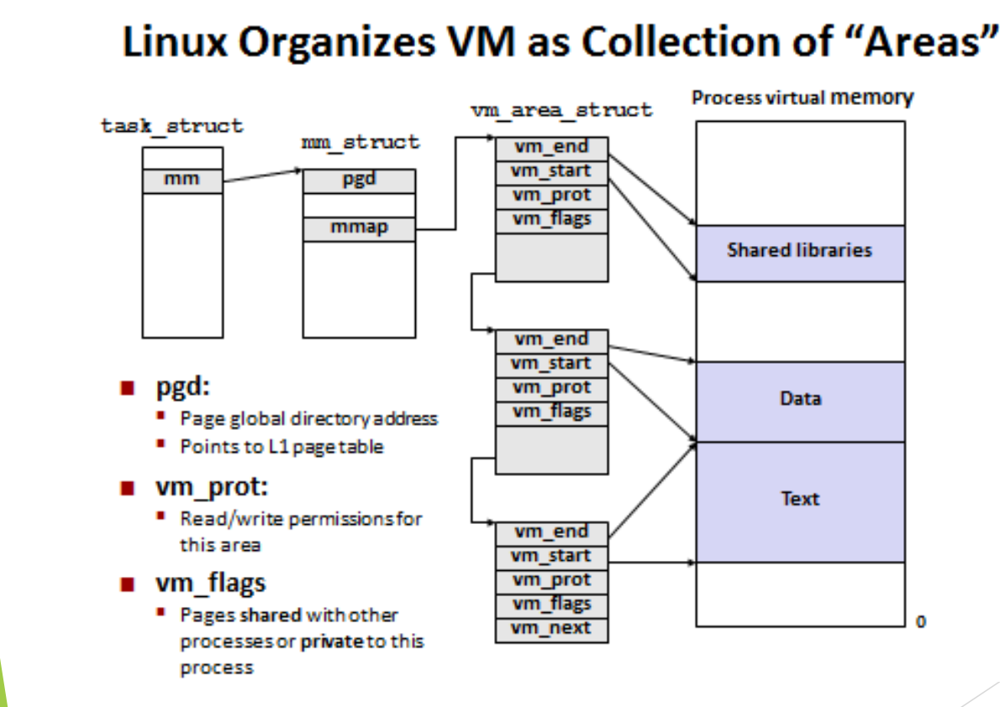

图：task_struct 的 mm 指向 mm_struct，其 mmap 链接多个 vm_area_struct，每个区域用 vm_start、vm_end、vm_prot、vm_flags 描述进程虚拟内存中的一段，如代码、数据和共享库；pgd 指向页表。
上图从左到右依次是 `task_struct`、`mm_struct`、`vm_area_struct` 链表和进程虚拟内存。三个 `vm_area_struct` 分别描述 Text、Data 和 Shared libraries 区域，其余空白部分没有任何结构描述，这正是“只描述有内容的区域”。

**`pgd`**（page global directory）是顶级页表的地址，在四级页表中指向最顶层那一级。进程上 CPU 时，这个值被装入页表基址寄存器；进程下 CPU 时，它保存在 PCB 中。[^l04-section-6-s4b10] 这正是[上下文](#进程控制块-pcb)中“页表指针”的具体落脚点，页表本身的结构属于 ICS 第九章的内容。

**链表与 AVL 树**：两者都能完整描述所有区域，区别在于查找效率。用 `mmap` 在指定位置映射一块新区域时，内核必须先判断这个位置是否已被其他区域占用，也就是查找“某地址是否落在已有区域中”。链表只能逐个比较；AVL 这类平衡树可以按地址二分查找，快得多。本质上这是一个检索问题。Solaris 用段的 AVL 树（见[Solaris 的 PCB](#进程控制块-pcb)），上图的 Linux 结构则用链表。[^l04-section-6-s4b9]

> [!tip] 课堂强调
> `pgd` 的作用要和 ICS 学过的页表联系起来，“这个挺重要”；描述区域的数据结构可以用链表，也可以用树。[^l04-section-6-s4b10]

> [!note] 补充解释
> 实际的 Linux 内核并不只用链表：Linux 2.2 曾在链表之外使用 AVL 树；2.4 系列起到 6.0 版本，`vm_next` 链表之外维护的是一棵红黑树（`mm_rb`），用于按地址快速查找区域；从 6.1 版本起，链表和红黑树都被一种名为 maple tree 的 B 树变体取代。思路仍是本节所说的“按地址检索区域”。

> [!question]- 自测：关闭 ASLR 后同时运行 `myval 5` 和 `myval 6`，两者打印出相同的地址。如果此时用调试器把 `myval 5` 进程中的 `myval` 改成 100，`myval 6` 打印的值会变吗？
> 不会。相同的只是虚拟地址，两个进程有各自的地址空间，同一虚拟地址映射到不同的物理内存，修改一个不影响另一个。

> [!question]- 自测：一个进程的 maps 输出（不含内核的 `[vsyscall]` 行）共有 25 行。在 Linux 内核中，描述它的用户地址空间大约需要多少个 `vm_area_struct`？为什么不需要描述 $2^{48}$ 字节中的其余部分？
> 大约 25 个，每行一个 area。地址空间是稀疏的，内核只为有内容的区域建立结构；没有结构覆盖的地址就是未映射的空白，访问它会出错。

> [!question]- 自测：程序调用 `mmap` 时指定在地址 $A$ 处映射一个文件，内核首先要做什么？此时链表和 AVL 树哪个更合适？
> 先检查从 $A$ 开始的这段范围是否与已有区域重叠。这是按地址检索已有区域的问题，链表要逐个比较，平衡树可以按地址快速定位，所以树更快。

> [!info]- 来源
> - slides03.pdf：PDF p.26–35
> - L04.docx：DOCX body 176–262

[^l04-section-6-s2p26]: slides03.pdf-PDF p.26
[^l04-section-6-s4b7]: L04.docx-DOCX body 176-203
[^l04-section-6-s4b8]: L04.docx-DOCX body 204-226
[^l04-section-6-s2p27]: slides03.pdf-PDF p.27
[^l04-section-6-s2p28]: slides03.pdf-PDF p.28
[^l04-section-6-s4b10]: L04.docx-DOCX body 253-262
[^l04-section-6-s2p29]: slides03.pdf-PDF p.29
[^l04-section-6-s2p30]: slides03.pdf-PDF p.30
[^l04-section-6-s2p31]: slides03.pdf-PDF p.31
[^l04-section-6-s4b9]: L04.docx-DOCX body 227-252
[^l04-section-6-s2p32]: slides03.pdf-PDF p.32
[^l04-section-6-s2p34]: slides03.pdf-PDF p.34
[^l04-section-6-s2p33]: slides03.pdf-PDF p.33
[^l04-section-6-s2p35]: slides03.pdf-PDF p.35

---

## 本讲小结

本讲的主线是“用什么描述进程”：先用**状态**描述进程在生命周期中的变化，再用 **PCB** 记录描述一个进程所需的全部信息，其中地址空间又是 PCB 里一个需要专门数据结构描述的子结构。

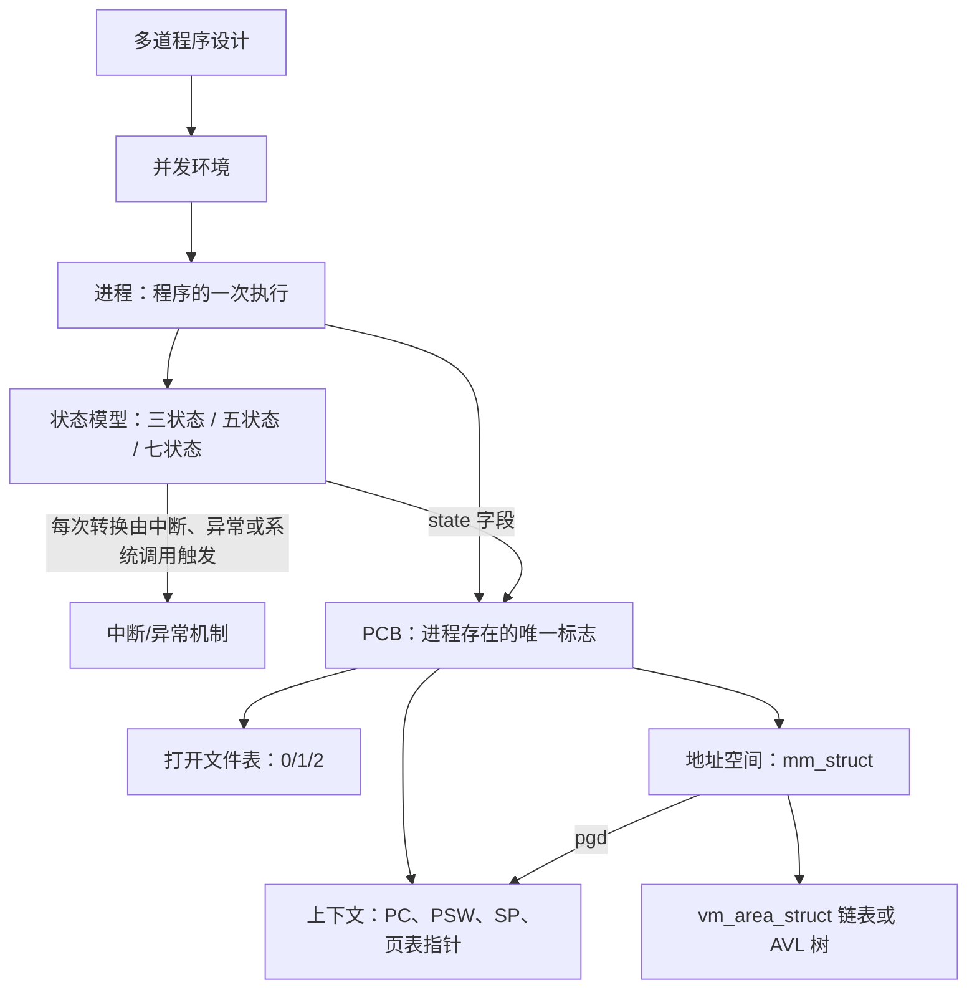

| 遇到的问题 | 先想到的数据结构 | 对应章节 |
| --- | --- | --- |
| 进程现在能不能上 CPU、为什么不能 | PCB 中的状态字段与就绪/阻塞队列 | [三状态模型](#三状态模型)、[扩展状态与实际系统](#扩展状态与实际系统) |
| 切换进程要保存和恢复什么 | PCB 中的上下文（含页表指针 `pgd`） | [进程控制块 PCB](#进程控制块-pcb) |
| 子进程为什么能直接读写 0/1/2 | PCB 中的打开文件表 | [进程控制块 PCB](#进程控制块-pcb) |
| 两个进程为什么能打印出同一个地址 | 每个进程独立的虚拟地址空间 | [进程地址空间](#进程地址空间) |
| 某地址是否已被映射、`mmap` 能否放在这里 | `mm_struct` 下的 `vm_area_struct` 集合 | [进程地址空间](#进程地址空间) |

进程的创建与撤销、进程队列，以及为什么要在进程之上再引入线程，在 L05「02 进程控制与原语」和 L05「04 为什么引入线程」中继续展开。

## 不确定事项

- p29 中现代机器的截图只显示地址 0x104a40000 和 0x102098000，没有说明是哪种操作系统，所以笔记不写平台；p30 关闭 ASLR 用的是 Linux 的 sysctl 命令。
- xv6 地址空间大小（Sv39，2^38）、Linux 区域查找结构的版本演变、randomize_va_space 的各个取值、32 位与 PIE 默认基址都是标注过的补充解释，课程材料中没有这些内容。
- 讲义 p21（Solaris proc_t 源码截图）没有可提取的文字，内容只按 p20 的结构图和头文件路径描述。

> [!info]- 来源
> - slides03.pdf：PDF p.1–35, 73
> - L04.docx：DOCX body 1–262
