有了进程的状态模型和 PCB 之后，还要回答两个问题：操作系统怎样组织和控制成百上千个进程，以及进程为什么还要再细分成线程。本讲先用进程表与队列、进程控制原语说明状态转换如何发生，以 UNIX `fork`/`exec` 和 Linux 的写时复制为例讲进程创建；再从应用、开销、性能三方面引入线程，讲清线程独有与共享的内容、用户级/核心级/混合三种实现，最后延伸到协程、纤程和可再入程序。阅读前应掌握 L04 的进程状态、PCB 与进程地址空间，以及 L03 的中断异常与系统调用；ICS 中的虚存、`mmap` 和并发服务器内容会反复用到。

---

## 进程表与队列模型

> [!abstract] 本节要点
> - 操作系统为每一类进程建立一个或多个队列，队列元素是 PCB；进程状态改变时，它的 PCB 从一个队列移到另一个队列。
> - 常见实现是内存中一张 PCB 大表（数组）：PCB 位置固定不动，靠 PCB 内的多种指针挂入就绪队列、等待队列，并表示父、子、兄弟关系。
> - 等待队列可以有多个，按所等事件区分；就绪队列也可以有多个；单 CPU 时处于运行态的只有一个进程。
> - 五状态队列模型中，只有就绪队列里的进程能被调度上 CPU；离开 CPU 只有三条路：结束释放、时间片到回就绪、等待事件进入对应等待队列（事件发生后回就绪）。
> - 进程模型 = 有哪些状态 + 能从哪转到哪 + 在什么条件下转 + 调用什么函数转；没有触发条件就没有转换，而触发条件与中断/异常密切相关。

### 从地址空间到进程组织

上一讲已经解决了“单个进程的地址空间如何描述”：虚存给每个进程一个巨大、布局一致、天然受保护且稀疏的空间，Linux 用 `task_struct`→`mm`→`mmap` 串起的 `vm_area_struct` 链表（或 AVL 树）只描述有内容的区域（见 L04「06 进程地址空间」）。[^l05-section-1-s4b1]

接下来的问题是：系统里同时有成百上千个进程，每个都有一份 PCB，操作系统怎样把它们组织起来，才能快速找到“下一个该上 CPU 的进程”或“等这块磁盘数据的那些进程”？答案是**排队**。

### 进程表与进程队列

**进程队列**（process queue）是操作系统组织 PCB 的基本方式：

- 操作系统为每一类进程建立一个或多个队列；
- 队列元素就是 PCB；
- 伴随进程状态的改变，其 PCB 从一个队列进入另一个队列。[^l05-section-1-s2p36]

典型的队列结构如下：

| 队列 | 队列中的 PCB | 说明 |
| --- | --- | --- |
| 就绪队列 | PCB1、PCB2、PCB3 | 就绪队列也可以有多个 |
| 等待队列 1 | PCB5、PCB6 | 不同等待队列等待的事件不同 |
| 等待队列 2 | PCB7、PCB8、PCB9 | 同上 |
| 运行 | PCB4 | 单 CPU 情况下只有一个进程处于运行态 |

#### 进程表：大数组加多种指针

队列在逻辑上是链表，但 PCB 本身放在哪里？操作系统一般的做法是在内存里安排一张大表，即**进程表**（process table）：它是一个大数组，每个元素就是一个 PCB，数组的大小决定了系统最多能容纳多少个进程。[^l05-section-1-s4b1]

PCB 在表中的位置固定不变，“排队”靠 PCB 内的指针完成：

1. **状态队列指针**：处于就绪态的进程，用这组指针链进就绪队列；处于等待态的进程，链进它所等事件的那个等待队列。状态改变时只需改指针，PCB 不搬家。
2. **家族关系指针**：UNIX 类系统中进程有父子关系，PCB 里还有指向父进程、子进程、兄弟进程的指针。

所以一个 PCB 往往带着好几种指针，同时出现在几条不同的链上。Linux 的 `task_struct` 就是这样，用不同的指针挂到不同的队列和关系链上，位置不动而组织灵活。[^l05-section-1-s4b2]

> [!warning] 易错点
> “PCB 从就绪队列进入等待队列”说的是逻辑上的移动：实际修改的是 PCB 里的链表指针，PCB 在进程表中的存储位置并不改变。

### 五状态模型的队列模型

五状态模型（新建、就绪、运行、阻塞/等待、终止）是最接近实际系统的进程模型：三状态模型太简单，七状态模型（含挂起）在实际系统中很少见。[^l05-section-1-s4b2] 把五状态模型画成队列图（W. Stallings），每个状态对应一个或一组队列，状态转换就变成 PCB 沿箭头在队列之间流动。

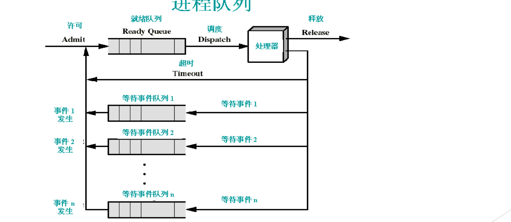

图：新进程经许可（Admit）进入就绪队列，调度（Dispatch）后上处理器运行；超时回到就绪队列，等待事件 $i$ 则进入等待事件队列 $i$，事件 $i$ 发生后整个对应队列移回就绪队列，运行结束则释放（Release）。

读图时可以直接推出以下规则：

1. **许可（Admit）**：新创建的进程被允许进入系统后，进入就绪队列。
2. **调度（Dispatch）**：处理器只从就绪队列取进程。也就是说只有就绪的进程才能变成运行态，就绪→运行只有“被调度”这一条路。图中的就绪队列没有优先级，例如按 FIFO 排队。[^l05-section-1-s2p38]
3. **离开处理器的三条路**：
   - **释放（Release）**：进程结束，离开系统；
   - **超时（Timeout）**：规定的时间片用完，回到就绪队列重新排队；
   - **等待事件 $i$**：进程需要等待某个事件，进入对应的等待事件队列 $i$。
4. **事件发生**：当事件 $n$ 发生时，对应等待队列中的进程被移进就绪队列，再等待调度。[^l05-section-1-s2p38]

等待队列按所等事件拆成 $n$ 条，不同事件发生只唤醒对应队列中的进程。队列图的流向可概括如下：

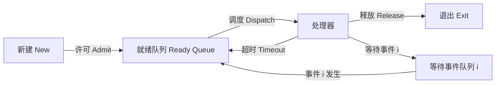

> [!warning] 易错点
> 等待队列中的进程在事件发生后**不会**直接回到处理器，而是先回到就绪队列，再由调度程序选中。阻塞→运行这条边在五状态模型中不存在。

### 状态转换的触发条件

所谓**进程模型**，就是规定系统中的进程处于哪些状态、如何从一个状态切换到另一个状态；模型一旦确定，整个系统的运行方式也就确定了。[^l05-section-1-s4b1] 画队列图的目的，是看清每次转换的**条件**和完成转换的**函数**。一个进程模型要回答四个问题：[^l05-section-1-s4b2]

1. 有哪些状态？
2. 能从哪个状态转到哪个状态？
3. 在什么情况下转（触发条件）？
4. 调用什么函数完成转换？

关键结论：**没有触发条件就没有转换**。连“新建→就绪”这种看似平常的转换也有触发条件，例如一次 `fork` 完成后子进程才进入就绪态。而触发条件大多来自中断和异常，所以中断/异常机制和进程模型是绑在一起的（中断与异常的概念见 L02「08 中断与异常概念」）。[^l05-section-1-s4b2]

> [!note] 补充解释
> 下面把常见的触发条件与中断/异常对应起来，便于理解（据课程内容整理）：
>
> | 转换 | 典型触发条件 |
> | --- | --- |
> | 运行→就绪 | 时钟中断，发现时间片用完 |
> | 运行→阻塞 | 进程执行会阻塞的系统调用（陷入），如 `read` 等待磁盘数据 |
> | 阻塞→就绪 | 所等事件完成，如 I/O 完成中断 |
> | 运行→终止 | 进程调用 `exit`，或发生无法处理的严重异常 |
> | 新建→就绪 | 创建原语（如 `fork`）完成 |

触发条件出现后，具体的转换动作由进程控制原语完成，见[进程控制与原语](#进程控制与原语)。

> [!question]- 自测：单 CPU 系统中有 1 个运行进程、3 个就绪进程、5 个等待进程。运行进程发起磁盘读请求，随后又有一个等待中的进程等到了键盘输入。之后各队列中各有几个进程？
> 运行进程进入等待磁盘的队列（等待变为 6 个），等到键盘输入的进程回到就绪队列（等待变回 5 个，就绪变为 4 个），调度程序再从就绪队列选一个上 CPU。最终运行 1 个、就绪 3 个、等待 5 个。注意等到键盘输入的进程不会直接上 CPU，而是先回就绪队列。

> [!question]- 自测：如果某系统的状态图中没有“挂起”状态，操作系统还需要“挂起原语”吗？从队列模型的角度说明。
> 不需要。原语是为状态转换服务的：队列模型里没有挂起队列，就不存在“移入挂起队列”的转换，也就没有对应的控制函数。

> [!info]- 来源
> - slides03.pdf：PDF p.36, 38
> - L05.docx：DOCX body 1–67

[^l05-section-1-s4b1]: L05.docx-DOCX body 1-39
[^l05-section-1-s2p36]: slides03.pdf-PDF p.36
[^l05-section-1-s4b2]: L05.docx-DOCX body 40-67
[^l05-section-1-s2p38]: slides03.pdf-PDF p.38

---

## 进程控制与原语

> [!abstract] 本节要点
> - 进程控制操作完成进程各状态之间的转换，由具有特定功能的原语完成：创建、撤销、阻塞、唤醒、挂起、激活、改变优先级等；有某个状态才需要对应的原语。
> - 原语（primitive）即原子操作（atomic）：完成特定功能的一段程序，不可分割、不可中断，执行必须连续；主要实现手段是先关中断、执行完再开中断。
> - 创建进程最基本的三件事：分配唯一 PID、分配 PCB、分配（虚拟）地址空间；随后初始化 PCB（状态为 New 等）、设置队列指针、创建或扩充其他数据结构。
> - 撤销进程：结束子进程或线程、回收资源（文件、网络连接、内存）、撤销 PCB；阻塞由进程自己执行阻塞原语，与唤醒成对出现。
> - 先分清 API 体系：UNIX/Linux 用 `fork`/`exec`、`exit`、`wait`；Windows 用 `CreateProcess`、`ExitProcess`、`WaitForSingleObject`。

### 进程控制与原语（Primitive）

[上一节](#进程表与队列模型)说明了状态转换需要触发条件；条件出现后，总要有一段代码真正去改 PCB、挪队列。对进程的所有控制最终都落在一个个函数上。

**进程控制**是完成进程各状态之间转换的操作，它由具有特定功能的原语完成，常见的有：[^l05-section-2-s2p39]

- 进程创建原语
- 进程撤销原语
- 阻塞原语
- 唤醒原语
- 挂起原语
- 激活（解挂）原语
- 改变进程优先级
- ……

有某个状态，才有相应的控制函数。本课程采用五状态模型，没有挂起状态，因此也就没有挂起和激活原语；反过来，如果系统想支持动态提升或降低优先级，就必须提供相应的函数。[^l05-section-2-s4b2]

#### 原语的定义

**原语**（primitive）也称**原子操作**（atomic），是完成某种特定功能的一段程序，具有不可分割性或不可中断性：原语的执行必须是连续的，执行过程中不允许被中断。[^l05-section-2-s2p39]

“不可分割”指的是不能执行到一半停下来、过一会儿再接着执行。为什么进程控制必须如此？以阻塞原语为例：它要把当前进程状态改为阻塞、把 PCB 从运行位置摘下并链入等待队列。如果改完状态还没链入队列时被打断，另一段代码看到的就是一个“状态写着阻塞、却不在任何等待队列里”的 PCB，事件发生时也就无人唤醒它。

“原子”这个名字来自当时的认识：原子被认为是最小、不可再分的粒子。[^l05-section-2-s4b2]

#### 用关中断实现原语

实现原语最重要的手段是**关中断**（disable interrupt）：进入这段代码前关闭中断，不响应任何中断；执行完再**开中断**（enable interrupt）。[^l05-section-2-s4b2]

```c
/* 原语的示意结构，函数名仅为示意 */
disable_interrupt();   /* 关中断：此后不会被中断打断 */
/* 修改 PCB 状态、调整队列指针等 */
enable_interrupt();    /* 开中断 */
```

这样做有效的原因是：单处理器上，当前代码只有在中断（包括时钟中断）发生时才可能被夺走 CPU，关掉中断就消除了被打断的机会。

> [!note] 补充解释
> 关中断只对当前 CPU 有效。在多处理器上，其他 CPU 仍可能同时修改同一个队列，所以实际内核还要配合自旋锁等同步机制。这部分属于后续同步互斥的内容，这里只需理解原语“不可中断”的要求和关中断这一基本手段。

### 进程何时创建、何时终止

进程有生命周期：从无到有，再从有到无。[^l05-section-2-s2p40]

**进程何时创建**：

1. 系统初始化时（系统启动会创建一批进程）；
2. 操作系统提供的服务（服务本身以进程或线程的形式存在）；
3. 交互用户登录系统（登录成功后出现一个新的 shell 进程直接面对用户）；
4. 由现有的进程派生出一个新进程（如 `fork`）；
5. 提交一个程序执行（例如在命令行输入命令后回车）。

**进程何时终止**：

| 终止方式 | 是否自愿 |
| --- | --- |
| 正常退出 | 自愿 |
| 出错退出 | 自愿 |
| 严重错误 | 非自愿 |
| 被其他进程杀死 | 非自愿 |

渠道不同，结果一样：进程不能再执行。导致进程终止的具体事件包括：正常结束；给定时限到；缺少内存；存储器出界；保护性出错（如写只读文件）；算术错；超出时间（进程等待某事件超过最大值）；I/O 失败；无效指令（如试图执行数据）；特权指令；操作系统干预（如发生死锁时）；父进程请求中止某一子进程；父进程中止（子进程也随之中止）。[^l05-section-2-s2p40]

其中不少事件就是异常（存储器出界、算术错、特权指令、无效指令），这再次说明中断/异常是状态转换的触发条件。

### 进程创建的基本工作

创建原语在 UNIX 中对应 `fork`/`exec`，在 Windows 中对应 `CreateProcess`。不管是哪个体系，创建一个进程都要做以下工作：[^l05-section-2-s2p41]

1. **分配唯一标识 PID**：相当于给新进程发一个学号。
2. **分配进程控制块 PCB**：一个大数据结构，相当于建立学籍档案。
3. **分配地址空间**：只要创建进程就必须有地址空间，这里分配的是虚拟地址空间，内容将来放在物理内存的哪里以后再定。
4. **初始化 PCB**：填入默认值，例如状态为 New 等。
5. **设置相应的队列指针**：例如把新进程加入就绪队列的链表。
6. **创建或扩充其他数据结构**。

前三件是最核心的；PID、PCB、地址空间都有了，剩下的填表、挂队列就好办了。[^l05-section-2-s4b2]


UNIX 如何把这些步骤拆进 `fork` 和 `exec`，以及 Linux 怎样优化地址空间的复制，见[fork、exec 与写时复制](#forkexec-与写时复制)。

### 进程撤销、阻塞与唤醒

**进程撤销**要做三件事：[^l05-section-2-s2p42]

1. 结束子进程或线程；
2. 收回进程所占有的资源：关闭打开的文件、断开网络连接、回收分配的内存……；
3. 撤销该进程的 PCB。

对应的系统调用：UNIX 为 `exit`，Windows 为 `ExitProcess`。

**进程阻塞**：处于运行态的进程在运行过程中期待某一事件发生，例如等待键盘输入、等待磁盘数据传输完成、等待其他进程发送消息。当被等待的事件尚未发生时，**由进程自己执行阻塞原语**，使自己由运行态变为阻塞态。[^l05-section-2-s2p43]

**进程唤醒**与阻塞成对出现。[^l05-section-2-s4b2] 所等事件发生后，由发现事件的一方（例如处理 I/O 完成的代码）执行唤醒原语，把进程从等待队列移入就绪队列（对应队列模型中“事件发生，移进就绪队列”的那条边）。

与阻塞、等待对应的调用：UNIX 为 `wait`，Windows 为 `WaitForSingleObject`。`wait` 让调用者一直等到另一个进程（通常是子进程）结束。[^l05-section-2-s2p43]

> [!warning] 易错点
> 阻塞是进程**主动**执行的（自己发现要等的事件还没发生），唤醒则一定由**别人**完成：一个已经阻塞的进程不在 CPU 上运行，不可能自己唤醒自己。

### 认清所在的 API 体系

同一个概念在不同系统里有不同的接口，学习时一定要知道自己处在哪个 API 体系下。本课程基本按 UNIX/Linux 体系（包括 FreeBSD 等）讲解，Windows 是另一套。[^l05-section-2-s4b2]

| 操作 | UNIX/Linux | Windows |
| --- | --- | --- |
| 创建 | `fork` / `exec` | `CreateProcess` |
| 撤销 | `exit` | `ExitProcess` |
| 等待 | `wait` | `WaitForSingleObject` |

> [!question]- 自测：某内核的阻塞原语分两步：①把 PCB 状态改为“阻塞”；②把 PCB 链入磁盘等待队列。如果没有关中断，在①②之间发生磁盘完成中断，会出现什么问题？
> 中断处理程序去磁盘等待队列找要唤醒的进程，但这个 PCB 还没链进去，于是找不到它；等中断返回后②才执行，进程进入等待队列，而它等的事件已经发生过了，可能再也没人唤醒它。用关中断把①②变成原语，就排除了这种中间状态。

> [!question]- 自测：一个进程执行时访问了越界地址，最终被终止。它属于哪种终止方式，触发这次状态转换的是什么？
> 属于“严重错误（非自愿）”终止，对应终止事件中的“存储器出界”。触发条件是 CPU 产生的访存异常，内核在异常处理中调用撤销原语，回收资源并撤销 PCB。

> [!info]- 来源
> - slides03.pdf：PDF p.39–43
> - L05.docx：DOCX body 40–67

[^l05-section-2-s2p39]: slides03.pdf-PDF p.39
[^l05-section-2-s4b2]: L05.docx-DOCX body 40-67
[^l05-section-2-s2p40]: slides03.pdf-PDF p.40
[^l05-section-2-s2p41]: slides03.pdf-PDF p.41
[^l05-section-2-s2p42]: slides03.pdf-PDF p.42
[^l05-section-2-s2p43]: slides03.pdf-PDF p.43

---

## fork、exec 与写时复制

> [!abstract] 本节要点
> - UNIX 进程控制的四个系统调用：`fork`（复制调用进程建立新进程）、`exec`（用新代码覆盖原内存空间）、`wait`（初级同步，等另一进程结束）、`exit`（终止）。
> - UNIX 创建进程靠两个动作：`fork` 克隆出除 PID 外一模一样的子进程，紧接着 `exec` 把继承来的代码和数据全部换掉；这体现了 small is beautiful 的设计哲学。
> - 传统 UNIX `fork` 以一次一页的方式复制父进程地址空间，既费时又费空间，而绝大多数 `fork` 之后紧跟 `exec`，复制的内容随即作废。
> - Linux 利用存储管理模块**已有的**写时复制（COW）技术优化 `fork`：子进程拥有自己的 `task_struct`、`mm_struct`、`vm_area_struct` 和页表，但指向同一批物理页，页面标为只读、区域标为私有 COW。
> - 写 COW 页时触发保护异常，内核复制该页并改页表后再写；`exec` 时子进程直接丢弃这些映射、改为映射新的可执行文件，因此 `fork`+`exec` 几乎不复制任何页面。

### UNIX 的进程控制系统调用

UNIX 系统设计的进程控制操作由四个系统调用组成：[^l05-section-3-s2p44]

- **`fork()`**：通过复制调用进程来建立新的进程，是最基本的进程建立过程；
- **`exec()`**：包括一系列系统调用，它们都用一段新的代码覆盖原来的内存空间，实现进程执行代码的转换；
- **`wait()`**：提供初级的进程同步措施，使一个进程等待，直到另外一个进程结束为止；
- **`exit()`**：终止一个进程的运行。

#### 创建 = fork + exec

在 UNIX 体系中，进程创建由两个动作共同完成：[^l05-section-3-s4b2]

1. **`fork`：克隆**。调用 `fork` 的进程成为父进程，新进程是子进程。子进程是父进程的复制品，除了 PID 不同，其他一模一样。
2. **`exec`：替换**。一个和父进程完全相同的子进程本身没什么用，所以子进程紧接着调用 `exec`，把从父进程继承来的代码和数据全部换成自己要运行的程序。

为什么不像 Windows 的 `CreateProcess` 那样一步到位？这是 UNIX 的设计哲学 **small is beautiful**：每个系统调用名字只有几个字母，好记好用；把一个大动作分解成两个小动作，组合起来更灵活。[^l05-section-3-s4b3] 例如 shell 就是 `fork` 出子进程，在子进程里 `exec` 用户输入的命令，父进程 `wait` 它结束。推荐阅读 OSTEP 第 5 章 Process API，了解 shell、`fork()`、`exec()`、`wait()` 之间的关联，体会这样设计的好处。[^l05-section-3-s2p44]

> [!example] 例：shell 式的 fork / exec / wait（补充示例）
> 下面的 C 程序演示四个调用的配合，以及 `fork` 对父子进程返回不同值：
>
> ```c
> #include <stdio.h>
> #include <unistd.h>
> #include <sys/wait.h>
>
> int main(void) {
>     pid_t pid = fork();              /* 一次调用，两次返回 */
>     if (pid == 0) {                  /* 子进程：fork 返回 0 */
>         execlp("ls", "ls", "-l", NULL);  /* 用 ls 的代码覆盖自己 */
>         _exit(1);                    /* 只有 exec 失败才会执行到这里 */
>     } else if (pid > 0) {            /* 父进程：fork 返回子进程 pid */
>         int status;
>         wait(&status);               /* 阻塞，直到子进程结束 */
>         printf("child %d finished\n", (int)pid);
>     }
>     return 0;                        /* 正常结束，相当于 exit(0) */
> }
> ```
>
> 1. `fork` 返回后父子进程都从同一位置继续执行，靠返回值区分身份。
> 2. 子进程调用 `execlp` 成功后，原来的代码不复存在，后面的 `_exit(1)` 不会执行。
> 3. 父进程在 `wait` 处阻塞，子进程 `exit` 后被唤醒。

#### 延伸阅读：xv6 中的 shell 与 fork

> [!info] 依据讲义整理
> 这是课后的 xv6 源码阅读任务，课上未讲解。

阅读任务要求：参考 xv6-book 第 2.5 节，阅读 xv6-riscv 中 `kernel/proc.h`、`kernel/proc.c` 和 `user/sh.c`，并结合 OSTEP 第 5 章 Process API，弄清 shell、`fork()`、`exec()`、`wait()` 之间的关联，体会这样设计的好处，再简要概括这些 API。[^l05-section-3-s2p73]

阅读时可以按下面的线索把本讲内容对上号：

1. **`proc.h`**：`struct proc` 就是 xv6 的 PCB，其中的状态字段对应本讲的进程状态（见[进程表与队列模型](#进程表与队列模型)）；xv6 用一个固定大小的 `proc` 数组作为进程表。
2. **`proc.c` 中的 `fork()`**：依次完成分配 `proc` 结构和 pid、复制父进程内存、复制打开的文件和当前目录、把子进程置为可运行，并让子进程的返回值为 0、父进程得到子进程 pid，正好对应下文“UNIX fork 的实现”的七个步骤。
3. **`sh.c`**：shell 主循环读入一行命令，`fork` 出子进程，子进程解析命令并 `exec` 对应程序，父进程 `wait` 子进程结束后再读下一条命令。

> [!note] 补充解释
> xv6 的 `fork()` 通过 `uvmcopy()` 把父进程的用户内存**整体复制**一份，没有实现写时复制，因此它展示的是下文的传统做法；`exec()` 的实现在 `kernel/exec.c` 中。源码见 [xv6-riscv（GitHub）](https://github.com/mit-pdos/xv6-riscv)。

### UNIX fork 的实现与代价

`fork` 要完成[进程创建的基本工作](#进程控制与原语)，只是换成了 UNIX 的数据结构：UNIX 的 PCB 叫 **`proc` 结构**（进程描述符）。传统 UNIX `fork()` 的实现步骤如下：[^l05-section-3-s2p45]

1. 为子进程分配一个空闲的进程描述符 `proc` 结构；
2. 分配给子进程唯一标识 `pid`；
3. **以一次一页的方式复制父进程地址空间**；
4. 从父进程处继承共享资源，如打开的文件和当前工作目录等；
5. 将子进程的状态设为就绪，插入就绪队列；
6. 对子进程返回标识符 0；
7. 向父进程返回子进程的 `pid`。

问题出在第 3 步。假设父进程地址空间有 100 页，`fork` 就要另外分配 100 个物理页框并逐页拷贝，又耗空间又耗时。[^l05-section-3-s4b3] 更糟的是，绝大部分情况下 `fork` 之后紧跟着 `exec`，从父进程拷来的东西随即被全部换掉，这次复制完全白做。于是 Linux 对这一步做了优化。

### 写时复制（Copy-on-Write）

**写时复制**（Copy-on-Write，COW）是一种内存管理和数据复制策略：多个使用者先共享同一份物理数据，只有当某一方要写时，才为它复制一份私有副本，再在副本上写。[^l05-section-3-s2p46]

> [!tip] 课堂强调
> COW **不是 Linux 发明的**。它是操作系统存储管理模块中原本就有的技术，Linux 只是利用它优化了 `fork`。以往考这个点时，约四五成同学答成“Linux 提出了 COW 技术”，一定要记住这一点。[^l05-section-3-s4b3]

准确的表述是：Linux 利用存储管理模块中的写时复制技术（COW）对 `fork()` 进行了优化。[^l05-section-3-s2p45]

#### 基本场景：私有 COW 映射

COW 的基本场景是内存映射（ICS 中已学过 `mmap`）：[^l05-section-3-s4b3]

1. 磁盘上有一个对象（例如一个文件），进程 1 和进程 2（也可以更多）都要用它，各自调用 `mmap` 把它映射进自己的虚拟地址空间。两个进程中映射的虚拟地址位置可以不同。
2. 如果物理内存里为每个进程各存一份副本，就很浪费空间。因此两个进程的页表都指向**同一块物理内存**，物理内存中只保留一个副本。
3. 使用场景要求：共享只为省空间，各自的修改互不可见——我改的你看不到，你改的我也不要。为此 `mmap` 时把 `flags` 参数设为私有（`MAP_PRIVATE`），对应的虚存区域（area）被标记为**私有写时复制**（private copy-on-write），区域中的页面在页表里标为只读。

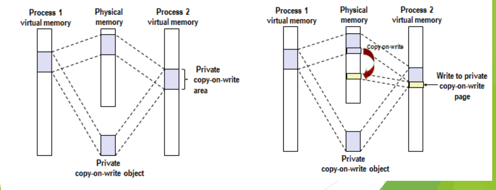

图：左侧两个进程把同一个私有写时复制对象映射进各自的虚拟地址空间，共享同一份物理页；右侧进程 2 写该页时触发写时复制，内核复制出一个新的物理页供进程 2 私有，进程 1 仍映射原页。

上图左半部分是映射完成后的状态：两个进程虚拟空间中的私有 COW 区域都映射到同一个物理副本（private copy-on-write object）。右半部分是进程 2 写其中一页之后的状态。写入的过程如下：[^l05-section-3-s4b3]

1. 进程 2 写私有 COW 区域中的某一页。内存按页管理，所以一次写涉及的是一整页。
2. 这一页在页表中是只读的，写只读页引发**保护异常**（fault）。这是一种异常（异常的分类见 L03「01 中断异常事件分类」），CPU 由此陷入内核。
3. 内核检查发现，出错地址所在区域是私有 COW 区域，说明这不是非法写，而是“要写请先复制”。
4. 内核分配一个新的物理页，把原页内容拷贝过去，并重建映射：修改进程 2 的页表，使该虚拟页指向新物理页，且可写。
5. 从异常返回，重新执行写指令，这次写到进程 2 的私有副本上。

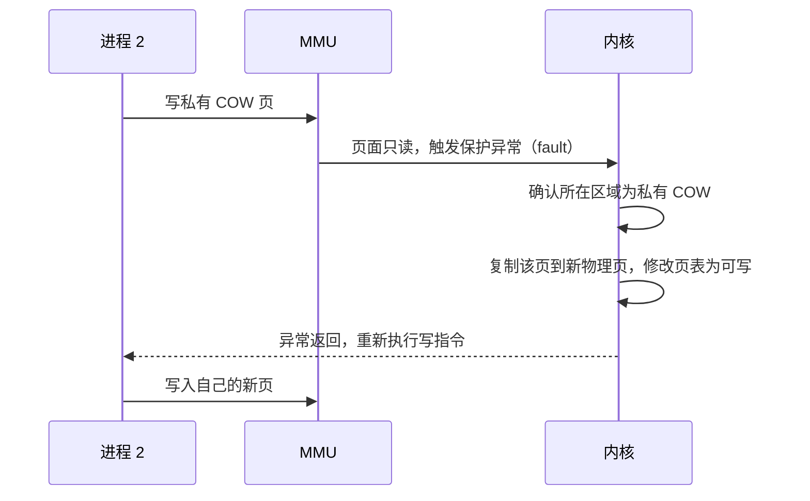

对进程 2 而言，它看到的地址空间依然完整：一部分页是共享的原始内容，一部分是自己写过的私有副本。只有真正被写的页才会被复制，没写的页始终共享。

> [!warning] 易错点
> COW 复制的单位是**页**，不是整个区域，更不是整个地址空间。进程只写了一个字节，内核也只复制这一个页。

### 用 COW 重新审视 fork

虚存和内存映射解释了 `fork` 怎样为每个进程提供私有地址空间，而且是 `fork()` 后跟 `exec()` 这一常见情况的完美方法。[^l05-section-3-s2p47]

Linux 为新进程创建虚拟地址空间的步骤如下：[^l05-section-3-s2p47]

1. **建立子进程自己的数据结构**：为子进程创建自己的 `task_struct`，其中 `mm` 指向子进程自己的 `mm_struct`，`mm_struct` 的 `mmap` 再指向 `vm_area_struct` 链表；同时复制页表。这些结构的内容可以从父进程复制，但是挂在子进程的 `task_struct` 上，不和父进程共用，它们是父进程这些结构的**精确副本**。[^l05-section-3-s4b4]
2. **把两个进程中的每个页面都标记为只读**。
3. **把两个进程中的每个 `vm_area_struct` 都标记为私有 COW**。
4. **返回**：此时每个进程都有一份虚拟内存的精确副本，但数据结构是两套、指向的却是同一批物理页，没有复制任何数据页。
5. **后续写入**：父子任何一方写某页，都按上一小节的 COW 机制为自己创建新页。

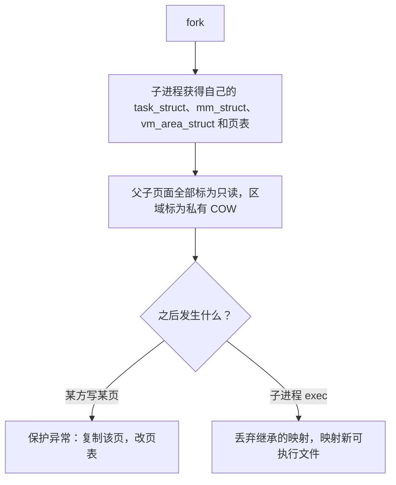

#### exec 让复制无从发生

`fork` 之后子进程马上 `exec`：子进程要执行另一个程序的代码，而这些代码在给定的可执行文件里。于是内核把子进程从父进程继承来的映射全部扔掉，把子进程的地址空间重新映射到这个可执行文件。[^l05-section-3-s4b4] 这样一来，`fork` 时没有复制页面，`exec` 时也不需要复制，原来那 100 页的逐页拷贝被完全省掉，只复制了几张描述地址空间的表。这就是 Linux `fork` 与传统 UNIX `fork` 的重大不同。

> [!note] 补充解释
> 把 `exec` 理解为“碰到只读页、进内核发现是私有 COW，再给子进程单独分配空间”并不准确。更准确的说法是：`exec` 并不去写父进程的那些页，而是直接拆除子进程原有的全部映射（只是让这些共享物理页的引用计数减一），再按新程序建立全新的映射，新程序的页在被访问时才按需调入。因此 `exec` 不会触发对旧页的 COW 复制；真正触发 COW 的是 `exec` 之前（或不调用 `exec` 时）父子进程对共享页的写操作，例如 `fork` 返回后写栈上的变量。

#### 把知识串起来

这一节把三块知识连在了一起：ICS 中的虚存与 `mmap`（私有映射、`flags` 参数）、中断与异常（写只读页引发的保护异常）、以及本课的进程创建（`fork`/`exec`）。COW 不是孤立的知识点，它是存储管理模块的已有机制，被进程管理模块借来解决 `fork` 的性能问题。[^l05-section-3-s4b3]

> [!question]- 自测：父进程有 100 页地址空间，在 Linux 上 fork 后，子进程只修改了一个全局变量（位于 data 段的某一页）就调用了 exec。不计栈等其他写入，整个过程中一共复制了多少个数据页？
> 1 页。`fork` 只复制 `task_struct`、`mm_struct`、`vm_area_struct` 和页表，不复制数据页；子进程写全局变量触发一次保护异常，内核复制那一页；`exec` 直接丢弃全部旧映射，不再复制。传统 UNIX `fork` 则要复制全部 100 页。

> [!question]- 自测：同学甲说“Linux 发明了写时复制，用来加速 fork”。这句话错在哪里，应如何改？
> 错在“发明”。COW 是存储管理模块原本就有的技术（例如私有 `mmap` 映射就用它），Linux 只是利用它优化了 `fork`。应说“Linux 利用存储管理模块中已有的写时复制技术优化了 fork”。

> [!question]- 自测：fork 之后，父子进程同一个虚拟地址上的变量值相同。若父进程随后把它改成 5，子进程读到的是多少？为什么父进程写的时候也会触发异常？
> 子进程读到的仍是原值。`fork` 把**两个**进程的页面都标成只读，所以父进程写该页同样触发保护异常，内核为父进程复制出新页再写，子进程仍映射原来的物理页，双方修改互不可见。

> [!info]- 来源
> - slides03.pdf：PDF p.44–47, 73
> - L05.docx：DOCX body 40–116

[^l05-section-3-s2p44]: slides03.pdf-PDF p.44
[^l05-section-3-s4b2]: L05.docx-DOCX body 40-67
[^l05-section-3-s4b3]: L05.docx-DOCX body 68-89
[^l05-section-3-s2p73]: slides03.pdf-PDF p.73
[^l05-section-3-s2p45]: slides03.pdf-PDF p.45
[^l05-section-3-s2p46]: slides03.pdf-PDF p.46
[^l05-section-3-s2p47]: slides03.pdf-PDF p.47
[^l05-section-3-s4b4]: L05.docx-DOCX body 90-116

---

## 为什么引入线程

> [!abstract] 本节要点
> - 引入一种新机制前先问三件事：有没有**应用需要**、**开销**值不值、能否提高**性能**（多核、多处理器）；线程的引入正是这三点的答案。
> - 多线程字处理软件把“接收键盘输入”“即时排版”“定时存盘”分给三个线程，任何一个在等待时其他两个照常工作，保证响应速度。
> - 单进程 Web 服务器的瓶颈是**阻塞的系统调用**：一次 `read` 磁盘把整个进程挂起，既不能接新请求，也不能做别的事。
> - 多线程 Web 服务器：分派线程只接请求、派活；工作线程先查网页缓存，未命中才 `read` 磁盘，只阻塞自己；工作线程取自预先建好、数量有上限的线程池。
> - 构造服务器的三种方法：多线程（并行、阻塞调用）、单线程进程（无并行、阻塞调用）、有限状态机（并行、非阻塞调用、中断）；线程的创建、撤销、切换、通信开销都远小于进程。

### 线程的由来与三个理由

进程概念出现之后运行了很长时间都没有问题，大约二十多年后，人们才提出：进程“体量”较大，可以在一个进程里再分出若干个**运行实体**，这就是线程。[^l05-section-4-s4b4] 引入线程后，“谁上 CPU”这个问题的答案就变了：在 Windows 这类系统中，被调度上 CPU 的不再是进程，而是进程中的某个线程；一个进程的多个线程还可以同时在多个核上运行。于是形成了这样的分工，即**进程是资源分配单位，线程是调度单位**（详细定义见 [线程的基本概念与属性](#线程的基本概念与属性)）。

为什么有了进程还要在进程中再派生线程？引入任何一项新技术都绕不开三个问题，它们也是计算机设计中反复出现的问题（再加上安全）：[^l05-section-4-s2p49]

1. **应用的需要**：有没有真实的应用场景需要它。
2. **开销的考虑**：时间、空间（乃至金钱）上的成本是否值得。
3. **性能的考虑**：能否借助多核、多处理器提高性能。

各操作系统之所以出现多种线程实现方式（见 [线程的实现模型](#线程的实现模型)），是历史遗留的结果：面对线程这项新技术，有的厂商积极拥抱，有的为了省事尽量少改内核，观点并不相同。[^l05-section-4-s4b4]

### 应用需要之一：多线程字处理软件

字处理软件（如 Word、WPS）本身是一个进程，但其内部有许多线程。Tanenbaum《现代操作系统》用三个线程说明其分工：[^l05-section-4-s2p50]

1. **交互线程**：接收键盘输入，用户敲的字马上被接收。
2. **排版线程**：对文档即时重新排版，实现“所见即所得”，敲下的内容立刻按排版结果显示。
3. **后台存盘线程**：定时（例如每小时）把文档保存到磁盘，防止意外丢失。

三个线程各干各的：存盘线程在等磁盘时，交互线程照样接收输入，排版线程照样刷新屏幕，所以整个软件的**响应速度**好、用起来顺畅。真实的软件分为很多层，每层都有许多线程，三个只是示意。[^l05-section-4-s4b4]

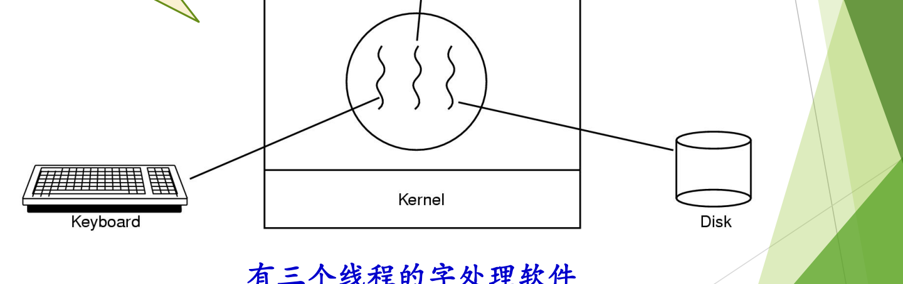

图：一个字处理进程内有三个线程，分别负责与键盘交互、在后台重排文档格式、定期把文档写回磁盘，它们共享同一份文档数据。

图中进程（圆圈）内有三条波浪线代表三个线程，左边连键盘、右边连磁盘、上边连正在排版的文档页面。

如果没有线程，这三件事只能在一个执行流里轮流做：存盘时一旦等磁盘，键盘输入和排版就全部停顿；要想避免停顿，就得像下文的“有限状态机”那样自己用非阻塞 I/O 把三件事交错安排，编程复杂得多。

### 应用需要之二：Web 服务器

#### 工作原理与提速手段

Web 服务器的工作过程分三步：[^l05-section-4-s2p51]

1. 从客户端接收网页请求（通过 HTTP 协议，请求里带有网页的 URL）；
2. 根据请求从磁盘上检索相关网页，读入内存；
3. 把网页返回给对应的客户端。

提高服务器效率有两个手段：**网页缓存**（Web page cache）和**多线程**。网页缓存把当天查询最多的热点网页留在内存里，查热点网页立刻返回，查多年前的旧网页就慢一些。它和 cache、TLB、文件系统缓存是同一种“快慢搭配”的思路：用一小块快速存储存放最常用的数据。[^l05-section-4-s4b5]

#### 阻塞系统调用是关键

`read`、`write` 这类系统调用是**慢速的、会阻塞的**。如果整个服务器只有一个进程：它接收请求后去磁盘检索网页，`read` 一发出，进程就被阻塞；在网页读回之前，它既不能接收新的请求，也做不了别的事。结果是同一时刻只能服务一个客户端，其他客户端只能排队等待。[^l05-section-4-s4b5]

> [!tip] 课堂强调
> `read`/`write` 等系统调用是慢速、会阻塞的，这一点上节课特意强调过，必须记住；后面理解线程、理解服务器的各种构造方法，关键都在“系统调用是否阻塞”。[^l05-section-4-s4b5]

#### 多线程 Web 服务器

既然一个执行流会被卡住，就让多个执行流一起干活。多线程 Web 服务器在一个进程里设两类线程：[^l05-section-4-s2p53]

- **分派线程**（dispatcher thread）：只负责从网络接收请求，接到后把工作交给一个工作线程，然后立刻回去接下一个请求，客户端不会被挡在门外。
- **工作线程**（worker thread）：没活时睡眠；被唤醒后先查网页缓存，命中就立即返回；未命中才从磁盘 `read` 网页。此时被阻塞的只是这一个工作线程，其他线程仍然活跃。

```c
/* (a) 分派线程 */
while (TRUE) {
    get_next_request(&buf);        /* 从网络接收下一个请求 */
    handoff_work(&buf);            /* 交给一个空闲的工作线程 */
}

/* (b) 工作线程 */
while (TRUE) {
    wait_for_work(&buf);                     /* 没活就睡眠 */
    look_for_page_in_cache(&buf, &page);     /* 先查网页缓存 */
    if (page_not_in_cache(&page))
        read_page_from_disk(&buf, &page);    /* 未命中：读磁盘，只阻塞本线程 */
    return_page(&page);                      /* 把网页返回客户端 */
}
```

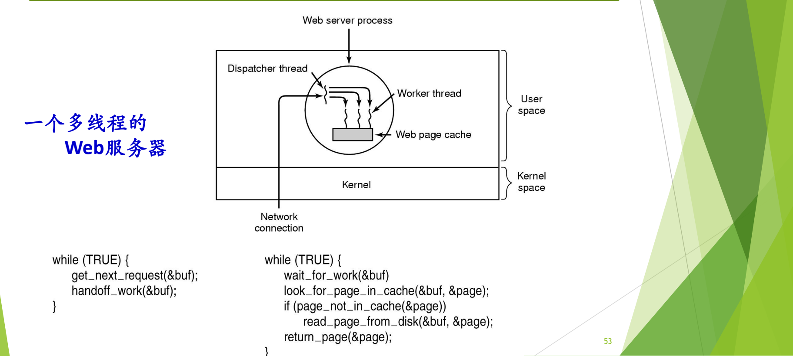

图：分派线程（dispatcher）循环接收网络请求并交给工作线程；工作线程先查网页缓存，不命中才从磁盘读取，读盘阻塞的只是这个工作线程。

图中 Web 服务器进程位于用户空间，网络连接经内核进入分派线程，分派线程把请求交给多个工作线程，工作线程共享同一块网页缓存。

工作线程通常来自**线程池**（thread pool）：事先建好一批线程，数量有上限，不会无限创建，也不在每个请求到来时临时新建，用时从池中取出，用完放回。这是**资源池**的思想。[^l05-section-4-s4b5]

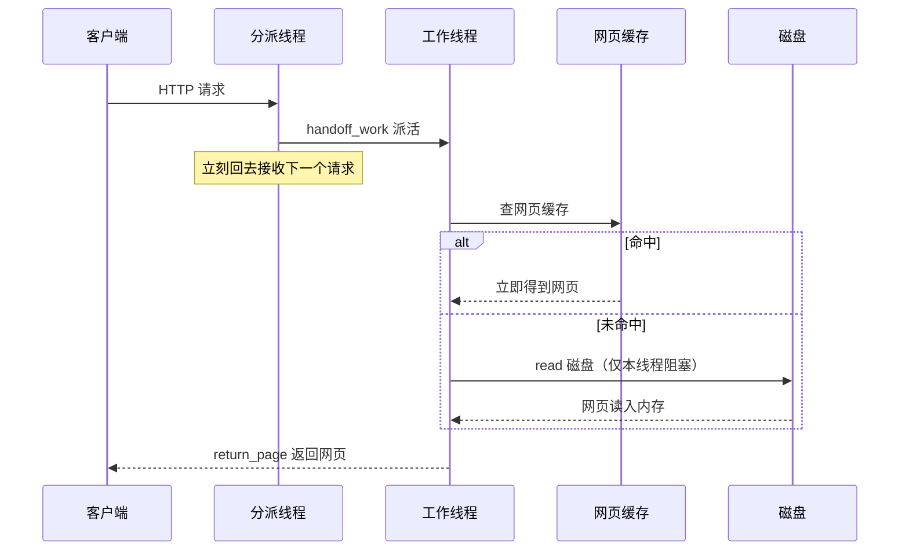

多线程方案的最大好处是**编程模型简单**：每个工作线程按顺序写“查缓存 → 读磁盘 → 返回”，阻塞就让它阻塞，并发由多个线程自然提供。

### 没有线程时的方案与三种构造方法

没有线程，Web 服务器也能做，只是要么慢，要么难写。两种方案：[^l05-section-4-s2p52]

1. **一个服务进程**：顺序编程，先完整服务一个客户端（直到连接关闭），再接受下一个客户端的请求。写起来简单，但性能下降。
2. **有限状态机**（finite-state machine）：在 ICS 中称为 **I/O 多路复用**（I/O multiplexing），即事件驱动方式。进程使用一套编程模型，把原本会阻塞的 `read` 换成**非阻塞 I/O**：请求发出后不等待，先去处理别的请求，之后再回来检查数据是否已到。为此进程内部要为每个请求记录它“进行到哪一步”，即若干个状态。这样 CPU 的控制权始终留在进程自己手里；一旦真的阻塞，进程就会被调度下 CPU。UNIX 的 `select` 就是这类接口，Windows 也有类似接口。缺点是**编程模型复杂**，对程序员要求高。[^l05-section-4-s4b5]

有限状态机可以类比一位店员：顾客要看某件商品，店员去取时不在原地干等，而是先接待其他顾客；但他必须记住每位顾客进行到哪一步，记得把东西取回来，也别让贵重珠宝被人顺手拿走。[^l05-section-4-s4b5]

三种方法比较如下（Tanenbaum）：[^l05-section-4-s2p54]

| 模型 | 并行性 | 系统调用 | 编程难度 |
| --- | --- | --- | --- |
| 多线程 | 有 | 阻塞 | 简单（每个线程顺序编写） |
| 单线程进程 | 无 | 阻塞 | 简单，但性能差 |
| 有限状态机 | 有 | 非阻塞，并借助中断（事件通知） | 复杂（自己维护状态） |

表中的“并行性”指多个请求的处理在时间上重叠（并发），不一定要求多个 CPU。三种方法的分界正是“系统调用是否阻塞”：想在等待时继续做事，要么让别的线程去等（多线程），要么把调用改成非阻塞的（有限状态机）。[^l05-section-4-s4b5]

> [!tip] 课堂强调
> 构造一个 Web 服务器的三种办法都应该知道，区别只在于针对什么问题选哪一种。[^l05-section-4-s4b5]

> [!note] 补充解释
> 这三种方法常与 ICS（CS:APP 第 12 章）的 process-based、event-based、thread-based 三种并发服务器对应。后两者确实分别对应有限状态机（I/O 多路复用）和多线程；但 ICS 的 process-based 服务器为每个连接 `fork` 一个子进程，多个子进程本身是并发的，并不等于表中“无并行性”的单线程顺序服务进程。它的问题在于进程开销大、进程间共享信息困难，这正是下文“开销”要讨论的内容。

### 开销的考虑

与进程相关的操作有创建进程、撤销进程、进程通信、进程切换。它们的时间和空间开销都大，限制了并发度的提高。线程则开销小：[^l05-section-4-s2p56]

- 创建一个新线程花费的时间少，撤销也一样；
- 两个线程之间切换花费的时间少；
- 线程之间相互通信**无须调用内核**，因为同一进程内的线程共享内存和文件。

可以用宿舍来理解：一个宿舍四位同学相当于一个进程里的四个线程。上下铺两人换个床位，很快就完成了（线程切换）；换宿舍则要搬动全部家当，麻烦得多（进程切换）。同宿舍的人商量明天去哪儿，喊一嗓子就行（线程通信不经内核）；要通知别的宿舍，就得打电话或发微信（进程通信要借助内核提供的机制）。[^l05-section-4-s4b6]

> [!warning] 易错点
> “线程开销小”比的是**同一进程内**的线程与进程。原因在于线程不独立拥有地址空间等资源：创建时不必分配一套新的地址空间，同进程线程切换时不必更换地址空间，通信可以直接读写共享内存。

> [!question]- 自测：一个单进程 Web 服务器每个请求要 `read` 磁盘 10 ms，CPU 处理只要 1 ms。改为“分派线程 + 4 个工作线程”后，为什么吞吐量能明显提高？如果所有请求都命中网页缓存，提升还大吗？
> 原来每个请求有 10 ms 进程整体被阻塞，CPU 在这段时间闲着；多线程后，一个工作线程阻塞在 `read` 上时，分派线程和其他工作线程仍可接收请求、处理请求，多次磁盘等待在时间上重叠，吞吐量随之提高。若全部命中缓存，就没有阻塞等待可供重叠，在单 CPU 上提升很小，多线程的价值主要体现在“有阻塞调用时”。

> [!question]- 自测：某服务器用 `select` 监视所有连接，任何时刻只有一个执行流。它属于三种构造方法中的哪一种？与多线程相比代价在哪里？
> 属于有限状态机（I/O 多路复用、事件驱动）：用非阻塞 I/O 加事件通知，在一个执行流里交错处理多个请求，因此具有并行性（并发）。代价是程序员必须自己为每个请求保存“进行到哪一步”的状态并手工切换，编程模型复杂；多线程则由各线程的栈和上下文自动保存这些状态。

> [!question]- 自测：为什么同一进程的两个线程交换数据不需要系统调用，而两个进程交换数据通常需要？
> 同一进程的线程共享地址空间和打开的文件，一个线程写入全局变量或堆中的数据，另一个线程直接就能读到；两个进程的地址空间相互独立、受保护，必须通过内核提供的通信机制（管道、共享内存映射等）才能交换数据。

> [!info]- 来源
> - slides03.pdf：PDF p.49–54, 56
> - L05.docx：DOCX body 90–167

[^l05-section-4-s4b4]: L05.docx-DOCX body 90-116
[^l05-section-4-s2p49]: slides03.pdf-PDF p.49
[^l05-section-4-s2p50]: slides03.pdf-PDF p.50
[^l05-section-4-s2p51]: slides03.pdf-PDF p.51
[^l05-section-4-s4b5]: L05.docx-DOCX body 117-144
[^l05-section-4-s2p53]: slides03.pdf-PDF p.53
[^l05-section-4-s2p52]: slides03.pdf-PDF p.52
[^l05-section-4-s2p54]: slides03.pdf-PDF p.54
[^l05-section-4-s2p56]: slides03.pdf-PDF p.56
[^l05-section-4-s4b6]: L05.docx-DOCX body 145-167

---

## 线程的基本概念与属性

> [!abstract] 本节要点
> - 进程有两个基本属性：**资源的拥有者**（虚拟地址空间、文件、I/O 设备、保护）和**调度单位**（执行轨迹、状态、优先级）。
> - 线程把“调度单位”这一属性从进程中分离出来：线程是进程中的运行实体、CPU 的调度单位，有时称轻量级进程；进程只是资源的拥有者，资源由其中的多个线程共享。
> - 线程私有的是状态、不运行时保存的上下文（PC 等寄存器）、自己的栈和栈指针；共享的是所在进程的地址空间和其他资源。
> - 多线程进程中，每个线程有自己的线程控制块、用户栈和内核栈，共享进程控制块和用户地址空间。
> - 各线程的栈只是同一地址空间中划分出来的区域，并不设防：线程 1 拿到指针就能访问线程 2 的栈。这不算错，但有安全隐患。

### 进程的两个基本属性

讲进程概念时，进程同时承担着两种角色：[^l05-section-5-s2p57]

1. **资源的拥有者**：拥有一个虚拟地址空间和一些占有的资源（文件、I/O 设备等），并受到保护。
2. **调度单位**：有一条执行（路径）轨迹，有状态和优先级，是被调度上 CPU 的对象。

这两个属性原本绑在一起，所以创建、切换进程时两方面的工作都要做，开销很大（见 [为什么引入线程](#为什么引入线程)）。线程的思路就是**把这两个属性分开处理**。

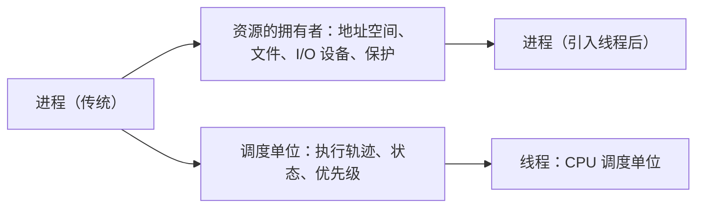

### 线程（Thread）的定义

**线程**（thread）是进程中的一个运行实体，是 CPU 的调度单位；有时也把线程称为**轻量级进程**。[^l05-section-5-s2p57] 引入线程后，线程把进程的“调度单位”属性拿走了：上 CPU 执行的是线程，而进程只负责拥有资源。虚拟地址空间、各种设备等资源都以进程为单位分配，由进程内的多个线程共享使用。[^l05-section-5-s4b6]

> [!tip] 课堂强调
> “进程是资源的拥有者、线程是 CPU 调度单位”这一区分在 ICS 中学过，本课特别强调一遍。[^l05-section-5-s4b6]

这一区分有个前提：系统里**既有进程又有线程**，即在进程里再派生线程。如果某个系统只有线程的概念而没有进程的概念，那么这种线程就等价于原来的进程，二者没有区别。本课讨论的都是前一种情形。[^l05-section-5-s4b6]

### 线程的属性

线程有以下属性：[^l05-section-5-s2p58]

1. **有状态及状态转换**：线程要上 CPU，所以和进程一样有运行、就绪、等待等状态，以及状态之间的转换，因此系统需要提供相应的操作。
2. **不运行时需要保存上下文**：包括程序计数器（PC）等寄存器，以便恢复执行。
3. **有自己的栈和栈指针**。
4. **共享所在进程的地址空间和其他资源**。
5. **可以创建、撤销另一个线程**：程序开始时以一个单线程进程的方式运行，之后由这个线程创建其他线程。

宿舍类比：整个宿舍空间、洗手间、电视等是大家共享的，对应进程的地址空间和资源；每位同学自己的床、书柜、书桌只属于他本人，对应线程私有的栈和上下文。[^l05-section-5-s4b6]

| 归属 | 内容 |
| --- | --- |
| 线程私有 | 线程状态、寄存器上下文（PC、栈指针等）、自己的栈 |
| 进程内各线程共享 | 地址空间（代码、全局数据、堆）、打开的文件、I/O 设备等资源 |

### 单线程与多线程进程模型

> [!info] 可视化资源
> - [OSTEP 第 26 章 Concurrency: An Introduction（PDF）](https://pages.cs.wisc.edu/~remzi/OSTEP/threads-intro.pdf)：Figure 26.1 对比单线程与多线程进程的地址空间：多个线程共享代码和堆，各有独立的栈。

在**单线程进程模型**中，进程由进程控制块、用户地址空间、一个用户栈和一个内核栈组成。在**多线程进程模型**中，进程控制块和用户地址空间仍只有一份，由所有线程共享；每个线程另有自己的**线程控制块**（保存寄存器上下文、状态等）、**用户栈**和**内核栈**。[^l05-section-5-s2p59]

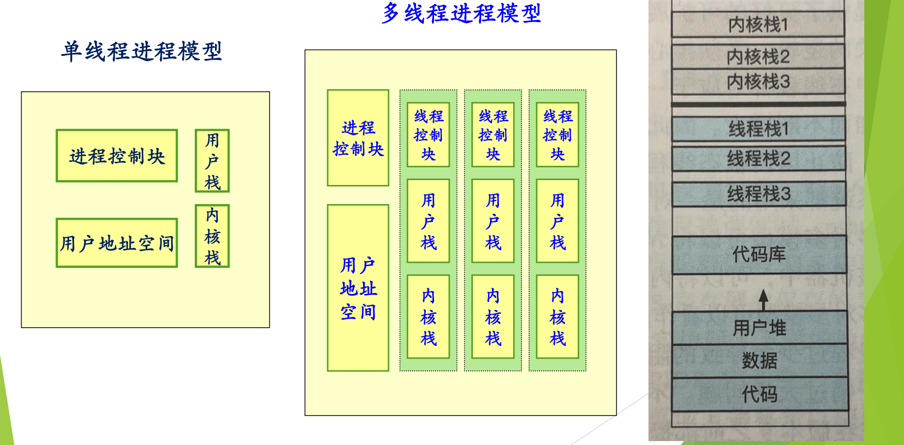

图：单线程进程只有一个进程控制块、用户地址空间和一对用户栈/内核栈；多线程进程共享进程控制块和用户地址空间，每个线程另有自己的线程控制块、用户栈和内核栈。

左图是单线程进程模型，中图是有三个线程的多线程进程模型。右图是这种进程的地址空间布局：从低地址到高地址依次是代码、数据、用户堆、代码库（共享库），之上是线程栈 1、2、3；最上面是内核部分的内核栈 1、2、3 以及内核代码和数据。三个线程栈都位于同一个用户地址空间中。

> [!note] 补充解释
> 每个线程各有一个内核栈，前提是内核知道这些线程的存在（线程进入内核执行系统调用时使用自己的内核栈）。如果线程完全在用户态实现，内核就只看到进程，情况见 [线程的实现模型](#线程的实现模型)。

### 线程栈并不设防

“每个线程有自己的栈”是**容易出错的地方**。[^l05-section-5-s4b6] 所谓“线程 1 的栈”“线程 2 的栈”，只是在同一个进程地址空间里划出的不同区域，硬件和操作系统并没有在它们之间设置保护。因此回答“线程 1 是否可以访问线程栈 2”这个问题，答案是**可以**：只要线程 1 拿到一个指向线程 2 栈中数据的地址（例如线程 2 把局部变量的地址存进了全局变量），就能直接读写。[^l05-section-5-s2p59]

> [!example] 例：通过全局指针访问另一个线程的栈
> 下面的程序中，数组 `msgs` 是主线程的局部变量，位于主线程的栈上；主线程把它的地址赋给全局变量 `ptr`，对等线程通过 `ptr` 读取它。
>
> ```c
> #include <pthread.h>
> #include <stdio.h>
>
> char **ptr;                 /* 全局变量：所有线程可见 */
>
> void *peer(void *arg) {
>     long id = (long)arg;
>     printf("[%ld] %s\n", id, ptr[id]);   /* 读的是主线程栈上的数据 */
>     return NULL;
> }
>
> int main(void) {
>     pthread_t tid[2];
>     char *msgs[2] = {"Hello from foo", "Hello from bar"};  /* 在主线程栈上 */
>     ptr = msgs;
>     for (long i = 0; i < 2; i++)
>         pthread_create(&tid[i], NULL, peer, (void *)i);
>     for (int i = 0; i < 2; i++)
>         pthread_join(tid[i], NULL);
>     return 0;
> }
> ```
>
> 1. `msgs` 分配在主线程的栈帧中；
> 2. 两个对等线程运行在同一地址空间，`ptr` 指向的地址对它们同样有效；
> 3. 因此对等线程可以读取主线程栈上的 `msgs`，程序能正确打印两行消息。

这种访问在语法和机制上都不算错，但它带来安全隐患：一个线程的错误写操作可能破坏另一个线程的栈。如果被访问的栈帧已经返回，指针还会变成悬空指针。用宿舍类比，朋友来串门坐在别人的床上是可以的，主人不在也没人拦着，只是要大家自觉。[^l05-section-5-s4b6]

> [!warning] 易错点
> “线程有自己的栈”说的是每个线程**使用**一块独立的栈区域、拥有自己的栈指针，并不等于这块栈**受保护**。线程之间唯一的隔离是约定，地址空间是共享的；真正受硬件保护的隔离只存在于进程之间。

> [!question]- 自测：线程 A 修改了全局变量 `x`，并在自己的函数里把局部变量 `y` 加 1。线程 B（同一进程）随后读 `x` 和用同名函数读自己的 `y`，各看到什么？
> B 看到 A 修改后的 `x`，因为全局变量在共享的数据段中；B 的 `y` 不受影响，因为每次函数调用的局部变量位于调用线程自己的栈帧上，A 和 B 各有一份。除非 A 把 `&y` 交给 B，否则 B 不会访问到 A 的 `y`。

> [!question]- 自测：一个程序启动后调用 `pthread_create` 创建了 3 个线程。此时进程里共有几个线程？共有几个线程控制块、几个进程控制块？
> 共 4 个线程：程序开始时以单线程进程方式运行，原来的主线程加上新建的 3 个。按多线程进程模型，有 4 个线程控制块（每线程一个，各带用户栈和内核栈），进程控制块只有 1 个，由所有线程共享。

> [!question]- 自测：某系统只有“线程”而没有“进程”概念，每个线程独立拥有地址空间。这种线程和本节的线程有何不同？
> 它同时承担资源拥有者和调度单位两个属性，实际上就等价于传统的进程。本节的线程以“既有进程又有线程”为前提：资源归进程，线程只是共享这些资源的调度实体。

> [!info]- 来源
> - slides03.pdf：PDF p.57–59
> - L05.docx：DOCX body 145–167

[^l05-section-5-s2p57]: slides03.pdf-PDF p.57
[^l05-section-5-s4b6]: L05.docx-DOCX body 145-167
[^l05-section-5-s2p58]: slides03.pdf-PDF p.58
[^l05-section-5-s2p59]: slides03.pdf-PDF p.59

---

## 线程的实现模型

> [!abstract] 本节要点
> - 线程有三种实现方式：**用户级线程**（在用户空间实现，内核不知道线程存在）、**核心级线程**（内核实现并管理线程）、**混合模型**（内核支持线程，同时支持用户线程）。三者反映了操作系统面对新概念时的不同态度和折中。
> - 用户级线程由线程库提供函数、由运行时系统维护线程表并切换线程，切换不需内核特权，因而快；但任一线程执行阻塞系统调用，内核会把整个进程阻塞，同一进程的线程也不能同时跑在多个处理器上。
> - 用户级线程下，线程状态和进程状态处在不同层面：进程 B 被阻塞时，线程 2 的状态可能仍是 running，但它并没有真正在运行。
> - 阻塞系统调用的两种对策：用 jacketing/wrapper 把阻塞调用转化为非阻塞调用，或重新实现相应的 I/O 库函数。
> - 核心级线程以线程为基础调度，例子是 Windows；混合模型的例子是 Solaris，用户线程经轻量级进程（LWP）多路复用到内核线程上。

### 三种实现方式概览

线程概念出现时，操作系统早已有了进程。如何在原有系统中支持线程这个新概念，形成了三种方案：[^l05-section-6-s2p60]

1. **用户级线程**：在用户空间实现，内核不支持、也不知道线程。
2. **核心级线程**：在内核中实现，内核知道并管理线程。
3. **混合模型**：两者结合，在内核中实现线程，同时支持用户线程；用户级线程通过某种中介与内核级线程挂上钩。

这三种方法体现的是一种“态度”：嫌改内核麻烦，就把线程放到用户态实现；不嫌麻烦，就直接在内核里实现；混合模型则是折中权衡。把几种已有方案组合成新方案，也是计算机领域的典型做法。[^l05-section-6-s4b6]

> [!tip] 课堂强调
> 考试一般会考“线程怎么实现”，即这几种不同的实现手段。[^l05-section-6-s4b6]

### 用户级线程（User Level Thread）

**用户级线程**是在用户空间建立的线程，其组成和特点是：[^l05-section-6-s2p61]

- **线程库**：提供一组管理线程的函数（创建、退出、等待等）。
- **运行时系统**（run-time system）：完成线程的管理工作，包括各种线程操作和维护**线程表**。
- **内核管理的是进程，不知道线程的存在**。
- **线程切换不需要内核态特权**，由运行时系统在用户态完成。
- 例子：POSIX Pthreads。

运行时系统只能在**同一个进程**的线程之间切换，管不到别的进程的线程。[^l05-section-6-s4b6]

#### 阻塞系统调用会阻塞整个进程

用户级线程的关键问题在系统调用上。无论是哪个线程，执行系统调用都要进入内核；而内核只看得到进程。于是：[^l05-section-6-s4b6]

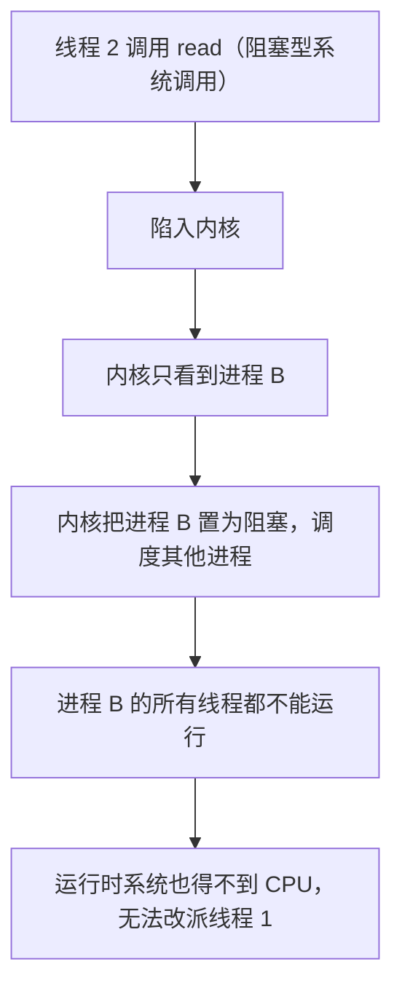

#### 进程状态与线程状态

Stallings 用一组典型场景说明用户级线程下两种状态的关系。初始状态 (a)：进程 B 正在运行，它有两个线程，线程 2 处于 Running，代表进程 B 执行，线程 1 处于 Ready。因为内核只调度进程，进程 B 内部一次只能有一个线程在执行，由运行时系统决定是哪一个。[^l05-section-6-s4b7] 从 (a) 出发有三种情况：[^l05-section-6-s2p62]

1. **case 1：线程 2 执行系统调用**（如阻塞的 `read`）。内核把进程 B 置为 Blocked；运行时系统并没有机会修改线程表，所以线程 2 的状态**仍是 Running**。见图 (b)。
2. **case 2：进程 B 被切换**（例如时间片到）。进程 B 回到 Ready，CPU 上运行的是另一个进程（图中未画出）；从线程库的角度看，两个线程的状态都没有变化，线程 2 仍为 Running。见图 (c)。
3. **case 3：线程 2 被阻塞、线程 1 执行**。线程 2 需要等待线程 1 完成某个动作，于是在用户态把自己置为 Blocked，运行时系统改派线程 1 运行；这一切发生在进程内部，内核不知道，进程 B 仍处于 Running。见图 (d)。

在 (b)、(c) 之后，当进程 B 再次被内核调度时，由于线程表中线程 2 仍记为 Running，进程 B 就从线程 2 停下的地方继续执行。

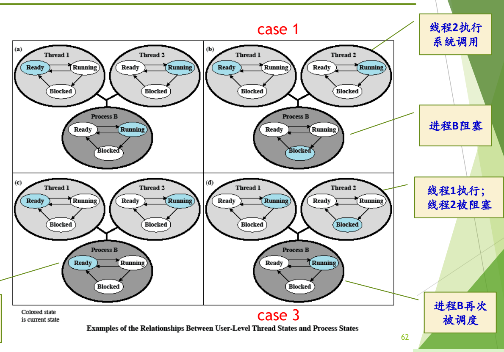

图：用户级线程的状态由线程库维护，与内核看到的进程状态可能不一致：线程 2 发起阻塞系统调用会让整个进程 B 阻塞，而线程库里线程 2 仍显示为运行；进程 B 时间片用完被切换时也一样。

图中四个面板分别为初始状态 (a) 和 case 1–3，彩色的椭圆表示当前状态；上方两个小圆是线程 1、线程 2 的状态机，下方深色大圆是进程 B 的状态机。

结论：**线程状态和进程状态处在不同层面**。线程状态由用户态的运行时系统记录，进程状态由内核记录；线程显示为 running，并不意味着它正在 CPU 上运行。[^l05-section-6-s4b7]

#### Pthreads 与 yield

**POSIX**（Portable Operating System Interface）1003.4a 定义了多线程编程接口，以线程库的方式提供给用户，这就是 **Pthreads**。[^l05-section-6-s2p63] 它是一个标准，各家按标准实现若干函数，主要有：[^l05-section-6-s4b7]

| 函数 | 作用 |
| --- | --- |
| `pthread_create` | 创建一个新线程 |
| `pthread_exit` | 结束调用线程 |
| `pthread_join` | 等待一个特定线程退出，作用类似进程的 `wait` |
| `pthread_yield` | 调用线程主动释放 CPU，让另一个线程运行 |
| `pthread_attr_init` | 创建并初始化线程的属性结构 |
| `pthread_attr_destroy` | 删除线程的属性结构 |

> [!note] 补充解释
> 1003.4a 是 Pthreads 标准制定期间的草案编号，正式发布时为 IEEE Std 1003.1c-1995，现已并入 POSIX.1。`pthread_yield` 并不在最终标准中（标准里对应的是 `sched_yield`），但许多实现提供了它。另外，Pthreads 只规定接口，并不规定实现方式：它可以用纯用户级线程库实现，也可以像今天的 Linux 那样用内核线程实现（见 [man7: pthreads(7)](https://man7.org/linux/man-pages/man7/pthreads.7.html)）。讲义把它当作用户级线程的例子，指的是“以线程库方式提供”这一形态。

在用户级线程库里，`yield` 尤其重要。为什么**线程要自愿让出 CPU**？[^l05-section-6-s2p63]

- 进程和进程之间会“打架”，即竞争资源；而同一进程的线程之间是**天然的合作关系**，派生多个线程是为了让这个进程执行得更快，不是为了彼此争抢。[^l05-section-6-s4b7]
- 内核不管线程，运行时系统也无法通过时钟中断强行剥夺一个线程的 CPU。因此一个线程做完手头工作后，应调用 `yield` 主动让运行时系统换上另一个线程，这样整个进程不会因为当前线程无事可做而空转。
- 自愿让出并不排除被动换下：进程时间片到了照样会被换下；线程执行阻塞调用时，整个进程照样被阻塞。

> [!tip] 课堂强调
> 进程之间是竞争关系、同一进程的线程之间是合作关系，这是二者非常重要的不同点，也是线程要自愿 `yield` 的原因。[^l05-section-6-s4b7]

### 用户级线程的优缺点与阻塞处理

#### 优点

1. **线程切换快**：切换由用户态的运行时系统完成，只需保存和恢复寄存器、换栈指针，不必陷入内核。[^l05-section-6-s2p64]
2. **调度算法是应用程序特定的**：线程之间如何轮换由应用（线程库）自己决定，内核不参与。
3. **可运行在任何操作系统上**：只需要实现一个线程库。这是最重要的一条：如果已经有了一个操作系统又不想改造它，线程库就是支持线程最快的办法。[^l05-section-6-s4b7]

> [!note] 补充解释
> 有一种说法是：Linux 当初为了不重新设计内核，采用了线程库的方式支持线程。这一说法需要修正。Linux 确实没有在内核中另设一种“线程”对象，进程和线程都用 `task_struct` 表示；但从 2.0 版前后（约 1996 年）起，主流线程库 LinuxThreads 就用 `clone()` 系统调用为每个线程创建一个与创建者共享地址空间、打开文件等资源的内核调度实体。这是**一对一的内核级线程**，不是纯用户级线程。2.6 内核起使用的 NPTL 仍然是一对一模型。所以 Linux 走的是“少改内核”的路线，但它的线程是由内核调度的。

#### 缺点

1. 大多数系统调用是阻塞的。内核阻塞进程时，进程中的所有线程都**不能运行**。[^l05-section-6-s2p64]
2. 内核只将处理器分配给进程，同一进程中的两个线程不能同时运行于两个处理器上，用户级线程无法利用多核提升单个进程的性能。[^l05-section-6-s4b7]

两条缺点都可以从“内核只看到进程”推出：阻塞的决定和分配 CPU 的决定都由内核以进程为单位做出，进程里让哪个线程上 CPU 不归内核管。[^l05-section-6-s4b7]

> [!warning] 易错点
> 讲义 p64 中“由于内核阻塞进程，故进程中所有线程也被阻塞”的措辞不准确（课末已作更正），应理解为进程中所有线程**都不能运行**。结合 case 1，被阻塞的是进程；线程表中线程 2 的状态可能仍是 running，状态记录本身没有错，但整个进程已被阻塞，CPU 已换给别的进程，线程实际上并没有在运行。[^l05-section-6-s4b8]

#### 阻塞系统调用的处理

针对“一个线程阻塞拖累整个进程”，有两种解决方案：[^l05-section-6-s2p65]

1. **把系统调用改为非阻塞的**：使用 **Jacketing/wrapper** 技术，把一个会产生阻塞的系统调用转化成一个非阻塞的系统调用。
2. **重新实现对应系统调用的 I/O 库函数**。

Jacketing 可以理解为给系统调用“加一件马甲”“包一层包袱皮”（wrapping，封装）。线程调用的不再是原来的阻塞调用，而是外面这层封装；封装发现需要等待时，就尽快 `yield`，让运行时系统换别的线程上，而不是把时间交给内核去决定。[^l05-section-6-s4b7]

> [!note] 补充解释
> 按 Stallings 的描述，jacket 例程的典型做法是：线程不直接调用系统 I/O 例程，而是调用一个应用层的 I/O jacket 例程。它先检查这次 I/O 是否会阻塞（例如设备是否忙、数据是否已到，可借助 `select` 之类的接口）。如果会阻塞，就把当前线程在线程表中置为 Blocked，经线程库切换到另一个线程，等以后条件满足时再真正发起调用。这样内核始终看不到进程阻塞。

### 核心级线程（Kernel Level Thread）

**核心级线程**由内核实现和管理，其特点是：[^l05-section-6-s2p66]

- 内核管理所有线程，并向应用程序提供 API 接口；
- 内核维护进程和线程的上下文；
- 线程的切换需要内核支持；
- 以线程为基础进行调度；
- 例子：Windows。

这是提出线程概念时的“完美模型”：进程是资源的拥有者，线程是上 CPU 的调度单位，内核既管进程又管线程，API 统一，所有线程都由内核维护。例如图中 932 号进程有三个线程、110 号进程有四个线程，内核对它们全都可见。[^l05-section-6-s4b7] 它恰好克服了用户级线程的两个缺点：一个线程阻塞时，内核可以调度同一进程的其他线程；同一进程的多个线程也能同时运行在多个处理器上。代价是线程的创建和切换都要进入内核，比用户态切换慢。

Windows 采用这一模型有其历史背景。Windows NT 于 1988 年开始开发，而线程概念大约在 1984 年前后提出，于是 NT 把当时的新概念全部采用：线程、面向对象、微内核等。当时外界普遍认为微软商业上成功、技术上不行，UNIX 家族则被看作技术上更完美。微软为此专门从 DEC（VAX/VMS 的开发者）挖来人才开发 NT，也是要在技术上证明自己。[^l05-section-6-s4b7]

> [!note] 补充解释
> 上面的历史只是概述，可以这样核实与补充：NT 项目的负责人 Dave Cutler 于 1988 年 10 月从 DEC 加入微软，他此前主持过 VMS 等操作系统；NT 第一版 Windows NT 3.1 于 1993 年发布。“约 1984 年提出线程概念”只是大致时间，类似思想出现得更早，1980 年代中期 Mach 等系统把“任务（资源）与线程（执行）分离”的设计推广开。NT 的设计受到微内核思想影响，但它把许多服务放在内核态运行，通常被归为混合内核，而不是纯微内核。

### 混合模型

**混合模型**的特点是：线程创建在用户空间完成，线程调度等在核心态完成；多个用户级线程**多路复用**到多个内核级线程上。例子：Solaris。[^l05-section-6-s2p67]

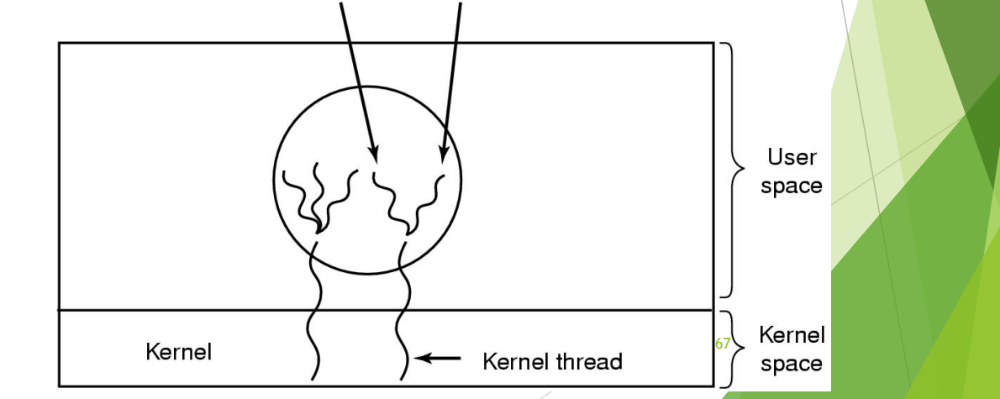

图：混合模型中，线程在用户空间创建，多个用户级线程多路复用到少量内核级线程上，由内核调度内核线程。

图中用户空间的一个进程内有多个用户线程，它们成组地落在少数几个内核线程上，即 “multiple user threads on a kernel thread”；内核按内核线程调度。

Solaris 的具体做法是：[^l05-section-6-s4b8]

1. 用户态有线程库，用户可以像在 UNIX/Linux 中那样创建线程；
2. 内核也有内核线程（kernel thread），内核按内核线程进行调度；
3. 用户线程和内核线程之间并不直接对应，而是通过一种专门的连接实体，即**轻量级进程**（LWP，Lightweight Process）连接起来；
4. 用户线程多、LWP 和内核线程少，所以二者**不是一对一的，而是多路复用的**：某个用户线程要运行，必须先“挂上”一个 LWP，由它代表该用户线程被内核调度。

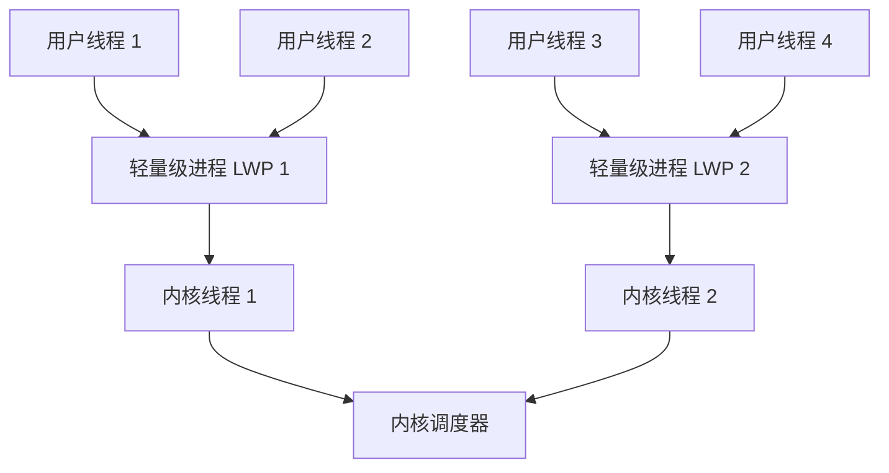

后来 Solaris 嫌多路复用太麻烦：用户线程必须先挂到 LWP 上才能运行，管理复杂，于是随着版本演化改成了用户线程与内核线程**一对一**，课程中给出的时间是大约 Solaris 8 之后（准确版本见下方补充解释）。Sun 公司后来被 Oracle 收购，Solaris 逐渐淡出，而它在操作系统层面的技术曾非常出色。[^l05-section-6-s4b8]

> [!note] 补充解释
> 按 Oracle/Sun 的文档：Solaris 2.x 到 Solaris 8 默认采用这种 M:N 的两级模型；Solaris 8 另外提供了一个可选的一对一线程库；Solaris 9（2002 年）起一对一成为默认且唯一的实现。Oracle 对 Sun 的收购于 2010 年 1 月完成。

> [!warning] 易错点
> 同一个词“轻量级进程”在本讲有两种用法。[线程的基本概念与属性](#线程的基本概念与属性) 中说“有时把线程称为轻量级进程”，是对线程的泛称；Solaris 的 LWP 则是混合模型里连接用户线程和内核线程的一个具体内核实体。二者不能混为一谈。

#### 三种实现方式对比

| 维度 | 用户级线程 | 核心级线程 | 混合模型 |
| --- | --- | --- | --- |
| 线程由谁管理 | 用户空间的线程库与运行时系统 | 内核 | 创建在用户空间，调度在核心态 |
| 内核是否知道线程 | 不知道，只知道进程 | 知道 | 知道内核线程（经 LWP 关联用户线程） |
| 线程切换 | 用户态完成，快 | 需内核支持，较慢 | 用户线程间可在用户态切换 |
| 一个线程执行阻塞调用 | 整个进程被阻塞，所有线程都不能运行 | 只阻塞该线程 | 只占住相应的 LWP/内核线程 |
| 同进程线程能否并行于多处理器 | 不能 | 能 | 能（内核线程有多少，最多就有多少并行） |
| 例子 | POSIX Pthreads 线程库 | Windows | Solaris |

> [!question]- 自测：用户级线程模型下，进程 P 有线程 T1、T2，T1 正在运行时调用了阻塞的 `read`。此刻线程表中 T1、T2 各是什么状态？内核眼中 P 是什么状态？T2 能运行吗？
> 内核把 P 置为阻塞；线程表没有被更新，T1 仍记为 running，T2 为 ready。但 T2 不能运行：P 得不到 CPU，运行时系统本身也无法执行，也就没法改派 T2。这正是课末勘误的意思：线程不是“被阻塞”状态，而是“不能运行”。

> [!question]- 自测：一台 4 核机器上，某计算密集型程序创建了 4 个线程。分别在用户级线程和核心级线程实现下运行，大约能用上几个核？
> 用户级线程：内核只把 CPU 分配给进程，4 个线程只能轮流在 1 个核上运行。核心级线程：内核以线程为调度单位，4 个线程可同时运行在 4 个核上。

> [!question]- 自测：用户级线程库中某线程循环等待一个共享标志由另一个线程置位，但从不调用 `yield`。会发生什么？
> 运行时系统无法通过时钟中断抢占用户级线程，置位标志的那个线程得不到运行机会，等待线程会一直空转到进程时间片用完。进程再次被调度时，线程表里仍是这个等待线程在运行，于是继续空转，程序无法前进。所以同一进程内合作的线程应在无事可做时主动 `yield`。

> [!info]- 来源
> - slides03.pdf：PDF p.60–67
> - L05.docx：DOCX body 145–208

[^l05-section-6-s2p60]: slides03.pdf-PDF p.60
[^l05-section-6-s4b6]: L05.docx-DOCX body 145-167
[^l05-section-6-s2p61]: slides03.pdf-PDF p.61
[^l05-section-6-s4b7]: L05.docx-DOCX body 168-186
[^l05-section-6-s2p62]: slides03.pdf-PDF p.62
[^l05-section-6-s2p63]: slides03.pdf-PDF p.63
[^l05-section-6-s2p64]: slides03.pdf-PDF p.64
[^l05-section-6-s4b8]: L05.docx-DOCX body 187-208
[^l05-section-6-s2p65]: slides03.pdf-PDF p.65
[^l05-section-6-s2p66]: slides03.pdf-PDF p.66
[^l05-section-6-s2p67]: slides03.pdf-PDF p.67

---

## 协程、纤程与可再入

> [!abstract] 本节要点
> - **协程**是特定编程语言或库支持的并发成分，与操作系统没有直接关系：它在一个线程中实现多个协作的执行流，常见于 Python asyncio、Rust async_std、C++20 coroutine、Go goroutine。
> - 协程与“在进程中派生线程”思路相同、层面不同，就像过程调用在语言层完成，而系统调用要进入内核。
> - **纤程**是 Windows 提供的机制，一个线程中可以有多个纤程；执行实体从进程到线程再到纤程/协程，一个比一个细。
> - C10K 问题（单机如何支撑上万个并发连接）是引出这些机制的出发点；线程并非越多越好，线程本身也有开销。
> - **可再入程序**可被多个进程同时调用：代码是纯代码，执行中自身不变，数据区由调用者提供（栈）；`rand` 因保留跨调用的内部状态而不可再入。

### 协程（Coroutine）

线程比进程轻，但每个线程仍要占用栈空间，创建、切换仍有开销。当一个程序要同时处理成千上万个异步任务、并发连接时，为每个任务开一个线程就太重了。**协程**就是在这种需求下出现的。[^l05-section-7-s2p69]

关于协程，可以从四个问题来把握：[^l05-section-7-s2p69]

1. **为什么引入协程**：改善并发编程的性能，用于处理异步任务和大量并发连接。
2. **协程是什么**：允许在一个线程/进程中实现多个执行流，并让它们之间相互协作。
3. **协程怎么用**：需要编程语言或库的支持。
4. **协程怎么实现**：更偏向语言机制的模拟和实现，即在一个用户线程上运行多个 Task。例如 Python `asyncio`、Rust `async_std`、C++20 coroutine、Go goroutine 等。

协程的名字和进程、线程、管程是同一系列，它也是一种运行实体。但它**与操作系统没有直接关系**，而是特定语言中支持的并发成分。几个协程协同完成一件事，所以叫“协”程。它的思路与“在进程中再派生线程”相同，即在一个线程中再派生出多个执行实体，但层次不同：如同 C 语言里写的过程调用在语言层面就完成了，而系统调用要进入内核。用协程必须有编程语言或库的支持。[^l05-section-7-s4b8]

> [!note] 补充解释
> 经典协程在固定位置（如 `await`、`yield`）主动交出控制权，由语言运行时在同一线程内切换，不需要陷入内核。Go 的 goroutine 稍有不同：Go 运行时把大量 goroutine 调度到多个操作系统线程上（M:N），而且自 Go 1.14 起可以被运行时抢占，因此它更像“由语言运行时管理的用户级线程”。讲义把它与协程并列，是取其“语言层面的轻量执行实体”这一共性。

### 纤程（Fiber）

> [!info] 拓展内容
> 纤程课上只提到名称，留作自学。以下内容依据讲义与微软官方文档整理。

**纤程**（fiber）是 Windows 提供的机制，一个线程中可以有多个纤程。[^l05-section-7-s2p70] 从进程到线程，再到线程里的纤程，执行实体一个比一个细：原来的进程比较庞大，线程瘦一些，纤程又更瘦一点。[^l05-section-7-s4b8]

纤程的工作方式如下（据 [Microsoft Learn: Fibers](https://learn.microsoft.com/en-us/windows/win32/procthread/fibers)）：

1. **转换**：线程先调用 `ConvertThreadToFiber`，把自己变成一个纤程，之后才能调度其他纤程。
2. **创建**：调用 `CreateFiber` 创建新纤程，为它指定栈大小和入口函数。每个纤程有自己的栈和一份寄存器上下文。
3. **切换**：调用 `SwitchToFiber` 切换到指定纤程。切换完全由应用程序决定，内核不感知，也不会抢占纤程；当前纤程不主动切换，其他纤程就得不到运行。
4. **删除**：调用 `DeleteFiber` 释放纤程。

由此可以看出，纤程本质上是由应用程序在一个内核线程内部手工调度的用户态执行实体，与 [线程的实现模型](#线程的实现模型) 中的用户级线程同理。它的调度是协作式的，切换开销小；但一个纤程执行阻塞调用时，它所在的整个线程都会被阻塞。

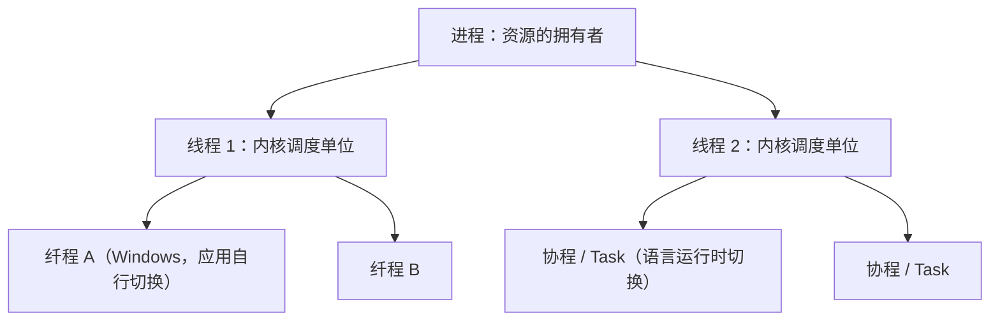

### C10K 与并发关键词

与这一部分相关的并发概念可以归纳为一组关键词：[^l05-section-7-s2p71]

- **内核态/用户态**：线程、协程等机制是在哪个态下支持的。用户级线程、纤程、协程都在用户态切换，核心级线程要内核支持。
- **阻塞/非阻塞**：非阻塞是这些机制的关键要素之一（见 [为什么引入线程](#为什么引入线程) 中的有限状态机）。
- **进程、线程、协程**：逐级变细的执行实体。
- **线程池**：预先创建、有上限的线程集合。
- **异步 I/O**、**I/O 密集型**、**I/O 多路复用**：协程主要针对的就是 I/O 密集型、大量等待 I/O 的任务。
- **切换开销**、**编程语言原生支持**（如 Golang、JavaScript）：编程语言要原生支持，才有协程。

这组关键词的出发点是 **C10K 问题**：一台服务器上，联网登录、并发连接最多能支持多少个，如何支撑上万（10K）个并发连接。[^l05-section-7-s4b8]

**线程是不是越多越好？**[^l05-section-7-s2p71] 不是。这和软件开发加人类似：一个人干不完，加到两三人、一个小组似乎会更快，但人多了就有沟通成本。线程也一样，每个线程有栈空间、创建和切换开销，线程之间还有同步和协调的成本。线程数量远超 CPU 核数且大多在等 I/O 时，这些开销会吞掉收益。这正是引出协程等更轻量机制的原因。[^l05-section-7-s4b8]

> [!note] 补充解释
> “C10K problem”一词由 Dan Kegel 在 1999 年前后的同名文章中提出，讨论单机同时处理一万个客户端连接所需的 I/O 模型，如非阻塞 I/O 加事件通知、每连接一线程等（见 [The C10K problem](http://www.kegel.com/c10k.html)）。

### 可再入程序（Reentrant Program）

多个进程（或线程）常常执行同一段代码，例如同一个编辑器被多个用户同时运行，或同一个库函数被多个线程同时调用。代码只在内存中保留一份，却要让各个调用互不干扰，这要求代码满足一定条件。

**可再入程序**（又称可重入程序）是可被多个进程同时调用的程序，具有下列性质：[^l05-section-7-s2p72]

1. 它是**纯代码**的，即在执行过程中自身不改变；
2. 调用它的进程应该**提供数据区**。

数据区通常就是调用者的栈。递归调用就是典型：每次调用都在栈上得到一个新的栈帧，存放这一次的参数和局部变量，执行期间这块空间只属于这次调用。多次递归就有多个栈帧，彼此不会互相破坏。[^l05-section-7-s4b8]

> [!tip] 课堂强调
> 可再入是一个很重要的前提，ICS 中已学过，需要复习。[^l05-section-7-s4b8]

> [!example] 反例：随机数发生器 `rand`
> C 标准库中的 `rand` 大致这样实现：
>
> ```c
> static unsigned int next = 1;        /* 跨调用保留的内部状态 */
>
> int rand(void) {
>     next = next * 1103515245 + 12345;
>     return (unsigned int)(next / 65536) % 32768;
> }
>
> void srand(unsigned int seed) { next = seed; }
> ```
>
> 1. 每次调用都会改写静态变量 `next`，下一次调用的结果依赖上一次留下的状态；
> 2. `next` 位于全局数据区，不由调用者提供，所有调用者共用一份；
> 3. 两个线程同时调用时，可能交错读写 `next`，各自得到的序列互相干扰。
>
> 因此 `rand` 不是可再入的。可再入的版本 `rand_r(unsigned int *seedp)` 把状态改由调用者传入，满足“数据区由调用者提供”。

> [!note] 补充解释
> 把 `rand` 不可再入解释为“代码本身每次都变了”并不准确：`rand` 的机器代码在执行中并不改变，改变的是它在静态数据区中保存的内部状态（上例中的 `next`）。不可再入的根源是函数依赖并修改了不由调用者提供的共享数据，这正违反了可再入的第二条性质。CS:APP 第 12 章把这类函数归为“保持跨越多个调用的状态”的线程不安全函数。

> [!warning] 易错点
> “纯代码”不只是“不修改指令”。函数中的 `static` 局部变量和被修改的全局变量都属于共享数据区，使用了它们的函数一般就不可再入。判断方法：函数使用的所有可写数据是否都来自参数或自己的栈帧。

### 进程特性与进程映像

> [!info] 依据讲义整理
> 本小节是讲义“重点小结”中除可再入以外的内容，课上未展开讲解。

进程有五个特性：[^l05-section-7-s2p72]

| 特性 | 含义 |
| --- | --- |
| 并发性 | 任何进程都可以同其他进程一起向前推进 |
| 动态性 | 进程是正在执行程序的实例；进程是动态产生、动态消亡的；在生命周期内在三种基本状态之间转换；具有动态的地址空间 |
| 独立性 | 进程是资源分配的一个独立单位，不同进程的工作不相互影响，例如各进程的地址空间相互独立 |
| 制约性 | 进程在执行过程中可能与其他进程产生直接或间接的关系，因访问共享数据/资源或进程间同步而产生制约 |
| 异步性 | 每个进程都以其相对独立的、不可预知的速度向前推进 |

**进程映像**（process image）由四部分组成：

$$
\text{进程映像} = \text{程序} + \text{数据} + \text{栈} + \text{PCB}
$$

其中程序（代码）可以是可再入的，被多个进程共享；数据和栈是每个进程私有的；PCB 是操作系统管理该进程的数据结构（组织方式见 [进程表与队列模型](#进程表与队列模型)）。线程部分的小结包括多线程应用场景、线程基本概念与属性、线程实现机制，分别对应 [为什么引入线程](#为什么引入线程)、[线程的基本概念与属性](#线程的基本概念与属性) 和 [线程的实现模型](#线程的实现模型)。

> [!question]- 自测：下面的函数是否可再入？`int counter(void) { static int n = 0; return ++n; }`
> 不可再入。代码本身不变，但它修改了位于静态数据区的 `n`，这个数据区不由调用者提供，所有调用者共享一份；多个线程同时调用时结果相互干扰。改为由调用者传入 `int *n` 即可再入。

> [!question]- 自测：一个 Python asyncio 程序在单线程里运行 1000 个协程。其中一个协程调用了阻塞的 `time.sleep(1)`（而不是 `await asyncio.sleep(1)`），会发生什么？
> `time.sleep` 是阻塞调用，会让整个线程被内核阻塞 1 秒，这 1 秒内其余 999 个协程都不能运行。这和用户级线程中“一个线程阻塞调用导致整个进程不能运行”是同一个道理；`await asyncio.sleep` 则把控制权交还事件循环，让其他协程继续执行。

> [!question]- 自测：纤程和 Windows 的线程都能在一个进程中并发执行。二者在“谁来调度”和“能否利用多核”上有何区别？
> Windows 线程是核心级线程，由内核调度，可抢占，同一进程的多个线程可同时运行在多个核上。纤程由应用程序调用 `SwitchToFiber` 自行切换，内核不知道它的存在；同一线程中的纤程只能轮流在这个线程上运行，无法利用多核。

> [!info]- 来源
> - slides03.pdf：PDF p.68–72
> - L05.docx：DOCX body 187–208

[^l05-section-7-s2p69]: slides03.pdf-PDF p.69
[^l05-section-7-s4b8]: L05.docx-DOCX body 187-208
[^l05-section-7-s2p70]: slides03.pdf-PDF p.70
[^l05-section-7-s2p71]: slides03.pdf-PDF p.71
[^l05-section-7-s2p72]: slides03.pdf-PDF p.72

---

## 本讲小结

本讲沿着“进程如何被管理”到“执行实体如何变细”两条线展开：状态转换由中断/异常触发、由原语完成；创建这一种原语在 UNIX 中拆成 `fork`+`exec`，又靠存储管理的 COW 变得廉价；即便如此进程仍然太重，于是把调度属性分给线程，而线程放在哪一层实现，决定了阻塞调用和多核利用的表现。

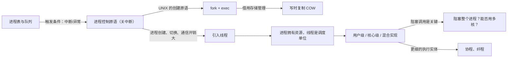

| 执行实体 | 由谁调度 | 一个实体执行阻塞调用 | 能否利用多核 |
| --- | --- | --- | --- |
| 进程 | 内核 | 只阻塞该进程 | 能 |
| 核心级线程 | 内核 | 只阻塞该线程 | 同进程线程可并行 |
| 用户级线程 | 用户态运行时系统 | 整个进程不能运行 | 不能 |
| 纤程/协程 | 应用或语言运行时 | 所在线程不能运行 | 单个线程内不能 |

## 不确定事项

- Solaris 改为一对一线程模型的版本，课程只凭回忆说“约 Solaris 8 之后”；正文保留这一说法，并用补充解释给出 Solaris 9 起默认、Solaris 8 可选的文档事实。
- “Linux 当时用线程库实现线程”的说法与 LinuxThreads/NPTL 的一对一内核线程史实不符，已在 section-6 的补充解释中更正。
- xv6 阅读任务（p73）的线索根据 xv6-riscv 源码结构整理（struct proc、fork 中的 uvmcopy、sh.c 主循环），课堂没有讲，也没逐行核对当前版本的源码。
- 转写为 ASR 文本，NT 历史（从 DEC VMS 挖人）、华为新概念等闲谈靠推断整理；后者属于背景闲谈，已略去。

> [!info]- 来源
> - slides03.pdf：PDF p.36, 38–47, 49–54, 56–73
> - L05.docx：DOCX body 1–208
