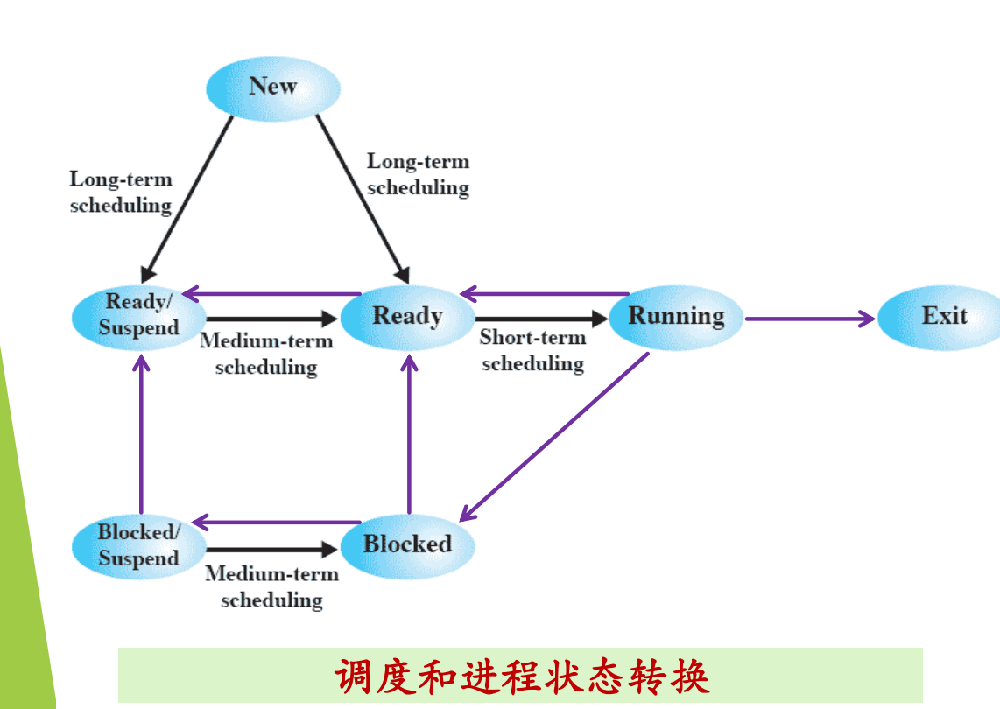
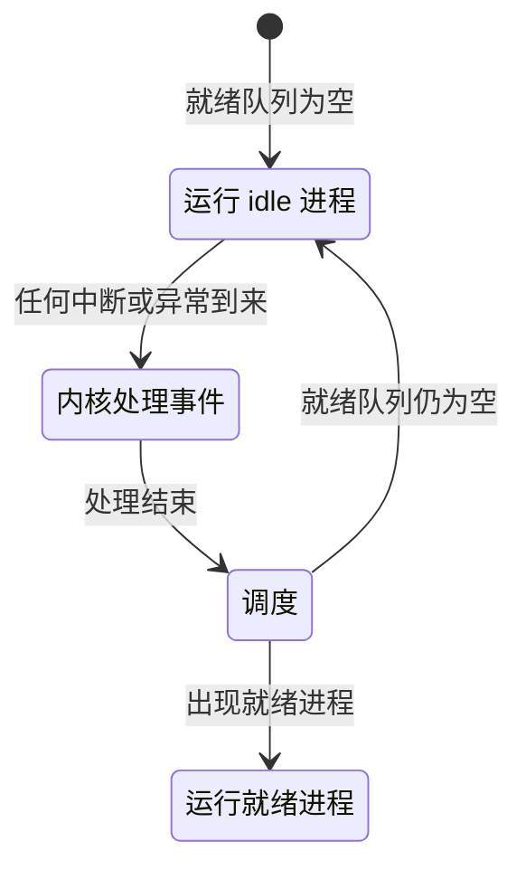
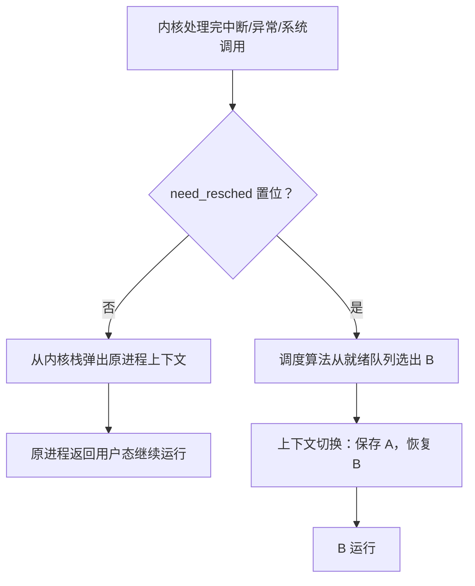
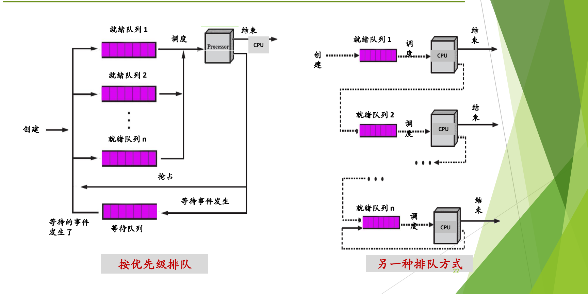
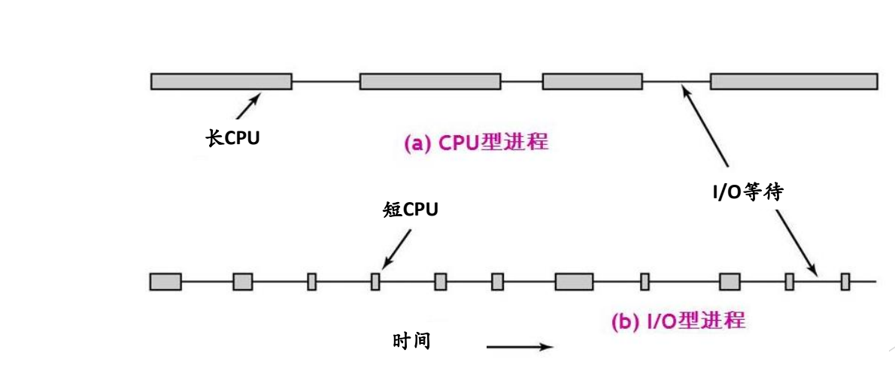
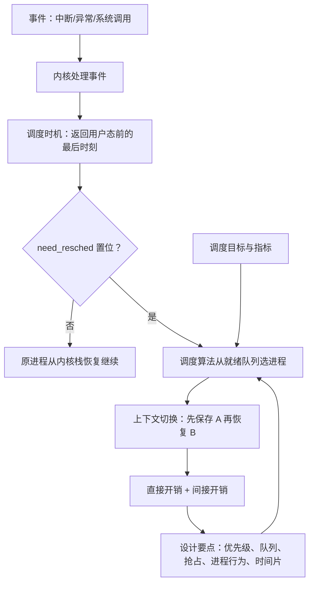

多个进程竞争有限且可被抢占的 CPU，操作系统必须决定谁上 CPU、何时换人、换人代价多大，这就是处理器调度要解决的问题。本讲先说明调度的意义与提纲，再在七状态模型上分出长程、中程、短程三层调度并聚焦处理器调度，接着依次讲调度时机（When）、进程切换与上下文切换（How），最后给出不同系统的调度目标、衡量指标和设计调度算法时的共性问题，为后续具体算法铺路。阅读前需要掌握 L03 的中断/异常/系统调用处理流程，以及 L04、L05 的进程状态模型、PCB 和进程队列。

---

## 为什么需要调度

> [!abstract] 本节要点
> - 操作系统为进程运行服务；每次中断、异常、系统调用处理完、返回用户态之前都要经过调度，由调度决定谁上 CPU、上多久。
> - 进程调度的根本问题：多个进程竞争**有限的、可被抢占的** CPU；要回答怎么分配、何时切换、切换代价多大。
> - 大模型推理引擎（如 vLLM）也在做调度：对象是用户请求和 token 生成任务，资源是 GPU、显存和 KV cache，目标同样是高吞吐、低延迟、公平、不饥饿。
> - 资源池化把多种（可能跨节点的）物理资源抽象成统一调配、共享使用的逻辑资源，是调度的前置条件；层次从单机、虚拟机、集群（K8S）到 GPU 池化。
> - 单 CPU 只能**并发**，多处理器才可能**并行**；调度问题按 When、How、What 展开，不存在适合所有系统的调度算法。

### 调度在操作系统中的位置

前几讲的内容都指向同一件事：操作系统是为进程运行服务的。没有进程运行，操作系统什么也不用做。服务过程中，进程有时暂时得不到资源，有时占用资源太久，有时出错，有时收到别的进程或设备发来的信号（软信号、硬件中断），这些情况都由底层的中断/异常机制统一处理（见 L03「03 中断处理完整流程」），进程在各状态之间的转移由进程模型描述（见 L04「03 三状态模型」、L04「04 扩展状态与实际系统」和 L05「01 进程表与队列模型」）。

这些机制最后都落到**进程调度**上：谁上 CPU、上多长时间，都由调度模块决定。前面讲过，中断或异常进入内核后，不管是哪类事件，内核处理完都要走到出口，而出口处一定经过调度。调度可以不重新选人，也可以重新选人，控制权交给调度来决策，所以这部分内容很重要。 出口处“要不要重新选人”由 `need_resched` 一类标志判断，见[进程切换与上下文切换](#进程切换与上下文切换)。

**进程调度的根本问题**：多个进程竞争**有限的、可被抢占的** CPU 资源。 由此产生三个具体问题：

1. **如何分配 CPU**：按什么原则把 CPU 给谁。
2. **何时切换**：在什么时刻做出“换人”的决定。
3. **切换代价多大**：换人本身要花时间和空间。

切换有代价，可以拿 4×100 米接力来比：选手跑本身没问题，最花时间的是交接棒。交接要准确，又不能为了稳妥把速度降得太低；交接做不好、掉了棒，损失更大。进程切换也一样，既要把旧进程妥善安置好，又不能太慢、太频繁。

### 今天的调度场景：大模型推理与资源池化

调度不只发生在进程之间。大模型服务（如 DeepSeek、ChatGPT）提供的是算力：用户发来推理请求，系统要决定怎样调配算力来为这些请求服务，这同样是一整套调度策略，只是在不同的层面上。

以推理引擎 vLLM 为例，它的调度器和操作系统的进程调度器几乎一一对应：

| 对比项 | 操作系统进程调度 | 大模型推理调度（如 vLLM） |
| --- | --- | --- |
| 调度对象 | 进程或线程 | 用户请求、token 生成任务 |
| 被分配的资源 | CPU（多个核） | GPU、显存、KV cache |
| 排队结构 | 就绪队列 | 等待处理的请求队列 |
| 调度决策 | 谁上 CPU 运行（running） | 谁在 GPU 上执行 |
| 资源不足时 | 抢占正在运行的进程 | 显存不足时抢占部分请求，或按优先级抢占 |
| 内存管理 | 虚拟存储 | 用 PagedAttention 管理 KV cache，思路类似虚存 |
| 目标 | 高吞吐、低延迟、公平、不饥饿 | 同样是高吞吐、低延迟、公平、不饥饿 |

时间片的概念在推理场景中也有对应：进程“上 CPU 运行多长时间”，变成了对 KV cache 块这类资源的分配。表中最后一行的目标在后面会反复出现，尤其是**不饥饿**：某些请求或进程长期得不到资源时该怎么办。低延迟在具身智能、自动驾驶等场景中是硬性要求，延迟过长，车辆就来不及反应。

> [!note] 补充解释
> PagedAttention 是 vLLM 提出的 KV cache 管理方法：把每个请求的 KV cache 切成固定大小的块，块在显存中不必连续，用一张块表记录“逻辑块→物理块”的映射，按需分配，用完回收。这和虚拟存储中“页→页框”的映射与按需分配是同一种思路。细节可参考 vLLM 论文 [Efficient Memory Management for Large Language Model Serving with PagedAttention](https://arxiv.org/abs/2309.06180)。

**资源池化**（resource pooling）是另一个与调度紧密相关的概念：把多种、可能跨节点的物理资源整合起来，抽象成一个逻辑资源，使其可以被统一调配、共享使用。 单机时资源很简单；跨节点后 CPU、内存、加速卡分散在很多机器上，必须先整合，再统一调度。

资源池化是调度的**前置条件**：先做池化，再在其上做调度，池化为调度提供了“舞台”，决定调度器能看到哪些资源、以多粗或多细的粒度看到。池化的层次如下：

| 池化层次 | 资源形态 | 调度在做什么 |
| --- | --- | --- |
| 无池化（单机） | 一个 CPU、一块内存 | 进程、线程在这台机器上轮流运行 |
| 虚拟机 | 虚拟化后可有多个 CPU | 按时间片分配 CPU |
| 集群（如 K8S） | 一堆节点的资源统一管理，以容器等形式使用 | 在统一的节点资源上分配 |
| 大模型 GPU 池化 | 很多卡汇成的算力 | 把多卡算力分配给推理请求 |

统一管理的目的有三：提高资源利用率；更灵活、可扩展，资源不够时可以扩容；统一管理降低了管理成本。 所以本讲讨论的 CPU 调度虽然是最简单的情形，它的思路在这些新场景中都可以借鉴。

### 并发与并行

只有一个 CPU 时，怎么“同时”跑多个程序？靠调度让这些进程**轮流**上 CPU。看上去它们在同时执行，准确的说法是**并发**执行。

- **并发**（concurrency）：在一段时间范围内，多个进程都已经开始运行、但都尚未结束。单个 CPU 只能做到并发。
- **并行**（parallelism）：多个进程在同一时刻真正同时执行，需要多个处理器。

可以用跑步来比：1500 米或马拉松，选手挤在同一条跑道上，谁跑在前面会变，像并发；跨栏比赛各跑各的道，同时推进，像并行。一个人做事也只能并发：同一时刻只能干一件，在几件事之间来回切换。ICS 课中接触的基本都是并发；有了多个处理器，才需要考虑并行计算。

> [!warning] 易错点
> “同时执行”在单 CPU 上是带引号的：任一时刻 CPU 上只有一个进程在运行，其余进程处于就绪或阻塞状态。判断是并发还是并行，看的是**同一时刻**有没有多个进程真正在不同处理器上执行，而不是用户感觉它们是否同时在推进。

### 调度问题的提纲

理解一个问题可以从 5W1H（What、When、How、Which、Why 等）多个角度入手。调度主题要回答的问题可以按 When、How、What 归类：

**When：何时调度，理由是什么。** “什么时候做”和“做的理由”其实是同一件事：没有事件发生就不需要调度，事件发生、内核处理完之后，才决定要不要重新选人。 这一点在[调度时机](#调度时机)中详细列出。

还有一个设计系统时必须面对的细节：就绪队列可能是空的。CPU 像心脏一样，只要开机就一个周期接一个周期地运转，不能“停跳”。所以操作系统会安排一个专门的进程在没人可选时占住 CPU、不做实际工作，有事来了就立刻让出。这就是 idle 进程，见[调度层次与处理器调度](#调度层次与处理器调度)。

**How：如何调度。** 选出新进程后，要把原来的进程妥善安置好，让它以后能继续执行，再把新进程送上 CPU。这件事的核心是**上下文切换**（context switch），在任何操作系统代码里找到 `switch` 相关的那一段，就是真正“换人”的地方。切换有成本：太频繁不合适，太久不切换又对其他用户进程不友好，这是一个折中权衡问题。 具体过程和开销见[进程切换与上下文切换](#进程切换与上下文切换)。

**What：用什么调度算法。** When 和 How 都比较确定，篇幅最多的是调度算法。如果有一个算法能“包打天下”，全世界计算机用它就行，不必讨论；但应用场景各不相同，这样的算法不存在。 关于算法要关注几点：

- **不同类型的操作系统不能用同一种算法。** 实时系统、服务器/云、桌面、手机的调度算法不应相同，因为它们的目标不同。
- **目标不是越快越好。** 只求快，闭着眼随便挑一个最快，但这样会在其他方面出问题。
- **选进程要考虑多种因素。** 就像计划假期出游要同时考虑时间、经费、目的地，调度算法也不能只看单一因素。

调度算法不需要死记，但要能像工作中向主管提交方案那样，说清它的优点、缺点和适用场景。What 这一大类完整地包括：批处理、交互式、实时系统各自适用的算法，抢占式与非抢占式调度，算法的比较维度，机制与策略分离原则在调度中的应用，以及实例操作系统（Windows、Linux）的调度。 本讲讲到设计调度算法前要考虑的目标、指标和共性问题，见[调度目标与衡量指标](#调度目标与衡量指标)和[调度算法设计要点](#调度算法设计要点)；具体调度算法留到后续课程。

> [!question]- 自测：一台单核笔记本上，同时开着音乐播放器和正在编译的 IDE，两者是并发还是并行？换成 8 核机器呢？
> 单核时是并发：任一时刻只有一个进程在 CPU 上，调度让它们轮流运行。8 核时，两个进程可能被分到不同的核上同一时刻执行，这时才是并行（是否真的并行取决于调度把它们放在哪些核上）。

> [!question]- 自测：在 vLLM 类推理引擎中，“显存不足时暂停一部分请求、优先服务高优先级请求”对应进程调度中的哪个概念？
> 对应**抢占**：资源不够时，强行收回正在使用资源的一部分任务的资源，交给更重要的任务。它和进程调度中“更高优先级进程就绪时剥夺当前进程的 CPU”是同一种思路。

---

## 调度层次与处理器调度

> [!abstract] 本节要点
> - 七状态模型中有三层调度：**长程**（new→ready、new→ready suspend）、**中程**（ready↔ready suspend、blocked↔blocked suspend，即内外存交换）、**短程**（ready→running）。
> - 短程调度的时间尺度是毫秒甚至微秒级，执行极其频繁，算法本身必须高效；本课只讨论短程调度。
> - **处理器调度**（=进程调度，视角不同）：按调度算法从就绪队列选一个进程，把 CPU 使用权交给它；一般场景是 $N$ 个就绪进程、$M \ge 1$ 个 CPU。
> - 就绪队列为空时运行 **idle 进程**，它最重要的性质是可以被任何事件打断。
> - 调度要解决三个问题：What（调度算法）、When（调度时机）、How（调度过程，即上下文切换）。

### 调度的三个层次

调度说白了就是“选人”，而选人可以在不同层次上进行，就像评选可以在班级、年级、学院、学校几个层次上进行。操作系统里同样如此：根据进程模型，存在不同层次的调度。

图：长程调度把新建（New）进程放入就绪或就绪挂起，中程调度在就绪/阻塞与对应的挂起状态之间换入换出，短程调度在就绪（Ready）与运行（Running）之间选进程上 CPU。

图中是 L04「04 扩展状态与实际系统」中的**七状态进程模型**（New、Ready、Running、Blocked、Ready/Suspend、Blocked/Suspend、Exit）。其中带 scheduling 标注的转换分属三个层次：

1. **长程调度**（long-term scheduling，也叫作业调度、宏观调度）：创建新进程时，决定它是否进入当前的**活跃进程集合**，对应 New→Ready 和 New→Ready/Suspend。新进程要么直接进入就绪队列竞争 CPU；要么在系统负载太高、排队的进程太多时，先放到就绪挂起状态作为缓冲，等负载减轻再激活。“选它进队列，还是让它先等着”，就是一次选择。
2. **中程调度**（medium-term scheduling）：进程在内存和外存之间的**交换**，对应 Ready↔Ready/Suspend、Blocked↔Blocked/Suspend。从存储资源管理的角度看，把某些进程的部分或全部换出到外存，可以为当前运行的进程腾出所需的内存空间；把当前需要的部分换入内存，这就是**交换技术**（swapping）。
3. **短程调度**（short-term scheduling，也叫微观调度）：从处理机资源分配的角度，选择一个就绪进程或线程进入运行状态，对应 Ready→Running。

三者的时间尺度差别很大。长程、中程调度的决策间隔较长；短程调度的时间尺度通常是**毫秒级**，甚至微秒级。由于短程调度算法被频繁使用，要求实现时做到**高效**：调度算法本身也必须又快又实时。

长程和中程调度一般不作重点：只要采用七状态模型，它们就存在；如果没有挂起状态，也可能只有一个简单的长程调度（决定是否让进程进内存、变成就绪），实现上并不复杂。本课关心的是短程调度。不过要知道，除了 Ready→Running 以外，其他状态转换也可以看作调度问题，调度并不只在一个地方发生。

> [!warning] 易错点
> Ready/Suspend→Ready 是**中程**调度（换入内存），不是长程调度。长程调度只管“新进程能不能进入活跃集合”，即从 New 出发的两条边；一旦进程已经在系统中，它在内外存之间的移动都属于中程调度。

### 处理器调度

最低一层的短程调度通常称为**处理器调度**（processor scheduling），也叫**进程调度**。两者基本是一回事，只是站的位置不同：处理器调度是“把这个处理器分给谁”，进程调度是“选哪个进程上处理器”。

**处理器调度**的任务是控制、协调进程对 CPU 的竞争：按一定的调度算法从就绪队列中选择一个进程，把 CPU 的使用权交给被选中的进程。完成这件事的内核函数称为**调度程序**（scheduler），即挑选就绪进程的内核函数。

一次调度过程因此牵涉三件事：用什么算法、怎样选、最后怎样让选中的进程上 CPU。

更一般的**系统场景**不是只有一个 CPU：

- 有 $N$ 个进程处于就绪状态，等待上 CPU 运行；
- 有 $M$ 个 CPU，$M \ge 1$；
- 调度要做出的决策是：**给哪一个进程分配哪一个 CPU**。

注意候选者只能是就绪进程。阻塞进程在等待某个条件（如 I/O 完成），条件不成立时，即使把 CPU 给它，它也无法运行。

### idle 进程

就绪队列有可能为空：所有进程都阻塞了，或者根本没有用户进程。CPU 不会因此停下来，只要开机就一个周期接一个周期地执行指令。所以系统必须规定这时 CPU 执行什么。

**idle 进程**（系统空闲进程）是在没有就绪进程时，系统安排在 CPU 上运行的进程（也可以是线程）。 早年也叫“闲逛进程”：它不做有用的工作，只是替其他进程“占着” CPU。它**最重要的性质是任何事件都可以把它打断**：一旦中断到来（例如磁盘完成 I/O，唤醒了某个阻塞进程），idle 进程就让出 CPU，调度程序去选那个变为就绪的进程。 idle 进程具体执行什么代码由各系统自己决定。

早年有的机器还会让空闲状态“看得见”：20 世纪 70 年代北大参与研制的一台计算机上运行四道操作系统，系统空闲、闲逛进程在运行时会播放乐曲《东方红》，机房里的人一听到，就知道该给机器“喂活”了。

### 调度要解决的三个问题

把上面的内容归纳起来，处理器调度要解决三个问题：

| 问题 | 含义 | 对应内容 |
| --- | --- | --- |
| What | 依据什么原则挑选进程或线程来分配处理器 | 调度算法 |
| When | 何时分配处理器 | 调度时机 |
| How | 如何分配 CPU，即进程的上下文切换 | 调度过程 |

三者中 When 和 How 比较简单、确定，先讲：调度时机见[调度时机](#调度时机)，调度过程见[进程切换与上下文切换](#进程切换与上下文切换)。What 涉及的目标、指标与设计要点见[调度目标与衡量指标](#调度目标与衡量指标)和[调度算法设计要点](#调度算法设计要点)。

> [!question]- 自测：系统负载很高时，新建的进程 P 被放入就绪挂起状态；一段时间后 P 被换入内存变为就绪，随后被选中运行。这三步分别属于哪一层调度？
> New→Ready/Suspend 是长程调度（决定 P 能否进入活跃集合）；Ready/Suspend→Ready 是中程调度（换入内存）；Ready→Running 是短程调度（处理器调度）。

> [!question]- 自测：所有进程都在等磁盘 I/O，这时 CPU 在执行什么？磁盘完成中断到来后会发生什么？
> CPU 在执行 idle 进程。磁盘中断打断 idle 进程，内核处理中断并唤醒等待该 I/O 的进程，使它进入就绪队列；处理结束后调度程序发现有就绪进程，便选它上 CPU，idle 进程让出。

---

## 调度时机

> [!abstract] 本节要点
> - 从进程模型看有 7 种调度时机：退出、出错终止、创建新进程、运行进程阻塞、阻塞进程被唤醒、时间片用完、主动放弃 CPU。
> - 从事件看，它们一一对应于 exit/abort 异常、fork、等待 I/O、I/O 中断与唤醒、时钟中断、yield 等确定的事件。
> - 时钟中断 ≠ 时间片：时钟按固定频率发中断；时间片计时器是内存中的整数，每次时钟中断减 1，减到 0 才是“时间片到”。
> - 完整顺序：事件发生→当前进程暂停→硬件响应→进入 OS 处理事件→进程状态变化或出现新进程→就绪队列调整→按调度算法选进程；先硬件后软件，不会软硬交错。
> - 调度时机统一为**内核对中断/异常/系统调用处理后返回到用户态前的最后时刻**。

> [!tip] 课堂强调
> 调度时机的两页是核心关键，“什么时候都会考”；调度时机显而易见，要求当堂就记住。答题时尤其要注意**顺序**：以往考试总有同学把硬件和软件的步骤交错着写。

### 从进程模型看调度时机

调度时机就是“什么时候要决定选人”。CPU 什么时候需要（或可能需要）重新选人，可以直接从进程状态模型推出来，共 7 种情况：

1. **进程执行完毕并退出**：CPU 空了，必须选人。
2. **进程由于某种错误或异常而终止**：与第 1 条一样都是终止，只是一个正常、一个出错。
3. **新进程的创建**：例如父进程创建了子进程，可能需要重新调度。
4. **运行进程要等待 I/O 操作或其他资源时进入阻塞态**：Running→Blocked，CPU 空了，必须选人。
5. **被唤醒的阻塞进程重新回到就绪态**：Blocked→Ready。
6. **进程用完所分配到的时间片回到就绪队列**：Running→Ready，要重新选。
7. **进程主动放弃 CPU**：例如线程库中的 `yield` 函数，调用者主动下 CPU。

其中第 1、2、4 条是当前进程不能再运行了，CPU 空出来，显然要选人。第 5 条乍看不需要调度：CPU 上的进程还在运行，为什么一个进程从阻塞回到就绪也要重新选？原因是**就绪队列的“格局”变了**。回来的这个进程可能比正在运行的进程优先级更高，就像一个领域里本来几个强者稳坐前列，突然杀出一匹黑马，排名就要重新考虑。 例如某个高优先级进程原先在等磁盘读，磁盘中断表示 `read` 完成，把它唤醒回到就绪，它就比正在运行的进程优先级高，这时可以重新调度。 第 3 条同理：新创建的子进程若被赋予更高的优先级，格局也变了。

### 从事件看调度时机

同样的时机也可以从**事件**的角度描述，典型事件有：

- 创建、唤醒、退出等进程控制操作；
- 进程等待 I/O、I/O 中断；
- 时钟中断，如时间片用完、计时器到时；
- 进程执行过程中出现 abort 异常；
- 执行 `yield`。

两种视角是一一对应的，只是一边看状态转换，一边看引发转换的事件。系统中定义的事件都是**确定**的：中断/异常机制定义了若干种事件，不应该出现系统不知道的事件。把中断和异常统一看作事件后，对应关系如下：

| 进程模型中的时机 | 对应的事件 | 为什么要调度 |
| --- | --- | --- |
| 执行完毕退出 | 调用 `exit`（陷入内核的异常） | CPU 空出 |
| 出错或异常终止 | abort 异常 | CPU 空出 |
| 创建新进程 | `fork` 等创建操作 | 就绪队列多了新进程 |
| 等待 I/O 或资源而阻塞 | 进程发起 I/O 等待（blocked） | CPU 空出 |
| 阻塞进程被唤醒 | I/O 中断、`wakeup`/signal | 就绪队列格局变化 |
| 时间片用完 | 时钟中断 | 当前进程须让出 CPU |
| 主动放弃 CPU | 执行 `yield` | CPU 空出 |

### 时钟中断与时间片计时器

时间片用完对应的事件是时钟中断，但**时钟中断和时间片不是一回事**。

- **时钟中断**来自硬件：系统中有一个定时装置，核心是晶体振荡器（石英晶体，和石英手表计时的原理相同；对精度要求极高的场合还有原子钟），它按**固定频率**向 CPU 发出中断信号。
- **时间片计时器**是软件维护的计数：本质上是一个整数。系统里这样的计时器很多（每个进程的时间片、各种定时器），寄存器放不下，所以只能放在**内存**中。

二者的关系是：每次时钟中断到来，中断处理程序把这些计数减 1（一般每次减 1），某个计数减到 0，就表示这个时间片到了，或者这个定时器到时了，随后进行唤醒或重新调度。也就是说，**时钟中断这一事件导致了“时间片到”或“定时到”**，它们是调度时机的具体触发动作。

> [!example] 例：时钟中断与时间片
> 设时钟每隔 $1\,{\rm ms}$ 发一次中断，进程 P 上 CPU 时时间片计数被设为 $10$。
>
> 1. 每次时钟中断，内核把 P 的计数减 1：$10 \to 9 \to \cdots \to 1$，这 9 次中断都不是“时间片到”，P 继续运行。
> 2. 第 10 次时钟中断把计数减为 $0$，内核判定 P 的时间片用完，P 回到就绪队列。
> 3. 中断处理结束、返回用户态之前进行调度，选出下一个进程。
>
> 因此时钟中断发生了 10 次，“时间片到”只发生 1 次，P 最多连续运行约 $10\,{\rm ms}$。

### 调度时机的完整链条

把上面的时机和事件串起来，一次调度时机是这样形成的：

1. **事件发生**：中断、异常或系统调用。
2. **当前运行的进程暂停运行。**
3. **硬件机制响应**：不论是进程主动进入内核还是响应中断进入，硬件完成响应（见 L03「03 中断处理完整流程」）。
4. **进入操作系统，处理相应的事件**：执行对应的中断/异常处理程序或系统调用服务例程。
5. **结束处理后**：进程模型中对应的操作完成，某些进程的状态会发生变化，也可能出现新的进程。
6. **就绪队列有调整**（也可能 CPU 空出）。
7. **需要进程调度**：根据预设的调度算法，从就绪队列中选一个进程。

这条链的**顺序**是：第 3 步之前是硬件做的，第 4 步起全部是软件（内核）做的。硬件做完交给软件，软件处理完后返回用户态继续运行，中间**不会再回到硬件**，不存在“软硬交错”。

由此得到调度时机的精确表述：**内核对中断/异常/系统调用处理后，返回到用户态前的最后时刻**。 不管进来时发生的是什么事件，处理完后都统一走到这个点进行调度。这体现了**机制与策略分离**：中断/异常机制统一负责“事件进来、处理、返回”，不同事件的处理是不同的策略，调度则安排在这个统一的出口上。 L03「07 Linux 系统调用执行」中，系统调用返回前检查 `need_resched` 标志的那段代码，就是这个“最后时刻”的具体实现。

> [!tip] 课堂强调
> 调度时机、中断/异常机制这部分是整个操作系统“转起来”的核心，按 80/20 原则，前面这些内容再加上虚拟存储，就是那最重要的 20%。

> [!warning] 易错点
> - 把“调度程序选进程”写在“硬件响应”之前，或者在内核处理中间又插入一个硬件步骤，都是顺序错误。正确答案中硬件步骤只出现在进入内核之前。
> - 调度时机到了不等于一定换人。到达“最后时刻”时，调度可能发现无须换人，原进程继续运行；是否换人见[进程切换与上下文切换](#进程切换与上下文切换)。

> [!question]- 自测：进程 A 正在用户态运行，磁盘中断到来，唤醒了一个优先级比 A 低的进程 B。这里有没有调度时机？A 会被换下吗？
> 有调度时机：内核处理完磁盘中断、返回用户态前的最后时刻就是调度时机。但 B 优先级比 A 低，在基于优先级的调度下就绪队列的变化不足以让 A 下 CPU，调度决定不换人，A 继续运行。

> [!question]- 自测：把下列步骤排成正确顺序：①按调度算法选进程 ②硬件响应中断 ③就绪队列调整 ④时钟中断发生 ⑤内核执行时钟中断处理程序、时间片计数减到 0 ⑥当前进程暂停
> ④→⑥→②→⑤→③→①。时钟中断（事件）发生，当前进程暂停，硬件响应后进入内核处理；处理中发现时间片用完，进程回到就绪队列，队列调整后在返回用户态前按算法选进程。

---

## 进程切换与上下文切换

> [!abstract] 本节要点
> - 调度时先根据 `need_resched` 一类标志决定**要不要换人**：不换人时原进程直接从内核栈恢复返回，不需要进程切换；换人时才用调度算法选新进程并做进程切换。
> - **进程切换**：一个进程让出处理器，由另一个进程占用处理器；具体做的是**上下文切换**。
> - 上下文是 PC、PSW、SP、通用寄存器、控制寄存器等硬件状态；运行时在 CPU 寄存器中，暂停而以后还要运行时保存在 PCB 中。
> - 上下文切换两部分：切换全局页目录（加载新地址空间）；切换内核栈和硬件上下文。步骤必须**先保存 A、再恢复 B**。
> - 开销分直接开销（保存恢复寄存器、切换地址空间的 CPU 时间）和间接开销（Cache、Buffer Cache、TLB 失效后由冷变热）。

### 是否换人与进程切换

到达调度时机后，调度要回答的第一个问题不是“选谁”，而是“要不要换人”。

准确的过程是：

1. 内核根据一个**标志**决定要不要换人。这个标志就是 L03「07 Linux 系统调用执行」中读 Linux 系统调用代码时见过的 `need_resched`。
2. **不需要换人**：相当于“选中”了刚被暂停的那个进程，让它继续执行。这时**不需要进程切换**：它的上下文还完整地保存在它的内核栈里，直接弹栈、返回用户态即可。
3. **需要换人**：才调用调度算法从就绪队列中选出一个新进程，然后进行**进程切换**。

> [!warning] 易错点
> 常见表述“调度程序从就绪队列选择了要运行的进程，它可以是刚被暂停的进程，也可以是新进程”不够准确：刚被暂停的进程并不在就绪队列里等着被选。是否换人由 `need_resched` 标志决定；保留原进程时既不经过调度算法，也不发生进程切换。

**进程切换**（process switch）是指一个进程让出处理器，由另一个进程占用处理器的过程。 只有真正换人时才发生进程切换。

### 上下文

**上下文**（context）是进程运行所需的 CPU 硬件状态。进程运行时，这些状态保存在 CPU 的寄存器中，包括：

- 程序计数器（PC）；
- 程序状态寄存器（PSW，程序状态字）；
- 栈指针（SP）；
- 通用寄存器；
- 其他控制寄存器。

进程不运行时，这些寄存器的值保存在它的 **PCB** 中。这里的“不运行”指运行过程中因中断、时间片到、阻塞等原因暂停，但**以后还要继续运行**；进程如果已经结束退出，就不需要保存上下文了。

把 CPU 的硬件状态从一个进程换到另一个进程的过程，称为**上下文切换**（context switch）。进程切换“A 换 B、B 换 A”，具体落实就是上下文切换。

上下文切换主要包括两部分工作：

1. **切换全局页目录**，以加载一个新的地址空间。只要换进程，地址空间就一定换，所以保存页表起始地址的页目录寄存器一定要换，这是重点。
2. **切换内核栈和硬件上下文**。硬件上下文包括了内核执行新进程需要的全部信息，如 CPU 相关寄存器。

整个切换过程包括对原来运行进程各种状态的**保存**，和对新进程各种状态的**恢复**。

> [!note] 补充解释
> “全局页目录”就是进程页表的最顶层。CPU 用一个专门的寄存器保存当前页表的起始（物理）地址，在 x86 上是 CR3。把它改成新进程的页目录地址，之后的地址翻译就按新进程的页表进行，相当于换了一整个地址空间。

### 上下文切换的具体步骤

> [!info] 可视化资源
> - [OSTEP 第 6 章 Limited Direct Execution（PDF）](https://pages.cs.wisc.edu/~remzi/OSTEP/cpu-mechanisms.pdf)：Figure 6.3 用时间线展示时钟中断触发切换时硬件与操作系统各自保存、恢复哪些寄存器，Figure 6.4 是 xv6 的上下文切换代码。

“保存”和“恢复”要说清**从哪里到哪里**。进程 A 被暂停时，进入内核的过程已经把 A 的寄存器组（register file）压在 A 的内核栈里。如果要换成 B：

- **保存**：把 A 的上下文保存到 A 的 PCB 中；
- **恢复**：把 B 的上下文从 B 的 PCB 中恢复到 CPU 寄存器；
- 然后内核把控制权交给 B。

场景：进程 A 下 CPU，进程 B 上 CPU。具体步骤如下：

1. **保存进程 A 的上下文环境**：程序计数器、程序状态字、其他寄存器等。
2. **用新状态和其他相关信息更新进程 A 的 PCB**：例如 A 的状态由运行改为就绪或阻塞。
3. **把进程 A 移至合适的队列**：就绪队列、阻塞队列等。
4. **将进程 B 的状态设置为运行态。**
5. **从进程 B 的 PCB 中恢复上下文**：程序计数器、程序状态字、其他寄存器等。

顺序上必须**先保存、后恢复**。恢复 B 会覆盖寄存器，而且 B 的上下文一装入，下一个周期 CPU 就开始执行 B 的指令，A 的状态如果还没保存就永远丢失了。

上下文切换代码与体系结构密切相关，要用汇编编写，代码不长但顺序很关键。 xv6 中对应的是 `kernel/swtch.S`，留到之后阅读源码时再讲。

> [!warning] 易错点
> - 不要把“进程切换”和“进入内核”混为一谈。每次中断都会进入内核、在内核栈中保存现场，但只有决定换人时才发生进程切换；不换人时只是从内核栈恢复返回。
> - 被保存的是**以后还要运行**的进程的上下文。退出的进程没有“以后”，不需要保存。

### 上下文切换的开销

**开销**（cost，也叫 overhead）在计算机里无非是 CPU 时间（指令、时钟周期）和空间。像上大学的生活费，除了吃饭等必需开支，还有通信、社交这些额外开支；进程上 CPU 运行所用的时间和空间是“正常该给的”，上下文切换则是额外的开销。如果每个进程运行完才换下一个，就几乎没有这笔开销；但为了提高整个系统的资源利用率，必须频繁切换，这笔开销就不可避免。

开销分两类：

1. **直接开销**：内核完成切换所用的 CPU 时间，包括：
   - 保存和恢复寄存器；
   - 切换地址空间（相关指令比较昂贵）。
2. **间接开销**：高速缓存（Cache）、缓冲区缓存（Buffer Cache）和 TLB（Translation Look-aside Buffer）失效。

间接开销容易被忽略。换了进程之后，原则上原来的 Cache 和 TLB 内容对新进程无用、要清空，这时它们是“冷”的（cold）：新进程开始运行时会连续 miss 一段时间，等内容慢慢填进去，才逐渐变“热”。频繁切换意味着经常处在这种冷启动状态。

新的硬件技术可以减轻这一点：给 TLB 表项或 Cache 行加上进程标识（如 ASID，地址空间标识符），切换时不必清空。某个进程下次再上 CPU 时，它留下的表项还在，仍然能命中。

> [!note] 补充解释
> Buffer Cache（缓冲区缓存）是操作系统在内存中缓存的磁盘块。它不像 TLB 那样随切换被清空，但新进程访问的是另一批文件和磁盘块，原进程留下的缓存内容对它用处不大，效果上同样是命中率下降。

> [!question]- 自测：进程 A 执行 `read` 系统调用，数据已在缓存中，内核直接完成并准备返回，`need_resched` 为 0。这次系统调用中发生了上下文切换吗？
> 没有。进入内核时 A 的寄存器被保存在 A 的内核栈中，返回时 `need_resched` 未置位，内核直接从内核栈恢复 A 的寄存器返回用户态，不选新进程，也不切换页目录和内核栈。

> [!question]- 自测：测得一次上下文切换的保存恢复只要很短时间，但进程 B 刚上 CPU 的一段时间里运行明显偏慢，原因是什么？怎样的硬件可以缓解？
> 这是间接开销：切换后 Cache 和 TLB 是冷的，B 开始时大量 miss，要等内容重新填入才变快。给 TLB 和 Cache 加进程标识（如 ASID），切换时不清空，B 再次上 CPU 时还能命中它之前留下的内容。

---

## 调度目标与衡量指标

> [!abstract] 本节要点
> - 交互式进程追求响应时间和均衡性，平均延迟要低于 $50\sim150\,{\rm ms}$；批处理进程追求吞吐量、周转时间、CPU 利用率；实时进程追求最后期限和可预测性。
> - 用户角度的指标（周转时间、响应时间、最后期限、均衡性、可预测性）与系统角度的指标（吞吐量、CPU 利用率、公平性、强制优先级、平衡资源）相互矛盾，必须折中权衡。
> - **吞吐量**是单位时间完成的进程数；**周转时间**是从提出请求到运行完成；**响应时间**是从提出请求到第一次回应。
> - 非性能指标有公平性、资源利用率（CPU 做有效工作的时间比例）；特定场景还要考虑实时性和能耗。

### 三类进程的调度目标

不同场景、不同类型的操作系统追求的目标不同，调度算法要满足各自的目标。按追求的目标，可以把进程（以及以它为主的系统）分成三类：

| 类型 | 特点 | 典型程序 | 追求的目标 |
| --- | --- | --- | --- |
| **交互式进程**（interactive process） | 经常与用户交互，大量时间在等待用户输入；响应要快，平均延迟要低于 $50\sim150\,{\rm ms}$ | shell、文本编辑程序、图形应用程序 | 响应时间、均衡性 |
| **批处理进程**（batch process） | 不必与用户交互，通常在后台运行，不必很快响应 | 营业额计算、利息计算、索赔处理 | 吞吐量、周转时间、CPU 利用率 |
| **实时进程**（real-time process） | 有实时需求，不应被低优先级进程阻塞，响应时间要短 | 视频/音频、机械控制 | 最后期限、可预测性 |

几个例子帮助区分：

- **实时**：汽车自动驾驶；视频、音频播放（不能总是卡顿、等半天数据不来）；股票交易系统（不能让交易者看到 20 分钟前的行情，否则决策会出错）。
- **批处理**：一家全球连锁快餐企业，总部每天汇总每个门店的营业额、各类产品的销量等数据，做一次统计和分析，一天一次。
- **交互式**：用户敲一个命令，希望马上得到回应。

实时进程追求的**最后期限**（deadline）是指任务只要在规定的时间之前完成就可以，不能超过。如果计算后发现一个队列中的进程不可能全部满足期限要求，就放弃一部分优先级低的进程，只保证优先级高的满足，这引出了**可调度**的概念（实时调度留到后续课程）。

### 设计调度算法要权衡的因素

设计调度算法时，要根据场景仔细斟酌。系统形态一直在演进：

批处理系统 → 多道程序设计系统 → 批处理与分时的混合系统 → 个人计算机 → 网络服务器 → 人-机-物协同（如物联网）

不同形态下关注的指标各有侧重，而这些指标又可以从**用户**和**系统**两个角度来看：

| | 用户角度 | 系统角度 |
| --- | --- | --- |
| 性能 | 周转时间、响应时间、最后期限 | 吞吐量、CPU 利用率 |
| 其他 | 均衡性、可预测性 | 公平性、强制优先级、平衡资源 |

作为用户，关心的是自己的任务多快完成、多快有回应；作为操作系统设计者，关心的是整个系统完成了多少工作、资源用得是否充分。两种角度的指标**一定有矛盾**：如果没有矛盾，也就不需要讨论调度算法了。正因为角度不同，才需要协调、折中权衡，拿出一个各方都认可的方案。

### 调度算法的衡量指标

**性能指标**：

- **吞吐量**（Throughput）：每单位时间完成的进程数目。
- **周转时间**（Turnaround Time，TT）：每个进程从提出请求到运行完成的时间。
- **响应时间**（Response Time，RT）：从提出请求到第一次回应的时间。

用 $t_{\rm submit}$ 表示进程提出请求（提交）的时刻，$t_{\rm first}$ 表示系统第一次给出回应的时刻，$t_{\rm finish}$ 表示运行完成的时刻，$n$ 表示一段时长 $T$ 内完成的进程数，则

$$
{\rm Throughput} = \frac{n}{T}, \qquad TT = t_{\rm finish} - t_{\rm submit}, \qquad RT = t_{\rm first} - t_{\rm submit}
$$

吞吐量的单位是“进程数/单位时间”，周转时间和响应时间的单位是时间。

**非性能指标**：

- **公平性**（Fairness）；
- **资源利用率**，如 **CPU 利用率**（CPU Utilization）：CPU 做有效工作的时间比例。设观察时长为 $T$，其中 CPU 做有效工作的时间为 $T_{\rm busy}$，则 CPU 利用率为 $\frac{T_{\rm busy}}{T}$。

**特定场景考虑的指标**：实时性、能耗。

这些指标之间相互依赖、需要折中权衡，是做调度决策时可供参考的依据。

周转时间和响应时间看起来都从“提出请求”开始算，但用在不同场合。周转时间一般用于批处理系统：一批作业交进去，什么时候把结果给我。交互式系统看响应时间：敲一个命令，系统多快给我回应。

响应时间强调的是**第一次回应**，不一定是最终结果。多年前程序运行时没有进度条，用户敲了命令后看不到任何信息，不知道系统是否在工作，等了几分钟没反应就乱按中断键；有了滚动条、百分比之后，看到“50%、60%”，即使结果还没出来，用户也安心了。进度提示本身就缩短了响应时间。

> [!warning] 易错点
> 不要把响应时间理解成“得到结果的时间”。一个需要 10 秒算完的命令，如果 0.1 秒就显示了进度条，响应时间是 0.1 秒，周转时间是 10 秒。

> [!question]- 自测：某作业在 $t=2\,{\rm s}$ 提交，$t=2.3\,{\rm s}$ 首次在屏幕输出提示，$t=12\,{\rm s}$ 运行完成。它的周转时间和响应时间分别是多少？
> $TT = 12 - 2 = 10\,{\rm s}$，$RT = 2.3 - 2 = 0.3\,{\rm s}$。响应时间只看第一次回应，与何时完成无关。

> [!question]- 自测：银行夜间的利息结算、在线会议的视频播放、用户使用的 shell，分别最该关注哪类指标？
> 利息结算是批处理，关注吞吐量、周转时间、CPU 利用率；视频播放是实时，关注最后期限和可预测性（不卡顿）；shell 是交互式，关注响应时间（平均延迟低于 $50\sim150\,{\rm ms}$）和均衡性。

---

## 调度算法设计要点

> [!abstract] 本节要点
> - 调度依据必须在 PCB 中有记录；记录什么取决于调度算法，例如 Windows 记录基本优先级和可变优先级两个字段。
> - **优先级**是重要/紧迫程度，**优先数**只是表示它的数字，数大是高还是低由系统规定；静态优先级创建后不变，动态优先级运行中可变。
> - 按优先级分多个就绪队列时，高级队列空了才调度下一级，低级进程可能**饥饿**；另一种排队让新进程都进第一级、用完时间片就降级，能区分进程行为，但同样会饥饿。
> - **可抢占式**：有更高优先级进程就绪时可强行剥夺当前进程的 CPU；**不可抢占式**：除非自身原因不能运行，否则一直运行。
> - 调度偏好 **I/O 密集型**进程；时间片要在切换开销和响应时间之间取舍，还要决定固定还是可变。

设计调度算法之前，有几个各算法共有的问题要先回答：

1. 进程控制块 PCB 中需要记录哪些与 CPU 调度有关的信息？
2. 进程优先级及就绪队列的组织；
3. 抢占式调度与非抢占式调度；
4. I/O 密集型与 CPU 密集型进程；
5. 时间片大小的选择。

### PCB 中的调度信息与优先级

调度时考虑的因素必须能在 PCB 中找到数据，“巧妇难为无米之炊”：没有记录的信息，算法无从依据。所以设计算法时首先要决定 PCB 中记录哪些与 CPU 调度有关的信息。

这个问题没有标准答案，记哪些信息与调度算法密切相关。最常见的是优先级：一般在 PCB 里给优先级一个字段。Windows 则给了两个：

- **基本优先级**：进程创建时给定；
- **可变优先级**（当前优先级）：运行过程中可以被提升，也可以回落。

有两个字段，调度可依据的信息就更多。（Windows 线程调度的具体设计留到后续课程。）

**优先级**（priority）和**优先数**不是一回事：

- **优先级**表示重要或紧迫的程度，与日常理解一致：优先级高的先处理，低的后处理。
- **优先数**是计算机中用来表示优先级的那个数字。数字大小与优先级高低的对应关系由系统规定，不是固定的。

日常生活中也有这种现象：运动员等级中一级最高，数越小级别越高；围棋段位中九段（以至十段）最高，数越大级别越高。

按优先级在运行过程中是否改变，分为：

- **静态优先级**：进程创建时指定，运行过程中不再改变。
- **动态优先级**：进程创建时指定了一个优先级，运行过程中可以动态变化。例如等待时间较长的进程可提升其优先级。

两者也可以并存，像 Windows 那样一个字段不变、一个字段变。

> [!warning] 易错点
> 看到“进程 P 的优先数是 1”，不能直接判断它优先级最高还是最低，要先看该系统规定的是“数小级高”还是“数大级高”。

### 就绪队列的组织

就绪队列排一个队还是多个队？多个队怎么排？不同系统有不同方案，实际系统选一种即可。下面是两种典型的组织方式。

图：左侧按优先级设置多条就绪队列（就绪队列 1 到 $n$），调度时从高优先级队列选进程，被抢占的回到就绪队列、等待事件的进入等待队列；右侧是另一种排队方式，进程在一条队列执行完一次后转入下一条队列。

**按优先级排队**（左图）：设置就绪队列 1 到就绪队列 $n$，每个优先级一个队列，进程按自己的优先级进入对应队列。创建的进程按优先级进入某个就绪队列；被调度上 CPU 后，运行结束则离开，被抢占则回到就绪队列，等待某个事件则进入等待队列，等待的事件发生后再回到就绪队列。

假设队列 1 的优先级最高。调度总是先从最高级开始，队列 1 空了才调度队列 2，依此类推。这个结构天然带来一个问题：如果队列 1、2、3 源源不断地有新进程到来，队列 $n$ 中的进程就可能长期得不到调度，即**饥饿**（starvation）。这正是前面大模型推理调度中提到的饥饿问题，ICS 中也学过这一概念。

**另一种排队方式**（右图）：

1. 所有新创建的进程都进入**第一级**就绪队列，一视同仁，都给最高优先级；
2. 进程被调度运行后，若运行结束就离开；若运行完一个时间片还没结束，就**降一级**，进入下一级队列；
3. 每被调度一次、用完一个时间片，就再降一级，越降越低，直到最低一级（第 $n$ 级）在本级内循环。

这种排队给出两个信息：一是它**也会出现饥饿**，低级队列中的进程可能长期轮不到；二是它能把进程的类型、**行为**（behavior）区分出来。这一队列和与之对应的调度框架是后面的重点。

> [!note] 补充解释
> “能区分行为”的原因：降级只发生在用完一个时间片之后。经常用完时间片的计算型进程会不断降级；时间片没用完就去做 I/O 的进程很少被降级，倾向于留在较高级别。这种调度框架通常称为多级反馈队列（multilevel feedback queue），具体算法在后续课程讲。

> [!tip] 课堂强调
> 右图的排队方式和与之对应的调度框架“是个重点”，后续讲具体调度算法时会展开。

### 抢占式与非抢占式

**抢占与非抢占**说的是进程占用 CPU 的方式：

- **可抢占式**（Preemptive，也叫可剥夺式）：当有比正在运行的进程优先级更高的进程就绪时，系统可强行剥夺正在运行进程的 CPU，提供给具有更高优先级的进程使用。
- **不可抢占式**（Non-preemptive，也叫不可剥夺式）：某一进程被调度运行后，除非由于它自身的原因不能运行，否则一直运行下去。

抢占式和非抢占式是加在调度算法前面的**前缀**，与具体算法组合成新的算法，例如“基于优先级的抢占式调度”和“基于优先级的非抢占式调度”。

> [!tip] 课堂强调
> 抢占式和非抢占式调度是调度算法中特别重要的一个概念，要真正理解它们是怎样实现的；真正理解了前面讲的调度时机，就能理解它。

可抢占是怎样实现的？它完全建立在前面的机制上：事件发生→进入内核处理→处理完后在返回用户态前调度。在可抢占的调度下，如果处理事件后出现了优先级更高的就绪进程，内核就设置重新调度标志（`need_resched`），在出口处换人。**机制**（中断/异常处理与统一的调度出口）保证了这一点，**策略**是在合适的条件下设置该标志。

> [!example] 例：抢占的条件与“自身原因”
> 题目：① 在什么情况下，会出现“比正在运行进程优先级更高的进程就绪”？写出两个条件。② 不可抢占式中“由于它自身的原因不能运行”，有哪些原因？
>
> 思路：答案都在[调度时机](#调度时机)的 7 种时机里。①找“让就绪队列格局变化、可能出现新的高优先级进程”的时机；②找“当前进程自己导致 CPU 空出”的时机。
>
> 1. **第①问条件一：创建了新进程。** 正在运行的父进程执行 `fork` 创建子进程，并赋予子进程比自己更高的优先级。`fork` 处理完、返回用户态前，就绪队列里出现了比当前进程更高的进程。
> 2. **第①问条件二：阻塞进程被唤醒。** 某个高优先级进程原先因 `read` 等待磁盘而阻塞；磁盘中断表示读操作完成，内核把它唤醒回到就绪。中断处理完时，它的优先级高于正在运行的进程。
>
>    在这两种情况下，可抢占式系统设置 `need_resched`，在返回用户态前把当前进程换下；不可抢占式系统则不换，让当前进程继续运行。
> 3. **第②问，自身原因不能运行**：进程执行完毕并退出；进程因错误或异常而终止；进程要等待 I/O 操作或其他资源而进入阻塞态；进程主动放弃 CPU（如 `yield`）。在不可抢占式调度下，只有这些情况会让当前进程下 CPU。

> [!warning] 易错点
> 用 Ctrl+C 或 `kill` 结束一个进程，与抢占无关。Ctrl+C 首先是一个中断，由内核的中断处理程序给目标进程发信号；`kill`（如 `kill -9`）是系统调用，由内核给目标进程设置信号。两条途径进入内核的方式不同，最终都是内核给进程发信号。

### I/O 密集型与 CPU 密集型进程

调度选人的基本原则应该是公平，大家的机会一样。Linux 此前版本的调度算法 CFS 的核心就是“完全公平”（具体算法留到后续课程）。但任何调度算法都有一些**倾向**或偏好。 最常讨论的偏好是针对进程行为的。按进程执行过程中的行为，可以把进程分为两类：

- **I/O 密集型**（I/O-bound，也叫 I/O 型）：频繁地进行 I/O，通常会花费很多时间等待 I/O 操作的完成。
- **CPU 密集型**（CPU-bound，也叫 CPU 型、计算密集型）：需要大量的 CPU 时间进行计算。

图：CPU 密集型进程（a）的 CPU 执行段长、I/O 等待少；I/O 密集型进程（b）的 CPU 执行段很短，大部分时间在等待 I/O 完成。

图中的时间轴把进程的执行画成交替的 CPU 运行段（方块）和 I/O 等待段（细线）：(a) CPU 型进程的 CPU 运行段很长，I/O 等待较少；(b) I/O 型进程的 CPU 运行段很短，频繁进入 I/O 等待。未来对 I/O 密集型进程的调度处理更重要。

调度算法通常**偏好 I/O 密集型进程**，理由有两个：

1. **提高所有资源的利用率。** 计算机里的资源不止 CPU，还有各种设备，系统的总体目标是让各种资源的利用率都提高。只顾 CPU，CPU 利用率虽然高，其他设备可能闲着。I/O 型进程上 CPU 一会儿就去做 I/O，既把 CPU 让给别人，又让设备忙起来。
2. **它没用完自己的时间片。** 按时间片分配运行时间时，I/O 型进程往往只用了时间片的 20%~30% 就去做 I/O 了，剩下的没用。它回来排队时，调度算法“有点亏欠它”，应该让它尽快上 CPU。

后面所有的调度算法都把这一点作为重要的考虑。

### 时间片的选择

**时间片**（time slice 或 quantum）是分配给调度上 CPU 的进程的一个时间段，确定了允许该进程在 CPU 上（连续）运行的最长时间。

选择时间片时要考虑的因素很多：

- 进程切换的开销；
- 对响应时间的要求；
- 就绪进程个数；
- CPU 能力；
- 进程的行为。

因素太多，实际中通常先用经验值，再调参数。 设计时要回答两个问题：

1. **时间片长一点还是短一点？** 时间片越短，切换越频繁，[上下文切换的开销](#进程切换与上下文切换)越大。就像在大学里换宿舍：四年住一间、每年换一次、每学期换一次，直到每周换一次，越频繁越烦。时间片太长，等待中的进程又迟迟得不到回应，影响响应时间。
2. **时间片固定还是可变？** 每个进程的时间片都一样，还是有的长、有的短。

时间片取值与具体算法的详细讨论留到下一次课。

> [!question]- 自测：在“新进程进第一级、用完时间片降一级”的排队方式中，一个每次只用时间片 20% 就去做 I/O 的进程，和一个一直在计算的进程，分别会停在哪里？
> I/O 型进程每次都没用完时间片就主动让出 CPU，不会被降级，倾向于留在较高级别的队列；计算型进程每次都用完时间片，会被一级级降到低级队列。所以这种排队能把进程行为区分出来，同时也说明低级队列中的进程可能饥饿。

> [!question]- 自测：某系统采用“基于优先级的非抢占式”调度。低优先级进程 L 正在运行，此时高优先级进程 H 因磁盘读完成被唤醒。H 什么时候能上 CPU？如果改为抢占式呢？
> 非抢占式下，H 只是进入就绪队列，L 继续运行，直到 L 因自身原因（退出、出错、阻塞或主动让出）下 CPU，H 才可能被选中。抢占式下，磁盘中断处理完后内核发现 H 优先级更高，设置 `need_resched`，在返回用户态前就把 L 换下、让 H 运行。

---

## 本讲小结

三个问题串起全讲：事件触发调度时机（When），出口处由标志决定是否换人并完成上下文切换（How），选谁则由服务于系统目标的调度算法决定（What）。

### 核心公式

| 指标 | 定义 | 公式 |
| --- | --- | --- |
| 吞吐量 | 单位时间完成的进程数 | ${\rm Throughput} = \frac{n}{T}$ |
| 周转时间 | 从提出请求到运行完成 | $TT = t_{\rm finish} - t_{\rm submit}$ |
| 响应时间 | 从提出请求到第一次回应 | $RT = t_{\rm first} - t_{\rm submit}$ |
| CPU 利用率 | CPU 做有效工作的时间比例 | $\frac{T_{\rm busy}}{T}$ |
