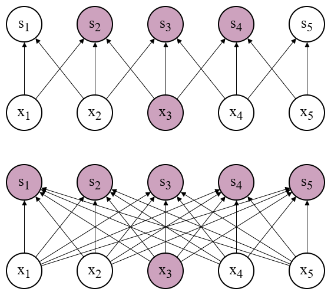
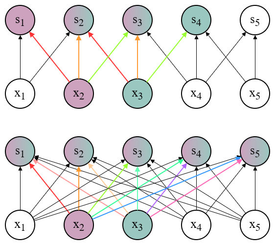

## Artificial Neural Network

### Biological Neuron

1. 神经元接收许多上游神经元的突触输入：
   - 兴奋性输入产生 EPSP（Excitatory Post-Synaptic Potential），使膜电位上升；
   - 抑制性输入产生 IPSP（Inhibitory Post-Synaptic Potential），使膜电位下降；
2. 神经元对这些输入进行时间积分（temporal integration）；
3. 当膜电位在轴丘（axon hillock / initial segment）处超过阈值时，神经元触发动作电位（spike）；
4. 动作电位沿轴突传播，传递给下游神经元。

本质上，神经元是一种**时序**的阈值非线性单元，包含输入合成、阈值触发和事件传播。

### SNN vs ANN

脉冲神经网络（**Spiking Neural Network**）与传统人工神经网络（**Artificial Neural Network**）。

| 特征 | **ANN** | **SNN** |
| :--- | :--- | :--- |
| Representation | **连续激活值**（continuous activations），每个神经元在一次前向计算中输出一个实数值 | 以事件/**脉冲**（spikes）表示信息，信息由脉冲的时序或频率编码 |
| Temporal handling | 无显式时间状态（frame-based），通常把时间维度外推或用循环结构处理 | 显式时间动力学（temporal dynamics），需要对膜电位进行 time integration |
| Computation mode | 同步、逐层前向计算（每层一次），适合批处理与矩阵运算加速 | **事件驱动**（event-driven），只有在有脉冲时才发生计算，适合稀疏异步计算 |
| Training / Optimization | 方便使用 backpropagation 和梯度下降算法，工具链成熟 | 直接训练困难（梯度不连续），常用近似/替代方法（如 **surrogate gradient**）；训练和调参更复杂 |
| Typical applications | 图像、语音、自然语言等多数传统深度学习任务，端到端训练容易实现 | 适合低功耗、在线、实时与时序敏感任务；在类脑（**neuromorphic**）硬件上有优势 |
| Biological plausibility vs engineering | 工程友好但生物意义较弱，与真实神经元差异大 | 更接近生物神经元的放电机制，但为工程实用性牺牲了训练易用性 |

**注**：

- 脉冲发放是二值、非连续的事件，梯度不存在或为零。通常使用**surrogate gradient**（替代梯度）方法将脉冲函数近似为可导函数。也可以先在 ANN 上训练再转换为 SNN（ANN-to-SNN conversion）。
- 当系统对延迟、能耗、异步事件处理有严格要求时（例如传感器事件流、嵌入式/边缘设备、神经形态芯片等），SNN 的事件驱动特性和稀疏计算可能带来明显优势。

---

## CNN

卷积神经网络（Convolutional Neural Network）。

### Convolutional Layer

- 输入尺寸：$W_{in} \times H_{in} \times C$
- filter 尺寸：$F \times F \times C$
- filter 个数：$K$
- stride 步长：$S$
- padding 填充：$P$
- 输出尺寸：$W_{out} \times H_{out} \times K$
    其中
    $$
    \begin{aligned}
    W_{out} = \left\lfloor\frac{W_{in} - F + 2P}{S}\right\rfloor + 1 \\
    H_{out} = \left\lfloor\frac{H_{in} - F + 2P}{S}\right\rfloor + 1
    \end{aligned}
    $$
- 参数数量：
    $$
    \text{Conv Params} = (F \times F \times C + 1) \times K
    $$
    每个 filter 有 $F \times F \times C$ 个可训练权重以及一个 bias。

**注**：filter 深度等于通道数，故每个位置不再是乘积，而应该是点积。

### Padding

**Padding Size**：

- Valid：$P = 0$
- Same Padding：
    $$
    P = \left\lfloor\frac{F-1}{2}\right\rfloor
    $$
- Full Padding：
    $$
    P = F - 1
    $$
    确保每个输入元素被卷积次数相同。

**Padding Content**：

- Zero Padding：填充 $0$
- Constant Padding：填充固定常数 $c$，常用均值
- Reflect Padding：镜像反射边缘
- Replicate Padding：复制边缘
- Circular Padding：循环填充

### Pooling

池化（Pooling）是通过下采样（spatial downsampling），减小特征图尺寸，提取更抽象、更不变的表示。

**Pooling Type**：

- Average pooling；常用
- Max pooling；最常用
- Sum pooling：较少

**注**：

- 池化操作没有可训练参数，输出尺寸公式与 Conv Layer 完全相同。
- 池化可以增加对微小**平移**和微小**旋转**的**不变性**（invariance）。
- 不一定需要池化，通过选定步长也可以替代池化的作用。

### Conv Layer vs FC Layer

- **Parameter Count**：
    参考 [Convolutional Layer](#convolutional-layer) 中的定义，考虑 bias 时两者的参数数量分别为：
    $$
    \begin{aligned}
    \text{Conv Params} &= (F \times F \times C + 1) \times K \\
    \text{FC Params} &= (W_{in} \times H_{in} \times C + 1) \times (W_{out} \times H_{out} \times K)
    \end{aligned}
    $$
    显然 Convolution 少了不只一点。

- **Sparse Connectivity**：
    Conv 只进行**稀疏连接**，也即每个像素点只与它相邻的点进行连接；而 FC 是全连接的。所以 Conv 之后仍保留了**空间位置信息**。

    

- **Parameter Sharing**：
    Conv 进行**参数共享**，也即同一卷积核在整张图像上复用；而 FC 则是各边权互不相同。这种参数共享使得 Conv 天然具有（微小）**平移等变性**。

    

本质上，MLP 是 CNN 的超集。若用 $\mathcal{F}_{\text{CNN}}$ 和 $\mathcal{F}_{\text{MLP}}$ 分别表示 CNN 与 MLP 能够学习的函数集合，则：
$$
\mathcal{F}_{\text{MLP}} \supseteq \mathcal{F}_{\text{CNN}}
$$

所以 MLP 其实更加 **expressive**。

但是实际训练时，我们很难在 MLP 如此广阔的参数空间中，优化寻找到满足所需性质（比如平移等变性）的那种解。
所以我们不妨在 MLP 的一个**特殊的**、**满足一定性质**（比如平移等变性）的子集中进行寻找，比如在 CNN 中寻找。

这就是利用 **Inductive Bias**（归纳偏见）简化问题。

---

## Training a CNN

### Pipeline

1. Data preparation and preprocessing
2. Weight initialization
3. Set a loss function
4. Start optimization

### Data Preprocessing

为加速训练收敛、减少过拟合、提升鲁棒性，我们需要对数据进行预处理。

- **Normalization**：

  - 减均值（zero-mean）、除方差（unit variance）。注意对于 RGB 图像，需要对每个通道分别进行操作（per-channel mean）。
  - 直接将像素值缩放到 $[0,1]$。

    这样可以使得数值更稳定，并且避免只向一个方向优化。
- **Augmentation**：随机裁剪、翻转、旋转、颜色扰动、缩放、平移、弹性变形等，以增强泛化能力。
- **Batching and Shuffle**：随机打乱并按 mini-batch 用于训练。
- **Dataset Split**：划分训练集、验证集、测试集。

**注**：验证集通常不做随机增强（或只做确定性变换），以确保评估一致性。训练集可做随机增强。

### Weight Initialization

梯度初始化很重要：

- 初始化太小，信号逐层衰减，**梯度消失**，网络无法训练；
- 初始化太大，信号逐层放大，**梯度爆炸**，数值不稳定；

所以我们需要合理初始化权重。下面先给出权重初始化的核心考虑因素，也即权重分布的方差。

**引理**：

对于神经网络的某一层，记：

- $\text{fan\_in}$ 为该层输入单元数量，例如 Conv 时为 $F \times F \times C$
- $\text{fan\_out}$ 为该层输出单元数量，例如 Conv 时为 $F \times F \times K$

假设：

1. 输入 $ x_i $ 独立同分布，均值 $ E[x_i] = 0 $，方差 $ \text{Var}(x_i) = \sigma_x^2 $
2. 权重 $ w_i $ 独立同分布，均值 $ E[w_i] = 0 $，方差 $ \text{Var}(w_i) = \sigma_w^2 $
3. $ x_i $ 与 $ w_i $ 相互独立
4. 神经元计算为 $ y = \sum_{i=1}^{n} w_i x_i $，也即忽略激活函数

则为保持输出方差等于输入方差 $ \sigma_y^2 = \sigma_x^2 $，应取：
$$
\sigma_w^2 = \frac{1}{\text{fan\_in}}
$$

**证明**：

$$
\begin{aligned}
\text{Var}(y)
&= \text{Var}\left(\sum_{i=1}^{\text{fan\_in}} w_i x_i\right) \\
&= \sum_{i=1}^{\text{fan\_in}} \text{Var}(w_i x_i) \\
&= \sum_{i=1}^{\text{fan\_in}} \left( E[w_i^2] E[x_i^2] - (E[w_i]E[x_i])^2 \right) \\
&= \text{fan\_in} \cdot \sigma_w^2 \cdot \sigma_x^2
\end{aligned}
$$

从而由 $ \sigma_y^2 = \sigma_x^2 $ 得：
$$
\sigma_w^2 = \frac{1}{\text{fan\_in}}
$$

**注**：

- 有时为了正向传播和反向传播开始时都能尽量保持方差，会取两者均值初始化，也即：
    $$
    \sigma_w^2 = \frac{1}{\text{fan\_in} + \text{fan\_out}}
    $$
    但下面均不考虑反向传播。要考虑只需用 $\text{fan\_in} + \text{fan\_out}$ 替换 $\text{fan\_in}$ 即可。
- 考虑激活函数的影响：

    当使用 **ReLU** 激活函数时，由于负半轴置零，输出方差近似减半，需修正为：
    $$
    \sigma_w^2 = \frac{2}{\text{fan\_in}}
    $$
    当使用 **Leaky ReLU** 激活函数时，再依负半轴斜率 $ \alpha $ 修正为：
    $$
    \sigma_w^2 = \frac{2}{\text{fan\_in} \cdot (1+\alpha^2)}
    $$
    当使用 **tanh** 激活函数时，由于在 0 附近有 $\tanh(z) \approx z$，从而我们不需要修正。也即仍为：
    $$
    \sigma_w^2 = \frac{1}{\text{fan\_in}}
    $$
    不过事实上，由于 $\tanh(z) < z$，所以不修正下方差会逐层缓慢减小。

    当使用 **Sigmoid** 激活函数时，由于 $\sigma(0) = 0.5$ 且 $\sigma'(0) = 0.25$，
    在 0 附近有 $\sigma(z) \approx 0.5 + 0.25z$，输出方差被压缩为原来的 $\frac{1}{16}$，从而我们需要将权重方差放大 16 倍来补偿，修正为：
    $$
    \sigma_w^2 = \frac{16}{\text{fan\_in}}
    $$
    不过事实上，由于 sigmoid 输出均值不为 0，且过大的初始化易使神经元进入饱和区导致梯度消失，实际使用中常采用较保守的初始化（如 $2/\text{fan\_in}$），或优先考虑其他激活函数。
- 以上策略仅保证**训练开始时**信号方差稳定，实际训练中方差必然会随参数更新而改变。

**具体初始化**：

所有初始化都可以统一为：

- 高斯分布：
    $$
    W \sim \mathcal{N}(0,\ \sigma_w^2)
    $$
- 均匀分布：
    $$
    W \sim \mathcal{U}\left(-\sqrt{3\sigma_w^2},\ \sqrt{3\sigma_w^2}\right)
    $$

具体来说，

- 对于对称激活函数（如 tanh），我们不需要修正方差，则称为 **Xavier/Glorot 初始化**；
- 对于不对称激活函数（如 ReLU / Leaky ReLU），我们需要针对激活函数进行一些修正，则称为 **He 初始化**。

**注**：

- 初始化仍是研究中的活跃领域（如针对 Transformer、稀疏网络等有特殊初始化策略）。
- 深层网络训练还依赖 BatchNorm、ResNet 等技巧缓解梯度问题。

### Optimizer

记梯度 $g_t = \nabla_\theta \mathcal{L}(\theta_t)$

- **SGD**：
    随机梯度更新（Stochastic Gradient Descent）。
    $$
    \theta_{t+1} \leftarrow \theta_t - \alpha g_t
    $$
    问题在于原始 SGD 噪声大、收敛慢。
- **Momentum**：
    $$
    v_t \leftarrow \rho v_{t-1} + (1 - \rho) g_t,\quad
    \theta_{t+1} \leftarrow \theta_t - \alpha v_t
    $$
    展开即得：
    $$
    v_t = (1 - \rho) \sum_{i = 0}^t \rho^{t-i} g_i
    $$
    其中 $\rho$ 是动量系数/摩擦系数，常取 $\rho = 0.9$。$v_t$ 是速度，$\theta_t$ 是位置。

    速度累积自历史梯度，有助于穿越鞍点与加速曲面方向。
- **RMSProp**：
    $$
    s_t \leftarrow \rho s_{t-1} + (1-\rho)g_t^2,\quad
    \theta_{t+1} \leftarrow \theta_t - \alpha \frac{g_t}{\sqrt{s_t} + \epsilon}
    $$
    其中 $s_t$ 为梯度平方的移动平均。$\epsilon = \text{1e-8}$ 防止除零。

- **Adam**：
    $$
    \begin{aligned}
    m_t &= \beta_1 m_{t-1} + (1-\beta_1) g_t \\
    v_t &= \beta_2 v_{t-1} + (1-\beta_2) g_t^2 \\
    \hat m_t &= \frac{m_t}{1-\beta_1^t},\quad \hat v_t = \frac{v_t}{1-\beta_2^t} \\
    \theta_{t+1} &= \theta_t - \alpha \frac{\hat m_t}{\sqrt{\hat v_t} + \epsilon}
    \end{aligned}
    $$
    其中 $m_t$ 为一阶矩，$v_t$ 为二阶矩，$\beta1,\ \beta_2$ 为超参数，常取 $\beta_1 = 0.9,\ \beta_2 = 0.999$。$\epsilon = \text{1e-8}$ 防止除零。

    本质上是在自适应学习率，一般收敛快、对超参不敏感，适合初学者作为默认选择。

**注**：
Adam 一般收敛快，但是 SGD + Momentum 能够训练出更好的模型。

### Learning Rate

学习率对训练至关重要：

- 学习率太小，收敛慢或容易陷入局部最小（undershoot）；
- 学习率太大，发散或在最优附近震荡（overshoot）。

建议的初始学习率约为 $[\text{1e-6}, \text{1e-3}]$。以下是常见的学习率调度策略。

**Schedules**：

- **Decay Strategy**：
    记 $T$ 为总 epoch 数。
  - Fixed：$\alpha_t = \alpha_0$
  - Step decay：每隔若干 epoch 乘以衰减因子
  - Exponential：$\alpha_t = \alpha_0 \cdot \gamma^t$
  - Linear：$\alpha_t = \alpha_0 (1 - t/T)$
  - Cosine：$\alpha_t = \frac{1}{2} \alpha_0 (1 + \cos(t\pi/T))$
  - Inverse sqrt：$ \alpha_t = \alpha_0 / \sqrt{t}$
  - ReduceLROnPlateau：自适应策略，根据验证集表现自动调整 LR
- **Warmup Strategy**：训练初期学习率线性增大，再进入正常调度。解决训练初期大 LR 导致不稳定的问题，尤其在大 batch 或 Transformer 等结构中常用。
- **Stopping Strategy**：在验证集上连续若干 epoch 无提升则停止训练。可以防止过拟合。

**注**：推荐使用 Adam 与 Fixed decay 先找到收敛的 epoch 总数，然后再使用 SGD + Momentum 与 Cosine decay 进一步训练。

### Iteration vs Epoch

**迭代概念**：

- Batch size：一次 iteration 中的样本数。
- Iteration：对一个 batch 的一次 propagation 与 backpropagation。
- Epoch：完整遍历一次训练集，包含若干 iterations。

事实上我们有关系：
$$
\text{Iterations per Epoch} \propto \frac{\text{Total Samples}}{\text{Batch Size}}
$$
我们通常在一个 Epoch 后进行可视化点采样、模型测试和参数存储。
我们调整上述量时，应考虑模型优化量。定义：
$$
\begin{aligned}
\text{Total Update Magnitude}
&\propto (\text{Iterations per Epoch} \times \text{Epoch}) \times \text{Learning Rate} \\
&\propto \frac{\text{Total Samples} \times \text{Epoch} \times \text{Learning Rate}}{\text{Batch Size}}
\end{aligned}
$$
从而可见控制模型优化相同，则：

- 若 Batch Size 和 Learning Rate 不变，增大样本数，可以减小 Epoch
- 若 Epoch 和样本数不变，增大 Batch Size，可以增大 Learning Rate
