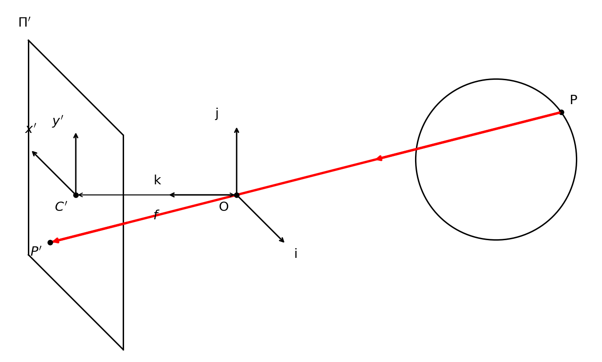

## From 2D to 3D

### Aim

3D Vision 部分关注三个问题：

1. **3D to 2D (Camera Model)**：相机模型描述 3D 点如何投影到 2D 图像。
2. **2D to 3D (3D Reconstruction)**：三维重建研究如何从 2D 观测恢复 3D 结构。
3. **3D Conception**：在点云、深度图、体素、网格等三维表征上进行识别、分割和理解。

### Visual Modality

常见视觉模态包括：

| 模态 | 数据形式 | 作用 |
| :--- | :--- | :--- |
| **Stereo Images** | 双目图像 | 通过视差估计深度 |
| **Multiview Images** | 多视角图像 | 聚合多个视角以恢复更完整的三维结构 |
| **Panoramic Images** | 全景图像 | 覆盖 360 度视场，扩展单相机视野 |
| **Depth Image** | 单通道深度图 | 每个像素记录沿光轴方向的深度值 |
| **LiDAR Point Cloud** | 三维点云 | 直接给出空间点的 $(X,Y,Z)$ 坐标 |

**注**：模态指通过不同采集方式获得的不同数据形态。

## Camera Model

### Pinhole Camera Model

**Pinhole Camera Model**（针孔相机模型）在物体与成像平面之间放置极小孔径，使空间点到像平面点之间近似一一对应，从而形成清晰图像。它是计算机视觉中最基础的几何成像模型。

设相机坐标系原点为 **Optical Center**（光心），$Z$ 轴沿光轴方向，像平面到光心的距离为焦距 $f$。空间点 $P=(X,Y,Z)$ 投影到像平面点 $p'=(x',y')$。

根据相似三角形，针孔投影为：
$$
x' = f\frac{X}{Z},\quad y' = f\frac{Y}{Z}
$$

其中 $Z$ 是点到相机的深度。

**注**：投影公式体现了**近大远小**，同样大小的物体，深度 $Z$ 越大，投影尺寸越小。

### Issues with Pinhole

针孔相机存在孔径大小的权衡：

| 孔径 | 结果 | 原因 |
| :--- | :--- | :--- |
| 较大 | 图像模糊 | 一个像平面点接收来自多个空间点的光线 |
| 较小 | 图像过暗 | 进入相机的光线数量不足 |

### Paraxial Refraction Model

真实相机使用 **Lens**（透镜）汇聚光线。理想透镜满足两条常用近似：

- 经过光心的光线方向不变；
- 平行于光轴的光线汇聚到焦点，光心到焦点的距离为焦距 $f$。

若物距为 $Z$，像距为 $Z'$，透镜成像仍可由相似三角形写为：
$$
x' = Z'\frac{X}{Z},\quad y' = Z'\frac{Y}{Z}
$$

实际摄影中，只有特定深度附近的物点能精确聚焦在像平面上，这对应 **Depth of Field**（景深）；过近或过远的点会失焦。

### Issues with Lens

透镜的线性投影推导依赖 **Paraxial Approximation**（近轴近似）：光线需要靠近光轴。当光线远离光轴时，折射不再满足简单线性关系，导致 **Radial Distortion**（径向畸变）。

常见径向畸变包括：

| 类型 | 现象 | 常见场景 |
| :--- | :--- | :--- |
| **Pincushion Distortion** | 网格向中心收缩，直线向内弯曲 | 部分长焦或复杂镜头 |
| **Barrel Distortion** | 网格向外膨胀，直线向外弯曲 | 广角、鱼眼、运动相机 |

## Camera Intrinsics

### Pixel Coordinates

针孔投影首先得到像平面坐标 $(x',y')$，其单位是物理长度；实际图像使用像素坐标 $(u,v)$，原点通常位于图像左上角。两者之间需要处理两个因素：

1. **Principal Point Offset**（主点偏移）：光轴与像平面的交点不一定是像素坐标原点，记为 $(c_x,c_y)$。
2. **Pixel Scale**（像素尺度）：像平面长度单位需要转换为像素单位。设横向、纵向转换系数分别为 $k,l$。

于是有：

$$
u = fk\frac{X}{Z} + c_x = \alpha\frac{X}{Z} + c_x
$$

$$
v = fl\frac{Y}{Z} + c_y = \beta\frac{Y}{Z} + c_y
$$

其中 $\alpha=fk$，$\beta=fl$ 表示等效焦距，$(c_x,c_y)$ 为主点坐标，都以像素为单位。

### Homogeneous Coordinates

投影公式中的除以 $Z$ 是非线性操作，无法直接写成普通线性矩阵乘法。引入 **Homogeneous Coordinates**（齐次坐标）后，可以使用矩阵运算表示。

齐次坐标具有尺度等价性：
$$
(X,Y,Z,W) \sim \left(\frac{X}{W},\frac{Y}{W},\frac{Z}{W},1\right),\quad W\neq 0
$$

在相机坐标系中，投影可写为：
$$
\begin{bmatrix}
\alpha X + c_x Z \\
\beta Y + c_y Z \\
Z
\end{bmatrix}
=
\begin{bmatrix}
\alpha & 0 & c_x & 0 \\
0 & \beta & c_y & 0 \\
0 & 0 & 1 & 0
\end{bmatrix}
\begin{bmatrix}
X \\ Y \\ Z \\ 1
\end{bmatrix}
$$

最后将前两维结果除以第三维 $Z$，得到像素坐标 $(u,v)$。

### Camera Intrinsic Matrix

**Camera Intrinsic Matrix**（相机内参矩阵）定义为：

$$
K =
\begin{bmatrix}
\alpha & 0 & c_x \\
0 & \beta & c_y \\
0 & 0 & 1
\end{bmatrix}
$$

若 $p_{\text{cam}}=(X,Y,Z,1)^\top$ 是相机坐标系下的三维齐次点，则像素齐次坐标为：

$$
p_{\text{hom}} = K
\begin{bmatrix}
I & 0
\end{bmatrix}
p_{\text{cam}}
$$

其中 $\begin{bmatrix} I & 0 \end{bmatrix}$ 是 $3\times4$ 矩阵，用于从三维齐次坐标中取出 $(X,Y,Z)$。

**Camera Skewness**（相机偏斜）用于描述像素坐标轴不严格垂直的情况。由于工业相机中 $x,y$ 像素轴通常接近正交，偏斜参数常被忽略。

## Camera Extrinsics

### World Reference Frame

前面的投影公式默认三维点已经在相机坐标系中表示。
但真实任务中，物体通常定义在 **World Reference Frame**（世界坐标系）下，而相机会在世界中移动。
因此需要用外参描述世界坐标到相机坐标的刚体变换。

相机外参包括：

- **Rotation**（旋转）$R\in SO(3)$；
- **Translation**（平移）$t=(t_x,t_y,t_z)^\top$。

从世界坐标到相机坐标的变换为：
$$
\begin{bmatrix}
P_{\text{cam}} \\
1
\end{bmatrix}
=
\begin{bmatrix}
R & t \\
0 & 1
\end{bmatrix}
\begin{bmatrix}
P_w \\
1
\end{bmatrix}
$$

这里 $R,t$ 表示世界坐标系在相机坐标系中的朝向与原点位置，而不是直接表示相机在世界坐标系中的位姿。
若要得到相机在世界坐标系中的位姿，则相机朝向为 $R^{-1}$，相机中心位置为 $-R^{-1}t$。

### Projection Matrix

结合内参和外参，三维世界点到二维像素坐标的完整投影为：
$$
p \sim K
\begin{bmatrix}
R & t
\end{bmatrix}
p_w
\sim P p_w
$$

其中：
$$
P = K
\begin{bmatrix}
R & t
\end{bmatrix}
$$

称为 **Projection Matrix**（投影矩阵）。若将 $P$ 的三行记为 $m_1,m_2,m_3$，则齐次归一化得到：
$$
(u,v)=
\left(
\frac{m_1 p_w}{m_3 p_w},
\frac{m_2 p_w}{m_3 p_w}
\right)
$$

透视投影具有以下性质：

- 点投影为点；
- 直线投影为直线；
- 远处物体看起来更小；
- 平行线在图像中可能相交于消失点。

因此，透视相机适合精确描述真实 3D 到 2D 的成像关系，是 **Structure from Motion**（运动恢复结构）、**SLAM** 等几何任务的基础。

## Camera Model Variants

### Perspective Camera

满足完整投影变换的相机称为 **Perspective Camera**（透视相机）。其核心公式为：
$$
x' = f\frac{x}{z},\quad y' = f\frac{y}{z}
$$

透视投影会保留深度相关的尺度变化，因此几何建模更准确，但数学处理更复杂。

### Weak Perspective Camera

当物体自身的深度变化远小于其到相机的平均距离时，可以用平均深度 $z_0$ 替代每个点的实际深度 $z$：
$$
x' = \frac{f}{z_0}x,\quad y' = \frac{f}{z_0}y
$$

其中 $m=\frac{f}{z_0}$ 可看作整体放大率。此时投影退化为线性缩放，弱透视矩阵可写成仿射形式：
$$
M =
\begin{bmatrix}
A & b \\
0 & 1
\end{bmatrix}
$$

弱透视的结果为：
$$
(u,v)=(m_1p_w,m_2p_w)
$$

也即不再对第三个齐次分量做逐点除法。

| 模型 | 假设 | 优点 | 局限 |
| :--- | :--- | :--- | :--- |
| **Perspective Camera** | 每个点使用真实深度 $z$ | 3D 到 2D 建模准确，适合 SFM、SLAM | 数学更复杂 |
| **Weak Perspective Camera** | 物体较小且距离相机较远，$z\approx z_0$ | 公式简单，适合识别任务 | 无法准确表达明显透视变化 |

### Orthographic Projection

**Orthographic Projection**（正交投影）可视为投影中心到像平面的距离趋于无穷远时的极限情况。所有投影光线互相平行，因此深度不影响投影尺度：
$$
x'=x,\quad y'=y
$$

正交投影常用于工程制图、三视图等场景；透视投影则更接近真实相机拍摄效果。

## Depth Images and Backprojection

### Depth Image

**Depth Image**（深度图）是单通道图像，每个像素存储该像素对应空间点的深度值。这里的深度通常指沿相机光轴方向的 $z$ depth，而不是光心到空间点的欧氏距离。

深度图是 **2.5D Representation**：

- 它只记录当前视角下可见表面的深度；
- 它无法表示物体背面或被遮挡结构；
- 单独的 $(u,v,z)$ 不能直接用于三维距离测量。

真正的三维坐标恢复还需要相机内参 $K$。

### Depth Backprojection

若已知深度相机内参 $K$，对深度图像素 $(u,v,z)$，由投影关系：
$$
u = \alpha\frac{x}{z}+c_x,\quad
v = \beta\frac{y}{z}+c_y
$$

可反解三维坐标：
$$
x = \frac{z(u-c_x)}{\alpha},\quad
y = \frac{z(v-c_y)}{\beta}
$$

因此，像素 $(u,v,z)$ 可通过 **Depth Backprojection**（深度反投影）转换为相机坐标系下的三维点 $(x,y,z)$。对所有深度像素执行该过程，就可以把深度图转换为 **Depth Point Cloud**（深度点云）。

**Pipeline**：

1. 读取深度图中每个有效像素 $(u,v)$ 及其深度 $z$。
2. 使用内参 $K$ 中的 $\alpha,\beta,c_x,c_y$ 计算 $x,y$。
3. 得到相机坐标系下的三维点 $(x,y,z)$。
4. 汇总所有有效点，形成深度点云。

**注**：没有相机内参时，深度图只是带有深度数值的二维栅格；只有结合 $K$ 完成反投影后，才具备真实三维坐标和距离测量能力。
