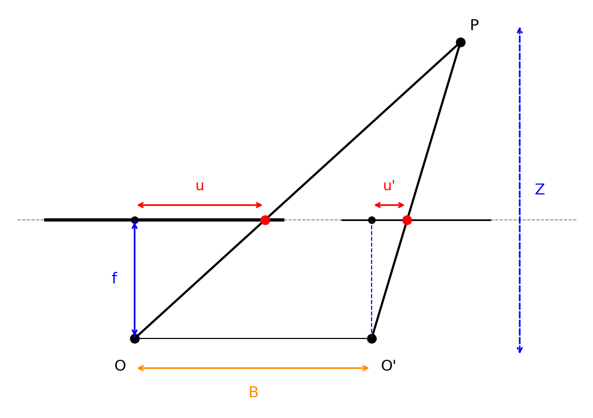

## Multiple 3D Representations

### 3D Representations Overview

三维数据的表示形式很多，常见类型包括：

| 表征 | 形式 | 典型特点 |
| :--- | :--- | :--- |
| **Multi-view Images** | 多视角图像 | 仍是 2D 图像集合，需要相机位姿建立几何关系 |
| **Depth Map** | 深度图 | 单视角 2.5D 表征，与图像像素一一对应 |
| **Voxel** | 体素 | 规则三维栅格，易索引但存储昂贵 |
| **Mesh** | 网格 | 显式表面表征，适合渲染、编辑与几何处理 |
| **Point Cloud** | 点云 | 表面采样点集合，轻量但缺少连接关系 |
| **Implicit Representation** | 隐式表征 | 用函数零等值面定义几何，适合拓扑变化 |

表征形式的多样性来自两方面：

1. **数据来源不同**：深度相机扫描通常得到点云或深度图；CAD 建模通常得到网格；程序化生成可能直接使用函数或代码定义几何。
2. **应用需求不同**：存储、编辑、平滑、修复、渲染、动画、机器学习监督等任务对表征的要求不同。

### Regular vs Irregular

三维表征可以粗略分为规则表征和不规则表征。

- **Regular Representation**：如多视角图像、深度图、体素，数据排列规则，便于索引与使用 CNN 类结构。
- **Irregular Representation**：如网格、点云、隐式表征，直接围绕物体表面或表面附近的几何结构建模，更接近真实三维几何。

---

## Depth Image and Voxels

### Depth Image

**Depth Image**（深度图）是最常见的三维相关表征之一。它本质上是一张单通道图像，每个像素存储该像素对应场景点到相机的深度值。

深度图是 **2.5D Representation**，不是完整 3D 表征：

- 它只描述某一视角下可见表面的深度，无法表示背面或被遮挡部分；
- 单独的 $(u,v,Z)$ 不能直接给出真实三维坐标 $(X,Y,Z)$；
- 若没有相机内参，无法正确测量任意两个点之间的三维距离。

真正的三维表征应当支持空间距离测量。深度图只有在结合相机内参后，才能通过反投影转成点云。

### Depth Backprojection

假设已知深度相机的内参矩阵 $K$。对深度图上的像素 $(u,v)$，其深度为 $Z$，相机投影关系为：
$$
u = \alpha \frac{X}{Z} + c_x,\quad
v = \beta \frac{Y}{Z} + c_y
$$

其中 $\alpha,\beta$ 为焦距相关参数，$c_x,c_y$ 为主点坐标。反解得到：
$$
X = \frac{(u-c_x)Z}{\alpha},\quad
Y = \frac{(v-c_y)Z}{\beta}
$$

通过该 **Backprojection**（反投影）过程，深度图中的像素 $(u,v,Z)$ 可转换为相机坐标系下的三维点 $(X,Y,Z)$，深度图也就变成了一个 **Depth Point Cloud**。

**注**：深度图必须配合相机内参 $K$ 才能恢复真实三维坐标。没有 $K$ 时，它只是带有深度数值的二维栅格。

### Voxels

**Voxel**（体素）是像素在三维空间中的推广，用 $H \times W \times D$ 的三维栅格表示空间。每个体素可以存储：

- 占用状态：empty / occupied；
- 颜色、法向量、材质等附加属性。

体素的优点是规则、可索引，容易将二维卷积扩展到 **3D CNN**。其核心缺点也很明显：

- 存储量随分辨率呈立方增长；
- 不是天然的表面表征，需要进一步判断表面在哪里；
- 简单上采样无法恢复已丢失的细节，会引入量化误差。

---

## Depth Sensors

### Stereo Sensors

**Depth Sensor**（深度传感器）是三维测距设备，用于在较大视场范围内测量多点距离。典型方案是 **Stereo Sensor**（双目立体传感器）。

双目立体视觉的基本机制是：

1. 在左右图像之间估计像素对应关系；
2. 根据对应点计算 **Disparity**（视差）；
3. 将视差转换为深度；
4. 再结合相机模型恢复三维点。

### Triangulation and Disparity

双目系统中，两个相机光心 $O,O'$ 之间有固定 **Baseline** $B$。空间点 $P$ 分别投影到左右图像中的 $p,p'$。
若能找到对应点，就可以通过两条相机射线的交会恢复 $P$ 的三维位置，这一过程称为 **Triangulation**（三角化）。

校正后的双目图像中，对应点通常位于同一水平扫描线。定义视差：
$$
d = u - u'
$$

深度为：
$$
Z = \frac{fB}{d}
$$

其中 $f$ 为焦距，$B$ 为双目基线。视差越大，深度越小；视差越小，点越远。

### Epipolar Geometry

**Epipolar Geometry**（对极几何）用于约束对应点搜索。两个相机光心与空间点 $P$ 构成 **Epipolar Plane**，该平面与左右图像平面的交线为 **Epipolar Line**。

对应点 $p'$ 必定位于 $p$ 的对极线上，因此匹配搜索从二维区域降为一维线搜索。

### Failure Cases

双目传感器的优点是对阳光直射等光照条件较鲁棒，实现成本较低。主要难点在于对应点搜索容易失败：

- **Textureless Region**：无纹理区域缺少可区分特征；
- **Repeated Pattern**：重复纹理会产生匹配歧义；
- **Specular / Transparent Surface**：高反光或透明材质在不同视角下外观差异大，基于 RGB 相似性的匹配不可靠。

### Active Stereo and Structured Light

**Active Stereo**（主动立体视觉）通过主动投射图案来降低匹配难度。典型做法是使用投影仪或红外发射器投射结构光、散斑或编码图案，再由相机观测图案变形。

**Structured Light**（结构光）的核心思想是把自然纹理变成可控纹理：

1. 投射器向场景投射已知图案；
2. 相机观测物体表面上的图案形变；
3. 根据图案编码或左右红外图像匹配建立对应关系；
4. 通过三角化恢复深度。

**注**：主动方法可以在黑暗环境中工作，也能缓解无纹理问题，但对透明、高反光材质仍然敏感。

---

## Mesh

### Surface Mesh

**Mesh**（网格）是一种显式表面表征，用分段线性曲面近似真实光滑表面。最常见的是 **Triangle Mesh**（三角网格），也有 **Quad Mesh**（四边形网格）。

- 三角形一定共面，便于计算法向量与执行光照计算；
- 四边形结构类似图像栅格，常用于建模与纹理展开；
- 不同分辨率的网格可以在几何精度和存储成本之间取舍。

网格既是几何表征，也是表面表征。相比点云，它显式给出顶点之间如何连接成边和面。

### Mesh Data Structure

网格需要存储三类信息：

- **Geometry**：顶点的三维坐标；
- **Topology**：顶点、边、面之间的连接关系；
- **Attributes**：法向量、颜色、纹理坐标等，可按顶点、边或面存储。

常见数据结构包括：

| 数据结构 | 思路 | 优点 | 缺点 |
| :--- | :--- | :--- | :--- |
| **Triangle List / STL** | 每个三角形直接存三个顶点坐标 | 简单，CAD 中常见 | 共享顶点会重复存储，缺少连接信息 |
| **Indexed Face Set** | 分开存顶点列表与面索引 | 紧凑，保留拓扑 | 需要通过索引解析面片 |

**Indexed Face Set** 常用于 OBJ、OFF、WRL 等格式。面片通常按逆时针顺序保存顶点索引，使法向量可由右手定则确定并指向外侧。

## Point Cloud

### Basic Definition

**Point Cloud**（点云）是物体表面采样点的集合，通常以 $N \times 3$ 数组存储。它是不规则且无序的数据结构：
$$
P = \{\mathbf{x}_i \in \mathbb{R}^3\}_{i=1}^{N}
$$

点云的特点是轻量、易存储、直观，且通常容易从深度传感器或多视角重建中获得。

但点云不是表面表征。它只给出表面上的采样点，不直接说明点之间如何连接，也不直接回答“表面在哪里”。

### Uniform Sampling

从网格采样点云时，最直接的方法是 **Uniform Sampling**：

1. 计算每个三角面片的面积；
2. 按面片面积占总面积的比例得到采样概率；
3. 按概率独立同分布采样面片；
4. 在被采样的三角形内部均匀采样点。

对三角形顶点 $\mathbf{v}_1,\mathbf{v}_2,\mathbf{v}_3$，可先采样 $a_1,a_2\sim U(0,1)$。若 $a_1+a_2\le 1$，则：

$$
\mathbf{x}=a_1\mathbf{v}_1+a_2\mathbf{v}_2+(1-a_1-a_2)\mathbf{v}_3
$$

若 $a_1+a_2>1$，则映射回三角形内部：

$$
\mathbf{x}=(1-a_1)\mathbf{v}_1+(1-a_2)\mathbf{v}_2+(a_1+a_2-1)\mathbf{v}_3
$$

该方法实现简单，但采样点间距可能不均匀。

### Farthest Point Sampling

**Farthest Point Sampling**（FPS，最远点采样）的目标是让采样点尽可能均匀分布。其优化目标可以理解为最大化采样点之间的最小距离。

实际通常使用贪心近似：

1. 先从表面得到较密集的候选点集合；
2. 随机选取一个初始点加入采样集；
3. 对每个候选点，计算其到当前采样集的最近距离；
4. 选择最近距离最大的候选点加入采样集；
5. 重复直到达到目标点数。

FPS 结果通常比纯均匀采样更规则，但迭代过程难以并行，计算代价较高。

### Distance Metrics for Point Cloud

点云是无序集合，通常没有天然的一一对应关系，因此距离度量需要直接作用在集合上。

**Chamfer Distance**（CD）定义为双向最近点距离：
$$
d_{\text{CD}}(S_1,S_2)=
\frac{1}{|S_1|}\sum_{\mathbf{x}\in S_1}\min_{\mathbf{y}\in S_2}\|\mathbf{x}-\mathbf{y}\|_2
+
\frac{1}{|S_2|}\sum_{\mathbf{y}\in S_2}\min_{\mathbf{x}\in S_1}\|\mathbf{x}-\mathbf{y}\|_2
$$

它不要求建立一一对应，计算相对简单，是点云重建和生成任务中常用的监督信号。

**Earth Mover's Distance**（EMD）源于 **Optimal Transport**（最优传输），要求在两个点集之间建立匹配，使总搬运代价最小。它更关注全局分布匹配，但计算更昂贵，且通常要求两个点集点数相等。

**注**：点云可看成“表面 + 采样”。若采样本身不均匀，距离度量可能把采样噪声当作几何差异，从而影响学习监督。

---

## Implicit Representation

### SDF

**Implicit Representation**（隐式表征）不直接列出表面点，而是用函数定义几何。最典型形式是：
$$
F(x,y,z)=0
$$

其零等值面即为物体表面。

**Signed Distance Function**（SDF，符号距离函数）定义空间点 $\mathbf{x}$ 到最近表面的有符号距离：

- $f(\mathbf{x})=0$：点在表面上；
- $f(\mathbf{x})<0$：点在物体内部；
- $f(\mathbf{x})>0$：点在物体外部。

隐式表征的优点包括：

- 可以通过 **Marching Cubes** 转换为网格；
- 天然支持拓扑变化，如合并或分裂；
- 表面法向量可由梯度 $\nabla f$ 得到。

除 SDF 外，常见隐式表征还包括 **Unsigned Distance Function** 和 **Occupancy Network**。

### Marching Squares and Marching Cubes

**Marching Squares** 是二维隐式曲线提取算法，**Marching Cubes** 是其三维版本，用于从隐式场中提取零等值面。

**Marching Squares Pipeline**：

1. 将平面离散为规则网格；
2. 在每个网格顶点计算隐式函数值；
3. 根据四个顶点的正负号判断内部/外部状态；
4. 查询 **Lookup Table** 得到该小方格中的曲线片段拓扑；
5. 对边上的零交点做线性插值，得到更精确的曲线位置。

**Marching Cubes Pipeline**：

1. 将空间离散为体素网格；
2. 每个立方体有 8 个顶点，分别记录隐式函数值；
3. 根据 8 个顶点的正负状态查询查找表；
4. 生成该立方体内部的三角面片；
5. 沿边线性插值确定等值面顶点位置；
6. 遍历所有立方体并拼接面片，得到网格。

原始 Marching Cubes 在考虑旋转对称后可归纳为 15 种基本情形。后续工作进一步讨论拓扑歧义并提出更严格的查找表。

**注**：当一个网格单元内的正负号不能唯一决定内部曲面连接方式时，会出现 **Ambiguity**（歧义）。可通过减小网格尺寸或引入邻域上下文缓解。

### DeepSDF

神经网络可以作为 **Universal Function Approximator**，用于逼近复杂的隐式函数。例如训练网络 $f_\theta(\mathbf{x})$ 输出点 $\mathbf{x}$ 处的 SDF 值。

**DeepSDF** 的关键价值不只是用网络复现单个形状，而是学习 **Shape Space**（形状空间）：

1. 为每个形状分配一个 **Latent Code**；
2. 网络输入为 $(\mathbf{x}, \mathbf{z})$，其中 $\mathbf{z}$ 是形状隐编码；
3. 网络输出该形状在空间点 $\mathbf{x}$ 处的 SDF；
4. 在隐空间中插值或优化，即可生成或重建新形状。

**注**：训练 DeepSDF 通常仍需要已有网格或点云来计算监督信号，但学习到的连续形状空间可用于重建、补全和生成。

---

## Neural Radiance Field

### Novel View Synthesis

**Neural Radiance Field**（NeRF）的目标是 **Novel View Synthesis**（新视角合成）：给定同一场景的若干已知相机位姿图像，学习一个连续场景表征，并渲染未见过视角下的图像。

传统三维视觉 Pipeline 通常是：

1. 从多视角图像重建显式三维几何；
2. 为几何估计纹理、材质或外观；
3. 使用图形学 Pipeline 从新相机位姿渲染图像。

NeRF 的思路是绕过显式几何重建，直接端到端学习一个可微的神经场景表征，并通过可微体渲染训练。

### Volume Rendering

体渲染将一条相机光线穿过场景的过程建模为沿线积分。对光线上的位置 $t$，定义：

- **Density** $\sigma(t)$：局部不透明度，决定光线被吸收的概率；
- **Color / Radiance** $\mathbf{c}(t)$：该位置沿观察方向贡献的颜色；
- **Transmittance** $T(t)$：光线从近端传播到 $t$ 仍未被遮挡的概率。

连续体渲染积分为：
$$
\mathbf{C}=
\int_{t_n}^{t_f}
T(t)\sigma(t)\mathbf{c}(t)\,dt
$$

其中：
$$
T(t)=\exp\left(-\int_{t_n}^{t}\sigma(s)\,ds\right)
$$

最终像素颜色是沿光线所有采样点的颜色贡献加权和。密度越大，该点越可能遮挡后方内容，前方透射率也越低。

### Discretized Radiance Integration

实际计算中会沿光线采样有限个点，并用 **Ray Marching** 离散近似体渲染积分。若第 $i$ 个采样点的不透明度为 $\alpha_i$，颜色为 $\mathbf{c}_i$，则其权重为：

$$
w_i=\alpha_i\prod_{j<i}(1-\alpha_j)
$$

最终颜色近似为：

$$
\mathbf{C}\approx\sum_i w_i\mathbf{c}_i
$$

该式表示：第 $i$ 个点的贡献等于它自身的不透明度，乘以前面所有点都没有遮挡光线的概率。

### NeRF Representation and Training

NeRF 使用 MLP 表示连续辐射场：

$$
F_\theta:(\mathbf{x},\mathbf{d})\mapsto(\sigma,\mathbf{c})
$$

其中 $\mathbf{x}=(x,y,z)$ 是空间坐标，$\mathbf{d}$ 是观察方向。
密度 $\sigma$ 主要由位置决定，颜色 $\mathbf{c}$ 同时依赖位置与视角方向，以建模高光、反射等 **Non-Lambertian** 外观。

**Training Pipeline**：

1. 输入已知相机位姿的多视角图像；
2. 从训练图像中采样像素，对应生成相机光线；
3. 沿每条光线采样空间点；
4. MLP 查询每个点的密度和颜色；
5. 用可微体渲染合成像素颜色；
6. 用渲染颜色与真实像素颜色之间的 **Photometric Loss** 优化网络。

**局限**：NeRF 每条光线都要查询大量采样点，训练和推理代价较高；同时隐式表征需要在大范围空间中查询，空区域会带来大量冗余计算。

## 3D Gaussian Splatting

### Motivation

**3D Gaussian Splatting**（3DGS）的核心动机是：辐射场只需要在密度非零的区域参数化，而不是在整片空间中密集查询。它重新采用显式表征，用一组三维高斯椭球表示场景。

每个 3D Gaussian 通常包含：

- 位置；
- 协方差矩阵，用于描述椭球形状、尺度与方向；
- 不透明度 $\alpha$；
- 颜色参数，常用 **Spherical Harmonics**（球谐函数）表示视角相关颜色。

### Rendering

3DGS 不使用 NeRF 式的逐点 MLP 查询和密集 Ray Marching，而是使用高效的光栅化式渲染。

**Rendering Pipeline**：

1. 根据当前相机视锥剔除与视图无关的高斯；
2. 将三维高斯投影到二维图像平面；
3. 利用高斯在仿射变换与积分下封闭的性质，得到屏幕空间二维高斯；
4. 按深度排序；
5. 对每个像素执行 $\alpha$-blending，累积前景到背景的颜色贡献。

由于高斯对投影、积分和滤波都具有良好的数学性质，3DGS 的训练与渲染速度通常显著快于 NeRF。

### Optimization

3DGS 的优化存在局部最优问题，因此需要合适的初始化和自适应密度控制。

**Optimization Pipeline**：

1. 使用 **Structure from Motion**（SfM）得到稀疏点云，作为初始高斯中心；
2. 优化高斯的位置、尺度、旋转、不透明度与颜色参数；
3. 根据梯度和渲染误差进行自适应操作：
   - **Clone**：复制小高斯以补充局部细节；
   - **Split**：将过大的高斯分裂为更小高斯；
   - **Prune**：移除不透明度接近零或贡献很小的高斯。

3DGS 的优势包括实时渲染能力、大规模场景表达能力，以及扩展到动态场景的 **4D Gaussian Splatting**。

**注**：3DGS 的优化目标主要是新视角合成质量，而不是严格几何精度。因此它生成的几何结构不一定优于传统点云或网格重建。

## 3D Deep Learning and PointNet

### Why Point Cloud Networks

三维视觉下游任务包括分类、检测、分割和场景理解。处理点云有几种直接思路：

| 方法 | 思路 | 问题 |
| :--- | :--- | :--- |
| 体素化 | 将点云转为规则体素后用 3D CNN | 量化误差大，高分辨率计算昂贵 |
| 多视角投影 | 从多个视角渲染为 2D 图像再用 2D CNN | 遮挡与视角选择困难 |
| 直接处理点云 | 在原始点集上学习 | 必须处理无序性和不规则性 |

点云网络的核心要求是对输入点顺序不敏感。点云是集合而不是序列，任意排列点的顺序都不应改变分类结果。

### Permutation Invariance

设点云为 $X=\{\mathbf{x}_1,\dots,\mathbf{x}_N\}$。点云分类函数 $f$ 应满足：

$$
f(\mathbf{x}_1,\mathbf{x}_2,\dots,\mathbf{x}_N)
=
f(\mathbf{x}_{\pi(1)},\mathbf{x}_{\pi(2)},\dots,\mathbf{x}_{\pi(N)})
$$

其中 $\pi$ 是任意排列。实现该性质的常见方法是使用 **Symmetric Function**（对称函数），例如 max pooling、sum pooling 或 average pooling。

### PointNet Architecture

**PointNet** 的核心结构非常简洁：

1. 对每个点独立应用共享 MLP，将点坐标映射到高维特征；
2. 对所有点特征执行 **Max Pooling**，得到全局特征；
3. 分类任务中，全局特征接 MLP 输出类别；
4. 分割任务中，将全局特征与逐点局部特征拼接，再对每个点输出标签。

共享 MLP 保证每个点使用同一特征提取器，max pooling 保证网络对点顺序具有置换不变性。

### Interpretation and Robustness

PointNet 的 max pooling 可以理解为一种软性的 **Spatial Hashing**：网络学习把三维点映射到高维特征空间，每个维度由最能激活该维度的点决定。全局特征因此记录了哪些几何模式被观察到。

PointNet 的优点：

- 结构轻量，训练和推理速度快；
- 直接处理原始点云，避免体素化量化误差；
- 对点缺失、插入离群点和传感器噪声相对鲁棒。

PointNet 的局限：

- 每个点主要独立编码，缺少显式局部邻域建模；
- 难以提取层次化特征；
- 对大规模室外点云和复杂局部结构建模不足。

**注**：PointNet++ 通过局部区域聚合和层次化采样来弥补 PointNet 缺少局部上下文的问题。
