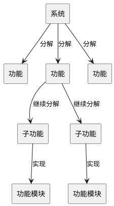
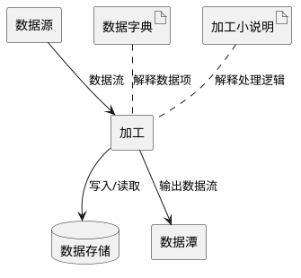
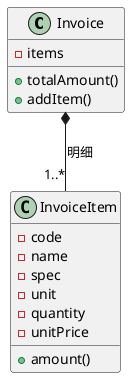
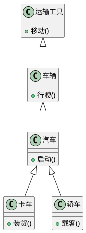
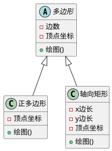
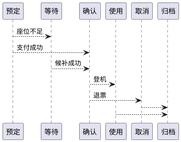

## 面向对象方法的课程定位

### 软件开发视角的转变

**定义**：**面向对象方法（Object-Oriented Method）** 是把现实问题理解为一组对象及其协作，并用类、对象、关系和消息来组织软件模型的软件开发方法。[PPT p.24-p.27]

**核心思想**：本质上，面向对象把“程序由过程驱动”转换为“系统由对象协作完成职责”。也就是说，开发者不再先问“系统要执行哪些函数”，而是先问“问题域中有哪些事物、它们各自承担什么责任、它们如何协作”。

**背景与目的**：课程开头强调，大模型与编程辅助工具可以完成简单重复的编码任务，但复杂系统仍然需要分析、设计和抽象能力。[PPT p.2-p.18] 因此，本课程的重点不是单纯写代码，而是从问题域出发建立业务模型、系统模型，并最终映射到程序实现。[PPT p.26] 值得注意的是，这里的“面向对象”不只是一种编程语言语法，而是一整套从分析、设计到实现的软件方法学。

**类比一下**：一个学校管理系统不是一个巨大的“处理学生信息”函数，而是由学生、教师、课程、教室、选课记录等对象共同组成。每个对象有自己的属性和操作，对象之间通过选课、授课、排课等关系发生协作。

**PPT 原文关联**：PPT 先从软件工程视角展示“现实世界 -> 业务模型 -> 系统模型 -> 程序”的链条，再区分“面向对象程序设计”和“面向对象方法”。这说明本课的主线是从开发方法讲 OO，而不是只从语言语法讲 OO。[PPT p.26-p.27]

### 面向对象编程与面向对象方法

**定义**：**面向对象编程（Object-Oriented Programming）** 是在编程语言层面使用对象、类、**继承（Inheritance）**、**封装（Encapsulation）**、**聚合（Aggregation）**、**关联（Association）**、消息、**多态（Polymorphism）** 等概念组织程序的范型；面向对象方法则覆盖需求、分析、设计、编程、测试和维护等更长的软件生命周期。[PPT p.27, p.52]

**核心思想**：OOP 更接近“如何写程序”，OO 方法更接近“如何理解、建模并构造系统”。两者有关联，但不能混为一谈；只会写类并不等于会做面向对象分析和设计。

**背景与目的**：PPT 明确指出，面向对象程序设计多见于语言书，而面向对象方法还包括 OOA、OOD、OOP 等阶段。[PPT p.27] 这一区分很重要，因为复杂系统的问题常常不在语法，而在需求理解、职责划分、关系建模和变化控制。

**直观理解**：如果把 OOP 看成“用对象写代码”，那么 OO 方法就是“用对象理解世界并组织软件”。前者更偏实现，后者更偏工程方法。

**PPT 原文关联**：PPT 图示将“现实世界中的客观对象”通过 OOA、OOD 逐步过渡到“计算机对象”和 OOP，说明本课后续会把对象作为贯穿分析、设计、实现的统一概念。[PPT p.27]

**本节 Q&A**：

- **问：为什么课程开头要讨论 AI 编程工具？** 答：这些工具降低了编码门槛，但不能替代复杂系统的分析和设计。课程借此强调，软件开发能力不能停留在“写好代码”，还要能建立模型、控制复杂性并处理变化。
- **问：会写 Python 或 Java 的类就等于掌握面向对象吗？** 答：不等于。语言层面的类只是表达工具，真正的面向对象能力还包括识别对象、划分职责、设计关系、控制耦合和复用模型。

## 传统开发方法的问题

### 无方法开发与复杂性增长

**定义**：无方法开发指早期软件规模较小时主要依赖个人经验、简单语言和随意控制流完成程序构造的开发方式。[PPT p.30]

**核心思想**：这种方式在小程序中可能可行，但系统复杂性增长后会迅速失控。也就是说，软件开发从“个人英雄主义”转向工程方法，是复杂性逼出来的结果。

**背景与目的**：二十世纪六十年代以前，软件系统相对较小，Fortran、Cobol 等语言较简单，代码中常见 GOTO 语句形成“面条式代码”。随着需求规模和维护周期增加，随心所欲的代码很难理解、修改和验证。高层次语言能隐藏部分机器细节，但不能单独解决需求变化、模块耦合和系统建模问题。

**直观理解**：早期程序像临时搭出来的脚手架，完成一次任务可能够用，但难以扩展成长期维护的建筑。软件工程方法的出现，就是为了让系统结构可理解、可沟通、可维护。

**PPT 原文关联**：PPT 将“无开发方法”放在传统方法问题的开端，并强调复杂性增长后这种方法不再可接受。[PPT p.30]

### 功能分解法

**定义**：**功能分解法（Functional Decomposition）** 是以系统需要提供的功能为中心，把系统逐层拆分为功能、子功能和功能**接口（Interface）**的方法。[PPT p.31-p.33]

**核心思想**：功能分解法把系统看成一棵功能树，开发者先定义总功能，再把总功能分解为较小的子功能，直到每个子功能可以被清楚定义和实现。它的优势是起步直接，因为用户往往首先表达“系统要做什么”。

**背景与目的**：在二十世纪七十年代，模块化编程与功能分解结合，提高了开发效率，也比无结构的 GOTO 程序更容易维护。对功能稳定的应用领域，例如某些科学计算，功能树可以较稳定地反映系统结构。问题在于许多业务系统的功能会随市场、制度和管理流程变化而频繁调整，一旦功能成为最高层组织原则，功能变化就可能牵动大量模块。

**结构示意**：



**解读说明**：图中系统被逐层拆成函数式的模块，最终模型由模块及其接口构成。这种结构容易围绕功能展开工作，但数据结构和问题域对象往往被放在次要位置。

**优点展开**：功能分解法对软件系统的功能性要求有据可寻，能让开发者快速从用户需求开始工作。它与模块化编程结合后，能够将大程序切成较小模块，从而提升开发效率。删除 GOTO 并采用较清晰的模块接口，也确实能改善早期程序的可维护性。[PPT p.33]

**缺点展开**：功能分解法注重处理功能，容易把被处理的数据放到次要位置。局部错误修改可能穿透多个功能模块，造成全局影响。对于企业管理、商业管理等功能易变领域，功能树会频繁重组，系统容易出现低内聚、高耦合，最终呈现“开头容易，结束难”的状态。[PPT p.33-p.36]

### 数据流法

**定义**：**数据流法（Data Flow Method）** 又称结构化分析法，它用数据流、加工、数据存储、数据源、数据潭、加工小说明和数据字典来描述问题域。[PPT p.34-p.35]

**核心思想**：数据流法关注数据如何在系统中流动，以及每个环节对数据做什么处理。它把问题域映射为数据流图，并通过加工说明和数据字典补充细节。

**背景与目的**：相比单纯功能分解，数据流法更强调对问题域的分析，并有较严格的法则和逐步求精过程。它适合描述输入、处理、输出明确的业务流程，但当系统规模变大时，数据流和加工数量会膨胀，文档维护成本随之上升。值得注意的是，它在概念上仍不能直接映射到问题域中的“事物”，因此复杂系统下也难以验证分析正确性。

**结构示意**：



**解读说明**：图中核心不是对象，而是数据流经加工节点的过程。数据字典和加工说明承担解释职责，但模型中的“加工”和“存储”与后续设计实现之间的转换规则并不严格。

**PPT 原文关联**：PPT 强调数据流法的优点是有严格法则、逐步求精、较强调研究问题域；缺点是概念上不能直接映射问题域事物，规模大时分析文档膨胀，并且分析与设计的概念和表示法不一致。[PPT p.35]

### 信息建模与有限状态机方法

**定义**：**信息建模方法（Information Modeling Method）** 以实体及其联系作为构造块，强调数据结构和实体关系；**有限状态机（Finite State Machine）** 方法以状态和状态转换作为构造块，强调行为视图。[PPT p.37-p.39]

**核心思想**：信息建模认为数据是企业应用中相对稳定的部分，因此围绕实体-联系图建立模型。有限状态机方法则认为系统行为可以通过状态变化来把握，适合描述对象或系统在不同状态下的响应。

**背景与目的**：信息建模在数据及其关系复杂的系统中很有用，尤其与关系数据库的数学基础相配合。但它主要建模数据方面，功能行为在模型中体现不足。有限状态机适合表达行为变化，却没有充分说明数据管理问题；基于规则的系统把计算机看作 if-then 规则推理机，但也不帮助处理数据和过程概念。

**直观理解**：信息建模像是在画系统的“名词地图”，有限状态机像是在画系统的“状态轨迹”。两者都抓住了软件系统的重要侧面，但都不是完整的系统视图。

**传统方法对比**：

| 方法 | 主要构造块 | 适合场景 | 主要不足 | 与 OO 的关系 |
| :--- | :--- | :--- | :--- | :--- |
| 功能分解法 | 功能、子功能、接口 | 功能稳定、流程清晰的系统 | 数据被放在次要位置，需求变化适应差 | 促成了模块化思想 |
| 数据流法 | 数据流、加工、数据存储 | 输入输出和处理流程明确的系统 | 文档易膨胀，分析设计转换不严格 | 促成了问题域分析意识 |
| 信息建模方法 | 实体、联系、数据结构 | 数据关系复杂的企业应用 | 行为和功能体现不足 | 促成了以实体认识领域的思想 |
| 有限状态机方法 | 状态、转换、事件 | 状态驱动的行为系统 | 数据管理不足 | 促成了动态行为建模思想 |

**PPT 原文关联**：PPT 总结指出，上述方法通常只基于一个或两个角度看待系统：功能分解法集中于功能，数据流法集中于数据流和加工，信息建模集中于实体而忽略功能。它们都对 OO 的产生做出贡献，但也暴露了单一视角建模的局限。[PPT p.40]

**本节 Q&A**：

- **问：传统方法是不是已经过时、完全不能用？** 答：不是。PPT 明确说这些方法已经开发了很多软件系统，对功能稳定的领域仍然适用；问题在于复杂、易变、跨角色协作的系统需要更贴近问题域的建模方式。
- **问：为什么功能分解会导致维护困难？** 答：因为它把功能作为系统骨架，而许多领域的功能恰恰最容易变化。功能一变，相关数据结构、接口和调用链都可能跟着变化，局部修改容易产生全局影响。

## 面向对象的基本思想

### 一切都是对象

**定义**：对象是对问题域中客观事物的软件化表达，它用属性表示事物的性质，用操作表示事物的行为。[PPT p.42-p.45]

**核心思想**：面向对象从现实世界中的客观对象入手，尽量运用人类自然思维方式来构造软件系统。也就是说，系统的基本构成单位不是孤立函数，也不是单独数据表，而是具有状态和行为的对象。

**背景与目的**：PPT 用发票明细计算说明非 OO 思路和 OO 思路的差异。非 OO 思路会先定义数据结构再定义函数；OO 思路则把发票明细看作对象，内部包含编号、名称、规格、单位、数量、单价、金额等属性，并提供合计等操作。[PPT p.44] 这样做的目的，是让软件结构直接映射问题域，保持现实事物及其关系的本来面貌。

**直观理解**：发票不是“数组加总函数”的附属品，而是一个有属性、有业务操作的领域对象。把它建成对象后，计算总额、校验数量、格式化输出等职责可以围绕同一对象组织。



**解读说明**：图中 `Invoice` 由多个 `InvoiceItem` 构成，明细项负责计算自身金额，发票负责汇总。这里使用整体与部分关系表达“复杂对象可以由简单对象构成”的思想。

### 属性操作与封装

**定义**：封装是把对象的属性和操作结合成一个独立实体，并尽可能隐藏内部细节，只通过对外接口提供服务的机制。[PPT p.45, p.58-p.59]

**核心思想**：封装把“数据”和“处理数据的行为”放在同一个边界内。外部对象不直接接触内部数据，而是通过对象公开的操作请求服务。

**背景与目的**：如果属性能被外部任意修改，对象的状态就很难保持一致，错误也会跨对象传播。封装公开相对稳定的操作，隐藏动态、易变的内部实现，从而降低对象间耦合，减少修改带来的波动效应。值得注意的是，封装也有代价，例如编程更麻烦、可能带来执行效率损失，所以混合型 OOPL 往往通过 public、protected、private 等可见性控制实现折中。[PPT p.58]

**直观理解**：售报亭对顾客公开“报刊零售”和“款货清点”等服务，但不会让顾客直接操作钱箱或内部库存。对象也是如此，它提供可见操作，但隐藏内部属性集和实现代码。

**PPT 原文关联**：PPT 将封装和信息隐蔽连续讲解，强调对象的操作定义了其他对象如何访问它，而其他对象不需要知道被请求对象怎样用代码和内部数据完成操作。[PPT p.58-p.59]

### 分类抽象与继承

**定义**：**抽象（Abstraction）** 是舍弃个别的、非本质的特征，抽取共同的、本质特征；分类是把具有共同性质的事物划分为一类；继承是特殊类复用并扩展一般类属性、操作和关系的机制。[PPT p.46-p.48, p.56-p.57]

**核心思想**：抽象决定“看什么、忽略什么”，分类决定“哪些对象属于同一概念”，继承决定“一般概念和特殊概念如何复用”。本质上，这三者构成从客观事物到对象、从对象到类、从类到一般类的抽象链条。

**背景与目的**：复杂世界中的事物太多，必须通过抽象和分类组织知识。例如商场里的鞋、酱油、笔都可以在销售系统中抽象为商品，因为该问题域关心的是名称、价格、库存和销售行为，而不是它们的物理形态。[PPT p.56] 继承进一步把共性提升到父类，让特殊类只描述差异，从而简化系统构造和文档表达。

**直观理解**：运输工具可以分为轮船、车辆、飞机；车辆又可以分为火车、汽车；汽车还可以分为卡车、轿车。抽象层次越高，越强调共性；抽象层次越低，越强调差异。[PPT p.57]



**解读说明**：图中继承关系从一般类逐层走向特殊类。上层类描述共同属性和操作，下层类继承共性并补充自身特征。

### 聚合关联与消息

**定义**：**聚合（Aggregation）** 表示复杂对象由较简单对象构成的整体-部分关系；**关联（Association）** 表示类或对象之间相对稳定的静态联系；**消息（Message）** 是对象之间请求协作的通信方式。[PPT p.47-p.49, p.62]

**核心思想**：聚合回答“对象由什么组成”，关联回答“对象之间有什么静态联系”，消息回答“对象运行时如何请求服务”。三者结合后，系统既有静态结构，也有动态协作。

**背景与目的**：PPT 明确指出，复杂对象可以用简单对象作为构成部分，对象之间通过消息通信以实现动态联系，并通过关联表达类之间的静态关系。[PPT p.47-p.49] 严格 OO 思想认为对象只能通过消息通信，函数调用只是消息的一种实现方式，而且更适合顺序系统的解释。消息传递和普通函数调用的关键差别在于：消息有指定接收者，消息解释依赖接收者，并且运行时才可能知道具体接收者。[PPT p.62]

**直观理解**：用户向售票系统发送“预订机票”的请求，系统再向机票对象、航班对象、支付对象发送消息。调用方关心的是对象能否响应请求，而不是对象内部如何组织代码。

**消息通信步骤**如下：

1. **确定接收者**
   - 输入：当前业务场景中的目标对象。
   - 操作：识别应当由哪个对象承担该请求。
   - 输出：一个明确的消息接收者。
   - 目的：避免无接收者的过程式调用，让职责落到对象边界内。
2. **发送消息**
   - 输入：操作名称、参数和调用上下文。
   - 操作：调用接收者对外提供的操作。
   - 输出：接收者开始解释消息。
   - 目的：通过公开接口协作，而不是直接修改内部状态。
3. **执行方法**
   - 输入：接收者的状态和对应操作实现。
   - 操作：根据接收者实际类型执行方法。
   - 输出：结果、状态变化或进一步消息。
   - 目的：支持不同对象对同一消息给出不同响应。

**本节 Q&A**：

- **问：为什么说面向对象更接近人类日常思维？** 答：人们通常先识别事物，再理解事物的性质、行为和关系。OO 把这种思维过程映射到对象、属性、操作、类、关系和消息中，因此比单纯函数分解更贴近问题域。
- **问：聚合和关联有什么区别？** 答：聚合强调整体与部分，例如发票包含明细项；关联强调对象之间存在联系，例如学生选修课程。聚合通常是一种更具体的结构关系，关联则覆盖更广泛的静态联系。

## 面向对象的主要概念与基本原则

### 对象与类

**定义**：**对象（Object）** 是具有状态、行为和标识的运行时实体；**类（Class）** 是一组相似对象的抽象描述，每个对象是它所属类的一个实例。[PPT p.52-p.56]

**核心思想**：对象用于表达具体个体，类用于表达共同结构。值得注意的是，类不是对象本身，而是创建对象、理解对象和组织对象共性的模型。

**背景与目的**：如果系统只保存零散数据，就很难说明“谁负责什么”。类和对象把属性与操作放在一起，使职责边界清晰，也使分析模型、设计模型和源代码之间更容易对应。

**直观理解**：例如，“学生”是类，“张三这个学生”是对象。学生类规定姓名、学号、选课行为，而张三拥有具体姓名和学号，并在运行时参与选课、退课等协作。

**PPT 原文关联**：PPT 的 OO 分析与设计模型图展示了从客观事物出发，经抽象、分类、关联、聚合、继承、封装等机制形成**类图（Class Diagram）**、**序列图（Sequence Diagram）**、状态图、活动图、构件图、用例图等模型，再进入编程和运行。[PPT p.50]

### 多态与泛化

**定义**：多态是同一消息在不同接收对象上表现为不同行为的机制；**抽象类（Abstract Class）** 是用于定义子类共性的超类，通常没有直接实例。[PPT p.60-p.61]

**核心思想**：多态让调用方用统一方式处理具有共同父类的对象，而具体行为由实际对象决定。也就是说，调用方依赖稳定接口，差异被封装到子类内部。

**背景与目的**：没有多态时，继承层次只能复用属性、操作和关系，但调用方仍可能需要判断具体类型。有多态后，子类可以定义自己的属性和操作来代替超类的同名属性和操作，这就是 **重写（Override）** 的作用。多态的用途是把具有共同父类的对象组成一组，并对它们进行一致处理。[PPT p.60]

**直观理解**：多边形都有“绘图”操作，但正多边形和轴向矩形的绘图算法不同。调用方只发送“绘图”消息，具体画法由对象自身决定。[PPT p.61]



**解读说明**：`多边形` 抽取共同属性和操作，`正多边形` 与 `轴向矩形` 继承它并提供各自的绘图实现。这个结构体现“共同父类统一处理，不同子类差异响应”的多态思想。

```python
# PPT 原片段：多边形、正多边形、轴向矩形具有共同的“绘图”操作。
# 补全部分：可运行的最小示例，展示同一消息在不同对象上的行为差异。
class Polygon:
    def draw(self) -> str:
        raise NotImplementedError("subclasses must implement draw")

class RegularPolygon(Polygon):
    def draw(self) -> str:
        return "draw by equal sides and equal angles"

class AxisAlignedRectangle(Polygon):
    def draw(self) -> str:
        return "draw by x/y edges parallel to axes"

for shape in [RegularPolygon(), AxisAlignedRectangle()]:
    print(shape.draw())
```

**注意**：这个示例中 `draw()` 是稳定接口，两个子类给出不同实现。调用方不需要写 `if type == ...` 的分支，说明多态可以减少类型判断和条件分支膨胀。

### 结构分析与行为分析

**定义**：结构分析关注类和对象如何通过关联、**依赖（Dependency）**、一般化、特殊化、聚合等关系组织起来；行为分析关注对象或类怎样提供操作，以及对象间如何通过交互共同完成系统功能。[PPT p.63-p.64]

**核心思想**：只有静态结构模型是不够的，因为系统还会随事件、状态和对象协作发生变化。行为分析补充了对象在运行时如何响应消息、改变状态和参与并发协作。

**背景与目的**：PPT 将关系机制形成的模型称作静态模型，而把考察对象怎样提供操作的过程称为行为分析。[PPT p.63] 动态行为可能来自对象存在不同状态，例如航班订票系统中“机票”对象可能处于预定、等待、确认、取消、使用、归档等状态。[PPT p.64] 对这种状态驱动行为，有限状态机比命令式控制流程更适合表达。

**直观理解**：类图回答“系统里有什么类、它们有什么关系”，状态图和交互图回答“对象运行起来以后如何变化、如何协作”。一个系统如果只有类图，很容易看起来结构完整，但仍解释不了关键业务流程。



**解读说明**：图中“机票”对象根据业务事件在不同状态之间转换。状态不同，对同一消息的响应也可能不同，例如确认状态可以登机，归档状态则只能查询历史记录。

### 复杂性控制

**定义**：复杂性控制是在模型和系统规模增大时，通过包、层次、抽象边界和粒度划分来组织模型的方法。[PPT p.65]

**核心思想**：复杂系统不能依赖单个巨大模型表达全部细节，而应当按不同粒度组织。包的作用是把相关模型元素放在一起，让开发者在合适层次上理解系统。

**背景与目的**：PPT 提到引入 package 概念，使模型具有大小不同的粒度层次，例如把分析阶段和设计阶段的模型分别用包组织。[PPT p.65] 这种机制不是为了“多画几个框”，而是为了降低认知负担，避免所有类、关系和交互混在同一张图里。

**直观理解**：大型项目的模型就像一本书，包相当于章节和小节。没有章节时，所有内容堆在一起；有包以后，读者可以先看全局，再进入局部细节。

**概念对比**：

| 概念 | 关注点 | 解决的问题 | 常见误区 | PPT 位置 |
| :--- | :--- | :--- | :--- | :--- |
| 抽象 | 提取本质特征 | 避免被无关细节淹没 | 抽象成空泛口号 | p.56 |
| 分类 | 组织同类对象 | 从对象得到类和层次 | 只看名称不看问题域职责 | p.57 |
| 封装 | 隐藏内部细节 | 降低耦合和波动效应 | 把所有内容都设为私有但接口混乱 | p.58-p.59 |
| 继承 | 复用一般类特征 | 表达一般化和特殊化 | 继承层次过深导致僵硬 | p.48, p.60 |
| 多态 | 统一处理差异对象 | 减少类型判断和分支 | 把任何同名函数都当多态 | p.60-p.61 |
| 消息 | 对象间动态协作 | 将请求发送给明确接收者 | 把消息简单等同于普通函数调用 | p.62 |

**本节 Q&A**：

- **问：为什么静态模型不够？** 答：静态模型表达类和关系，但不表达对象在运行时如何响应事件、改变状态和协作完成流程。复杂业务系统必须同时考虑结构和行为。
- **问：多态和继承是什么关系？** 答：继承提供一般类与特殊类的层次结构，多态利用这个结构让同一消息在不同子类上产生不同响应。没有多态的继承主要强调复用，有多态的继承还能统一处理差异。

## 面向对象方法的主要优点

### 缩小语言鸿沟

**定义**：语言鸿沟指客观世界、自然语言、编程语言和计算机执行机制之间存在的表达差距。[PPT p.67-p.71]

**核心思想**：面向对象通过对象、类、关系和消息，使软件模型更直接地反映客观世界。也就是说，它把开发者对问题域的认识用更接近自然思维的方式表达出来，再逐步转换为程序。

**背景与目的**：PPT 从认识论角度指出，软件开发是从问题域出发，对事物进行认识和描述。[PPT p.67] 机器语言离机器最近但离人类思维最远，汇编语言仍需考虑大量机器细节，高级语言隐藏了机器细节但与客观事物仍有差距。面向对象语言和方法进一步缩小了从问题域到计算机之间的鸿沟。[PPT p.68-p.71]

**直观理解**：结构化软件工程中，需求分析、总体设计、详细设计、编程和测试之间存在分析与设计的鸿沟，概念和表示法不一致。OO 软件工程中，OOA、OOD、OOP、OOT 都围绕对象和类展开，因此阶段之间更容易保持概念连续。

**PPT 原文关联**：PPT 对比结构化方法和 OO 方法的开发链条，强调 OO 方法从自然语言到面向对象编程语言之间使用一致的对象概念组织模型。[PPT p.70-p.71]

### 维护复用与质量提升

**定义**：维护性是软件在需求变化、缺陷修复和环境变化下被理解、修改和验证的能力；复用性是已有模型、类、对象或设计在新场景中被再次使用的能力。[PPT p.72-p.76]

**核心思想**：OO 把数据和处理数据的过程作为整体，即对象；程序可以理解为对象及其关系的集合。相比“关系、算法、数据结构”分散组织的结构化程序，OO 更容易围绕稳定对象边界维护系统。[PPT p.72-p.73]

**背景与目的**：PPT 指出，结构化方法从算法角度建模，把大量精力集中在控制流程和大算法分解上，这种模型较脆弱，需求变动时维护困难。[PPT p.74] OO 方法以类及交互模式为中心，把易变的数据结构和部分功能封装在对象内并加以隐藏，使局部修改较少影响其他对象。同时，封装提高内聚、降低耦合，继承直接复用一般类的属性和操作，因此有利于复用。[PPT p.75]

**直观理解**：当需求变化影响发票明细金额计算时，OO 系统可以优先修改 `InvoiceItem.amount()`；过程式系统中同样逻辑可能散落在多个函数、报表和校验流程中。变化是否局部化，是维护成本差异的关键。

**质量与生产率说明**：PPT 强调现代质量观点不是只靠编码后测试排错，而是在分析和设计阶段就开展质量保证活动。[PPT p.76] OO 方法让系统更易理解，分析文档、设计文档和源代码对应更好，功能变化引起的全局性修改较少，也有利于 OOA 结果复用。因此，设计阶段的投入会在编程、测试和维护阶段得到回报。

### 软件方法学的返朴归真

**定义**：软件方法学的返朴归真，是指软件开发从过分专业化的规则、技巧和机器视角，回到客观世界和人类日常思维方式。[PPT p.77]

**核心思想**：面向对象并不是凭空创造一套术语，而是把人们认识世界时常用的对象、分类、整体部分、一般特殊、协作关系引入软件构造。类比一下，人们理解现实世界时很少先画函数调用链，而是先识别事物及其关系。

**背景与目的**：PPT 回顾软件科学中出现过许多“面向”：面向机器、面向代数、面向过程、面向数据、面向功能、面向数据流等。[PPT p.77] OO 的意义在于把软件开发重新拉回客观世界，使模型更符合人类理解问题和表达问题的方式。

**本节 Q&A**：

- **问：OO 为什么有助于复用？** 答：封装把属性和操作绑定在稳定对象边界内，提高内聚并降低耦合；继承让特殊类直接复用一般类的属性和操作。复用不只是复制代码，而是复用已经验证过的抽象和职责划分。
- **问：OO 一定比结构化方法更好吗？** 答：不一定。PPT 明确说对给定应用系统和开发方法，多种方法都可能正确，只是代价和收益不同。OO 在复杂、易变、需要长期维护和复用的系统中更有优势。

## 面向对象的发展与现状

### 从雏形到完善

**定义**：面向对象语言的发展从 Simula 67 的类和继承机制开始，经由 Smalltalk 系列逐步形成较完整的对象、类、继承、消息等机制。[PPT p.79-p.80]

**核心思想**：OO 的形成不是单一语言突然发明出来的，而是语言机制、抽象数据类型理论、图形用户界面和软件方法学共同发展的结果。Smalltalk 的重要性在于它把面向对象作为完整编程思想系统化。

**背景与目的**：六十年代挪威计算中心开发的 Simula 67 被视为面向对象语言的先驱和第一个里程碑，因为它首先引入类的概念和继承机制。[PPT p.79] 七十年代 CLU、并发 Pascal、Ada、Modula-2 等语言推动了抽象数据类型理论，支持数据与操作封装。Alan Kay 借鉴 Simula 概念设计 Flex，随后 PARC 发布 Smalltalk-72，正式使用“面向对象”术语；Smalltalk-80 则被认为是 OO 语言发展史上的重要里程碑。[PPT p.79-p.80]

**直观理解**：Simula 提供早期种子，抽象数据类型提供理论养分，Smalltalk 将这些思想发展成完整生态。这个过程说明 OO 同时是语言机制和软件思维方式的演进。

### 从繁荣到统一建模

**定义**：**面向对象编程语言（Object-Oriented Programming Language）** 是直接支持对象、类、封装、继承、多态等机制的编程语言；**统一建模语言（UML）** 是面向对象建模的标准化表示语言。[PPT p.81-p.83]

**核心思想**：八十年代中期到九十年代，C++、Objective-C、Object Pascal、CLOS、Eiffel、Actor 等实用 OOPL 大量出现，OO 从语言繁荣走向方法学繁荣。随后，分析与设计方法过多导致概念和符号不统一，UML 的出现就是为了解决建模语言混乱的问题。

**背景与目的**：OO 编程语言可分为纯 OO 语言和混合型 OO 语言。混合型语言在传统过程式语言基础上增加 OO 成分，实用性较强，例如 C++；纯 OO 语言也逐渐重视实用性，例如 Eiffel、Smalltalk、Actor、Java。[PPT p.81] 到九十年代，OO 分析与设计方法已有数十种，不同方法对操作、责任、服务、方法、成员函数等概念使用不同名称，容易造成混乱并妨碍推广。[PPT p.82] UML 在产业界获得广泛支持，推荐过程是 USDP，但 OO 过程指导仍没有统一国际规范。[PPT p.83]

**直观理解**：语言繁荣解决“能不能用 OO 写程序”的问题，UML 解决“团队能不能用统一符号讨论 OO 模型”的问题。没有统一建模语言，分析师、设计师和程序员很容易在同一概念上使用不同说法。

### 生命周期覆盖与领域扩展

**定义**：OO 生命周期覆盖是指面向对象从编程扩展到分析、设计、测试和维护，并渗透到图形界面、数据库、数据结构、软件体系结构、领域工程、**设计模式（Design Pattern）**、构件技术、服务计算和智能代理等领域。[PPT p.84-p.85]

**核心思想**：OO 已经不只是某几门语言的特性，而是覆盖计算机软件多个分支的基础思想。它既能组织代码，也能组织模型、架构和复用经验。

**背景与目的**：PPT 明确指出，面向对象方法从编程发展到设计、分析，进而发展到整个软件生命周期。[PPT p.84] 许多新领域以 OO 理论为基础，或把 OO 作为主要技术，包括软件体系结构、领域工程、设计模式、基于构件的软件工程、面向服务的计算和智能代理等。[PPT p.85]

**直观理解**：OO 的影响不是局限在“class 关键字”，而是扩展到“如何描述系统结构、如何复用设计经验、如何演化大型软件”。这也是本课程后续会讲 UML、OOA、OOD、设计模式、编码实现和测试的原因。

**本节 Q&A**：

- **问：为什么 UML 会成为课程主线之一？** 答：因为 OO 方法曾经存在大量不同概念和符号，UML 提供了相对统一的建模语言。课程采用 UML 2.5 的概念和表示法，可以让分析、设计和沟通更一致。
- **问：OO 的发展是否只和编程语言有关？** 答：不是。语言机制是起点，但 OO 后来扩展到分析、设计、测试、维护和架构等多个阶段，已经成为软件方法学的一部分。
