## UML 的定位

### 统一建模语言

**定义**：**统一建模语言（UML）** 是一种用于规约、构造、可视化和文档化软件系统制品的建模语言，它用统一符号表达软件系统在不同抽象层次上的结构、行为和组织关系。[PPT p.1-p.4]

**核心思想**：UML 的核心不是“画图好看”，而是把需求、分析、设计、实现和部署中的关键决策表达为可讨论、可检查、可保存的模型。也就是说，UML 不是编程语言，也不是完整的软件开发方法学；它更像方法学中的公共建模语汇和表达工具。

**背景与目的**：大型系统通常横跨多个应用领域、开发角色和运行平台，仅靠代码很难解释“为什么这样设计”。UML 通过建立不同抽象层次的术语空间和模型表示工具，弥补应用系统与运行平台之间的距离，使业务人员、分析人员、设计人员和程序员能够围绕同一组模型沟通。

**直观理解**：类比一下，建筑图纸不是建筑物本身，但图纸能让设计、施工、验收人员知道墙、梁、管线和空间如何配合。UML 也是这样，它不是最终运行的软件，却能提前暴露结构不清、职责混乱、依赖过强等设计问题。

**PPT 原文关联**：PPT 将 UML 概述放在课程开头，并强调 UML 可用于“规约系统的制品”“构造系统的制品”“建立系统制品的文档”。其中“UML 并非软件开发方法学本身”是理解本课的关键边界，因为后续所有术语都服务于建模表达，而不是直接规定开发流程。[PPT p.3-p.4]

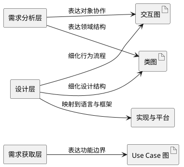

**解读说明**：这张图把 PPT 中“不同抽象层次的术语和模型表达工具”转成模型关系。Use Case 图偏向需求获取，类图和交互图既能用于需求分析，也能用于设计；平台不是 UML 的替代物，而是模型最终要落到的实现环境。

### UML 的适用范围

**定义**：UML 的适用范围，是指它可以在对象方法和构件方法中，为不同应用领域、不同实现平台的软件系统提供统一建模表达。[PPT p.3]

**核心思想**：UML 关注的是模型元素和模型关系的表达能力，而不是绑定某一种语言或框架。值得注意的是，PPT 特别列出航空航天、财政、通讯等领域，以及 J2EE、.NET 等平台，说明 UML 的目标是跨领域、跨平台沟通。

**背景与目的**：如果每个团队、每种语言、每个阶段都使用完全不同的表达方式，系统设计很难复用和评审。UML 提供一种相对稳定的符号系统，使模型可以从分析层逐步细化到设计层，再进一步对应到代码、构件和部署制品。

**直观理解**：本质上，UML 是系统分析和设计的工具。它不替代代码实现，却能帮助团队在写代码之前先回答“有哪些对象”“对象如何关联”“对象如何协作”“哪些部分可以替换”等问题。

**PPT 原文关联**：PPT 用“应用系统”和“运行平台”之间的距离说明 UML 的价值，并指出 UML 支持多视角地建立系统模型。[PPT p.3]

### UML 与方法学的关系

**定义**：方法学描述软件开发如何组织过程、活动和产物；UML 提供这些活动中用于表达模型的术语和图形工具。[PPT p.4]

**核心思想**：UML 是方法学的重要组成部分，但不是方法学本身。也就是说，团队采用瀑布、迭代、敏捷或其他过程时，都可以使用 UML，但 UML 本身并不告诉团队每一步必须如何排期、谁负责审批、何时发布。

**背景与目的**：这个边界很重要，因为误把 UML 当成流程规范，会导致“为了画图而画图”。正确做法是让 UML 服务于沟通和决策：在需求层用用例澄清系统边界，在分析层用类和交互图澄清对象模型，在设计层进一步细化接口、依赖和部署结构。

**直观理解**：例如，写需求时可以用 **用例（Use Case）** 图描述用户能从系统获得什么；做分析时可以用 **类图（Class Diagram）** 表达领域词汇；做设计时可以用 **序列图（Sequence Diagram）** 或交互图表达对象之间如何发消息。不同图的用途不同，但背后共享一套模型元素和关系术语。

**PPT 原文关联**：PPT 通过“需求获取层、需求分析层、设计层”的示意图，把 UML 作为跨层表达工具，而不是单独的开发过程。[PPT p.4]

#### 小结问答

**问**：UML 是不是必须在项目中画全套图？

**答**：不是。UML 的价值在于降低沟通成本和设计风险，应该优先画对当前决策有帮助的图。例如需求边界不清时优先画用例，类职责混乱时优先画类图，对象交互复杂时优先画交互图。

**问**：UML 和代码是什么关系？

**答**：UML 模型可以与编程语言直接关联，但它不是代码的简单截图。模型抽取的是结构、行为和设计意图，代码则承担可执行实现；两者应该相互校验，而不是互相替代。

## UML 的基本术语体系

### 术语分类

**定义**：UML 术语体系包括表达客观事物的术语、表达事物关系的术语，以及用于组织和解释模型信息的包与注解。[PPT p.6]

**核心思想**：UML 建立在面向对象方法的世界观上，即世界由对象组成，对象有属性和运动规律，对象之间的相互作用构成各种系统。本质上，UML 先定义“有哪些东西可以建模”，再定义“这些东西之间如何连接”，最后定义“如何组织和解释模型”。

**背景与目的**：没有统一术语，模型图上的矩形、线段、箭头和注释就无法稳定表达语义。PPT 将“类、接口、协作、用况、主动类、构件、制品、节点”归为表达客观事物的术语，并把它们统称为类目；又将 **关联（Association）**、泛化、实现和 **依赖（Dependency）** 归为表达关系的术语。

**直观理解**：类比一下，写句子需要名词、动词和标点。UML 中的类目像名词，关系像动词或介词，包和注解像段落组织与旁注；只有三者配合，模型才既能表达内容，又能让读者理解。

**PPT 原文关联**：PPT 在“UML 术语”页明确列出两类主要术语，并补充包用于控制信息组织复杂性，注解用于增强模型可理解性。[PPT p.6]

| 维度 | 表达客观事物的术语 | 表达关系的术语 | 组织和解释术语 |
| :--- | :--- | :--- | :--- |
| 主要作用 | 描述系统中可建模的元素 | 描述模型元素之间的语义连接 | 降低模型组织和阅读复杂度 |
| 典型元素 | 类、接口、协作、用况、主动类、构件、制品、节点 | 关联、泛化、实现、依赖 | 包、注解 |
| 建模问题 | 系统里有什么 | 它们如何相互作用或约束 | 模型如何分组、解释和维护 |
| 常见图形 | 矩形、椭圆、节点立方体、构件符号 | 实线、虚线、菱形、三角箭头 | 文件夹形包、折角注释 |

### 类目

**定义**：类目是 UML 中可包含在模型里的基本结构化概念的统称，课程中包括类、接口、协作、用况、主动类、构件、制品和节点。[PPT p.41]

**核心思想**：类目提供了建模对象的分类框架。也就是说，模型中的元素不只是“一个框”，而应当根据它表达的是领域实体、外部服务、行为协作、运行线程、软件部件还是物理资源来选择合适术语。

**背景与目的**：如果所有东西都用类表示，模型会丢失语义层次。例如源代码文件、服务器节点、系统功能、并发控制对象都画成普通类，就无法区分逻辑结构、物理制品和运行资源。

**直观理解**：类比一下，仓库管理不能只写“物品”，还要区分原料、成品、设备、文件和容器。UML 的类目就是这种分类能力，它让模型读者知道每个元素在系统中的性质。

**PPT 原文关联**：PPT 在表达客观事物的术语末尾总结：类、接口、协作、用况、主动类、构件、制品、节点，以及它们的变体，统称为 classifier。[PPT p.41]

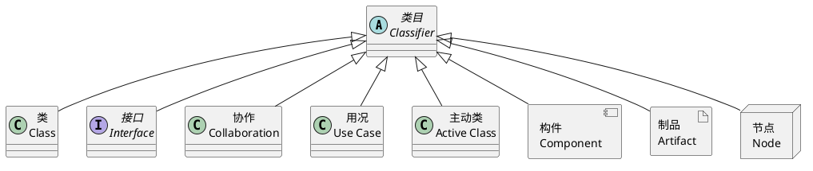

**解读说明**：这张图不是 PPT 原图的逐像素复制，而是把 PPT 中“八个术语统称为类目”的概念关系转成 PlantUML。空心三角表示一般化关系：这些元素都可以被理解为 UML 模型中的类目，但每种类目服务的建模视角不同。

#### 小结问答

**问**：为什么课程先讲术语，而不是直接讲各种 UML 图？

**答**：因为图只是术语和关系的组合。如果不知道类、接口、关联、依赖这些基本语义，即使能照着画图，也很难判断一条线该用实线、虚线、空心菱形还是实心菱形。

**问**：类目是不是都只出现在类图里？

**答**：不是。类目是模型元素的通用概念，可能出现在类图、构件图、部署图、用例图等不同图中。不同图强调的视角不同，但底层语义需要保持一致。

## 类与对象

### 类和对象的含义

**定义**：类是一组具有相同属性、操作、关系和语义的对象的描述；对象是类的一个实例。[PPT p.8]

**核心思想**：类体现数据抽象，对象体现运行时实例。本质上，类回答“这种事物有什么结构和行为”，对象回答“某个具体事物当前是什么状态”。

**背景与目的**：面向对象建模需要从现实世界或问题域中抽取稳定概念，再用对象表达某个时刻的具体状态。如果只看对象，模型会过于零散；如果只看类，又容易忽略运行时对象之间的实际连接。

**直观理解**：例如，“账户”是类，它规定账号、余额、存款、取款等共同特征；“账户 A-001”是对象，它有具体账号和具体余额。值得注意的是，PPT 问“为什么对象只有属性栏而没有操作栏”，原因是对象的操作由其类规定，对象图更关注实例当时的属性值和链接状态。

**PPT 原文关联**：PPT 用类符号和对象符号对比：类通常包含类名、属性栏、操作栏；对象符号通常写作“对象名: 类名”，并主要展示属性值。[PPT p.8]

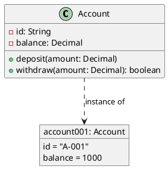

**解读说明**：类 `Account` 给出共同结构和行为，对象 `account001: Account` 给出具体属性值。虚线依赖用来提示对象是类的实例，但在严格 UML 对象图中，通常直接通过带下划线的对象名表达实例关系。

### 类名和抽象类

**定义**：类名是类的标识，通常使用名词或名词短语；**抽象类（Abstract Class）** 是没有直接实例的类，用于表达不能单独实例化的共同抽象。[PPT p.9]

**核心思想**：类名应该反映问题域或解域中的稳定概念，而不是临时过程或含糊职责。抽象类进一步把多个具体类中的共同属性和操作抽出，使模型能表达“一般概念”和“具体类型”的层次。

**背景与目的**：类名命名混乱会直接影响模型可读性。PPT 要求类名以大写字母开始，多个词时每个词首字母大写；这不是形式主义，而是为了让图中的元素一眼可识别为类型级概念。

**直观理解**：例如 `PaymentMethod` 可以是抽象类，`CreditCardPayment` 和 `WalletPayment` 是具体类。也就是说，抽象类像“交通工具”这样的概念，它能约束共同能力，但不能直接说明运行时到底是一辆车、一艘船还是一架飞机。

**PPT 原文关联**：PPT 指出类可以是抽象类，其类名采用斜体字；类用于抽象客观世界中的事物，一般要包含属性和操作。[PPT p.9]

### 属性

**定义**：属性是类的命名特性，由该类的所有对象共享其定义，用于表达对象状态的数据；对象中每个来自所属类的属性都应有特定值。[PPT p.10]

**核心思想**：属性不是随便写在类框里的变量，而是对象状态的一部分。也就是说，属性定义说明“对象应该保存什么信息”，具体对象的属性值说明“这个对象当前是什么状态”。

**背景与目的**：属性语法让模型能够表达可见性、属性名、类型、多重性、初始值和性质串。没有这些信息，类图只能提供粗略名词列表，无法支撑后续设计和实现。

**属性默认语法**：

```text
[可见性] 属性名 [:类型] [多重性] [= 初始值] [{性质串}]
```

**符号说明**：

- `可见性`：说明属性能否被其他类目使用，例如 `+` 表示公有，`-` 表示私有。它控制的是访问边界，与 **封装（Encapsulation）** 和信息隐蔽直接相关。
- `属性名`：说明属性的语义名称，通常小写字母开头。属性名应表达对象状态，而不是表达操作过程。
- `类型`：说明属性值的实现类型或建模类型。它和具体语言有关，但在分析模型中也可以先使用领域类型。
- `多重性`：说明属性值数量的上下界。省略时通常表示 `[1..1]`，即每个对象有且仅有一个该属性值。
- `初始值`：说明新对象建立时的默认值。它可以被构造函数参数化或在运行时修改。
- `性质串`：补充属性性质，例如 `{readonly}` 或 `{frozen}`。它增强属性语义，但需要结合语言和模型约束理解。

**含义解释**：这个语法在做的事情，是把一个字段从“名字”扩展成“可访问、可计数、可初始化、可约束”的模型元素。例如 `+name: String[0..1]` 表示外部可见的字符串属性，并且该属性可以没有值或只有一个值。

**物理/几何意义**：在类图上，属性通常位于类矩形的第二栏，和操作栏分离。这个分栏表达了结构与行为的分离，也让读者能快速判断一个类保存什么状态、提供什么服务。

**PPT 原文关联**：PPT 逐项解释属性语法，并给出 `name`、`name: String`、`name: String[0..1]`、`+name: String`、`name: String{readonly}` 等例子。[PPT p.10-p.18]

| 属性形式 | 表达内容 | 技术含义 | 使用场景 |
| :--- | :--- | :--- | :--- |
| `name` | 只有属性名 | 只说明状态名称，不说明类型和约束 | 早期分析草图 |
| `name: String` | 属性名和类型 | 明确该状态值的类型规约 | 需要映射到实现时 |
| `name: String[0..1]` | 属性名、类型、多重性 | 允许属性为空或只有一个值 | 可选字段 |
| `+name: String` | 可见性、属性名、类型 | 对外公开该属性 | 公共数据或接口模型 |
| `name: String {readonly}` | 属性名、类型、性质串 | 属性只读或受额外约束 | 不希望外部修改的状态 |

### 可见性与信息隐蔽

**定义**：可见性指明属性或操作是否可以被其他类或类目使用，是 UML 对访问边界的模型化表达。[PPT p.11-p.17]

**核心思想**：可见性服务于信息隐蔽。也就是说，每个模块中包含的数据和处理过程，不应被不需要这些信息的模块访问，这样可以降低模块之间的耦合。

**背景与目的**：如果所有属性和操作都公开，调用方会直接依赖内部表示，类的实现细节一变就会牵连外部代码。引入可见性后，模型可以提前说明哪些内容是稳定接口，哪些内容是内部实现。

**直观理解**：类比一下，餐厅顾客只需要看到菜单和付款方式，不需要进入后厨操作炉灶。公有操作像菜单，私有属性像后厨细节；封装并不是故意隐藏信息，而是把不该被依赖的变化隔离起来。

**PPT 原文关联**：PPT 给出四种可见性，并专门解释“为何引入可见性”：为了支持信息隐蔽这一软件设计原则，实现模块低耦合。[PPT p.11-p.17]

| 可见性 | 符号 | 关键字 | 描述 |
| :--- | :---: | :--- | :--- |
| 公有的 | `+` | `public` | 所有其他类或类目都可以使用 |
| 受保护的 | `#` | `protected` | 仅子类或子类目可以使用 |
| 私有的 | `-` | `private` | 仅本类的操作可以使用 |
| 包内的 | `~` | `package` | 仅同一包中声明的类或类目可以使用 |

### Python 中的属性和方法可见性

**定义**：Python 中的属性和方法可见性主要通过命名约定表达，而不像 Java 或 C++ 那样依靠严格访问修饰符强制控制。[PPT p.12-p.16, p.24]

**核心思想**：Python 把可见性更多视为开发者之间的约定，而不是编译器强制规则。值得注意的是，这并不意味着 Python 没有封装；它只是用命名、工具警告、名称改写和团队规范来表达访问意图。

**背景与目的**：PPT 强调 Python 的动态性、反射、动态导入和测试场景会受严格访问控制影响。因此 Python 常说“我们都是成年人”，即语言信任开发者在必要时访问内部 API，但这种访问也意味着调用方承担更高耦合风险。

**直观理解**：例如 `name` 是公开属性，`_internal_id` 表示受保护的内部细节，`__password` 会触发名称改写。方法可见性与属性一致，普通方法、单下划线方法和双下划线方法分别表达公开、内部约定和名称改写后的私有意图。

**PPT 原文关联**：PPT 先讲 Python 属性可见性，再强调 Python 中方法的可见性体现方式与属性完全一致。[PPT p.12-p.15, p.24]

**PPT 原片段**：PPT 中的 Python 片段主要展示公开属性、单下划线属性、双下划线属性的访问差异。[PPT p.13-p.15]

**补全部分**：下面给出一个可运行的最小示例，补齐缩进、构造函数和输出。

```python
class Person:
    def __init__(self, name: str, password: str) -> None:
        self.name = name
        self._internal_id = 123
        self.__password = password

    def greet(self) -> str:
        return f"Hello, {self.name}"

    def _debug_id(self) -> int:
        return self._internal_id

    def __secret(self) -> str:
        return self.__password


p = Person("Alice", "secret")
print(p.name)
print(p._internal_id)
print(p._Person__password)
print(p.greet())
print(p._debug_id())
print(p._Person__secret())
```

**代码说明**：`name` 是公开属性，可以正常访问和修改。`_internal_id` 技术上仍可访问，但语义上提示外部代码不应直接依赖；`__password` 和 `__secret` 会被改写为 `_Person__password` 和 `_Person__secret`，这能减少子类意外覆盖，但不是安全边界。

### 属性的多重性和作用范围

**定义**：属性多重性描述属性值数量的上下界；属性作用范围描述该属性属于类本身还是属于对象实例。[PPT p.18-p.19]

**核心思想**：多重性解决“一个对象可以持有多少个值”的问题，作用范围解决“这个值是全类共享还是实例独有”的问题。也就是说，`points[1..*]: Point` 和 `name[0..1]: String` 不只是类型不同，它们对对象状态的约束也完全不同。

**背景与目的**：没有多重性，模型无法表达必填、可选、一对多等约束；没有作用范围，模型无法区分类变量和实例变量。PPT 指出类范围属性描述所有对象实例的共同特征，UML 中通过给属性加下划线表示。

**直观理解**：例如，一个多边形至少有一个点，因此 `points[1..*]: Point` 合理；一个用户昵称可能未设置，因此 `nickname[0..1]: String` 合理。类范围属性像“账户总数”，所有账户对象共享；实例范围属性像“当前余额”，每个账户对象不同。

**PPT 原文关联**：PPT 说明多重性省略时默认为 `[1..1]`，并列出类范围属性和实例范围属性的差异。[PPT p.18-p.19]

### 操作

**定义**：操作是对一个类中所有对象要做的事情的抽象，是对象对外提供服务、可能改变对象数据或状态的行为规约。[PPT p.20]

**核心思想**：操作关注“对象能做什么”，属性关注“对象保存什么”。也就是说，类的完整语义至少要同时考虑状态和行为，否则会变成只有数据没有职责的结构体，或者只有接口没有状态基础的空壳。

**背景与目的**：操作可以被其他对象调用，也可以是抽象的，即不在类中给出实现。PPT 给出默认语法，是为了让操作不仅有名字，还能表达参数、返回类型、可见性和性质约束。

**操作默认语法**：

```text
[可见性] 操作名 [(参数表)] [:返回类型] [{性质串}]
```

**符号说明**：

- `可见性`：与属性可见性一致，说明操作是否对外可调用。它决定调用方能否把该操作视为可依赖的服务。
- `操作名`：通常为动词或动词短语，小写字母开头。操作名应表达行为意图，例如 `resize`、`getName`、`submitOrder`。
- `参数表`：说明输入、输出或双向通信参数。参数方向可为 `in`、`inout`、`out`，分别表示输入、输入输出和输出参数。
- `返回类型`：说明操作返回值类型。若无返回值，可以省略冒号和返回类型。
- `性质串`：说明额外性质，例如 `{abstract}` 表示抽象操作。它让模型能表达“必须由子类实现”等约束。

**含义解释**：这个语法把方法签名从代码层提前到模型层，使调用者知道如何使用对象服务。对于设计评审来说，操作签名能帮助判断一个类是否承担了合适职责，以及是否暴露了过多内部细节。

**PPT 原文关联**：PPT 用 `resize`、`+resize`、`set(id: Integer, name: String)`、`getName(): String` 展示操作语法，并解释参数方向、返回类型和性质串。[PPT p.20-p.22]

### 操作的多态

**定义**：**多态（Polymorphism）** 是指同一个操作作用于不同对象时，可以根据对象实际类型产生不同执行结果。[PPT p.23, p.65]

**核心思想**：多态把“调用什么”与“如何实现”分离。也就是说，调用者依赖稳定的操作名称或接口，具体类负责提供不同实现。

**背景与目的**：如果没有多态，调用方往往需要写大量类型判断，把不同对象的处理逻辑硬编码在一起。多态把变化分散到各个类中，使新增类型时更容易扩展。

**直观理解**：例如不同图形都支持 `draw()`，调用者只需要遍历图形列表并调用 `draw()`，不需要知道它是圆、矩形还是三角形。Python 中除了继承层次，也可以通过鸭子类型实现多态：只要对象提供同名方法，就可以按统一方式调用。

**PPT 原文关联**：PPT 在操作页提示“操作的多态性”，并在 Python 泛化页解释“同一个操作作用于不同对象，可以产生不同执行结果”。[PPT p.23, p.65]

### 类语义的进一步表达

**定义**：类语义的进一步表达，是在类名、属性和操作之外，用职责、注解、状态机、活动图和交互图补充类的目的、约束和行为细节。[PPT p.25-p.27]

**核心思想**：类图的三栏结构并不总能完整表达设计意图。值得注意的是，PPT 将“详细叙述类的职责”放在第一位，因为职责往往是类建模的起点，再由职责推导属性和操作。

**背景与目的**：如果只列属性和操作，一个类为什么存在、何时可调用、调用后必须满足什么条件，可能仍然不清楚。通过前置条件、后置条件、不变式、状态图、活动图和交互图，可以把类的静态结构与动态语义连接起来。

**直观理解**：例如 `Modem` 类可能有 `dial`、`hangup`、`send`、`recv` 等操作，但还需要说明它的职责是管理通信连接。若嵌入式控制器有复杂状态，单靠操作列表无法表达状态转换，此时状态图比文字列表更清晰。

**PPT 原文关联**：PPT 列出五种增强类语义的方式：职责、类或操作的注解、类的状态机、类的内部结构、体现类的协作。[PPT p.25-p.27]

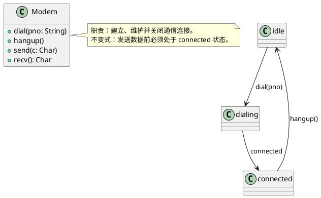

**解读说明**：类图部分表达 `Modem` 的操作，注解补充职责和不变式，状态机补充控制行为。这样比单独列出四个方法更接近 PPT 所说的“进一步描述类的语义”。

### 类在建模中的用途

**定义**：类在建模中的用途包括模型化系统词汇、模型化责任分布，以及模型化基本类型。[PPT p.28-p.30, p.90]

**核心思想**：类不仅是代码中的 `class`，也是分析模型中组织领域概念和责任分配的工具。本质上，好的类应当明确抽象问题域或解域中的某个有形事物或概念，并包含小而清晰的职责集。

**背景与目的**：PPT 强调责任分布要避免类过大或过小。过大的类难以复用和维护，过小的类会导致模型碎片化、难以理解；因此建模时需要识别协作类组，重新分配职责，让每个类既不过载也不过碎。

**直观理解**：例如个人博客系统中的访客、注册用户、博客、博文、评论都可以成为类；零售系统中的 `Customer`、`Order`、`Product`、`Shipment`、`Invoice`、`Warehouse`、`Transaction` 也可以构成领域词汇。对基本类型建模时，可以用带衍型的类表示枚举或值类型，并用约束说明值域。

**PPT 原文关联**：PPT 先用个人博客系统举例，再在总结页用零售系统说明词汇建模，并指出结构良好的类应满足三个条件：抽象明确、职责集小而清晰、抽象和实现分离。[PPT p.28-p.31, p.90]

#### 小结问答

**问**：对象为什么通常不单独列操作？

**答**：因为对象的操作由所属类定义，对象图更关心某一时刻的属性值和对象链接。若每个对象都重复列操作，会制造冗余，并削弱对象图表达运行时状态的重点。

**问**：类越细越好吗？

**答**：不是。类太大会导致职责混杂，类太小会导致模型难以理解和管理。建模时应围绕责任和协作调整粒度，让类承担清晰、有限且能被实现的职责。

## 接口与协作

### 接口

**定义**：**接口（Interface）** 是一组操作的集合，其中每个操作描述类或构件提供的一个服务；接口定义操作描述，而不是操作实现。[PPT p.32]

**核心思想**：接口体现功能抽象，强调“能提供什么服务”而不是“内部如何完成”。也就是说，接口把调用者和实现者隔开，使类、构件或子系统可以在遵守同一契约的前提下替换实现。

**背景与目的**：PPT 将接口称为模型化系统“接缝”的工具。没有接口，调用方会直接依赖具体类或构件；一旦实现变化，调用方也会被迫变化。

**直观理解**：例如支付系统可以定义 `Payment` 接口，银行卡支付、钱包支付和优惠券支付分别实现它。调用方只依赖 `pay(amount)` 这个行为契约，不需要知道背后调用银行网关还是内部账户扣款。

**PPT 原文关联**：PPT 给出两种 UML 表示：带 `<<interface>>` 关键字的分栏矩形，以及小圆圈表示法；同时区分供接口和需接口。[PPT p.32-p.34]

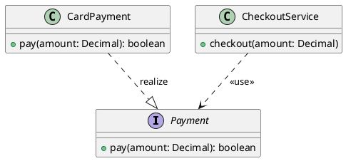

**解读说明**：空心三角虚线表示实现关系，说明 `CardPayment` 承诺实现 `Payment` 规定的操作。`CheckoutService` 到 `Payment` 的虚线依赖带有 `<<use>>` 标记，表示它使用接口而不是绑定具体实现。

### 模型化接口的注意事项

**定义**：模型化接口时，应把接口视为外部可见操作的有限集合，接口本身不保存状态、不描述实现，也不能主动访问其他类目。[PPT p.34]

**核心思想**：接口的边界越清晰，系统替换性越强。值得注意的是，PPT 说接口在形式上等价于一个没有属性、只有抽象操作的抽象类，但这只是形式上的近似；在建模意图上，接口更强调契约和接缝。

**背景与目的**：接口如果塞入属性、状态或实现细节，就会破坏抽象边界。接口可以使用可见性、并发性、衍型、标记值和约束修饰操作，但这些修饰应服务于契约表达，而不是泄露内部实现。

**直观理解**：类比一下，插座标准规定电压、插头形状和接触方式，但不规定发电厂如何发电。接口也是这样，它说明服务如何被调用，不说明服务内部由哪些类协作完成。

**PPT 原文关联**：PPT 明确列出四点：接口只可被其他类目使用；描述外部可见操作；不描述实现且没有属性和状态；接口可以参与泛化、实现和依赖。[PPT p.34]

### 协作

**定义**：协作是一个交互，涉及交互各方、交互方式和交互内容；交互各方的共同工作提供某种协作行为。[PPT p.35]

**核心思想**：协作体现行为结构抽象，它关注“多个对象如何一起完成一个目标”。也就是说，单个类的职责并不能完整解释系统行为，很多功能必须通过对象之间的消息传递和分工来实现。

**背景与目的**：PPT 指出协作有结构部分和行为部分。结构部分说明共同完成协作的类、接口和其他元素，常用组合结构图或类图表达；行为部分说明这些元素如何交互，常用交互图表达。

**直观理解**：例如“统计学生成绩分布”不是某一个对象独自完成的，它可能涉及课程、学生、成绩记录、统计服务和展示对象。协作模型能让我们看到参与者、连接方式和消息流程。

**PPT 原文关联**：PPT 用“统计学生成绩分布”作为协作示例，并强调协作同时包含结构和行为两个方面。[PPT p.35]

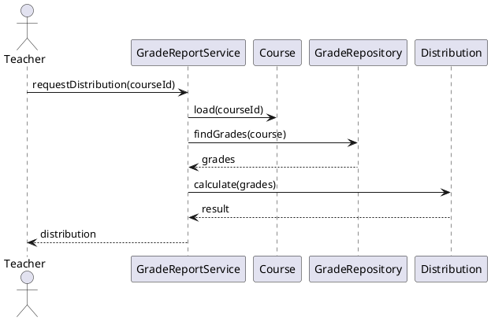

**解读说明**：这张序列式 PlantUML 展示一个协作的行为部分：教师发起请求，服务对象协调课程、成绩仓库和分布计算对象。它说明“统计学生成绩分布”不是一个孤立方法名，而是一组对象按顺序交互产生结果。

### 用况

**定义**：用况是对一组动作序列的描述，系统执行这些动作后，会对特定参与者产生有价值、可观察的结果。[PPT p.36]

**核心思想**：用况体现功能抽象，关注系统从外部看能为参与者提供什么价值。也就是说，用况不是内部算法步骤，而是从参与者目标出发描述完整功能需求。

**背景与目的**：用况用于模型化系统中的行为，是建立系统功能模型的重要术语。PPT 还指出用况通过协作予以细化，说明需求层的功能目标最终要映射到分析或设计层的对象协作。

**直观理解**：例如“提交订单”是一个用况，因为用户执行一组动作后能得到订单创建结果；“调用库存扣减函数”不是合适的用况，因为它是内部实现细节。用况的好坏取决于是否对参与者有可观察价值。

**PPT 原文关联**：PPT 将用况放在接口和协作之后，强调它是功能模型的重要术语，并指出一个用况描述系统的一个完整功能需求。[PPT p.36]

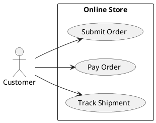

**解读说明**：参与者 `Customer` 位于系统外部，用例位于系统边界内部。每个用例都代表对参与者有价值的可观察功能，而不是系统内部的类或方法。

#### 小结问答

**问**：接口和抽象类是否一样？

**答**：不完全一样。PPT 说接口形式上类似没有属性、只有抽象操作的抽象类，但接口的重点是外部契约和系统接缝，抽象类的重点是抽取共同结构和行为。设计时应优先根据意图选择，而不是只看语法相似。

**问**：用况和协作是什么关系？

**答**：用况描述外部参与者希望系统完成的功能目标，协作描述内部对象如何共同完成该目标。可以理解为用况提出“要做什么”，协作细化“由谁一起做、如何做”。

## 主动类构件制品与节点

### 主动类

**定义**：主动类是至少具有一个进程或线程、能够启动系统控制活动的类。[PPT p.37]

**核心思想**：主动类体现并发行为抽象，强调对象不仅被动响应调用，还可能拥有自己的控制线程。也就是说，主动类对象的行为通常与其他元素的行为并发发生。

**背景与目的**：在实时系统、嵌入式系统或服务端系统中，有些对象承担调度、监听、控制循环等职责。若用普通类表示这些对象，模型会丢失并发控制含义，读者无法判断哪些对象会主动推进系统行为。

**直观理解**：例如 `SensorMonitor` 可以是主动类，它持续采集传感器数据并触发报警；普通 `SensorReading` 则可能只是被动数据对象。主动类强调控制流来源，这是并发建模中的关键差异。

**PPT 原文关联**：PPT 对主动类的说明很简洁，但明确指出主动类对象的行为通常与其他元素行为并发。[PPT p.37]

### 构件

**定义**：构件是系统设计中的模块化部件，是系统中逻辑的、可替换的成分；它在遵循并提供一组外部接口实现的同时隐藏内部实现。[PPT p.38]

**核心思想**：构件强调模块化、替换性和接口约束。本质上，构件比普通类更接近可部署、可组合的软件单元，它通过接口与外部协作，内部结构可以独立变化。

**背景与目的**：大型系统不能只靠类组织，还需要更大粒度的模块边界。构件可以包含更小构件，共享相同接口的构件可以相互替代，但替换前提是保持相同逻辑行为。

**直观理解**：例如支付模块、报表模块、认证模块都可以作为构件。只要它们遵循约定接口，系统就能替换具体实现，例如把本地认证构件替换为单点登录认证构件。

**PPT 原文关联**：PPT 将构件定义为“比特世界的软件制品的系统单位”，并强调共享相同接口的构件可以相互替代。[PPT p.38]

### 制品

**定义**：制品是系统中包含物理信息的、可替代的物理部件，通常代表源代码、可执行程序、脚本或运行时信息的物理打包。[PPT p.39]

**核心思想**：制品表达软件在未运行时也存在的物理文件或包。也就是说，构件偏逻辑设计单元，制品偏物理打包结果，两者可以有关联但不能混为一谈。

**背景与目的**：部署和交付需要知道哪些文件、二进制包、脚本或配置实际存在。若模型只停留在类和构件层，就无法表达系统如何被打包、发布和部署。

**直观理解**：例如 `payment-service.jar`、`init.sql`、`deploy.sh`、`nginx.conf` 都可以被视为制品。它们不是运行中的机器资源，而是可交付、可替换、可部署的文件实体。

**PPT 原文关联**：PPT 特别说明“物理的”是指软件未运行时也存在的部分，主要指文件。[PPT p.39]

### 节点

**定义**：节点是在运行时存在的物理元素，通常表示具有记忆能力和处理能力的计算机资源。[PPT p.40]

**核心思想**：节点表达运行环境的物理资源，例如服务器、设备或执行环境。值得注意的是，一个构件可以驻留在一个节点中，也可以从一个节点移动到另一个节点。

**背景与目的**：系统设计不仅要说明软件由哪些逻辑模块组成，还要说明这些模块最终在哪里运行。节点让模型能够表达部署架构、资源边界和运行时依赖。

**直观理解**：例如 `Server`、`Database VM`、`Edge Device` 都可以是节点。构件和制品可以部署到节点上，节点之间可以通过网络通信形成运行时拓扑。

**PPT 原文关联**：PPT 用 `Server` 作为节点示例，并说明这里的“物理的”指实际机器设备。[PPT p.40]

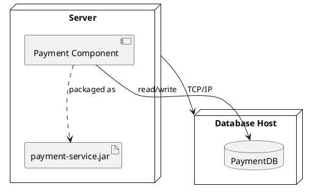

**解读说明**：`Payment Component` 是逻辑构件，`payment-service.jar` 是物理制品，`Server` 和 `Database Host` 是运行时节点。这个图把构件、制品和节点的层次分开，避免把逻辑模块、文件包和机器资源混成同一种元素。

#### 小结问答

**问**：构件和制品最容易混在哪里？

**答**：构件强调逻辑模块和接口替换性，制品强调物理文件和交付打包。一个构件可以被打包成一个或多个制品，一个制品也可能包含多个逻辑构件的实现。

**问**：什么时候需要画节点？

**答**：当运行环境影响系统设计时，就需要画节点。例如服务部署到哪台机器、数据库与应用是否分离、构件是否能迁移到另一个节点，这些都属于节点视角关心的问题。

## 关系术语

### 关系术语总览

**定义**：UML 的基本关系术语包括关联、泛化、实现和依赖，用于表达类目之间的特定语义关系，帮助构造结构良好的 UML 模型。[PPT p.43]

**核心思想**：关系不是“把两个框连起来”这么简单，而是表达耦合类型、生命周期约束、替换性、契约履行或临时使用。也就是说，线型、箭头、菱形和标记共同决定了关系语义。

**背景与目的**：面向对象世界中，对象之间的相互依赖和相互作用构成系统。若关系类型选择错误，模型会误导设计：把临时参数使用画成强结构关系，或把整体部分关系画成普通依赖，都会影响后续职责划分和代码结构。

**直观理解**：例如学生和课程之间是关联，订单和订单项之间常是组合，动物和猫之间是泛化，类和接口之间是实现，服务方法临时使用参数对象常是依赖。不同关系表达的强度和稳定性不同。

**PPT 原文关联**：PPT 先总述“关联、泛化、实现、依赖”，再分别展开关联的语义表达、泛化、实现、依赖及关系用法。[PPT p.43-p.80]

| 关系 | UML 表示 | 语义重点 | 典型问题 |
| :--- | :--- | :--- | :--- |
| 关联 | 实线，可带导航、多重性、角色 | 对象之间存在结构性连接 | 两类对象是否需要长期互相知道 |
| 聚合 | 空心菱形实线 | 弱整体/部分关系 | 部分能否脱离整体独立存在 |
| 组合 | 实心菱形实线 | 强整体/部分关系，共享生命周期 | 部分是否随整体创建和销毁 |
| 泛化 | 空心三角实线 | 一般/特殊，is-a-kind-of | 子类是否能替换父类 |
| 实现 | 空心三角虚线 | 一个类目履行另一个类目的契约 | 类或构件是否兑现接口 |
| 依赖 | 有向虚线 | 临时使用或语义依赖 | 被使用者变化是否影响使用者 |

### 关联

**定义**：**关联（Association）** 描述两个或多个类实例之间的连接关系，是一种名为链的抽象，表达一组具有相同结构、相同语义的对象之间的特定语义关系。[PPT p.44]

**核心思想**：关联表达对象之间可持续的结构连接，而不是一次性的函数调用。也就是说，如果一个对象需要长期导航到另一个对象，或对象之间存在稳定业务关系，就应考虑关联。

**背景与目的**：类图如果只列类而不画关联，就无法说明对象如何构成系统结构。PPT 强调关联可以是二元关联，也可以是三元及以上的 n 元关联，说明关联不是只能连接两个类。

**直观理解**：例如公司与员工之间存在雇佣关联，银行与账户持有人之间存在账户关联，学生与课程之间存在选课关联。关联不是“谁创建谁”，而是“运行时对象之间存在可识别的连接”。

**PPT 原文关联**：PPT 从关联定义开始，随后展开关联名、导航、角色、多重性、限定符、聚合、组合和关联类。[PPT p.44-p.53]

### 关联名和导航

**定义**：关联名描述关联的内涵；导航表示对于一个给定类目，能否找到与之关联的另一个类目。[PPT p.45]

**核心思想**：关联名说明“这条关系是什么”，导航说明“能沿这条关系走到哪里”。值得注意的是，PPT 指出导航默认为双向；若需要限定为单向，可以用单向箭头修饰关联。

**背景与目的**：没有关联名，读者可能看不懂两类对象为何连接；没有导航，读者无法判断对象引用方向。导航方向会影响实现，例如单向关联通常只需要一方保存另一方引用，双向关联则需要维护两边一致性。

**直观理解**：例如 `Order --> Customer : placedBy` 表示订单知道下单客户；若客户也需要知道所有订单，则可能建模为双向关联或在客户侧维护订单集合。选择导航方向时，应基于数据访问和行为协作需要，而不是为了图形对称。

**PPT 原文关联**：PPT 将关联名列为语义表达第一点，将导航列为第二点，并解释默认双向和单向箭头。[PPT p.45]

### 角色和端点名

**定义**：角色是关联一端的类目对另一端类目的一种呈现；当类目参与关联并具有特定角色时，应在关联中显式命名该角色，称为端点名。[PPT p.46]

**核心思想**：角色让同一个类在不同关系中表达不同身份。也就是说，一个 `Person` 在雇佣关系中可能是 `employee`，在家庭关系中可能是 `parent` 或 `child`，不能只靠类名理解其关系语义。

**背景与目的**：当两个类之间有多个关联，或同一个类在一个关联中扮演多个端点时，端点名尤其重要。PPT 指出明确给出关联端名时，通常可以不给出关联名；但多个关联或多个端点需要用关联名或端点名区分。

**直观理解**：例如 `Person` 与 `Person` 的婚姻、监护、好友关系都是自关联，仅凭类名无法区分。端点名能告诉读者某一端在关系中承担什么角色。

**PPT 原文关联**：PPT 用专门一页解释角色，并说明同一个类可以在其他关联中扮演相同或不同角色。[PPT p.46]

### 多重性

**定义**：多重性是类或类目中的对象参与一个关联的数目，采用下限到上限的闭区间表达，星号表示上限无限制。[PPT p.47-p.48]

**核心思想**：多重性回答“对另一端的每个对象，本端可能有多少个对象出现”。也就是说，`1..*`、`0..1`、`*` 不只是装饰，它们是业务约束。

**背景与目的**：没有多重性，关联会缺少数量约束，进而影响数据库设计、集合类型选择和业务校验。PPT 指出单个星号等价于 `0..*`，而 `0..0` 没有实际意义，因为它表示没有实例产生。

**直观理解**：例如每个公司可以雇佣一个或多个人员，即人员端对公司而言是 `1..*`；每个人员可以受雇于零个或多个公司，即公司端对人员而言是 `*`。读多重性时要站在另一端对象的角度解释，这是最容易出错的地方。

**PPT 原文关联**：PPT 用人员和公司关系解释多重性，并强调关联一端的多重性说明对另一端类的每个对象，本端类可能出现多少对象。[PPT p.47-p.48]

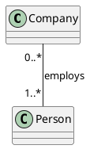

**解读说明**：站在 `Company` 对象看，右端 `Person` 的 `1..*` 表示每个公司雇佣一个或多个员工。站在 `Person` 对象看，左端 `Company` 的 `0..*` 表示每个人可以受雇于零个或多个公司。

### 限定符

**定义**：限定符是关联的属性或属性表，这些属性的值对关联相关的对象集合进行划分。[PPT p.49]

**核心思想**：限定符把“从一个对象到一组对象”的关联进一步约束为“给定某个键值后找到更小范围的对象”。也就是说，它类似在关联端增加索引或查找条件。

**背景与目的**：当一个对象关联到很多对象，但实际访问总是通过某个键定位时，限定符能让模型表达这种访问语义。PPT 示例中给定一个 `Bank` 对象和一个 `account#` 值，可以找到零个或一个 `Person` 对象。

**直观理解**：例如银行通过账号查找账户持有人，字典通过键查找值，仓库通过 SKU 查找商品库存。限定符让关联不只是“银行关联很多人”，而是“银行可通过账号定位某个人”。

**PPT 原文关联**：PPT 将 `account#` 作为限定符示例，并说明它对 `Person` 对象进行了划分。[PPT p.49]

### 聚合

**定义**：**聚合（Aggregation）** 是一种特殊形式的关联，用于表达对象之间较弱的整体/部分关系，UML 中用整体端的空心菱形表示。[PPT p.50]

**核心思想**：聚合表达“部分属于整体的一部分”，但部分通常可以独立存在，也可以在某些情况下脱离或转移到其他整体。也就是说，聚合是弱所有权关系，不应误画成组合。

**背景与目的**：PPT 强调聚合是对象之间的结构关系，而非类或类目之间的结构关系。这句话的意思是，真正发生整体/部分关系的是运行时对象实例，而不是抽象类名本身。

**直观理解**：例如车队与车辆、学院与教师、公司与部门在某些业务语境下可以建模为聚合。值得注意的是，是否聚合取决于问题域语义，而不是自然语言里是否能说“有一个”。

**PPT 原文关联**：PPT 指出聚合通过“一个类目是另一类目的一部分”的性质增强关联语义，并用空心菱形位于整体类一侧表示。[PPT p.50]

### 组合

**定义**：**组合（Composition）** 是聚合的一种强形式，当整体类和部分类实例具有相同生命周期时，该聚合称为组合，UML 中用整体端的实心菱形表示。[PPT p.51]

**核心思想**：组合表达强所有权和生命周期绑定。也就是说，部分通常不能脱离整体独立存在，整体销毁时部分也随之销毁或失去意义。

**背景与目的**：组合比聚合约束更强，因此不能随意使用。PPT 指出组合末端的多重性不能超过 `1`，并且由一个链连接的对象元组必须属于同一个整体对象，这体现了组合对所有权唯一性的限制。

**直观理解**：例如订单和订单项通常是组合，因为订单项只在某个订单中有意义；文档和段落也常是组合，因为段落随文档生命周期管理。相反，轮胎是否组合到汽车要看业务：若轮胎可拆卸、可独立库存，就更像聚合。

**PPT 原文关联**：PPT 将组合定义为生命周期相同的聚合，并强调实心菱形在整体类一侧。[PPT p.51]

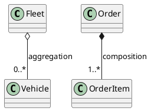

**解读说明**：`Fleet` 到 `Vehicle` 使用空心菱形，表示车队拥有车辆集合，但车辆可以独立存在。`Order` 到 `OrderItem` 使用实心菱形，表示订单项依附订单生命周期，通常不应脱离订单单独存在。

### 关联类

**定义**：关联类是具有关联和类双重特性的模型元素，可以看作带有类特性的关联，也可以看作带有关联特性的类。[PPT p.52-p.53]

**核心思想**：当一条关系本身需要保存属性、操作或与其他元素发生关系时，应使用关联类。也就是说，不是所有信息都自然属于关联两端的类，有些信息属于“这次连接”本身。

**背景与目的**：例如学生和课程之间的选课关系可能有成绩、选课时间、状态等属性。这些属性既不完全属于学生，也不完全属于课程，而属于某个学生选某门课程这条关联。

**直观理解**：关联类像“关系上的记录”。如果关联类只有属性，可以把名字显示在关联路径上以强调关联性质；如果它还有操作和其他关联，则可以放在类矩形中以强调类性质。

**PPT 原文关联**：PPT 说明关联类虽然画成关联虚线和类，但它仍是单一模型元素，并列出省略路径名或类名的规则。[PPT p.52-p.53]

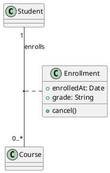

**解读说明**：`Enrollment` 表达学生与课程之间“选课”这条关联本身的属性和操作。成绩不应简单放入 `Student` 或 `Course`，因为它依赖具体学生和具体课程的组合。

### Python 中的关联聚合和组合

**定义**：在 Python 中，关联通常通过一个对象持有另一个对象引用实现；聚合和组合在代码形式上可能相近，但语义上由生命周期和所有权区分。[PPT p.54-p.59]

**核心思想**：Python 代码中的引用只是实现手段，UML 关系的关键仍是语义。也就是说，同样是 `self.part = part`，可能表示普通关联、聚合或组合，需要看对象是否独立创建、是否可共享、是否依附整体生命周期。

**背景与目的**：PPT 将实现方式分为单向关联、双向关联、聚合、组合和多重性。单向关联只有一方持有引用，双向关联双方互持引用；一对多和多对多通常用列表、集合或字典保存多个关联对象。

**直观理解**：例如学生和课程是多对多关联，双方可用集合保存对方；汽车和轮胎若轮胎可拆换，像聚合；身体和心脏若心脏由身体内部创建并随身体管理，像组合。关键不是 Python 语法，而是业务生命周期。

**PPT 原文关联**：PPT 明确说 Python 实现方式一致，仅语义不同，并给出聚合为弱关联、组合为强依赖的说明。[PPT p.54-p.59]

**PPT 原片段**：PPT 中列出单向关联、双向关联、聚合、组合和多重性，但未完整给出可运行代码。[PPT p.54-p.59]

**补全部分**：下面的 MCVE 将这些关系放在同一个最小示例中。

```python
class Address:
    def __init__(self, city: str) -> None:
        self.city = city


class Customer:
    def __init__(self, name: str, address: Address) -> None:
        self.name = name
        self.address = address


class Department:
    def __init__(self, name: str) -> None:
        self.name = name
        self.employees: list[Employee] = []

    def add_employee(self, employee: "Employee") -> None:
        self.employees.append(employee)
        employee.department = self


class Employee:
    def __init__(self, name: str) -> None:
        self.name = name
        self.department: Department | None = None


class OrderItem:
    def __init__(self, sku: str, quantity: int) -> None:
        self.sku = sku
        self.quantity = quantity


class Order:
    def __init__(self, order_no: str) -> None:
        self.order_no = order_no
        self.items: list[OrderItem] = []

    def add_item(self, sku: str, quantity: int) -> None:
        self.items.append(OrderItem(sku, quantity))


address = Address("Beijing")
customer = Customer("Alice", address)

employee = Employee("Bob")
department = Department("Engineering")
department.add_employee(employee)

order = Order("O-001")
order.add_item("BOOK-001", 2)
```

**代码说明**：`Customer` 持有 `Address` 引用，是普通单向关联示例；`Department` 与 `Employee` 双方互相引用，表达双向关联或聚合语义。`Order` 在内部创建 `OrderItem`，更接近组合，因为订单项由订单管理并依附订单存在。

### 泛化

**定义**：泛化是一般性类目和较特殊类目之间的关系，通常称为超类或父类与子类之间的关系，也称为 `is-a-kind-of` 关系。[PPT p.60-p.61]

**核心思想**：泛化表达一般/特殊层次，并支持复用。也就是说，子类继承父类的属性和操作，可以扩展自己的属性和操作，也可以在满足替换原则的前提下替换父类声明。

**背景与目的**：泛化让模型能够抽取共同责任，避免多个类重复定义相同属性和操作。PPT 同时提醒继承层次不要过深或过宽，因为过度继承会使模型难以理解，必要时应寻找中间抽象类。

**直观理解**：例如 `Employee` 是 `Person` 的一种，`Manager` 是 `Employee` 的一种。这个关系不是“包含”，也不是“使用”，而是“更特殊的类型可以被看作更一般的类型”。

**PPT 原文关联**：PPT 说明子类可继承父类属性和操作、可替换父类声明、可覆盖父类同名同参数操作，并解释根类、叶子类、单继承和多继承。[PPT p.60-p.61]

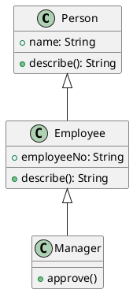

**解读说明**：空心三角实线指向更一般的父类。`Employee` 继承 `Person`，并可以重写 `describe()`；`Manager` 继承 `Employee`，进一步增加审批职责。

### Python 中的泛化继承和多态

**定义**：Python 中的泛化通常通过继承实现，即子类复用父类属性和方法，并可以扩展或 **重写（Override）** 父类同名方法。[PPT p.62-p.65]

**核心思想**：继承关注复用和一般/特殊关系，多态关注统一调用与多种实现。值得注意的是，Python 支持单继承和多继承，也支持不依赖共同父类的鸭子类型多态。

**背景与目的**：如果多个类确实共享共同责任，可以抽取父类；如果只是需要统一调用某个方法，未必一定要强制继承同一个父类。Python 的鸭子类型让“对象是否可用”更多取决于它是否提供所需操作。

**直观理解**：例如 `Dog` 和 `Cat` 都有 `speak()` 方法时，可以统一调用 `animal.speak()`。它们可以继承同一个 `Animal`，也可以完全没有共同父类，只要都提供同名方法。

**PPT 原文关联**：PPT 展示 Python 单继承、方法重写、`super()`、多继承和鸭子类型多态。[PPT p.62-p.65]

**PPT 原片段**：PPT 给出 Python 继承关系的要点，但代码片段在 OCR 中不完整。[PPT p.62-p.65]

**补全部分**：

```python
class Animal:
    def speak(self) -> str:
        return "..."


class Dog(Animal):
    def speak(self) -> str:
        return "woof"


class Cat(Animal):
    def speak(self) -> str:
        return "meow"


class Robot:
    def speak(self) -> str:
        return "beep"


def announce(speaker) -> None:
    print(speaker.speak())


for item in [Dog(), Cat(), Robot()]:
    announce(item)
```

**代码说明**：`Dog` 和 `Cat` 通过继承实现泛化，并重写父类 `speak()`。`Robot` 没有继承 `Animal`，但它也提供 `speak()`，所以 `announce()` 仍可统一调用，这体现了 Python 的鸭子类型多态。

### 实现

**定义**：实现是类目之间的语义关系，其中一个类目规约另一个类目必须执行的契约，UML 中用带空心三角形的虚线段表示。[PPT p.67]

**核心思想**：实现表达“约定”和“兑现”的关系。也就是说，接口或用况提供抽象契约，类、构件或协作提供满足契约的具体行为。

**背景与目的**：PPT 指出实现关系常用于两个地方：接口与实现它们的类或构件之间，用况与实现它们的协作之间。它体现了不同抽象层之间的精化思想。

**直观理解**：例如 `Payment` 接口规定 `pay()`，`CardPayment` 实现 `pay()`；“提交订单”用况可以通过订单创建协作实现。实现关系比普通依赖更强，因为它承诺满足契约。

**PPT 原文关联**：PPT 在实现页给出定义、UML 表示和两个使用场景。[PPT p.67]

### Python 中的实现关系

**定义**：Python 中的实现关系可以通过抽象基类表达显式契约，也可以通过鸭子类型表达隐式契约。[PPT p.68-p.70]

**核心思想**：抽象基类把“必须实现哪些方法”写成可检查的结构，鸭子类型把契约变成约定。也就是说，前者更显式，后者更灵活；两者都能对应 UML 中“一个类目履行另一个类目契约”的思想。

**背景与目的**：在需要强约束、团队协作或框架扩展点时，抽象基类更清晰；在脚本、小型模块或高度动态场景中，鸭子类型更轻量。PPT 将抽象类称为官方标准方式，将鸭子类型称为隐式实现关系。

**直观理解**：例如插件系统往往适合抽象基类，因为插件作者需要明确知道必须实现哪些方法；临时工具函数可以只要求对象“有某个方法”，不要求继承特定父类。

**PPT 原文关联**：PPT 列出“方式一：用抽象基类实现 Realization”和“方式二：鸭子类型实现隐式 Realization”。[PPT p.68-p.70]

**PPT 原片段**：PPT 展示两种方式但 OCR 未完整保留示例代码。[PPT p.68-p.70]

**补全部分**：

```python
from abc import ABC, abstractmethod


class Exporter(ABC):
    @abstractmethod
    def export(self, data: list[str]) -> str:
        raise NotImplementedError


class CsvExporter(Exporter):
    def export(self, data: list[str]) -> str:
        return ",".join(data)


class JsonLikeExporter:
    def export(self, data: list[str]) -> str:
        return "[" + ", ".join(f'"{item}"' for item in data) + "]"


def save(exporter, data: list[str]) -> str:
    return exporter.export(data)


print(save(CsvExporter(), ["a", "b"]))
print(save(JsonLikeExporter(), ["a", "b"]))
```

**代码说明**：`CsvExporter` 显式继承 `Exporter`，这是抽象基类形式的实现关系。`JsonLikeExporter` 没有继承接口，但提供了相同 `export()` 方法，因此在 Python 中也能按隐式契约使用。

### 依赖

**定义**：**依赖（Dependency）** 是一种使用关系，用于描述一个类目使用另一类目的信息和服务，UML 中用有向虚线表示。[PPT p.71]

**核心思想**：依赖表达较弱、较临时的使用关系。也就是说，当一个类只在方法参数、局部变量、返回值或临时调用中使用另一个类，而不长期持有它时，通常应建模为依赖而不是关联。

**背景与目的**：PPT 指出若被使用的类发生变化，使用它的类的操作也会受到影响。依赖虽然比关联弱，但仍然代表变化传播路径，因此设计时应避免不必要的依赖扩散。

**直观理解**：例如 `Library.add(book: Book)` 中，`Library` 的操作使用 `Book` 参数。如果 `Library` 并不保存 `Book` 引用，只是在方法中处理它，就可以用依赖表达。

**PPT 原文关联**：PPT 说明箭头一端的类目为目标，另一端为源；大多数情况下，用依赖描述一个类使用另一个类的操作。[PPT p.71, p.79]

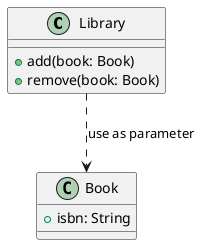

**解读说明**：`Library` 的方法签名使用 `Book`，因此 `Library` 依赖 `Book` 的语义。若 `Library` 保存 `Book` 集合，这条关系可能升级为关联；若只是参数使用，依赖更合适。

### 依赖分类

**定义**：依赖分类是在普通依赖基础上用标记进一步表达依赖语义，例如绑定、导出、允许、实例、实例化、幂类型、精化和使用。[PPT p.72-p.73]

**核心思想**：依赖本身语义较宽，分类标记能说明“为什么依赖”。也就是说，`<<use>>`、`<<refine>>`、`<<instantiate>>` 等标记能让读者知道依赖是因为调用、细化、创建还是可见性许可。

**背景与目的**：如果所有虚线箭头都不加说明，模型读者只能知道“有依赖”，却不知道依赖性质。PPT 用模板容器实例化、生日推导年龄、分析类到设计类精化等例子说明分类的必要性。

**直观理解**：例如年龄可以从生日导出，适合用 `derive`；设计模型比分析模型更细，适合用 `refine`；工厂创建产品实例，适合用 `instantiate`。标记越准确，模型越能支持评审和追踪。

**PPT 原文关联**：PPT 列出八类依赖：绑定、导出、允许、实例、实例化、幂类型、精化、使用。[PPT p.72-p.73]

| 依赖类别 | 标记 | 含义 | 示例 |
| :--- | :--- | :--- | :--- |
| 绑定 | `bind` | 源的实例化使用目标给定实参 | 模板容器实例与模板参数 |
| 导出 | `derive` | 源可由目标推导出来 | 年龄由生日推导 |
| 允许 | `permit` | 目标对源可见 | 访问私有特征的许可关系 |
| 实例 | `instance of` | 源对象是目标实例 | 对象和类之间的实例关系 |
| 实例化 | `instantiate` | 源实例由目标创建 | 工厂创建产品 |
| 幂类型 | `powertype` | 源是目标的幂类型 | 类型分类建模场景 |
| 精化 | `refine` | 源比目标更细 | 设计类细化分析类 |
| 使用 | `use` | 源公共语义依赖目标语义 | 方法调用或参数使用 |

### Python 中的依赖关系

**定义**：Python 中最基础的依赖关系，是一个类的方法临时使用另一个类的实例，例如把后者作为方法参数传入。[PPT p.74]

**核心思想**：依赖不要求对象长期持有引用，它只要求一个元素的正确性受另一个元素影响。也就是说，方法参数、局部对象创建、静态函数调用都可能形成依赖。

**背景与目的**：区分依赖和关联有助于控制耦合强度。若只是参数使用，画成关联会夸大结构关系；若长期保存引用却只画依赖，则会低估对象间的连接强度。

**直观理解**：例如 `Printer.print_document(document)` 使用 `Document`，但 `Printer` 不保存文档列表，这就是依赖。若 `PrinterQueue` 长期维护多个 `Document`，则更像关联。

**PPT 原文关联**：PPT 对 Python 依赖的说明是“一个类的实例作为另一个类的方法的参数被使用”。[PPT p.74]

**PPT 原片段**：PPT 只给出关系描述，未完整展开代码。[PPT p.74]

**补全部分**：

```python
class Document:
    def __init__(self, title: str, body: str) -> None:
        self.title = title
        self.body = body


class Printer:
    def print_document(self, document: Document) -> None:
        print(f"== {document.title} ==")
        print(document.body)


doc = Document("Report", "UML dependency example")
printer = Printer()
printer.print_document(doc)
```

**代码说明**：`Printer` 的 `print_document()` 方法依赖 `Document` 的属性，但 `Printer` 对象没有长期保存 `Document`。因此在 UML 中更适合画依赖，而不是关联。

### 关系建模策略

**定义**：关系建模策略是指在关联、泛化、实现和依赖之间选择合适关系类型的判断规则。[PPT p.75-p.80]

**核心思想**：应先考虑结构关系、一般/特殊关系和精化关系，只有不符合这些语义时才考虑依赖。也就是说，依赖是兜底的弱使用关系，而不是所有不确定连线的默认选择。

**背景与目的**：PPT 将关系用法分为结构关系、继承关系、精化关系和依赖关系。结构关系用关联建模，继承关系用泛化建模，精化关系用实现建模，非结构、非继承、非精化的使用关系再用依赖建模。

**直观理解**：例如公司、部门、职员、产品之间长期存在结构连接，用关联；多个类共享共同责任并存在 `is-a-kind-of`，用泛化；需求层用况由设计层协作细化，用实现；某类只作为另一类操作参数，用依赖。

**PPT 原文关联**：PPT 最后总结策略：仅当关系不是结构关系时才使用依赖；仅当关系是 `is-a-kind-of` 时才使用泛化；不要引入循环泛化；保持泛化层次平衡。[PPT p.75-p.80]

| 判断问题 | 若答案为是 | 推荐关系 | 说明 |
| :--- | :--- | :--- | :--- |
| 对象之间是否存在稳定结构连接 | 是 | 关联 | 再判断多重性、导航、角色、聚合或组合 |
| 是否整体/部分，且部分可独立存在 | 是 | 聚合 | 空心菱形在整体端 |
| 是否整体/部分，且生命周期绑定 | 是 | 组合 | 实心菱形在整体端 |
| 是否一般/特殊关系 | 是 | 泛化 | 必须能解释为 `is-a-kind-of` |
| 是否一个元素履行另一个契约 | 是 | 实现 | 接口到类、用况到协作 |
| 是否只是临时使用信息或服务 | 是 | 依赖 | 常见于参数、局部变量、方法调用 |

#### 小结问答

**问**：聚合可以替代多继承吗？

**答**：通常不能简单说替代，因为两者表达的语义不同。多继承表达多个一般类型的特化，聚合表达整体/部分结构；但在设计实践中，如果使用继承只是为了复用实现而不是表达真正的 `is-a-kind-of`，就应考虑用聚合或组合降低继承耦合。

**问**：为什么说只有不是结构关系时才使用依赖？

**答**：因为依赖语义较弱，如果对象之间实际存在长期结构连接，却只画依赖，会隐藏重要设计约束。结构关系应该优先用关联及其变体表达，依赖用于临时使用或语义依赖更准确。

## 包和注解

### 包

**定义**：包是模型元素的分组，用于控制信息组织复杂性，形成可管理的部分；包可以嵌套在其他包中，并可包含子包和其他模型元素。[PPT p.82]

**核心思想**：包体现模型层面的模块化和构件化机制。也就是说，当模型元素数量变多时，不能只依靠一张大图堆叠元素，而应按命名空间、职责边界或子系统进行分组。

**背景与目的**：没有包，大型模型会变得难以浏览、难以复用、难以控制可见性。包通过分组和可见性符号说明哪些元素对外公开，哪些只在包内部或子孙包中可见。

**直观理解**：类比一下，文件系统用文件夹组织文件，编程语言用模块或包组织代码。UML 包也承担类似职责，但它组织的是模型元素，而不是仅仅组织源文件。

**PPT 原文关联**：PPT 将包的目的定义为控制信息组织复杂性，并列出包元素可见性的四种符号。[PPT p.82]

| 可见性 | 符号 | 描述 |
| :--- | :---: | :--- |
| 公有的 | `+` | 对所有包可见 |
| 受保护的 | `#` | 仅对子孙包可见 |
| 私有的 | `-` | 对其他包不可见 |
| 包范围的 | `~` | 仅对同一包内声明的模型元素可见 |

### 包的表示

**定义**：包通常表示为一个大矩形，左上角带一个小矩形；包内容可以画在大矩形内，也可以画在包外并通过符号连接。[PPT p.83]

**核心思想**：包表示强调“分组”和“命名空间”。也就是说，包图不是为了展示类的全部细节，而是为了展示模型元素属于哪个组织单元，以及包之间如何依赖。

**背景与目的**：在大型模型中，把所有内容展开在包内部会导致图过于拥挤；把内容放在包外再连接，可以保留包结构，又降低视觉复杂度。选择哪种表示取决于当前图的沟通目标。

**直观理解**：例如可以把 `Window`、`Form`、`EventHandler` 放在 `GUI` 包内，也可以只画 `GUI` 包并在另一张图展开其内部类。这样做能让高层图保持简洁。

**PPT 原文关联**：PPT 说明包名可写在小矩形内，也可在内容画在包外时放在大矩形中。[PPT p.83]

### 包间依赖

**定义**：包之间的依赖是从源包到目标包的有向关系，主要包括引入依赖和访问依赖，UML 中用带箭头的虚线并标记 `<<import>>` 或 `<<access>>` 表示。[PPT p.84-p.87]

**核心思想**：引入依赖把目标包中适当可见的内容加入源包公共命名空间，访问依赖把目标包中可见内容加入源包私有命名空间。也就是说，`import` 会影响源包对外可见的命名空间，`access` 只方便源包内部引用，不会再输出给第三方。

**背景与目的**：包间依赖控制模型元素如何跨包引用。PPT 示例中 `Policies` 引入 `GUI` 后，可以用简单名访问 `GUI::Window` 和 `GUI::Form`，但受保护的 `GUI::EventHandler` 不可见；未引入 `GUI` 的 `Server` 必须使用限定名访问公共内容。

**直观理解**：类比一下，`import` 像把某个模块的公开名字纳入本模块对外声明的一部分，而 `access` 更像内部使用，不希望第三方通过自己间接获得目标包内容。两者都降低书写限定名的负担，但可传播性不同。

**PPT 原文关联**：PPT 分别解释 `<<import>>` 和 `<<access>>`，并给出 `Policies`、`GUI`、`Server` 的例子。[PPT p.84-p.87]

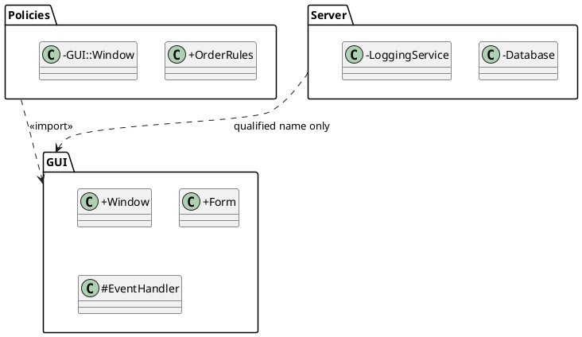

**解读说明**：`Policies` 对 `GUI` 的 `<<import>>` 表示它可以把 `GUI` 的公共内容纳入自己的命名空间。`Server` 没有引入 `GUI`，因此即使要访问公共内容，也需要使用限定名；同时 `Server` 的私有内容不会被 `GUI` 访问。

### 注解

**定义**：注解是用于解释信息的模型元素，可为模型增加辅助说明；注解可以是简单文字，也可以内嵌 URL 或文档链接，并用虚线连接到被解释的模型元素上。[PPT p.88]

**核心思想**：注解用于补充图形符号难以表达的背景、约束或说明。也就是说，注解不是垃圾桶，不能替代清晰建模；它应当只补充那些确实需要文字解释的信息。

**背景与目的**：模型读者未必知道某条关系的业务规则、某个类的不变式或某个设计选择的理由。适当注解可以提高模型可理解性，避免读者误解图上的符号。

**直观理解**：例如在 `Order` 类旁注“订单提交后不可删除，只能取消”，比把这个规则硬塞进类名或关联名更清楚。注解还可以链接外部需求文档，让模型和文档保持可追踪。

**PPT 原文关联**：PPT 将注解作为用于解释信息的术语，强调它使建造的系统模型更容易理解。[PPT p.88]

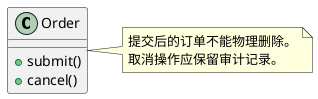

**解读说明**：注解通过虚线附着到 `Order`，补充业务约束。它不改变类的结构，却能帮助读者正确理解操作的使用条件和设计意图。

#### 小结问答

**问**：包是不是等同于代码目录？

**答**：不完全等同。包是模型元素的分组，代码目录是实现层文件组织；二者可以对应，但模型包更强调命名空间、可见性和依赖关系。

**问**：什么时候应该加注解？

**答**：当图形符号不足以表达重要约束、背景或例外规则时，应加注解。若注解只是重复类名或关系名，就没有必要；若注解能防止误解或连接外部文档，就很有价值。

## UML 建模实践总结

### 有效知识点覆盖

**定义**：本课的 UML 基础可以概括为三层元信息：抽象客观实体的类目、抽象实体关系的关系术语，以及组织和解释信息的包与注解。[PPT p.89]

**核心思想**：UML 的学习重点不是背符号，而是理解符号背后的建模语义。也就是说，看到矩形要问它是类、接口、构件、制品还是节点；看到线要问它是关联、聚合、组合、泛化、实现还是依赖。

**背景与目的**：PPT 最终总结时再次强调类目、关系术语和包注解，说明这些是后续学习具体 UML 图的基础。没有这些基础，后续看到 14 种图时会只记形状，不理解图要表达的系统视角。

**直观理解**：类比一下，学电路图不能只记电阻、电容和线长什么样，还要知道它们代表什么物理意义。学 UML 也一样，形状只是入口，语义才是设计沟通的核心。

**PPT 原文关联**：PPT 的 UML 总结页把本课内容归纳为三组：类目、关系术语、包和注解。[PPT p.89]

### 建模判断流程

**定义**：建模判断流程是从问题域词汇出发，识别类目，分配职责，选择关系，并用包和注解组织模型的过程。[PPT p.28-p.31, p.75-p.80, p.89-p.90]

**核心思想**：好的 UML 模型来自逐步判断，而不是一次性画满所有符号。也就是说，先识别系统词汇，再判断职责和协作，最后选择关系类型和组织方式。

**背景与目的**：PPT 多次强调模型化词汇、模型化责任分布和关系建模策略，说明建模是一种设计推理活动。若直接从代码类倒推图，容易遗漏需求层和分析层的抽象。

**建模流程**的步骤如下：

1. **识别系统词汇**
   - 输入：需求描述、业务名词、领域术语和已有系统文档。
   - 操作：抽取候选类、参与者、用况、构件或节点，过滤过于临时的实现细节。
   - 输出：候选模型元素列表。
   - 目的：建立共同词汇，避免不同角色对同一概念使用不同名字。

2. **分配类的职责**
   - 输入：候选类和系统行为需求。
   - 操作：为每个类写出小而明确的职责集，检查是否过大或过碎。
   - 输出：职责清晰的类模型。
   - 目的：让每个类既有存在理由，又不会承担过多变化原因。

3. **选择关系类型**
   - 输入：类、接口、构件等模型元素及其协作需求。
   - 操作：先判断是否结构关联，再判断是否整体/部分、一般/特殊、契约实现或临时使用。
   - 输出：带关联、聚合、组合、泛化、实现和依赖的结构模型。
   - 目的：用准确关系表达耦合强度和设计约束。

4. **补充语义细节**
   - 输入：初步结构模型和行为需求。
   - 操作：补充属性、操作、多重性、可见性、限定符、关联类、状态机、交互图和注解。
   - 输出：可用于评审和实现映射的模型。
   - 目的：让模型从“名词列表”变成真正可讨论的设计产物。

5. **组织模型信息**
   - 输入：规模变大的模型集合。
   - 操作：用包分组，用包间依赖表达命名空间关系，用注解解释关键约束。
   - 输出：可维护、可阅读、可追踪的模型结构。
   - 目的：控制复杂性，避免一张图承载过多信息。

**PPT 原文关联**：这个流程综合了 PPT 中类的主要用途、关系用法总结、包和注解的目的，并保持在本课材料范围内。[PPT p.28-p.31, p.75-p.89]

### 常见误区

**定义**：常见误区是指在使用 UML 术语时容易混淆语义、夸大关系强度或忽略模型目的的做法。[PPT p.31, p.50-p.51, p.79-p.80]

**核心思想**：UML 建模的错误通常不是符号画错一点，而是语义判断错了。值得注意的是，聚合、组合、依赖和泛化最容易被滥用，因为它们都能“连线”，但表达的设计含义完全不同。

**背景与目的**：PPT 多次提醒要注意结构良好的类、聚合与组合的语义、依赖的使用时机、泛化层次的平衡。这些提醒共同指向一个原则：模型应服务理解和决策，而不是追求符号数量。

**直观理解**：例如把所有“有一个”都画成聚合，会让模型充满无意义空心菱形；把参数使用画成关联，会夸大对象连接；把代码复用画成继承，会制造错误的 `is-a-kind-of`。正确做法是先问语义，再选符号。

**PPT 原文关联**：PPT 在聚合页强调整体类和部分类概念上处于同一层次，在依赖页强调只在不是结构、继承、精化关系时才使用依赖，在泛化页强调继承层次不要过深或过宽。[PPT p.50, p.79-p.80]

| 误区 | 问题 | 更合适的判断 |
| :--- | :--- | :--- |
| 看到“有”就画聚合 | 自然语言的“有”不一定是整体/部分 | 先判断部分是否是整体的结构组成 |
| 把组合当普通包含 | 组合包含生命周期绑定和强所有权 | 只有部分依附整体存在时才用组合 |
| 为复用代码滥用泛化 | 泛化必须表达一般/特殊关系 | 如果只是复用实现，优先考虑组合或委托 |
| 把临时参数画成关联 | 关联会暗示稳定对象连接 | 只作为参数或局部变量时画依赖 |
| 用注解替代建模 | 注解过多会掩盖结构不清 | 先用正确元素和关系表达，再补充必要说明 |

#### 总结问答

**问**：本课之后学习具体 UML 图时，应该优先记什么？

**答**：优先记模型元素和关系的语义，而不是图形外观。具体图只是把这些元素按某个视角组织起来，例如类图强调结构，用例图强调功能边界，交互图强调对象消息。

**问**：如何判断一张 UML 图是否有用？

**答**：看它是否回答了一个明确问题。若它能解释系统词汇、职责分布、关系约束、交互流程或部署结构，就是有用模型；若它只是把代码机械翻译成框和线，价值就很有限。

**问**：本课有哪些盲区需要注意？

**答**：[盲区：PPT 第 12 至 15 页、62 至 70 页的 Python 示例在 OCR 中代码缩进和部分内容缺失，无法逐字恢复原始代码。] 本笔记基于 PPT 文字要点补全了可运行 MCVE，并用“PPT 原片段”和“补全部分”标明来源边界。
