## UML 图形工具的整体分类

### 静态图与动态图

**定义**：**统一建模语言（UML）** 为不同抽象层提供两大类图形工具：一类对系统静态部分建模，另一类对系统动态部分建模。[PPT p.1-p.2, p.10]

**核心思想**：静态图回答“系统中有哪些稳定元素，它们如何组织”；动态图回答“系统运行时会发生什么，对象、参与者和活动如何变化”。也就是说，静态图像系统骨架，动态图像系统的运行过程，两者合起来才构成可复习、可评审的模型视图。

**背景与目的**：只看静态结构，开发者容易知道有哪些类、包、构件和节点，却不知道对象何时交互、状态如何迁移、业务流程怎样推进。只看动态行为，又会缺少承载这些行为的结构载体。PPT 用房屋作类比，静态方面像墙、门、窗、管子和电线的布局，动态方面像空气流动和人在房间中的走动，这说明 UML 图的分类本质上是在分离不同建模关注点。[PPT p.2, p.10]

**直观理解**：类比一下，建筑施工图不能只画房间里人的移动路线，也不能只画墙体而不考虑实际使用方式。UML 也是这样，类图、包图、部署图等说明“系统长什么样”，用况图、状态机图、活动图、顺序图等说明“系统怎样被使用和运行”。

**PPT 原文关联**：PPT 首先列出七种可对系统静态部分建模的图，随后列出七种可对系统动态部分建模的图，并把这十四种图作为 UML2 的主要模型表达工具。[PPT p.2-p.19]

| 分类 | 图形工具 | 主要关注点 | 典型问题 |
| :--- | :--- | :--- | :--- |
| 静态图 | 类图、对象图、构件图、包图、部署图、外扩图、组合结构图 | 结构、分组、配置和内部组成 | 系统由什么组成 |
| 动态图 | 用况图、状态机图、活动图、顺序图、通信图、交互概观图、定时图 | 需求、行为、交互、状态和时间 | 系统如何运行 |
| 类图深化 | 类、接口、依赖、泛化、关联、注解、约束、包、子系统和实例 | 面向对象分析与设计的静态结构 | 类之间如何协作 |
| 关系建模 | 关联、聚合、依赖、泛化、多重性和导航 | 关系语义和耦合强度 | 这条线应该怎么画 |

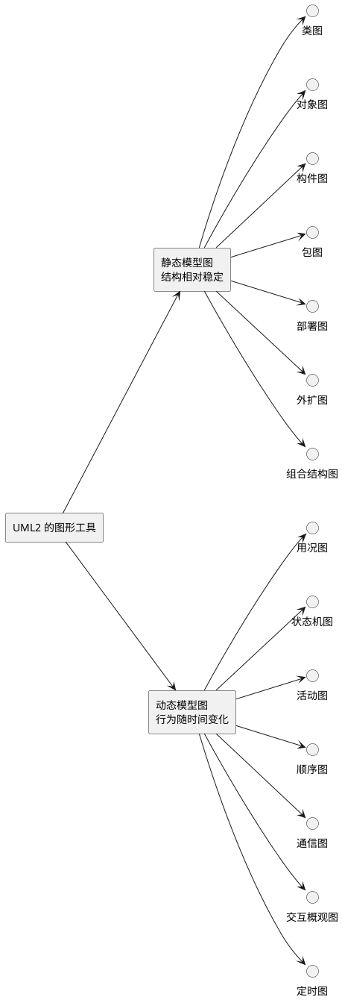

**解读说明**：图中把 PPT 的十四种图按静态与动态两类组织。静态模型图不是“不变化”的意思，而是强调系统在某个抽象层上的相对稳定结构；动态模型图也不是脱离结构存在，而是强调运行时事件、消息、状态和流程。

#### 本节 Q&A

**问**：学习 UML2 的十四种图时，是否需要每个项目都画全？

**答**：不需要。十四种图提供的是表达工具箱，实际项目应根据风险和沟通需要选择图。例如需求边界不清时优先用用况图，领域结构不清时优先用类图，对象交互复杂时再补顺序图或通信图。

**问**：为什么 PPT 要先区分静态和动态？

**答**：因为这能防止把所有问题都塞进一张图里。结构问题、流程问题、交互问题和部署问题的关注点不同，用不同图表达可以降低模型复杂度。

## 静态模型表达工具

### 类图

**定义**：**类图（Class Diagram）** 显示类及其**接口（Interface）**、类的内部结构，以及类与其他类之间的联系，是面向对象分析与设计得到的最重要模型之一。[PPT p.3, p.20]

**核心思想**：类图把系统中的稳定词汇、责任和关系可视化。也就是说，它不是简单罗列类名，而是要说明类有哪些属性和操作、类之间如何关联、哪些关系是依赖、泛化或关联。

**背景与目的**：面向对象分析与设计需要把需求中的名词、概念和服务转成可讨论的模型元素。如果没有类图，类的责任分配、关系强度和结构约束会隐含在代码或口头讨论中，后续评审和维护都很困难。

**直观理解**：例如公司、部门、产品和职员之间的关系，既可以在数据库中实现，也可以在代码中实现，但在实现之前先用类图表达，可以提前发现“公司有多个部门”“职员开发多个产品”等关系是否清楚。[PPT p.21]

**PPT 原文关联**：PPT 明确说类图用于可视化表达系统的静态结构模型，并强调它通常包含类、接口、依赖、泛化和关联关系，也可包含注解、约束、包、子系统甚至实例。[PPT p.20]

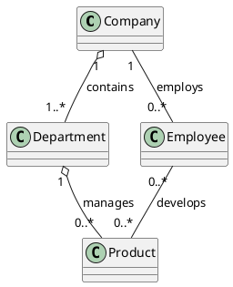

**解读说明**：该 PlantUML 图转译了 PPT 中公司、部门、产品和职员的类图示例。空心菱形表示整体与部分的聚合关系，多重性说明一个公司可以有多个部门、一个部门可以管理多个产品；职员和产品之间是普通关联，因为“开发”描述的是工作联系，不一定意味着生命周期从属。

### 对象图

**定义**：对象图展示一组对象以及对象之间的关系，用来说明类图中所发现事物的实例数据结构和静态快照。[PPT p.4]

**核心思想**：对象图关注某一时刻“具体对象是什么状态”。本质上，它是类图在实例层面的切片，用对象名、类名、属性值和对象链接来验证类图能否表达真实场景。

**背景与目的**：类图描述类型级结构，但类型级结构有时过于抽象，难以判断多重性、关联和属性值是否合理。对象图可以把一个具体业务场景展开成实例快照，例如某家公司、某个部门、某位职员和某个产品之间的当前连接。

**直观理解**：类图像模板，对象图像按照模板填好的样本。值得注意的是，对象图不是运行流程图，它不强调消息顺序，而强调对象在某个时刻的连接和数据状态。

**PPT 原文关联**：PPT 将对象图定义为“展示一组对象以及它们之间的关系”，并说明它用于展示类图中事物实例的数据结构和静态快照。[PPT p.4]

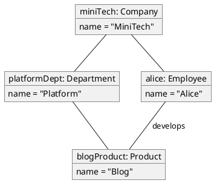

**解读说明**：这张对象图把上一节类图中的类型关系落到具体实例。它说明 `miniTech` 当前包含 `platformDept`，`platformDept` 管理 `blogProduct`，`alice` 正在开发该产品；这些信息是某个时刻的快照，而不是所有公司都必须一模一样。

### 构件图

**定义**：构件图描述构件以及构件之间的依赖关系，在转入实现阶段之前，可用于表示系统构件如何组织。[PPT p.5]

**核心思想**：构件图把系统看成可替换、可部署或可复用的软件构件集合。也就是说，它不再细看每个类的属性和操作，而是关注更粗粒度的软件部件之间如何依赖。

**背景与目的**：当设计进入实现阶段，团队需要知道哪些模块、服务、库或子系统彼此依赖，以及依赖是否会造成实现和发布风险。构件图能帮助开发者从架构层面审查“银行储蓄系统”这类系统的构件组织，而不是只看类级关系。[PPT p.5]

**直观理解**：例如储蓄业务构件依赖账户构件，账户构件依赖持久化构件，界面构件调用业务构件。这样的图不替代类图，但它更适合讨论模块边界、构建顺序和替换成本。

**PPT 原文关联**：PPT 的构件图示例是银行储蓄系统的构件图，重点在“构件及构件之间的依赖关系”。[PPT p.5]

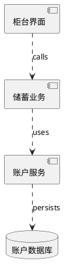

**解读说明**：虚线箭头表示构件之间的依赖方向。界面构件依赖业务构件，业务构件依赖账户服务，账户服务依赖数据库；如果账户服务接口变化，上层构件可能需要调整。

### 包图

**定义**：包图描述模型元素的分组以及包之间的依赖关系，可用于组织类目，并控制信息组织和文档组织的复杂性。[PPT p.6]

**核心思想**：包图解决的是“大模型如何分组”的问题。也就是说，当类、接口和其他模型元素越来越多时，包把它们放入可管理的命名空间，并用包间依赖表达高层组织关系。

**背景与目的**：没有包图，大型模型容易变成一张无法阅读的大图。包图可以把领域层、应用层、基础设施层或不同子系统分开，让读者先理解高层依赖，再进入具体类图。

**直观理解**：类比一下，代码项目不会把所有文件放在同一个目录下，UML 模型也不应把所有元素堆在一张图中。包图像模型层面的文件夹和依赖地图。

**PPT 原文关联**：PPT 强调包图用于组织类目，并控制信息组织和文档组织的复杂性。[PPT p.6]

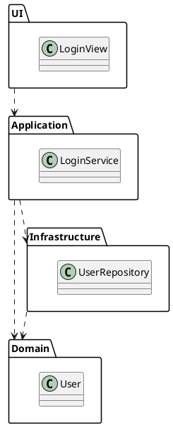

**解读说明**：该包图展示了分层模型的包间依赖。UI 依赖应用层，应用层使用领域对象和基础设施服务，基础设施也依赖领域对象；这种图适合检查是否出现不合理的反向依赖。

### 部署图

**定义**：部署图展示运行时进行处理的节点，以及在节点上生存的制品的配置，用于对系统的静态部署视图建模。[PPT p.7]

**核心思想**：部署图关注软件制品如何映射到运行环境。也就是说，它把服务器、客户端、数据库节点、网络连接和部署制品放在一张图中，说明系统运行时的物理或逻辑配置。

**背景与目的**：设计类和构件之后，还必须回答“这些东西运行在哪里”。如果忽略部署视图，性能瓶颈、网络边界、数据库位置和外部系统连接可能到上线阶段才暴露。

**直观理解**：例如 Web 应用部署在应用服务器上，数据库制品运行在数据库节点上，浏览器客户端通过 HTTPS 访问服务端。部署图让这些运行环境和制品关系可见。

**PPT 原文关联**：PPT 定义部署图用于展示运行时处理节点和节点上制品的配置，并把它作为系统静态部署视图的建模工具。[PPT p.7]

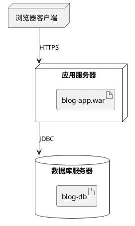

**解读说明**：节点表示运行资源，制品表示部署到节点上的软件结果。箭头标明节点之间的通信路径，这些信息有助于讨论部署、运维和运行时依赖。

### 外扩图

**定义**：外扩图是在 UML2.5 的基础上定义新建模元素的图，用以增加新的建模能力。[PPT p.8]

**核心思想**：外扩图用于扩展 UML 的表达能力。也就是说，当标准 UML 元素不足以直接表达某个领域的特殊概念时，可以通过扩展机制引入新的建模元素或语义标记。

**背景与目的**：通用建模语言必须面对不同领域的差异，例如嵌入式、安全、业务流程或特定平台都可能需要额外语义。外扩图的目的不是让建模随意化，而是在 UML 基础上有控制地增加领域表达能力。

**直观理解**：例如可以用构造型标记某些类是 `<<service>>`、某些构件是 `<<microservice>>`。这些标记不是课程前面基础关系的替代品，而是给模型增加领域语义。

**PPT 原文关联**：PPT 只给出外扩图的基本定义，没有展开示例。[PPT p.8] [盲区：该页没有提供可直接转译的具体外扩图示例，因此本笔记只根据 PPT 定义说明其用途，并用构造型示例补充直观理解。]

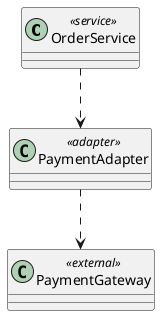

**解读说明**：这里的 `<<service>>`、`<<adapter>>` 和 `<<external>>` 是扩展语义标记，用来说明普通类在架构中的角色。它体现的是 UML 扩展思想，而不是 PPT 中给出的具体原图。

### 组合结构图

**定义**：组合结构图描述类或协作的内部结构，用于展示一个结构化类目内部的部件、端口、连接器和协作关系。[PPT p.9]

**核心思想**：组合结构图强调“一个类或协作内部由哪些部分共同完成行为”。本质上，它比普通类图更深入到内部组成，关注对象在一个上下文中的角色和连接。

**背景与目的**：类图通常说明类与类之间的外部关系，但有时需要说明一个复杂类内部如何由多个部件协作完成服务。组合结构图能把内部部件和连接明确画出来，避免把内部设计全部隐藏在一个类框里。

**直观理解**：例如一个订单处理器内部可能包含验证器、库存检查器和支付端口。类图能说有 `OrderProcessor` 这个类，组合结构图则进一步说明它内部怎样组织这些部件。

**PPT 原文关联**：PPT 将组合结构图定义为描述类或协作内部结构的图，并给出组合结构图示例。[PPT p.9]

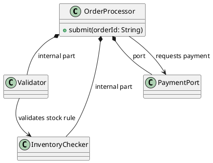

**解读说明**：实心菱形表示内部部件依附于 `OrderProcessor` 这个整体。该图不是普通业务对象关系，而是从一个结构化类目的内部视角解释部件如何配合。

#### 本节 Q&A

**问**：类图和对象图最核心的区别是什么？

**答**：类图描述类型层面的结构，对象图描述实例层面的某一时刻快照。类图回答“系统中有哪些类以及关系”，对象图回答“这些类的具体对象在某个场景下如何连接”。

**问**：构件图和部署图是不是都属于实现阶段才使用？

**答**：它们都更靠近实现和部署，但并不意味着只能上线前再画。构件图可以在实现前帮助确定模块边界，部署图可以在设计阶段提前暴露运行环境和网络配置问题。

## 动态模型表达工具

### 用况图

**定义**：**用例（Use Case）** 图在本课 PPT 中称为用况图，它表现一组用况、参与者以及它们之间的关系，是描述需求模型的视图。[PPT p.11]

**核心思想**：用况图从系统外部看系统，强调参与者希望系统提供什么服务。也就是说，它不描述系统内部类如何设计，而是描述外部角色和系统功能边界。

**背景与目的**：需求阶段最容易出现的问题是系统边界不清：哪些角色会使用系统，系统为这些角色提供哪些服务，哪些外部机构会参与交互。用况图通过参与者和用况关系，把这些外部可见服务放在一张图中。

**直观理解**：例如零售机构和财务结算机构可以作为外部参与者，它们与系统中的订购、结算或支付用况发生交互。PPT 的用况图示例中出现了“零售机构”和“财务结算机构”，说明用况图并不只画人，也可以画外部组织或系统。[PPT p.11]

**PPT 原文关联**：PPT 明确说用况图是系统的需求模型，是描述需求模型的视图。[PPT p.11]

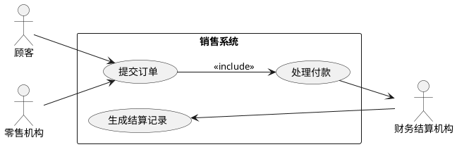

**解读说明**：用况图把系统视为黑箱，外部参与者通过用况获得服务。`<<include>>` 表示提交订单过程中包含处理付款这个必需行为，财务结算机构则作为外部参与者参与付款和结算。

### 状态机图

**定义**：状态机图描述一个对象或其他实体在其生命周期中经历的各种状态以及状态变迁。[PPT p.12]

**核心思想**：状态机图把对象行为看作状态和事件驱动的迁移。也就是说，当对象的行为比较复杂时，仅靠类图中的操作名不足以定义对象在不同状态下如何响应事件。

**背景与目的**：PPT 特别说明，当对象行为比较复杂时，可用状态图作为辅助模型描述对象状态及其状态转移，从而更准确地定义对象操作。[PPT p.12] 这说明状态机图适合订单、账户、设备、任务等具有明显生命周期的对象。

**直观理解**：例如订单从“已创建”进入“已支付”，再进入“已发货”或“已取消”。同一个 `cancel()` 操作在不同状态下含义不同，状态机图能把这种约束表达出来。

**PPT 原文关联**：PPT 将状态机图定义为描述对象或实体生命周期状态和状态变迁的图，并强调它用于辅助复杂对象行为建模。[PPT p.12]

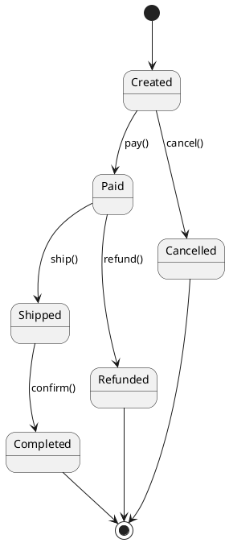

**解读说明**：每个圆角状态表示订单生命周期中的一个阶段，箭头上的事件表示触发状态迁移的操作。该图能说明哪些操作在什么状态下合法，也能暴露遗漏的异常路径。

### 活动图

**定义**：活动图描述活动、活动执行顺序以及活动的输入和输出，可用于描述对象操作流程、一组对象之间的协作行为或用户业务流程。[PPT p.13]

**核心思想**：活动图强调控制流和工作流。也就是说，它把一个业务或操作拆成一连串活动，并可以表达分支、并行、合并和结束条件。

**背景与目的**：有些需求不是单个对象状态能解释清楚，而是一段跨角色或跨对象的流程。活动图可以在需求和设计之间搭桥，让团队先理解流程顺序，再决定由哪些类或构件承担这些活动。

**直观理解**：例如“用户提交订单”可以包含校验购物车、计算价格、创建订单、发起支付和返回结果。活动图比顺序图更适合表达业务步骤本身，而不是具体对象之间的消息细节。

**PPT 原文关联**：PPT 给出两个活动图示例，并强调活动图既可以描述对象操作流程，也可以描述协作行为或用户业务流程。[PPT p.13]

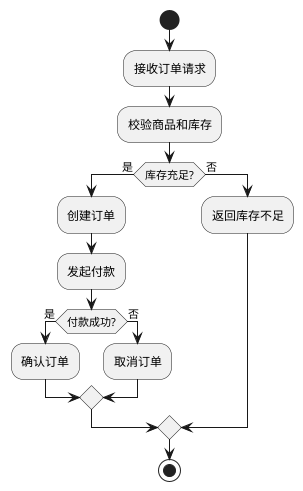

**解读说明**：活动节点表示流程步骤，条件分支表示不同业务路径。它适合描述“先做什么、再做什么、遇到条件如何分流”，但不强调对象生命线和消息时序。

### 顺序图

**定义**：**序列图（Sequence Diagram）** 在本课 PPT 中称为顺序图，它注重消息的时间次序，可用于表示一组对象之间的交互情况。[PPT p.14]

**核心思想**：顺序图把对象交互沿时间轴展开。也就是说，它最关心“谁先给谁发消息、然后发生什么、返回什么结果”，因此适合分析用例场景和对象协作。

**背景与目的**：仅有类图时，开发者知道类之间可能有关联，却不知道一次业务请求中对象如何互相调用。顺序图把一次场景的消息顺序表达出来，能帮助检查职责是否合理、调用是否过长、是否存在遗漏的外部交互。

**直观理解**：例如顾客提交订单时，界面对象调用订单服务，订单服务检查库存并请求支付，支付成功后保存订单。顺序图能把这些消息按时间从上到下排列，读者可以直接看到交互节奏。

**PPT 原文关联**：PPT 定义顺序图注重消息时间次序，并专门补充带参与者的顺序图画法说明。[PPT p.14-p.16]

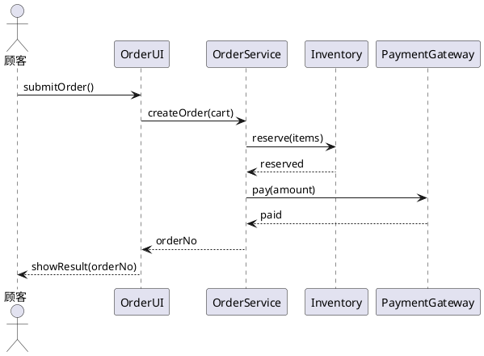

**解读说明**：生命线从左到右排列，对象之间的消息从上到下表示时间顺序。该图强调一次下单场景中消息发生的先后，而不是每个类的完整属性和操作。

### 带参与者的顺序图

**定义**：带参与者的顺序图是在顺序图中显式表示系统边界外参与者和系统内部对象的传统画法。[PPT p.15-p.16]

**核心思想**：这种画法强调外部角色和内部对象的边界。值得注意的是，PPT 指出 UML2 淡化了系统边界和参与者在顺序图中的特殊表示，因为 UML2 把系统边界以外的参与者和系统内部对象同等看待，都作为生命线。

**背景与目的**：PPT 说明，早期 Jacobson 方法会在文字描述和图中对象之间画系统边界，Booch 方法也在一侧画长条并在上方放参与者符号，UML1 基本采用 Booch 表示法。[PPT p.15] 从实用角度看，区分系统外部参与者和内部对象对大部分软件开发仍有意义，所以 PPT 建议只要建模工具支持，就尽可能采用这种传统风格。[PPT p.15]

**直观理解**：例如在登录场景中，“用户”是外部参与者，“登录界面”“认证服务”“用户仓库”是内部对象。把它们都画成生命线也可以，但显式保留参与者能让读者更快看出哪些消息来自系统外部。

**PPT 原文关联**：PPT 用一整页解释 Jacobson、Booch、UML1 和 UML2 对参与者及系统边界表示方式的差异，并在下一页给出带参与者的顺序图例子。[PPT p.15-p.16]

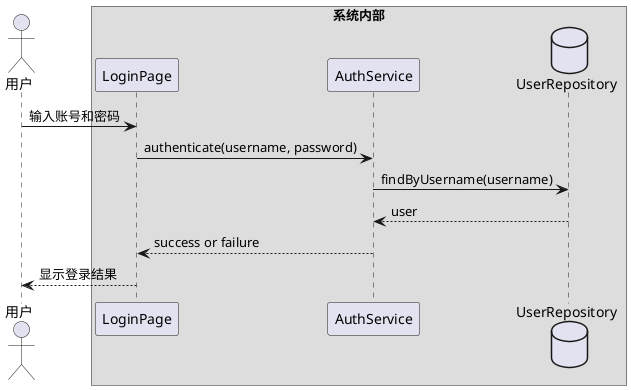

**解读说明**：`actor` 表示系统边界外的用户，`box` 表示系统内部对象的范围。虽然 UML2 可以把它们都视为生命线，但保留这种视觉边界有助于分析外部输入和内部职责。

### 通信图

**定义**：通信图注重收发消息对象的组织结构，可用于表示一组对象之间的交互情况。[PPT p.17]

**核心思想**：通信图和顺序图都描述交互，但关注点不同。顺序图强调时间次序，通信图强调对象之间的连接结构和消息编号。

**背景与目的**：当需要检查对象网络、职责分布和谁依赖谁时，通信图比顺序图更紧凑。它不如顺序图直观地展示时间轴，但能更清楚地呈现对象组织关系。

**直观理解**：例如订单界面、订单服务、库存对象和支付网关之间的消息仍然存在，但通信图会把对象按关系组织在平面上，并用 `1`、`2`、`3` 这类编号表示消息顺序。

**PPT 原文关联**：PPT 将通信图定义为注重收发消息对象组织结构的交互图。[PPT p.17]

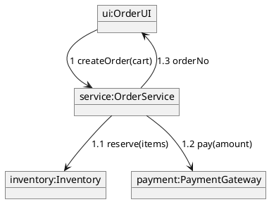

**解读说明**：该图用对象之间的连接和消息编号表达交互。编号提供了相对顺序，但视觉重点落在对象如何组织、哪些对象之间有通信关系。

### 交互概观图

**定义**：交互概观图用于描述系统的宏观行为，是活动图和顺序图的混合物。[PPT p.18]

**核心思想**：交互概观图用活动图的控制结构组织多个交互片段。也就是说，它适合在高层描述“哪些交互按什么条件或顺序发生”，而不是展开每条消息的所有细节。

**背景与目的**：复杂用例往往包含多个交互场景，例如登录、查询、支付、通知等。如果每个细节都放在一张顺序图里，图会变得很大；交互概观图可以把这些交互作为节点嵌入宏观流程。

**直观理解**：例如购物流程可以先执行“登录交互”，再执行“下单交互”，若需要付款则进入“付款交互”，最后执行“通知交互”。它像流程图，但节点可以代表完整交互。

**PPT 原文关联**：PPT 将交互概观图定义为活动图和顺序图的混合物，用于描述系统宏观行为。[PPT p.18]

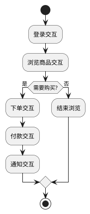

**解读说明**：这里的每个活动节点代表一个可进一步展开为顺序图的交互片段。交互概观图的价值在于控制宏观流程，而不是替代所有详细交互图。

### 定时图

**定义**：定时图用于表示交互，展现消息跨越不同对象或角色的实际时间，而不仅仅关心消息的相对顺序。[PPT p.19]

**核心思想**：定时图把时间作为显式建模对象。也就是说，它不仅说明“消息 A 早于消息 B”，还说明状态持续多长时间、某个事件在什么时间点发生。

**背景与目的**：某些系统对时间约束非常敏感，例如实时控制、网络协议、设备状态监测和用户会话超时。普通顺序图只能表示相对顺序，定时图更适合表达实际时间跨度和状态变化。

**直观理解**：例如传感器每秒采样一次，控制器必须在 100ms 内响应，设备状态从空闲进入忙碌再回到空闲。定时图能把这些时间约束放到模型中。

**PPT 原文关联**：PPT 定义定时图用于表示跨越不同对象或角色的实际时间，而不仅仅关注消息相对顺序。[PPT p.19]

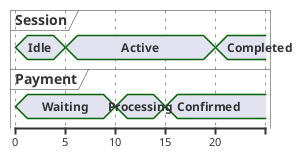

**解读说明**：该图用时间刻度描述会话和支付对象的状态随时间变化。与顺序图相比，它更强调状态持续时间和时间点，而不是消息排列。

#### 本节 Q&A

**问**：顺序图和通信图都能表示交互，应该如何选择？

**答**：如果最关心消息先后和场景步骤，优先使用顺序图。如果最关心对象之间的组织结构和连接关系，通信图更合适。两者表达的交互信息可以相互补充。

**问**：活动图和状态机图都描述变化，它们有什么区别？

**答**：活动图描述流程如何推进，适合业务过程和操作步骤；状态机图描述一个对象生命周期中的状态和迁移，适合状态敏感对象。一个关注“流程”，另一个关注“对象状态”。

## 类图的建模内容

### 类图内容

**定义**：类图通常包含类、接口、依赖、泛化和关联关系，也可以包含注解和约束、包或子系统，甚至可以包含实例以便使其可视化。[PPT p.20]

**核心思想**：类图中的每种元素都有明确语义。也就是说，矩形、线、箭头、菱形、注解和包不是装饰，而是在表达系统的不同结构形态。

**背景与目的**：PPT 说明这些成分确定了所表达系统的各种形态。[PPT p.20] 如果类图只画类名而不画关系，就只能得到领域词汇表；如果只画关系而不补充多重性、注解或约束，模型又会缺少设计判断依据。

**直观理解**：例如“课程表”和“课程”之间可能只是方法参数依赖，也可能是长期维护的课程集合。只有选择正确关系并补充多重性，读者才能判断它们之间的耦合强度。

**PPT 原文关联**：PPT 在“静态模型表达工具-类图”中先给出定义和作用，再列出类图内容，并强调类图可视化表达系统的静态结构模型。[PPT p.20]

| 类图元素 | 表达内容 | 技术含义 | 常见风险 |
| :--- | :--- | :--- | :--- |
| 类与接口 | 系统词汇、责任和服务契约 | 描述结构与行为入口 | 类名像过程名，职责不清 |
| 关联 | 类对象之间的稳定结构连接 | 可带导航、角色和多重性 | 把临时使用误画成关联 |
| 聚合 | 整体与部分关系，部分可相对独立 | 空心菱形在整体端 | 看到“有”就滥用聚合 |
| 泛化 | 一般类与特殊类的 `is-a-kind-of` 关系 | 子类继承父类共同结构和行为 | 为复用实现滥用继承 |
| 依赖 | 使用关系，常见于操作参数 | 虚线箭头指向被使用元素 | 隐藏真实结构关系 |

### 对系统中的概念建模

**定义**：对系统概念建模，是使用 UML 中的“类”抽象系统及系统环境中的组成部分，确定每一类的责任，最终形成类图中的基本模型元素。[PPT p.22-p.23]

**核心思想**：概念建模的第一步是建立系统词汇。也就是说，要从需求、业务描述和系统环境中识别稳定名词，再判断它们是否应成为类、接口、参与者、构件或其他模型元素。

**背景与目的**：如果一开始没有统一词汇，后续关系建模会建立在不稳定概念上。例如“职员”“开发者”“员工”如果指同一类对象，模型中就不应随意混用；如果它们代表不同角色，也必须说明差异。

**直观理解**：例如在公司产品开发场景中，公司、部门、产品、职员都是候选概念。它们能成为类，是因为它们具有稳定身份、属性、责任和与其他概念的关系。

**PPT 原文关联**：PPT 说创建类图包括四方面工作，第一方面是对系统中的概念即词汇建模，形成类图中的基本元素。[PPT p.22-p.23]

**概念建模**的步骤如下：

1. **抽取候选概念**
   - 输入：需求文本、业务规则、系统环境描述和已有术语。
   - 操作：找出稳定名词和名词短语，并排除临时动作、界面按钮和实现细节。
   - 输出：候选类或候选模型元素。
   - 目的：让类图从问题域词汇出发，而不是从代码文件名出发。
2. **确定类的责任**
   - 输入：候选概念和业务行为。
   - 操作：为每个候选类说明它知道什么、负责什么、向外提供什么服务。
   - 输出：职责边界清楚的类列表。
   - 目的：避免一个类承担过多原因变化，也避免把一个概念拆得过碎。
3. **过滤和命名**
   - 输入：候选类列表。
   - 操作：合并同义概念，删除无独立责任的概念，并使用统一命名。
   - 输出：可进入类图的基本元素。
   - 目的：让模型具有稳定性和可读性。

### 对系统中的关系建模

**定义**：关系建模是使用 UML 中表达关系的术语，例如**关联（Association）**、泛化和**依赖（Dependency）**，抽象系统成分之间的关系，形成系统初始类图。[PPT p.24]

**核心思想**：关系类型必须由语义决定，而不是由画图习惯决定。本质上，关联表示对象之间的稳定结构连接，依赖表示较弱的使用关系，泛化表示一般与特殊的继承层次。

**背景与目的**：PPT 对关系建模给出了一组判断规则：若需要从一个类的对象导航到另一个类的对象，应建立关联；若一个类对象要与另一个类对象交互，且后者不是前者过程局部变量或操作参数，也应建立关联；若整体和部分关系明显，则用菱形修饰为聚合；每个关联还要说明多重性，特别是多重性不为默认 `*` 时。[PPT p.24-p.25]

**直观理解**：例如公司与部门是稳定组织关系，适合关联或聚合；`CourseSchedule.add(c: Course)` 只是方法参数使用，适合依赖。值得注意的是，把参数使用画成关联会夸大结构耦合，把长期持有关系画成依赖又会低估设计约束。

**PPT 原文关联**：PPT 在关系建模部分逐条说明关联、聚合、多重性、依赖和泛化的建模规则，并用课程表和课程的例子说明依赖关系。[PPT p.24-p.26]

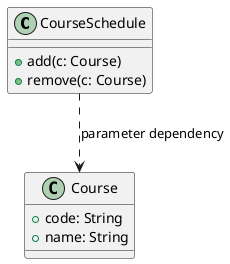

**解读说明**：`CourseSchedule` 的操作使用 `Course` 作为参数，但图中没有表示它长期保存课程集合，因此使用虚线依赖更准确。若课程表内部维护多个课程对象，应补充属性或改画为关联。

### 关联与聚合的判断

**定义**：关联是两个类之间的结构关系；聚合是关联的一种特化，用空心菱形标记整体端，表示一个类在结构或组织上是整体，另一端看起来像它的部分。[PPT p.24-p.25]

**核心思想**：关联建模的关键是判断对象之间是否需要稳定导航和交互。也就是说，只有当关系不只是临时参数或局部变量时，才应考虑把它画成关联。

**背景与目的**：PPT 给出的判断非常实用：如果需要从一个类的对象导航到另一个类的对象，就建立关联；如果一个类的对象要与另一个类对象相互交互，而后者不作为前者的过程局部变量或操作参数，也建立关联。[PPT p.24-p.25] 这能帮助区分“长期结构关系”和“临时使用关系”。

**直观理解**：例如部门和职员之间通常存在稳定组织关系，可以画关联；方法 `print(report)` 中打印机临时使用报告，则通常只是依赖。聚合只在整体与部分关系确实成立时使用，例如公司包含部门、学校包含系。

**PPT 原文关联**：PPT 强调整体一端用菱形修饰关联，从而标记为聚合，并要求每个关联都说明多重性，特别是多重性不是默认 `*` 时。[PPT p.25]

| 判断维度 | 关联 | 聚合 | 依赖 |
| :--- | :--- | :--- | :--- |
| 关系强度 | 稳定结构连接 | 稳定结构连接且有整体/部分语义 | 临时或较弱使用 |
| 图形表示 | 实线 | 实线加空心菱形，菱形在整体端 | 有向虚线 |
| 生命周期含义 | 不直接说明归属生命周期 | 部分通常可相对独立存在 | 不表达对象持有 |
| 典型例子 | 职员开发产品 | 公司包含部门 | 方法参数使用课程 |
| 建模风险 | 把临时使用画成长期关系 | 把普通“有”误画成整体/部分 | 用弱关系隐藏真实结构 |

### 泛化与继承

**定义**：泛化关系是 `is-a-kind-of` 关系，用于描述较特殊的类继承较一般类的结构特征和行为特征。[PPT p.26]

**核心思想**：泛化把多个类中共同的责任、属性和操作提升到更一般的父类。也就是说，泛化不是为了省几行代码，而是为了表达稳定的一般/特殊分类关系。

**背景与目的**：PPT 说明，在系统词汇建模中，经常遇到结构或行为上与其他类相似的类，可以提取所有共同结构特征和行为特征，并把它们提升到较一般的类中，特殊类继承这些特征。[PPT p.26] 这与**继承（Inheritance）** 的思想一致，但建模时仍要谨慎检查语义是否真的是 `is-a-kind-of`。

**直观理解**：例如“储蓄账户”和“信用账户”都可以是“账户”的特殊类，因为它们都是账户的一种。相反，“订单服务使用支付网关”不是 `is-a-kind-of`，不能为了复用调用逻辑而画成泛化。

**PPT 原文关联**：PPT 给出泛化建模步骤：寻找两个或以上类的共同责任、属性和操作；把共同部分提升为较一般的类；画出从特殊类到父类的泛化关系，用以表示特殊类继承一般类。[PPT p.26]

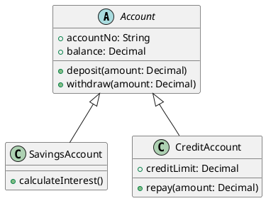

**解读说明**：空心三角箭头指向一般类 `Account`，两个子类继承账户的共同属性和操作，同时保留自己的差异。该图表达的是分类关系，而不是对象之间的运行时调用关系。

### 协作建模与最终类图

**定义**：协作建模是使用类和 UML 关系术语，模型化若干类之间的协作，并用类图表达这组类及其关系，从而给出系统的最终类图。[PPT p.28]

**核心思想**：最终类图不是一次画完的，而是在概念、关系和协作不断校正后形成。也就是说，初始类图只说明候选结构，协作建模进一步检查这些类能否共同完成系统行为。

**背景与目的**：PPT 以机器人沿路径移动所涉及的类为例，说明一组类共同完成某个目标时就形成协作。[PPT p.28] 如果类图中有类却没有出现在任何协作中，要怀疑它是否有存在必要；如果某个协作需要的类不存在，也说明结构模型缺失。

**直观理解**：例如机器人沿路径移动，需要机器人、路径、位置传感器和运动控制器协作。类图不只展示它们存在，还要展示谁持有谁、谁使用谁、谁对谁发出控制请求。

**PPT 原文关联**：PPT 写道，使用类和 UML 表达关系的术语，模型化一些类之间的协作，用类图对这组类及它们之间的关系建模。[PPT p.28]

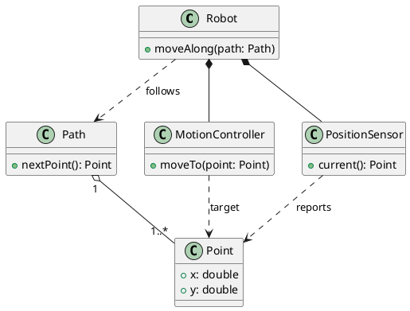

**解读说明**：`Robot` 内部组合了运动控制器和位置传感器，并依赖路径对象取得移动目标。路径聚合多个点，控制器和传感器都依赖点来表达目标位置或当前位置；这比只画一个 `Robot` 类更能说明协作结构。

### 逻辑数据库模式建模

**定义**：逻辑数据库模式建模是使用类图表达数据库中需要存储的信息结构，为数据库概念设计提供指导。[PPT p.28]

**核心思想**：类图可以把信息实体、实体关系和维护完整性的操作表达出来。也就是说，类图不仅用于程序类设计，也可以在概念设计阶段帮助理解数据结构。

**背景与目的**：PPT 将该内容标为“附加内容，考试不要求”，但它说明类图在数据库设计中的扩展用途。[PPT p.28] PPT 示例描述学校信息系统：学校有多个系，每个系有多名教员，每位教员教授多门课程；学校还有学生，每位学生参加多门课；`School` 和 `Department` 还显示了操作部件的方法，用于维护数据完整性。

**直观理解**：例如如果 `Department` 有添加教员、删除教员的操作，就能在模型层提示维护系与教员关系时需要保证完整性。类图中的多重性也能为后续数据库表关系和约束提供依据。

**PPT 原文关联**：PPT 说明该学校信息系统类图细节足以构造物理数据库，并强调 `School` 和 `Department` 的操作对维护数据完整性很重要。[PPT p.28]

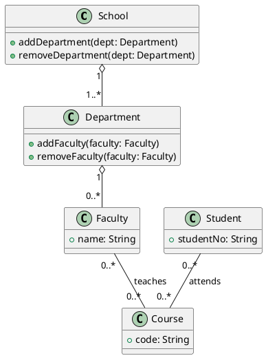

**解读说明**：该图把学校、系、教员、课程和学生之间的数据关系转成类图。多对多关系如教员教授课程、学生参加课程，在物理数据库中通常需要中间表；类图先表达概念关系，再指导实现映射。

#### 本节 Q&A

**问**：类图建模时应该先画关系还是先找类？

**答**：通常先识别系统词汇和候选类，再逐步判断关系。关系必须连接语义稳定的模型元素，如果类本身还没有清楚责任，过早画关系容易得到混乱结构。

**问**：泛化和聚合都能组织模型，为什么不能混用？

**答**：它们表达的语义完全不同。泛化表达“某类是一种更一般的类”，聚合表达“某对象是另一个对象的部分”；把部分关系画成继承，或把分类关系画成聚合，都会误导设计。

## 建模判断与复习总结

### 类图创建流程

**定义**：类图创建流程是从概念建模、关系建模、协作建模到可选数据库模式建模的逐步求精过程。[PPT p.22-p.28]

**核心思想**：类图不是把需求中的名词机械搬到图上，而是逐步回答“有哪些类、它们负责什么、它们如何连接、它们如何协作”。也就是说，类图是一种分析和设计推理工具。

**背景与目的**：PPT 将创建类图拆成四方面工作，前三项是考试与建模实践重点，第四项数据库模式建模为附加内容。[PPT p.22-p.28] 这种拆分提示我们，类图质量取决于逐步审查，而不是符号堆叠。

**直观理解**：例如先识别公司、部门、产品和职员，再判断公司与部门是否聚合、职员与产品是否关联，最后检查这些类能否支撑“职员开发多个产品”的协作场景。每一步都在减少歧义。

**类图创建流程**的步骤如下：

1. **对概念建模**
   - 输入：需求文本、业务术语和系统环境。
   - 操作：使用 UML 的类抽象系统组成部分，并确定每一类的责任。
   - 输出：类图中的基本模型元素。
   - 目的：建立共同词汇，让后续关系建模有稳定对象。
2. **对关系建模**
   - 输入：候选类及其交互需求。
   - 操作：用关联、聚合、依赖和泛化表达系统成分之间的关系，并补充多重性。
   - 输出：系统初始类图。
   - 目的：表达结构连接、使用关系和一般/特殊关系。
3. **对协作建模**
   - 输入：初始类图和系统行为场景。
   - 操作：检查哪些类共同完成目标，并把协作所需关系补入类图。
   - 输出：更完整的最终类图。
   - 目的：验证类图不是静态名词列表，而能支撑实际行为。
4. **对逻辑数据库模式建模**
   - 输入：需要持久化的信息结构。
   - 操作：使用类图表达数据实体、关系、多重性和完整性维护操作。
   - 输出：可指导数据库概念设计的模型。
   - 目的：在进入物理数据库设计前澄清数据结构。[补充：PPT 标明该部分考试不要求。]

### 常见判断误区

**定义**：常见判断误区是指在 UML 图选择和类图关系选择中，把图形外观当成语义、或用错误关系表达真实设计约束的做法。

**核心思想**：UML 建模首先要问语义，其次才是画法。值得注意的是，同一对类之间可能在不同上下文中表现为不同关系，因此不能用自然语言里的“有”“用”“属于”直接套符号。

**背景与目的**：PPT 对关联、聚合、依赖和泛化都给出了判断条件，说明关系建模是本课类图部分的重点。[PPT p.24-p.26] 如果这些判断错误，模型会在设计层误导实现，例如把临时参数画成持久关联，或把可替换策略错误画成继承层次。

**直观理解**：例如 `CourseSchedule.add(c: Course)` 看起来“课程表有课程”，但 PPT 示例强调它是依赖，因为 `Course` 只是操作参数。[PPT p.26] 只有当课程表对象长期持有课程集合时，才应考虑关联和多重性。

| 误区 | 问题 | 更合适的判断 |
| :--- | :--- | :--- |
| 把所有结构都画成类图 | 忽略行为、部署和构件视图 | 根据问题选择动态图或其他静态图 |
| 把临时方法参数画成关联 | 夸大对象之间的稳定连接 | 方法参数或局部使用通常画依赖 |
| 看到整体和部分就不写多重性 | 读者无法判断数量约束 | 每个重要关联都应补充多重性 |
| 为复用代码画泛化 | 泛化必须表达 `is-a-kind-of` | 若只是复用行为，考虑组合或依赖 |
| 忽略参与者边界 | 顺序图难以区分外部输入和内部对象 | 工具支持时可保留带参与者的传统风格 |

### 全课知识点覆盖

**定义**：本课知识点覆盖包括 UML2 十四种图的分类与用途，以及类图作为静态模型表达工具的内容、用法和关系建模规则。

**核心思想**：十四种图的学习重点不是背名称，而是知道每种图回答什么问题。也就是说，图的选择应服务于建模目的：需求用用况图，状态生命周期用状态机图，流程用活动图，消息时序用顺序图，结构和关系用类图。

**背景与目的**：PPT 前半部分快速介绍十四种图，后半部分转入“静态模型表达工具-类图”，说明本课真正的深入点是类图建模用法。[PPT p.1-p.28] 复习时应先建立整体分类，再重点掌握类图的概念建模、关系建模和协作建模流程。

**直观理解**：类比一下，十四种图像不同镜头：有的拍建筑骨架，有的拍人流，有的拍设备部署，有的拍对象生命周期。选择错误镜头，即使画得很细，也可能回答不了当前问题。

**PPT 原文关联**：本节综合了 PPT 的静态图列表、动态图列表、顺序图参与者说明、类图定义、类图内容、类图一般用法、关联判断、依赖示例、泛化步骤、协作示例和数据库模式附加内容。[PPT p.1-p.28]

#### 本节 Q&A

**问**：本课最应该掌握哪一部分？

**答**：先掌握十四种图的静态/动态分类，再重点掌握类图的一般用法。特别是关联、聚合、依赖和泛化的判断规则，它们会直接影响后续面向对象分析与设计。

**问**：PPT 中哪些内容属于附加？

**答**：逻辑数据库模式建模被 PPT 标为“附加内容，考试不要求”。但它仍然能帮助理解类图不仅可以表达程序类，还可以表达持久化信息结构。

**问**：如果素材中只有图名和简短定义，如何复习？

**答**：可以按“定义、关注点、适用场景、与相近图的区别”四步记忆。例如顺序图和通信图都表达交互，但一个强调时间次序，一个强调对象组织结构；类图和对象图都表达静态结构，但一个是类型层，一个是实例快照。
