## 面向对象分析的任务与模型

### 面向对象分析

**定义**：**面向对象分析（Object-Oriented Analysis, OOA）** 是运用面向对象方法理解问题域和系统责任，识别类、对象、属性、操作和关系，并形成分析模型及其规约的过程。[PPT p.2]

**核心思想**：OOA 关注“问题本身是什么”，而不是“代码怎么写”。也就是说，它把需求中的业务事物、系统职责和对象协作组织成可以讨论、检查和演化的模型，让模型直接反映问题域和系统责任。[PPT p.2]

**背景与目的**：需求文本通常分散、模糊，而且容易混合用户目标、业务规则和实现设想。OOA 的目的就是把这些信息转化为类、对象、属性、操作和关系，使后续设计不再凭直觉跳到界面、数据库或程序结构。[PPT p.2]

**生活类比**：类比一下，设计校园选课系统前，应该先理解学生、教师、课程、选课记录和成绩这些领域概念，而不是先决定使用哪种数据库表结构。OOA 就是在进入设计之前，把“现实中有哪些重要事物”和“系统应该承担哪些责任”先讲清楚。

**PPT 原文关联**：PPT 将 OOA 的基本任务描述为：分析问题域和系统责任，找出描述它们所需的类和对象，定义属性、操作及其关系，最终产生符合用户需求并直接反映问题域和系统责任的 OOA 模型及规约。[PPT p.2]

### OOA 模型

**定义**：OOA 模型是由需求模型、基本模型、辅助模型和模型规约共同构成的分析结果，其中基本模型是**类图（Class Diagram）**。[PPT p.3]

**核心思想**：本质上，OOA 模型用类图承载核心结构，用用况图、顺序图、活动图、状态图和包图等辅助模型帮助理解不同侧面。类图又可分为对象层、特征层和关系层，分别回答“有哪些对象类”“每个类有什么属性和操作”“对象之间如何联系”。[PPT p.3]

**背景与目的**：如果只写自然语言需求，开发者很难判断某个信息应该放在哪个类里，也很难检查职责是否遗漏。OOA 模型通过结构化表达，让每个概念都有位置，每个关系都有语义，每个模型元素还能通过规约获得详细说明。[PPT p.3]

**直观理解**：例如，超市前台销售管理系统中，商品、销售事件、账册和收款机属于对象层；编号、单价、售货、记账等属于特征层；商品一览表与商品、账册与销售事件之间的联系属于关系层。值得注意的是，模型规约不是附属文档，而是对图中元素进行详细说明和解释的必要部分。

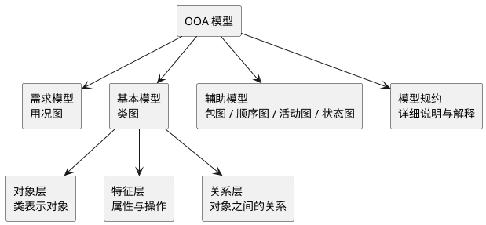

**解读说明**：图中把 PPT 的 OOA 模型结构转译为 PlantUML。类图是 OOA 的基础，需求模型提供用户需求的规范化描述，辅助模型补充行为和组织视角，模型规约负责解释图中所有元素。

### OOA 过程

**定义**：OOA 过程是围绕需求描述、类图构建、交互建模、原型开发和模型规约反复迭代的分析活动。[PPT p.4-p.5]

**核心思想**：OOA 不是一次性画图，而是在用况、类图、交互图、原型和规约之间不断校正。也就是说，发现对象、定义对象内部特征、识别对象外部关系和建立规约会相互影响，不能机械地只做一次。[PPT p.4-p.5]

**背景与目的**：用户需求往往一开始并不完整，分析人员也可能遗漏对象或误判职责。通过对照**用例（Use Case）**、交互顺序和原型反馈，OOA 能逐步发现遗漏的类、调整属性与操作，并把模型稳定为后续设计输入。[PPT p.4]

**OOA 类图构建**的步骤如下：

1. **发现对象并定义类**
   - 输入：系统边界、问题域描述、系统责任和用况描述。
   - 操作：识别候选对象，筛掉无用对象，并按共同属性和操作归类。
   - 输出：类图对象层，也就是系统中需要保留的分析类。
   - 目的：先确定系统中“有哪些重要对象”，避免后续属性、操作和关系没有承载者。[PPT p.5-p.16]
2. **定义对象的属性**
   - 输入：每个类的业务含义、系统需要保存的信息、对象状态和类之间关系。
   - 操作：识别、筛选、命名并详细说明属性。
   - 输出：类图特征层中的属性部分。
   - 目的：让每个对象明确需要记住什么信息，以及这些信息为什么属于该对象。[PPT p.17-p.21]
3. **定义对象的操作**
   - 输入：系统功能需求、问题域行为、对象状态变化和操作执行路线。
   - 操作：识别、审查、命名、定位并详细说明操作。
   - 输出：类图特征层中的操作部分。
   - 目的：让每个对象明确对外提供什么服务，以及服务如何支撑系统责任。[PPT p.23-p.27]
4. **建立对象之间的关系**
   - 输入：对象分类、静态联系、整体部分结构、行为使用关系和接口实现关系。
   - 操作：建立泛化、关联、聚合、组合、依赖和实现关系，并标注多重性、角色、限定符等性质。
   - 输出：类图关系层。
   - 目的：表达对象之间的结构约束和协作依赖，避免只列类而不说明类之间如何组织。[PPT p.41-p.62]
5. **创建类的模型规约**
   - 输入：类图中的类、属性、操作和关系。
   - 操作：用文字描述类图综述、类描述、关联描述、泛化描述和依赖描述。
   - 输出：OOA 类图文档和规约。
   - 目的：补足图形表达无法承载的解释、约束、前置条件、后置条件和数据限制。[PPT p.63-p.68]

#### 本节 Q&A

**问**：OOA 类图要不要加入数据库表和界面类？

**答**：通常不要。OOA 主要表达问题域和系统责任，数据库表、窗口、按钮和存储优化属于 OOD 或实现阶段关注点，过早加入会让分析模型依赖实现环境。[PPT p.12, p.19]

**问**：为什么类图是 OOA 的基本模型？

**答**：因为类图同时承载对象层、特征层和关系层，能把“有什么对象”“对象有什么信息和行为”“对象之间有什么结构关系”统一到一张核心模型中。辅助模型可以帮助理解，但不能替代类图对静态分析结构的组织作用。[PPT p.3]

## 发现对象并定义类

### 系统边界

**定义**：系统边界是被开发系统与外部人员、设备和外系统之间的明确界限，并且要说明它们之间通过什么**接口（Interface）**发生交互。[PPT p.6]

**核心思想**：系统边界决定哪些事物属于系统内部对象，哪些只是系统外部参与者。值得注意的是，同一个现实人员可能在某个系统中只是参与者，在另一个系统中却需要作为系统内部对象保存和管理。[PPT p.6]

**背景与目的**：不先划清边界，分析人员容易把所有外部人或设备都画进类图，也容易漏掉负责处理外部交互的对象。考虑边界可以启发分析人员发现处理对外接口的对象，例如收款机、上级系统接口或设备适配对象。[PPT p.6]

**直观理解**：人员、设备和外系统是 PPT 强调的三类外部活动者。人员包括操作员和直接用户，设备包括与系统交换信息的机器，外系统包括与本系统互联的其他信息系统；它们是否变成内部类，取决于系统是否需要保存其信息或模拟其行为。[PPT p.6]

### 问题域与系统责任

**定义**：问题域是被开发系统的应用领域，系统责任是所开发系统应具备的职能；从二者出发识别对象，是 OOA 类发现的主线。[PPT p.2, p.7-p.9]

**核心思想**：从问题域出发，要找客观存在并对业务有意义的事物；从系统责任出发，要找承担功能、保存信息和完成协作的对象。也就是说，类发现既不能只看名词，也不能只看功能步骤，而要同时看“业务中有什么”和“系统要做什么”。[PPT p.7-p.9]

**背景与目的**：单纯从名词抽取类会产生大量候选项，例如人员、组织、物品、设备、抽象事物、事件、文件和结构都可能出现，但并非都应保留。系统责任能进一步检查每项功能是否有对象提供，并通过用况动作的模拟执行或复杂功能的交互顺序发现遗漏对象。[PPT p.7-p.9]

**PPT 原文关联**：PPT 给出的启发因素包括人员、组织、物品、设备、抽象事物、事件、文件和结构。人员可能是需要管理信息的人，也可能是在系统中提供服务的人；事件是需要系统长期记忆的事实；结构则可以通过分类关系和构成关系继续启发其他对象。[PPT p.8]

| 发现角度 | 典型候选对象 | 判断问题 | 示例 |
| :--- | :--- | :--- | :--- |
| 人员 | 居民、管理员、收款员 | 是否需要保存信息或模拟行为 | 户籍系统中的居民 |
| 组织 | 学院、部门、供应商 | 是否在系统中发挥稳定作用 | 计算机学院 |
| 物品或设备 | 商品、传感器、车辆 | 是否由系统管理、监控或使用 | 商品、仪表 |
| 抽象事物或事件 | 法律条文、生产计划、投保事件 | 是否有业务意义并需长期记忆 | 贸易成交事件 |
| 文件或结构 | 档案、证件、订单结构 | 是否承载业务信息或启发分类/构成 | 票据、订单行 |

### 审查与筛选

**定义**：审查与筛选是对候选对象进行保留、合并、删除或推迟处理的过程，核心依据是对象是否保存有用信息或提供有用功能。[PPT p.10-p.12]

**核心思想**：系统中任何对象都应该服务于信息保存或功能履行。如果一个候选对象既没有需要系统保存和处理的信息，也没有需要系统模拟并发挥作用的行为，它就是无用对象，应从 OOA 模型中删除。[PPT p.10]

**背景与目的**：候选对象列表通常会膨胀，尤其是从需求文本中抽取名词时更明显。审查与筛选可以防止模型被“只有一个属性的对象”“只有一个操作的对象”和“实现条件相关对象”污染，使分析模型保持面向问题域而非实现环境。[PPT p.11-p.12]

**直观理解**：例如，“辅导员姓名”如果只是计算机系年级的一个信息项，就不一定需要单独建“辅导员”类；“格式转换器”如果只有一个文件格式转换操作，也可能更适合作为输出设备的一个操作。图形用户界面、数据管理系统、硬件和操作系统相关对象，则通常应推迟到 OOD 考虑，因为 OOA 模型应独立于实现环境。[PPT p.11-p.12]

| 筛选问题 | 保留倾向 | 删除或推迟倾向 | 技术理由 |
| :--- | :--- | :--- | :--- |
| 是否记录有用信息 | 有稳定属性并被其他对象使用 | 没有需要保存的信息 | 属性是对象存在的重要证据 |
| 是否提供有用功能 | 有业务行为或对系统责任有贡献 | 没有可模拟行为 | 操作是对象职责的直接表现 |
| 是否只是单一属性 | 属性背后有独立生命周期和行为 | 仅是另一个类的字段 | 避免把字段误建为类 |
| 是否只是单一操作 | 操作背后有独立状态或协作 | 更像另一个类的服务 | 避免制造职责空洞的类 |
| 是否依赖实现条件 | 领域本身就需要该对象 | GUI、数据库、硬件细节 | OOA 要独立于实现环境 |

### 主动对象

**定义**：主动对象是分析阶段被认为可能主动发起行为、直接处理外部交互或作为控制线程起点的对象。[PPT p.13]

**核心思想**：主动对象的识别依赖问题域、系统责任和系统边界。也就是说，如果某个外部参与者发起交互，系统内部第一个处理该交互的对象往往是主动对象，但 PPT 也提醒在分析阶段不能完全确定。[PPT p.13]

**背景与目的**：主动对象帮助分析人员思考系统行为从哪里开始，以及哪些对象承担对外响应和控制职责。如果完全不识别主动对象，后续交互图和操作执行路线可能缺少起点；如果过度确定主动性，又可能提前进入线程设计和实现细节。[PPT p.13]

**示例**：在超市案例中，收款机直接与收款员交互，模拟登录、售货和结账等行为，因此被定义为主动对象。上级系统接口的查账、价格更新和种类增删由上级系统触发，也被视为主动对象；供货员对象的行为由系统内部引发，所以在该案例中是被动对象。[PPT p.29]

### 对象分类与类命名

**定义**：对象分类是用问题域和系统责任知识，把具有相同属性和操作的一组对象定义为一个类，并通过异常检查不断调整类边界。[PPT p.14-p.15]

**核心思想**：类不是随意命名的集合，而是对象共同特征和职责的抽象。本质上，类必须适合其全部对象实例，并且名称要反映问题域中的规范概念。[PPT p.14-p.15]

**背景与目的**：分类过粗会导致某些属性或操作并不适合全部对象，例如“汽车”类中放入只适合货车的“货物限量”属性。分类过细又会造成类数量膨胀，例如吸尘器和电子琴如果在销售系统中只保留共同商品特征，就可考虑合并为商品类。[PPT p.14]

**异常检查**：

- 当类的属性或操作不适合全部实例时，应考虑进一步划分特殊类。例如“汽车”的货物限量不适合所有汽车，说明分类不够细，需要区分轿车和货车等特殊类。[PPT p.14]
- 当差别很大的事物经过抽象后只保留相同特征时，应考虑能否合并为一个类。例如吸尘器和电子琴在商品销售问题中都可能只表现为商品编号、名称、价格和库存，此时强行保留两个领域类会增加复杂度。[PPT p.14]
- 当属性和操作相似时，应考虑能否提升出一般类或部分类。例如轿车和货车可以提升出汽车，机床和抽风机可能都包含电动机这个部分类。[PPT p.14]
- 当同一事物被重复描述时，应取消其中一个类。例如“职员”和“工作证”如果在当前系统中只是同一身份信息的重复载体，就不应同时保留为两个核心对象。[PPT p.14]

**命名规则**：类名应使用名词或名词性短语，避免无意义符号和数字；名称应反映个体而不是群体，例如用“书”而不是“书籍”。同时，类名应适合该类及其特殊类的全部对象实例，并使用问题域通用、规范的词汇；在中文语境中可使用中英文双重命名。[PPT p.15]

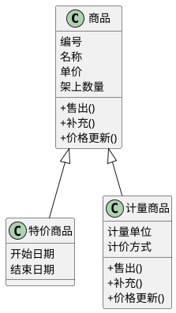

**解读说明**：该图对应超市案例中的对象分类。商品是一般类，特价商品和计量商品是特殊类；计量商品因为计价算法发生变化，需要重新定义继承来的操作。

#### 本节 Q&A

**问**：候选类越多是不是越完整？

**答**：不是。候选类只是发现阶段的原材料，必须通过信息、行为、职责和实现独立性筛选，保留真正有业务意义和系统责任的对象。[PPT p.10-p.12]

**问**：为什么“收款员”在超市案例里没有作为类保留？

**答**：需求没有要求管理收款员个人信息，而收款员与系统对话的行为已经由收款机对象处理。因此可以不设“收款员”类；如果愿意，也可以把收款机改名为收款员对象，但没有必要同时设两类对象。[PPT p.32-p.33]

## 定义对象的属性

### 属性识别

**定义**：属性是对象为了表达状态、保存业务信息、实现操作或表示关系而需要记住的数据特征。[PPT p.17-p.18]

**核心思想**：属性必须属于对象自身职责，而不是把所有能想到的数据都塞入类中。也就是说，属性识别要同时考虑常识、问题域、系统责任、信息保存目的、操作实现需要、状态描述和关系表达。[PPT p.17-p.18]

**背景与目的**：没有属性，对象无法保存系统责任所需的信息；属性放错位置，则会导致对象职责混乱。例如人的姓名、职业、地址可由常识启发，商品条形码由当前问题域启发，持卡人的使用地点则由系统责任启发。[PPT p.17]

**识别策略**：

- 按常识判断对象应该有哪些属性，这能快速得到候选信息。例如“人”通常有姓名、职业和地址，但这些属性是否进入模型，还要看当前系统是否需要保存和处理。[PPT p.17]
- 从当前问题域判断对象应该有哪些属性，这能避免模型过于泛化。例如商品销售系统中的商品需要条形码或编号，因为系统要用它识别商品并查询价格。[PPT p.17]
- 根据系统责任判断对象应该有哪些属性，这能保证属性服务功能。例如持卡人的使用地点不是所有人员系统都需要，但在刷卡或门禁系统中可能是完成责任所必需的信息。[PPT p.17]
- 为操作实现补充属性，这能让对象完成自身服务。例如传感器为了定时采集信号需要时间间隔属性，为了报警需要临界值属性。[PPT p.17]
- 为对象状态设置属性，这能支撑状态相关行为。例如设备处于关闭、待命、运行和故障时行为不同，因此需要状态属性记录当前状态。[PPT p.18]

### 用属性表示关系

**定义**：用属性表示关系，是指在类中设置指向其他对象或嵌套部分对象的属性，以实现**关联（Association）**、**聚合（Aggregation）** 或 **组合（Composition）** 的语义。[PPT p.18]

**核心思想**：关系不仅画在线上，也常通过属性在类规约中体现。对于关联，可在一端定义指向另一端对象的指针或对象标识；对于紧密、固定的聚合，可在整体对象中嵌套部分对象；对于松散聚合，可根据多重性决定由整体指向部分还是由部分指向整体。[PPT p.18]

**背景与目的**：类图中的关系需要落到对象如何找到彼此、整体如何保存部分、对象标识如何维护这些具体问题上。OOA 不要求立刻规范化到数据库层面，但应明确某个属性是否是为了表示整体-部分结构或关联链而存在。[PPT p.18, p.21]

**示例**：课程的“主讲教师”属性可以说明为“表示课程与教师对象间的关联，指出该课程由哪个教师主讲”。这里属性不是普通文字字段，而是课程对象到教师对象的一条关联线在规约中的体现。[PPT p.21]

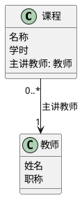

**解读说明**：图中 `主讲教师` 既可以看作课程类的一个属性，也表达了课程对象与教师对象之间的关联。PPT 要求这类属性在类规约中明确说明其关系含义。

### 属性审查与说明

**定义**：属性审查是判断候选属性是否有用、是否属于对象自身、是否保持原子性、是否可由继承或其他属性获得，以及是否过早涉及实现条件的过程。[PPT p.19-p.21]

**核心思想**：属性要描述对象自身的业务特征，不能混入无用信息、外部对象特征或实现优化细节。值得注意的是，OOA 中属性数据类型可以是任何合适的数据类型，数据类型规范化、对象标识和性能缓存等问题通常推迟到 OOD 考虑。[PPT p.19]

**背景与目的**：属性设计会直接影响类职责和关系表达。如果把“课程”的电话号码作为属性，就可能把教师或教室的联系方式错误放进课程对象；如果把可从其他属性直接导出的值保存为属性，就会引入一致性维护负担。[PPT p.19]

**详细说明内容**：

- 属性的文字解释要说明属性含义。例如“课程”的“学时”可解释为“课堂讲授学时数，每学时为 50 分钟”，这样读者不会把学时误解为课程周数或自学时间。[PPT p.21]
- 属性的数据类型要说明是常用类型、类类型还是对象指针。表示整体-部分结构或关联的属性，可能直接使用类或某一类对象的指针。[PPT p.21]
- 属性所体现的关系要特别标明。例如某个属性用于聚合、组合或关联时，不能只写字段名，还要说明它连接了哪些对象以及关系语义是什么。[PPT p.21]
- 实现要求及其他限制也应记录，包括取值范围、精度要求、初始值、度量单位、完整性、安全性和存取限制。如果某个属性实现时应作为类属性处理，也要在规约中明确指出。[PPT p.21]

| 属性审查维度 | 应保留的情况 | 应调整的情况 | 示例 |
| :--- | :--- | :--- | :--- |
| 有用信息 | 对参与者或其他对象有用 | 系统不保存也不处理 | 书的 ISBN 通常有用，书的重量未必有用 |
| 本身特征 | 描述该对象自身 | 描述了别的对象 | 课程的电话号码可能属于教师或教室 |
| 原子性 | 表达单一稳定含义 | 一个字段塞入多个含义 | 地址拆分与否取决于系统责任 |
| 继承获得 | 一般类已有且适用 | 在特殊类重复定义 | 特价商品继承商品编号 |
| 可导出性 | 不能稳定计算得到 | 可从其他属性直接导出 | 总价可由单价和数量计算 |
| 实现条件 | 分析阶段必须表达 | 数据库规范化或性能缓存 | 缓存中间结果推迟到 OOD |

#### 本节 Q&A

**问**：OOA 中属性的数据类型是否必须规范到数据库字段类型？

**答**：不需要。OOA 阶段可以使用任何能表达分析含义的数据类型，数据类型规范化、对象标识和性能优化应推迟到 OOD 或实现阶段处理。[PPT p.19]

**问**：关联一定要在两个类中都定义属性吗？

**答**：不一定。PPT 强调应在关联一端定义属性指出另一端对象，但具体方向取决于导航需要和多重性；松散聚合也可以由整体指向部分，或由部分指向整体。[PPT p.18]

## 定义对象的操作

### 操作识别

**定义**：操作是对象对外提供的行为或服务，用来直接或间接完成系统责任、响应状态变化或支持其他对象协作。[PPT p.23-p.24]

**核心思想**：操作必须属于对象职责，而不是把系统流程随意拆成函数堆在某个类里。也就是说，操作识别要从系统责任、问题域行为、对象状态和执行路线四个方面共同判断。[PPT p.24]

**背景与目的**：OOA 阶段定义操作，是为了说明对象应该提供什么服务，而不是写出最终算法。PPT 先区分系统行为、对象自身的简单行为和对象自身的复杂行为，提醒分析人员不要把创建、删除、复制、转存等系统性行为与领域对象自身行为混在一起。[PPT p.23]

**行为类型**：

- 系统行为包括创建、删除、复制和转存等，它们常常与系统管理能力相关。分析时要谨慎判断这些行为是否属于某个领域对象，还是属于更高层的系统服务。[PPT p.23]
- 对象自身的简单行为包括读写属性值等，它们通常算法简单，但仍然反映对象对外暴露的信息访问能力。是否需要显式列出，取决于分析模型的粒度和规约要求。[PPT p.23]
- 对象自身的复杂行为包括计算或监控等，它们更能体现对象职责。例如商品售出、销售事件计价、账册记账等都不是单纯读写字段，而是对业务状态的改变。[PPT p.23, p.35-p.39]

**类范围与实例范围**：仅用于操纵类属性的操作叫类范围的操作，其余操作叫实例范围的操作。这个区分能帮助分析人员判断操作是作用在整个类的共享信息上，还是作用在某个具体对象实例上。[PPT p.23]

### 操作审查与调整

**定义**：操作审查是检查每个操作是否真正有用、是否高内聚，并通过取消、拆分或合并调整对象服务边界的过程。[PPT p.25]

**核心思想**：一个操作应完成一项单一、完整的功能，并且必须直接提供系统责任所要求的功能，或响应其他操作请求间接完成其中某个局部功能。若操作没有这种贡献，就应取消；若操作包含多项可独立定义的功能，就应拆分；若一个完整功能被过度切碎到多个对象操作中，也需要合并或重新定位。[PPT p.25]

**背景与目的**：操作粒度过大，会形成低内聚的万能操作；操作粒度过小，会让对象协作过度碎片化，难以看出谁真正承担责任。OOA 需要在系统责任和对象职责之间找到稳定边界，为后续交互图和设计提供清晰服务接口。[PPT p.25]

**示例**：超市案例中，收款机的“售货”是循环地为每个顾客计价收款的主动操作；商品的“售出”负责减少架上数量，并在低于下限时向供货员发消息。两者不能合并成一个“处理销售”万能操作，因为收款机负责交易流程，商品负责自身库存状态。[PPT p.35]

### 操作命名、定位与说明

**定义**：操作命名、定位与说明是为操作选择动词或动宾结构名称，把操作放到符合实际事物职责的类中，并在类规约中解释其消息格式、主动性、**多态（Polymorphism）** 和约束条件。[PPT p.26-p.27]

**核心思想**：操作应该放在最符合实际事物的类中，并与一般-特殊结构保持一致。通用操作放在一般类，专用操作放在特殊类；一个类中的操作应适合该类及其所有特殊类的每一个对象实例。[PPT p.26]

**背景与目的**：操作定位错误会造成职责反常。例如售货员可以“售货”，商品更适合“售出”；课程和教师都可能出现“授课”字样，但它们对应的责任并不相同，需要根据问题域语义定位。[PPT p.26]

**详细说明内容**：

- 操作的文字解释应说明该操作的作用和功能，避免只列操作名而不说明行为边界。例如“售出”不仅减少数量，还可能触发缺货登记。[PPT p.27, p.35]
- 操作名、输入输出参数和参数类型应给出入口消息格式。这样其他对象在交互图中发送消息时，才知道如何请求该服务。[PPT p.27]
- 消息发送要指出该操作执行时需要请求哪些其他对象操作，包括接收消息的对象类名和操作名。这个信息能直接支持后续依赖关系和交互图。[PPT p.27]
- 约束条件要记录前置条件、后置条件和执行时间要求。复杂操作还应给出流程图或活动图，说明操作怎样执行。[PPT p.27]

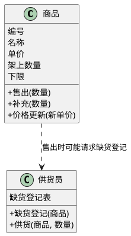

**解读说明**：该图体现操作说明中的“消息发送”。商品执行 `售出` 时，如果剩余数量低于下限，就需要请求供货员对象执行 `缺货登记`。

#### 本节 Q&A

**问**：操作是不是越接近程序函数越好？

**答**：不是。OOA 操作强调对象责任和业务服务，不要求展开成最终代码函数；过早用程序函数思维拆分，会把分析模型变成实现草图。[PPT p.23-p.27]

**问**：通用操作为什么要放在一般类？

**答**：因为一般类中的操作应适合该类及其所有特殊类的每一个对象实例。通用操作放在一般类可以避免重复定义，专用或算法变化的操作再由特殊类重新定义。[PPT p.26, p.36]

## 超级市场销售管理系统案例

### 功能需求与候选类

**定义**：超市案例是一个只负责前台销售管理的子系统，用来演示从需求到对象层、特征层和关系层的完整 OOA 类图构建过程。[PPT p.28-p.40, p.69-p.74]

**核心思想**：案例的分析重点不是“超市系统全部业务”，而是前台销售管理这一明确边界内的对象、属性、操作和关系。也就是说，补货、查账、改价和交接班都只在前台子系统责任范围内建模，总账等上级系统职责不放入本系统内部。[PPT p.28, p.31]

**背景与目的**：PPT 用该案例说明类发现不能停留在抽象规则上，而要落到具体功能需求。功能需求包括计价收费打印清单、记录商品编号单价和数量、帮助供货员发现脱销、向上级系统报告款货数量和维护商品种类价格、交接班结算并报告上级系统。[PPT p.28]

**候选类来源**：

- 从系统边界和活动者出发，可发现收款机、供货员和上级系统接口。收款机直接与收款员交互并模拟登录、售货和结账，所以是主动对象；供货员处理补货提醒和数量修改，但行为由系统内部引发，所以是被动对象；上级系统接口处理外部系统发起的查账和改价，所以也是主动对象。[PPT p.29]
- 从问题域和系统责任出发，可发现商品、特价商品、计量商品、商品一览表、销售事件和账册。商品保存名称、价格、数量并保持准确；特价商品和计量商品是商品的特殊类别；商品一览表支持按编号检索；销售事件记录一次计价收款事实；账册记录一个收款员一个班次内的款货账目。[PPT p.30-p.31]
- 从筛选出发，可删除经理和独立收款员类。经理不被系统处理，个人信息也无助于前台销售功能；收款员与系统对话的责任已经由收款机承担，因此不需要同时保留“收款员”和“收款机”两类对象。[PPT p.32-p.34]

| 候选对象 | 保留结果 | 主要依据 | 主动性 |
| :--- | :--- | :--- | :--- |
| 收款机 | 保留 | 处理登录、售货、结账，与收款员交互 | 主动对象 |
| 供货员 | 保留 | 记录缺货并执行补货相关行为 | 被动对象 |
| 上级系统接口 | 保留 | 处理查账、价格更新、种类增删等外系统请求 | 主动对象 |
| 商品 | 保留 | 保存编号、名称、价格、数量并提供售出等服务 | 被动对象 |
| 特价商品 | 保留 | 在指定时间范围内按特殊价格销售 | 被动对象 |
| 计量商品 | 保留 | 按重量、长度或容积计价 | 被动对象 |
| 商品一览表 | 保留 | 支持按编号快速检索和维护商品目录 | 被动对象 |
| 销售事件 | 保留 | 记录一次顾客购买与计价收款事实 | 被动对象 |
| 账册 | 保留 | 记录一个收款员一个班次的款货账目 | 被动对象 |
| 经理 | 删除 | 需求不处理经理工作和个人信息 | 不适用 |
| 收款员 | 不单独保留 | 对话行为已由收款机承担 | 不适用 |

### 特征层

**定义**：特征层是对已保留对象类的属性和操作进行分析后形成的类图部分，说明每个类保存什么信息、提供什么服务。[PPT p.35-p.40]

**核心思想**：特征层把功能需求落实到具体类，而不是把需求列表原样贴到模型旁边。值得注意的是，一个类的属性和操作必须能解释其存在理由，并且操作之间的消息发送会进一步启发关系层中的依赖关系。[PPT p.35-p.40, p.71-p.73]

**背景与目的**：对象层只说明有哪些类，还不足以判断模型是否能完成前台销售管理。只有补齐收款机、商品、销售事件、账册等类的属性和操作，才能检查计价、库存、缺货、报账和交接班这些功能是否都有对象承接。[PPT p.35-p.40]

**主要类的属性与操作**：

- 收款机保存本班收款员、开始时间和结束时间，操作包括登录、售货和结账。登录是本班收款员开始工作时触发的主动操作；售货循环处理顾客计价收款；结账在下班或交班时结算本班账目。[PPT p.35]
- 商品保存编号、名称、单价、架上数量和下限，操作包括售出、补充和价格更新。售出会减少库存并在低于下限时请求供货员缺货登记；补充会增加架上数量；价格更新由上级系统接口请求修改。[PPT p.35]
- 特价商品继承商品的属性和操作，并增加开始日期和结束日期，用于说明实行特价的时间范围。计量商品也继承商品，但单价语义变成计量单价，并补充计量单位和计价方式；由于算法变化，继承来的售出、补充和价格更新需要重新定义。[PPT p.36]
- 商品一览表保存商品目录，目录元素包括商品编号和指向商品对象的指针或对象标识。它提供检索和种类增删操作，分别支持按编号找到商品对象，以及维护商品目录项。[PPT p.36]
- 供货员保存缺货登记表，操作包括缺货登记和供货。缺货登记把告缺商品名称和编号记入表中；供货在补充货物后请求商品对象修改数量，并删除缺货登记表中相应条目。[PPT p.37]
- 销售事件保存收款人、购物清单、应收款、售出日期和时间，操作包括销售计价和入账。购物清单记录每件商品编号、名称、数量和价格；销售计价逐条记录并累计应收款；入账把本次销售事件信息计入账册。[PPT p.37]
- 账册保存销售事件表、前班结余、本班结余、收入累计和上交款等信息，操作包括接班、记账、报账和交班。账册与销售事件有聚合关系，因为账册通过一组指针或对象标识汇集本班次销售事件明细。[PPT p.38]
- 上级系统接口保存账册目录，操作包括消息收发、查账、报账、价格更新和种类增删。消息收发负责与上级系统通信并请求其他对象服务，因此是主动操作；查账、改价和种类增删分别落到账册、商品和商品一览表等对象协作上。[PPT p.39]

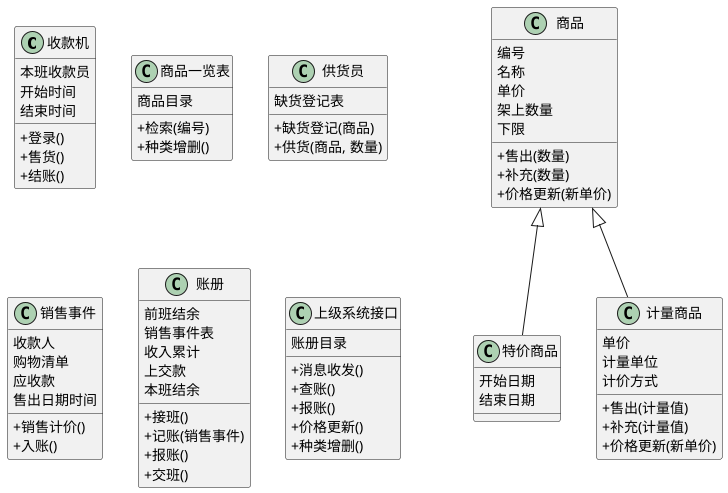

**解读说明**：该图转译 PPT p.40 的 OOA 模型特征层。它只表达类、属性、操作和继承，不额外加入数据库表或界面控件。

### 关系层与完整类图

**定义**：关系层是在特征层基础上建立继承、聚合、关联和依赖等关系，用来说明超市案例中类之间的结构组织和行为使用。[PPT p.69-p.74]

**核心思想**：超市案例中的关系不是随意连接，而是来自分类、目录、账目归集和消息追踪。商品与特价商品、计量商品之间是继承；商品一览表与商品、账册与销售事件之间是聚合；案例中没有其他普通关联；行为上的协作通过依赖表达。[PPT p.70-p.73]

**背景与目的**：PPT 在 p.74 给出完整类图，目的就是把对象层、特征层和关系层合在一起检查。只有这样，才能看到收款机如何通过商品一览表找到商品，商品如何触发供货员登记，销售事件如何入账到账册，账册如何向上级系统接口报账。[PPT p.71-p.74]

**关系说明**：

- 商品是一般类，特价商品和计量商品是特殊类，并且特殊类中的某些属性和操作具有多态表现。这里的**继承（Inheritance）** 表达的是“特价商品是一种商品、计量商品是一种商品”，不是简单代码复用。[PPT p.70]
- 商品一览表和商品构成聚合，前者通过商品目录属性保存商品项。账册和销售事件也构成聚合，前者通过销售事件表汇集一个班次中的销售事件。[PPT p.70]
- 供货员执行供货时依赖商品的补充服务。收款机售货时依赖商品一览表检索、商品售出、销售事件计价入账和账册接班报账交班等服务；账册又依赖上级系统接口报账。[PPT p.71-p.72]
- 上级系统接口在查账时依赖账册报账，在价格更新和商品种类增删时分别依赖商品和商品一览表的相应服务。也就是说，依赖关系来自操作执行路线追踪，而不仅仅来自类之间“看起来有关”。[PPT p.73]

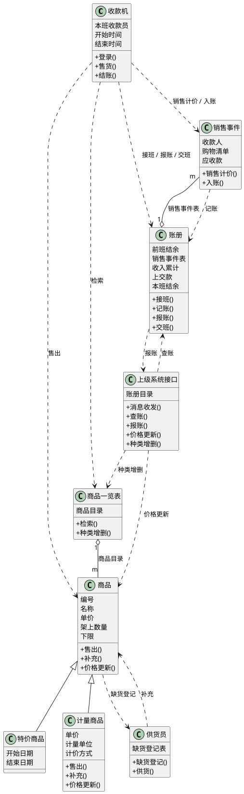

**解读说明**：该图综合 PPT p.70-p.74。空心菱形表示聚合，虚线箭头表示依赖；依赖来自对象操作执行路线，表达类在行为上使用其他类的信息或服务。

#### 本节 Q&A

**问**：为什么账册不是总账？

**答**：PPT 明确说明账册对象只针对一个收款员的一个班次，记录该班次经手的销售事件和款货账目；总账属于上级系统，不在前台销售管理子系统内部。[PPT p.31]

**问**：为什么案例中没有普通关联关系？

**答**：因为 PPT 认为该案例中有意义的稳定结构主要由继承和聚合表达，其他行为协作更适合用依赖补充。普通关联不是“两个类有关就画线”，必须表达与系统责任有关的静态联系。[PPT p.52, p.70]

## 建立对象之间的关系

### 泛化关系

**定义**：泛化关系也就是一般-特殊关系，在课程语境中与继承关系一起讨论，用来表达特殊类继承一般类的属性和操作。[PPT p.42-p.51]

**核心思想**：泛化不是为了让类图看起来层次化，而是为了表达分类学上的“is a kind of”和特征继承。也就是说，只有当特殊类确实是一般类的子集，或确实具有一般类全部特征时，才应建立泛化关系。[PPT p.43, p.47]

**背景与目的**：泛化可以复用共同属性与操作，也可以通过特殊类表达差异。但过度泛化会增加类数量、继承深度和理解成本，所以 PPT 强调识别、审查、简化和调整对象层/特征层要一起进行。[PPT p.47-p.51]

**识别策略**：

- 从分类角度发现泛化。例如人员可按年龄、性别、种族、在职状态或用工性质分类；不同分类角度会启发一般-特殊关系的初步设想，但只有问题域和系统责任真正需要时才保留。[PPT p.42]
- 从对象集合包含关系发现泛化。如果一个类是另一个类的子集，例如职员是人员的子集、轿车是汽车的子集，就可以考虑把它们组织为一般-特殊关系。[PPT p.43]
- 从特征继承发现泛化。如果某类具有另一类的全部属性与操作，或者某些类重复出现共同属性和操作，就应考虑提取一般类，避免重复定义。[PPT p.43-p.45]
- 从属性和操作适用范围发现泛化。如果某些属性或操作只适合一个类的一部分对象，说明需要拆出特殊类；如果多个类有共同属性和操作，说明可能需要提升一般类。[PPT p.44-p.45]
- 从领域范围内复用发现泛化。PPT 单独列出复用作为策略，说明继承不仅是分类表达，也能帮助在同一领域模型中复用稳定抽象。[PPT p.46]

**审查与简化**：

- 审查问题域是否需要该分类，例如“书”和“线装书”未必在所有系统中都需要区分。若分类对业务无贡献，就不应为了常识完整性而建特殊类。[PPT p.47]
- 审查系统责任是否需要该分类，例如“职员”和“本市职员”只有在系统功能因户籍或地域产生差异时才需要区分。否则该分类只是信息项，不是类结构。[PPT p.47]
- 审查是否符合分类学常识，可用“is a kind of”检验。若说不通，就可能不是泛化关系，而是关联、聚合或其他结构。[PPT p.47]
- 取消没有特殊性的特殊类。如果特殊类没有独特属性、操作或约束，只是换了名字，就会增加复杂度而不提供分析价值。[PPT p.48]
- 用属性简化继承关系。当特殊类之间的差别可以由一般类的某个属性值表达，并且除此之外没有太多不同，就可以用属性如性别、国籍等替代一批特殊类。[PPT p.49]
- 取消用途单一的一般类。一般类存在的理由包括有两个或以上特殊类、需要创建对象实例或有助于软件复用；若这些理由都不成立，就应减少继承层次。[PPT p.50]

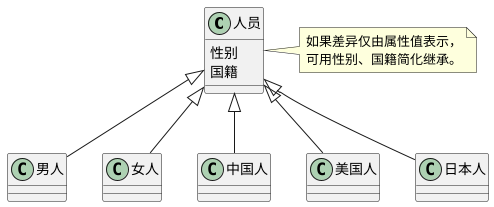

**解读说明**：该图对应 PPT p.49 的简化思想。若男人、女人、中国人、美国人、日本人没有独特属性和操作，把它们全部建为特殊类会让继承关系过度膨胀；用属性表达差异更简洁。

### 关联、聚合与组合

**定义**：关联表示类之间与系统责任有关的静态联系；聚合表示整体与部分关系；组合是生命周期相同、部分依附整体的强聚合关系。[PPT p.52-p.53]

**核心思想**：关联、聚合和组合的区别在于语义强度不同。普通关联只说明对象之间存在业务相关的静态联系；聚合进一步说明整体-部分；组合再进一步要求整体对象和部分对象生命周期相同，并用实心菱形表示。[PPT p.52-p.53]

**背景与目的**：如果把所有联系都画成普通关联，模型会丢失整体结构和生命周期语义；如果把所有包含关系都画成组合，又会过度约束对象生命周期。PPT 要求先从问题域角度识别静态联系，再判断是否属于聚合或组合。[PPT p.52-p.53]

**聚合判断角度**：

- 物理整体和部分关系可标注为聚合，例如汽车和轮胎、人和大脑。这类关系强调现实结构中的组成关系，但是否组合还要看生命周期是否相同。[PPT p.52-p.53]
- 组织机构和下级部门关系可标注为聚合，例如大学和院系。这类聚合表达组织结构，而不是对象之间的临时交互。[PPT p.52]
- 团体和成员关系可标注为聚合，例如计算机学会与会员、学校和老师。这里成员可脱离团体存在，所以通常不应轻易画成组合。[PPT p.52]
- 空间包容关系可标注为聚合，例如工厂和设备、教室和讲台。这类关系表达空间或管理上的包含，不等同于生命周期绑定。[PPT p.52]
- 抽象事物的整体与部分关系可标注为聚合，例如法律与法律条文、项目管理计划和进度计划。这说明聚合不限于物理实体。[PPT p.52]
- 材料组成关系可标注为聚合，例如房屋由混凝土和钢筋组成。若部分与整体生命周期高度绑定，可进一步考虑组合。[PPT p.52-p.53]

| 关系 | **统一建模语言（UML）** 表示 | 语义强度 | 生命周期要求 | 示例 |
| :--- | :--- | :--- | :--- | :--- |
| 关联 | 实线 | 静态业务联系 | 无统一要求 | 教师主讲课程 |
| 聚合 | 空心菱形 | 整体-部分 | 部分可相对独立 | 学校和老师、商品一览表和商品 |
| 组合 | 实心菱形 | 强整体-部分 | 整体和部分生命周期相同 | 订单和不可独立存在的订单行 |
| 依赖 | 虚线箭头 | 使用信息或服务 | 被使用者变化会影响使用者 | 课程表使用课程 |

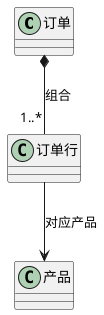

**解读说明**：订单和订单行可作为组合示例，因为订单行通常依附于具体订单存在。订单行与产品之间则更像关联或引用，因为产品可以独立存在，并被多个订单行引用。

### 关联类、多重性、限定符与角色

**定义**：关联类、多重性、限定符和角色是用于精化关联语义的建模元素，分别回答关联是否有自身属性/操作、每端连接多少对象、如何限定另一端对象，以及类在关联中扮演什么角色。[PPT p.54-p.58]

**核心思想**：一条关联线有时不足以表达完整业务事实。若关联本身有销售时间、商品清单、售货金额等信息，应使用关联类或插入一个类；若一个对象连接多个对象，应标注多重性；若需要通过某个属性值选定另一端对象，可使用限定符；若同一类参与关联的含义不同，应使用角色名。[PPT p.54-p.58]

**背景与目的**：关联细节能防止类图语义模糊。例如售货员和顾客之间的“售货”若需要记录时间、清单和金额，就不能只画一条线；职员管理职员的递归关联若不标角色，就无法区分管理者和下属。[PPT p.54-p.58]

**多重性标注规则**：对于每个关联，要从连接线的每一端看本端一个对象与另一端几个对象发生连接，并把结果标注在连接线的另一端。这能避免把“一个订单有多个订单行”和“一个订单行属于一个订单”的方向关系写反。[PPT p.56]

**限定符示例**：产品订单由订单行和其他描述信息组成，如果给定一份订单并指定产品名，另一端可能有或没有一个订单行与其对应；没有限定符时，给定一份订单可能对应许多订单行。限定符画成靠近关联一端的小矩形，里面放用于限定的属性值。[PPT p.57]

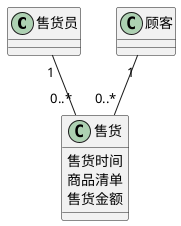

**解读说明**：该图把原本可能画在售货员和顾客之间的关联提升为“售货”类。这样售货时间、商品清单和售货金额就有了明确承载位置。

```plantuml
@startuml
skinparam classAttributeIconSize 0
class 职员
职员 "1 管理者" -- "0..* 下属" 职员 : 管理
@enduml
```

**解读说明**：该图对应 PPT p.58 的关联角色思想。同一个“职员”类参与自关联时，一端扮演管理者，另一端扮演下属；没有角色名，读者难以理解连接线两端的业务含义。

### 关联命名与定位

**定义**：关联命名与定位是为关联选择必要的语义名称，并在涉及继承结构时决定连接线应该画到一般类还是特殊类。[PPT p.59-p.60]

**核心思想**：关联语义清晰时名称可以缺省，不清晰时可用动词或动宾结构命名。若连接线的一端是继承结构，且关联适用于结构中每个类的对象，就画到一般类；若只适用于某些特殊类，就画到相应特殊类。[PPT p.59]

**背景与目的**：关联画错位置会造成过度约束或语义遗漏。例如若所有商品都能被商品一览表检索，关联应画到商品一般类；若只有特价商品需要特价活动规则，相关关联就不应画到全部商品上。[PPT p.59]

**对象层和特征层修改**：建立关联过程中可能发现新类，必须补充到对象层并建立类规约。对于每个关联，至少要说明它的实际意义，否则类图读者只能看到线条，无法判断线条的业务含义。[PPT p.60]

### 依赖关系与实现关系

**定义**：**依赖（Dependency）** 是一种使用关系，描述一个类目使用另一个类目的信息和服务；实现关系通常用于接口与实现类/构件之间，或用况与实现它的协作之间。[PPT p.61-p.62]

**核心思想**：依赖表示“我使用你，因此你变化可能影响我”。PPT 建议初步建立类之间关系时可以暂时使用依赖，但在最终类图中，如果能用其他关系明确表达语义，就不要使用依赖。[PPT p.61]

**背景与目的**：依赖适合表达操作层面的服务使用，例如课程表的 `add(c: Course)` 和 `remove(c: Course)` 使用课程类。它的语义比关联弱，不表达稳定结构；如果滥用依赖，类图会变成消息追踪图，掩盖真正的静态关系。[PPT p.61]

**实现关系**：在类图中，如果已有接口和实现它们的类，可以建立实现关系。例如 Sale 接口与 Product 类之间可以用实现关系表达；用况和实现它的协作之间也可以建立实现关系，但这更多出现在用况实现语境中。[PPT p.62]

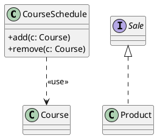

**解读说明**：`CourseSchedule` 使用 `Course` 作为操作参数，因此二者存在依赖。`Product` 实现 `Sale` 接口，用虚线空心三角箭头表示实现关系。

#### 本节 Q&A

**问**：能不能先用依赖把所有不确定关系连起来？

**答**：可以在初步建模时临时使用，但最终类图中应尽量用关联、聚合、组合或泛化明确语义。依赖表达的是使用关系，不能替代结构关系。[PPT p.61]

**问**：聚合和组合最关键的区别是什么？

**答**：关键在生命周期。聚合只说明整体-部分，部分对象可以相对独立；组合要求整体对象和部分对象生命周期相同，UML 中用实心菱形表示。[PPT p.53]

## 创建类的模型规约

### 类图文档

**定义**：类图文档是对面向对象分析得到的类图进行图形和文字说明的规约材料，包括类图综述、类描述、关联描述、泛化描述、依赖描述和其他说明。[PPT p.64]

**核心思想**：图形负责表达结构，规约负责消除歧义。也就是说，类图上一个类名、属性名或关系线无法说明完整责任、约束和语义，必须通过文字规约补足。[PPT p.64]

**背景与目的**：如果只有类图，没有规约，评审者可能无法判断属性取值范围、操作前置条件、依赖类型或关联端点含义。模型规约把图中的每个元素转化为可审查、可交付、可追踪的分析文档。[PPT p.64-p.68]

**类图综述**：类图综述要从总体上阐述整个类图的目的、结构、功能和组织。它不是重复列类名，而是解释这张类图解决什么分析问题、包含哪些主要子结构，以及它与系统责任如何对应。[PPT p.64]

### 类描述

**定义**：类描述是对类图中每一个类的整体说明、属性说明、操作说明、关联说明、泛化说明、依赖说明和其他事项进行逐项记录。[PPT p.64-p.66]

**核心思想**：类描述要把“类为什么存在”和“类如何参与模型”说完整。一个类不仅有名称，还应说明责任、一般类、主动性、引用情况、属性、操作和相关关系。[PPT p.65-p.66]

**背景与目的**：类描述能防止类图成为只有框和线的视觉草图。例如主动性决定对象是否可能作为控制起点，属性说明决定数据含义，操作说明决定服务边界，关联/泛化/依赖说明决定该类如何与其他类协作。[PPT p.65-p.66]

**类整体说明内容**：

- 类名应是中文名或英文名，且符合问题域规范。命名不应依赖无意义编号，否则模型难以被用户和开发者共同理解。[PPT p.65]
- 解释要说明类的责任。责任描述比属性列表更重要，因为它回答这个类为什么存在。[PPT p.65]
- 一般类要说明该类是从哪些类泛化而来。若类是特殊类，这能帮助读者理解它继承了哪些属性和操作。[PPT p.65]
- 主动性要说明有无主动行为。主动对象会影响后续交互模型和控制流分析。[PPT p.65]
- 引用情况要说明该类是否被其他类图定义或引用。大型系统中，不同类图之间复用类时必须可追踪。[PPT p.65]
- 其他事项可记录数据完整性、安全性等特别要求。这些要求若只在口头讨论中存在，后续设计很容易遗漏。[PPT p.65]

**属性说明内容**：

| 属性名 | 多重性 | 解释 | 数据类型 | 聚合关系 | 组合关系 | 关联关系 |
| :--- | :--- | :--- | :--- | :--- | :--- | :--- |
| 学时 | 1 | 课堂讲授学时数，每学时为 50 分钟 | 整数 | 否 | 否 | 否 |
| 主讲教师 | 1 | 指出该课程由哪个教师主讲 | 教师对象标识 | 否 | 否 | 是 |
| 销售事件表 | 0..* | 指向本班次所有销售事件 | 销售事件对象标识集合 | 是 | 否 | 否 |

**操作说明内容**：

| 操作名 | 主动性 | 多态性 | 解释 | 约束条件及其他 |
| :--- | :--- | :--- | :--- | :--- |
| 登录 | 有 | 无 | 本班收款员开始工作并建立班次上下文 | 需有有效收款员身份 |
| 售出 | 无 | 可有 | 减少商品架上数量，必要时触发缺货登记 | 售出数量不能超过可售数量 |
| 报账 | 无 | 无 | 向上级系统报告账目 | 账册应已完成收入累计 |

### 关联、泛化与依赖描述

**定义**：关系描述是对类图中的每一个关联、泛化和依赖进行文字化规约，说明关系名称、类型、参与类、端点性质和依赖类型等信息。[PPT p.67-p.68]

**核心思想**：关系线必须可解释。图中一条线只有在规约中说明其业务含义、端点多重性、导航性、聚合性质或依赖类型后，才能作为可靠的分析成果。[PPT p.67-p.68]

**背景与目的**：类之间的关系往往比类本身更容易误读。例如同样是空心菱形，必须说明整体是谁、部分是谁、是否排序、多重性多少；同样是虚线依赖，也要说明是 `<<use>>` 还是其他依赖类型。[PPT p.67-p.68]

**关联描述内容**：

| 关联名称 | 关联类型 | 关联所连接的类 | 导航性 | 排序 | 聚合 | 多重性 |
| :--- | :--- | :--- | :--- | :--- | :--- | :--- |
| 商品目录 | 聚合 | 商品一览表、商品 | 从商品一览表到商品 | 可按编号组织 | 聚合 | 1 到 m |
| 销售事件表 | 聚合 | 账册、销售事件 | 从账册到销售事件 | 可按时间排序 | 聚合 | 1 到 m |
| 主讲教师 | 一般二元关联 | 课程、教师 | 从课程到教师 | 无 | 否 | 多课程到一教师 |

**泛化描述内容**：

| 泛化名称 | 父类 | 子类 |
| :--- | :--- | :--- |
| 商品分类 | 商品 | 特价商品 |
| 商品分类 | 商品 | 计量商品 |

**依赖描述内容**：

| 依赖名称 | 依赖涉及的类名称 | 依赖类型 |
| :--- | :--- | :--- |
| 售货检索 | 收款机、商品一览表 | `<<use>>` |
| 库存补充 | 供货员、商品 | `<<use>>` |
| 账目上报 | 账册、上级系统接口 | `<<use>>` |

#### 本节 Q&A

**问**：模型规约是不是可以等到设计阶段再写？

**答**：不应该。PPT 将创建类的模型规约列为 OOA 类图构建的第五步，说明规约属于分析成果的一部分；没有规约，类图中的属性、操作和关系缺少可审查的详细说明。[PPT p.63-p.68]

**问**：关系描述为什么要记录端点信息？

**答**：因为关联端点决定导航性、排序、聚合性质和多重性。只画一条线无法说明一个对象到底连接几个对象、是否能从一端导航到另一端，以及整体-部分语义是否存在。[PPT p.67]

## 盲区与复习提示

### 盲区处理

**定义**：盲区是指 PPT 或 OCR 中对某些概念只给出图示或提示，但缺少足够文字说明的地方，需要在笔记中明确标记并谨慎补充。

**核心思想**：补充只能服务于理解，不应伪装成 PPT 原文。也就是说，若某处信息来自常识性 UML 解释而非 PPT 明确文本，应保持克制，并通过例子辅助而不是扩展到本课之外。

**本课盲区**：

- [盲区：PPT p.46 只列出“考虑领域范围内的复用”，没有展开具体判断步骤。] 笔记中仅将其解释为继承识别的一种启发，不额外引入设计模式或代码复用原则。
- [盲区：PPT p.55 主要是关联类图示，OCR 文字较少。] 笔记中根据相邻页 p.54 的售货时间、商品清单、售货金额示例，将其转译为“售货”关联类。
- [盲区：PPT p.57 的限定符图形细节 OCR 不完整。] 笔记保留“订单、订单行、产品名限定符”的核心语义，没有强行复原原图全部版式。

### 复习主线

**定义**：本课复习主线是从 OOA 任务出发，按类图构建的五步依次掌握对象、属性、操作、关系和规约。

**核心思想**：不要把本课理解为 UML 关系符号大全，而要把它理解为“如何从需求得到 OOA 类图”。符号只是表达手段，真正的重点是对象为什么保留、属性为什么属于该类、操作为什么放在该类、关系为什么这样画。[PPT p.5-p.74]

**背景与目的**：考试或面试中常见错误是直接背关联、聚合、组合的图标，却说不清如何从需求推出这些关系。更稳的复习方式是沿着超市案例走一遍：边界识别活动者，问题域发现商品和销售事件，筛选掉经理和收款员，补齐特征层，再通过继承、聚合和依赖得到完整类图。[PPT p.28-p.74]

**最终检查口诀**：类要有责任，属性要有用，操作要内聚，关系要有语义，规约要能解释。类比一下，类图像地图，模型规约像地图图例；只有地图没有图例，很多线条和标记就无法被可靠理解。

#### 本节 Q&A

**问**：本课最容易混淆的点是什么？

**答**：最容易混淆的是问题域对象、系统责任对象和实现条件对象。OOA 应优先保留能反映问题域和系统责任的对象，把 GUI、数据库、硬件和操作系统相关对象推迟到 OOD 考虑。[PPT p.7-p.12]

**问**：画完类图后怎样自查？

**答**：可以逐类检查责任、属性、操作和关系是否都有需求依据，再逐功能检查是否有对象负责完成。最后用模型规约解释每个类和关系，若无法解释，说明类图中可能存在无用元素或语义不清的线条。
