## OOD 的发展脉络

### 早期面向对象设计

**定义**：**面向对象设计（Object-Oriented Design, OOD）** 是在软件设计阶段运用面向对象思想组织系统结构、对象职责、对象关系和实现策略的方法。[PPT p.3-p.5]

**核心思想**：早期 OOD 本质上是从 **面向对象编程（Object-Oriented Programming, OOP）** 向设计活动的外推。也就是说，它先看到对象、类、消息和继承在程序结构中的好处，再尝试把这些思想提前到设计阶段。

**背景与目的**：PPT 把早期 OOD 放在八十年代到九十年代初来讲，重点不是让我们记年份，而是理解 OOD 的历史起点。Booch 在 1982 年使用 Object-Oriented Design 一词，1986 年又使用 Object-Oriented Development 更完整地阐述思想；两个术语都可缩写为 OOD，课程认为二者内容没有根本区别。[PPT p.3]

**直观理解**：类比一下，早期 OOD 像先有了某种施工工艺，再把施工经验反推到设计图纸中。它已经意识到对象比过程更适合作为系统组织单位，但还没有完全摆脱结构化分析、数据流图和具体语言的影响。[PPT p.5]

**PPT 原文关联**：PPT 还提到 Abbott 在 1983 年提出正文分析方法，用规范英语描述问题，再从文本中抽取对象及其特征，例如名词对应对象、动词对应操作。这说明早期 OOD 已经尝试从需求文字中识别对象，只是这种识别还不如后来的 OOA 系统化。[PPT p.3]

### 早期方法和局限

**定义**：早期 OOD 方法是指 Booch86、GOOD、HOOD、OOSD 等在 OOA 成熟之前出现的对象设计方法。[PPT p.4]

**核心思想**：这些方法的共同点是想用对象组织软件，但它们的入口和支撑并不完全是对象分析。值得注意的是，它们经常从结构化分析结果、编程语言机制或模块化思想出发，因此只能看作今天 OOA&D 方法体系的雏形。

**背景与目的**：早期方法的局限主要体现在四个方面。第一，它们大多不是基于 OOA，而是基于结构化分析结果，例如数据流图；第二，它们是 OOP 方法的延伸，受 Ada 等语言影响较大；第三，它们并不纯粹支持 OO 概念，例如对 **继承（Inheritance）** 支持不足，同时混入数据流、包、模块等非 OO 概念；第四，OOD 中的 D 有时指 Design，有时指 Development，因此会多少涉及分析问题，却又分析得不彻底。[PPT p.5]

**直观理解**：例如，一个早期方法可能会先从数据流图中找处理步骤，再把这些步骤包装为对象。这样得到的对象常常更像过程的容器，而不是现实问题域中有身份、有状态、有职责的对象。

| 维度 | 早期 OOD | 现今 OOD | 复习要点 |
| :--- | :--- | :--- | :--- |
| 输入基础 | 常依赖结构化分析结果 | 基于 OOA 模型 | 输入基础决定对象质量 |
| 与语言关系 | 常受具体语言影响 | 多数方法独立于语言 | 设计模型应尽量保持可移植 |
| OO 纯度 | 可能混合数据流、模块等概念 | 更全面体现 OO 概念与原则 | 早期方法是过渡形态 |
| 生命周期边界 | Design 和 Development 混用 | 分析与设计目标更清楚 | OOD 主要解决实现相关问题 |

### 现今面向对象设计

**定义**：现今 OOD 是在 OOA 模型基础上运用面向对象方法进行系统设计，目标是产生符合具体实现条件的 OOD 模型和过程。[PPT p.6-p.7]

**核心思想**：OOD 不再负责从零识别问题域对象，而是接收 OOA 已经识别出的对象、关系、职责和行为，再围绕实现条件进行组织。也就是说，OOA 主要回答系统应理解哪些现实事物，OOD 主要回答这些对象怎样被实现、协作、存储、展示和部署。[PPT p.6-p.7]

**背景与目的**：PPT 明确指出，从结构化分析文档中识别 OOD 对象并不是良策，因为识别对象的关键在于使用 OO 方法进行系统分析。OO 方法从设计发展到分析之后，OOA 和 OOD 才共同构成完整的 OOA&D 方法体系。[PPT p.6]

**直观理解**：如果把 OOA 看成领域地图，OOD 就是施工方案。地图要忠实反映业务地形，施工方案则必须考虑材料、工具、工期、承重、维护和扩建。

**PPT 原文关联**：PPT 对现今 OOD 的特点概括为：以 OOA 为基础；与相应 OOA 方法共同构成 OOA&D 方法体系；较全面体现 OO 概念与原则；多数方法独立于编程语言，不同语言可以实现同一分析与设计模型。[PPT p.7]

### 根本目标

**定义**：OOD 的根本目标是通过设计阶段的投入，提高软件生产率、质量和可维护性。[PPT p.8-p.9]

**核心思想**：设计不是额外文档负担，而是把未来编码、测试、修改和复用成本提前管理。值得注意的是，PPT 强调设计投入会在编程和测试时得到回报，这说明 OOD 的收益不只在图画得好看，而在源程序更容易对应、理解、修改和复用。[PPT p.8]

**背景与目的**：生产率方面，OO 方法使系统更容易理解，分析文档、设计文档和源程序之间对应更好，功能变化引起的全局性修改也更少。质量方面，现代质量观不是事后通过测试排除错误，而是从分析、设计阶段开始保证质量；高质量也不只是没有错误，还包括好用、易用、可移植、易维护和让用户满意。[PPT p.8]

**直观理解**：可维护性是这一页最关键的设计目标，因为需求总会变化，即使某个阶段可以冻结，也会受到客户业务、竞争形势、技术发展和规章制度影响。本质上，好的 OOD 要把易变部分和较稳定部分隔离，把变化影响限制在局部；PPT 给出的易变性顺序是服务大于接口大于属性大于类，这提醒我们服务流程往往最容易变化，而领域类的核心身份相对稳定。[PPT p.9]

**PPT 原文关联**：PPT 采用 Coad/Yourdon 的目标表述，强调提高生产率、提高质量、加强可维护性三个方面。[PPT p.8-p.9]

## OOD 与 OOA 的关系

### 调整和增补

**定义**：从 OOA 到 OOD 不是传统意义上的模型转换，而是在 OOA 模型基础上进行必要调整，并增补实现相关的组成部分。[PPT p.11]

**核心思想**：OOA 模型会被搬到 OOD 中，成为 OOD 模型的问题域部分；随后再增补人机交互部分、控制驱动部分、数据管理部分、构件及部署部分。也就是说，OOD 不是把分析模型推倒重来，而是围绕分析模型建立一个可实现的外部结构。[PPT p.11]

**背景与目的**：传统结构化方法中，分析文档和设计文档之间容易产生鸿沟，设计人员需要把一种表示法转换成另一种表示法。OOA 和 OOD 使用一致的概念和表示法，因此可以减少这种鸿沟，但这不代表设计阶段没有独立工作。[PPT p.12]

**直观理解**：类比一下，OOA 已经确定了业务核心，例如商品、订单、账户和交易；OOD 会继续保留这些对象，同时补上界面窗口、控制器、数据库访问对象、部署节点和复用库适配结构。

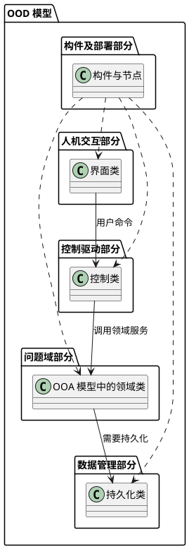

**解读说明**：这张图把 PPT p.11 的视觉结构转译为 PlantUML。问题域部分处在核心位置，其他部分围绕它补充实现条件；箭头表示常见协作方向，不表示课程限定的唯一调用方式。

### 一致表示和不同侧重

**定义**：OOA 和 OOD 采用一致的 OO 概念和表示法，但处于软件生命周期的不同阶段，具有不同目标和策略。[PPT p.12-p.14]

**核心思想**：OOA 主要针对问题域，识别相关对象及其关系，产生映射问题域、满足用户需求且独立于实现的模型。OOD 主要解决实现相关问题，基于 OOA 模型，针对机器、网络、操作系统、GUI、DBMS 等具体软硬件条件产生可实现模型。[PPT p.12]

**背景与目的**：PPT 提到 OOA 与 OOD 可适合瀑布模型、螺旋模型、增量模型和喷泉模型，而且二者可以顺序进行，也可以交叉进行。值得注意的是，交叉并不意味着混淆职责，而是当某些设计约束反过来影响分析认识时，需要及时反馈。[PPT p.12-p.13]

**直观理解**：例如，属性的数据类型和服务流程图到底在分析时定义还是设计时定义，课程给出“两种观点”的讨论。第二种观点认为“做什么”和“怎么做”并没有绝对划分，过分强调分析不考虑实现会让某些必须早理解的问题被延后；由于 OO 表示形式一致，也没有必然理由把所有细化都留给设计人员。[PPT p.14]

| 维度 | OOA | OOD | 设计含义 |
| :--- | :--- | :--- | :--- |
| 主要问题 | 做什么，问题域是什么 | 怎么实现，如何适配环境 | 设计承接分析而不是替代分析 |
| 关注对象 | 领域对象、关系、需求责任 | 领域对象的实现细节与外围对象 | OOD 会增加非问题域对象 |
| 独立性 | 尽量独立于具体实现 | 必须面对具体实现条件 | 语言、GUI、DBMS 会影响模型 |
| 输出要求 | 满足用户需求且可理解 | 可编码、可部署、可维护 | OOD 更靠近工程落地 |

### OOD 模型和过程

**定义**：OOD 模型是在实现条件约束下，对 OOA 模型进行调整并补充若干由对象构成的新组成部分后得到的系统设计模型。[PPT p.16-p.19]

**核心思想**：OOD 模型可以从两个侧面观察：一个侧面看它由问题域核心和若干外围部分组成，另一个侧面看每个部分都用 OOA 一致的 OO 概念和模型组织方式表达。也就是说，OOD 既增加了实现视角，又保持了 OO 建模语言的一致性。[PPT p.18]

**背景与目的**：OOD 需要考虑图形用户界面系统、硬件、操作系统、网络、数据管理系统、编程语言、可复用构件库等实现因素。基本思想是能隔离的实现条件尽量通过独立 **接口（Interface）** 隔离，不能隔离的因素则按实现条件调整 OOA 模型。[PPT p.17]

**直观理解**：例如，数据库访问可以尽量放入数据管理部分以隔离 DBMS 变化；但编程语言不支持多继承时，问题域类的继承结构本身就可能必须调整。前者是外围隔离，后者是核心适配。[PPT p.17-p.19]

**OOD 过程**的步骤如下：[PPT p.19]

1. **设计问题域部分**
   - 输入：OOA 模型、需求变化、实现条件和复用资源。
   - 操作：调整领域类的属性、操作、继承、关联、对象实例和算法。
   - 输出：可实现的问题域模型。
   - 目的：在保持问题域本质稳定的同时补足实现细节。
2. **设计人机交互部分**
   - 输入：人员活动者、用例中的输入输出、界面支持系统能力。
   - 操作：设计窗口、菜单、按钮、对话框、提示、反馈和命令结构。
   - 输出：界面类、界面对象关系和交互流程。
   - 目的：隔离 GUI 变化并提高用户操作质量。
3. **设计控制驱动部分**
   - 输入：系统控制流程、事件触发和对象协作需求。
   - 操作：确定控制对象如何驱动问题域对象完成系统功能。
   - 输出：控制类和控制协作结构。
   - 目的：把流程调度与领域对象职责分开。
4. **设计数据管理部分**
   - 输入：持久对象、文件系统或 DBMS 约束。
   - 操作：设计对象存储、恢复、标识和数据访问方式。
   - 输出：持久化相关类和数据访问协议。
   - 目的：隔离数据管理系统对领域模型的影响。
5. **设计构件及部署部分**
   - 输入：构件划分、运行节点、网络和部署约束。
   - 操作：确定构件边界、节点分布、通信方式和部署关系。
   - 输出：构件模型与部署模型。
   - 目的：让设计模型能落到具体硬件、网络和运行环境中。

**注意**：PPT 明确说“不强调次序”。这些部分可以根据风险和依赖关系交叉推进，但每个部分都采用与 OOA 一致的概念、表示法和活动，同时有自己的设计策略。[PPT p.19]

## 问题域部分的设计

### 问题域部分

**定义**：问题域部分是 OOD 模型的五个组成部分之一，由与问题域有关的对象构成，并在特定实现条件下提供用户所需功能；它是在 OOA 模型基础上按实现条件进行必要修改、调整和细节补充而得到的。[PPT p.21]

**核心思想**：问题域部分不是传统方法中的“转换”结果，也不是单纯细化分析模型。也就是说，它既保留 OOA 对问题域的认识，又承担 OOA 未完成的细节定义和实现适配。[PPT p.21]

**背景与目的**：并非所有实现因素都能通过 OOD 中新定义的独立组成部分隔离。有些实现因素会不可避免地影响 OOA 阶段识别的对象，进而影响对象内部特征和相互关系，因此必须在问题域部分直接修改或补充。[PPT p.22]

**直观理解**：例如，编程语言、硬件与网络、复用支持、数据管理系统和界面支持系统都会影响设计。数据库主要影响数据管理部分，但也可能要求问题域类补充对象标识、持久化状态或访问操作；界面支持系统主要影响人机交互部分，但问题域与界面之间仍然需要消息传递。[PPT p.22, p.26]

**PPT 原文关联**：PPT 对问题域部分的视觉逻辑是“将 OOA 模型搬到 OOD 作为基础，再按编程语言、网络与操作系统、复用支持等实现条件调整”。[PPT p.21]

### 设计问题域部分的必要性

**定义**：问题域部分设计的必要性来自 OOA 与 OOD 的关注差异：OOA 只考虑问题域和系统责任，OOD 必须考虑具体实现问题。[PPT p.23]

**核心思想**：好的问题域设计要让反映问题域本质的总体框架长期稳定，同时允许实现细节变化。本质上，它通过分离稳定部分与可变部分，让系统能从容适应变化。[PPT p.23]

**背景与目的**：这种设计有利于同一个分析模型被用于不同设计和实现，也支持系统族、相似系统以及编程结果的复用。值得注意的是，PPT 把“一个成功系统具有超出生存期的可扩展性”也列为目的，这说明设计不只是满足当前版本，还要给未来扩展留下结构空间。[PPT p.23]

**直观理解**：例如，销售系统的商品、订单和付款这些领域概念应尽量稳定；但它可以先用本地文件存储，后来改用关系数据库，再后来改用服务化存储。问题域部分设计要避免每次换存储方案都大规模改领域类。

### 实现条件的影响

**定义**：实现条件是指编程语言、硬件、操作系统、网络、复用类库、数据管理系统和界面支持系统等会约束设计模型落地方式的因素。[PPT p.24-p.26]

**核心思想**：实现条件对问题域部分的影响不均衡，其中编程语言影响最大。也就是说，语言是否支持某些 OO 概念，直接决定继承、多态、抽象、封装、对象生命周期和属性类型如何表达。[PPT p.24]

**背景与目的**：如果选定语言不支持某些 OO 概念与原则，就必须根据语言表达能力调整模型，以保证设计模型和源程序一致。OOA 阶段可能还会把对象创建、删除、复制、转存、初始化、属性数据类型等语言相关细节推迟到 OOD，语言确定之后这些问题都必须给出完整解决。[PPT p.24]

**直观理解**：例如，C++ 支持多继承，Java 和 C# 通常采用单继承加多接口，Python 支持多继承但封装约束较弱，JavaScript 基于原型链且类是语法糖。设计时不能只画理想继承树，还要确认目标语言能否自然表达该结构。[PPT p.25]

| 编程语言 | **封装（Encapsulation）** 支持 | 继承支持 | **多态（Polymorphism）** 支持 | **抽象（Abstraction）** 支持 | 设计影响 |
| :--- | :--- | :--- | :--- | :--- | :--- |
| Java | public、private、protected、default 等权限 | 单继承、多接口 | 方法**重写（Override）**和**重载（Overload）** | **抽象类（Abstract Class）**和接口 | 适合用接口替代多继承 |
| C++ | public、private、protected | 支持多继承 | 虚函数重写和重载 | 纯虚函数 | 表达力强但复杂度高 |
| C# | 权限控制更细 | 单继承、多接口 | 重写和重载 | 抽象类和接口 | 企业开发中模型到代码映射较规范 |
| Python | 主要靠命名约定模拟封装 | 支持多继承 | 鸭子类型和方法覆盖 | 抽象基类可辅助表达 | 需要靠约定和测试维护模型约束 |
| JavaScript | 现代版本支持私有字段 | 原型链继承，class 为语法糖 | 支持覆盖，不强调严格重载 | 常用约定或运行时错误模拟 | 设计模型要注意运行时动态性 |

**PPT 原文关联**：PPT 除编程语言外，还列出硬件、操作系统及网络设施对对象分布、主动对象、通信控制和性能策略的影响；复用支持会要求调整模型以使用已有类；数据管理系统会影响持久化属性与操作；界面支持系统主要影响界面部分，但与问题域之间仍需通信。[PPT p.26]

### 问题域部分的工作路线

**定义**：问题域部分设计是在继续使用 OOA 概念、表示法和策略的前提下，对 OOA 结果进行修改、补充与调整。[PPT p.27-p.28]

**核心思想**：问题域设计不是另起炉灶，而是“使用 OOA 结果”。也就是说，需求变化和新发现错误需要修改 OOA 结果，实现条件和工程策略则需要补充与调整。[PPT p.27]

**背景与目的**：PPT 把重点放在十二类补充与调整：为复用类增加结构、增加一般类以建立共同协议、按编程语言调整继承和多态、提高性能、为永久存储修改、为编程方便增加底层成分、转化复杂关联并决定实现方式、调整属性、构造和优化算法、决定对象可访问性、定义对象实例以及其他设计问题。[PPT p.27-p.28]

**直观理解**：这些工作可以看成把分析模型推向代码模型的检查清单。每一项都不是机械翻译，而是在问一个具体问题：这个模型能不能复用已有类，能不能被目标语言表达，能不能跑得动，能不能存起来，能不能被对象正确访问和协作。

### 为复用类增加结构

**定义**：为复用设计与编程的类而增加结构，是指当已有可复用类与 OOA 模型中的新定义类相似但不完全相同时，通过修改、继承或删减来提高复用比例。[PPT p.29-p.31]

**核心思想**：目标是尽可能增加复用成分，减少新开发成分。值得注意的是，可复用类既有分析设计定义又有源程序时，复用它不仅提高编码效率，也可能提高质量，因为它已被设计、实现和测试过。[PPT p.29]

**背景与目的**：PPT 把复用程度分成几种情况：可复用类定义的信息等于当前所需信息时可以直接复用；少于当前所需信息时可以通过继承复用；多于当前所需信息时要删除多余信息；近似但不完全匹配时，需要删除多余信息并通过继承复用。[PPT p.30]

**直观理解**：例如，已有 `车辆{复用}` 类包含序号、厂商、式样和序号认证，而问题域中的车辆还需要颜色、出厂年月等属性。设计时可以把复用车辆类加入问题域，并让新车辆类继承它，再把重复属性从新类中移除。[PPT p.31]

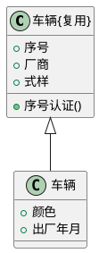

**解读说明**：这张图对应 PPT p.31 的车辆示例。复用类提供已有属性和操作，新问题域类只保留当前系统额外需要的特征，从而避免重复定义并提高复用。

### 增加一般类建立共同协议

**定义**：增加一般类是指在模型中引入更高层的通用类，用来为全系统或局部类集合提供共同协议。[PPT p.32-p.33]

**核心思想**：一般类把多个类共有的创建、删除、复制、永久存储、恢复等操作集中起来。也就是说，它通过共同父类或共同接口减少重复定义，使对象之间能遵循同一协议。[PPT p.32]

**背景与目的**：如果新增的一般类是自己定义的，它的表示法与其他类相同；如果它是编程语言提供的预定义类，只需要在类符号名字栏填写与语言完全相同的类名，并标注 `{复用}`，属性和操作栏可以不填写。还需要在类描述模板的整体说明中说明“利用编程语言提供的同名类”。[PPT p.32]

**直观理解**：例如，`Object{复用}` 可以作为模型中新增的一般类，让 A、D、E、F 等类直接引用它作为一般类，B 和 C 则通过 A 间接继承。这样做的本质是承认目标语言或类库已经提供了基本对象协议，不需要在业务模型中重新实现。[PPT p.33]

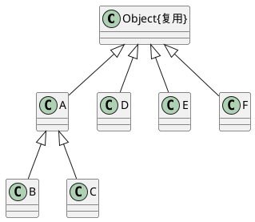

**解读说明**：图中 `Object{复用}` 表示语言或平台提供的类。A、D、E、F 直接继承通用协议，B 和 C 通过 A 间接获得通用协议。

### 按编程语言调整继承和多态

**定义**：按编程语言调整继承和多态，是指当目标语言不支持模型中的多继承或多态表达方式时，重新组织类结构、属性分布和操作命名。[PPT p.34-p.43]

**核心思想**：OOA 为了如实反映问题域，可能自然画出多继承和多态；OOD 必须考虑实现语言是否支持这些结构。也就是说，设计模型必须能被目标语言稳定、清晰、低成本地实现。[PPT p.34]

**背景与目的**：PPT 展示了狭义菱形和广义菱形等多继承模式，这些结构在不支持多继承的语言中会造成直接映射困难。设计阶段常见调整方法包括用**聚合（Aggregation）** 将多继承转换为单继承、重新定义对象类、压平继承结构，或者在完全不支持继承的语言中取消继承。[PPT p.34-p.41]

**直观理解**：例如，“顾主职员”既是顾主又是职员，可以建成多继承；如果语言不支持多继承，可以把顾主信息和职员信息拆成部分对象，通过聚合让同一个公司人员对象拥有两类身份信息。继承和聚合在现实语义上不同，但从最终效果看都能让一个类的对象拥有另一个类的一些属性和操作，这是它们可变通的依据。[PPT p.35-p.36]

| 调整方法 | 做法 | 优点 | 代价 | 适用场景 |
| :--- | :--- | :--- | :--- | :--- |
| 聚合替代多继承 | 把特殊信息剥离为部分对象类 | 保留信息复用，避免多继承 | 语义从“是一种”转为“拥有” | 语言只支持单继承 |
| 重新定义对象类 | 引入身份等新概念重新分类 | 更符合问题本质，结构清楚 | 需要重新审视领域分类 | 多继承来自身份交叉 |
| 压平 | 把共同和特殊信息直接放入各类 | 实现简单 | 容易重复和不一致 | 结构小且变化少 |
| 取消继承 | 展平或展平加聚合 | 可在无继承语言中实现 | 失去 OO 继承表达力 | 目标环境不支持继承 |

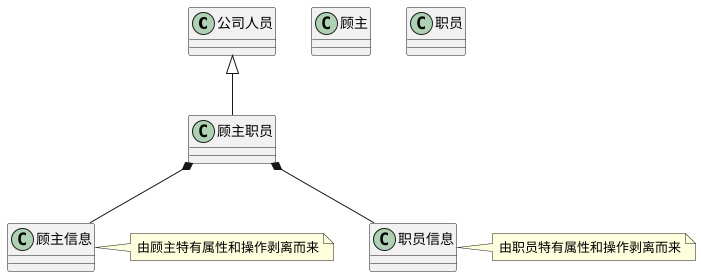

**解读说明**：这张图对应 PPT p.35-p.36 的“聚合替代多继承”思路。`顾主职员` 不再同时继承 `顾主` 和 `职员`，而是拥有 `顾主信息` 和 `职员信息` 两个部分对象。

**多态调整**：多态是指在继承结构中，相同属性和操作在不同类中可以有不同类型和行为。若语言不支持这种表达，可以把多态属性和操作的名字分别赋予不同含义以明确区分，也可以重新考虑对象分类并调整属性和操作分布。[PPT p.42]

**重载与多态的区别**：重载是同一个类中相同操作名可以被定义多次，通过参数个数、种类或次序区分；多态是在继承结构中，相同属性和操作在不同类中具有不同类型和行为。值得注意的是，重载解决的是同类内部的调用匹配问题，多态解决的是继承层次中的动态行为差异问题。[PPT p.43]

### 提高性能

**定义**：提高性能的设计是指在 OOD 模型层面调整对象分布、通信、属性、主动类、分类和聚合结构，以降低系统执行时间或资源开销。[PPT p.44-p.46]

**核心思想**：性能问题首先应该通过设计策略处理，只有这些策略仍不能满足要求时，才考虑改变计算机、网络、DBMS 等基本配置。也就是说，OOD 阶段不能把性能完全推给硬件升级。[PPT p.45]

**背景与目的**：PPT 把影响性能的因素分为数据传输时间、数据存取时间和数据处理时间。数据传输时间主要受分布方案、网络拓扑、线路速率和拥挤程度影响；数据存取时间受外存设备性能、访问次数和访问数据量影响；数据处理时间则是主机完成处理和计算所花时间。[PPT p.44]

**直观理解**：例如，流速调节器和流速探测器通信极其频繁时，可以合并为流速控制器以减少对象间通信。再如，增加冗余属性可以减少重复计算，但必须配合一致性维护；细化对象分类可以降低单个操作复杂性；用聚合描述复杂类可以把复杂显示对象拆成背景和前景等部分。[PPT p.45-p.46]

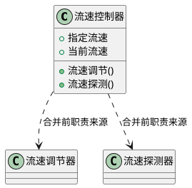

**解读说明**：图中用依赖说明 `流速控制器` 汇聚了原先两个频繁通信类的职责。合并可以减少通信开销，但会降低类的单一性，所以只应在性能瓶颈明确时采用。

### 永久存储和底层成分

**定义**：为永久存储所做的修改，是指当某些对象实例需要长期保存时，为类补充对象存储、恢复、标识或外存映射相关属性和操作。[PPT p.47]

**核心思想**：永久对象不能只存在于内存对象模型中，它还要能在文件系统或关系数据库中被保存、重建和更新。也就是说，数据管理部分会承担主要设计，但问题域类也可能需要补充支持持久化的细节。[PPT p.47]

**背景与目的**：如果领域对象要保存到数据库，设计可能需要对象标识、版本号、创建时间、更新时间、延迟加载状态或仓储访问接口。PPT 没有在本课展开数据管理部分，只提示这些修改会在后续数据管理部分介绍，因此这里应理解为问题域与数据管理之间的边界预告。[PPT p.47]

**直观理解**：为编程方便增加底层成分则更偏向编码表达。例如把几何图形进一步分成多边形、椭圆、扇形等特殊类，可以让每类拥有更明确的绘制和计算逻辑，避免在一个大类中写大量条件分支。[PPT p.48]

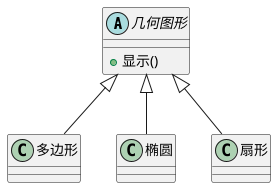

**解读说明**：这张图对应 PPT p.48。细化分类让每个特殊类可以分别实现自己的显示、面积或绘制算法，降低单个类的复杂性。

### 复杂关联的转化和实现

**定义**：复杂关联的转化是指把多对多关联、多元关联等难以直接编码或维护的关系，改造成一对多关联、二元关联或关联类结构。[PPT p.49-p.52]

**核心思想**：分析阶段可以用较抽象的关联表达业务事实，设计阶段必须决定关联如何被对象引用、指针、对象标识、集合或中间类实现。也就是说，关联从图上的线变成代码中的属性、集合、引用和约束。[PPT p.51-p.52]

**背景与目的**：PPT 用供货商和客户的多对多关系说明，可以引入供需合同，把原来的多对多转化为供货商到合同、客户到合同的一对多关系。这样不仅便于实现，还能把卖方、买方和合同条款等关联自身的信息放入合同类中。[PPT p.49]

**直观理解**：多元关联也可以转化为二元关联。例如项目、语言、人员三者之间的任务关系，可以引入任务项类，让任务项分别关联项目、语言和人员。这样每个任务项都成为可命名、可存储、可维护的对象。[PPT p.50]

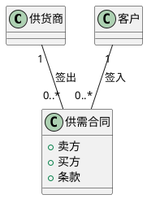

**解读说明**：这张图把多对多供应关系拆成两个一对多关系。`供需合同` 不只是技术中间表，而是业务上有意义的关联对象。

**实现方式**：对聚合关系，要决定整体类中是直接把部分类作为属性类型，还是保存指针或对象标识。如果是**组合（Composition）**，最好直接包含部分类对象，否则必须在程序中保证整体和部分生命周期一致。[PPT p.51]

**关联实现**：对普通**关联（Association）**，通常在对象中设立指针或对象标识记录另一端对象；单向关联只在源端类中设属性，双向关联则两端都设属性。若对方多重性为 1，可保存单个引用；若大于 1，应保存引用集合；若关联端有角色名，最好把角色名作为另一端类的属性名，便于按语义访问对象。[PPT p.52]

### 调整与完善属性

**定义**：调整与完善属性，是指按照 `[可见性] 属性名[:类型][=初始值]` 的格式补全属性定义，并处理属性约束、派生属性和数据完整性。[PPT p.53-p.54]

**核心思想**：属性不是只有名字，还需要可见性、类型、初始值和约束。也就是说，设计阶段要把分析阶段的概念属性推向能被语言、数据库和对象不变式共同维护的工程属性。[PPT p.53]

**背景与目的**：每个属性要么包含单个值，要么包含一组作为整体密切相关的值。若存在“工龄小于 60”或“英语成绩在 0 到 100 之间”等约束，要看语言是否直接支持；如果不支持，就需要在算法中实现约束检查。[PPT p.53]

**直观理解**：维护数据完整性时，尤其要注意基本属性和导出属性之间的同步。例如总价可能由单价和数量导出，单价或数量变化后必须更新总价。PPT 给出三种方法：显式代码、批处理性重计算和触发器；显式代码及时但容易遗漏，批处理适合批量变化，触发器适合依赖关系集中管理。[PPT p.54]

```java
// PPT 原片段：属性需要补全可见性、类型、初始值和约束。
// 补全部分：用最小 Java 示例表达基本属性、导出属性和显式同步。
final class OrderLine {
    private int quantity = 1;
    private int unitPriceInCents;
    private int totalPriceInCents;

    OrderLine(int unitPriceInCents) {
        if (unitPriceInCents < 0) {
            throw new IllegalArgumentException("unit price must be non-negative");
        }
        this.unitPriceInCents = unitPriceInCents;
        recalculateTotal();
    }

    void changeQuantity(int quantity) {
        if (quantity <= 0) {
            throw new IllegalArgumentException("quantity must be positive");
        }
        this.quantity = quantity;
        recalculateTotal();
    }

    private void recalculateTotal() {
        this.totalPriceInCents = this.quantity * this.unitPriceInCents;
    }
}
```

**解读说明**：这个 MCVE 对应 PPT p.53-p.54 的属性完善和派生属性同步。`quantity` 与 `unitPriceInCents` 是基本属性，`totalPriceInCents` 是导出属性，显式代码保证它们同步。

### 构造和优化算法

**定义**：构造和优化算法，是指为类操作补全签名、责任、前置条件、后置条件、不变式、异常处理和性能优化策略。[PPT p.55]

**核心思想**：操作不是类图中的一个名字，而是对象响应消息并完成责任的具体方法。也就是说，OOD 要从对象责任出发说明操作怎样提供服务，而不仅是列出服务名。[PPT p.55]

**背景与目的**：PPT 要求按照 `[可见性] 操作名(参数列表):返回类型` 完善操作定义，并从问题域角度考虑实现算法。如果操作有前后置条件或不变式，要确认编程语言是否支持；不支持时，必须在方法中实现。[PPT p.55]

**直观理解**：进一步分析交互图可以找出某类对象需要响应的所有消息，拥有状态图的类还可以根据内部转换和外部转换上的动作设计详细逻辑。值得注意的是，算法描述可以用自然语言、结构化自然语言、程序框图或活动图；同时必须处理输入错误、中间件错误、软硬件错误和其他异常情况。[PPT p.55]

**操作设计算法**的步骤如下：

1. **补全操作签名**
   - 输入：分析模型中的服务名和交互图消息。
   - 操作：确定可见性、参数、返回类型和异常约定。
   - 输出：可映射到代码的方法定义。
   - 目的：消除“只有操作名，没有调用契约”的模糊性。
2. **确定责任算法**
   - 输入：类职责、状态图动作和相关业务规则。
   - 操作：用结构化自然语言、活动图或伪代码描述执行逻辑。
   - 输出：操作内部算法。
   - 目的：说明对象如何完成它承诺的服务。
3. **补充约束和异常**
   - 输入：前置条件、后置条件、不变式和外部错误来源。
   - 操作：决定用语言机制、显式代码或异常处理实现约束。
   - 输出：健壮的操作定义。
   - 目的：避免合法性检查散落或遗漏。
4. **评估性能**
   - 输入：数据规模、调用频率和性能要求。
   - 操作：优化体系结构、算法复杂度或对象协作方式。
   - 输出：满足性能要求的设计。
   - 目的：让设计在真实负载下可用。

### 对象间可访问性

**定义**：对象间可访问性是指一个类的对象在运行期间如何获得另一个类对象的引用或标识，从而访问其公共属性和操作。[PPT p.56]

**核心思想**：可访问性决定对象之间是否存在稳定链接或临时链接。本质上，它把类图中的关联、聚合和**依赖（Dependency）**落实为代码中的属性、参数、局部变量或全局对象。[PPT p.56]

**背景与目的**：PPT 从类 A 对类 B 的访问列出四种方式：属性可见性、参数可见性、局部声明可见性和全局可见性。后三者对应 A 到 B 的依赖关系，运行期存在临时连接；第一种由 A 到 B 的关联实例化而来，连接更稳定。[PPT p.56]

**直观理解**：例如，订单对象把客户对象作为属性，说明订单和客户之间有较稳定关系；结算方法把优惠券作为参数，说明优惠券只在这次调用中临时参与；方法内部创建一个价格计算器，是局部声明可见性；全局可见性则类似到处访问全局配置或单例对象，通常要谨慎使用。

| 可访问性 | 代码形态 | UML 关系倾向 | 生命周期特征 | 设计风险 |
| :--- | :--- | :--- | :--- | :--- |
| 属性可见性 | `class A { B b; }` | 关联或聚合 | 链接较稳定 | 过多会提高耦合 |
| 参数可见性 | `aMethod(B b)` | 依赖 | 调用期间临时连接 | 调用契约变复杂 |
| 局部声明可见性 | 方法内部声明 `B b` | 依赖 | 方法内部临时存在 | 隐藏创建成本 |
| 全局可见性 | 全局对象或全局访问点 | 依赖 | 广泛可见 | 容易破坏封装和测试性 |

### 定义对象实例

**定义**：定义对象实例，是指在 OOD 文档中说明类创建出的对象在内存、外存、处理机节点和对象集合中的存在方式。[PPT p.57-p.58]

**核心思想**：类是对象的逻辑抽象，但对象实例必须落到物理环境中。也就是说，设计文档不仅要说明有哪些类，还要说明重要对象在哪里创建、如何命名、是否持久、是否成批存在。[PPT p.57]

**背景与目的**：内存对象可以用变量记录其标识，外存对象可以保存在文件或数据库表中。系统从外存读取数据创建对象时，通常先创建对象，再读取外存数据并赋值给对象属性；内存中的永久对象也需要按策略保存回外存。[PPT p.57]

**直观理解**：例如，一个收银系统中，当前收款会话对象可能只存在于内存，商品目录对象可能从数据库加载，交易记录对象则必须持久保存。PPT 要求这些方式都在 OOD 文档中说明，格式包括处理机、内存对象和外存对象。[PPT p.58]

```text
处理机：收银终端, 数据库服务器；
内存对象：currentSale[当前收款会话], cartItems(n 元数组)[本次购买条目集合]；
外存对象：salesRecords[销售记录表], products[商品信息表]；
```

**解读说明**：这段文本是对 PPT p.58 模板的补全示例。它说明对象实例不仅是类图中的抽象节点，还要进入运行节点、内存集合和外部存储。

### 其他问题域设计事项

**定义**：其他问题域设计事项包括在合适位置使用**设计模式（Design Pattern）**、加入输入验证类、错误处理类、异常处理类，以及正确引用容器和集合类。[PPT p.59]

**核心思想**：OOD 不应把所有工程问题都塞进领域类。值得注意的是，输入数据验证、中间件错误处理、软硬件错误处理等横向问题，可以通过专门类或模式处理，以避免领域类职责膨胀。[PPT p.59]

**背景与目的**：PPT 提醒有些做法不会在 OOD 阶段把读写属性的操作放入类中，而是把它视为编程人员可理解的约定；有些做法也不把创建和复制对象这类操作放入 OOD 模型。这说明模型详细程度应服务于沟通和实现，而不是机械列出所有代码级方法。[PPT p.59]

**直观理解**：包容器或集合类，例如 Java 的 Vector、Hash table，通常已经是预定义类库的一部分，一般不在类图中重新定义，而是引用或继承。不要把集合类已有方法，例如 `find`，错误地在其他类中重新定义，否则会重复制造已有基础设施。[PPT p.59]

## 人机交互部分的设计

### 人机交互部分

**定义**：人机交互部分是系统中负责人机交互的部分，由一些对象类构成，突出人如何命令系统以及系统如何向用户提交信息。[PPT p.61]

**核心思想**：OOA 和 OOD 都会考虑人机交互，但目的不同。OOA 常通过人机界面原型反映需求，OOD 则要设计交互细节、界面对象和界面与问题域之间的协作。[PPT p.61]

**背景与目的**：人机交互部分既取决于需求，又与 GUI 密切相关，因此可以与 OOA 同时进行，但必须与问题域相互分离。也就是说，界面实现条件可以提前探索，但不能让 GUI 变化污染问题域核心。[PPT p.61-p.62]

**直观理解**：例如，同一个库存系统可以有桌面界面、Web 界面和移动端界面，但商品、库存、出入库规则不应因为界面形态变化而重写。人机交互部分的独立性正是为了隔离 GUI 变化对问题域部分的影响。[PPT p.62]

### 人机交互需求分析

**定义**：人机交互需求分析是对使用系统的人以及人与机器的交互过程进行分析，以设计适合使用者特点的交互方式和界面表现形式。[PPT p.63-p.67]

**核心思想**：交互内容通常由功能需求决定，交互过程和交互方式则受人的主观因素影响。也就是说，系统必须完成哪些输入输出是客观问题，但如何组织输入输出、用什么界面风格、给什么提示，则需要考虑用户特点。[PPT p.63-p.66]

**背景与目的**：分析人员活动者时，要列举所有人员活动者，调查他们的基本情况、具体要求、习惯和爱好，区分人员类型，统计或估算各类人员比例，并了解主观需求。分类角度包括熟练程度、职业、与系统关系和年龄；例如系统管理员、维护人员、操作员、超级用户、一般用户和业务客户，对界面的期望可能完全不同。[PPT p.64-p.65]

**直观理解**：从 **用例（Use Case）** 中抽取人机交互时，方法是删除所有与输入、输出无关的语句，以及不再包含任何内容的控制语句和括号，剩下的就是某个人员活动者使用某项系统功能时的人机交互描述。PPT 的收款员收款例子中，检索商品、减少货架库存、通知供货员、计入账册等内部处理会被删掉，而输入命令、输入商品编号、输入商品数量、打印商品信息、打印应收款和输入顾客交款等交互内容会被保留。[PPT p.66-p.67]

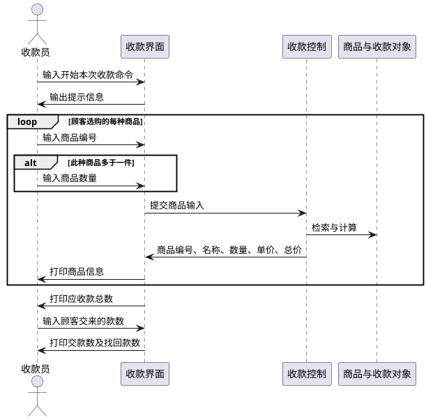

**解读说明**：这张序列图把 PPT p.67 的 use case 抽取为交互描述。界面侧保留输入输出，内部业务处理通过控制和领域对象承接，避免把所有处理步骤都暴露为用户交互。

### 人机界面设计准则

**定义**：人机界面设计准则是用于评价和指导界面组织、操作流程、反馈机制和错误防护的设计原则。[PPT p.68-p.69]

**核心思想**：界面设计不只是视觉美观，而是让用户低成本、低错误率地完成系统命令和信息获取。也就是说，界面质量直接影响系统是否好用、易用和可维护。[PPT p.68-p.69]

**背景与目的**：PPT 给出的准则包括使用简便、一致性、启发性、减少记忆负担、减少重复输入、容错性、及时反馈、防止灾难性错误以及艺术性、趣味性、风格和视感等其他因素。[PPT p.68-p.69]

**直观理解**：一致性要求界面各部分和各层次在术语、风格、交互方式、操作步骤上尽量一致，也要与当前潮流一致。容错性要求对误操作给警告或确认、提供撤销和恢复、对无意义操作尽量不造成破坏；及时反馈要求长时间命令不能等执行完才回应，而要告诉用户工作正在进展。[PPT p.68-p.69]

| 准则 | 设计含义 | 例子 | 忽视后果 |
| :--- | :--- | :--- | :--- |
| 使用简便 | 操作路径短，概念清楚 | 常用功能放在易访问位置 | 用户学习成本高 |
| 一致性 | 术语、风格、流程一致 | 所有删除操作都用相同确认逻辑 | 用户迁移经验失败 |
| 启发性 | 界面能引导正确操作 | 下一步按钮只在输入合法时可用 | 用户不知道如何继续 |
| 减少记忆 | 避免记大量规则和状态 | 显示当前上下文和可选项 | 用户依赖外部笔记 |
| 减少重复输入 | 复用已输入信息 | 地址、客户名自动带出 | 操作繁琐且易错 |
| 容错性 | 可警告、确认、撤销 | 删除前确认，支持 undo | 小错误变成大损失 |
| 及时反馈 | 长操作给进度或状态 | 导入数据时显示进度 | 用户误以为系统卡死 |
| 防灾难错误 | 防止数据丢失 | 定时备份，不存盘退出提醒 | 造成不可恢复损失 |

### 输入与输出设计

**定义**：输入与输出设计是对交互过程中每一次输入和每一次输出进行细化，使基本交互过程更符合人的习惯与爱好。[PPT p.70-p.72]

**核心思想**：交互细化不是增加功能，而是把功能输入输出组织成用户可理解、可操作、可纠错的形式。也就是说，同一条信息可以一次输入，也可以分多步输入，设计者必须权衡效率、清晰度和错误率。[PPT p.70]

**背景与目的**：输入细化包括输入步骤细化、输入设备选择和输入信息表现形式选择。输入可分为人对系统的命令和向系统提供的数据，后者要原本输送给系统；课程重点讨论前者，也就是命令如何表达和输入。[PPT p.70-p.71]

**直观理解**：命令表现形式要适合使用者特点，文字命令需要准确反映语义，图形或符号命令需要形象直观并让人联想到寓意，同时还要符合流行和用户习惯。输出则分为提示信息、处理结果和反馈信息；大量输出可以分步给出，输出设备可以是显示器、打印机和绘图仪，表现形式可以是文本、表格、图形、图像、声音或视频片段。[PPT p.71-p.72]

### 命令组织

**定义**：命令组织是把基本命令、命令步和高层命令进行分解与组合，使用户能按合理路径发现和执行系统功能。[PPT p.73-p.78]

**核心思想**：不受欢迎的命令组织有两类：一条命令含大量参数和任选项，或者系统有大量命令却不加组织和引导。也就是说，命令设计要避免把复杂度一次性推给用户。[PPT p.73]

**背景与目的**：基本命令是使用一项独立系统功能的命令，通常可对应提取后的用况；命令步是执行基本命令过程中包含的具体输入步骤；高层命令是引导用户选择另一条命令的上层命令。组织措施包括把复杂命令分解成若干命令步，以及把基本命令组合到高层命令下。[PPT p.73]

**直观理解**：基本命令及命令步可以组织成线性结构、树型结构、半序网状结构或一般网状结构。高层命令可以按功能组织，例如文件下包含创建、打开、关闭、打印、删除；也可以按子系统组织，例如文本编辑子系统和编译子系统。[PPT p.74-p.75]

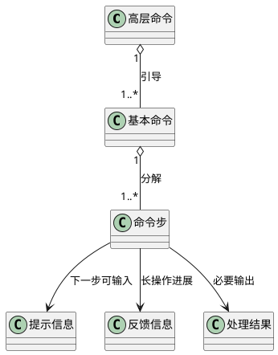

**解读说明**：这张图把 PPT p.73-p.77 的命令结构和两层命令之间输出信息结构合并表达。提示信息引导下一步输入，反馈信息说明长命令仍在执行，处理结果则传达系统计算或处理结果。

**命令树建立策略**：把使用最频繁的命令放在前面，并按照用户工作步骤排列。设计时要在命令中发现整体-部分模式，以帮助组织和分块；每层命令个数应遵循 7+2 原则，命令层次深度尽量控制在三层以内。[PPT p.78]

### 界面支持系统和界面元素

**定义**：界面支持系统是支持人机界面开发和运行的软件环境，包括窗口系统、图形用户界面和可视化编程环境。[PPT p.79-p.82]

**核心思想**：人机界面设计通常以一种选定界面支持系统为基础，利用它支持的界面构成成分建立可满足交互需求、适合使用者特点的界面设计模型。也就是说，界面对象不是凭空设计，而要受工具、平台和类库能力约束。[PPT p.79]

**背景与目的**：窗口系统控制位映像显示器和输入设备，管理屏幕、窗口、色彩表、字体、光标、图形资源和输入设备，既是开发平台也是运行平台。GUI 是在窗口系统之上提供更高层界面支持功能、特定视感和风格，并支持应用系统用户界面开发的系统；可视化编程环境则把窗口系统、GUI、可视化开发工具、编程语言和类库结合起来。[PPT p.79-p.81]

**直观理解**：例如 Smalltalk 把语言、类库和窗口系统结合在一起，Macintosh 是早期影响较大的商品化窗口系统，X Windows 在工作站上广泛使用，MS-Windows 在微机上广泛使用。设计时还要根据交互需求选择窗口、菜单、对话框、图符、滚动条、控制板、剪辑板、光标、按钮等界面元素。[PPT p.80-p.82]

### 用 OO 概念表达界面成分

**定义**：用 OO 概念表达界面成分，是指把窗口、菜单、工作区、对话框、按钮等界面构成成分建模为对象类，并用继承、聚合、关联、属性、操作和交互图表达其结构与行为。[PPT p.83-p.84]

**核心思想**：界面对象也应遵循 OO 表示法。也就是说，窗口部件可以作为窗口的部分对象类，与窗口类形成聚合关系；窗口和部件之间的共性可以抽象为一般窗口类和一般部件类，形成继承关系。[PPT p.83]

**背景与目的**：静态特征应表示为属性，例如尺寸、位置、颜色和选项，尤其要注意界面对象关联和聚合关系的属性。动态特征应表示为操作，例如选中、移动、滚屏；界面类之间的关系应建立关联，必要时还要绘制用户与系统会话的**序列图（Sequence Diagram）**。[PPT p.83]

**直观理解**：界面类与问题域类之间的联系尤其重要。人机界面只负责输入、输出和窗口更新，并把面向问题域的请求转发给问题域部分；多数情况下，问题域对象不应主动发起到界面对象的通信，而应由界面部分对象访问问题域对象；界面易变，因此二者要低耦合。[PPT p.84]

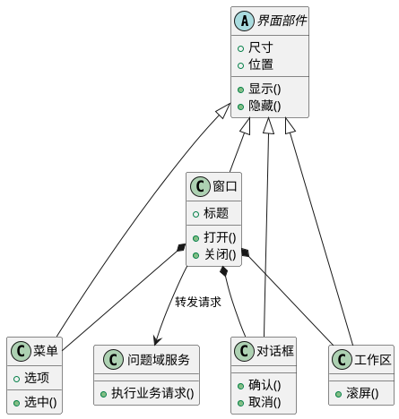

**解读说明**：这张图对应 PPT p.83-p.84。界面部件之间通过继承和聚合组织，窗口把业务请求转发给问题域服务，但不直接实现业务规则。

### 发布订阅和观察者模式

**定义**：**观察者（Observer）** 模式定义对象之间一对多的依赖关系，当一个对象发生变化并对外发布消息时，所有依赖它的对象都会得到通知并可以更新；该模式也称发布-订阅（Publish-Subscribe）模式。[PPT p.85-p.86]

**核心思想**：观察者模式解决问题域对象对界面层对象的访问问题。也就是说，问题域对象不必直接认识每个图表、窗口或报表对象，只需发布变化事件，由订阅者接收并更新自己。[PPT p.85-p.86]

**背景与目的**：采用观察者模式时，要在发布消息的对象中设立增减观察者对象的操作，并为观察者对象建立统一的接收消息接口。益处是观察者变化时，只需在发布消息对象中增减对象标识，而不需要修改发布者的业务逻辑。[PPT p.86]

**直观理解**：例如，同一份销售数据可以被柱状图、折线图和饼图同时展示。销售数据变化时，它发布事件；各图表作为订阅者收到通知后更新显示，而销售数据对象不需要知道每个图表的绘制细节。[PPT p.85]

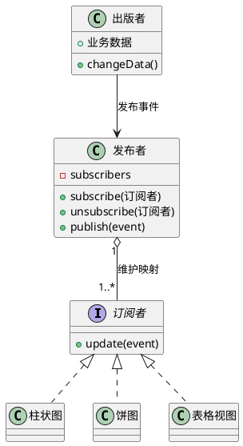

**解读说明**：这张图把 PPT p.85-p.87 的发布者、出版者和订阅者关系转成 PlantUML。出版者产生变化事件，发布者维护订阅映射并通知订阅者，订阅者通过统一接口更新界面。

```java
// PPT 原片段：观察者模式要求发布对象能增减观察者，观察者有统一接收消息接口。
// 补全部分：最小 Java 示例展示发布-订阅协作。
import java.util.ArrayList;
import java.util.List;

interface Subscriber {
    void update(String event);
}

final class Publisher {
    private final List<Subscriber> subscribers = new ArrayList<>();

    void subscribe(Subscriber subscriber) {
        subscribers.add(subscriber);
    }

    void unsubscribe(Subscriber subscriber) {
        subscribers.remove(subscriber);
    }

    void publish(String event) {
        for (Subscriber subscriber : subscribers) {
            subscriber.update(event);
        }
    }
}

final class SalesChart implements Subscriber {
    @Override
    public void update(String event) {
        System.out.println("refresh chart because " + event);
    }
}
```

**解读说明**：这个 MCVE 对应 PPT p.86 的观察者结构。发布者只依赖 `Subscriber` 接口，不依赖具体图表类，因此新增或移除界面展示对象不会改动发布逻辑。

## 按页复习锚点

### 课程结构总览

- [PPT p.1-p.2] 封面和目录说明本课主题是 OOD，并把内容分成 OOD 发展、OOD 与 OOA 的关系、OOD 模型和过程三条主线。目录中列出的控制驱动、数据管理、构件及部署部分在本课只进入总览，具体展开不在第 8 课主体范围内。
- [PPT p.3-p.5] 早期 OOD 的重点是历史过渡，而不是背诵方法名称。Booch、Abbott 和 Booch86、GOOD、HOOD、OOSD 等内容共同说明，早期 OOD 已经开始关注对象，但仍然带有结构化分析和语言实现的痕迹。
- [PPT p.6-p.7] 现今 OOD 的关键变化是基于 OOA，而不是从结构化分析结果中硬找对象。识别对象由 OOA 完成，OOD 主要定义对象如何实现，因此 OOD 的价值在于把领域理解变成可编码、可维护的系统结构。
- [PPT p.8-p.9] OOD 的目标要同时看生产率、质量和可维护性。生产率来自模型与代码对应良好、复用增加和全局修改减少；质量来自过程前移的质量保证；可维护性来自隔离易变部分与稳定部分。

### 分析设计关系锚点

- [PPT p.10-p.11] 目录页之后，PPT 用图示强调 OOA 到 OOD 不是转换，而是调整和增补。OOA 模型进入 OOD 后成为问题域部分，再由人机交互、控制驱动、数据管理、构件及部署等外围部分组成完整 OOD 模型。
- [PPT p.12] OOA 与 OOD 采用一致的概念和表示法，因此不存在传统意义上分析与设计之间的鸿沟。它们的区别在侧重点：OOA 面向问题域和用户需求，OOD 面向机器、网络、操作系统、GUI、DBMS 等实现条件。
- [PPT p.13] 瀑布模型和喷泉模型的示意图说明，OOA 与 OOD 可以顺序进行，也可以交叉进行。复习时要把这页理解为生命周期适配问题，而不是把 OOD 固定成某一种过程模型中的单独阶段。
- [PPT p.14] OOA 与 OOD 分工的争议集中在对象特征细节何时定义，例如属性数据类型和服务流程图。第二种观点认为“做什么”和“怎么做”没有绝对边界，过分推迟细化会导致重复认识同一事物，也不利于分析结果复用。

### 模型过程锚点

- [PPT p.15-p.17] OOD 模型和过程部分先声明讲授基础是 Coad/Yourdon，并按实现条件调整 OOA 模型。这里要抓住两个策略：能隔离的实现条件尽量通过独立接口隔离，不能隔离的因素则必须调整问题域模型。
- [PPT p.18] OOD 模型的两个观察侧面分别是组成结构和表达方式。组成结构强调一个核心加几个外围部分，表达方式强调每个部分仍用 OO 概念和 OOA 式模型组织方式表示。
- [PPT p.19-p.20] OOD 过程包含问题域、人机交互、控制驱动、数据管理、构件及部署五部分，但 PPT 明确不强调严格次序。每个部分都使用与 OOA 一致的概念和表示法，同时具有自己的设计策略。

### 问题域设计锚点

- [PPT p.21-p.22] 问题域部分的定义强调“由问题域有关的对象构成”，但它已经处于特定实现条件下。并非所有实现因素都能被外围部分隔离，编程语言、硬件网络、复用支持、数据管理系统和界面支持系统都可能反过来影响问题域对象。
- [PPT p.23] 问题域部分设计的必要性可以归纳为“稳定核心、隔离变化、支持复用”。它让问题域总体框架长期稳定，同时让细节根据不同实现条件变化，从而支持同一分析用于不同系统或系统族。
- [PPT p.24-p.25] 编程语言是对问题域影响最大的实现条件，因为语言决定 **封装（Encapsulation）**、继承、多态、抽象和对象生命周期如何表达。表格中 Java、C++、C#、Python、JavaScript 的差异提醒我们，设计模型不能脱离目标语言的表达能力。
- [PPT p.26] 硬件、操作系统和网络设施会影响对象分布、主动对象、通信控制和性能措施。复用支持会要求修改模型以使用已有类，数据管理系统会要求问题域类补充持久化相关属性和操作，界面支持系统主要影响界面部分但仍需要与问题域交换消息。
- [PPT p.27-p.28] 问题域部分设计的路线包括继续运用 OOA 方法、使用 OOA 结果并修正需求变化或错误，以及对 OOA 结果进行十二类补充与调整。复习时可把这两页当作问题域设计的总检查表。

### 复用和协议锚点

- [PPT p.29] 为复用类增加结构的前提是 OOA 中识别的类通常是本次开发中新定义的，需要编程。若已有可复用类同时有设计定义和源程序，就应优先考虑复用，以提高开发效率和质量。
- [PPT p.30] 复用关系要看“可复用类定义的信息”与“当前所需类的信息”的相对关系。等于时直接复用，少于时通过继承补充，多于时删去多余信息，近似时则删除多余信息并通过继承复用。
- [PPT p.31] 车辆示例展示了复用类和问题域类如何合并。设计者把复用车辆类加入问题域，用 `{复用}` 标记，再让新车辆类继承它并移除重复属性，这样可以减少新开发成分。
- [PPT p.32] 增加一般类用于建立共同协议，可以是全系统协议，也可以是局部通用协议。全系统协议可能包括创建、删除、复制，局部协议可能包括永久存储和恢复。
- [PPT p.33] `Object{复用}` 示例说明，若一般类来自语言或平台预定义类，可以只写类名和 `{复用}`，不需要重复列出属性和操作。这样做是为了让模型承认已有运行平台能力，而不是把平台类库重新设计一遍。

### 继承多态锚点

- [PPT p.34] 调整继承和多态的起因是 OOA 强调如实反映问题域，而 OOD 必须考虑目标语言是否支持多继承和多态。狭义菱形和广义菱形都提示多继承结构在实现时可能带来歧义和语言映射困难。
- [PPT p.35-p.36] 用聚合把多继承转换为单继承时，要保留原来多继承结构中的每个类，并把特殊信息剥离为部分对象类。继承和聚合语义不同，但最终效果都能让对象拥有另一些类的属性和操作，这是该转换可以成立的工程理由。
- [PPT p.37-p.38] 重新定义对象类不是简单替换关系，而是换一种不使用多继承的思路重新审视现实事物。顾主和职员的例子中，引入“身份”类能够解释分类原因，并把交叉身份转为单继承加关联或聚合结构。
- [PPT p.39-p.41] 压平和取消继承是更激进的实现适配策略。压平实现最直接，但会带来信息重复和维护风险；压平加聚合可以减少冗余，但模型会比原继承结构更繁琐。
- [PPT p.42] 对多态的调整通常包括重命名属性和操作，或重新考虑对象分类与特征分布。这样做的目标不是否认多态，而是在目标语言不支持时避免同名特征在代码中含义不清。
- [PPT p.43] 重载与多态必须区分：重载发生在同一个类内，通过参数个数、类型或次序区分同名操作；多态发生在继承结构中，表示不同类对同名属性或操作具有不同类型和行为。考试或面试中常把这两个术语混淆，本课给出了清晰边界。

### 性能和持久化锚点

- [PPT p.44] 性能因素分为数据传输时间、数据存取时间和数据处理时间。网络分布影响传输，外存访问次数和数据量影响存取，主机计算和处理影响处理时间。
- [PPT p.45] 改进性能应先考虑 OOD 模型策略，例如调整对象分布和合并通信频繁的类。只有模型策略仍不能满足要求时，才考虑更换计算机、网络或 DBMS 等基本配置。
- [PPT p.46] 增加属性可以减少重复计算，增加或减少主动类可以调节并发度，细化分类可以降低操作复杂性，用聚合描述复杂类可以拆分复杂显示对象。每种优化都有代价，因此要服务于明确的性能瓶颈。
- [PPT p.47] 永久存储要求某些对象实例能跨程序运行周期存在。若使用文件系统或关系数据库实现永久存储，就可能需要为类增加存储、恢复、对象标识或映射相关属性和操作。
- [PPT p.48] 为编程方便增加底层成分可以让代码结构更清晰。几何图形拆成多边形、椭圆和扇形后，各类可以拥有更专门的算法，从而减少大类中的条件分支。

### 关联属性算法锚点

- [PPT p.49] 多对多关联常通过引入关联类转化为一对多关联。供货商和客户之间引入供需合同后，合同不仅承担连接作用，还能保存卖方、买方和合同条款等关联自身信息。
- [PPT p.50] 多元关联可以通过引入任务项类转化为二元关联。项目、人员、语言三者之间的关系一旦变成任务项对象，就可以被命名、存储、查询和扩展。
- [PPT p.51] 聚合实现时要决定整体类中如何记录部分类，是直接包含对象，还是保存指针或对象标识。若关系是组合，最好直接包含部分类对象，否则必须额外保证整体和部分生命周期一致。
- [PPT p.52] 普通关联通常通过指针、引用或对象标识实现。单向关联在源端保存引用，双向关联在两端保存引用；对方多重性为 1 时保存单个引用，大于 1 时保存引用集合，角色名最好转成属性名。
- [PPT p.53] 属性完善要补齐可见性、属性名、类型和初始值。属性约束是否能直接表达取决于语言能力，不能直接表达时要在算法中实现，例如年龄、成绩或库存数量范围检查。
- [PPT p.54] 派生属性必须与基本属性保持同步。显式代码适合即时更新，批处理性重计算适合批量变化后统一刷新，触发器适合用注册与通知机制维护依赖属性。
- [PPT p.55] 操作设计要补齐签名、算法、前后置条件、不变式和异常处理。交互图能帮助找出对象必须响应的消息，状态图能帮助把内部转换和外部转换动作转化为操作逻辑。
- [PPT p.56] 对象可访问性包括属性、参数、局部声明和全局四种方式。属性可见性通常对应稳定关联，后三者通常对应依赖和临时链，因此设计者要避免为了方便访问而过度使用全局可见性。
- [PPT p.57-p.58] 定义对象实例时，要说明对象在内存、外存和处理机节点中的存在方式。PPT 给出的模板要求写出处理机、内存对象和外存对象，这能帮助实现人员理解对象何时创建、保存和恢复。
- [PPT p.59] 其他问题包括使用设计模式、输入验证类、错误处理类和异常处理类，以及正确使用容器与集合类。预定义容器类一般不在类图中重新定义，也不要把容器已有方法错误复制到业务类中。

### 人机交互锚点

- [PPT p.60-p.62] 人机交互部分从目录切入，随后定义为系统中负责人机交互的对象集合。它集中表现人如何向系统下达命令、系统如何向人提交信息，设计目的之一是隔离 GUI 变化对问题域部分的影响。
- [PPT p.63] 人机交互需求分析包括分析使用系统的人，以及分析人与机器的交互过程。前者关注用户特点和界面表现形式，后者关注命令、输入、输出和信息提交路径。
- [PPT p.64-p.65] 人员活动者分析要列举人员、调查研究、区分人员类型、估算比例和了解主观需求。熟练程度、职业、系统角色和年龄都会影响界面策略，因此不能把所有用户当成同一种人。
- [PPT p.66-p.67] 从 use case 抽取人机交互时，要删除与输入输出无关的内部处理语句。收款员收款示例说明，商品检索、库存减少和记账是系统内部处理，而开始命令、商品编号、数量、应收款和交款数是人机交互内容。

### 界面设计锚点

- [PPT p.68-p.69] 界面设计准则覆盖易用性、一致性、启发性、记忆负担、重复输入、容错、反馈和灾难错误防护。复习时要能把每条准则转成实际设计动作，例如确认删除、撤销、进度反馈和自动复用输入。
- [PPT p.70-p.71] 输入细化包括输入步骤、输入设备和输入信息表现形式。人对系统的命令要考虑使用者特点、语义准确性、图形直观性和流行操作习惯，不能只从程序实现方便出发。
- [PPT p.72] 输出细化包括提示信息、处理结果和反馈信息三类输出。提示告诉用户如何输入，处理结果报告系统计算或处理结果，反馈信息用于较长处理时间的输入操作确认。
- [PPT p.73] 命令组织要避免一条命令塞入大量参数，也要避免大量命令无组织堆放。分解把复杂命令拆成命令步，组合把基本命令组织到高层命令下，使用户能被逐步引导。
- [PPT p.74-p.78] 命令结构可以是线性、树型、半序网状或一般网状，高层命令可以按功能或子系统组织。命令树策略包括高频命令靠前、按工作步骤排列、发现整体-部分模式、每层控制在 7+2 范围内并尽量不超过三层深度。
- [PPT p.79-p.81] 窗口系统、GUI 和可视化编程环境是不同层次的界面支持。窗口系统控制屏幕、窗口和输入设备，GUI 在其上提供视感和风格，可视化编程环境再把开发工具、语言和类库结合起来。
- [PPT p.82] 界面元素包括窗口、菜单、对话框、图符、滚动条、控制板、剪辑板、光标和按钮等。OOD 中要用面向对象概念表示这些元素及其关系，最终再由选定界面支持系统实现。
- [PPT p.83] 用 OO 概念表达界面成分时，窗口部件可以作为窗口的部分对象类形成聚合关系。共性应抽象成一般窗口类或一般部件类，静态特征写成属性，动态特征写成操作，必要时补充用户会话序列图。
- [PPT p.84] 界面类与问题域类之间要低耦合。界面负责输入、输出和窗口更新，并将问题域请求转发出去；问题域对象通常不主动访问界面对象，可以通过接口、控制器、协调类或发布-订阅模式降低耦合。
- [PPT p.85-p.87] 发布-订阅模式用于解决问题域对象对界面层对象的访问问题。发布者维护出版者和订阅者之间的映射，出版者变化时发布事件，订阅者通过统一接口接收通知并更新显示。

## 章节问答

### 常见问题

**问**：OOD 会不会破坏 OOA 的领域模型？

**答**：好的 OOD 不应破坏领域语义，而是在 OOA 模型基础上进行调整和增补。若实现条件要求修改问题域结构，设计者必须说明修改理由，例如目标语言不支持多继承、需要复用已有类或需要补充持久化标识。[PPT p.11, p.21-p.28]

**问**：为什么界面对象不应该处理业务规则？

**答**：界面是易变部分，业务规则属于问题域核心。如果把业务规则写进界面，换 GUI、增加移动端或修改界面流程时就会影响领域逻辑，复用和维护都会变差。[PPT p.62, p.84]

**问**：多继承不能实现时，是否总应该改成聚合？

**答**：不一定。聚合替代多继承是一种方法，但也可以重新定义对象类、引入身份类、压平结构或取消继承；选择依据是问题域语义、语言能力、重复风险和未来变化方向。[PPT p.35-p.41]

### 复习抓手

**问**：这节课最核心的主线是什么？

**答**：主线是“基于 OOA、面向实现条件、隔离变化”。OOD 把 OOA 模型作为问题域核心，再围绕编程语言、复用、性能、持久化、界面和对象访问补充可实现结构。[PPT p.6-p.19]

**问**：问题域部分和人机交互部分的区别是什么？

**答**：问题域部分关注业务对象如何在实现条件下保持稳定并完成用户功能，人机交互部分关注用户如何下达命令以及系统如何提交信息。前者要处理领域类、关联、属性、算法和对象实例，后者要处理人员活动者、输入输出、命令树、界面元素和界面对象关系。[PPT p.21-p.59, p.61-p.87]

**问**：本课没有展开控制驱动、数据管理、构件部署，是否要补充？

**答**：本课目录列出这几个部分，但正文有效内容主要覆盖问题域部分和人机交互部分。这里不展开未讲细节，只在 OOD 模型总览中说明其位置；具体策略应留到对应课次或后续材料处理。[PPT p.2, p.15-p.19]
