## 设计模式基础

### 设计模式

**定义**：**设计模式（Design Pattern）** 是在某一背景下，对一般设计问题给出的类、对象、角色、职责与协作方式的可复用解决方案。[PPT p.3]

**核心思想**：设计模式复用的不是一段固定代码，而是一种已经被反复验证过的设计结构。也就是说，模式会告诉我们参与者是谁、它们承担什么职责、它们如何通信，以及这种结构适合解决什么变化问题。本质上，模式是一种设计层面的共同语言，让团队能用简短名称讨论复杂结构。

**背景与目的**：PPT 把“模式”定义为“在某一背景下对某个问题的一种解决方案”，再把设计模式限定到面向对象设计问题中。[PPT p.3] 如果没有模式，开发者遇到类似的创建、访问、通知、扩展问题时，往往只能临时拼接结构，导致设计质量依赖个人经验。模式把成熟经验沉淀下来，帮助系统更好、更快地完成设计，并提高复用、维护和扩展能力。[PPT p.4]

**生活类比**：类比一下，网购、遥控器、转接头和游戏存档都不是软件专有概念，但它们背后都包含“隔离复杂性”“封装请求”“转换接口”“保存状态”等稳定结构。设计模式把这些稳定结构抽象成软件对象之间的协作方式。值得注意的是，类比只能帮助理解动机，真正落地时仍要回到类、对象、接口和依赖关系。

**PPT 原文关联**：PPT 强调每一个设计模式都会确定所包含的类和对象、角色与协作方式、职责分配、约束条件、使用时机和使用效果。[PPT p.3] 因此学习模式时不能只背定义，还要知道它解决的具体设计压力和引入的代价。

| 观察角度 | 关注问题 | 笔记中的展开方式 | 常见风险 |
| :--- | :--- | :--- | :--- |
| 构成 | 包含哪些类、对象、接口和关系 | 用 PlantUML 描述核心结构 | 只记名字，不会落成对象协作 |
| 使用 | 什么时候使用，产生什么效果 | 结合 PPT 例子解释动机和代价 | 为了使用模式而过度设计 |
| 演化 | 哪些部分容易变化 | 说明变化点如何被封装 | 把稳定部分和变化部分混在一起 |
| 维护 | 如何降低修改影响面 | 对比直接实现与模式实现 | 类数量增加后理解成本上升 |

### 模式分类与本课主线

**定义**：模式分类是把不同设计模式按照主要目标归入创建、结构、行为和工程技巧等类别，用来理解它们解决的是“如何创建对象”“如何组织结构”还是“如何分配行为”。[PPT p.5-p.93]

**核心思想**：本课没有按 GoF 的标准分类顺序讲解，而是按课堂例子从外观、桥接、单例、备忘录一直讲到依赖注入和设计原则。也就是说，笔记应以 PPT 页序为主线，同时在每个模式中说明它所属的设计压力。这样复习时既能对齐课堂页码，也能看出模式之间的内在联系。

**背景与目的**：设计模式数量较多，如果只逐个背定义，很容易混淆。把它们放回“创建对象”“控制访问”“分离算法”“通知变化”“封装请求”“转换接口”“注入依赖”等问题中，就能判断某个场景到底需要哪种模式。本质上，模式不是答案库，而是定位变化点和降低耦合的一组经验工具。

**生活类比**：例如，外观像网购 App 的统一入口，适配器像转接头，命令像遥控器按钮，备忘录像游戏存档。它们表面上都是不同故事，但背后都在处理客户端与复杂对象之间的关系。类比一下，设计模式就是软件系统里常见的“组织办法”。

**PPT 原文关联**：PPT 先解释设计模式定义和作用，再依次讲外观、桥接、单例、备忘录、策略、工厂方法、抽象工厂、代理、迭代器、访问者、观察者、命令、模板方法、空对象、mixin、适配器、依赖注入，最后总结设计原则。[PPT p.5-p.93]

### 基础问答

**问**：设计模式是不是越多越好？

**答**：不是。模式只有在确实存在变化点、耦合压力或复用需求时才有价值，否则会引入不必要的类和间接层。值得注意的是，本课反复强调“更易使用”“减少继承负担”“低耦合”“开放扩展”，这些都是模式的目的，而不是机械套模板的理由。

**问**：设计模式和具体语言有什么关系？

**答**：设计模式描述的是对象协作结构，但不同语言会影响实现方式。例如，Java 常用接口、抽象类和对象组合表达模式，JavaScript 可以借助对象、函数和 mixin 表达更动态的组合。也就是说，模式思想可以跨语言，但代码形态会受语言机制影响。

## 外观模式

### 外观模式

**定义**：**外观模式（Facade Pattern）** 向客户端提供一个访问子系统的统一高层接口，使子系统更易使用，并隐藏子系统内部的复杂性。[PPT p.6]

**核心思想**：外观类位于客户端和复杂子系统之间，客户端只依赖外观提供的稳定接口。也就是说，客户端不必知道子系统中有多少类、调用顺序是什么、参数如何拼装，而是把这些细节交给外观类协调。本质上，外观模式通过增加一个入口对象，把客户端与子系统细节隔离开。

**背景与目的**：PPT 用网购 App 类比外观，说明客户端如果直接面对系统，就要知道 IP 地址、用户 ID、商品 ID、身份验证 token 等大量细节。[PPT p.7-p.9] 一旦服务器搬迁或内部接口变化，过度耦合的客户端就会被迫修改。外观模式的目的就是让客户端依赖更稳定、更贴近业务意图的接口，而不是依赖大量底层调用细节。

**生活类比**：类比一下，用户使用网购 App 时，只需要点击“购买”，不需要手动拼网络请求、验证身份、选择服务器和组织商品列表。App 就像系统的外观，它把复杂流程包装成可理解的用户操作。例如，系统迁移服务器时，理想情况下只需要外观层或后端配置变化，用户端不应感知底层地址变化。

**PPT 原文关联**：PPT 的外观结构图把 `Client`、`Facade` 和多个子系统类放在同一页，强调“使用系统的客户端不与系统耦合，而外观类与系统耦合”。[PPT p.6-p.7]

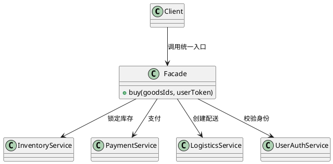

**解读说明**：图中 `Client` 只知道 `Facade.buy()`，不直接依赖库存、支付、物流和鉴权服务。外观类仍然会依赖子系统类，但这种依赖被集中在一个高层入口中，客户端的变化压力明显降低。

### 典型应用

**定义**：外观模式的典型应用，是在不破坏原有子系统接口的情况下，为客户端提供更简单、更稳定或更可监控的新入口。[PPT p.10]

**核心思想**：外观并不要求重写子系统，而是在原有系统前面新增一层接口。也就是说，遗产系统、复杂库或多服务系统仍然可以保持原结构，外部访问则统一经过外观层。本质上，它用“新增稳定入口”代替“让所有调用方理解内部复杂度”。

**背景与目的**：PPT 提到三类应用：通过新增接口为原系统增加功能、包装遗产系统呈现新的外观、让所有访问通过接口以监控系统。[PPT p.10] 这些场景的共同点是原系统已有复杂实现或历史负担，直接改动风险较高。外观层可以把新需求放在边界处处理，降低对原代码的侵入。

**生活类比**：例如，老系统只提供一堆分散接口，新业务需要一个“一键下单”接口。外观层可以组合这些旧接口，不必强行重构整个老系统。类比一下，商场导购台不是每个店铺本身，但它能把用户引导到合适服务。

**PPT 原文关联**：PPT p.10 的三个应用点都强调“新增接口”和“访问统一经过接口”。因此外观模式常和日志、权限、监控、兼容旧系统一起出现。

```python
# PPT 原片段：网购 App 作为系统外观，隐藏 IP、用户 ID、商品 ID、token 等细节。
# 补全部分：最小示例展示客户端只调用高层接口。
class ShopFacade:
    def __init__(self, auth, inventory, payment):
        self.auth = auth
        self.inventory = inventory
        self.payment = payment

    def buy(self, user_token, goods_id):
        user = self.auth.verify(user_token)
        self.inventory.lock(goods_id)
        self.payment.pay(user, goods_id)
        return "order created"
```

**代码说明**：客户端只调用 `buy()`，不需要知道认证、库存和支付的调用顺序。补全部分展示了外观类如何把多个子系统对象组合起来，对外暴露一个更稳定的业务方法。

### 外观模式问答

**问**：外观模式会不会只是多写一层转发？

**答**：如果外观层只机械转发一个方法，价值确实有限。真正有意义的外观会统一调用顺序、参数组织、异常处理、权限检查或监控逻辑。也就是说，它应该封装客户端不该关心的复杂性。

**问**：外观模式会不会让外观类变得很胖？

**答**：有这个风险。外观类如果不断累积无关业务，会变成新的上帝对象。更合理的做法是按子系统边界或业务入口拆分多个外观，而不是把所有操作都塞进一个类。

## 桥接模式

### 桥接模式

**定义**：**桥接模式（Bridge Pattern）** 将抽象部分与实现部分分离，使二者都可以独立变化。[PPT p.12]

**核心思想**：桥接模式识别一个类中两个独立变化的维度，把它们拆成两个继承等级结构，再用**聚合（Aggregation）** 或**组合（Composition）** 把抽象对象连接到实现对象。也就是说，它不让所有变化都通过继承展开，而是在运行时把不同维度的对象动态组合。本质上，桥接模式是用对象组合替代多维继承爆炸。

**背景与目的**：PPT 特别问“是否要为所有的泛化关系无脑使用继承”，并指出多个继承维度会导致类数量爆炸式增加。[PPT p.13] 例如，一个图形既有形状维度，又有颜色维度，如果为每种组合创建子类，就会出现红圆、蓝圆、红矩形、蓝矩形等大量类。桥接模式把形状和颜色拆开，使新增形状或颜色时只扩展对应维度。

**生活类比**：类比一下，遥控器和电视品牌是两个变化维度。万能遥控器不应该为“海信开机按钮”“索尼开机按钮”“三星开机按钮”分别继承一套类，而应让遥控器抽象依赖一个设备实现接口。这样换遥控器样式或换电视品牌时，两个方向都能独立变化。

**PPT 原文关联**：PPT p.14 强调“善用组合/聚合关系，减少继承负担”，并要求识别两个独立变化维度，设计为两个继承等级结构，再建立抽象和实现的聚合关系。

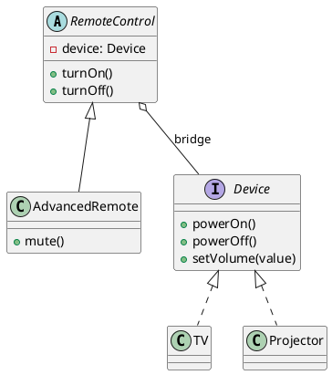

**解读说明**：`RemoteControl` 是抽象维度，`Device` 是实现维度。遥控器通过聚合 `Device` 调用具体设备能力，因此新增 `GameRemote` 或新增 `Speaker` 不需要制造所有组合子类。

### 继承与桥接的对比

**定义**：继承方案把多个变化维度折叠到同一棵继承树中，桥接方案则把变化维度拆开并通过对象关系连接。[PPT p.13-p.14]

**核心思想**：继承适合表达稳定的一般-特殊关系，但不适合承载多个同时变化的维度。也就是说，如果一个类的变化原因来自两个方向，单一继承树会让子类数量按组合数增长。本质上，桥接模式把“类层次扩张”转化为“对象运行时组合”。

**背景与目的**：PPT 的重点不是否定继承，而是提醒不要“无脑使用继承”。继承会让父类变化影响子类，也会让多个维度相互绑死。桥接通过接口和聚合把维度隔离开，降低修改影响面。

**生活类比**：例如，咖啡杯有材质和容量两个维度。若为每种组合建立“玻璃大杯”“陶瓷中杯”“塑料小杯”类，种类会快速膨胀。更好的理解是杯子对象聚合材质策略和容量规格，二者可以分别变化。

| 维度 | 直接继承 | 桥接模式 | 影响 |
| :--- | :--- | :--- | :--- |
| 变化组织 | 多个维度混在一棵继承树 | 抽象维度和实现维度分离 | 桥接更容易定位变化原因 |
| 类数量 | 随组合数增长 | 随各维度数量相加增长 | 桥接能缓解类爆炸 |
| 运行期灵活性 | 对象类型创建后通常固定 | 可替换被聚合的实现对象 | 桥接更适合动态组合 |
| 理解成本 | 小规模时直观 | 初期多一层接口 | 桥接适合变化维度明确的场景 |

### 桥接模式问答

**问**：桥接模式和普通组合有什么区别？

**答**：桥接模式是一种有明确目的的组合：它专门用来分离两个独立变化维度。普通组合只是对象拥有另一个对象，不一定承担“抽象与实现分离”的设计意图。因此判断是否是桥接，要看它是否让两个继承等级结构独立变化。

**问**：什么时候不需要桥接？

**答**：如果只有一个变化维度，或者类数量很少且短期不会扩展，直接继承可能更简单。桥接会引入接口、引用和对象装配成本，过早使用会让简单问题变复杂。

## 单例模式

### 单例模式

**定义**：**单例（Singleton）** 模式确保一个类只有一个实例，并提供该实例的全局访问点。[PPT p.16]

**核心思想**：单例模式控制的是对象实例数量，而不是对象功能本身。也就是说，它把构造过程收束到类内部或专门入口中，避免外部随意创建多个实例。本质上，单例是一种全局唯一资源的访问约束。

**背景与目的**：PPT 提到线程池、数据库连接池、日志对象、全局计数器等对象通常只需要一个，多了反而可能出问题。[PPT p.17] 例如，多个日志对象可能导致配置不一致，多个连接池可能浪费资源或破坏限流策略。但是单例并不等于全局变量，因为现实中还要考虑初始化时机、线程安全、资源开销和测试替换问题。[PPT p.18]

**生活类比**：类比一下，一个系统的总闸或全局广播站通常只应该有一个。所有人都通过同一个入口使用它，而不是各自复制一个“总闸”。值得注意的是，唯一入口方便管理，但也可能形成全局状态依赖。

**PPT 原文关联**：PPT p.18 用三个问题引出单例实现难点：如何保证对象只初始化一次，多个线程同时使用时如何保证线程安全，以及对象耗费资源时是否要延迟初始化。

### 单例实现方式

**定义**：单例实现方式是围绕“是否延迟创建”和“是否线程安全”对实例初始化策略进行取舍。[PPT p.19-p.22]

**核心思想**：懒汉式关注节约资源，饿汉式关注简单安全，加锁懒汉式关注正确性，双重校验锁试图兼顾延迟初始化和性能。也就是说，单例没有唯一正确写法，具体实现要根据资源成本、并发环境和语言内存模型选择。本质上，单例实现难点来自“唯一性”和“初始化时机”的冲突。

**背景与目的**：PPT 先讲懒汉式线程不安全，因为多个线程可能同时发现实例为空并各自创建对象。[PPT p.19] 饿汉式在系统启动时直接初始化，可以杜绝多次实例化，但可能带来启动开销。[PPT p.20] 加锁懒汉式能避免多次实例化，却会让获取单例的线程阻塞，产生性能问题。[PPT p.21] 双重校验锁先判断是否已实例化，再只对创建过程加锁，是较好的折中方案。[PPT p.22]

**生活类比**：例如，图书馆只有一个总服务台。饿汉式像开馆前就把服务台完全准备好，懒汉式像第一个读者来时才搭服务台，加锁懒汉式像每个读者都先排队确认服务台是否存在。双重校验锁则是大多数读者看到服务台已经存在就直接使用，只有第一次搭建时才排队。

| 实现方式 | 初始化时机 | 线程安全 | 优点 | 代价 |
| :--- | :--- | :--- | :--- | :--- |
| 懒汉式线程不安全 | 第一次使用时创建 | 否 | 未使用时不消耗资源 | 多线程下可能创建多个实例 |
| 饿汉式线程安全 | 系统启动或类加载时创建 | 是 | 实现简单，唯一性明确 | 启动开销和资源占用可能较高 |
| 加锁懒汉式 | 第一次使用时创建 | 是 | 兼顾延迟创建与正确性 | 每次获取都可能有锁开销 |
| 双重校验锁 | 第一次使用时创建 | 是 | 已创建后通常无需加锁 | 实现依赖语言内存可见性规则 |

```java
// PPT 原片段：双重校验锁先判断是否已实例化，如果没有才对实例化语句加锁。
// 补全部分：Java 中使用 volatile 保证可见性和禁止指令重排。
public final class AppConfig {
    private static volatile AppConfig instance;

    private AppConfig() {
    }

    public static AppConfig getInstance() {
        if (instance == null) {
            synchronized (AppConfig.class) {
                if (instance == null) {
                    instance = new AppConfig();
                }
            }
        }
        return instance;
    }
}
```

**代码说明**：外层 `if` 避免实例已创建后仍进入锁，内层 `if` 防止多个线程等待锁后重复创建。`volatile` 是 Java 语境下的重要补全部分，用于保证其他线程看到正确初始化后的对象。

### 单例模式问答

**问**：为什么不用全局变量替代单例？

**答**：全局变量只能提供全局可见性，不能自然控制初始化时机、线程安全和创建约束。单例至少把这些问题集中到类内部处理。也就是说，单例比裸全局变量多了一层生命周期与访问控制。

**问**：单例有什么副作用？

**答**：单例容易引入全局状态，使测试替换、并发隔离和模块复用变困难。如果对象只是“当前实现碰巧只有一个”，而不是业务上必须唯一，使用依赖注入管理生命周期通常更灵活。

## 备忘录模式

### 备忘录模式

**定义**：**备忘录模式（Memento Pattern）** 捕获一个对象的内部状态，并在该对象之外保存该状态，以便以后需要时把对象恢复到原先状态；它又叫快照模式。[PPT p.23-p.24]

**核心思想**：备忘录模式把“创建快照”“保存快照”和“恢复快照”分开。也就是说，原发对象负责导出和恢复自己的状态，备忘录对象保存状态，管理者对象负责看管历史快照。本质上，它让撤销、回溯和恢复功能不必暴露原对象的内部表示。

**背景与目的**：PPT 给出的应用包括浏览器访问回溯、数据库备份与还原、文本编辑器撤销与重做、虚拟机快照与恢复。[PPT p.25] 这些场景都需要在未来回到过去某个状态，但又不能让外部对象随意修改被保存对象的内部细节。备忘录模式通过快照对象保存必要状态，兼顾恢复能力和封装性。

**生活类比**：类比一下，游戏存档就是备忘录。游戏角色是被保存的对象，一条存档是备忘录，存档栏位是看管备忘录的管理者。玩家不需要知道角色内部状态如何编码，只需要选择某个存档恢复。

**PPT 原文关联**：PPT p.26 明确对应三类角色：`Subject` 是被保存的对象，`Memory` 是备忘录，`Caretaker` 是接管备忘录的对象。

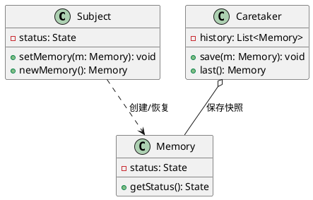

**解读说明**：`Subject` 负责把自己的内部状态变成 `Memory`，也负责从 `Memory` 中恢复状态。`Caretaker` 只保存备忘录，不直接解释或修改状态，这样可以保持被保存对象的封装。

### 计算器回溯示例

**定义**：计算器回溯示例是把每次计算的操作数和结果保存成备忘录，由管理者对象维护历史记录，以便查询或恢复历史计算。[PPT p.27-p.28]

**核心思想**：每次计算之后，计算器把当前状态封装为一个备忘录并交给管理者保存。也就是说，调用方不需要直接复制计算器字段，而是通过计算器公开的快照接口获得历史状态。本质上，备忘录模式把“历史记录”从计算器主体逻辑中分离出来。

**背景与目的**：PPT 的简单计算器示例强调“每次计算有两个操作数，可以把这个记下来”。[PPT p.27] 如果没有备忘录，调用方可能要知道计算器内部字段名，甚至手动拷贝多个值，封装会被破坏。用备忘录后，计算器仍能控制哪些状态可以被保存和恢复。

**生活类比**：例如，计算器的历史列表像账本。每完成一次计算，就把这次计算写入一条记录；之后用户翻看历史时，不需要重新执行所有计算。值得注意的是，快照越完整，恢复越准确，但存储成本也越高。

```python
# PPT 原片段：简单计算器可把每次计算的两个操作数形成 memento 交给 caretaker。
# 补全部分：可运行的最小备忘录示例。
from dataclasses import dataclass

@dataclass(frozen=True)
class CalcMemento:
    left: int
    right: int
    operator: str
    result: int

class Calculator:
    def add(self, left: int, right: int) -> CalcMemento:
        return CalcMemento(left, right, "+", left + right)

class History:
    def __init__(self):
        self.records = []

    def save(self, memento: CalcMemento) -> None:
        self.records.append(memento)

history = History()
history.save(Calculator().add(2, 3))
print(history.records[-1].result)
```

**代码说明**：`CalcMemento` 是不可变快照，保存一次计算的关键状态。`History` 是 caretaker，只负责保存记录，不参与计算逻辑。

### 备忘录模式问答

**问**：备忘录模式和直接复制对象有什么区别？

**答**：直接复制对象容易暴露对象内部结构，也可能复制不该外部知道的状态。备忘录由原对象主动创建，能控制保存范围。也就是说，备忘录更尊重封装边界。

**问**：备忘录模式的主要代价是什么？

**答**：主要代价是内存和存储成本，尤其是状态很大或快照很多时。实际系统常用增量快照、历史数量限制或外部存储来控制成本。

## 策略模式

### 策略模式

**定义**：**策略（Strategy）** 模式定义一系列策略，将它们分别封装，并提供统一对外接口，使这些策略可以相互替换。[PPT p.30]

**核心思想**：策略模式把“使用策略的对象”和“具体策略算法”分离。也就是说，使用者只依赖策略接口，具体算法由不同策略类实现，运行时可以注入或切换。本质上，它把算法变化封装成对象，避免使用者内部堆积大量条件分支。

**背景与目的**：PPT 强调策略的优势是低耦合，策略可以自由切换，系统扩展性和灵活性更高。[PPT p.31] 如果不使用策略模式，代码通常会出现反复修改源代码或大量选择控制逻辑的问题。策略模式把新增算法变成新增类，而不是修改原有使用者。

**生活类比**：例如，发放奖励可以有满减券、积分、会员折扣、现金红包等不同策略。订单系统不应在一个方法里写满所有 `if` 分支，而应把每种发奖逻辑封装为策略。类比一下，收银员只需要知道当前采用哪种优惠规则，不需要把所有促销规则写死在收银机核心流程里。

**PPT 原文关联**：PPT p.32 的发放奖励示例要求声明发放奖励的接口 `Strategy`，再实现不同的发奖策略；它还提到后端请求过滤策略和过滤器配置策略对象。

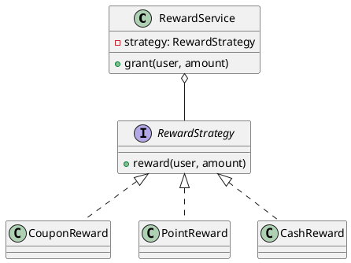

**解读说明**：`RewardService` 只依赖 `RewardStrategy` 接口，不知道具体奖励算法。新增 `GiftReward` 时只需新增策略实现，原服务类不必反复修改。

```python
# PPT 原片段：声明发放奖励的接口并实现不同发奖策略。
# 补全部分：最小可运行策略示例。
class RewardStrategy:
    def reward(self, amount: int) -> str:
        raise NotImplementedError

class PointReward(RewardStrategy):
    def reward(self, amount: int) -> str:
        return f"{amount // 10} points"

class CouponReward(RewardStrategy):
    def reward(self, amount: int) -> str:
        return "coupon: 20 off"

class RewardService:
    def __init__(self, strategy: RewardStrategy):
        self.strategy = strategy

    def grant(self, amount: int) -> str:
        return self.strategy.reward(amount)

print(RewardService(PointReward()).grant(120))
```

**代码说明**：`RewardService` 不需要判断奖励类型，它只调用策略接口。补全部分展示了策略对象如何在构造时注入，也可以在运行时替换。

### 策略模式问答

**问**：策略模式和桥接模式都用组合，它们有什么不同？

**答**：策略模式主要封装可替换算法，关注“同一任务的不同做法”。桥接模式主要分离两个独立变化维度，关注“抽象和实现都能独立扩展”。两者都可能使用组合，但解决的问题不同。

**问**：策略模式什么时候不划算？

**答**：如果算法只有两三个分支且几乎不变化，拆成多个类可能增加理解成本。策略适合算法频繁变化、需要运行时切换或需要独立测试的场景。

## 工厂方法模式

### 简单工厂

**定义**：**简单工厂（Simple Factory）** 单独提供一个类，把实例化对象的操作封装到该类的方法中，调用方通过工厂获得产品对象。[PPT p.35]

**核心思想**：简单工厂把 `new` 从使用者代码中移出，集中到工厂类中。也就是说，调用方不再直接依赖具体构造函数，而是依赖一个统一创建入口。本质上，它降低了构造细节变化对调用方的影响。

**背景与目的**：PPT 用“你怎么创建一个对象”引出直接 `new` 的问题：如果构造函数参数改变，调用方就要到处改创建代码。[PPT p.34] 简单工厂提供统一接口后，对象构造函数变化可以在工厂内部处理。它适合产品种类不多、创建逻辑相对集中且变化可控的场景。

**生活类比**：例如，顾客不直接进厨房做汉堡，而是在柜台点单。柜台负责把订单转给后厨并返回汉堡。类比一下，简单工厂就是“统一下单窗口”，让使用者不用知道每个产品如何构造。

**PPT 原文关联**：PPT p.36 明确说“简单工厂提供了创建对象的统一接口”，并强调以后对象构造函数改了也不怕。

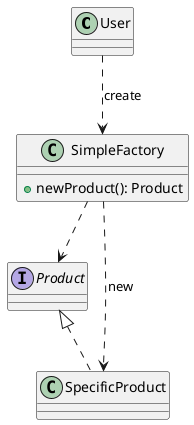

**解读说明**：`User` 通过 `SimpleFactory` 创建 `Product`，不直接调用 `SpecificProduct` 的构造函数。这样构造参数变化时，主要修改工厂内部。

### 工厂方法

**定义**：**工厂方法（Factory Method）** 模式把实例化对象的操作抽取出来，交由具体工厂类负责；父类规定统一的抽象创建方法，子类决定创建哪一种具体产品。[PPT p.38-p.39]

**核心思想**：工厂方法把“使用产品的通用流程”和“创建具体产品的选择”分离。也就是说，抽象工厂类可以在 `execute()` 中使用产品，但真正返回哪种产品由具体工厂子类实现。本质上，它把对象创建延迟到子类，避免在一个简单工厂里写大量分支。

**背景与目的**：PPT 指出简单工厂在产品种类很多时会出现问题：要么用大量选择分支决定使用哪个工厂，要么每次修改原代码来生产不同汉堡。[PPT p.37] 工厂方法通过新增具体工厂子类扩展产品种类，减少对原有代码的修改。它体现了“通过扩展增加行为，而不修改既有代码”的思想。

**生活类比**：例如，不同汉堡店分店都遵守“制作汉堡并售卖”的流程，但每个分店生产的具体汉堡不同。总部规定流程，分店决定具体产品。类比一下，抽象工厂类负责通用流程，具体工厂负责生产细节。

**PPT 原文关联**：PPT p.39 强调 `Factory` 中规定统一抽象方法 `constructMethod` 来创建对象，这个方法由不同子类实现；增加新的产品种类时，只增加具体工厂子类，不必修改原代码。

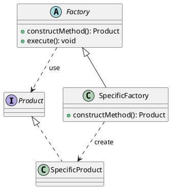

**解读说明**：`Factory.execute()` 可以写通用业务流程，但它通过 `constructMethod()` 获得产品。`SpecificFactory` 重写创建方法，因此新增产品时扩展工厂子类即可。

```java
// PPT 原片段：Factory 中有 constructMethod()，execute() 使用创建出的 Product。
// 补全部分：最小工厂方法示例。
interface HttpClient {
    String get(String url);
}

class OkHttpClient implements HttpClient {
    public String get(String url) {
        return "okhttp:" + url;
    }
}

abstract class CrawlerFactory {
    protected abstract HttpClient createClient();

    public String crawl(String url) {
        return createClient().get(url);
    }
}

class OkHttpCrawlerFactory extends CrawlerFactory {
    protected HttpClient createClient() {
        return new OkHttpClient();
    }
}
```

**代码说明**：PPT p.40 提到“使用不同 httpClient 的网络爬虫”。这里 `CrawlerFactory` 规定爬取流程，具体子类决定使用哪种 HTTP 客户端。

### 工厂方法问答

**问**：简单工厂和工厂方法最大的区别是什么？

**答**：简单工厂通常由一个工厂类集中判断和创建对象，产品增加时容易修改工厂内部。工厂方法把创建操作延迟到具体工厂子类，新增产品时更偏向新增类。也就是说，工厂方法更符合开放扩展、关闭修改的方向。

**问**：工厂方法的代价是什么？

**答**：主要代价是类数量增加。每一种产品往往对应一个具体工厂，如果产品变化很少，简单工厂可能已经足够。

## 抽象工厂模式

### 抽象工厂模式

**定义**：**抽象工厂（Abstract Factory）** 模式提供创建一组紧密相关对象的接口，用于创建一个对象家族。[PPT p.42]

**核心思想**：抽象工厂关注的不是单个产品，而是一组必须配套创建的产品。也就是说，一个具体工厂会同时创建同一产品族中的多个产品，例如枪和配套子弹、同一主题下的按钮和文本框。本质上，抽象工厂把“产品族的一致性”封装到工厂对象中。

**背景与目的**：PPT 用士兵、枪和子弹说明“你是否永远只需要一种对象”。[PPT p.43] 如果系统需要同时创建一组相关对象，单独使用工厂方法容易让产品搭配错误。抽象工厂让用户只选择一个具体工厂，就能获得同一族的所有对象。

**生活类比**：类比一下，买相机时可能需要机身、镜头、充电器和电池都属于兼容套装。用户不应该手动混搭不兼容配件。抽象工厂就像套装供应商，保证一组对象来自同一风格或兼容体系。

**PPT 原文关联**：PPT p.44 明确区分抽象工厂和工厂方法：抽象工厂创建对象家族，家族中的对象相关且必须一起创建；工厂方法只能用于创建一种对象。PPT 还指出抽象工厂可被看作工厂方法模式的组合。

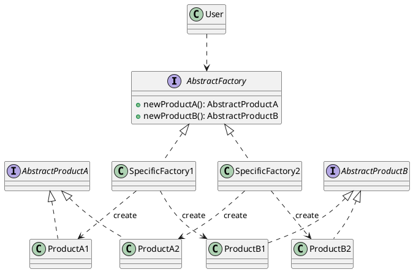

**解读说明**：`SpecificFactory1` 创建 `ProductA1` 和 `ProductB1`，`SpecificFactory2` 创建 `ProductA2` 和 `ProductB2`。用户依赖 `AbstractFactory`，因此切换产品族时替换工厂即可。

### 工厂模式对比

**定义**：工厂模式对比用于区分直接创建、简单工厂、工厂方法和抽象工厂在创建职责、扩展方式和适用对象数量上的差异。[PPT p.34-p.44]

**核心思想**：创建模式的共同目标是隐藏实例化细节，但隐藏层次不同。也就是说，简单工厂隐藏构造细节，工厂方法隐藏具体产品选择，抽象工厂隐藏产品族选择。本质上，创建模式越复杂，越适合变化更多、约束更强的对象创建场景。

**背景与目的**：PPT 从“直接 new”讲到简单工厂，再指出简单工厂面对多种相似对象时的问题，最后引出工厂方法和抽象工厂。[PPT p.34-p.44] 这条逻辑说明模式是逐步应对变化压力的结果，不应一开始就套最复杂结构。选择哪种工厂，取决于产品种类、产品族关系和扩展频率。

**生活类比**：直接 `new` 像自己做饭，简单工厂像一个柜台统一做饭，工厂方法像不同分店各自做特色餐，抽象工厂像按套餐提供一组配套餐品。每一层都增加组织能力，也增加管理成本。

| 方式 | 创建对象数量 | 扩展方式 | 适合场景 | 主要代价 |
| :--- | :--- | :--- | :--- | :--- |
| 直接创建 | 单个具体类 | 修改调用方 | 构造稳定且调用点少 | 调用方耦合构造细节 |
| 简单工厂 | 多个具体产品 | 修改工厂分支 | 产品少、创建逻辑集中 | 工厂容易膨胀 |
| 工厂方法 | 一类产品 | 增加具体工厂 | 产品类型常扩展 | 类数量增加 |
| 抽象工厂 | 一组产品族 | 增加具体产品族工厂 | 产品必须配套创建 | 增加新产品等级较困难 |

### 抽象工厂问答

**问**：抽象工厂为什么能保证产品族一致？

**答**：因为同一个具体工厂负责创建一整组相关产品。用户不直接挑选每个具体产品，而是选择一个工厂，由它返回兼容的一组对象。也就是说，一致性从调用方选择转移到了工厂实现中。

**问**：抽象工厂适合频繁增加产品等级吗？

**答**：不太适合。比如原来只创建 `ProductA` 和 `ProductB`，后来所有工厂都要新增 `ProductC`，抽象工厂接口和所有具体工厂都要修改。它更适合产品族变化多、产品等级相对稳定的场景。

## 代理模式

### 代理模式

**定义**：**代理模式（Proxy Pattern）** 为某对象提供一个代理，以控制对该对象的访问，并常用于扩展原对象的行为。[PPT p.46]

**核心思想**：代理对象和真实对象实现同一个接口，客户端以为自己在调用目标对象，实际上先调用代理对象。也就是说，代理可以在转发调用前后增加权限检查、缓存、日志、延迟加载、远程访问等逻辑。本质上，代理用一个可替代对象控制对真实对象的访问。

**背景与目的**：PPT 用代理服务器和“对象 A 通过代理对象请求对象 B”的类比说明代理概念。[PPT p.47-p.49] 如果直接修改对象 B 的代码，有时会破坏原类职责，有时根本改不了第三方库对象。代理模式通过增加对象而不是修改原对象来扩展行为，因此更符合可扩展性要求。

**生活类比**：类比一下，代理服务器代表用户访问目标网站，可以加入缓存、转发、过滤或认证逻辑。面向对象中的代理也是如此：对象 A 只看到统一接口，代理对象在背后决定何时、如何调用真实对象。例如，图片延迟加载中，代理先占位，真正显示时才加载大图片。[PPT p.51]

**PPT 原文关联**：PPT p.50 总结了代理要点：代理对象和其代理的实际对象需要实现统一接口；代理对象使用实际对象的操作，并可以在实际对象操作之上添加其他逻辑，就像中介一样。

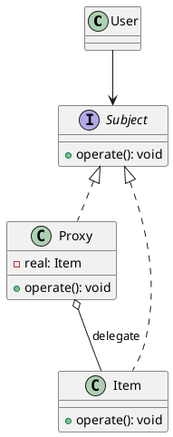

**解读说明**：`User` 只依赖 `Subject` 接口，因此代理对象和真实对象都能替换到同一位置。`Proxy` 内部持有 `Item`，可以在调用 `Item.operate()` 前后增加额外逻辑。

```python
# PPT 原片段：图片延迟加载。
# 补全部分：代理对象在真正需要显示时才加载图片。
class Image:
    def display(self) -> None:
        raise NotImplementedError

class RealImage(Image):
    def __init__(self, path: str):
        self.path = path
        print(f"load {path}")

    def display(self) -> None:
        print(f"display {self.path}")

class LazyImageProxy(Image):
    def __init__(self, path: str):
        self.path = path
        self.real = None

    def display(self) -> None:
        if self.real is None:
            self.real = RealImage(self.path)
        self.real.display()
```

**代码说明**：`LazyImageProxy` 和 `RealImage` 都实现图片接口。只有调用 `display()` 时才创建真实图片对象，这正对应 PPT 的图片延迟加载应用。

### 代理模式问答

**问**：代理模式和外观模式有什么不同？

**答**：代理模式通常和真实对象实现同一接口，用来控制对某个对象的访问。外观模式通常提供一个新的高层接口，用来简化对子系统的访问。也就是说，代理强调替身，外观强调入口。

**问**：为什么不直接修改真实对象？

**答**：直接修改会让真实对象承担额外职责，也可能修改不了第三方库或远程对象。代理通过新增类扩展行为，能降低对原对象的侵入。

## 迭代器模式

### 迭代器模式

**定义**：**迭代器模式（Iterator Pattern）** 提供一种顺序访问聚合对象元素的方法，并且不暴露聚合对象的内部表示。[PPT p.53]

**核心思想**：迭代器把“如何遍历”从聚合对象的内部结构中分离出来。也就是说，客户端可以通过统一的迭代接口访问元素，而不需要知道底层是数组、链表、树还是其他结构。本质上，它是**封装（Encapsulation）** 思想在集合遍历上的体现。

**背景与目的**：PPT 提到很多面向对象语言内部集合类已经支持迭代器，例如 C++ 和 Java。[PPT p.54] 如果客户端总是用下标 `for` 循环，它就默认集合有连续索引和长度属性，这会暴露内部表示。迭代器允许一个聚合对象提供不同遍历方式，并且新增遍历方式时不修改原集合代码。

**生活类比**：类比一下，图书馆可以按书架顺序找书，也可以按借阅热度列表找书，还可以按主题索引找书。读者不需要知道书库内部怎么存放，只需要按某种“导览方式”逐个访问。迭代器就是这个导览方式。

**PPT 原文关联**：PPT p.54 强调迭代器是面向对象封装特性的很好体现，可以以不同方式遍历一个聚合而不暴露内部表示，增加新的迭代方式也方便。

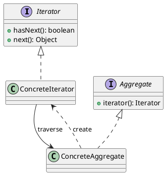

**解读说明**：聚合对象创建迭代器，迭代器负责按某种顺序访问元素。客户端依赖 `Iterator` 接口，不需要依赖聚合对象的内部存储细节。

### 迭代器模式问答

**问**：现代语言已经有 `for-each`，还需要理解迭代器吗？

**答**：需要。`for-each` 往往就是语言或类库对迭代器的语法支持。理解迭代器有助于知道为什么集合能被统一遍历，也能帮助我们为自定义聚合对象设计遍历协议。

**问**：迭代器只支持顺序访问吗？

**答**：经典定义强调顺序访问，但具体实现可以支持不同顺序，例如正序、逆序、过滤后遍历或树的先序遍历。关键不是“只能一种顺序”，而是“遍历方式不暴露内部表示”。

## 访问者模式

### 访问者模式

**定义**：**访问者模式（Visitor Pattern）** 将作用于某种数据结构中各元素的操作分离出来，封装成独立类，使系统能在不改变数据结构的前提下添加作用于这些元素的新操作。[PPT p.56]

**核心思想**：访问者模式把复杂结构本身和施加在结构上的操作分离。也就是说，元素对象提供 `accept(visitor)`，访问者对象提供针对不同元素类型的 `visit` 方法。本质上，它让新增操作变成新增访问者类，而不是反复修改复杂数据结构中的每个节点。

**背景与目的**：PPT 提到访问者通常用于需要为复杂数据结构增加新逻辑的场景，例如树、图、语言的抽象语法树和 HTML DOM 树。[PPT p.57] 这些结构的节点类型稳定，但对节点的操作可能经常变化，例如解释、编译、格式化、统计或检查。访问者模式适合“元素类型相对稳定、操作种类经常增加”的场景。

**生活类比**：类比一下，一棵语法树像一份结构固定的试卷，每个题型是不同节点。阅卷老师、统计老师和讲评老师都是访问者，他们按不同目的访问同一份结构。结构不用为了每个新老师都改一遍。

**PPT 原文关联**：PPT p.58 用编译器举例：程序代码被解析为抽象语法树，每个语法树节点实现 `accept` 方法，内部调用 visitor 的 `visit` 方法；Visitor 内部有访问每个节点的 `visit` 方法并实现语言翻译。

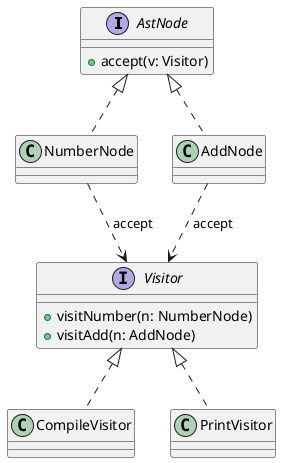

**解读说明**：`NumberNode` 和 `AddNode` 是数据结构中的元素，`CompileVisitor` 和 `PrintVisitor` 是不同操作。新增打印、检查或编译逻辑时，可以新增访问者，而不用把所有逻辑塞进节点类。

### 编译器示例

**定义**：编译器示例把复杂数据结构对应为抽象语法树，把数据结构中的元素对应为语法树节点，把访问者对应为在 `visit` 方法中实现具体编译逻辑的对象。[PPT p.59]

**核心思想**：编译器访问语法树时，当前节点往往需要根据子节点翻译结果生成当前语句或表达式的翻译结果。也就是说，访问者沿树遍历，把不同节点类型的处理逻辑集中到同一个访问者类中。本质上，访问者让“编译”这一操作从 AST 节点类中独立出来。

**背景与目的**：如果把编译、解释、格式化、静态检查都写在每个节点类里，节点类会迅速膨胀。访问者模式允许同一棵 AST 被多个访问者处理，每个访问者承担一种操作。PPT 还提到自定义处理 HTML 等场景，因为 DOM 树同样是可遍历复杂结构。[PPT p.59]

**生活类比**：例如，一栋楼的结构图可以被消防检查员、装修设计师和物业维修员分别访问。结构图不需要因为检查员变化而改变，变化的是访问它的人和检查规则。访问者模式就是把这些检查规则对象化。

### 访问者模式问答

**问**：访问者模式为什么初学者不常接触？

**答**：因为它通常出现在结构复杂且操作扩展频繁的系统中，例如编译器、规则引擎、DOM 处理和模型转换。普通业务 CRUD 很少需要这种结构。值得注意的是，不常用不代表没用，而是适用场景更窄。

**问**：访问者模式的缺点是什么？

**答**：它不适合元素类型频繁增加的结构。新增节点类型时，所有访问者接口和具体访问者都可能要补充对应 `visit` 方法。也就是说，访问者优化的是新增操作，不是新增元素类型。

## 观察者模式

### 观察者模式

**定义**：**观察者（Observer）** 模式定义对象之间的一对多依赖，当一个对象状态发生改变时，它的所有依赖者都会得到通知并自动更新；它也称发布-订阅模式或模型-视图模式。[PPT p.61]

**核心思想**：被观察对象维护观察者列表，并在状态变化时逐个通知观察者。也就是说，主题对象不需要知道每个观察者具体如何更新，只需要调用统一的 `update()` 接口。本质上，观察者模式把状态变化和响应动作解耦。

**背景与目的**：PPT 用 UI 自动刷新说明观察者并不是“没用的模式”。[PPT p.62-p.63] 在前端或客户端 UI 中，数据变化后界面需要自动更新；如果每次都手动刷新，容易遗漏并造成状态不一致。观察者模式让不同分析对象或界面组件订阅同一个数据源，当天气数据变化时，各个展示或分析对象自动更新。[PPT p.64]

**生活类比**：类比一下，天气台发布新天气数据，手机 App、电视台、农业系统和交通系统都可能收到通知。天气台不需要知道每个系统内部如何展示或分析，只需要发布变化事件。例如，天气数据分析系统里虽然分析对象不同，但它们分析的是同一个天气数据源。

**PPT 原文关联**：PPT p.61 的图中 `Subject` 提供 `registerObserver()`、`removeObserver()`、`notifyObserver()`，`Observer` 提供 `update()`，并且 `ConcreteObserver` 通过 `subject.getState()` 获取主题状态。

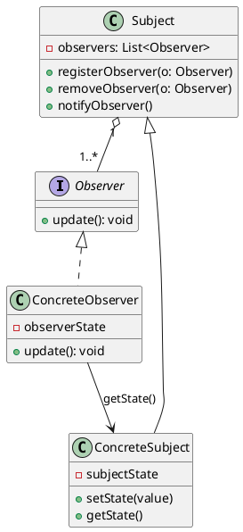

**解读说明**：`ConcreteSubject` 保存主题状态，状态变化后调用 `notifyObserver()`。每个 `ConcreteObserver` 实现 `update()`，可以在更新时读取主题状态并刷新自己的显示或分析结果。

```python
# PPT 原片段：Subject 状态改变时通知若干 Observer。
# 补全部分：天气数据变化后通知多个观察者。
class WeatherData:
    def __init__(self):
        self.observers = []
        self.temperature = None

    def register(self, observer):
        self.observers.append(observer)

    def set_temperature(self, value):
        self.temperature = value
        for observer in self.observers:
            observer.update(self)

class Display:
    def update(self, subject):
        print(f"display: {subject.temperature}")

weather = WeatherData()
weather.register(Display())
weather.set_temperature(26)
```

**代码说明**：`WeatherData` 是主题，`Display` 是观察者。主题状态改变后主动通知观察者，观察者再从主题读取最新状态。

### 观察者模式问答

**问**：观察者模式和发布-订阅完全一样吗？

**答**：PPT 把观察者称作发布-订阅模式，但工程上二者有时会区分。观察者通常是主题直接维护观察者列表，发布-订阅常通过事件总线或消息中间件间接转发。这里按课程语境理解为同一类思想即可。

**问**：观察者模式的主要风险是什么？

**答**：观察者过多或通知链过长时，状态变化可能引发难以追踪的连锁更新。工程中需要注意取消订阅、异常隔离和更新顺序，否则容易出现内存泄漏或状态不一致。

## 命令模式

### 命令模式

**定义**：**命令模式（Command Pattern）** 将一个请求封装为一个对象，使发出请求的责任和执行请求的责任分割开。[PPT p.66]

**核心思想**：命令对象把“要做什么”封装成一个可传递、可保存、可排队、可撤销的对象。也就是说，调用者只持有命令接口并触发 `exec()` 或 `undo()`，真正执行逻辑由命令对象调用接收者完成。本质上，命令模式把请求从直接方法调用提升为一等对象。

**背景与目的**：PPT 用遥控器说明命令模式：遥控器的每个按钮代表对设备的一个命令，对应实现了 `Command` 接口的具体对象。[PPT p.67] 如果调用者直接执行系统底层逻辑，它必须了解接收者细节，耦合很高。命令模式让命令使用者不再需要了解系统底层逻辑，只需要使用包装好的命令；文字编辑器等系统还可以利用命令实现参数化、队列、日志和撤销。[PPT p.69]

**生活类比**：类比一下，遥控器按钮不是空调本身，但按下按钮会让空调执行开机或关机操作。按钮命令可以被替换、记录或撤销。值得注意的是，命令对象不是多余中间层，而是把一次交互变成了可管理对象。

**PPT 原文关联**：PPT p.66 的结构中包含 `User`、`Caller`、`Command`、`Receiver` 和 `SpecificCommand`，其中 `Command` 定义 `exec()` 与 `undo()`。

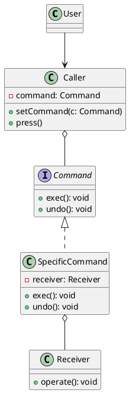

**解读说明**：`Caller` 不直接调用 `Receiver`，而是调用 `Command.exec()`。`SpecificCommand` 内部知道具体接收者和执行方法，因此请求发起者和请求执行者被解耦。

```python
# PPT 原片段：遥控器按钮对应实现 Command 接口的具体对象。
# 补全部分：最小命令与撤销示例。
class Light:
    def on(self):
        print("light on")

    def off(self):
        print("light off")

class LightOnCommand:
    def __init__(self, light):
        self.light = light

    def exec(self):
        self.light.on()

    def undo(self):
        self.light.off()

class RemoteButton:
    def set_command(self, command):
        self.command = command

    def press(self):
        self.command.exec()

button = RemoteButton()
button.set_command(LightOnCommand(Light()))
button.press()
```

**代码说明**：`RemoteButton` 是调用者，`Light` 是接收者，`LightOnCommand` 是具体命令。调用者不需要知道灯的具体开关方法，只执行命令接口。

### 命令模式问答

**问**：命令模式和策略模式有什么区别？

**答**：策略模式封装的是算法选择，调用者通常关心得到某种计算结果。命令模式封装的是请求本身，强调执行、撤销、排队、记录和参数化。也就是说，策略像“选择一种做法”，命令像“保存一条指令”。

**问**：命令模式为什么适合撤销？

**答**：因为每个操作都被封装为对象，命令对象可以保存执行所需参数和撤销所需状态。系统可以把命令放入历史栈，撤销时调用 `undo()`。这比散落的方法调用更容易统一管理。

## 模板方法模式

### 模板方法模式

**定义**：**模板方法模式（Template Method Pattern）** 在一个操作中定义算法骨架，把某些步骤延迟到子类中，使子类可以在不改变算法结构的情况下重定义特定步骤。[PPT p.71]

**核心思想**：模板方法把稳定流程放在父类，把变化步骤交给子类实现。也就是说，父类控制执行顺序，子类只填充其中某些步骤。本质上，它复用的是流程骨架，而不是每个步骤的具体实现。

**背景与目的**：PPT 用泡咖啡和泡茶说明二者其实都是一个套路：烧水、冲泡、倒入杯子、加入调料等步骤有共同结构。[PPT p.72-p.74] 如果分别写两个完整函数，公共部分会重复，后续流程调整也容易不一致。模板方法把公共套路提取到抽象类中，方便扩展和复用。

**生活类比**：类比一下，写实验报告有固定结构：目的、原理、步骤、结果、分析。不同实验的具体内容不同，但报告骨架相同。模板方法就像规定报告模板，子类填写具体实验步骤。

**PPT 原文关联**：PPT p.73 明确写到“可以用一个抽象类总结这个套路，把每一步的具体实现放到子类里”，并强调提取公共部分代码，方便系统扩展与复用。

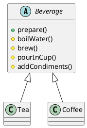

**解读说明**：`Beverage.prepare()` 是模板方法，它定义泡饮品的算法骨架。`Tea` 和 `Coffee` 分别实现 `brew()` 和 `addCondiments()` 等变化步骤。

```python
# PPT 原片段：冲咖啡与冲茶有公共套路。
# 补全部分：最小模板方法示例。
class Beverage:
    def prepare(self):
        self.boil_water()
        self.brew()
        self.pour_in_cup()
        self.add_condiments()

    def boil_water(self):
        print("boil water")

    def pour_in_cup(self):
        print("pour in cup")

    def brew(self):
        raise NotImplementedError

    def add_condiments(self):
        raise NotImplementedError

class Tea(Beverage):
    def brew(self):
        print("steep tea")

    def add_condiments(self):
        print("add lemon")
```

**代码说明**：`prepare()` 固定了算法结构，子类只能改变被延迟的步骤。这样公共流程复用在父类中，具体饮品差异由子类表达。

### 模板方法模式问答

**问**：模板方法和策略模式都能替换行为，它们有什么不同？

**答**：模板方法通过继承替换算法中的部分步骤，父类控制整体流程。策略模式通过组合替换完整算法或行为对象，使用者可以在运行时切换策略。也就是说，模板方法更强调流程骨架复用，策略更强调算法对象替换。

**问**：模板方法的主要风险是什么？

**答**：它依赖继承，父类流程变化会影响所有子类。如果变化维度较多或需要运行时切换，策略或桥接可能比模板方法更灵活。

## 空对象模式

### 空对象

**定义**：**空对象模式（Null Object Pattern）** 使用什么都不做的空对象来代替 `NULL` 或 `null`。[PPT p.76]

**核心思想**：空对象实现和真实对象相同的接口，但方法默认不产生实际效果。也就是说，调用方可以正常调用对象方法，而不必在每个地方先判断是否为 `null`。本质上，空对象把“没有对象”的特殊分支封装成一个对象。

**背景与目的**：PPT 强调方法返回 `NULL` 意味着调用端需要检查返回值，这会导致大量冗余检查代码。[PPT p.77] 如果某个调用端忘记检查并直接使用对象，就可能抛出空指针异常。空对象通过提供安全默认行为，减少调用端重复判断。

**生活类比**：类比一下，活动报名系统里没有填写推荐人时，可以给一个“无推荐人”对象，它的计算奖励方法返回 0。这样结算系统不需要到处判断推荐人是否存在。例如，日志系统也常用空日志器，在不需要输出日志时什么都不做。

**PPT 原文关联**：PPT p.77 的重点是“使用空对象替代 NULL 是十分有必要的事情”，原因是避免冗余检查和空指针异常。

```python
# PPT 原片段：使用什么都不干的空对象代替 NULL。
# 补全部分：最小空对象示例。
class Logger:
    def info(self, message: str) -> None:
        raise NotImplementedError

class ConsoleLogger(Logger):
    def info(self, message: str) -> None:
        print(message)

class NullLogger(Logger):
    def info(self, message: str) -> None:
        pass

def run_task(logger: Logger = NullLogger()) -> None:
    logger.info("task started")
```

**代码说明**：`run_task()` 不需要判断 `logger is None`，因为默认日志器实现了同一接口但不做任何事。空对象把缺省行为封装到对象内部。

### 空对象问答

**问**：空对象会不会掩盖错误？

**答**：会有这种风险。如果某个对象缺失本来代表严重错误，使用空对象可能让问题静默发生。空对象适合“没有对象也是合法状态”的场景，不适合必须强制存在的依赖。

**问**：空对象和可选类型有什么关系？

**答**：可选类型让调用方显式处理“可能为空”，空对象让调用方以统一接口继续调用。二者都能减少空指针问题，但设计取向不同：可选类型强调显式判断，空对象强调默认行为。

## Mixin 模式

### Mixin 模式

**定义**：**混入模式（Mixin Pattern）** 利用动态语言的灵活特性，通过一系列 mixin 函数或对象组合方式，为对象赋予灵活能力。[PPT p.79]

**核心思想**：Mixin 不强调严格继承层次，而是把可复用能力混入目标对象或组件。也就是说，一个对象可以按需要组合点击、拖拽、校验、主题等能力，而不必把这些能力都写入固定父类。本质上，mixin 是一种偏动态的能力组合机制。

**背景与目的**：PPT 指出 mixin 常用于加强一个对象，为对象加入某种能力；它在动态性比较强的语言中很常见，UI 开发常见、后端不常见。[PPT p.80] 这是因为 UI 组件经常需要临时组合交互行为，而继承对类结构有较强形态限制。[PPT p.81] 但是灵活的负面是难维护，因为引入别人写的 mixin 后，可能很难弄清楚到底组合了什么能力。

**生活类比**：类比一下，一个 UI 组件像基础积木，mixin 像贴上去的功能贴纸：可点击、可拖拽、可校验、可折叠。它比继承更灵活，但贴纸太多时，别人可能看不出组件到底拥有哪些行为。值得注意的是，mixin 的使用要有命名和边界约束。

**PPT 原文关联**：PPT p.81 强调在 UI 业务开发中，组合在实践中优于继承；但灵活的负面是难维护，尤其是难以弄清楚引入的 mixin 组合了什么能力。

```javascript
// PPT 原片段：利用 mixin 函数为 UI 组件组合新能力。
// 补全部分：最小 JavaScript mixin 示例。
const clickable = (target) => ({
  ...target,
  onClick(handler) {
    this.clickHandler = handler;
  },
  click() {
    if (this.clickHandler) this.clickHandler();
  }
});

const button = clickable({ text: "Save" });
button.onClick(() => console.log("saved"));
button.click();
```

**代码说明**：`clickable()` 把点击能力混入普通对象，目标对象不需要继承某个固定父类。补全部分展示了动态组合能力的基本形态。

### Mixin 模式问答

**问**：Mixin 和继承相比有什么优势？

**答**：Mixin 更适合横向能力复用，例如多个无关组件都需要点击、拖拽或校验能力。继承更适合稳定的一般-特殊关系。也就是说，mixin 解决的是跨层级能力组合问题。

**问**：Mixin 为什么对类型推导不友好？

**答**：因为对象的最终能力可能来自多个运行时组合来源，静态类型系统或阅读代码的人不一定能立即看出对象完整结构。PPT 也提醒“啥样的都有可能混出来”，这就是灵活性带来的维护代价。[PPT p.80]

## 适配器模式

### 适配器模式

**定义**：**适配器模式（Adapter Pattern）** 定义一个转换器，用它将一个类的接口转换成用户需要的另一个接口。[PPT p.83]

**核心思想**：适配器位于调用方需要的目标接口和已有对象接口之间，负责把调用请求转换成已有对象能理解的形式。也就是说，调用方不需要修改自己的接口预期，已有对象也不需要修改原实现。本质上，适配器解决的是接口不兼容问题。

**背景与目的**：PPT 用转接头类比适配器，说明这个概念非常贴近日常经验。[PPT p.84] 当系统需要替换内部实现或接入第三方库，但又不希望修改对外接口时，适配器可以作为桥梁。[PPT p.85-p.86] 它常用于旧接口兼容、新旧系统迁移和第三方 API 包装。

**生活类比**：类比一下，电脑需要 USB-C，投影仪只有 HDMI，转接头负责把一种接口转换成另一种接口。用户仍然插 USB-C，投影仪仍然接 HDMI，中间转换由适配器完成。例如，不修改对外支付接口而把内部实现从旧支付 SDK 换成新支付 SDK，就是典型适配场景。

**PPT 原文关联**：PPT p.85 说明实现方式是“实现适配器类作为原对象与适配目标对象的桥梁”。

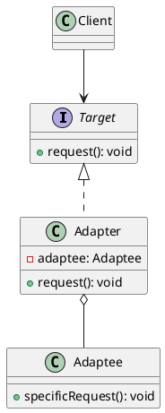

**解读说明**：`Client` 只依赖目标接口 `Target`。`Adapter.request()` 内部调用 `Adaptee.specificRequest()`，从而在不改客户端和被适配者的情况下完成接口转换。

```python
# PPT 原片段：不修改对外接口而修改实现。
# 补全部分：支付接口适配第三方 SDK。
class Payment:
    def pay(self, amount: int) -> None:
        raise NotImplementedError

class ThirdPartyPaySdk:
    def send_money(self, cents: int) -> None:
        print(f"send {cents} cents")

class PaymentAdapter(Payment):
    def __init__(self, sdk: ThirdPartyPaySdk):
        self.sdk = sdk

    def pay(self, amount: int) -> None:
        self.sdk.send_money(amount * 100)
```

**代码说明**：业务代码仍调用 `Payment.pay(amount)`，适配器负责把金额单位和方法名转换为第三方 SDK 所需形式。这样外部接口保持稳定，内部实现可以替换。

### 适配器模式问答

**问**：适配器和外观模式有什么区别？

**答**：适配器解决接口不匹配，让已有对象符合目标接口。外观模式简化复杂子系统，提供更高层入口。也就是说，适配器强调“转换接口”，外观强调“隐藏复杂性”。

**问**：适配器是不是只适合旧系统？

**答**：不是。新系统接入第三方库、替换内部实现、统一多平台 API 时也经常使用适配器。只要存在调用方期望接口和已有实现接口不一致，就可能需要适配器。

## 依赖注入

### 依赖注入

**定义**：**依赖注入（Dependency Injection）** 是对象声明自己的依赖，而依赖对象由外部以构造参数、属性或方法参数等形式注入给它的设计方式。[PPT p.90]

**核心思想**：依赖注入把“使用依赖”和“创建依赖”分离。也就是说，一个类不在内部直接 `new` 它依赖的具体类，而是通过外部传入依赖对象。本质上，依赖注入降低了依赖者与被依赖者之间的耦合。

**背景与目的**：PPT 用汽车依赖轮胎说明直接在 `Car` 构造函数中 `new Tire()` 会导致耦合过高。[PPT p.88-p.89] 如果汽车内部固定创建轮胎，那么测试汽车时必须使用真实轮胎，替换轮胎实现也要改汽车类。依赖注入后，轮子和车可以分开测试、分开实现，也可以在运行时替换具体轮胎。[PPT p.90]

**生活类比**：类比一下，汽车厂不应该把轮胎生产线硬编码进每辆车的构造过程，而应按接口装配符合规格的轮胎。车只声明自己需要轮胎，具体用雪地胎、普通胎还是测试假胎，由外部装配决定。值得注意的是，这和“面向接口编程”紧密相关。

**PPT 原文关联**：PPT p.90 明确写到对象声明自己的依赖，而该依赖由外部注入的形式提供；用途是对依赖者和被依赖对象进行解耦。

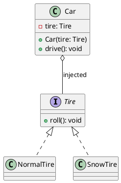

**解读说明**：`Car` 依赖 `Tire` 接口，而不是直接创建 `NormalTire`。外部可以注入普通轮胎、雪地轮胎或测试替身，汽车类本身不需要修改。

```java
// PPT 原片段：Car 构造函数中直接 new Tire() 耦合过高。
// 补全部分：通过构造函数注入依赖。
interface Tire {
    void roll();
}

class Car {
    private final Tire tire;

    Car(Tire tire) {
        this.tire = tire;
    }

    void drive() {
        tire.roll();
    }
}
```

**代码说明**：`Car` 只声明自己需要 `Tire`，具体轮胎由外部创建并传入。这样测试时可以注入假轮胎，生产环境可以注入真实轮胎。

### 依赖注入问答

**问**：依赖注入和工厂模式有什么关系？

**答**：工厂模式关注对象如何创建，依赖注入关注对象创建后如何把依赖交给使用者。实际框架中二者经常配合：容器或工厂负责创建对象，再把依赖注入到需要它的类中。

**问**：依赖注入会不会让代码更复杂？

**答**：在小脚本中可能显得多余，但在可测试、可替换、可扩展的系统中，它能显著降低耦合。关键是不要为不会变化的简单对象过度抽象。

## 设计原则总结

### 面向接口编程

**定义**：面向接口编程是指客户端依赖抽象接口，而不是直接依赖具体实现细节。[PPT p.91]

**核心思想**：把实现隐藏在接口之后，双方只要遵循共同接口，就可以独立变化而不影响对方。也就是说，调用方关心“对象能做什么”，而不是“对象具体是哪一个类”。本质上，这是多数设计模式降低耦合的共同基础。

**背景与目的**：PPT 在总结原则时首先强调“面向接口编程，而不是面向具体细节”。[PPT p.91] 外观、代理、策略、工厂、观察者、命令和依赖注入都依赖这个思想：使用者通过抽象边界访问能力，具体实现可以扩展或替换。如果直接依赖具体类，任何实现细节变化都会传导到调用方。

**生活类比**：例如，插座提供标准接口，电器只要符合标准就能工作。用户不需要知道电厂内部如何发电，也不需要针对每个品牌电器改墙上的插座。类比一下，软件接口就是对象协作的标准插座。

### 优先使用聚合而不是继承

**定义**：优先使用聚合而不是继承，是指在可替换部件、多个变化维度或运行时组合场景中，优先通过对象持有对象来复用行为，而不是通过父子类层次复用。[PPT p.91]

**核心思想**：继承会让一般类的变化影响特殊类，而聚合可以让整体类和部分类通过接口协作并独立变化。也就是说，部件可以在运行时替换，整体对象不必被固定在某个继承树中。本质上，聚合把复用从“静态类层次”转向“动态对象关系”。

**背景与目的**：桥接模式、策略模式、代理模式、命令模式和依赖注入都体现了聚合优先思想。PPT 明确指出使用聚合时，整体类和部分类都可以独立变化，并可在运行时根据需要替换部分类对象。[PPT p.91] 这能减少继承层次膨胀，也能提升测试与配置灵活性。

**生活类比**：类比一下，台式电脑通过更换显卡、内存和硬盘升级，而不是每种配置都制造一种不可拆的电脑型号。聚合让部件独立存在，整体对象按需要装配。继承则更像把配置固化在型号里。

### 正确使用委托

**定义**：委托是指一个对象接收请求后，进行必要逻辑分析，再决定让哪个或哪些对象继续完成计算。[PPT p.92]

**核心思想**：委托把职责分发给更合适的协作者，而不是让一个对象包办所有逻辑。也就是说，接收请求的对象可以作为协调者、路由者或上下文对象，把具体工作交给策略、命令、服务、代理或部件对象。本质上，委托是对象协作的基本机制。

**背景与目的**：PPT 指出委托便于在运行时组合对象操作，并按需要改变组合。[PPT p.92] 这解释了为什么许多模式都会出现“一个对象持有另一个对象并调用它”的结构。委托既降低单个类复杂度，也让不同职责能独立变化。

**生活类比**：例如，客服接到请求后，不一定自己解决所有问题，而是判断该交给技术、财务还是物流处理。客服承担协调职责，具体部门承担专业职责。软件中的委托也是这种责任转交。

### 找出变化并进行封装

**定义**：找出变化并进行封装，是指识别系统中可能变化的数据、操作、派生类和实例化规则，并用**抽象类（Abstract Class）**、**接口（Interface）** 或独立对象把变化隐藏起来。[PPT p.92]

**核心思想**：设计不是把所有代码都抽象，而是把最可能变化的部分封装到可替换边界中。也就是说，共性概念可以用抽象类表示，变化由具体类实现；不同变化原因应封装在不同类中。本质上，它要求类的职责单一，避免多个不相关变化互相牵连。

**背景与目的**：PPT 强调应尽量隐蔽数据、操作、派生类和实例化规则，并且类的职责要单一。[PPT p.92] 如果多个职责总是同时发生改变，可以把它们封装在一个类中；如果变化原因不同，就应拆开。这个原则解释了策略封装算法、工厂封装创建、观察者封装通知、适配器封装接口转换的共同动机。

**生活类比**：类比一下，学校系统中选课规则、成绩计算规则和通知规则变化原因不同，不应全部塞进一个学生类。每种规则独立封装后，修改成绩算法不必影响选课流程。这样维护者能更准确地定位变化点。

### 开闭原则与依赖倒转

**定义**：**开闭原则（Open-Closed Principle）** 指软件实体应对扩展开放、对修改关闭；**依赖倒转（Dependency Inversion）** 指高层模块应面向抽象编程，具体类只实现接口或抽象类声明的操作。[PPT p.93]

**核心思想**：开闭原则关注扩展方式，依赖倒转关注依赖方向。也就是说，系统应通过新增策略、命令、观察者、工厂子类或适配器来增加行为，而不是反复修改稳定核心；高层业务不应依赖低层具体实现，而应依赖抽象接口。本质上，这两个原则共同支撑可维护的面向对象设计。

**背景与目的**：PPT p.93 明确写到“通过扩展增加行为（开放），而不修改代码（封闭）”，并要求针对高层模块和抽象编程。具体类应只实现接口或抽象类声明的操作，不要有多余操作供外部编程使用。这样外部调用方只能依赖抽象协议，具体实现可以在不破坏调用方的情况下替换。

**生活类比**：例如，电商平台要新增一种优惠规则，理想方式是新增一个优惠策略，而不是改订单核心流程里的一堆条件判断。高层订单流程依赖优惠接口，具体满减、折扣、积分策略实现该接口。类比一下，这就是让业务骨架稳定，让变化通过扩展对象进入系统。

| 原则 | 解决的主要问题 | 常见模式体现 | 违反后的后果 |
| :--- | :--- | :--- | :--- |
| 面向接口编程 | 调用方依赖具体实现 | 策略、代理、观察者、命令 | 替换实现需要修改大量调用方 |
| 优先使用聚合 | 继承层次膨胀与运行时不灵活 | 桥接、策略、依赖注入 | 类数量爆炸，父类变化影响子类 |
| 正确使用委托 | 单个对象职责过重 | 外观、命令、代理 | 对象变成上帝类，难以测试 |
| 封装变化 | 修改点分散 | 工厂、策略、适配器 | 变化传导范围大，维护困难 |
| 开闭原则 | 新需求反复修改旧代码 | 工厂方法、观察者、命令 | 回归风险高 |
| 依赖倒转 | 高层业务依赖低层细节 | 依赖注入、抽象工厂 | 高层模块难以复用和测试 |

### 原则问答

**问**：这些原则和前面的模式是什么关系？

**答**：原则是设计方向，模式是常见落地结构。模式不是孤立技巧，它们大多是在实现面向接口、封装变化、优先聚合、开放扩展等原则。也就是说，先理解原则，才能知道模式为什么存在。

**问**：所有地方都要抽象成接口吗？

**答**：不需要。接口应该服务于真实变化点、可替换实现或跨模块协作边界。对稳定、简单、不会替换的内部对象过度抽象，会增加代码量和理解成本。

## 全课复习

### 模式速查

**定义**：模式速查是按“问题、结构、适用场景和代价”回顾本课模式，帮助在具体设计场景中快速定位候选模式。[PPT p.5-p.90]

**核心思想**：不要从模式名称出发找使用机会，而要从设计压力出发选择模式。也就是说，先问问题是创建复杂、接口不兼容、访问需要控制、算法要切换、状态要通知，还是请求要封装，再选择对应结构。本质上，模式选择是对变化点的诊断过程。

**背景与目的**：本课覆盖模式较多，复习时容易只记住生活类比。速查表把每个模式重新压回“解决什么问题”和“付出什么代价”，用于面试和设计题中判断取舍。值得注意的是，很多模式都能同时出现，例如依赖注入可以把策略注入服务，命令可以被放入备忘录历史中，代理可以出现在外观内部。

**生活类比**：类比一下，工具箱里有螺丝刀、扳手、转接头和胶带，关键不是背工具名字，而是判断手头问题需要哪种工具。设计模式也是工具，不是装饰品。

| 模式 | 主要问题 | 核心结构 | 典型场景 | 主要代价 |
| :--- | :--- | :--- | :--- | :--- |
| 外观 | 子系统太复杂 | 高层统一入口 | 遗产系统包装、监控入口 | 外观类可能膨胀 |
| 桥接 | 多维继承爆炸 | 抽象聚合实现接口 | 多个独立变化维度 | 结构比继承更间接 |
| 单例 | 全局唯一实例 | 私有构造与全局访问点 | 线程池、日志、连接池 | 全局状态影响测试 |
| 备忘录 | 保存和恢复状态 | 原发器、备忘录、管理者 | 撤销、快照、回溯 | 快照存储成本 |
| 策略 | 算法需要切换 | 使用者聚合策略接口 | 奖励、过滤、计价 | 策略类数量增加 |
| 工厂方法 | 创建具体类变化 | 抽象创建方法由子类实现 | 不同 HTTP 客户端 | 工厂类数量增加 |
| 抽象工厂 | 创建对象族 | 一个工厂创建一组产品 | 枪和子弹、主题组件 | 新产品等级扩展困难 |
| 代理 | 控制对象访问 | 代理和真实对象同接口 | 延迟加载、权限、缓存 | 调用链更长 |
| 迭代器 | 遍历不暴露内部 | 迭代接口访问聚合 | 集合、树遍历 | 简单集合可能显得多余 |
| 访问者 | 给复杂结构加操作 | 节点 accept，访问者 visit | AST、DOM | 新节点类型扩展困难 |
| 观察者 | 状态变化通知多个对象 | 主题维护观察者列表 | UI 自动刷新、天气系统 | 通知链难追踪 |
| 命令 | 请求需要对象化 | 调用者、命令、接收者 | 遥控器、撤销、队列 | 简单调用会变繁 |
| 模板方法 | 流程骨架稳定 | 父类固定流程，子类填步骤 | 泡茶泡咖啡 | 继承耦合 |
| 空对象 | 避免 null 检查 | 空对象实现同接口 | 空日志器、默认推荐人 | 可能掩盖错误 |
| Mixin | 动态组合能力 | 函数或对象混入能力 | UI 组件增强 | 类型和来源难追踪 |
| 适配器 | 接口不兼容 | 目标接口包装被适配者 | 第三方 SDK、旧系统 | 适配层维护成本 |
| 依赖注入 | 创建依赖与使用耦合 | 外部注入接口依赖 | 服务、测试替身 | 装配复杂度上升 |

### 复习问答

**问**：看到大量 `if-else` 应该马上用策略模式吗？

**答**：不一定。先判断这些分支是否代表可独立变化的算法，是否需要运行时切换，是否会继续扩展。如果分支只是一次性的小判断，策略可能过度设计；如果分支代表业务规则族，策略就很合适。

**问**：设计模式之间会不会互相替代？

**答**：有些模式表面结构相似，但意图不同。例如，代理和适配器都包装对象，代理保持同一接口并控制访问，适配器转换接口；策略和命令都封装行为，策略封装算法选择，命令封装请求对象。面试或设计时应先说意图，再说结构。

**问**：本课最重要的设计判断是什么？

**答**：最重要的是找出变化点，并让稳定部分依赖抽象、变化部分通过扩展进入系统。PPT 最后总结的面向接口、优先聚合、正确委托、封装变化、开闭原则和依赖倒转，正是贯穿所有模式的判断标准。[PPT p.91-p.93]
