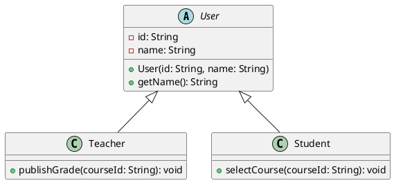

## 防御式编程

### 防御式编程

**定义**：**防御式编程（Defensive Programming）** 是在编码时主动考虑所有可能输入、状态和环境异常，并用合理方法处理错误，避免错误扩散到系统内部的编程方式。[PPT p.3-p.6]

**核心思想**：防御式编程的出发点是“别做任何假设”。也就是说，程序不能假设外部输入一定合法、调用方一定按约定传参、文件一定存在、网络一定稳定、数组下标一定在范围内。它要求把不确定性显式放进代码结构中，让程序在遇到错误时可检测、可定位、可恢复或可明确终止。

**背景与目的**：PPT 用墨菲定律说明工程实践中的一个事实：只要代码存在可能出错的路径，在足够多的运行次数和足够复杂的线上环境中，错误就很可能真的出现。[PPT p.4] 面向对象系统由多个对象协作，每个对象边界都可能接收来自用户、文件、网络、数据库、其他对象或未来维护者的输入；如果边界处没有检查，非法状态会进入对象内部，后续错误就更难追踪。防御式编程的目的不是让代码显得保守，而是让系统在异常输入下仍然保持可控。

**生活类比**：类比一下，电梯关门前会检查门口是否有障碍物，并不是因为每次都有人挡门，而是因为一旦发生，后果可能很严重。程序中的边界检查也是同样的逻辑：正常路径要顺畅，异常路径也要有明确处理方式。值得注意的是，防御式编程不是怀疑所有调用者，而是在工程上承认人、环境和数据都会犯错。

**PPT 原文关联**：PPT 先从墨菲定律引出“代码可能出现错误，错误就一定真的会出现”，再给出定义：考虑一切输入可能对程序造成的负面影响，并处理所有可能发生的错误。[PPT p.4-p.5] 随后 PPT 强调“不对可能的输入值做任何假设”，并指出防御式编程会在主要逻辑之外增加大量检查。[PPT p.6]

```python
# PPT 原片段：防御式编程强调对输入和异常进行检查。
# 补全部分：可运行的最小示例，展示对象边界处的输入保护。
class BankAccount:
    def __init__(self, balance: float):
        if balance < 0:
            raise ValueError("initial balance must be non-negative")
        self._balance = balance

    def withdraw(self, amount: float) -> None:
        if amount <= 0:
            raise ValueError("amount must be positive")
        if amount > self._balance:
            raise ValueError("insufficient balance")
        self._balance -= amount

    @property
    def balance(self) -> float:
        return self._balance


account = BankAccount(100)
account.withdraw(30)
print(account.balance)
```

**代码说明**：`BankAccount` 在构造函数和 `withdraw()` 方法入口处检查参数，确保对象内部余额不会进入负数等非法状态。也就是说，检查不是随便散落在程序里，而是放在对象边界处保护不变量。本质上，这体现了防御式编程与**封装（Encapsulation）** 的配合：对象对外暴露操作，同时自己维护内部状态合法性。

### 常见检查项

**定义**：常见检查项是防御式编程中对外部数据、数组访问、迭代器、指针、引用、函数参数和返回值等风险点进行合法性验证的集合。[PPT p.7]

**核心思想**：检查项的作用是尽早发现错误，并把错误限制在最靠近来源的位置。也就是说，外部输入进入系统时要检查，函数参数进入函数时要检查，指针和引用使用前要检查，返回值离开函数前也要检查。错误越晚暴露，越可能污染更多对象状态，定位成本也越高。

**背景与目的**：PPT 把常见检查项放在一页横向展开，视觉上强调这些检查分布在不同编程语言和不同运行场景中。[PPT p.7] 例如，数组越界在 C/C++ 中可能造成内存破坏，在 JavaScript 中可能得到 `undefined` 并引发后续逻辑错误，在 Python 中会抛出异常。检查的目的不是消灭所有错误，而是在错误进入核心业务逻辑前截断它。

**生活类比**：例如，快递分拣中心会检查地址、手机号、重量和禁运品，而不是等包裹进入运输网络后再处理。程序也一样，输入刚进入系统时信息最完整，处理成本最低。类比一下，边界检查就是软件系统的入口安检。

**PPT 原文关联**：PPT p.7 列出检查程序所有外部输入数据值是否在允许范围内、检查数组访问是否越界、检查迭代器是否合法、使用指针或引用前检查非空、检查函数参数类型和值域、检查函数返回值是否在允许范围内。

| 检查对象 | 典型问题 | 防御式处理 | 后果控制 |
| :--- | :--- | :--- | :--- |
| 外部输入 | 值域越界、格式错误、组合不合理 | 在入口处校验并给出错误提示 | 阻止脏数据进入业务对象 |
| 数组访问 | 下标越界、空集合访问 | 访问前检查长度或使用安全 API | 避免运行时异常或内存错误 |
| 迭代器 | 迭代器失效、遍历中修改集合 | 使用语言推荐遍历方式并限制修改 | 保证遍历行为稳定 |
| 指针与引用 | 空指针、悬垂引用 | 使用前判空或使用安全包装类型 | 避免崩溃和未定义行为 |
| 函数参数 | 类型不对、范围不对 | 参数校验、类型标注、断言或异常 | 保持函数前置条件明确 |
| 函数返回值 | 返回值不在约定范围内 | 返回前检查或使用结果对象 | 避免调用方收到不可解释结果 |

### 错误处理方法

**定义**：错误处理方法是程序在发现异常输入或异常状态后，为继续执行、记录问题、通知调用方或终止运行而采取的策略。[PPT p.8]

**核心思想**：发现错误只是第一步，真正重要的是根据错误性质选择处理方式。也就是说，轻微数据错误可以跳过或使用无害值，运维排查需要日志，调用方可恢复的错误适合抛出异常，系统状态已经不可相信时应退出程序。本质上，错误处理是一种风险分级。

**背景与目的**：PPT 列出返回无害值、切换到下一条数据、记录警告信息、抛出异常、进入异常处理子程序和退出程序等方法。[PPT p.8] 这些方法没有绝对优劣，关键看错误是否可恢复、是否影响数据一致性、是否需要通知上层以及是否会造成更大损失。如果所有错误都静默吞掉，系统会表面正常但数据已经损坏；如果所有小错误都直接退出，系统可用性又会很差。

**生活类比**：例如，表单中某个可选字段为空，可以使用默认值；支付金额为负数，则必须拒绝；数据库文件损坏，可能需要停止服务并报警。类比一下，不同故障对应不同处置等级，软件也需要这种分级响应。

**PPT 原文关联**：PPT p.8 的处理方法从“保证系统能继续执行”到“退出程序”逐步变重，说明防御式编程不仅检查错误，也要设计错误后的行为。

| 处理方法 | 适用场景 | 优点 | 风险 |
| :--- | :--- | :--- | :--- |
| 返回无害值 | 可选数据缺失、局部结果不可用 | 系统可继续执行 | 可能掩盖真实错误 |
| 切换到下一条数据 | 批处理中的单条坏数据 | 不因个别错误中断整体任务 | 需要记录跳过原因 |
| 记录警告日志 | 错误暂不影响主流程但需要追踪 | 便于排查和统计 | 只记录不处理会积累隐患 |
| 抛出异常 | 调用方可以决定恢复方式 | 错误传播清晰 | 异常边界设计不当会干扰流程 |
| 退出程序 | 状态不可恢复或继续运行危险 | 避免更大损失 | 可用性下降，需配合报警和恢复 |

### 工程师视角

**定义**：工程师视角是从长期维护和线上运行角度评价代码质量，而不是只看代码在正常输入下是否能跑通。[PPT p.9]

**核心思想**：好的工程师关注代码健壮性，会主动考虑所有输入可能面临的错误，并为错误输入给出相应解决方案。也就是说，能跑通样例并不等于代码可靠，真正可靠的代码需要知道自己在异常情况下如何失败。PPT 将其与“通常认为自己的代码不会遇到错误输入”的做法对比，强调工程质量来自对边界条件的尊重。[PPT p.9]

**背景与目的**：面向对象课程中谈编码实现，不只是为了讲语法，而是把 OOA/OOD 得到的模型变成可维护、可协作、可运行的代码。对象模型一旦进入真实系统，就会面对用户误操作、外部服务失败、数据不一致、并发时序和维护者改动。防御式编程让代码在这些情况下仍能给出确定行为。

**生活类比**：类比一下，桥梁设计不能只考虑晴天小客车通过，还要考虑暴雨、风、超载和材料老化。程序也是工程作品，不能只为演示路径服务。例如，登录功能不仅要处理正确账号密码，也要处理空输入、重复提交、网络超时和后端异常。

### 防御式编程问答

**问**：防御式编程会不会让代码变得很啰嗦？

**答**：会增加一些检查和错误处理代码，但关键对象边界、外部输入和资源访问处的检查是必要成本。值得注意的是，防御式编程不是要求在每一行都重复检查，而是把检查放在最能保护系统状态的位置。内部已经验证过的路径可以减少重复检查，避免把代码写成噪音。

**问**：什么时候应该抛异常，什么时候应该返回无害值？

**答**：如果错误意味着调用方违反了前置条件，或者当前函数无法决定如何恢复，抛异常更清晰。如果错误只是局部数据缺失且业务允许默认行为，返回无害值可以提升可用性。也就是说，处理方式要服务于业务语义，而不是机械套用某一种风格。

## 代码风格

### 代码风格

**定义**：代码风格是关于命名、注释、视觉组织、语句构造、输入输出、数字与字符串字面量等可读性和一致性约定的集合。[PPT p.10-p.12]

**核心思想**：代码不仅仅是能用就好了，它还必须能被团队阅读、评审、修改和长期维护。也就是说，代码是写给机器执行的，也是写给人理解的。本质上，代码风格把个人表达习惯收敛为协作中的共同语言。

**背景与目的**：PPT 指出现代软件几乎不可能靠一个人单打独斗完成，协作开发和软件维护是现代软件的必要条件。[PPT p.11] 如果每个人命名、缩进、注释和结构都完全不同，后续阅读者需要先适应作者个人习惯，才能判断业务逻辑。统一风格能降低理解成本，让评审者把注意力放在正确性和设计质量上。

**生活类比**：例如，同一本教材如果每章字体、标题层级和标点都不同，读者会频繁被排版干扰。代码风格也是排版和表达层面的秩序。类比一下，风格统一不是形式主义，而是让读者快速进入内容。

**PPT 原文关联**：PPT p.12 将好的代码风格拆成命名、注释、视觉组织、语句构造、输入输出、数字与字符串字面量的使用风格。本章按这个视觉顺序展开。

| 风格因素 | 关注点 | 好处 | 典型风险 |
| :--- | :--- | :--- | :--- |
| 命名 | 名字是否表达语义 | 快速理解对象职责 | 缩写歧义、无意义词 |
| 注释 | 注释是否解释意图 | 传达代码无法表达的信息 | 重复代码细节、过期注释 |
| 视觉组织 | 缩进、空格、换行 | 结构层次清晰 | 混用风格导致误读 |
| 语句构造 | 函数长度、嵌套深度、语句长度 | 降低局部复杂度 | 巨型函数和深层嵌套 |
| 输入输出 | 输入检查与输出可读性 | 提升用户和系统交互质量 | 输入脏数据、输出无意义 |
| 字面量 | 魔法数字和魔法字符串 | 集中配置并表达含义 | 修改困难、含义不明 |

### 命名

**定义**：命名是为变量、函数、类、模块和常量选择能准确表达语义、类型和用途的标识符的过程。[PPT p.13-p.20]

**核心思想**：变量名回答“是什么”，函数名回答“做什么”。也就是说，好的命名应具体、可识别、少歧义，并在同一用途上保持风格一致。本质上，命名是代码中最短但最频繁出现的文档。

**背景与目的**：PPT 先用“出了甚么问题？”引出糟糕命名会让读者不知道代码在表达什么。[PPT p.13] 随后强调变量名应使用名词或名词化动词，函数或方法名应使用动词加名词或形容词，并可适当反映返回值类型。[PPT p.14-p.15] 这说明命名不是随便缩短字符，而是要把程序意图压缩进标识符。

**生活类比**：例如，文件夹叫 `misc` 很难让人判断里面有什么，叫 `invoice-pdfs` 就清楚得多。代码里的 `doit`、`one`、`each` 也是类似问题，它们让读者必须跳进实现细节才能理解含义。[PPT p.16] 类比一下，命名就是给代码对象贴标签，标签不准，整理和查找都会困难。

**PPT 原文关联**：PPT p.17 还提醒避免容易产生歧义的缩写，例如 `TM` 可能表示 TradeMark、Tencent Messenger 或 Transparent Mode；避免拼音和英文混淆；布尔变量可使用 `isAnimal` 或 `haveMoney` 这类与类型对应的名字；避免 `each_city` 中无用的 `each`；可用前缀区分类别。[PPT p.17]

| 命名规则 | 示例 | 技术含义 | 维护影响 |
| :--- | :--- | :--- | :--- |
| 变量名表达对象 | `paperIndex` | 读者知道变量保存什么 | 减少查定义次数 |
| 函数名表达动作 | `searchMaxNumber` | 读者知道调用后发生什么 | 降低调用误用概率 |
| 布尔名表达真假语义 | `isActive`、`hasPermission` | 条件判断更像自然语言 | 避免双重否定 |
| 避免歧义缩写 | 不用无法解释的 `TM` | 缩写必须在团队内稳定 | 降低跨团队理解成本 |
| 同用途风格一致 | 同一类 ID 不混用 `userId` 和 `user_id` | 便于搜索和批量重构 | 减少接口错配 |

**注意**：PPT p.18 给出大驼峰、小驼峰、下划线和中划线命名法。不同语言的主流选择不同，Java 类名常用大驼峰，JavaScript 变量和函数常用小驼峰，Python 模块和函数常用下划线。关键不是某种写法天然最好，而是同一项目、同一用途保持一致。

### 避免命名混淆

**定义**：避免命名混淆是指在标识符中避开容易误读的字符、关键字相近词和视觉相似组合，使代码在快速阅读时不产生歧义。[PPT p.20]

**核心思想**：代码阅读经常发生在屏幕、评审工具和终端输出中，视觉相似字符会让错误隐藏很久。也就是说，`hard2Write` 和 `hardZWrite`、数字 `0` 和字母 `O`、数字 `1` 和字母 `I` 等组合都可能造成误判。本质上，命名不仅要语义正确，还要视觉可靠。

**背景与目的**：PPT 明确列出数字 0 与字母 O、数字 1 与字母 I、数字 2 与字母 Z、数字 5 与字母 S、数字 6 与字母 G 等混淆风险。[PPT p.20] 这些风险在密码、编号、配置项、数据库字段和日志排查中尤其明显。如果标识符还接近语言关键字或框架保留词，编辑器高亮和读者预期也会被干扰。

**生活类比**：例如，车牌号和验证码会避免某些相似字符，是为了降低人工识别错误。代码命名同样需要考虑人眼识别成本。值得注意的是，机器能区分不代表人能稳定区分。

### 注释

**定义**：注释是在代码旁边补充说明，用于总结代码、标记重要内容、解释设计意图或记录代码自身无法表达的信息。[PPT p.21-p.23]

**核心思想**：正确的注释解释“为什么”和“意图是什么”，而不是机械复述“代码怎么做”。也就是说，高可读代码应让实现细节尽量通过代码本身表达，注释则补足上下文、约束、算法选择、版本和法律声明等额外信息。本质上，注释是对代码表达能力的补充，不是对糟糕代码的遮羞布。

**背景与目的**：PPT p.22 将注释场景分成应该使用和错误使用两类。应该使用的场景包括总结代码、标记重要内容、说明设计意图、说明代码无法表达的信息；错误使用包括说明编码技巧和用注释解释整个实现过程。PPT p.23 进一步提醒，注释越多会导致屏幕显示代码越少，也会增加注释维护工作量。

**生活类比**：类比一下，地图上的注记应该告诉你道路封闭、坡度大或需要通行证，而不是在每条路旁写“这是一条路”。代码注释也应提供额外信息。例如，复杂排序选择某个算法是因为输入规模小且稳定，这种背景就适合注释说明。

**PPT 原文关联**：PPT p.23 总结正确注释应在代码宏观尺度上总结说明，传达代码本身无法传达的信息，而不是纠结实现细节。

| 注释类型 | 适合内容 | 不适合内容 | 原因 |
| :--- | :--- | :--- | :--- |
| 总结性注释 | 模块职责、算法意图 | 每行语句翻译 | 读者需要先把握整体 |
| 约束性注释 | 输入前提、性能假设、兼容原因 | 已由类型系统表达的信息 | 约束改变时必须同步维护 |
| 标记性注释 | TODO、版权、版本、风险提示 | 无意义分割线 | 标记应帮助定位问题 |
| 文档注释 | 公共 API 的参数、返回、异常 | 私有短函数的机械描述 | 公共边界需要稳定说明 |

### 视觉组织

**定义**：视觉组织是通过缩进、空格和换行让代码结构、层级和逻辑分段在视觉上清晰可见的风格规则。[PPT p.24-p.29]

**核心思想**：视觉组织让读者无需执行代码，就能快速看出嵌套层次、语句关系和逻辑段落。也就是说，缩进表现结构，空格表现语法边界，换行表现语句与段落。本质上，视觉组织把抽象语法树的一部分信息转化为人眼可感知的排版。

**背景与目的**：PPT p.25 指出规范缩进可以帮助阅读者定位嵌套层次，也能帮助开发者发现遗漏 `end`、右括号等错误。PPT p.26 说明赋值等双目运算符前后加空格，逗号、分号、问号后加空格，括号前后是否加空格则应在项目内统一。PPT p.27 强调一行一个语句，逻辑区别较大的代码段用空行分隔，函数和类定义也用空行分隔。

**生活类比**：例如，法律条文会用段落、缩进和编号表达层级，不会把所有句子挤成一行。代码也一样，排版不是装饰，它直接影响结构识别。类比一下，缩进就是代码里的层级地图。

**PPT 原文关联**：PPT p.28-p.29 引入 EditorConfig，说明格式约束不应只靠口头或文档描述，而应尽量交给编辑器自动执行。

```ini
# PPT 原片段：在工程根目录创建 .editorconfig，让编辑器识别统一格式。
# 补全部分：常见的最小配置示例。
root = true

[*]
charset = utf-8
end_of_line = lf
insert_final_newline = true
indent_style = space
indent_size = 4
trim_trailing_whitespace = true

[*.js]
indent_size = 2

[*.py]
indent_size = 4
```

**代码说明**：`.editorconfig` 把缩进、换行、编码和尾随空格等格式规则写成机器可读配置。这样协作者打开项目时，编辑器能自动适配格式约束，减少人工争论和格式性差异。

### 语句构造风格

**定义**：语句构造风格是关于子程序长度、嵌套深度、语句长度、单行语句数量和控制结构清晰性的编码约定。[PPT p.30-p.35]

**核心思想**：语句构造的目标是让局部逻辑足够小、足够平、足够清晰。也就是说，函数太长会让读者同时记住过多状态，嵌套太深会让条件上下文难以追踪，语句太长会让核心操作淹没在细节里。本质上，好的语句构造是在降低人的工作记忆负担。

**背景与目的**：PPT p.30 把语句构造风格概括为避免子程序过长、避免嵌套过深、避免语句过长、尽量一行一条语句、优先使用清晰结构。PPT p.31 用商店七月日均销售额例子说明，可以把读取商品列表、读取销售量、计算月销售总额、计算日均销售额拆成四个函数，让主流程从 28 行压缩为 4 行函数调用。PPT p.32-p.34 继续说明深层嵌套、过长语句和一行多语句都会干扰阅读。

**生活类比**：类比一下，说明一次报销流程时，可以拆成“收集票据、填写表单、主管审批、财务打款”四步，而不是把所有细节塞进一个长句。程序中的函数拆分也是为了让读者先理解主流程，再按需进入细节。例如，`calculateDailyAverage()` 比一段 20 行混合读取、统计和输出的代码更容易审查。

**PPT 原文关联**：PPT p.35 特别强调，在协作开发环境中，代码逻辑清晰性反而比其效率更加重要，并建议只使用三种基本逻辑结构、避免临时变量、减少否定条件、适度使用语法糖。

```python
# PPT 原片段：把计算七月日均销售额的长子程序拆为多个函数。
# 补全部分：用最小代码表达“主流程短，细节下沉”的结构。
def load_products():
    return ["book", "pen"]


def load_sales(products):
    return {"book": 3100, "pen": 620}


def calculate_month_total(sales):
    return sum(sales.values())


def calculate_daily_average(total, days=31):
    return total / days


products = load_products()
sales = load_sales(products)
month_total = calculate_month_total(sales)
daily_average = calculate_daily_average(month_total)
print(daily_average)
```

**代码说明**：主流程保留业务步骤，细节被拆进命名清楚的小函数。这样读者可以先看到“读取、统计、平均”这条主线，再进入具体实现。本质上，这是一种用函数命名替代注释的可读性策略。

### 输入输出风格

**定义**：输入输出风格是关于如何接收、验证、容忍、提示和展示数据的编码约定。[PPT p.36]

**核心思想**：输入风格关注“用户或外部系统如何把数据交给程序”，输出风格关注“程序如何把结果交给人或其他系统”。也就是说，输入要尽量自由但必须校验，输出要尽量有意义且便于理解。本质上，输入输出是程序与外部世界的**接口（Interface）**，风格不好会直接影响可靠性和可用性。

**背景与目的**：PPT p.36 提到检查输入项组合的合理性、允许更加自由的输入、连续输入使用文件结束标志 EOF 判断结束、对输入数据进行检查并筛除非法输入或报警、交互式场景提示用户下一步输入。输出方面，PPT 强调检验输出数据，避免无意义输出，并为输出数据加注释和设计报表格式。输入输出风格与防御式编程相互连接：输入检查保护系统状态，输出检查保护用户理解。

**生活类比**：例如，报名系统允许姓名中包含空格或少数民族姓名符号，这是输入自由；但年龄不能是负数，这是输入校验。输出成绩单时不仅给数字，还要标注课程名、学期和单位，这是输出可读性。类比一下，接口越贴近使用者，系统越不容易被误用。

**PPT 原文关联**：PPT p.36 的输入输出风格同时覆盖命令行、文件和交互式场景，因此不应只理解为 `input()` 和 `print()` 的格式问题。

### 数字与字符串字面量

**定义**：数字与字符串字面量风格是指避免在代码中直接散落含义不明的数值和字符串，而是把它们提取为命名常量、配置项或独立配置文件。[PPT p.37]

**核心思想**：魔法数字和魔法字符串的问题在于“机器能执行，人不知道含义”。也就是说，`7`、`30`、`"admin"`、`"A001"` 如果没有上下文，读者难以判断它们是业务规则、测试数据、状态码还是临时值。本质上，把字面量命名就是把隐含业务含义显式化。

**背景与目的**：PPT p.37 建议将魔法数字或魔法字符串写入单独配置文件，让它们作为常量存在，并使用全大写命名表示。这样做既方便统一修改，也能减少复制粘贴时遗漏某个值的风险。尤其在业务规则经常变化时，散落字面量会让维护者无法确定哪些值应该一起改。

**生活类比**：类比一下，办公室门禁规则不应写在每个人的便签上，而应统一写在制度文件里。程序中的超时时间、最大重试次数、状态码和角色名也是如此。例如，`MAX_LOGIN_ATTEMPTS = 5` 比直接写 `5` 更能表达规则。

### 代码风格问答

**问**：代码风格是不是只影响美观？

**答**：不是。代码风格直接影响阅读、评审、调试、重构和协作成本。值得注意的是，很多逻辑错误并不是因为算法太难，而是因为命名混乱、嵌套太深、格式不统一导致维护者误读。

**问**：注释越详细越好吗？

**答**：不是。注释应说明代码无法自然表达的意图、约束和背景，而不是逐行翻译实现细节。过多注释会占用阅读空间，也会在代码变化后变成过期信息。

## 编码规范

### 编码规范

**定义**：**编码规范（Coding Standard）** 是团队、语言生态或组织对代码文件结构、格式、命名、异常、注释、导入和工具使用方式的正式约束。[PPT p.38]

**核心思想**：编码规范把分散的个人习惯转化为稳定的团队约定。也就是说，规范的价值不在于证明某种写法绝对正确，而在于让同一项目中的代码具备一致预期。本质上，规范是一种低成本协作协议。

**背景与目的**：PPT 指出目前没有统一的编码规范，并说明本课主要参考 Google 的各种编程语言编码规范，整理 JavaScript、Java 和 Python 的主要规范。[PPT p.38] 这意味着编码规范具有语言和社区差异，不能把某一种语言的习惯硬套到所有语言中。规范应与工具结合，例如 Lint、格式化器、IDE 插件和代码评审规则。

**生活类比**：例如，交通规则在不同国家可能有差异，但同一城市内必须统一，否则协作会混乱。编码规范也是类似的约定系统。类比一下，团队写代码就像多人同时驾驶，规则越稳定，沟通成本越低。

| 规范层次 | 作用 | 例子 | 自动化方式 |
| :--- | :--- | :--- | :--- |
| 格式规范 | 统一视觉结构 | 缩进、空行、行长 | 格式化器、EditorConfig |
| 语法习惯 | 避免易错写法 | JS 使用 `===`，不用 `eval` | Lint |
| 文件结构 | 统一代码组织 | Java license/import/class 顺序 | 模板、检查脚本 |
| 命名规范 | 稳定语义预期 | Java 类大驼峰，Python 函数下划线 | Lint、评审 |
| 文档规范 | 说明公共边界 | Javadoc、Python docstring | 文档生成器 |

### JavaScript 编码规范

**定义**：JavaScript 编码规范是围绕 ECMAScript 语法、动态类型、浏览器和 Node.js 生态制定的代码约束，本课主要以 JS Standard Style 及其规则为参考。[PPT p.39-p.62]

**核心思想**：JavaScript 语言动态性强，因此规范尤其要限制隐式转换、动态执行、变量提升和难以追踪的运行时行为。也就是说，规范不是为了压制语言能力，而是为了避免动态特性被误用。本质上，JavaScript 规范的重点是提升可读性、可预测性和可维护性。

**背景与目的**：PPT p.41 提到安装 standard Lint 工具、利用 standard 检测规范问题，以及在 VSCode 中安装 StandardJS 扩展。PPT p.42 给出基本细则：两个空格缩进、字符串统一使用单引号、空行不允许多行、变量与函数使用小驼峰、构造函数大写开头、默认不使用分号。后续页面逐条列出更具体的易错点。[PPT p.43-p.62]

**生活类比**：类比一下，JavaScript 像一套很灵活的工具箱，可以快速搭东西，也容易因为工具太自由而留下隐患。规范相当于规定哪些工具在生产环境中可以用、怎么用、什么时候必须避免。例如，`eval` 很灵活，但风险远大于收益。

**PPT 原文关联**：PPT p.43-p.62 从比较、动态执行、异常、变量、三元操作符、构造函数、条件赋值、模块导入、路径、模板字符串、getter/setter、debugger、嵌套函数、switch、命名、字符串、对象和分号等角度展开。

| 规则 | 技术原因 | 示例或说明 | 主要收益 |
| :--- | :--- | :--- | :--- |
| 使用 `===` 和 `!==` | 避免 `==` 的隐式类型转换 | `"1" == 1` 会为真 | 条件判断更可预测 |
| 不使用 `eval` | 字符串执行代码风险高 | `new Function` 也应谨慎 | 降低安全和维护风险 |
| 正确抛出异常对象 | 字符串异常缺少结构信息 | `throw new Error("...")` | 调试和捕获更清晰 |
| 少用 `var` | 变量提升会造成误解 | 优先 `const` 和 `let` | 作用域更明确 |
| 使用 `path.join` | 手拼路径不跨平台 | Windows 与 Linux 分隔符不同 | 提升跨平台可靠性 |
| `switch` 使用 `break` | 避免意外贯穿 | 每个分支正常中断 | 条件分支更稳定 |

```javascript
// PPT 原片段：始终使用 ===，避免未定义变量，避免字符串拼路径。
// 补全部分：最小 Node.js 示例。
const path = require('path')

function buildUserFile(rootDir, userId) {
  if (typeof userId !== 'string' || userId === '') {
    throw new Error('userId must be a non-empty string')
  }

  return path.join(rootDir, `${userId}.json`)
}

console.log(buildUserFile('/tmp/users', 'ming'))
```

**代码说明**：示例使用 `const` 声明依赖，使用严格相等检查字符串，使用模板字符串表达文件名，并通过 `path.join()` 生成路径。也就是说，规范把很多“看似小事”的写法固定下来，减少跨平台、隐式转换和变量作用域问题。

### JavaScript 易错规则

**定义**：JavaScript 易错规则是针对语言中高动态性和隐式行为的额外约束，用于防止代码在运行时出现难以定位的问题。[PPT p.43-p.62]

**核心思想**：JavaScript 的很多错误来自“代码看起来像一种意思，运行时却按另一种规则执行”。也就是说，`==` 的隐式转换、`var` 的变量提升、`eval` 的动态执行、条件语句中的赋值、无 `break` 的 `switch` 都会制造意图和行为的错位。本质上，规范要让代码的文本含义尽量接近运行含义。

**背景与目的**：PPT p.45 强调异常处理程序应真正处理异常，而不是简单丢弃；p.49 要求条件语句中的赋值用括号包起来，以免读者误认为把 `===` 写成了 `=`；p.55 要求对象中定义了 setter 时对应定义 getter；p.56 说明 `debugger` 可临时调试，但不应留在提交代码中；p.62 对分号采取 Standard Style 的“不使用分号”建议，同时提醒不要让 `(`、`[`、反引号作为行首造成压缩后问题。

**生活类比**：例如，路牌如果让人误以为可以左转，但实际规则禁止左转，就会造成事故。代码也是文本协议，读者需要从文本判断行为。值得注意的是，动态语言越灵活，越需要用规范减少误解空间。

### Java 编码规范

**定义**：Java 编码规范是围绕 Java 源文件结构、类组织、格式、命名、异常、注解和 Javadoc 的一组工程规则。[PPT p.63-p.81]

**核心思想**：Java 是典型的面向对象语言，规范不仅关注格式，还关注类文件结构、成员排序、方法重载位置、修饰符顺序和公共 API 文档。也就是说，Java 规范的目标是让类作为工程单元保持稳定、清晰和可维护。本质上，它把面向对象代码的组织方式固定成团队可读的形式。

**背景与目的**：PPT p.63 说明 Google 风格官方使用两个空格缩进，但本课按国内常用习惯改为四个空格。PPT p.64-p.66 讲文件结构：文件名必须与顶级类类名一致且大小写敏感，编码使用 UTF-8，源文件依次包含版权信息、import 语句、顶级类定义，每个 Java 源文件有且只有一个顶级类，同名方法应紧挨出现。后续页面讲 K&R 大括号、一行一语句、100 字符行长、空行、switch、注解、注释、修饰符、命名、异常、Javadoc 等规则。[PPT p.67-p.81]

**生活类比**：类比一下，Java 源文件像正式档案，封面、目录、正文和附注都有固定顺序。顺序统一后，读者打开任何文件都知道先看导入、再看类定义、再看成员。这样的秩序对大型项目尤其重要。

**PPT 原文关联**：PPT p.77 的编程实践强调 `@Override` 能用则用，捕获的异常不能忽视，极少重载 `Object.finalize`，静态成员应使用类名调用而不是具体对象调用。

| Java 规范点 | 具体要求 | 技术含义 | 维护价值 |
| :--- | :--- | :--- | :--- |
| 文件名 | 与顶级类名一致 | Java 编译和类加载依赖该约定 | 定位类更直接 |
| 文件结构 | license、import、顶级类 | 组织顺序稳定 | 降低阅读成本 |
| 大括号 | K&R 风格 | 左大括号不单独换行 | 统一视觉结构 |
| 行长度 | 通常限制 100 字符 | 长语句应合理换行 | 避免横向滚动 |
| switch | 包含 `default`，枚举例外 | 分支覆盖明确 | 减少遗漏分支 |
| 异常 | 捕获后不能忽视 | 空 catch 需解释 | 避免吞错 |
| 静态成员 | 用类名调用 | 表明成员属于类 | 减少对象语义误导 |

```java
// PPT 原片段：Java 文件结构、@Override、异常不能忽视、静态成员使用类调用。
// 补全部分：最小示例。
import java.util.Objects;

public final class UserNameFormatter {
    private static final int MAX_LENGTH = 20;

    public String normalize(String rawName) {
        Objects.requireNonNull(rawName, "rawName");
        String trimmed = rawName.trim();
        if (trimmed.length() > UserNameFormatter.MAX_LENGTH) {
            throw new IllegalArgumentException("name is too long");
        }
        return trimmed;
    }
}
```

**代码说明**：示例使用 `final` 表达类不可继承，使用静态常量保存业务上限，通过类名访问静态成员，并在参数为空或长度越界时抛出异常。它展示了 Java 规范与防御式编程、命名和文件结构之间的连接。

### Javadoc

**定义**：Javadoc 是 Java 中用于描述公共类、公共成员和受保护成员的文档注释规范，可被工具提取生成 API 文档。[PPT p.78-p.81]

**核心思想**：Javadoc 的目标是解释 API 的用途、参数、返回值和异常，而不是复述方法内部如何实现。也就是说，公共边界需要让调用方在不阅读源码的情况下知道怎么使用。本质上，Javadoc 是面向调用方的契约说明。

**背景与目的**：PPT p.78 要求至少在每个 `public` 类及其每个 `public` 和 `protected` 成员处使用 Javadoc，但简单明显的 `getFoo` 可以例外。PPT p.80 要求标准块标记按 `@param`、`@return`、`@throws`、`@deprecated` 的顺序出现，且不能空描述。PPT p.81 强调每个类或成员的 Javadoc 以一个简短摘要片段开始，这个片段在索引中可能是唯一显示的文本。

**生活类比**：例如，电器说明书应告诉用户按钮用途、输入电压和错误处理，而不是讲内部电路如何焊接。Javadoc 对 API 的作用类似说明书。值得注意的是，内部短小私有方法不一定需要完整 Javadoc，否则会增加维护负担。

### Python 语言规则

**定义**：Python 语言规则是针对 Python 动态类型、异常、迭代、默认参数、布尔求值、作用域、导入和全局变量等语言特性的实践建议。[PPT p.82-p.89]

**核心思想**：Python 代码追求清晰直接，但动态语言也容易在运行时暴露错误。也就是说，要善用语言提供的内建迭代器、异常、生成器和布尔求值，同时避免可变默认参数、宽泛异常捕获和全局状态滥用。本质上，Python 规范强调“写得像 Python”，也要写得可维护。

**背景与目的**：PPT p.83 介绍 pylint，它能在 Python 这门动态语言中查找 bug，虽然不完美，但可捕捉输入错误、未赋值变量等问题。PPT p.84 建议使用异常但区分于 `assert`，模块和包应自定义以 `Error` 结尾并继承 `Exception` 的异常，不要只用宽泛 `except` 捕捉所有异常，保持较小的 `try/except` 块并善用 `finally`。PPT p.86 特别提醒不要在函数或方法定义中使用可变对象作为默认值。

**生活类比**：类比一下，Python 像一门表达很顺手的自然语言，写得简洁不代表可以省略语义边界。默认参数、异常和作用域如果使用不当，就像一句话省略了关键主语，短期能懂，长期容易误会。例如，可变默认参数会在多次调用之间保留状态，常常不是作者真正想要的行为。

**PPT 原文关联**：PPT p.87 说明空列表、空字典、空集合、0 和空字符串在布尔上下文中为 False，但字符串 `"0"` 为 True；比较 `None` 时应使用 `is` 或 `is not`，不要用 `==` 比较布尔变量，空序列可直接用 `if not items`。[PPT p.87]

| Python 规则 | 推荐做法 | 避免做法 | 原因 |
| :--- | :--- | :--- | :--- |
| 静态检查 | 使用 pylint 并抑制无用警告 | 完全依赖运行时发现错误 | 动态语言更需要工具辅助 |
| 异常 | 自定义 `XxxError`，缩小 `try` 范围 | 裸 `except` 或吞异常 | 保持错误边界清晰 |
| 默认参数 | 用 `None` 表示缺省再创建对象 | `def f(items=[])` | 避免跨调用共享状态 |
| 布尔判断 | `if not items`，`x is None` | `items == []`，`x == None` | 更符合语言习惯 |
| 导入 | 使用绝对路径名 | 随意相对导入 | 减少模块解析歧义 |
| 全局变量 | 只用于配置和常量 | 保存可变业务状态 | 降低隐式耦合 |

```python
# PPT 原片段：不要使用可变对象作为默认值，比较 None 使用 is。
# 补全部分：最小示例。
class InvalidNameError(Exception):
    pass


def append_name(name, names=None):
    if names is None:
        names = []
    if not name:
        raise InvalidNameError("name must not be empty")
    names.append(name)
    return names


print(append_name("Ming"))
```

**代码说明**：`names=None` 避免默认列表在多次调用之间共享，`if names is None` 明确判断缺省状态，`if not name` 使用 Python 的布尔求值处理空字符串。自定义异常以 `Error` 结尾，符合 PPT 对异常命名的建议。

### Python 编码规范

**定义**：Python 编码规范是关于行长度、缩进、空行、空格、字符串、文档字符串、注释、导入、文件资源和命名的工程约定。[PPT p.90-p.108]

**核心思想**：Python 的可读性很大程度依赖统一排版和命名。也就是说，缩进不仅是风格，更是语法结构；文档字符串不仅是注释，也能被工具识别；导入顺序不仅是审美，也帮助读者理解依赖层次。本质上，Python 规范把“可读性”落到了具体写法上。

**背景与目的**：PPT p.91 说明 Python 建议单行不超过 80 个字符，注释每行不超过 72 个字符，除非遇到长 import、URL、路径名或模块级字符串常量。PPT p.92 强调不推荐 tab 或 tab 与空格混合，推荐 4 个空格缩进。PPT p.94 要求顶级定义之间空两行，类定义与成员方法、方法之间空一行。PPT p.104 规定导入位于模块文档字符串之后、全局变量之前，且每个模块独占一行，并按 `__future__`、标准库、第三方库、本地子包顺序组织。

**生活类比**：类比一下，Python 文件像一篇结构化短文，导入是背景材料，常量是前提，函数和类是正文。读者习惯固定顺序后，就能快速定位依赖和主要逻辑。值得注意的是，Python 因为缩进参与语义，所以视觉组织比许多语言更关键。

**PPT 原文关联**：PPT p.98-p.103 详细说明文档字符串和注释。文档字符串通常出现在包、模块、类或函数里的第一条语句，使用三双引号包裹；函数文档字符串描述功能、输入输出格式和异常，通常不描述“怎么做”；注释解释代码“做什么”，不应解释代码如何实现功能。[PPT p.98-p.103]

| Python 规范点 | 规则 | 技术含义 | 维护价值 |
| :--- | :--- | :--- | :--- |
| 行长度 | 代码通常不超过 80 字符 | 避免过长表达式 | 便于并排阅读和评审 |
| 缩进 | 4 个空格，不混用 tab | 缩进就是语法 | 避免结构错误 |
| 空行 | 顶级定义之间空两行 | 分隔大结构 | 扫描文件更快 |
| 字符串 | 项目内引号风格统一 | 表达一致 | 减少无意义 diff |
| Docstring | 描述模块、类、函数用途 | 工具可提取 | API 更清晰 |
| Import | 按层次排序且一行一个模块 | 依赖可见 | 降低循环依赖排查成本 |
| 文件和 sockets | 显式关闭，文件推荐 `with` | 生命周期明确 | 避免资源泄露 |
| 命名 | 函数下划线，类大驼峰，常量全大写 | 符合社区预期 | 读者快速判断标识符角色 |

### 编码规范对比

**定义**：编码规范对比是把 JavaScript、Java 和 Python 的规则放在同一组维度下观察，理解语言差异如何影响规范重点。[PPT p.39-p.108]

**核心思想**：三种语言的规范都追求可读性和可维护性，但各自关注点不同。JavaScript 重点防止动态语义误用，Java 重点组织类和公共 API，Python 重点保持简洁可读和缩进语义稳定。也就是说，规范不是抽象口号，而是语言特性和工程生态的反映。

**背景与目的**：PPT 分别展示三种语言规范，是为了让学生看到“编码实现”不是只学一套规则，而是根据语言选择合适约束。比如 JavaScript 的 `===` 和 Python 的 `is None` 都属于避免语义误判，但对应语言机制不同。Java 的 Javadoc 和 Python 的 docstring 都服务文档化，但格式和工具生态不同。

**生活类比**：例如，汽车、火车和飞机都有安全规范，但检查项目不同。不能用飞机起飞检查表直接检查汽车，也不能认为汽车没有机翼就不需要安全规范。类比一下，不同语言的规范都服务工程可靠性，只是关注的风险点不同。

| 维度 | JavaScript | Java | Python |
| :--- | :--- | :--- | :--- |
| 类型与运行特性 | 动态类型、隐式转换多 | 静态类型、类结构强 | 动态类型、缩进语法 |
| 格式重点 | 两空格、少分号、StandardJS | 类文件结构、K&R、行长 | 4 空格、80 字符、空行 |
| 易错重点 | `==`、`eval`、变量提升、`switch` | 空 catch、修饰符、静态成员调用 | 可变默认参数、宽泛异常、全局变量 |
| 文档方式 | 注释和生态工具 | Javadoc | docstring |
| 命名习惯 | 小驼峰变量函数，构造函数大写 | 类大驼峰，方法小驼峰，常量全大写 | 函数和模块下划线，类大驼峰，常量全大写 |
| 工具支持 | standard、ESLint、编辑器插件 | Checkstyle、IDE、Javadoc | pylint、格式化器、文档工具 |

### 编码规范问答

**问**：为什么 PPT 说没有统一编码规范，却又讲这么多规则？

**答**：没有统一规范的意思是不存在跨所有语言、所有团队都完全相同的一套规则。每种语言都有自己的生态习惯，团队也会根据项目约束调整。关键是项目内部要稳定一致，并尽量用工具自动检查。

**问**：编码规范和代码风格有什么区别？

**答**：代码风格更偏可读性原则，例如命名、注释和视觉组织；编码规范更偏团队或语言层面的正式约束，例如文件结构、工具规则、异常处理和文档格式。两者高度重叠，但规范通常更可执行，也更适合自动化检查。

## 代码重用

### 代码重用

**定义**：代码重用是使用现有代码、变量、函数、类、模板、软件以及经验，灵活构建新软件的编程技术。[PPT p.109-p.111]

**核心思想**：代码重用的核心是把目标软件进行分解，并把现有代码和软件视为目标软件的一部分。也就是说，重用不是简单复制，而是识别哪些能力已经存在、边界是否稳定、能否以合适方式组合进当前系统。本质上，重用是用已有可信构件降低新系统的开发成本和风险。

**背景与目的**：PPT p.110 指出代码重用可以保证开发质量、提高软件开发效率、降低软件开发和维护成本。PPT p.111 进一步说明重用方式取决于编程语言复杂性和重用范围：较低层次包括代码片段、对象和类，较高层次包括包、框架和软件。也就是说，重用存在层次，不同层次的收益和代价也不同。

**生活类比**：类比一下，盖房子不会从烧砖、炼钢、制造玻璃开始，而会使用已有材料、标准构件和成熟施工经验。软件开发也不应总是从零写起。例如，文件读写、数据库连接、权限框架和 UI 组件都可以在合适边界上重用。

**PPT 原文关联**：PPT p.110 的图示把“目标软件”分解成多个可重用部分，强调通过重用实现质量、效率和成本收益。本章按 PPT 后续顺序展开框架重用、程序库重用、面向对象重用和代码片段重用。

### 框架重用

**定义**：框架重用是使用成熟框架提供的标准接口、抽象算法和高层设计，组装已有构件来实现目标软件的重用方式。[PPT p.112-p.113]

**核心思想**：框架重用复用的不只是函数，而是一整套架构骨架和协作方式。也就是说，框架通常规定对象生命周期、调用流程、扩展点和配置方式，开发者把业务逻辑填入框架提供的位置。本质上，框架重用是“复用控制结构”。

**背景与目的**：PPT p.112 说明成熟框架可以帮助开发人员专注业务逻辑，而不用关注事务处理、安全性、数据流控制等问题。PPT p.113 同时提醒框架也有问题，例如框架过于庞大导致应用臃肿、产品受制于框架大公司、大型框架使用门槛高。也就是说，框架能提高效率，但会带来学习成本、技术锁定和运行开销。

**生活类比**：例如，开餐厅可以加盟成熟品牌，菜单、供应链、装修和流程都可复用，但也要遵守品牌规则并承担加盟成本。框架重用也类似：它给你一套成熟流程，同时限制你的自由度。值得注意的是，框架不是越大越好，而是要匹配项目规模和变化需求。

### 程序库重用

**定义**：程序库重用是通过调用库文件中已有变量、函数或类来实现常用操作的重用方式，库文件可分为静态库和动态库。[PPT p.114-p.115]

**核心思想**：程序库重用复用的是相对独立的功能单元。也就是说，库通常不会像框架那样接管整体控制流程，而是由用户代码主动调用库提供的 API。本质上，库是可被调用的工具集合，框架则更像可被填充的应用骨架。

**背景与目的**：PPT p.114 区分静态库和动态库：静态库在编译时完成代码重用，动态库在链接时完成代码重用；静态库执行效率更高，动态库更加灵活，甚至可以被不同软件共享。PPT 还给出系统差异：Linux 下静态链接库为 `.a`，动态链接库为 `.so`；Windows 下静态链接库为 `.lib`，动态链接库为 `.dll`。PPT p.115 说明程序库的优点是通常由专业开发人员发布，安全性、可靠性和性能有保障；缺点是可定制化程度较低，功能粒度较细，需要后续开发。

**生活类比**：类比一下，程序库像工具箱里的扳手、螺丝刀和电钻，使用者按需要拿来完成局部任务。框架则更像一条装配线，规定了工作顺序和站点。两者都是重用，但控制权方向不同。

| 维度 | 静态库 | 动态库 | 工程影响 |
| :--- | :--- | :--- | :--- |
| 重用时机 | 编译或链接进可执行文件 | 运行或链接时加载共享库 | 动态库部署更灵活 |
| 文件形式 | Linux `.a`，Windows `.lib` | Linux `.so`，Windows `.dll` | 不同平台格式不同 |
| 执行效率 | 通常较高 | 可能有间接加载成本 | 性能与部署需权衡 |
| 共享能力 | 每个程序通常包含一份 | 可被多个程序共享 | 动态库节省空间并便于升级 |
| 定制化 | 取决于编译配置 | 取决于导出接口 | 库粒度通常比框架细 |

### 面向对象的代码重用

**定义**：面向对象的代码重用是利用**抽象（Abstraction）**、封装、**继承（Inheritance）**、**多态（Polymorphism）** 等机制复用类、对象、接口和设计结构的方式。[PPT p.116-p.117]

**核心思想**：面向对象重用既可以复用父类中的已有代码，也可以通过接口、组合、聚合和多态复用可替换能力。也就是说，子类可以继承父类构造和通用方法，同时定制自己的特殊行为；对象也可以持有其他对象，把已有能力组合进新对象。本质上，面向对象重用是把共性和变化分离。

**背景与目的**：PPT p.116 强调面向对象编程因封装、抽象、继承和多态等特性，可以实现复杂设计思路，也是很多设计原则和**设计模式（Design Pattern）** 的基础。PPT p.117 用教务系统中 `Teacher` 类和 `Student` 类复用父类构造函数初始化属性，并分别添加特有方法作为例子。这个例子说明继承适合表达角色之间的共性，但也要注意不要为了复用一点代码而制造错误的父子关系。

**生活类比**：例如，教师和学生都是校园用户，都有姓名、账号和联系方式，但教师有发布成绩的方法，学生有选课方法。把共同属性放在 `User` 父类中，可以减少重复；把特有行为放在子类中，可以保持角色差异。类比一下，继承适合“确实是一种”的关系，而组合适合“拥有某种能力”的关系。

**PPT 原文关联**：PPT p.116 的图示表达“子类简便地重用父类已有代码，并定制特定于自己的方法”。下面的 PlantUML 将该结构转译为**类图（Class Diagram）**。



**解读说明**：`Teacher` 和 `Student` 继承 `User`，复用 `id`、`name` 和构造逻辑，同时添加各自特有方法。图中 `User` 设为抽象类，是因为系统通常不会创建一个没有具体角色的普通校园用户；这属于对 PPT 例子的合理结构化表达。

### 继承重用与组合重用

**定义**：继承重用通过父子类关系复用代码，**组合（Composition）** 重用通过对象持有对象来复用能力。[PPT p.116-p.117]

**核心思想**：继承适合稳定的一般-特殊关系，组合适合可替换部件和能力拼装。也就是说，`Student` 是一种 `User` 可以用继承表达，但“学生拥有一个通知服务”更适合组合表达。本质上，选择重用方式要看关系语义，而不是只看哪种写法省代码。

**背景与目的**：PPT 第 11 课已经强调优先使用聚合而不是继承，本课在代码重用中再次体现这一点。继承能方便复用父类代码，但会把子类耦合到父类实现；组合需要多写对象关系，却让部件可以独立替换和测试。代码实现阶段如果把所有复用都写成继承，很容易形成僵硬的类层次。

**生活类比**：类比一下，电动车是车的一种，这适合继承；车有电池，这适合组合。如果把电池写成车的父类，就会破坏概念关系。软件中也一样，重用不能违背领域语义。

| 维度 | 继承重用 | 组合重用 | 判断标准 |
| :--- | :--- | :--- | :--- |
| 关系语义 | “是一种” | “拥有一个”或“使用一个” | 先看领域含义 |
| 复用内容 | 父类字段和方法 | 被持有对象的能力 | 组合更适合能力拼装 |
| 耦合程度 | 子类依赖父类实现 | 整体依赖部件接口 | 组合通常更灵活 |
| 运行时替换 | 较弱，类型创建后固定 | 较强，可替换成员对象 | 需要动态配置时优先组合 |
| 主要风险 | 父类变化影响所有子类 | 对象装配更复杂 | 根据变化频率取舍 |

### 代码片段重用

**定义**：代码片段重用是通过复制粘贴已有代码，并在适当修改后使用的低层次重用方式，也被称为代码克隆。[PPT p.118-p.120]

**核心思想**：代码片段重用成本低、速度快，但维护风险高。也就是说，复制粘贴可以快速解决眼前问题，却会把同一逻辑分散到多个位置；当原逻辑需要修复漏洞或调整规则时，维护者必须找到所有克隆片段。本质上，代码克隆把“复用”变成“重复”，长期成本可能很高。

**背景与目的**：PPT p.118 区分句法克隆和语义克隆：句法克隆表示代码片段文本相似，语义克隆表示代码片段功能相似。PPT p.119 用最大公约数 `gcd` 代码说明，变量名改了但执行逻辑不变属于句法克隆；递归版本文本差异很大但功能相同，属于语义克隆。PPT p.120 指出代码片段重用可能因开发者未理解克隆代码而引入漏洞，克隆代码分散后修改困难，修改后语义和结构变化还会影响克隆检测准确率。

**生活类比**：类比一下，把同一张通知复制到十个群里很快，但内容更新时必须十个群都改，否则有人会看到旧信息。代码克隆也是这样，复制时省事，维护时费事。值得注意的是，短期实验代码可以接受局部复制，但产品代码应尽快提炼公共函数、类或库。

**PPT 原文关联**：PPT p.119 的 `gcd` 示例在 OCR 中保留了核心代码，下面用 C 语言补全一个最小版本，并展示如何把克隆片段提炼为函数。

```c
// PPT 原片段：gcd 的循环实现被复制后只改了变量名，属于句法克隆。
// 补全部分：把最大公约数逻辑提炼为可重用函数。
#include <stdio.h>

int gcd(int a, int b) {
    int remainder = a % b;
    while (remainder) {
        a = b;
        b = remainder;
        remainder = a % b;
    }
    return b;
}

int main(void) {
    printf("最大公约数为：%d\n", gcd(24, 18));
    return 0;
}
```

**代码说明**：把 `gcd` 逻辑提炼为函数后，调用者只需要复用函数，而不是复制整段循环。这样如果后续要处理负数、零或溢出，只需要修改一个函数。也就是说，函数提炼是消除低质量代码克隆的第一步。

### 重用方式对比

**定义**：重用方式对比是从重用粒度、控制权、灵活性、学习成本和维护风险等维度评估框架、程序库、面向对象机制和代码片段克隆。[PPT p.110-p.120]

**核心思想**：不同重用方式解决不同层次的问题，没有一种方式适用于所有场景。也就是说，小工具函数适合库重用，系统骨架适合框架重用，领域共性适合面向对象重用，临时局部相似代码才可能短期使用片段重用。本质上，重用方式选择也是设计决策。

**背景与目的**：PPT 从高层框架到低层代码片段逐步展开，隐含了一条风险和粒度变化线：越高层的重用越能节省整体设计成本，但约束越强；越低层的重用越灵活，但越容易变成重复和维护负担。复习时要能说明每种方式的收益和代价，而不是只背定义。

**生活类比**：例如，装修房子可以选择整装公司、购买标准家具、复用旧家具，或者直接复制别人家的布置清单。每种方式成本、自由度和风险都不同。类比一下，软件重用也要在效率、自由度和长期维护之间取平衡。

| 重用方式 | 重用粒度 | 控制权方向 | 优点 | 代价 |
| :--- | :--- | :--- | :--- | :--- |
| 框架重用 | 应用骨架和高层设计 | 框架调用用户代码 | 快速搭建系统，复用成熟架构 | 学习成本高，可能臃肿或锁定 |
| 程序库重用 | 函数、类、模块 | 用户代码调用库 | 功能可靠，粒度较灵活 | 需要自行组织业务流程 |
| 面向对象重用 | 类、对象、接口、关系 | 取决于继承或组合结构 | 能表达领域共性和变化 | 继承滥用会增加耦合 |
| 代码片段重用 | 局部语句和算法片段 | 复制后各自维护 | 初期最快 | 容易引入漏洞和重复维护 |

### 代码重用问答

**问**：代码重用是不是越多越好？

**答**：不是。重用的前提是边界清晰、语义稳定、质量可信。盲目重用会引入不需要的依赖、框架负担或错误抽象。值得注意的是，真正好的重用应降低复杂度，而不是把复杂度藏到看不见的地方。

**问**：复制粘贴一定是坏事吗？

**答**：短期探索或一次性脚本中，复制粘贴可能是现实选择；但进入长期维护代码后，应尽快判断重复逻辑是否需要提炼。若克隆片段承担业务规则、权限判断或安全校验，分散复制会带来很高风险。

## 全课复习

### 编码实现主线

**定义**：编码实现主线是把设计阶段得到的对象、职责和协作关系，转化为健壮、可读、合规并可复用源代码的过程。[PPT p.2-p.120]

**核心思想**：本课四个主题分别回答四个问题：代码如何面对错误，代码如何让人读懂，代码如何符合团队规则，代码如何复用已有成果。也就是说，编码实现不是把模型机械翻译成语法，而是在真实工程约束下保持正确性、可维护性和效率。本质上，编码实现是面向对象分析与设计落地的最后一公里。

**背景与目的**：PPT 的视觉逻辑从防御式编程开始，先保证代码在错误输入下不崩坏；再进入代码风格，让代码能被团队理解；然后进入编码规范，让不同语言和团队约定可执行；最后进入代码重用，让开发质量和效率提升。[PPT p.2] 这条顺序也符合工程实践：可靠性、可读性、规范性和复用性共同决定代码能否长期演进。

**生活类比**：类比一下，把设计图变成建筑，不只需要会砌墙，还要考虑安全规范、施工标准、材料复用和后期维护。编码实现也是同样的综合工程。例如，一个类图转成代码后，仍要检查输入、统一命名、遵循语言规范，并合理复用库和框架。

### 复习速查表

| 主题 | 核心问题 | 关键方法 | 典型页码 |
| :--- | :--- | :--- | :--- |
| 防御式编程 | 错误输入和异常状态如何处理 | 检查输入、参数、返回值并分级处理错误 | [PPT p.3-p.9] |
| 命名 | 标识符能否表达语义 | 变量名回答是什么，函数名回答做什么 | [PPT p.13-p.20] |
| 注释 | 注释是否补充代码不能表达的信息 | 解释意图、约束、背景，而不是翻译代码 | [PPT p.21-p.23] |
| 视觉组织 | 结构是否一眼可见 | 统一缩进、空格、换行和 EditorConfig | [PPT p.24-p.29] |
| 语句构造 | 局部逻辑是否过复杂 | 拆函数、减少嵌套、避免长语句 | [PPT p.30-p.35] |
| 输入输出 | 外部交互是否可靠 | 检查输入组合，输出有注释和格式 | [PPT p.36] |
| 字面量 | 常量含义是否清晰 | 魔法数字和字符串提取为常量或配置 | [PPT p.37] |
| JavaScript 规范 | 动态语义是否可控 | `===`、不用 `eval`、`const/let`、Lint | [PPT p.39-p.62] |
| Java 规范 | 类文件和 API 是否稳定 | 文件结构、K&R、异常、Javadoc | [PPT p.63-p.81] |
| Python 规范 | 简洁表达是否仍可维护 | pylint、异常、默认参数、docstring、import | [PPT p.82-p.108] |
| 代码重用 | 如何提高质量和效率 | 框架、库、OO 机制、谨慎处理代码克隆 | [PPT p.109-p.120] |

### 全课问答

**问**：本课和前面 OOA/OOD 的关系是什么？

**答**：前面课程关注如何识别对象、关系、职责和设计结构，本课关注这些结构进入代码后如何保持工程质量。也就是说，类图只是起点，真正写代码时还要考虑输入错误、命名、注释、规范、工具和复用边界。如果实现阶段忽视这些问题，设计模型即使正确，也可能变成难维护的代码。

**问**：编码规范是不是会限制程序员创造力？

**答**：规范会限制一些个人习惯，但它换来的是团队协作的一致性和自动化检查能力。真正需要创造力的地方是业务建模、抽象边界和错误处理，而不是每个人都发明一套缩进和命名方式。本质上，规范把低价值争论固定下来，让团队把精力用于高价值设计判断。

**问**：本课有哪些素材盲区？

**答**：OCR 文本中 p.13、p.19、p.29、p.40、p.96、p.101 等页主要是图片或示例截图，未提取出完整代码或图中文字。[盲区：这些页的具体视觉示例无法从 OCR 中逐字还原，笔记已根据相邻页面标题和可读文字补充其教学意图，但没有编造截图中的具体细节。]
