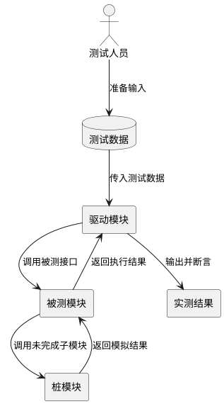
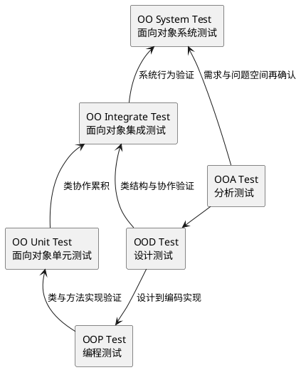
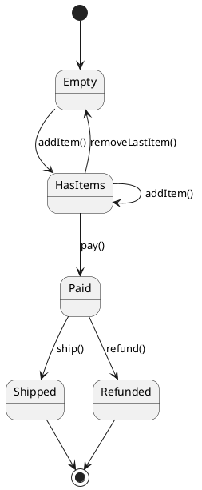
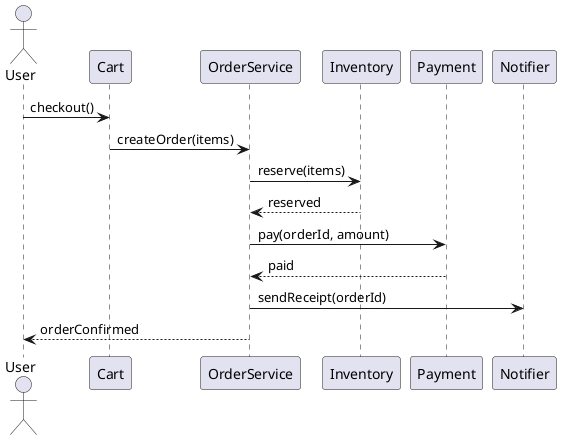

## 软件测试的阶段主线

### 软件测试

**定义**：**软件测试（Software Testing）** 是通过审查、执行和验证软件制品，发现缺陷、确认需求满足程度并评估质量风险的工程活动。[PPT p.4-p.9]

**核心思想**：测试不是证明软件完全没有错误，而是在有限时间和成本内尽可能暴露高风险错误。也就是说，测试要沿着模块、接口、需求、环境和用户验收逐层推进，让错误尽早暴露在最容易定位的位置。本质上，软件测试是一套有层次的质量反馈机制。

**背景与目的**：PPT 先把测试分为单元测试、集成测试、确认测试和系统测试，再单独强调验收测试中用户的作用。[PPT p.4-p.9] 这种视觉顺序说明软件缺陷既可能出现在局部算法中，也可能出现在模块连接、需求理解、运行环境和用户接受标准中。如果只做某一个层次的测试，系统仍可能在其他层次失败。

**生活类比**：类比一下，汽车出厂前不会只检查发动机是否能转，还要检查零件装配、驾驶功能、道路环境和用户交付标准。软件也是一样，函数正确不代表系统正确，系统能运行也不代表用户认可。例如，一个支付函数单测通过，但如果和库存模块的接口字段不一致，真实下单仍会失败。

**PPT 原文关联**：PPT p.4 用四个 bullet 概括软件测试步骤；p.5-p.8 分别展开单元、集成、确认和系统测试；p.9 用“强调用户的作用”引出验收测试。

| 测试阶段 | 测试对象 | 主要依据 | 典型技术 | 重点风险 |
| :--- | :--- | :--- | :--- | :--- |
| 单元测试 | 独立模块或类 | 详细设计文档、源代码 | 白盒为主，黑盒为辅 | 局部逻辑、边界、错误处理 |
| 集成测试 | 多个模块的组装 | 软件体系结构设计 | 接口测试、增量集成、冒烟测试 | 接口错配、数据丢失、误差累积 |
| 确认测试 | 已实现的软件功能 | 需求规格说明书 | 黑盒为主 | 功能和需求不一致，配置不完整 |
| 系统测试 | 完整系统及环境 | 系统目标和运行环境 | 功能、恢复、安全、压力、性能、可用性、部署测试 | 软硬件协作、环境适配、非功能质量 |
| 验收测试 | 面向用户的交付系统 | 需求确认标准 | 用户执行既定功能和服务 | 用户不认可，无法发布或交付 |

### 单元测试

**定义**：**单元测试（Unit Testing）** 是集中对源代码实现的每个程序单元进行测试，检查模块是否正确实现规定功能的测试阶段。[PPT p.5-p.19]

**核心思想**：单元测试把问题压缩到最小可测试范围内，优先验证模块接口、局部数据结构、重要执行路径、错误处理路径和边界条件。也就是说，单元测试既要看“正常输入能否得到正确结果”，也要看“不合理输入能否被识别和响应”。本质上，单元测试是在系统组装前先把局部行为稳定下来。

**背景与目的**：PPT 明确指出单元测试主要依据详细设计说明书和源代码清单，并主要采用白盒测试方法设计测试用例。[PPT p.10] 这是因为单元测试面对的是程序内部结构，测试者需要理解控制路径、变量状态、接口参数和异常分支。如果单元测试缺失，集成阶段会同时暴露大量局部错误和接口错误，定位成本会急剧上升。

**生活类比**：例如，装配电脑前会单独检查内存条、硬盘和电源是否正常，而不是整机无法启动后才猜哪个零件坏了。类比一下，单元测试就是把复杂系统拆成可定位的质量检查点。值得注意的是，单元测试不是只测一个函数返回值，它还要检查模块内部状态和错误路径。

**PPT 原文关联**：PPT p.10 列出单元测试内容，p.11-p.19 依次展开测试计划、驱动模块、桩模块、代码审查、静态测试、动态测试、测试用例注意事项、缺陷跟踪和回归测试。



**解读说明**：驱动模块相当于被测模块的主程序，负责接收测试数据、调用被测模块并输出实测结果。桩模块用于代替被测模块调用的子模块，让测试不必等待所有依赖都实现完成。这个结构对应 PPT p.11 的单元测试环境图。

**单元测试设计流程**的步骤如下：

1. **制定测试计划**
   - 输入：软件需求规格说明书、软件详细设计说明书和源代码清单。
   - 操作：确定测试范围、测试环境、通过标准、驱动模块和桩模块需求。
   - 输出：单元测试计划。
   - 目的：让测试活动有明确依据，而不是写完代码后随手运行几个样例。[PPT p.11]
2. **执行代码审查和静态测试**
   - 输入：源代码、检查单和设计文档。
   - 操作：开发组、测试组和相关人员联合审查，开发人员讲解代码，通过 checklist 查找错误，并进行代码走查。
   - 输出：审查记录、问题列表和改进项。
   - 目的：在代码运行前发现结构、接口、命名、控制流和数据使用问题。[PPT p.12-p.13]
3. **设计动态测试用例**
   - 输入：单元测试计划、详细设计说明书和代码结构。
   - 操作：围绕模块接口、局部数据结构、执行路径、错误处理和边界条件设计输入与断言。
   - 输出：单元测试用例。
   - 目的：把“要测什么”转化为可执行、可复现、可判断的测试。[PPT p.14-p.18]
4. **执行测试并跟踪缺陷**
   - 输入：测试用例、测试环境、驱动模块和桩模块。
   - 操作：运行测试，记录实际结果，书写缺陷跟踪报告，修改程序后进行回归测试。
   - 输出：缺陷报告、回归结果和单元测试报告。
   - 目的：确认修复没有引入新错误，并在达到测试通过标准后结束单元测试。[PPT p.19]

### 单元测试检查重点

**定义**：单元测试检查重点是对模块接口、局部数据结构、路径逻辑、错误处理和边界条件进行系统验证的一组测试关注点。[PPT p.14-p.18]

**核心思想**：一个模块可能在正常路径上工作良好，却在参数个数、数据类型、文件 I/O、未初始化变量、循环终止或错误描述上失败。也就是说，单元测试必须覆盖数据如何进入模块、模块如何保存数据、控制流如何执行、错误如何处理以及边界值如何表现。本质上，这些检查点共同保护模块的局部正确性。

**背景与目的**：PPT 对模块接口的列举非常细，包括实际参数和形式参数个数、类型、单位是否一致，内部函数参数次序是否正确，多入口模块是否引用无关参数，以及是否修改只读参数。[PPT p.14-p.15] 这些细节说明单元测试不只是算法题式输入输出，它也检查模块与外部世界的契约。如果接口契约不稳定，后续集成测试会放大这些问题。

**生活类比**：例如，插头和插座不仅要形状能插上，还要电压、频率和接地方式都匹配。模块接口也是一样，参数个数、类型、单位和副作用都必须对齐。类比一下，接口测试就是检查软件零件之间是否真的能可靠连接。

| 检查重点 | 具体问题 | 测试方法 | 失败后果 |
| :--- | :--- | :--- | :--- |
| 模块接口 | 参数个数、类型、单位、次序、全局变量定义、文件 I/O 不一致 | 构造合法和非法调用，检查输入输出与副作用 | 数据丢失、接口误用、文件读写错误 |
| 局部数据结构 | 类型说明错误、变量未初始化、默认值错误、变量名拼写错误、上溢或下溢 | 检查变量初始状态、边界值和状态变化 | 内部状态污染，后续路径计算错误 |
| 路径逻辑 | 算术优先级错误、混合模式运算错误、精度不足、循环不终止、分支无法退出 | 控制流程图、分支覆盖、核心路径覆盖 | 正常输入下也可能得到错误结果 |
| 错误处理 | 不拒绝不合理输入、错误描述难懂、错误定位失败、显示错误与实际错误不符 | 构造异常输入和故障条件，检查错误响应 | 用户或调用方无法恢复和定位问题 |
| 边界条件 | 第零次、第一次、第 n 次循环，最大值、最小值，刚好等于或越过比较值 | 边界值分析 | 只在临界数据下失败，隐蔽性强 |

**PPT 原文关联**：PPT p.14-p.15 重点讲模块接口，p.16 讲局部数据结构，p.17 讲路径测试，p.18 讲错误处理和边界条件，p.19 强调复杂代码先画控制流程图，并尽量做到分支覆盖和核心路径覆盖。

```python
# PPT 原片段：根据边界条件设计测试用例。
# 补全部分：可运行的最小示例，展示用户名校验的单元测试。
import re


def valid_username(value: str | None) -> bool:
    if value is None:
        return False
    if len(value) < 2 or len(value) > 8:
        return False
    return re.fullmatch(r"[A-Za-z0-9]+", value) is not None


def test_valid_username_boundaries():
    assert valid_username(None) is False
    assert valid_username("a") is False
    assert valid_username("ab") is True
    assert valid_username("abcdefgh") is True
    assert valid_username("abcdefghi") is False
    assert valid_username("ab_12") is False
```

**代码说明**：这个例子来自 PPT 后半部分的用户名验证函数场景，测试用例覆盖了 `null`、长度下界、长度上界和非法字符。[PPT p.49-p.52] 也就是说，测试数据不是随便挑几个看起来正常的值，而是围绕需求规则和边界条件构造。本质上，边界测试能用很少样例暴露最常见的临界错误。

### 集成测试

**定义**：**集成测试（Integration Testing）** 是把经过单元测试的模块组装起来，检查模块接口、体系结构和子功能组合是否满足设计要求的测试阶段。[PPT p.6, p.20-p.21]

**核心思想**：集成测试关注模块连接后发生的行为，而不是重复验证每个模块内部算法。也就是说，它要发现数据穿越接口时是否丢失，一个模块是否对另一个模块产生不利影响，子功能组合能否形成父功能，全局数据结构是否一致，以及局部误差是否累积到不可接受程度。本质上，集成测试验证的是协作正确性。

**背景与目的**：PPT 将集成方式分为一次性组装和增量式组装。[PPT p.20] 一次性组装先把所有模块合起来再测，速度看似快，但失败时难定位；增量式组装边连接边测试，反馈更细。PPT 还引入冒烟测试，强调在时间关键情况下频繁评估构建是否具备基本可用性。[PPT p.21]

**生活类比**：例如，乐队每个乐手单独练得很好，不代表合奏一定准确，因为节奏、音量和进入时机都需要配合。软件模块也是这样，单元测试通过只说明零件可用，集成测试才说明零件能否一起工作。值得注意的是，接口错误通常不是某个模块单独运行时能发现的。

**PPT 原文关联**：PPT p.20 列出集成测试任务和一次性组装、增量式组装；p.21 展开冒烟测试，包括把构件集成到 build 中、设计暴露构建基础错误的测试，并和每日构建配合。

### 确认测试与系统测试

**定义**：**确认测试（Validation Testing）** 是验证软件功能、性能和其他特性是否与用户要求一致的测试；**系统测试（System Testing）** 是把软件放入实际或近似实际环境，与硬件、信息、人员和其他系统成分一起检验整体行为的测试。[PPT p.7-p.8, p.22-p.26]

**核心思想**：确认测试回答“我们是否构建了用户需要的软件”，系统测试回答“这个软件在完整运行环境中是否能工作”。也就是说，确认测试主要对照需求规格说明书，系统测试则扩大到功能、恢复、安全、强度、性能、可用性和部署环境。本质上，二者把测试对象从模块实现推向用户目标和真实运行条件。

**背景与目的**：PPT p.22 说明确认测试又称有效性测试，强调功能、性能和其他特性是否与用户要求一致。PPT p.23-p.26 进一步说明系统测试是一系列不同测试：功能测试验证严重错误，恢复测试强制系统故障后观察恢复能力，安全性测试尝试突破预防机制，强度测试在非正常资源条件下运行，性能测试检查运行性能，可用性测试发现人为因素或使用问题，部署测试检查多平台和安装文档。没有这些测试，软件可能在开发环境中通过，却在真实用户、真实压力或真实平台上失败。

**生活类比**：类比一下，菜谱试做成功不代表餐厅能开业，还要考虑高峰期出餐、卫生、顾客点单、设备故障和不同门店环境。软件系统也是一样，需求功能只是基础，真实交付还需要适配环境、负载、安全和用户操作。例如，游戏在开发机上流畅运行，但在用户显卡或操作系统上崩溃，就是部署和兼容性测试不足。

**PPT 原文关联**：PPT p.23-p.26 用多个 bullet 展开系统测试类型，其中 p.24 对安全性测试列出模拟攻击角色、口令获取、破坏防御、拒绝服务、跳过恢复过程和接触不安全数据等场景。

### 测试阶段问答

**问**：为什么不能只做系统测试，等最后一起发现问题？

**答**：系统测试发现的问题往往跨模块、跨环境、跨数据流，定位成本比单元测试高得多。也就是说，越晚发现越难判断错误来自局部算法、接口契约、需求理解还是部署环境。测试阶段分层的目的就是让错误尽量在最接近来源的位置暴露。

**问**：白盒测试和黑盒测试在这些阶段如何配合？

**答**：单元测试主要依据详细设计和源代码，适合白盒测试；确认测试主要对照需求规格说明书，通常采用黑盒测试。值得注意的是，PPT 明确说单元测试也要辅以黑盒测试，使模块对合理和不合理输入都能鉴别和响应。[PPT p.10] 因此二者不是互斥关系，而是关注视角不同。

## 面向对象测试策略

### 面向对象测试

**定义**：**面向对象测试（Object-Oriented Testing）** 是以类和对象为核心，围绕对象状态、类间协作、继承、多态和消息传递开展的测试策略。[PPT p.28-p.37]

**核心思想**：面向对象软件的基本组织单位是类，因此测试不能只沿用传统过程式模块思路。也就是说，类的方法、对象状态、继承层次、动态绑定和对象协作都会影响测试设计。本质上，面向对象测试把测试对象从“函数过程”扩展为“具有状态和关系的对象网络”。

**背景与目的**：PPT p.28 明确说面向对象测试以类为单元，并分为面向对象单元测试、面向对象集成测试和面向对象系统测试。随后 p.37 给出面向对象软件测试模型，将 OO Unit Test、OO Integrate Test 和 OO System Test 叠放在一起。这说明 OO 测试仍保留分层思想，但每一层的对象和策略都发生变化。

**生活类比**：例如，测试一台自动售货机不能只测试“投币函数”和“出货函数”，还要检查库存状态、余额状态、退款状态和多个对象之间的协作。类比一下，面向对象系统更像一组有记忆和职责的角色，而不是一串孤立步骤。值得注意的是，状态变化常常是 OO 测试中最容易漏掉的部分。

**PPT 原文关联**：PPT p.28 给出三层测试划分，p.29-p.32 讲类测试，p.33-p.35 讲面向对象集成测试，p.36 讲面向对象系统测试，p.37 给出 OO 测试模型。



**解读说明**：图中纵向表示面向对象单元、集成、系统测试的层次，横向表示分析、设计和编程制品都需要被测试。PPT p.38-p.46 反复在右侧展示 OO System Test、OO Integrate Test、OO Unit Test，并在底部标出 OOA Test、OOD Test、OOP Test，这里将其整理为更清晰的关系图。

### 类测试

**定义**：**类测试（Class Testing）** 是面向对象软件中的单元测试形式，它以类及其操作为最小可测试单元，验证类的规格说明、方法行为、结构路径和对象状态变化。[PPT p.29-p.32]

**核心思想**：类测试既要看每个方法是否符合规格，也要看方法执行后对象是否进入预期状态。也就是说，类包含数据成员和操作，操作的结果不仅可能表现为返回值，还可能表现为对象内部状态改变。本质上，类测试是在验证一个对象职责是否被正确实现。

**背景与目的**：PPT p.29 说明面向对象软件的类测试相当于传统软件中的单元测试，类包含的操作是最小的可测试单元。类测试方法包括功能性测试、结构性测试和基于状态测试。功能性测试检查类和方法是否符合规格，结构性测试检查类内部逻辑结构，基于状态测试则通过监视对象数据成员值的变化判断状态转移是否正确。[PPT p.29-p.31]

**生活类比**：类比一下，测试银行账户类不能只看 `withdraw()` 有没有返回成功，还要看余额是否正确减少、非法金额是否被拒绝、失败时余额是否保持不变。对象有记忆，因此测试必须验证“操作前状态、操作、操作后状态”。例如，订单对象从“待支付”转为“已支付”后，就不应该再允许重复支付。

**PPT 原文关联**：PPT p.31-p.32 将基于状态测试作为类测试方法重点展开：先根据设计文档或数据成员取值空间得到状态机图，再给被测类加入设置和检查对象新状态的方法，导出对象逻辑状态。



**解读说明**：这个状态图用订单对象示意基于状态测试。测试用例应覆盖合法转移，例如 `HasItems -> Paid`，也要覆盖非法转移，例如空订单直接 `pay()` 或已发货后 `refund()`。这正对应 PPT p.31 所说“通过检查对象的状态在执行某个方法后是否会转移到预期状态”。

### 继承与多态对类测试的影响

**定义**：**继承（Inheritance）** 与 **多态（Polymorphism）** 对类测试的影响，是指父类测试、子类改动、方法重写和动态绑定会改变测试用例复用与补充测试的策略。[PPT p.30]

**核心思想**：父类中已经测试过的成员函数通常不需要在子类中完整重复测试，但子类改动会破坏这个假设。也就是说，如果继承的成员函数在子类中做了改动，或者它调用了子类改动过的部分成员函数，就必须重新测试相关行为。本质上，继承提供测试复用机会，同时也引入契约破坏风险。

**背景与目的**：PPT p.30 指出，由于形成多态的父子类函数本身具有相似性，子类函数的测试方案可以通过对父类测试方案稍加修改得到。这个说法不是让子类少测，而是强调测试方案可复用：父类的边界、异常和契约断言可以迁移到子类，再加入子类特有约束。若子类的 **重写（Override）** 不符合父类预期，调用方通过父类类型使用子类对象时就会出现隐蔽错误。

**生活类比**：例如，所有银行卡都支持取款，信用卡和储蓄卡可以复用“取款金额必须为正”的测试，但信用卡还要测试额度、利息和透支限制。类比一下，父类测试像通用体检，子类测试还要检查职业或年龄带来的特殊风险。值得注意的是，多态错误常发生在“单独测试子类没问题，但替换父类使用时出问题”的场景。

| 场景 | 是否可复用父类测试 | 必须补充的测试 | 原因 |
| :--- | :--- | :--- | :--- |
| 子类完全继承父类方法且依赖未变 | 可以高度复用 | 少量构造和集成场景 | 行为应与父类契约一致 |
| 子类重写父类方法 | 只能复用测试思想 | 重写后的返回值、状态变化、异常处理 | 重写可能改变契约 |
| 父类方法调用子类改动过的方法 | 需要重新测试调用链 | 父类入口触发子类行为的路径 | 动态绑定会改变实际执行逻辑 |
| 多态替换场景 | 需要复用并扩展 | 通过父类引用调用子类对象 | 检查子类是否可安全替换父类 |

```java
// PPT 原片段：父子类函数可复用测试方案。
// 补全部分：JUnit 风格最小示例，展示父类契约在子类中继续成立。
import static org.junit.jupiter.api.Assertions.*;
import org.junit.jupiter.api.Test;

class Account {
    protected int balance = 100;

    void withdraw(int amount) {
        if (amount <= 0 || amount > balance) {
            throw new IllegalArgumentException();
        }
        balance -= amount;
    }

    int balance() {
        return balance;
    }
}

class CreditAccount extends Account {
    @Override
    void withdraw(int amount) {
        if (amount <= 0 || amount > balance + 50) {
            throw new IllegalArgumentException();
        }
        balance -= amount;
    }
}

class AccountTest {
    @Test
    void withdrawRejectsNonPositiveAmount() {
        Account account = new CreditAccount();
        assertThrows(IllegalArgumentException.class, () -> account.withdraw(0));
    }
}
```

**代码说明**：测试通过 `Account` 类型引用 `CreditAccount` 对象，目的是检查子类在多态使用时是否仍满足父类的基本契约。也就是说，子类可以扩展能力，但不能让调用方的基本假设失效。本质上，这类测试把继承层次中的契约风险显式化。

### 面向对象集成测试

**定义**：面向对象集成测试是关注类之间结构和内部相互作用的测试，验证对象协作、消息传递和类依赖能否共同实现系统行为。[PPT p.33-p.35]

**核心思想**：面向对象软件没有传统过程式软件那样明显的层次控制结构，因此传统自顶向下和自底向上的集成策略意义减弱。也就是说，类之间可能通过关联、组合、回调、事件和消息传递互相影响，测试必须围绕协作路径组织。本质上，OO 集成测试从“模块装配顺序”转向“对象协作关系”。

**背景与目的**：PPT p.33 指出，每次将一个操作集成到类中这种传统增量方式往往也不可能，因为类的成分间直接或间接相互作用。PPT p.34 给出两种策略：基于线程的测试和基于使用的测试。前者围绕响应系统输入的一组类进行集成，后者从很少使用服务类的独立类开始，再逐层测试依赖类。

**生活类比**：例如，测试线上购物不能只按代码目录顺序集成，而要按“用户提交订单”这条业务线程，把购物车、订单、库存、支付和通知一起验证。类比一下，基于线程的测试像排练一段完整业务动作，基于使用的测试像先检查基础服务再搭建上层功能。值得注意的是，两种策略可以结合使用。

| 策略 | 集成起点 | 组织方式 | 优点 | 风险 |
| :--- | :--- | :--- | :--- | :--- |
| 基于线程的测试 | 一个输入、事件或业务场景 | 集成响应该事件所需的一组类 | 贴近用户行为，容易发现端到端协作问题 | 可能较早依赖未稳定类，需要回归测试 |
| 基于使用的测试 | 很少使用服务类的独立类 | 先测独立类，再用它们测试依赖类 | 依赖基础更稳定，适合构建类层次 | 业务场景覆盖可能不够完整 |
| 驱动程序辅助 | 低层操作或整组类 | 用驱动程序触发操作或替代界面 | 界面未完成时也能测试系统功能 | 驱动程序与真实界面行为可能有偏差 |
| 桩程序辅助 | 未完全实现的协作类 | 用桩程序模拟依赖对象 | 降低等待成本，隔离外部依赖 | 桩行为过于理想会掩盖真实协作问题 |



**解读说明**：这个**序列图（Sequence Diagram）** 表示基于线程的集成测试：一次结算输入触发多个类协作。测试关注点不是某个类内部算法，而是消息是否按正确顺序传递、失败是否被处理、状态是否在多个对象之间保持一致。

### 面向对象系统测试

**定义**：面向对象系统测试是参考面向对象分析结果，检查软件是否能够完整再现问题空间，并对整体行为和开发设计进行再确认的测试。[PPT p.36]

**核心思想**：OO 系统测试要回到问题空间，确认对象、属性、服务和协作是否能支撑用户真实任务。也就是说，系统测试不仅验证软件能运行，还要验证 OOA 中识别出的对象和关系在实现中没有丢失。本质上，它是需求模型、设计模型和运行系统之间的一次闭环检查。

**背景与目的**：PPT p.36 明确说应参考 **面向对象分析（Object-Oriented Analysis, OOA）** 的结果，对应描述的对象、属性和各种服务，检测软件是否能够完全“再现”问题空间。测试内容包括功能测试、强度测试、性能测试、安全性测试、恢复测试和安装测试等。这说明 OO 系统测试仍覆盖传统系统测试类型，但判定依据更强调对象模型对现实问题的表达能力。

**生活类比**：例如，教务系统如果实现了课程表页面，却遗漏了教师、学生、课程、成绩和选课规则之间的真实关系，就没有再现问题空间。类比一下，系统测试不是只看按钮能不能点，而是看软件世界是否足够像真实业务世界。值得注意的是，OOA 模型越准确，系统测试的验收依据越清晰。

### 分析设计编程制品的测试

**定义**：分析、设计和编程制品的测试，是分别检查 OOA 模型、**面向对象设计（Object-Oriented Design, OOD）** 模型和 **面向对象编程（Object-Oriented Programming, OOP）** 实现是否完整、一致、可实现和可协作的活动。[PPT p.38-p.46]

**核心思想**：面向对象测试不应等到代码写完才开始，分析模型和设计模型也需要被测试。也就是说，OOA 要检查对象、结构、属性、实例关联、服务和消息关联是否完整；OOD 要检查类层次、类结构、类库支持和重用方案是否合理；OOP 要检查功能是否通过类和消息传递正确实现。本质上，测试贯穿分析、设计和编码三个阶段。

**背景与目的**：PPT p.38 说明 OOA 中认定的对象是问题空间中结构、其他系统、设备、被记忆的事件和系统设计人员等实际实例的抽象，测试重点在完整性和正确性。PPT p.39-p.42 继续展开认定结构、分类结构、组装结构、属性、实例关联、服务和消息关联。PPT p.43-p.45 说明 OOD 是 OOA 的细化和扩充，重点是项目实施方案、类和类结构，并要测试类层次是否涵盖所有定义类、是否体现 OOA 中的实例关联、类库支持是否服务重用。PPT p.46 则强调 OOP 将设计功能分布在类中，通过消息传递协同实现。

**生活类比**：类比一下，建房不能只检查竣工房屋，设计图、施工图和实际施工都要审查。OOA 像需求蓝图，OOD 像施工设计，OOP 像实际施工。任何一个阶段理解错了，后面即使很努力也可能构建出错误系统。

| 制品 | 测试重点 | 典型问题 | 对应页码 |
| :--- | :--- | :--- | :--- |
| OOA 模型 | 对象、结构、属性、实例关联、服务、消息关联 | 问题空间对象遗漏，分类结构或组装结构错误，服务定义不完整 | [PPT p.38-p.42] |
| OOD 模型 | 类层次、类结构、实现方案、类库支持和重用 | 类层次没有覆盖所有类，未体现实例关联，类库支持不足 | [PPT p.43-p.45] |
| OOP 实现 | 类中功能实现、消息传递和协同结果 | 方法实现偏离设计，类之间消息传递错误，状态更新不一致 | [PPT p.46] |

### 面向对象测试问答

**问**：面向对象单元测试为什么通常以类为单位？

**答**：因为类把数据成员和操作封装在一起，对象行为经常表现为内部状态变化，而不只是函数返回值。也就是说，单独测试一个方法时仍要理解它所在对象的状态和不变量。类是 OO 系统中职责最集中的可测试单位。

**问**：父类测试通过后，子类一定安全吗？

**答**：不一定。子类可能重写方法，或者让父类方法通过动态绑定调用到子类改动过的逻辑。值得注意的是，父类测试可以复用为子类测试的基础，但不能替代子类特有行为和多态替换场景的测试。

## 自动化测试工具

### 自动化测试框架

**定义**：**自动化测试框架（Automated Testing Framework）** 是用于组织测试套件、执行测试用例、进行断言并生成测试报告的工具体系。[PPT p.48-p.63]

**核心思想**：自动化测试框架把手工运行和肉眼判断转化为可重复、可报告、可集成的工程流程。也就是说，测试代码应当像业务代码一样有结构、有语义、有断言，能够被命令行或持续集成系统稳定执行。本质上，自动化测试把质量反馈从偶然行为变成开发流程的一部分。

**背景与目的**：PPT 从 JavaScript 的用户名验证函数开始，先展示原始测试手段，再指出问题：大量重复代码、没有规范、描述不清晰、难以理解测试语义、容易出错、手动运行麻烦。[PPT p.49-p.52] 随后引入 Mocha、Jest、Jasmine，并以 Mocha 搭配 Chai 为例说明 `describe`、`it` 和 `assert` 的组织方式。[PPT p.53-p.58] 这条叙述说明工具不是为了炫技，而是为了解决测试可维护性和自动执行问题。

**生活类比**：例如，手工拿计算器核对每张发票不仅慢，还容易漏算；自动化脚本可以每天重复检查并给出报告。类比一下，自动化测试框架就是软件质量检查的流水线。值得注意的是，框架只能帮助执行和报告，真正有效的测试仍取决于测试用例设计。

**PPT 原文关联**：PPT p.59-p.63 说明 Mocha 可自动执行测试、报告错误细节，默认在 `./test` 文件夹寻找测试代码，可使用 `npx mocha` 或 glob 匹配路径，并可通过 Babel 支持 ES6 的 `import/export`。

```javascript
// PPT 原片段：Mocha + Chai 测试用户名验证函数。
// 补全部分：可运行的最小示例，展示 describe、it 和断言。
const should = require("chai").should();

function validUsername(value) {
  if (value == null) return false;
  if (value.length < 2 || value.length > 8) return false;
  return /^[A-Za-z0-9]+$/.test(value);
}

describe("validUsername", function () {
  it("rejects null input", function () {
    validUsername(null).should.equal(false);
  });

  it("accepts letters and digits within length range", function () {
    validUsername("abc123").should.equal(true);
  });

  it("rejects non-alphanumeric characters", function () {
    validUsername("ab_12").should.equal(false);
  });
});
```

**代码说明**：`describe` 表示一组相关测试，也就是测试套件；`it` 表示一个单独测试用例，是测试的最小单位。[PPT p.56-p.57] `should.equal` 是 Chai 提供的断言 API，用于验证执行结果是否符合期望。[PPT p.58] 本质上，测试语义从“自己写一段函数看看输出”变成了“用命名清晰的测试用例表达需求规则”。

### 异步和调用行为测试

**定义**：异步和调用行为测试是针对回调函数、Promise 以及函数调用次数等非直接返回值行为进行验证的自动化测试方法。[PPT p.64-p.67]

**核心思想**：不同测试情况要配以不同的测试工具或手段。也就是说，同步函数可以直接断言返回值，回调风格异步函数需要 `done` 通知测试结束，Promise 风格异步函数需要等待最终结果，而只关心调用情况时需要 spy 记录函数是否被调用以及调用次数。本质上，测试方法必须匹配被测代码的执行模型。

**背景与目的**：PPT p.65 说明回调函数风格的异步操作可以通过传入 Mocha 提供的 `done` 函数，在异步完成后结束测试。PPT p.66 说明 Promise 风格可安装并使用 `chai-as-promised`，用 `should.eventually` 一类断言处理最终结果。PPT p.67 用 `once` 函数说明有时要测试函数调用情况而不是调用结果，可使用 Sinon 的 spy 记录调用信息。

**生活类比**：例如，点外卖不是下单后立刻拿到食物，而是要等骑手送达后才能评价结果；这就像异步测试需要等待完成信号。又例如，门禁系统测试不一定关心保安说了什么，而关心报警器是否只响了一次，这就像 spy 测试调用次数。类比一下，被测行为不是只有“返回值”一种形态。

```javascript
// PPT 原片段：once 函数接受回调，并保证最多调用一次。
// 补全部分：Sinon spy 最小示例。
const sinon = require("sinon");
const should = require("chai").should();

function once(callback) {
  let called = false;
  return function (...args) {
    if (called) return;
    called = true;
    return callback(...args);
  };
}

describe("once", function () {
  it("calls callback only once", function () {
    const spy = sinon.spy();
    const wrapped = once(spy);
    wrapped();
    wrapped();
    spy.calledOnce.should.equal(true);
  });
});
```

**代码说明**：这里的断言不是检查 `wrapped()` 的返回值，而是检查 `spy` 是否只被调用一次。也就是说，当需求描述的是交互行为时，测试也应围绕交互事实设计。本质上，spy 是把“函数是否被调用”这种过程信息变成可断言的数据。

### Java 与 Python 自动化测试

**定义**：Java 与 Python 自动化测试分别通过 JUnit 和 unittest 等框架组织测试类、测试方法和断言，从而实现类级或函数级测试自动执行。[PPT p.68-p.76]

**核心思想**：不同语言的测试框架语法不同，但核心结构相似：准备被测对象，执行被测行为，断言实际结果。也就是说，Java 常通过 `@Test` 标注测试用例并使用 `assertEquals` 等断言，Python 的 unittest 则通过继承 `TestCase` 并使用 `assertEqual`、`assertRaises` 等断言。本质上，自动化测试的思想跨语言一致。

**背景与目的**：PPT p.69 从一个 Java 类开始，它接受字符串消息，并通过 `printMessage` 输出。p.70 说明 JUnit 可下载 jar 包加入 classpath，也可通过 Maven 依赖声明。p.71-p.73 说明测试类与待测试类对应，一个测试类包含相关测试用例，带有 `@Test` 注解的方法代表测试用例，并可用运行器执行测试类。p.74-p.76 则说明 Python 语言本身集成 unittest，并列出多种断言。

**生活类比**：类比一下，不同学校考试答题卡格式不同，但都需要题目、作答和评分标准。JUnit 和 unittest 的语法不同，但都在解决“如何表达测试用例”和“如何判断结果”的问题。例如，异常断言就是检查错误路径是否按预期失败，而不是让测试程序直接崩溃。

| 维度 | JUnit | unittest | 共同点 |
| :--- | :--- | :--- | :--- |
| 测试组织 | 测试类对应被测类，`@Test` 方法表示用例 | 继承 `unittest.TestCase`，方法名通常以 `test_` 开头 | 都把相关测试集中组织 |
| 断言方式 | `assertEquals`、`assertFalse`、`assertSame`、`assertNull` 等 | `assertEqual`、`assertTrue`、`assertRaises`、`assertIn` 等 | 都用断言表达期望 |
| 运行方式 | IDE、Maven/Gradle、测试运行器 | 命令行、IDE、测试发现机制 | 都可自动执行并报告结果 |
| 适用对象 | Java 类、方法、异常和对象状态 | Python 函数、类、异常和模块行为 | 都服务单元测试和回归测试 |

### UI 自动化测试

**定义**：**UI 自动化测试（UI Automated Testing）** 是通过工具模拟用户在 Web、组件、小程序或移动应用界面上的操作，并断言界面状态是否符合预期的测试方法。[PPT p.77-p.105]

**核心思想**：UI 自动化测试关注用户能看到和能操作的界面行为。也就是说，它会模拟点击、输入、导航、组件渲染和页面变化，再验证文本、元素状态或报告结果是否正确。本质上，UI 测试把用户操作路径变成可回放、可断言的测试脚本。

**背景与目的**：PPT 先介绍 Selenium IDE，可作为浏览器扩展录制 Web 应用操作，并在回放时生成测试报告。[PPT p.78-p.86] 随后介绍 Selenium WebDriver，可用代码控制不同浏览器，通过 `find_element`、`click`、`send_keys` 等方法定位和操作组件。[PPT p.87-p.88] 对前端组件，PPT 以 Vue Testing Library 为例，说明 `render` 将组件解析到 document，`queryByText` 和 `getByText` 查询节点，`fireEvent` 模拟操作，再对操作后结果断言。[PPT p.89-p.98]

**生活类比**：例如，验收一台自动售票机时，会模拟真实乘客点选线路、投入金额、点击确认并检查出票结果。UI 自动化测试也是这样，它不只检查内部函数，还检查用户路径能不能走通。值得注意的是，UI 测试通常比单元测试慢且更受环境影响，因此应覆盖关键流程，而不是替代所有低层测试。

```javascript
// PPT 原片段：Vue Testing Library 测试 Button.vue，每次点击显示文字加 1。
// 补全部分：组件测试的最小结构示例。
import { render, screen, fireEvent } from "@testing-library/vue";
import Button from "./Button.vue";

test("increments text after click", async () => {
  render(Button);
  screen.getByText("0");
  await fireEvent.click(screen.getByText("0"));
  expect(screen.getByText("1")).toBeTruthy();
});
```

**代码说明**：`render` 负责把组件渲染到测试 document 中，`screen.getByText` 用文本定位节点，`fireEvent.click` 模拟用户点击。[PPT p.94-p.98] 也就是说，组件测试的核心逻辑是“渲染组件、模拟操作、验证结果”。本质上，它比直接调用组件内部方法更接近用户实际使用方式。

**补充说明**：PPT p.99-p.102 介绍微信小程序由 JSON、WXML、WXSS 和 JS 构成，并可考虑使用 minium 测试小程序组件。minium 测试继承 `minium.MiniTest`，通过 `self.page.get_element` 和 wxss 选择器定位元素，逻辑仍然是操作后验证组件内容。PPT p.103-p.105 还列出 Android 的 JUnit、Espresso、Monkey Test，以及 iOS 的 XCTest.framework 和 Xcode Instruments；这些工具分别覆盖单元测试、UI 测试和动态分析。

### 后端 API 自动化测试

**定义**：**API 自动化测试（API Automated Testing）** 是围绕前后端分离后的 HTTP 接口，构造请求、断言响应并批量运行接口集合的测试方法。[PPT p.106-p.117]

**核心思想**：前后端分离后，前端和后端主要通过 HTTP 请求交换数据，常见数据格式是 JSON。也就是说，后端 API 测试要检查请求方式、参数、状态码、响应体、错误信息和业务副作用，而不依赖完整 UI。本质上，API 测试位于单元测试和端到端 UI 测试之间，是验证服务契约的重要层次。

**背景与目的**：PPT p.107 说明前后端分离后，后端提供 API，前后端仅通过 HTTP 请求交换数据。PPT p.108-p.114 以 Postman 为例：一个 request 代表一次 API 请求，可以设定请求方式和参数；一个 collection 包含若干 request，代表一组 API 测试；Tests 标签页可用 JavaScript 写测试用例；Collection Runner 可运行 collection 并生成报告。PPT p.115-p.117 还列出 Flask-Testing 和 Django.test，说明后端框架通常也提供测试客户端。

**生活类比**：类比一下，餐厅前台和后厨之间用订单单据沟通，测试后厨不一定要让顾客真实下单，可以直接给后厨一张订单并检查出餐。API 测试也是这样，它绕过 UI，直接验证服务接口是否按契约工作。例如，登录接口应在密码错误时返回合适状态码和错误信息，而不是只看页面是否弹窗。

```javascript
// PPT 原片段：Postman Tests 中可用 JavaScript 写断言。
// 补全部分：常见 API 响应断言示例。
pm.test("status is 200", function () {
  pm.response.to.have.status(200);
});

pm.test("response contains user id", function () {
  const body = pm.response.json();
  pm.expect(body).to.have.property("id");
});
```

**代码说明**：Postman 的 Tests 脚本在请求完成后执行，用于验证状态码和响应体结构。[PPT p.110-p.111] 也就是说，API 测试不是只发请求看一眼结果，而是把接口契约写成可自动判断的断言。本质上，collection runner 让一组接口契约可以批量回归。

```python
# PPT 原片段：Django Test 使用 django.test.Client 实现 get 或 post 并检查响应。
# 补全部分：Django API 测试最小示例。
from django.test import TestCase, Client


class UserApiTest(TestCase):
    def test_get_user_profile(self):
        client = Client()
        response = client.get("/api/profile/")
        self.assertIn(response.status_code, [200, 401])
```

**代码说明**：这个示例展示后端框架测试客户端的基本形态：构造客户端、发起请求、断言响应。实际项目中还应准备数据库夹具、登录态和更精确的响应体断言。值得注意的是，API 测试应稳定、隔离并可重复执行，避免依赖不可控外部状态。

### 工具选择问答

**问**：自动化测试框架是不是越多越好？

**答**：不是。工具应匹配被测对象：函数和类适合单元测试框架，浏览器交互适合 Selenium 或组件测试库，后端接口适合 Postman 或框架测试客户端。也就是说，工具越贴近问题形态，测试越清晰；工具堆得越多，维护成本也越高。

**问**：UI 测试能不能替代单元测试和 API 测试？

**答**：不能。UI 测试最接近用户，但通常运行慢、定位难、受环境影响大。单元测试更适合定位局部逻辑，API 测试更适合验证服务契约，UI 测试更适合覆盖关键用户路径。本质上，测试组合要分层，而不是把所有风险都压到最外层。

## 全课复习

### 复习主线

**定义**：本课复习主线是从传统软件测试阶段出发，过渡到面向对象测试策略，再落到多语言、多平台自动化测试工具的使用方法。[PPT p.3-p.118]

**核心思想**：前半部分回答“软件测试按什么层次推进”，中间部分回答“面向对象系统有什么特殊测试问题”，后半部分回答“如何用工具把测试自动化”。也就是说，测试既是理论上的质量分层，也是工程上的持续反馈流程。本质上，本课把测试从概念、对象模型和工具实践三个层面串起来。

**背景与目的**：PPT 的目录有三项：软件测试的步骤、面向对象的测试策略、测试工具使用方法。[PPT p.3, p.27, p.47] 这说明课程不是单独讲某个框架，而是先建立测试阶段和 OO 测试思维，再展示 JavaScript、Java、Python、UI、小程序、移动端和后端 API 的工具例子。复习时应优先掌握测试层次、OO 特有风险和工具选择原则。

**生活类比**：类比一下，学习质量管理不能只学一台检测仪器怎么用，还要知道生产流程、产品结构和检测标准。软件测试也是一样，Mocha、JUnit、Selenium、Postman 都只是工具，关键是知道应该在哪个层次、针对什么风险使用它们。

| 主题 | 核心问题 | 关键方法 | 页码 |
| :--- | :--- | :--- | :--- |
| 测试步骤 | 软件测试如何分层推进 | 单元、集成、确认、系统、验收测试 | [PPT p.4-p.9] |
| 单元测试 | 如何检查局部模块正确性 | 驱动模块、桩模块、代码审查、动态用例、边界测试、回归测试 | [PPT p.10-p.19] |
| 集成测试 | 模块组装后如何发现协作错误 | 一次性组装、增量式组装、冒烟测试 | [PPT p.20-p.21] |
| 系统测试 | 完整系统如何面对真实环境 | 功能、恢复、安全、强度、性能、可用性、部署测试 | [PPT p.22-p.26] |
| OO 类测试 | 类和对象状态如何验证 | 功能性、结构性、基于状态测试 | [PPT p.28-p.32] |
| OO 集成测试 | 类协作如何组织测试 | 基于线程、基于使用、驱动程序、桩程序 | [PPT p.33-p.35] |
| OO 系统测试 | 系统是否再现问题空间 | 参考 OOA 的对象、属性和服务 | [PPT p.36-p.46] |
| 自动化工具 | 如何让测试可重复执行 | Mocha、Chai、Sinon、JUnit、unittest、Selenium、Vue Testing Library、minium、Postman | [PPT p.48-p.117] |

### 开放性问题

**定义**：开放性测试问题是指真实软件系统中由规模、并发、兼容性、硬件平台、环境适配或工程质量不足引发的复杂测试挑战。[PPT p.118]

**核心思想**：真实测试问题往往不是单个函数断言能完全覆盖的。也就是说，网站崩溃、游戏适配不佳、芯片架构变化导致软件不可运行、航天项目失败等案例，背后可能涉及性能、兼容性、部署、恢复、安全和系统集成等多类测试不足。本质上，测试是控制现实复杂性的工程手段。

**背景与目的**：PPT p.118 用 12306 上线初期网站崩溃、迪士尼游戏无法在部分机器运行、赛博朋克 2077 PC 版适配不佳、Apple M1 芯片导致部分软件无法运行、美国火星探测项目失败等案例引导讨论。这些例子覆盖高并发、兼容性、平台迁移和系统可靠性，说明测试必须贴近真实运行条件。

**生活类比**：例如，一把伞在实验室淋水测试通过，不代表它在大风、低温、长时间使用和不同人操作下都可靠。软件也是一样，实验环境和真实环境之间存在差距。值得注意的是，越是面向大规模用户和复杂环境的软件，越需要系统级、部署级和性能级测试。

### 全课问答

**问**：本课为什么先讲传统软件测试，再讲面向对象测试？

**答**：因为面向对象测试并没有抛弃单元、集成、确认和系统测试这些基本层次，而是在每个层次上改变了测试对象和关注点。也就是说，传统测试阶段提供框架，OO 特性提供新的风险来源。理解二者关系后，才能知道为什么类测试、状态测试、多态测试和对象协作测试很重要。

**问**：面向对象测试中最容易被忽略的是什么？

**答**：最容易被忽略的是对象状态和多对象协作。很多测试只检查一次方法返回值，却没有检查方法执行后对象是否进入正确状态，也没有检查消息传递过程中其他对象是否被正确影响。本质上，OO 系统的错误常藏在状态转移和协作边界中。

**问**：本课有哪些素材盲区？

**答**：PPT 后半部分包含大量工具界面截图和示例代码截图，OCR 只能提取部分说明文字，无法逐字还原所有截图内容。[盲区：p.51-p.63、p.70-p.73、p.79-p.88、p.92-p.102、p.109-p.117 的部分界面细节无法从文字稿完整恢复。] 笔记已根据可读文字补全最小可运行示例和操作逻辑，但没有编造截图中的具体 UI 细节。
