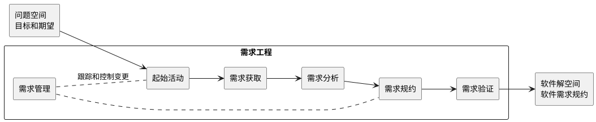
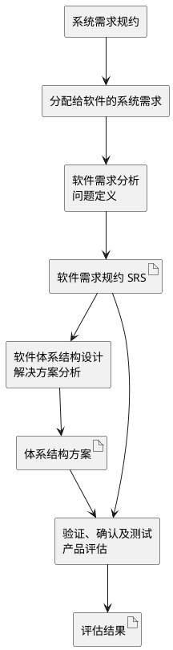
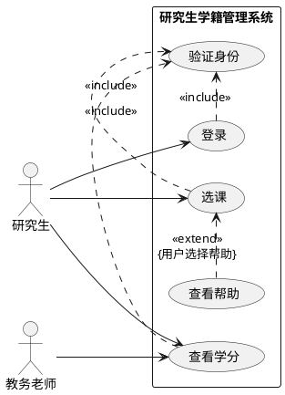
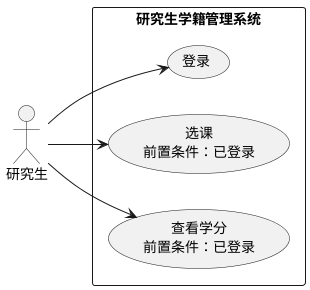

## 需求工作的定位

### 软件需求

**定义**：**软件需求（Software Requirement）** 是对待开发软件必须具有的能力、必须满足的条件、系统边界和外部约束的可验证描述。[PPT p.7, p.22]

**核心思想**：软件需求的核心不是马上给出实现方案，而是先划清“软件做什么”和“不做什么”。也就是说，需求把用户的问题空间、需求分析师的捕获与分析活动、软件工程师的软件解空间连接起来，使目标和期望能够转化为软件需求规约。[PPT p.7]

**背景与目的**：PPT 开篇强调，不论采用自顶向下还是自底向上的开发，正确定义问题都是解决问题的前提。[PPT p.3] 如果问题定义不清，后续的设计、编码和测试都会围绕一个漂移的目标展开，项目很容易出现返工、争议和范围膨胀。需求工作的目的，是把用户目标、业务约束、系统责任和验收依据转换为团队可讨论、可追踪、可验证的材料。

**类比一下**：用户说“系统要好用”就像顾客说“来点好吃的”，它表达了愿望，但不能直接指导执行。真正可用的需求需要说明使用者是谁、要完成什么任务、成功条件是什么、有哪些约束，以及失败时如何处理。

**PPT 原文关联**：PPT 用“用户 → 需求分析师 → 软件工程师”的图示说明，需求分析师位于问题空间和软件解空间之间，负责捕获并分析软件需求，最终形成软件需求规约。[PPT p.7]

### 需求工程

**定义**：**需求工程（Requirements Engineering）** 是一组持续理解、捕获、分析、规约、验证和管理需求的任务与技术，开始于沟通活动，并持续到建模活动。[PPT p.9-p.15]

**核心思想**：需求工程把“理解问题”作为一个持续过程，而不是项目开始时的一次性访谈。本质上，需求会随着利益相关者理解加深、业务环境变化和原型反馈不断被澄清，所以需求工程必须同时处理发现、冲突、确认和变更。

**背景与目的**：开发人员有时认为需求会在写代码时自然清晰，或者只有看到早期版本后用户才知道自己要什么。[PPT p.8] 这些想法在周期不超过一个月的小项目中可能尚可接受，但随着软件规模和复杂性增加，缺少需求工程会让误解被带入架构、代码和测试。需求工程的目的不是拖慢开发，而是用较低成本提前暴露边界、目标、风险和冲突。

**直观理解**：需求工程像是在建楼前确认地基、用途、预算、法规和验收标准。直接开工看似更快，但一旦发现地基不对，后续返工成本通常远高于前期澄清成本。

**PPT 原文关联**：PPT 将需求工作拆为起始活动、需求获取活动、需求分析活动、需求规约活动、需求验证活动和需求管理活动，并强调需求是软件开发的工作基础。[PPT p.9-p.20]

### 需求工程活动链

**定义**：需求工程活动链是从项目起始、需求获取、需求分析、需求规约、需求验证到需求管理的一组连续活动，用来把模糊目标逐步转化为受控需求。[PPT p.9-p.15]

**核心思想**：各活动不是彼此孤立的阶段，而是围绕需求逐步求精。也就是说，起始活动建立基本理解，获取活动收集原始材料，分析活动解决冲突并建立模型，规约活动形成文档，验证活动检查质量，管理活动处理后续变更。

**背景与目的**：PPT 特别指出，需求获取活动要询问客户、用户和其他利益相关者系统目标是什么、如何满足业务要求、最终如何用于日常工作。[PPT p.11] 这说明需求不是单一人的主观想法，而是多个角色、多个约束和多个使用场景共同作用的结果。没有活动链，团队会缺少从“听到一句话”到“确认一条需求”的处理机制。

**需求工程活动链**的步骤如下：

1. **开展起始活动**
   - 输入：项目设想、业务机会、市场目标、初步问题陈述和利益相关者名单。
   - 操作：定义业务用例，确定市场宽度和深度，开展粗略可行性分析，并形成项目范围工作说明。
   - 输出：问题、解决方案性质、关键利益相关者和初步合作方式的共同理解。
   - 目的：避免项目一开始就陷入技术细节，而忽略业务目标和范围边界。[PPT p.9-p.10]
2. **执行需求获取**
   - 输入：访谈记录、现场观察、已有文档、业务流程和用户反馈。
   - 操作：围绕目标、业务要求、日常使用方式和限制条件提问，并识别范围问题、理解问题和易变问题。
   - 输出：软件需求陈述、用户场景、用例图或用户故事。
   - 目的：把分散、口语化、隐含的用户期望转化为可以进一步分析的需求材料。[PPT p.11-p.13]
3. **进行需求分析**
   - 输入：需求陈述、用户场景、候选功能、冲突列表和约束。
   - 操作：建立更精确的需求模型，对不同客户或用户提出的冲突需求进行排序、评估、删除、组合或修改。
   - 输出：经过协商和求精的需求模型。
   - 目的：让需求从“收集到的意见”变为“可解释、可取舍、可实现的模型”。[PPT p.14]
4. **形成需求规约**
   - 输入：需求模型、场景、接口信息、非功能要求和约束。
   - 操作：采用标准模板，以一致、可理解的方式表达需求；大型系统通常结合自然语言和图形模型。
   - 输出：**软件需求规约（Software Requirements Specification, SRS）**。
   - 目的：为设计、测试、验收和变更控制提供共同基线。[PPT p.14]
5. **完成需求验证**
   - 输入：软件需求规约、需求模型和相关标准。
   - 操作：通过正式技术评审检查需求是否无歧义、是否存在不一致、疏忽和错误，以及工作产品是否符合标准。
   - 输出：被确认或被修正的需求规约。
   - 目的：在成本较低的阶段发现需求缺陷，减少后续设计和实现返工。[PPT p.15]
6. **实施需求管理**
   - 输入：需求基线、变更请求、跟踪关系和项目进展信息。
   - 操作：标识、控制和跟踪需求及需求变更，并通常与软件配置管理结合。
   - 输出：受控的需求版本和可追踪的变更记录。
   - 目的：承认需求会变化，同时防止变化失控。[PPT p.15]



**解读说明**：图中需求工程位于问题空间和软件解空间之间，体现了 PPT 对“捕获和分析软件需求”的定位。需求管理用虚线连接多个活动，表示它不是最后一步，而是贯穿需求生命周期的控制机制。

### 利益相关者

**定义**：**利益相关者（Stakeholder）** 是与待开发系统相关、会影响系统需求或受系统影响的人、组织或外部系统。[PPT p.12]

**核心思想**：需求不是只问“用户想要什么”，还要问不同角色的利益、约束和关注点是否一致。值得注意的是，业务经理、客户、用户、软件工程师、维护工程师、市场销售人员和系统集成商都可能提出有效需求，但他们评价系统成功的标准不同。

**背景与目的**：PPT 以网上银行管理系统为例说明，业务经理关注预算内的产品特征和市场限制，用户关注功能熟悉、易学易用，客户关注整体满意度和成本控制，软件工程师关注需求清晰度和实现难度，维护工程师关注可维护性，系统集成商关注接口是否清晰、是否易于集成。[PPT p.12] 如果只听某一类角色，需求模型会偏向局部视角，可能满足了一个人却破坏了整体系统目标。

**直观理解**：同一个“登录功能”，用户希望简单，安全团队希望强认证，运营团队希望可统计转化，维护团队希望故障可定位。需求分析师的任务不是无条件接受某个说法，而是把这些视角放到同一个模型里进行取舍。

| 角色 | 典型关注点 | 可能提出的需求 | 风险 |
| :--- | :--- | :--- | :--- |
| 业务经理 | 预算、市场和产品特征 | 在预算内完成核心能力 | 过度关注市场窗口而压缩验证 |
| 用户 | 易学、易用和任务完成 | 熟悉的功能流程与界面反馈 | 可能只表达个人习惯 |
| 客户 | 满意度、成本和合同 | 明确交付范围与验收标准 | 可能与最终用户目标不完全一致 |
| 软件工程师 | 清晰度、可实现性和风险 | 可测、可追踪的需求表达 | 可能过早从技术实现角度裁剪需求 |
| 维护工程师 | 可维护性和长期演化 | 日志、配置、诊断和升级要求 | 常被早期需求忽略 |
| 系统集成商 | 接口、协议和部署环境 | 与外部软硬件系统的集成约束 | 接口不清会导致后期集成失败 |

**本节 Q&A**：

- **问：为什么需求工作不能等到编码时再澄清？** 答：编码阶段当然还会发现细节，但系统边界、目标、关键约束和验收标准必须提前建立基本共识。否则代码写得越多，围绕错误理解积累的返工成本越高。
- **问：需求工程是否只适合大型项目？** 答：不是。小项目可以轻量化执行需求工程，但不能完全跳过问题定义、需求确认和变更控制。PPT 的提醒是，小项目中某些“边做边想”的说法风险较低，但规模和复杂性上升后就会出现明显问题。[PPT p.8]

## 系统工程视角下的需求

### 软件作为现代系统元素

**定义**：系统工程视角下的软件，是现代产品或系统中的重要元素，可能提供控制功能、耦合功能或独立功能，并与人员、硬件、通信设备和其他系统共同形成解决方案。[PPT p.16]

**核心思想**：软件需求不能只从孤立程序出发，还要从软件所在的系统整体出发。也就是说，软件往往要连接人员、设备、网络和外部应用，需求边界必须覆盖这些交互关系。

**背景与目的**：PPT 用空中交通管制系统说明，软件集成了人员、雷达、飞机、通信及其他设备等系统元素。[PPT p.16] 这类系统中，软件提供灵活性，尤其可以在系统集成后期用较低成本处理软硬件接口问题。值得注意的是，PPT 同时强调“软件是容易修改的，但修改正确是很难的”，这说明软件可修改性不等于需求可以随意变更。[PPT p.17]

**直观理解**：修改软件参数可能比更换硬件便宜，但如果需求理解错误，修改后的软件可能破坏安全、流程或接口协议。软件越处在系统核心位置，越需要把需求放在系统工程语境中审视。

### 软件系统工程任务

**定义**：软件系统工程是系统工程的一部分，围绕分配给软件的系统需求开展需求分析、体系结构设计、验证确认测试和必要的软件系统工程管理。[PPT p.18-p.19]

**核心思想**：软件需求来自系统目标的分配，不是凭空产生的功能列表。本质上，系统先有整体使命和约束，然后才将其中一部分责任分配给软件，并进一步形成软件需求及约束。

**背景与目的**：PPT 将需求分析称为“问题定义”，将软件体系结构设计称为“解决方案分析”，将验证、确认及测试称为“产品评估”。[PPT p.19] 这种说法提醒我们，需求、设计和测试分别回答“问题是什么”“方案是什么”“产品是否满足问题”的不同问题。把三者混在一起，会导致需求文档中夹杂实现细节，或者测试无法追溯到需求。



**解读说明**：图中软件需求分析从系统需求中接收被分配给软件的部分，形成 SRS。体系结构设计和验证测试都依赖这个基线，因此需求规约既是设计输入，也是评估准则。

**本节 Q&A**：

- **问：为什么说软件通常是系统中最复杂的部分？** 答：软件不仅实现功能，还连接人员、硬件、网络和外部系统，并承担大量变化吸收工作。它容易修改，但要在不破坏既有约束和接口的情况下正确修改，非常困难。[PPT p.17]
- **问：系统需求和软件需求有什么区别？** 答：系统需求描述整个系统要满足的目标和约束，软件需求只描述其中分配给软件系统或软件构件的能力与条件。软件需求应当能追溯到系统需求，但不能把所有系统责任都写成软件责任。

## 需求定义与基本性质

### 需求的正式定义

**定义**：按照 ISO/IEC/IEEE 24765:2017，软件需求是用户解决问题或实现目标所需的软件能力，也是为满足合同、标准、规范或其他正式强制性文件而系统或系统组件必须满足或拥有的软件能力。[PPT p.22]

**核心思想**：需求同时有用户目标维度和正式约束维度。也就是说，一条需求既可能来自用户完成任务的需要，也可能来自合同、标准、法规或组织规范。

**背景与目的**：PPT 给出的定义强调“能力”和“条件”两个方面。[PPT p.22] 能力说明系统必须能做什么，条件说明能力在什么环境、约束或质量水平下成立。如果只写能力而不写条件，需求会缺乏验收依据；如果只写约束而不写能力，团队又无法判断系统应提供的价值。

**直观理解**：需求不是愿望清单，而是可用于约束产品构造和验收的陈述。例如“系统支持并发用户”仍然太模糊，必须进一步说明并发数量、操作组合、平均响应时间和最大响应时间。

### 单一需求的质量性质

**定义**：单一需求的质量性质是判断一条需求陈述是否可以进入需求规约的基本标准，PPT 引用 IEEE 830-1998，要求单一需求具有必要、无歧义、可测、可跟踪和可测量五个基本性质。[PPT p.24]

**核心思想**：需求质量的关键在于能否被理解、验证和追踪。值得注意的是，需求写得漂亮并不等于质量高，真正重要的是不同读者是否只能得到同一种解释，以及测试和管理能否落地。

**背景与目的**：PPT 提醒，确定一条需求是否满足这些性质是复杂耗时的过程。[PPT p.24] 这种成本是必要的，因为需求一旦进入 SRS，就会影响设计、计划、测试和合同验收。模糊需求越晚被发现，修复代价越高。

| 性质 | 判断问题 | 合格表达特征 | 不合格风险 |
| :--- | :--- | :--- | :--- |
| 必要的 | 这真的是要求吗 | 能追溯到用户目标、合同、标准或约束 | 镀金功能增加成本 |
| 无歧义的 | 是否只能用一种方式解释 | 术语明确，边界清楚，条件完整 | 不同团队按不同理解实现 |
| 可测的 | 是否可以通过测试验证 | 有输入、输出、条件或可观察结果 | 无法判断是否完成 |
| 可跟踪的 | 是否能跨阶段追踪 | 有来源、编号、设计和测试对应关系 | 变更影响不可控 |
| 可测量的 | 是否存在量化或判定标准 | 性能、容量、时间、比例或明确阈值 | 验收争议无法消除 |

**PPT 原文关联**：PPT p.23 的并发用户例子说明，同一段需求可以拆分出功能需求和性能需求。功能部分是“处理附录 A 中操作任务的任选组合”，性能部分是“支持 100 个以上并发用户，平均响应时间小于 1 秒，最大响应时间小于 5 秒”。[PPT p.23]

**拆分示例**：PPT 还给出“必须在对话窗口的中间显示错误警告，其中使用红色的、14 点加粗 Arial 字体”的例子。[PPT p.23] 其中“能显示错误警告”是功能需求，因为它规定系统必须执行的行为；“在对话窗口中间显示，并使用红色、14 点、加粗 Arial 字体”则是设计约束，因为它限制了界面呈现方案。这个例子说明，一句自然语言陈述中可能混合多种需求类型，需求分析时要把能力、性能、接口、约束和质量目标拆开，否则后续评审和测试会混在一起。

### 模糊需求到可验证需求

**定义**：结构化需求改写是把模糊、主观、不可测试的自然语言描述，转化为带有对象、动作、条件、阈值和验收方式的需求陈述。

**核心思想**：需求改写不是替用户改变目标，而是把目标表达成团队能够实现和验证的形式。也就是说，“快”“简单”“准确”这类词可以保留为业务意图，但必须补充可测指标。

**背景与目的**：PPT 在 LLM 辅助需求获取部分展示了从模糊描述到结构化需求的转换，例如“系统要快”可以追问并转化为“响应时间 ≤ 0.3 秒”，“操作要简单”可以转化为“界面操作步骤 ≤ 3”。[PPT p.43] 这说明需求工程的关键技能之一，是把主观感受转化为可讨论的质量目标。

| 用户描述 | 主要问题 | 结构化需求示例 | 验收方式 |
| :--- | :--- | :--- | :--- |
| 系统要快 | “快”没有场景和阈值 | 在常规网络环境下，搜索请求的 95 分位响应时间不超过 0.3 秒 | 性能测试报告 |
| 操作要简单 | “简单”不可直接测试 | 新用户完成核心任务的界面操作步骤不超过 3 步 | 可用性测试和流程走查 |
| 内容要准 | “准”缺少评价口径 | 推荐结果 Top 10 的准确率不低于 90% | 标注集评测 |

**本节 Q&A**：

- **问：需求必须全部量化吗？** 答：不是所有需求都能用数字表达，但每条需求都必须可验证。不能量化时，也应给出清晰的判定条件、业务规则或验收场景。
- **问：为什么一条需求还要可跟踪？** 答：需求会进入设计、代码、测试和变更管理。没有跟踪关系时，修改一条需求会影响哪些模块和测试用例很难判断。

## 需求分类

### 功能需求

**定义**：**功能需求（Functional Requirement）** 规约系统或系统构件必须执行的功能，描述系统应当在特定输入、状态或业务事件下完成什么行为。[PPT p.25-p.26]

**核心思想**：功能需求回答“系统要做什么”。本质上，它是需求主体，因为没有功能需求，就没有依附其上的性能需求、外部接口需求、设计约束和质量属性。[PPT p.26]

**背景与目的**：PPT 的例子包括系统自动核算并归集平台技术服务费与交易手续费，以及支持运营人员动态调整会员积分抵扣比例。[PPT p.25] 这些需求都描述了系统对业务任务的直接支持。写功能需求时，还应考虑功能的时序或优先程度、互斥规则、内部状态假定、输入输出次序和内部计算公式等内容。[PPT p.26]

**直观理解**：功能需求像是系统对外承诺的动作清单，但每个动作都应附带触发条件和完成结果。仅写“系统支持订单管理”粒度过大，难以设计和测试；写成“系统在订单支付成功后自动生成结算记录，并更新商户待结算金额”才更接近可实现需求。

**编写要点**：除了说明系统要执行的功能，还要写清输入假定、输入检测假定、与外部相关的动作次序，以及对异常条件的响应。[PPT p.25] 例如“自动核算手续费”不仅要写系统会核算，还要说明订单状态、费率来源、四舍五入规则、重复结算处理和异常订单处理。若功能之间存在互斥规则或优先级，也应在需求中明确，否则开发人员只能在设计阶段自行猜测业务规则。[PPT p.26]

### 性能需求

**定义**：**性能需求（Performance Requirement）** 规约系统或系统构件必须具有的性能特性，例如响应时间、吞吐量、并发能力、处理速度或资源消耗。[PPT p.27]

**核心思想**：性能需求回答“系统做得多快、多稳、多大规模”。值得注意的是，性能需求通常会隐含设计方案，对架构、部署、缓存、数据库和并发控制产生影响。[PPT p.27]

**背景与目的**：PPT 的例子包括系统应在 3 秒内从百万级用户画像库中检索并返回目标用户的完整行为标签数据，应用必须支持 500 路并发视频流的实时转码与分发。[PPT p.27] 这些需求不是简单附加说明，而是会直接影响技术路线和成本估算。性能需求如果写得太晚，团队可能发现现有架构根本无法满足目标。

**直观理解**：功能需求说明电梯能把人送到楼层，性能需求说明等待时间、载重量和运行速度。二者缺一不可，因为能做和做得足够好是两件事。

### 外部接口需求

**定义**：**外部接口需求（External Interface Requirement）** 规约系统或系统构件必须与之交互的硬件、软件、数据库、用户或通信元素，并可能规约交互格式、时间和协议因素。[PPT p.28-p.30]

**核心思想**：外部接口需求回答“系统和外部世界如何连接”。也就是说，它不仅描述有无接口，还描述数据格式、触发时机、交互模式、错误处理和运行条件。

**背景与目的**：PPT 将外部接口分为系统接口、用户接口、硬件接口、通信接口、内存约束、操作和地点需求等类别。[PPT p.29-p.30] 这些接口决定系统能否融入既有环境。接口需求不清晰会导致集成阶段爆发问题，因为每个系统都可能按照自己的假设解释字段、协议和异常。

**直观理解**：系统接口像两个部门之间的交接单，用户接口像柜台服务流程，硬件接口像插头规格。只说“要对接统一身份认证平台”不够，还要说明认证协议、用户标识、权限变更同步时机、失败重试和安全要求。

| 接口类别 | 规约内容 | 需求写作重点 | 示例问题 |
| :--- | :--- | :--- | :--- |
| 系统接口 | 应用与其他应用如何交互 | 上下游系统、调用方向、数据边界 | 哪个系统发起请求，哪个系统返回结果 |
| 用户接口 | 软件产品与用户之间的逻辑接口 | 显示数据、输入数据、用户控制方式 | 用户看到哪些字段，必须填写哪些字段 |
| 硬件接口 | 软件与硬件设备的交互 | 支持类型、协议、采样或控制方式 | 外部传感器如何提供输入 |
| 软件接口 | 与数据库、操作系统或软件包交互 | 版本、API、错误码和兼容性 | 是否依赖特定数据库版本 |
| 通信接口 | 与通信设施的交互 | 网络类型、协议、传输格式 | 是否必须使用 TCP/IP 或特定局域网 |
| 内存约束 | 易失性和永久性存储限制 | 容量、共享方式、通信用途 | 是否用共享内存与其他处理通信 |
| 操作需求 | 正常和异常运行下的操作方式 | 运行模式、备份、恢复、升级 | 系统异常时用户如何恢复业务 |
| 地点需求 | 安装地点和现场适配 | 部署环境、场地调整、区域差异 | 某地点需要怎样调整才能安装系统 |

**PPT 原文关联**：PPT 对接口分类的说明强调，外部接口需求不只是“有接口”，还应描述接口的逻辑特性、支持协议、网络类型、操作模式和现场适配要求。[PPT p.29-p.30]

### 设计约束

**定义**：**设计约束（Design Constraint）** 是限制系统或系统构件设计方案的需求，通常难以权衡或调整，必须予以满足。[PPT p.31-p.33]

**核心思想**：设计约束回答“系统必须按哪些限制来设计”。本质上，它不是系统直接提供的业务能力，却会直接影响方案选择、项目规划、成本和工作量。

**背景与目的**：PPT 提到的约束包括法规政策、硬件限制、与其他应用的接口、并发操作、控制功能、高级语言需求、握手协议、应用关键程度、安全考虑等。[PPT p.32-p.33] 这些约束往往来自组织、硬件、法规、安全或外部系统，开发团队不能随意忽略。设计约束过晚发现，会导致已经完成的设计不符合部署环境或合规要求。

**直观理解**：如果合同规定必须使用某种数据库，或者法规规定数据必须本地存储，这些不是用户界面功能，却会强烈约束架构。它们像道路限高和限速标志，车辆能不能走、怎么走都要受其限制。

**典型约束来源**：法规政策决定系统必须遵守哪些合规要求，硬件限制决定处理速度、存储容量、通信速度和可用性边界。[PPT p.32] 与其他应用的接口会产生状态约束，例如外部系统处于某状态时禁止新系统执行某些操作；并发操作则要求清晰描述多个数据源同时产生或接收数据时的时间关系。[PPT p.32] 审计功能、安全考虑和应用关键程度尤其容易被误写成“后面再说”的运维问题，但在生物医学、航空、军事和财务软件中，它们会直接决定系统设计是否可接受。[PPT p.32-p.33]

### 质量属性

**定义**：**质量属性（Quality Attribute）** 规约软件产品必须达到的质量水平，例如可靠性、可维护性、可移植性、易用性、效率、安全性和可用性。[PPT p.34-p.35]

**核心思想**：质量属性回答“系统以什么质量水平提供能力”。值得注意的是，质量属性通常是跨功能的，一个质量属性可能影响多个功能需求，例如安全性会影响登录、支付、数据访问和审计。

**背景与目的**：PPT 给出质量属性及度量示例，例如可靠性可用平均失败时间、不可用概率和失败发生频率衡量；易用性可用培训时间、任务完成时间和用户响应时间衡量。[PPT p.34-p.35] 质量属性如果只写成“系统应可靠、易维护、用户友好”，就无法指导架构和测试。必须把质量目标落到可观察指标或评审准则上。

**直观理解**：同样是“能登录”，普通论坛、网上银行和航空管制系统对安全性、可靠性和审计性的要求完全不同。质量属性决定系统的工程等级，而不只是功能数量。

| 质量属性 | PPT 描述 | 可用度量 | 写作提示 |
| :--- | :--- | :--- | :--- |
| 可靠性 | 指定环境中没有失败而正常运行的概率 | 平均失败时间、不可用概率、失败发生频率 | 必须说明运行环境和统计周期 |
| 可维护性 | 发现和改正故障或修改特定范围所需工作 | 修复时间、修改影响范围、回归测试成本 | 不要只写“易维护”，要说明维护场景 |
| 用户友好性 | 学习和使用系统的容易程度 | 培训时间、帮助帧数、任务完成时间 | 需要结合具体用户角色 |
| 安全性 | 预定时间内使软件系统安全的可能性 | 未授权访问次数、漏洞等级、审计覆盖率 | 应与权限、日志和合规需求相连 |
| 可移植性 | 软件可运行的平台类型 | 目标依赖语句百分数、目标系统数量 | 应说明支持平台和迁移边界 |
| 鲁棒性 | 失败后维持或恢复能力 | 失败后重启时间、事件引起失败百分数、失败中数据崩溃概率 | 要写清异常类型和恢复目标 |
| 规模 | 软件或数据规模水平 | 兆字节数、记录数、用户数 | 常与性能和部署约束共同出现 |

**注意**：质量属性常常跨越多个功能，因此需要附加到具体用例、子系统或整个系统上。[PPT p.71] 例如“选课响应时间小于 1 秒”是附加到选课用例的性能要求，而“所有关键操作必须可审计”可能是附加到整个系统的安全与审计要求。

| 需求类型 | 回答的问题 | 示例 | 验证重点 |
| :--- | :--- | :--- | :--- |
| 功能需求 | 系统必须做什么 | 自动核算交易手续费 | 场景、输入、输出和业务规则 |
| 性能需求 | 系统做到什么程度 | 平均响应时间小于 1 秒 | 压测、容量和资源指标 |
| 外部接口需求 | 系统如何连接外部 | 同步统一身份认证平台权限变更 | 协议、字段、时序和异常 |
| 设计约束 | 方案必须受什么限制 | 必须满足法规政策或硬件限制 | 合规审查和方案评审 |
| 质量属性 | 系统达到什么质量水平 | 平均失败时间达到指定阈值 | 质量度量和专项测试 |

**本节 Q&A**：

- **问：非功能需求是不是比功能需求次要？** 答：不是。PPT 说功能需求是主体，是因为非功能需求通常依附于功能需求而存在；但性能、接口、约束和质量属性会直接决定系统能否被接受。
- **问：设计约束和质量属性有什么区别？** 答：设计约束限制方案选择，例如必须使用某协议或满足法规；质量属性定义产品质量目标，例如可靠性、易用性或可维护性。前者更像硬限制，后者更像质量水平要求。

## 需求发现技术

### 需求发现

**定义**：**需求发现（Requirement Discovery）** 是发现初始需求的一组技术活动，目标是从用户、文档、现场环境和讨论中识别系统应提供的能力、约束和质量目标。[PPT p.36-p.46]

**核心思想**：需求发现的关键是从“用户说了什么”追问到“用户真正要完成什么”。也就是说，需求工程师不能只记录原话，还要理解业务动机、上下文、隐含规则和异常场景。

**背景与目的**：PPT 提到常用技术包括自悟、交谈、观察、小组会和提炼。[PPT p.36-p.40] 每项技术都有优点和不足，实际项目中往往需要组合使用，并辅以原型构造来帮助交流。[PPT p.46] 需求发现的成功高度依赖执行者技能，因为提问、观察、归纳和冲突处理都会影响需求质量。

**直观理解**：需求发现像调查现场案件，访谈能听到说法，观察能看到真实行为，文档能提供规则，会议能协调冲突，原型能让抽象想法变得可见。单靠一种证据很容易偏差，组合技术更稳妥。

### 自悟

**定义**：**自悟（Introspection）** 是需求人员把自己假设为系统最终用户，审视系统并提出“如果是我使用这一系统，则我需要……”的问题。[PPT p.36]

**核心思想**：自悟用需求人员的领域经验快速产生初始需求。本质上，它是一种低成本的启发式方法，适合不能直接与用户交流的场景。

**背景与目的**：PPT 指出，自悟成功的条件是需求人员必须比最终用户更了解系统的功能过程，或者至少具有足够领域知识。[PPT p.36] 如果需求人员缺乏真实使用经验，自悟很容易把个人想象误当用户需求。因此，自悟通常适合作为启动材料，而不应作为唯一依据。

**直观理解**：一个长期做教务系统的人可以凭经验列出选课、退课、成绩查询等候选需求，但仍需要用户和教务老师确认细节。经验能提供方向，不能替代验证。

### 交谈

**定义**：**交谈（Individual Interview）** 是需求人员通过提问和回答，直接询问用户想要什么样的系统，以确定系统应提供的功能和条件。[PPT p.37]

**核心思想**：交谈的价值在于可追问、可澄清、可挖掘动机。值得注意的是，交谈是否成功取决于需求人员能否正确提出问题，也取决于回答人员能否揭示需求本意。[PPT p.37]

**背景与目的**：用户常常用解决方案表达问题，例如说“我要导出 Excel”，但真实目标可能是“我要月度汇总并发给主管”。交谈需要持续追问“为什么”“什么时候”“谁使用”“失败怎么办”“如何判断完成”。没有这些追问，访谈记录会堆满功能词，却缺少业务规则。

**直观理解**：交谈不是填表，而是共同澄清问题。一个好访谈会从表层诉求走向目标、场景、约束和验收标准。

### 观察

**定义**：**观察（Observation）** 是通过观察用户执行现行任务、过程或现有系统操作，了解系统运行环境以及新系统与现存系统、过程和工作方法之间必须进行的交互。[PPT p.38]

**核心思想**：观察的优势是获取第一手材料，发现用户自己未必能说清的隐性步骤。也就是说，真实工作流中的绕行、纸质记录、口头确认和临时工具，往往不会自然出现在访谈回答中。

**背景与目的**：PPT 指出，尽管部分信息可以通过交谈获取，但第一手材料通常更符合现实。[PPT p.38] 观察也有风险，例如观察对象可能因被观察而改变行为，或者观察时间过短导致误判。需求人员需要结合访谈和文档交叉验证。

**直观理解**：用户说“审批很简单”，但现场观察可能发现他还要打开三个系统、电话确认库存、手工登记台账。观察能把这些隐藏协作暴露出来。

### 小组会

**定义**：**小组会（Group Session）** 是客户和开发人员的联席会议，通常由首席需求工程师或项目经理主持，与客户组织代表共同开发需求。[PPT p.39]

**核心思想**：小组会适合处理跨角色需求和冲突，因为不同角色可以在同一语境中暴露差异。值得注意的是，主持人的作用主要是控制会议进程，而成员选择需要兼顾现存和未来运行环境的知识。

**背景与目的**：一个需求可能同时影响业务、技术、运维和销售。小组会可以加速达成共识，也可能因为角色权力差异导致某些声音被压制。因此会议需要明确议题、记录决策、区分事实和意见，并在必要时辅以原型帮助交流。[PPT p.39, p.46]

**直观理解**：如果只单独访谈财务和运营，双方可能都认为自己的流程最合理；小组会能让冲突在模型和规则层面显性化。需求工程师要做的是把讨论结果转化为需求，而不是只记录会议纪要。

### 提炼

**定义**：**提炼（Extraction）** 是复审技术文档、需求陈述、功能和性能目标、系统规约、接口标准、硬件设计文档等材料，并从中抽取相关需求信息的方法。[PPT p.40]

**核心思想**：提炼适合已有部分需求文档或技术资料的项目。也就是说，许多关键约束并不在用户口头表达中，而隐藏在合同、标准、接口协议、历史系统文档和硬件说明里。

**背景与目的**：PPT 指出，在许多项目中，在交谈、观察、小组会或自悟之前，应该先复审项目可用文档。[PPT p.40] 这样做可以避免重复提问，也能提前识别必须遵守的标准和接口。提炼的风险是文档可能过时，因此需要把抽取结果回到用户和现场中验证。

**需求发现技术对比**：

| 技术 | 适用场景 | 优点 | 风险 | 建议用法 |
| :--- | :--- | :--- | :--- | :--- |
| 自悟 | 暂时无法接触用户 | 启动快、成本低 | 容易把经验当事实 | 作为候选需求来源 |
| 交谈 | 需要理解目标与痛点 | 信息深、可追问 | 依赖提问和表达能力 | 配合提纲和追问 |
| 观察 | 业务流程复杂或隐性步骤多 | 贴近真实工作 | 成本高，可能受观察效应影响 | 与访谈交叉验证 |
| 小组会 | 多角色协同和冲突明显 | 共识形成快 | 易受主持和权力结构影响 | 明确议题和记录决策 |
| 提炼 | 已有文档、标准或接口资料 | 可追溯、覆盖约束 | 文档可能过时 | 先抽取再验证 |

**本节 Q&A**：

- **问：哪种需求发现技术最好？** 答：没有单一最好。PPT 明确说每项技术在特定环境中都有优点和不足，实际项目往往需要组合使用。[PPT p.46]
- **问：为什么需求发现人员的技能这么重要？** 答：需求发现不是机械记录，而是提问、抽象、识别冲突、判断遗漏和组织验证的过程。技能不足会让初始需求从源头上失真。

## LLM 辅助需求获取

### 传统需求获取挑战

**定义**：**大语言模型辅助需求获取（LLM-assisted Requirement Elicitation）** 是使用大语言模型分析访谈记录、问卷、用户反馈和文档，辅助归纳、追问、结构化和标注需求的活动。[PPT p.41-p.45]

**核心思想**：LLM 可以提升整理效率和语义对齐能力，但不能替代需求工程师的判断。本质上，LLM 擅长处理大量文本、生成候选问题和归纳模式，最终需求仍要由利益相关者确认并由工程团队验证。

**背景与目的**：PPT 将传统需求获取的挑战概括为耗时耗力、沟通不畅和信息零散，并指出 LLM 可以自动分析访谈记录、问卷和用户反馈，减少人工整理时间；也可以把业务语言转化为开发术语，减少沟通误解；还可以从大量文档中提取关键信息。[PPT p.41] 这说明 LLM 的定位是“赋能需求获取”，不是自动生成最终 SRS。

**直观理解**：LLM 像一个高效的需求助理，能快速整理材料、提出追问和打标签。它不能像项目负责人那样承担业务取舍、法律责任和验收承诺。

### 从模糊描述到结构化需求

**定义**：LLM 辅助结构化是通过语义分析和主动追问，将用户的模糊表达转化为可量化、可验证、可跟踪的需求候选项。[PPT p.43]

**核心思想**：LLM 的价值不只在“润色句子”，而在帮助发现缺失变量。也就是说，当用户说“不同人看到的内容要不一样，要有权限控制”时，LLM 可以追问角色类型、资源范围、权限粒度、默认策略、异常处理和审计要求。[PPT p.44]

**背景与目的**：PPT 给出多轮对话实现需求迭代的过程：初始定义阶段引导用户明确核心目标，发散拓展阶段从用户场景、竞品和未来迭代补充遗漏点，功能细化阶段深入讨论用户流程、界面元素、业务规则和异常场景处理方案。[PPT p.44] 这种分层追问可以让需求从意向逐步变成可实现条目。

**LLM 辅助需求迭代**的步骤如下：

1. **初始定义**
   - 输入：产品类型、大致目标和用户的原始描述。
   - 操作：要求 LLM 以产品经理或需求分析师视角提出关键问题，帮助明确核心需求。
   - 输出：初步目标、核心用户、主要功能和待澄清问题。
   - 目的：快速建立需求讨论框架，避免一开始就陷入零散功能。[PPT p.44]
2. **发散拓展**
   - 输入：初步目标和候选功能。
   - 操作：从用户场景、竞品分析和未来技术可行性角度补充潜在需求点。
   - 输出：遗漏清单、候选改进点和风险提示。
   - 目的：降低需求遗漏概率，但需要人工筛选，避免过度发挥。[PPT p.44]
3. **功能细化**
   - 输入：关键功能和业务目标。
   - 操作：让 LLM 描述用户操作流程、界面元素、业务规则和异常场景处理方案。
   - 输出：更细粒度的用例、用户故事或验收条件草案。
   - 目的：把模糊诉求变成可评审、可估算、可测试的需求候选。[PPT p.44]

**注意**：LLM 输出必须经过领域专家和利益相关者确认。它可能产生看似合理但不符合业务、法规或技术环境的内容，因此不能直接作为正式需求基线。

**本节 Q&A**：

- **问：LLM 能不能直接写需求规约？** 答：可以辅助生成草案，但不能直接替代正式需求规约。正式 SRS 需要来源、确认、追踪、评审和变更控制。
- **问：LLM 最适合需求获取的哪个环节？** 答：它适合材料整理、需求打标、模糊表达改写、追问建议和遗漏检查。最终取舍仍取决于项目目标、利益相关者共识和验证结果。

## 用例图基础

### 用例图

**定义**：**用例图（Use Case Diagram）** 是一种对系统或子系统功能行为进行建模的图形化工具，用来表示系统边界、参与者、用例以及它们之间的关系。[PPT p.48-p.50, p.65]

**核心思想**：用例图把系统看作黑箱，关注系统对外部客观世界发挥什么作用，描述外部可见行为，而不描述内部实现。也就是说，用例图先回答“谁为了什么目标使用系统”，而不是“系统内部类如何调用”。

**背景与目的**：PPT 提出，在系统尚未存在时，可以通过把系统看作黑箱来描绘用户需要什么样的系统，并规范地定义用户需求。[PPT p.48] 用例图的优势是使系统、子系统和类对用户与开发者更易讨论和理解，易于对需求规范化，并有利于面向对象分析。[PPT p.49]

**术语说明**：课件使用“用况”一词，对应英文 Use Case。根据本课程术语表，本笔记统一使用 **用例（Use Case）**，但在引用 PPT 原意时保持其概念范围不变。

### 系统边界

**定义**：**系统边界（System Boundary）** 是被开发计算机软硬件系统所包含成分与系统外各种事物之间的分界线。[PPT p.50-p.51]

**核心思想**：系统边界决定哪些内容属于待开发系统，哪些内容只是与系统交互的外部实体。值得注意的是，PPT 强调这里的“系统”是被开发的计算机软硬件系统，不是现实世界中的整个业务系统。[PPT p.50]

**背景与目的**：边界不清会导致需求范围不清。某些现实事物可被抽象为系统内对象，例如超市商品可以成为系统内“商品”对象；某些现实事物则位于边界外，作为参与者；还有一些事物可能既在系统内有对象抽象，本身又在边界外与系统交互，例如超市收款员。[PPT p.51]

**直观理解**：边界像系统合同的围墙。墙内是团队要实现、测试和维护的对象与功能，墙外是要交互但不由当前系统实现的人员、设备或外部系统。

### 参与者

**定义**：**参与者（Actor）** 是系统之外与系统交互的任何事物，它定义了用例使用者在与这些用例交互时所扮演的一组功能高内聚角色。[PPT p.52]

**核心思想**：参与者不是某个具体的人，而是人、组织、设备或外部系统在交互中扮演的角色。本质上，同一个人可能扮演多个参与者，一个参与者也可能由多个人担任。

**背景与目的**：PPT 指出，参与者可以向系统发出服务请求，也可以接收系统服务结果。[PPT p.52] 参与者识别是用例建模的入口，因为系统的外部行为通常由参与者目标触发。如果参与者漏掉，对应的用例、接口和异常流程也容易被漏掉。

**直观理解**：在研究生学籍管理系统中，“研究生”是参与者，“教务老师”也是参与者；如果系统还要与统一身份认证平台交互，该平台也是参与者。参与者强调角色，而不是自然人的姓名。

### 用例

**定义**：用例从使用视角看，是参与者使用系统一项功能时所进行交互过程的描述；从系统设计视角看，是系统可以执行的一组动作序列，包括可能变体，并对特定参与者产生可见、有价值的结果。[PPT p.53]

**核心思想**：用例不是一个按钮、一个页面或一个内部函数，而是一段完整的、有用户价值的交互。也就是说，用例应描述参与者和系统彼此为对方直接做了什么，不应描述系统内部如何实现。[PPT p.58]

**背景与目的**：PPT 说明使用用例有两个重要原因：一是它能把用户需求，尤其是功能需求，规范化表达；二是它为领域专家、最终用户和开发者提供共同交流手段。[PPT p.54] 用户需求材料常常不规范或不准确，全面认真地定义用例可以提高需求表达质量。

**用例正文模板**：

| 字段 | 含义 | 写作要求 |
| :--- | :--- | :--- |
| 用例名 | 参与者要达成的目标 | 使用动宾结构，避免界面控件名 |
| 描述 | 一到两句概括用例价值 | 说明参与者获得什么结果 |
| 初始参与者 | 首先与系统交互的角色 | 必须位于系统边界外 |
| 包含 | 该用例包含或被包含的用例 | 只记录明确复用的行为 |
| 前置条件 | 用例开始前必须成立的状态 | 不要写成内部实现步骤 |
| 基本流 | 最常见的成功路径 | 交替描述参与者动作和系统响应 |
| 可选流 | 分支、取消和异常路径 | 说明触发条件和结果 |
| 后置条件 | 用例结束后系统状态 | 支持验收和测试 |

**PPT 原文关联**：ATM“验证用户”示例中，基本流描述系统提示输入 PIN、顾客输入 PIN、顾客确认、系统校验并承认登录；可选流描述顾客可随时取消事务且账户不发生改变。[PPT p.56]

**可选流补充**：PPT 的 ATM 示例还说明，顾客可以在确认前清除 PIN 并重新输入；如果顾客输入无效 PIN，用例重新开始；如果连续 3 次无效，系统取消整个事务，并在 60 秒内阻止该顾客与 ATM 交易。[PPT p.56] 这些可选流不是实现细节，而是参与者和系统在异常或替代路径中的外部可见行为。写用例正文时必须覆盖这类路径，否则测试只能验证最顺利的成功流程，无法验证取消、重输、锁定等关键业务规则。

**正文写作规则**：一个用例描述参与者对一项或几项相对完整系统功能的使用情况，行为是系统级的。[PPT p.58] 每个步骤应该只描述参与者或系统要完成的一件事，并且要清楚区分“参与者做什么”和“系统做什么”；不要把双方行为混在同一句里，也不要写内部算法、数据库更新细节或类之间调用。若需要进一步说明复杂控制流，可以使用活动图等模型补充，但用例正文本身仍应保持外部视角。[PPT p.58]

**收款员收款示例解读**：PPT 的“收款员收款”示例包含开始收款、输入商品编号、输入数量、检索商品名称和单价、扣减货架商品数、低于下限时通知供货员、打印明细、累计应收款、输入顾客交款、计算找零并入账等步骤。[PPT p.57] 这个例子展示了用例正文可以使用控制语句和缩进表达循环与分支，但描述对象仍然是参与者和系统的交互结果。值得注意的是，“检索商品名称及单价”可以作为系统响应写入用例，而“用哪张表、哪个 SQL 查询”不应进入用例正文。

### 用例图关系

**定义**：用例图中的关系包括参与者与用例之间的关联、用例之间的扩展、包含和泛化，以及参与者之间的泛化。[PPT p.59-p.65]

**核心思想**：关系用于表达交互、复用、条件扩展和一般化特殊化。值得注意的是，不同关系含义不同，不能为了让图看起来复杂而随意使用。

**背景与目的**：当一个用例中存在几处重复动作序列、几个用例中存在重复动作序列，或者一个用例的主要流和分支过于冗长复杂时，就需要考虑产生新用例并在用例间建立关系。[PPT p.60] 关系的目的是管理复杂性和提高理解度，而不是把所有步骤都拆成小椭圆。

| 关系 | 定义 | 箭头方向 | 适用场景 | 常见误区 |
| :--- | :--- | :--- | :--- | :--- |
| 关联 | 参与者在用例中的参与和通信 | 参与者与用例之间实线 | 参与者使用某项系统服务 | 把关联当成数据流或控制流 |
| 扩展 | 在条件成立时，把扩展用例行为插入基用例扩展点 | 扩展用例指向基用例，标记 `<<extend>>` | 可选、条件性、异常性行为 | 把必做公共步骤画成扩展 |
| 包含 | 基用例在内部显式使用供应者用例行为 | 基用例指向被包含用例，标记 `<<include>>` | 多个用例复用同一必需行为 | 把所有子步骤都画成包含 |
| 泛化 | 子用例继承父用例行为和含义，并可增加或覆盖行为 | 子用例指向父用例 | 多个用例具有一般和特殊关系 | 用泛化替代普通分支 |



**解读说明**：图中系统边界内是系统提供的用例，边界外是参与者。“验证身份”被多个用例必需复用，因此使用包含关系；“查看帮助”只在用户选择帮助时插入“选课”流程，因此使用扩展关系。

### 扩展点

**定义**：**扩展点（Extension Point）** 是基用例中的一个位置，当扩展条件为真时，可以在该位置插入扩展用例描述的全部或部分动作序列。[PPT p.62]

**核心思想**：扩展点让可选行为有明确插入位置，而不是模糊地附着在用例旁边。也就是说，扩展关系必须说明在什么条件下、在哪里扩展，否则读者无法理解扩展行为何时发生。

**背景与目的**：PPT 的 ATM 示例中，扩展条件可以是“用户选择了帮助”，扩展点可以是“选择”。[PPT p.62] 这说明扩展不是主流程必然发生的部分，而是在特定条件下增强基用例的行为。基用例本身应当能够独立存在。

**直观理解**：在线支付的“使用优惠券”适合作为扩展，因为不使用优惠券时支付仍能完成。相反，“验证支付密码”如果每次支付都必须执行，就更适合作为包含或基本流的一部分。

**本节 Q&A**：

- **问：用例图能不能描述系统内部设计？** 答：不能作为主要目的。用例图把系统看作黑箱，描述外部可见行为和参与者目标，内部类、数据库和算法应放到后续分析设计模型中。
- **问：包含和扩展最容易混在哪里？** 答：包含表示必需复用，扩展表示条件性插入。判断时先问“没有这个行为，基用例还能否独立完成主要目标”；如果能，通常更接近扩展。

## 构建用例图

### 识别参与者

**定义**：识别参与者是从系统外部交互角色出发，确定谁或什么会启动系统行为、接收系统结果或与系统交换信息的建模活动。[PPT p.66-p.67]

**核心思想**：参与者识别应优先关注启动系统行为的角色，因为它们最容易暴露系统外部服务。也就是说，先从“谁会用系统完成目标”入手，再补充外部系统、设备、管理者和被系统通知的角色。

**背景与目的**：PPT 给出的指导原则包括：首先集中于启动系统行为的参与者，从用户角度考虑如何使用系统，识别单个参与者在系统中可能担当的角色，并记录参与者责任。[PPT p.66] 参与者还可以来自外部系统，例如上级系统、下级系统、其他子系统或协作应用，但它们的开发不是当前系统范围。[PPT p.67]

**识别参与者**的步骤如下：

1. **查找主动角色**
   - 输入：业务流程、用户岗位、系统触发事件和外部请求。
   - 操作：找出会主动请求系统服务的人、组织或外部系统。
   - 输出：初始参与者列表。
   - 目的：建立系统语境，避免从内部功能列表开始建模。
2. **区分角色与个人**
   - 输入：初始参与者列表和组织结构。
   - 操作：把具体人员归并为功能高内聚角色，同时保留同一人可能扮演的多个角色。
   - 输出：稳定的参与者角色。
   - 目的：让模型不随人员姓名和组织微调频繁变化。
3. **补充外部系统**
   - 输入：接口清单、部署环境和上下游系统。
   - 操作：识别与当前系统交互但不属于当前开发范围的应用、设备和平台。
   - 输出：外部系统参与者。
   - 目的：让接口需求和集成约束在需求阶段被看见。
4. **识别外部设备**
   - 输入：硬件连接、传感器、执行器和现场设备清单。
   - 操作：找出与系统相连、向系统提供外界信息或在系统控制下运行的设备。
   - 输出：设备类参与者。
   - 目的：把非人类交互对象纳入系统语境，例如外部传感器输入或受控马达输出。[PPT p.67]
5. **记录责任**
   - 输入：参与者角色和交互目标。
   - 操作：说明每个参与者为什么使用系统、期望系统提供什么结果。
   - 输出：参与者责任描述。
   - 目的：为后续捕获用例提供依据。

### 捕获用例

**定义**：捕获用例是从参与者目标、系统功能和具体场景中识别系统外部可见服务，并将其命名和描述为用例的过程。[PPT p.68-p.70]

**核心思想**：用例捕获应围绕参与者目标，而不是围绕菜单、按钮或内部模块。值得注意的是，一个用例描述的功能不能过大，否则会失去指导分析和测试的作用。[PPT p.69]

**背景与目的**：PPT 提供了三种捕获方式：利用参与者捕获用例、从系统功能角度捕获用例、使用场景技术捕获用例。[PPT p.68-p.70] 从参与者出发时，可以询问每个参与者的主要任务、为了达到目的参加什么活动、是否读写系统信息、是否通知系统外部变化、是否希望系统通知预料之外的变化。[PPT p.68] 从功能角度出发时，要避免把企业信息管理系统粗略分为生产管理、供销管理、财务管理和人事管理这种过大粒度。[PPT p.69]

**直观理解**：如果说“教务管理”是一个用例，它太大，难以描述基本流和验收条件；如果拆成“学生选课”“教师录入成绩”“教务老师审核培养计划”，就更容易讨论参与者目标和系统响应。

**捕获问题清单**：对每个参与者，应追问它在系统中的主要任务、为达到目的参加什么活动、是否读写系统信息、是否把外部变化通知系统、是否希望系统把预料之外的变化通知自己。[PPT p.68] 还要继续追问它怎样使用系统服务完成任务、参加了哪些本质不同的过程，以及什么事件引起与系统交互的序列。每一项能完成特定功能的活动都可能成为用例，而这些活动之间的关联也可能继续引出其他用例。[PPT p.68]

**粒度判断**：一个用例应当是一个完整任务，通常应在相对短的时间段内完成。[PPT p.69] 如果一个候选用例的各部分分布在不同时间段，尤其由不同参与者执行，最好拆分为不同用例。对每个基本流还要考虑例外情况，因为异常处理往往决定需求是否完整。[PPT p.69]

### 场景技术

**定义**：**场景（Scenario）** 是某个具体参与者在特定条件下与系统交互的一次具体路径，用例可以看作用多个场景抽象出来的结果。[PPT p.70]

**核心思想**：场景帮助需求人员从具体故事走向抽象用例。当难以直接确定用例描述时，可以使用角色扮演技术，让参与者和系统的交互路径变得具体。[PPT p.70]

**背景与目的**：用例太抽象时，用户可能不知道如何确认；场景太具体时，又容易遗漏共同结构。需求人员需要先收集典型成功场景、异常场景和可选场景，再抽象出稳定用例。这样可以保证用例不是凭空命名，而是来自真实交互。

**直观理解**：一次“研究生在选课开放日登录系统并选择课程成功”的过程是场景；从多个选课成功、容量已满、时间冲突和未登录场景中抽象出的“选课”才是用例。

### 需求建模策略与审查

**定义**：需求建模策略是通过识别系统周围参与者建立语境，考虑每个参与者需要系统提供的行为，命名为用例，并在用例图中建模参与者、用例和关系的过程。[PPT p.71-p.72]

**核心思想**：用例建模需要“建模”和“审查”两个动作。也就是说，画出图只是初稿，还要检查参与者是否完整、每个参与者是否至少关联一个用例、是否需要泛化关系，以及用例粒度和关系是否合理。

**背景与目的**：PPT 的审查清单要求确定系统环境中的所有角色都归入相应参与者，每个参与者至少和一个用例关联；如果一个参与者是另一个参与者的一部分，或扮演类似角色，可以考虑泛化关系。[PPT p.72] 这类审查能发现边界遗漏和关系误用。

**审查清单**：参与者方面，要检查系统环境中的所有角色是否都归入相应参与者，每个参与者是否至少关联一个用例，以及参与者之间是否存在部分角色或相似角色需要用泛化组织。[PPT p.72] 用例方面，要检查每个用例是否至少和一个参与者相关；若两个用例有相同或相似序列，应考虑合并或抽取新用例，并在它们之间使用包含、扩展或泛化关系。若某个用例过于复杂，应拆分；若一个用例中存在完全不同的事件流，通常也应拆成不同用例。[PPT p.72]

**非功能需求修饰**：PPT 提醒，可以用陈述非功能需求的注解或约束来修饰用例，也可能把某些非功能需求附加到整个系统。[PPT p.71] 例如“查看学分必须在 1 秒内返回”可以贴近“查看学分”用例，而“所有用户操作必须写入审计日志”更可能是系统级约束。这样做可以把功能行为和质量目标联系起来，避免非功能需求游离在模型之外。

**用例建模策略**的步骤如下：

1. **建立系统语境**
   - 输入：系统目标、边界和外部环境。
   - 操作：识别系统周围的参与者，并说明它们与系统的交互关系。
   - 输出：参与者列表和系统边界。
   - 目的：先明确外部世界，再讨论系统行为。[PPT p.71]
2. **提取参与者期望行为**
   - 输入：参与者责任和用户场景。
   - 操作：对每个参与者考虑它期望或需要系统提供什么行为。
   - 输出：候选用例。
   - 目的：保证用例来自外部价值，而不是内部模块名称。[PPT p.71]
3. **命名和整理用例**
   - 输入：候选行为。
   - 操作：用动宾结构命名用例，合并重复项，拆分粒度过大的用例。
   - 输出：用例清单。
   - 目的：形成可描述、可评审、可测试的需求单位。
4. **分解公共和异常行为**
   - 输入：用例清单及其基本流、分支流。
   - 操作：把公共行为抽成包含用例，把异常或可选行为抽成扩展用例。
   - 输出：用例间关系。
   - 目的：降低重复描述，提高模型可理解性。[PPT p.71]
5. **审查模型**
   - 输入：用例图和用例正文。
   - 操作：检查参与者、用例、关系、粒度和边界。
   - 输出：修正后的用例模型。
   - 目的：让图形模型和需求正文能够互相支撑。[PPT p.72]

**本节 Q&A**：

- **问：为什么不能把“生产管理”“财务管理”直接当用例？** 答：它们粒度太大，更像业务领域或子系统名称。用例应描述参与者通过系统完成的一段相对完整且可验证的功能。
- **问：场景和用例是什么关系？** 答：场景是一次具体交互路径，用例是对多个相关场景的抽象。场景帮助发现用例，用例帮助组织场景。

## 登录用例建模示例

### 登录方案的设计问题

**定义**：登录用例建模问题是当多个业务用例都需要登录条件时，如何在用例图和用例正文中表达“登录”与业务用例关系的问题。[PPT p.73-p.77]

**核心思想**：登录既可能被看作可复用的公共行为，也可能被看作业务用例的前置条件。也就是说，不同建模方案表达的语义和维护代价不同，不能只看图是否能画通。

**背景与目的**：PPT 以研究生学籍管理系统为例，假设只描述登录、选课和查看学分三项功能，并比较四种登录建模方案。[PPT p.73] 该例子的重点不是登录本身，而是说明包含、扩展、独立用例和前置条件之间的选择会影响可理解性和可维护性。

### 方案对比

**定义**：登录方案对比是对“专门设立登录用例”“相关用例包含登录”“使用扩展设计登录”“登录独立并作为前置条件”等方案进行语义和维护性比较。[PPT p.74-p.77]

**核心思想**：建模方案必须服务于需求表达，而不是追求某种关系固定套用。值得注意的是，PPT 指出方案一在新增用例时要修改登录用例，方案二可能导致研究生被多次验证，方案三比方案一更清楚但仍需维护扩展点，方案四让登录独立于其他用例，并在业务用例中指定前置条件。[PPT p.74-p.77]

**背景与目的**：登录通常是访问控制条件，不一定是每个业务目标的一部分。如果用户真正的目标是“选课”，登录只是达成目标前必须满足的系统状态，那么将“已登录”写为前置条件往往更清晰。若登录流程本身复杂、可被多个业务流程显式调用，也可以作为独立用例描述。

| 方案 | 表达方式 | 优点 | 缺点 | 适用判断 |
| :--- | :--- | :--- | :--- | :--- |
| 专门设立登录并连接业务 | 登录成功后进入选课或查看学分 | 直观看到登录入口 | 登录用例需要了解所有模块，新增功能要修改登录 | 不适合业务用例持续增加的系统 |
| 业务用例包含登录 | 选课、查看学分都 `<<include>>` 登录 | 表达公共必需行为 | 可能意味着每个功能都重复验证 | 适合每次业务操作都必须显式认证 |
| 登录扩展业务 | 登录在扩展条件下插入 | 比方案一流程清楚 | 扩展关系语义容易误用 | 适合真正可选或条件性登录流程 |
| 登录独立并设前置条件 | 登录独立，选课前置条件为已登录 | 业务目标清楚，维护成本低 | 需要在正文中严格写前置条件 | 适合登录作为系统状态前提 |



**解读说明**：图中“登录”独立表达认证目标，“选课”和“查看学分”通过正文前置条件要求已登录。这样不会让登录用例了解所有业务功能，也避免每个业务用例都重复包含登录流程。

**本节 Q&A**：

- **问：登录到底应不应该画成包含关系？** 答：取决于语义。如果每次执行业务用例都必须显式执行登录步骤，可以考虑包含；如果登录只是业务用例开始前的状态条件，用前置条件更清楚。
- **问：为什么方案对比重要？** 答：同样的功能可以画出不同图，但每种图表达的需求含义和维护成本不同。需求建模要让语义准确，而不是只让图形完整。

## 用户故事

### 用户故事

**定义**：**用户故事（User Story）** 是敏捷开发中以用户价值为中心的简短需求表达，通常由用户、事件或目标、任务价值构成，用于描述系统需要为用户做的事情。[PPT p.78-p.79]

**核心思想**：用户故事强调简短、可协商、面向价值和易理解。也就是说，它不是详尽的需求说明书，而是开发人员、干系人和用户围绕系统行为进行讨论的工具。[PPT p.79]

**背景与目的**：PPT 指出，用户故事相当于用例图正文的描述说明；UML 实际推崇用例图，但敏捷开发中使用面向对象方法时也会将用户故事作为系统需求描述。[PPT p.78] 用户故事聚焦由用户规定的价值，而不是功能分解结构，这有助于团队把开发项与用户收益联系起来。

**直观理解**：相比“系统应提供作业模块”，“作为学生，我想查看作业截止时间，以便安排学习计划”更能说明角色、能力和价值。它短，但不是空；它留有讨论空间，但必须能进一步补充验收条件。

**用户故事模板**：

```text
作为 <某类用户>，
我想要 <完成某个目标或使用某个能力>，
以便 <获得某种业务价值>。
```

**PPT 原文关联**：PPT 强调用户故事是简要的意向性陈述，用开发人员和用户都可以理解的方式定义系统行为，并聚焦用户规定的价值。[PPT p.79]

**用户故事特征**：PPT 将用户故事概括为不是详尽需求说明书，而是可协商的意向表达；它短、容易阅读，开发人员、干系人和用户都可以理解。[PPT p.79] 它还代表有价值功能的小型增量，可以在数天到数周周期内开发；相对容易估算，可以快速确定工作量；它不依赖大而笨重的文档，而是组织在便于排序和重新排序的列表中。[PPT p.79] 概括一下，用户故事应具有独立性、可估算、可协商、小型、有价值和可测试等特征。[PPT p.79]

### 用户故事与用例

**定义**：用户故事与用例都是需求表达方式，但用户故事偏向轻量价值陈述，用例偏向系统交互过程和关系建模。

**核心思想**：二者不是互斥关系。值得注意的是，用户故事适合敏捷迭代和优先级排序，用例适合系统边界、参与者关系和交互流程的规范化表达。

**背景与目的**：PPT 将用户故事放在用例图之后，说明课程承认两种表达方式可以并存。[PPT p.78] 当团队需要快速规划迭代时，用户故事更轻；当团队需要明确复杂系统的参与者、边界、包含、扩展和泛化时，用例图更清楚。实际项目中，可以先用用户故事捕获价值，再为关键故事补充用例正文或图形模型。

| 维度 | 用例 | 用户故事 | 说明 |
| :--- | :--- | :--- | :--- |
| 表达形式 | 图形模型加正文 | 简短价值陈述加验收条件 | 前者结构更完整，后者更轻量 |
| 关注点 | 参与者、系统边界和交互流程 | 用户角色、目标和业务价值 | 二者关注层次不同 |
| 粒度 | 可覆盖较完整业务流程 | 通常较小，适合迭代 | 用户故事便于估算和排期 |
| 变更方式 | 修改模型和用例正文 | 调整故事、优先级和验收条件 | 敏捷团队更常操作故事列表 |
| 验证依据 | 基本流、可选流、后置条件 | 验收标准 | 都必须可测试 |

### 极限编程中的用户故事

**定义**：**极限编程（Extreme Programming, XP）** 中的用户故事，是客户书写在索引卡上的需求单元，用于描述即将建立的软件所需的输出、特征和功能，并支持估算、排序和迭代计划。[PPT p.81-p.82]

**核心思想**：XP 的策划活动从倾听开始，本质上也是需求获取活动。也就是说，团队技术成员需要理解软件商业背景，充分感受需要的输出、主要特征和主要功能，再通过故事估算和优先级安排迭代。

**背景与目的**：PPT 说明，每个故事由客户书写并置于索引卡上，客户根据对应特征或功能的综合业务价值标明权值，也就是优先级；XP 团队成员评估每个故事，并以开发周为度量单位给出成本。[PPT p.82] 如果某个故事成本超过 3 个开发周，就请客户进一步细化、重新赋值并计算成本。这体现了用户故事“小而可交付”的要求。

**XP 用户故事策划**的步骤如下：

1. **倾听客户**
   - 输入：商业背景、期望输出、主要特征和功能。
   - 操作：技术团队与客户沟通，理解故事背后的业务价值。
   - 输出：故事候选列表。
   - 目的：让开发计划从价值出发，而不是从技术任务出发。[PPT p.82]
2. **书写故事**
   - 输入：客户目标和功能诉求。
   - 操作：由客户将每个故事写成独立卡片，并标明业务价值权值。
   - 输出：带优先级的用户故事。
   - 目的：保证需求表达由业务价值驱动。[PPT p.82]
3. **估算成本**
   - 输入：用户故事和团队经验。
   - 操作：XP 团队成员评估每个故事，以开发周为单位估算成本。
   - 输出：故事成本估计。
   - 目的：让计划同时考虑价值和实现代价。[PPT p.82]
4. **拆分过大故事**
   - 输入：成本超过 3 个开发周的故事。
   - 操作：请客户进一步细化故事，并重新赋值和估算。
   - 输出：更小的故事集合。
   - 目的：保持迭代规模可控，降低交付风险。[PPT p.82]

**本节 Q&A**：

- **问：用户故事是不是越短越好？** 答：不是。用户故事要短，但必须能触发讨论、估算和验收；只有一句口号而没有验收条件，仍然不是合格需求。
- **问：用户故事能替代用例图吗？** 答：在轻量敏捷场景中可以作为主要需求单元，但复杂系统仍常需要用例图来表达边界、参与者和关系。二者可以互补。
