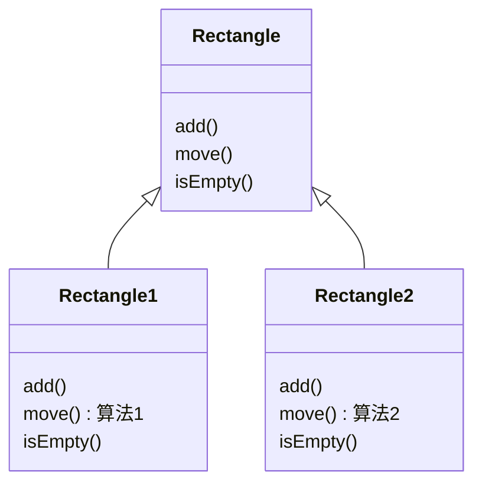
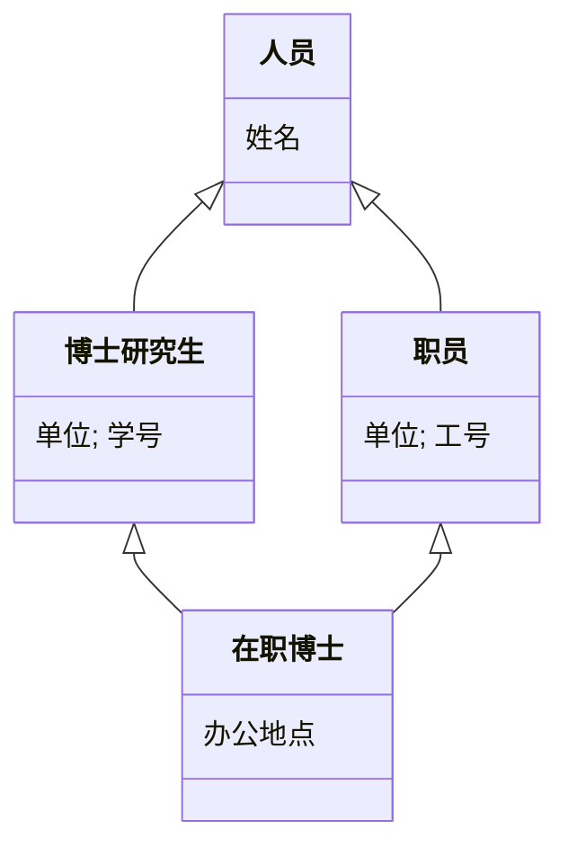

## 一、UML概述

### UML是什么（Unified Modeling Language）

**定义**：**UML（统一建模语言，Unified Modeling Language）**是一种可视化的系统分析与设计工具语言，用于对软件系统的制品进行规约、构造和文档化。

**核心思想**：UML并非软件开发方法学本身，而是为方法学提供不同抽象层次的术语及模型表达工具——它是弥合"应用系统"与"运行平台"之间"距离"的桥梁。

**背景与目的**：在实际开发中，面向对象的分析设计需要一种统一的符号体系，让不同团队、不同平台的开发者都能读懂模型。UML就是这样一套标准化"建模语言"。

**三大用途** [PPT p.3]：

- **规约（Specify）**：对所有重要的分析、设计和实现决策进行详细描述；
- **构造（Construct）**：UML描述的模型可与各种编程语言直接相关联；
- **文档化（Document）**：建立系统制品的文档。

**应用范围**：可用于对象方法和构件方法；适用于所有应用领域（航空航天、财政、通讯等）和不同实现平台（J2EE、.NET等）。

**结构示意** [PPT p.4]：

```
应用系统
    │
    │  ← UML弥补两者之间的"距离"
    │     1. 建立不同抽象层次的术语空间和模型表示工具
    │     2. 支持多视角地建立系统模型
    ↓
运行平台（VB/VC、中间件、J2EE、.NET、框架等）
```

UML在各抽象层次均提供表达模型的工具：需求获取层（Use Case图）、需求分析层（类图、交互图等）、设计层（类图、交互图等）……

### 💡 常见疑问与解答

**Q1：UML是编程语言吗？**
> 不是。UML是建模语言，用来描述和设计系统，不能直接运行。但UML描述的模型可以与Java、C++、Python等编程语言建立直接映射关系。

**Q2：UML和软件开发方法学（如RUP、敏捷）是什么关系？**
> UML是方法学的工具和组成部分，但不等于方法学本身。方法学定义了开发过程，UML提供在每个阶段用于表达模型的符号系统。

---

## 二、UML术语——表达客观事物

UML基于面向对象的世界观："大千世界是由对象组成的，对象有其自己的属性和运动规律，对象之间的相互作用构成了客观世界各种各样的系统。" [PPT p.6]

UML将表达事物的术语统一称为**类目（Classifier）**，共八种：**类、接口、协作、用况、主动类、构件、制品、节点**。

### 类与对象（Class & Object）——体现数据抽象

**定义** [PPT p.8]：

- **类（Class）**：一组具有相同属性、操作、关系和语义的对象的描述；
- **对象（Object）**：类的一个实例。

**核心思想**：类是抽象描述，对象是具体存在。类定义了"模板"，对象是"实体"。

**结构示意** [PPT p.8]：

```
类的符号                    对象的符号
┌──────────┐               ┌──────────────────┐
│ Rectangle│  ← 类名        │ circle:Shape     │  ← 对象名:类名（下划线）
├──────────┤               ├──────────────────┤
│  origin  │  ← 属性        │ center=(1,1)     │  ← 属性栏（有具体值）
│  length  │               │ radius=1         │
│  width   │               │ borderColor=red  │
├──────────┤               │ fillColor=blue   │
│ resize() │  ← 操作        └──────────────────┘
│ display()│
└──────────┘
```

> **注意**：对象符号只有属性栏而**没有操作栏**。原因：操作是类级别的行为描述，对所有实例共享，无需在每个具体对象上重复列出；对象关注的是特定时刻的**状态**（属性值）。

#### 类名（Class Name）

[PPT p.9] 命名规则：

- 使用名词或名词短语，以大写字母开始，每个词的首字母大写（PascalCase）；
- **抽象类**（没有实例的类）：类名采用*斜体字*；
- 名称分**简单名**（如 `Person`）和**限定名**（含包路径，如 `java::awt::Rectangle`）。

#### 类的属性（Attribute）

[PPT p.10] **定义**：类的命名特性，由该类的所有对象共享，用于表达对象状态的数据。

**属性的完整语法**：

```
[可见性] 属性名 [:类型] [多重性] [=初始值] [{特性串}]
```

举例说明：

| 写法 | 含义 |
| :--- | :--- |
| `name` | 仅属性名 |
| `name: String` | 属性名 + 类型 |
| `name: String[0..1]` | 属性名 + 类型 + 多重性 |
| `+name: String` | 可见性 + 属性名 + 类型 |
| `name: String{readonly}` | 属性名 + 类型 + 性质串（只读） |

#### 可见性（Visibility）

[PPT p.11] 引入可见性的目的：**支持信息隐蔽（Information Hiding）**，即每个模块中的信息不允许不需要它的模块访问，这是实现模块**低耦合**的有效途径。 [PPT p.17]

| 可见性 | 符号 | 关键字 | 描述 |
| :---: | :---: | :---: | :--- |
| 公有的 | `+` | `public` | 所有其它类/类目均可使用 |
| 受保护的 | `#` | `protected` | 仅其子类/类目才能使用 |
| 私有的 | `-` | `private` | 仅本类的操作才能使用 |
| 包内的 | `~` | `package` | 仅同一包中声明的类/类目才能使用 |

**⚠️ 易错点**：Python中没有像Java/C++那样由编译器强制的访问修饰符，而是通过**命名约定**来表达可见性 [PPT p.12–p.16]：

| Python命名 | 对应可见性 | 机制 |
| :--- | :--- | :--- |
| `name`（无下划线） | public（公有） | 完全公开，可在任何地方访问 |
| `_name`（单下划线） | protected（受保护，约定俗成） | 技术上仍可访问，语义上表示"内部使用" |
| `__name`（双下划线） | private（私有，名称改写） | 触发Name Mangling，变为`_ClassName__name`，阻止直接访问 |

Python没有包级可见性，原因是：Python信任开发者（"我们都是成年人"），且其动态特性（反射、猴子补丁等）依赖灵活的访问能力。

#### 属性的其他要素 [PPT p.18]

- **属性名**：小写字母开头，左对齐；
- **类型**：与具体实现语言有关；
- **多重性**：属性值的数目，格式为 `下限..上限`，省略时默认 `[1..1]`。例如 `points[1..*]: Point` 表示一个或多个值；`name[0..1]: String` 表示可为空；
- **初始值**：新建对象的默认值，可被构造函数修改；
- **性质串**：如 `{frozen}` 表示属性不可改变（类似 Java 的 `final`）。

#### 属性的作用范围 [PPT p.19]

- **实例范围的属性**：每个对象有独立的属性值，随程序执行变化（默认情况）；
- **类范围的属性**：所有对象共享同一属性值，UML中对属性**加下划线**表示（对应Java的`static`字段）。

```
Window
• size : Area           ← 实例范围（每个窗口有自己的尺寸）
• defaultSize : Rectangle  ← 类范围（下划线，所有窗口共享默认尺寸）
```

#### 类的操作（Operation）

[PPT p.20] **定义**：对一个类中所有对象要做的事情（行为）的抽象；是类对外提供的服务，可被其它对象调用。

**操作的完整语法**：

```
[可见性] 操作名 [(参数表)] [:返回类型] [{性质串}]
```

举例说明：

| 写法 | 含义 |
| :--- | :--- |
| `resize` | 仅操作名 |
| `+resize` | 可见性 + 操作名 |
| `set(id: Integer, name: String)` | 操作名 + 参数表 |
| `getName(): String` | 操作名 + 返回类型 |

**参数方向** [PPT p.21]：

| 方向 | 含义 |
| :--- | :--- |
| `in` | 输入参数，不能修改 |
| `inout` | 输入参数，可能被修改以返回信息 |
| `out` | 输出参数，用于向调用者返回信息 |

**操作的性质串**：`leaf`（叶子操作，不可覆盖）、`abstract`（抽象操作，子类必须实现）等。

**操作的作用范围**：同属性，实例范围（默认）或类范围（加下划线，对应`static`方法）。

**操作的多态性** [PPT p.23]：父类可以定义抽象操作（斜体），子类各自提供不同算法实现。例如父类 `Rectangle` 中有抽象操作 `move()`，子类 `Rectangle1` 和 `Rectangle2` 分别以不同算法实现 `move()`。



#### 类语义的进一步表达 [PPT p.25–p.27]

当类名、属性、操作还不能充分描述类的语义时，可以用以下方式增强：

1. **详细叙述类的职责（Responsibility）**：以自然语言描述类在系统中承担的任务。**注意使用单一职责原则（SRP）**——一个类应只有一个变化的原因。例如，调制解调器（Modem）不应同时负责"连接管理"和"数据通信"两种职责，这会使类难以维护和复用。
2. **类/操作的注解**：用结构化文本描述操作的**前置条件**和**后置条件**，以及整个类的**不变式**。
3. **详述类的状态机**：用状态图描述控制器类的行为；
4. **详述类的内部结构**：用活动图描述复杂操作的处理流程；
5. **详述体现类的协作**：用交互图描述该类与其他类的协作。

#### 类在建模中的主要用途 [PPT p.28–p.31]

1. **对系统词汇建模**：将问题域中的概念（如"访客"、"博文"、"评论"）模型化为类；
2. **对系统责任分布建模**：均衡每个类的职责，避免过大（难复用）或过小（难管理）；
3. **对基本类型建模**：用带有**衍型（stereotype）**的类表示整数、枚举等简单类型。衍型用双尖括号表示，如 `«datatype»`、`«enumeration»`。

**结构良好的类应满足**：明确抽象了问题域中某个有形事物或概念；包含小而明确的职责集；清晰分离了抽象和实现。

### 💡 常见疑问与解答

**Q1：对象为什么只有属性栏没有操作栏？**
> 操作属于类级别的行为规范，对同一个类的所有实例来说操作的定义是相同的，没有必要在每个具体对象上重复列出。对象图关注的是某一时刻的**系统状态**（即属性值的快照），而不是行为。

**Q2：类范围的属性（静态属性）和实例属性有什么本质区别？**
> 类范围属性只有一份拷贝，所有实例共享并看到同一个值（类似全局变量但归属于类）；实例属性每个对象各有一份独立的拷贝。在UML中，类范围属性和操作用下划线标识。

### 接口（Interface）——体现功能抽象

**定义** [PPT p.32]：接口是一组操作的集合，每个操作描述了类或构件的一个服务。**接口只定义操作的描述，不包含操作的实现**（这是接口和抽象类的核心区别之一）。

**核心思想**：接口是系统中的"接缝"——它把"需要什么服务"和"如何实现服务"彻底分开，使系统各部分可以独立演化。

**UML表示**：

```
方式一（矩形符号）：             方式二（圆圈符号）：
┌──────────────┐
│ «interface» │
│    Sale      │           供接口（实心圆）——类提供的接口
├──────────────┤           需接口（半圆）——类需要的接口
│  search()    │
│  sell()      │
└──────────────┘
```

**接口与类的关系表示** [PPT p.33]：

- **实现关系**（类实现接口）：带实心三角箭头的虚线，箭头指向接口；
- **使用关系**（类使用接口）：带 `«use»` 标记的虚线箭头。

**建模注意事项** [PPT p.34]：

- 接口只可被其它类目使用，其本身不能访问其它类目；
- 接口没有属性和状态，本质上等价于一个**没有属性、只有抽象操作的抽象类**；
- 接口之间没有关联，但可以参与泛化、实现和依赖关系。

### 协作（Collaboration）——体现行为结构抽象

**定义** [PPT p.35]：协作是一个交互，涉及交互三要素：交互各方、交互方式以及交互内容。多个对象协同工作，共同提供某种协作行为。

**两个方面**：

- **结构部分**：说明参与协作的类、接口等元素（用组合结构图或类图表示）；
- **行为部分**：说明这些元素如何交互（用交互图表示）。

**UML表示**：用虚线椭圆，椭圆内写协作名称，例如"统计学生成绩分布"。

### 用况（Use Case）——体现功能抽象

**定义** [PPT p.36]：对一组动作序列的描述，系统执行这些动作为特定的参与者产生有值的、可观察的结果。

**核心作用**：用况用于模型化系统中的行为，一个用况描述系统的一个**完整功能需求**；用况通过协作来细化（即由协作实现）。

**UML表示**：实线椭圆，内写用况名称，例如 `Place order`。

---

### 主动类（Active Class）——体现并发行为抽象

**定义** [PPT p.37]：至少具有一个进程或线程的类，能够启动系统的控制活动。

**说明**：主动类对象的行为通常与其他元素的行为**并发**执行。

**UML表示**：类似普通类符号，但边框为**粗线**矩形。

---

### 构件（Component）

**定义** [PPT p.38]：系统设计中逻辑的、可替换的模块化部件。在遵循并提供一组外部接口实现的同时，隐藏内部实现。

**本质**：构件是描述"比特世界"软件制品的系统单位——强调**可替换性**：共享相同接口的构件可以相互替代。构件可以包含更小的构件（嵌套结构）。

**UML表示**：带有组件图标（小矩形+插头符号）的矩形。

---

### 制品（Artifact）

**定义** [PPT p.39]：系统中包含物理信息的、可替代的物理部件，主要指文件（如源代码、可执行程序、脚本等）。

**说明**："物理的"意味着软件未运行时仍然存在的部分；制品代表对源代码/运行时信息的物理打包。

**UML表示**：带有 `«artifact»` 衍型标记的矩形，内写文件名（如 `window.dll`）。

---

### 节点（Node）

**定义** [PPT p.40]：在运行时存在的物理元素，通常表示一种具有记忆能力和处理能力的计算机资源（即实际的机器设备）。

**说明**：构件可以驻留在一个节点中，也可以从一个节点迁移到另一个节点。

**UML表示**：三维立方体图形，内写节点名（如 `Server`）。

---

### 八大类目对比总结 [PPT p.41]

| 类目 | 体现的抽象 | UML符号特征 | 典型变体 |
| :--- | :--- | :--- | :--- |
| 类（Class） | 数据抽象 | 三栏矩形（类名/属性/操作） | 参与者、信号、实用程序 |
| 接口（Interface） | 功能抽象 | `«interface»`矩形 或 圆圈 | — |
| 协作（Collaboration） | 行为结构抽象 | 虚线椭圆 | — |
| 用况（Use Case） | 功能抽象 | 实线椭圆 | — |
| 主动类（Active Class） | 并发行为抽象 | 粗线三栏矩形 | 进程、线程 |
| 构件（Component） | 模块化部件 | 带插头图标的矩形 | — |
| 制品（Artifact） | 物理部件 | `«artifact»`矩形 | 应用、文档、库、页、表 |
| 节点（Node） | 计算资源 | 三维立方体 | — |

### 💡 常见疑问与解答

**Q1：构件和类有什么区别？**
> 类是对业务概念的抽象，面向问题域；构件是对软件模块的抽象，面向实现域。一个构件可以由多个类协作实现，强调**可替换性**和**接口暴露**，隐藏内部细节。

**Q2：接口和抽象类有什么区别？**

| 对比维度 | 接口（Interface） | 抽象类（Abstract Class） |
| :--- | :--- | :--- |
| 操作实现 | 完全没有实现 | 可以有部分实现 |
| 属性 | 无属性 | 可以有属性 |
| 状态 | 无状态 | 可以有状态 |
| 本质 | 纯行为规约 | 部分实现的类 |
| 继承 | 一个类可实现多个接口 | 通常单继承（Java等语言） |

---

## 三、UML术语——表达关系

UML提供四种关系术语，用于表达类目之间的特定语义关系：**关联（Association）、泛化（Generalization）、实现（Realization）、依赖（Dependency）**。 [PPT p.43]

---

### 关联（Association）

**定义** [PPT p.44]：描述了两个或多个类实例间的连接关系，是一种名为**链（link）**的抽象，表达一组具有相同结构、相同语义的对象之间的特定语义关系。

**说明**：可以是二元关联（两个类）或n元关联（三个及以上，用菱形节点表示）。

#### 关联的8个语义要素 [PPT p.45–p.53]

**1. 关联名（Name）**：描述该关联的"内涵"，如 `Work in`，通常写在关联线的中间。

**2. 导航（Navigation）**：从一个类目找到与之关联的另一个类目的能力。默认双向；若限定为单向，用**单向箭头**修饰关联。

**3. 角色（Role）**：关联一端的类目对另一端类目的呈现方式，写在关联线的端点处，称为**端点名**。例如 `Teacher` 端标记为 `employee`，`University` 端标记为 `employer`。

**4. 多重性（Multiplicity）**：类中对象参与关联的数目（上下界闭区间）。

| 多重性表示 | 含义 |
| :---: | :--- |
| `1` | 恰好1个 |
| `0..1` | 0或1个 |
| `1..*` | 1个或多个 |
| `*` 或 `0..*` | 0个或多个（任意数量） |
| `m..n` | m到n个 |

> **关键**：关联一端的多重性，说明**对另一端的每个对象，本端可能有多少个对象参与**。例如 `Person -1..*- Company` 的 `1..*` 在 Company 端，表示每个 Person 对象受雇于1个或多个公司。

**5. 限定符（Qualifier）**：关联的属性，其值对关联的对象集做划分。例如 `Bank` 通过 `account#` 限定符，给定一个具体账号值，可找到0或1个 `Person`。

**6. 聚合（Aggregation）**：特殊形式的关联，表达"整体/部分"关系。整体类和部分类**在概念上处于同一层次**，**生命周期可以不同**。

**UML表示**：带**空心菱形**的线段，菱形位于**整体类**一侧。

```
University ◇────* Teacher
（空心菱形）
```

**7. 组合（Composition）**：更强的聚合，整体类和部分类的实例**具有相同的生命周期**（部分随整体的销毁而销毁）。

**UML表示**：带**实心菱形**的线段，实心菱形在**整体类**一侧。组合端的多重性不能超过1。

```
Table ◆──1 TableName
     ◆──1 TableHeader
     ◆──* TableRow
（实心菱形）
```

**8. 关联类（Association Class）**：同时具有关联和类特性的模型元素——既是关联又是类。用虚线将关联类符号连接到关联线。例如 `University` 和 `Teacher` 之间的关联，可以用关联类 `Task(beginTime, endTime)` 来记录任务信息。

---

### 聚合 vs 组合 对比

| 对比维度 | 聚合（Aggregation） | 组合（Composition） |
| :--- | :--- | :--- |
| 符号 | 空心菱形 ◇ | 实心菱形 ◆ |
| 生命周期 | 整体和部分**独立**，可以不同 | 整体和部分**相同**，共存亡 |
| 所有权强度 | 弱（部分可属于多个整体） | 强（部分只能属于一个整体） |
| 典型例子 | 大学有教师（教师可离职） | 订单有订单行（订单删除行也删） |
| 整体端多重性 | 无限制 | 不超过1 |

---

### 泛化（Generalization）

**定义** [PPT p.54]：一般性类目（父类/超类）和较为特殊性类目（子类）之间的关系，即"is-a-kind-of"关系。泛化是支持**复用**的机制。

**说明**：

- 子类继承父类的属性和操作，并可以有自己的属性和操作；
- 子类操作可以**覆盖**父类同一操作的实现（多态），条件是名字和参数相同；
- 一个类可以有0个、1个或多个父类：**单继承**（一个父类）或**多继承**（多个父类）；
- **根类/基类**：没有父类且至少有一个子类；**叶子类**：没有子类的类。

**UML表示**：带**空心三角形**的实线，三角形指向**父类**。



> **注意**：`在职博士` 同时继承 `博士研究生` 和 `职员`，这是多继承的例子。

---

### 实现（Realization）

**定义** [PPT p.56]：类目之间的语义关系，其中一个类目规约了保证另一个类目执行的**契约**。

**使用场景**：

- 接口与实现它们的类/构件之间；
- 用况与实现它们的协作之间。

**UML表示**：带**空心三角形的虚线段**，三角形指向被实现的接口/用况。

---

### 依赖（Dependency）

**定义** [PPT p.57]：一种**使用关系**，描述一个类目使用另一类目的信息和服务。若被使用的类发生变化，使用方的操作也会受到影响。

**UML表示**：**有向虚线**，箭头指向被使用的目标类目。

**依赖分类** [PPT p.58–p.59]：

| 类型 | 标记 | 含义 |
| :--- | :---: | :--- |
| 绑定 | `«bind»` | 源是使用目标模板实例化的 |
| 导出 | `«derive»` | 源可从目标推导出（如年龄从生日推导） |
| 允许 | `«permit»` | 目标对源可见（访问私有特征） |
| 实例 | `«instanceOf»` | 源的对象是目标的实例 |
| 实例化 | `«instantiate»` | 源的实例由目标创建 |
| 精化 | `«refine»` | 源比目标更精细（不同抽象层间细化） |
| 使用 | `«use»` | 源的语义依赖于目标的语义（最常用） |

---

### 四种关系综合对比

| 关系 | 本质 | UML符号 | 语义强度 | 典型场景 |
| :--- | :--- | :--- | :---: | :--- |
| 关联（Association） | 对象间结构连接 | 实线（可加箭头/菱形） | 中 | Teacher在University工作 |
| 泛化（Generalization） | is-a-kind-of | 实线+空心三角（指向父类） | 强 | 在职博士 is-a 职员 |
| 实现（Realization） | 履行契约 | 虚线+空心三角 | 强 | Product实现Sale接口 |
| 依赖（Dependency） | 使用关系 | 有向虚线（可加标记） | 弱 | LibraryManager使用Book |

---

### UML关系用法总结 [PPT p.60–p.65]

建模时的基本策略：

- **结构关系**：用**关联**，模型化系统中的静态/动态结构；
- **继承关系**：用**泛化**，仅当确实是"is-a-kind-of"关系时才用，注意继承层次不宜过深或过宽；
- **精化关系**：用**实现**，表达不同抽象层之间的细化（如用况通过协作实现）；
- **依赖关系**：用**依赖**，当关系不属于以上三种，且某类仅作为另一类的操作参数时使用；
- 不要引入循环的泛化关系。

### 💡 常见疑问与解答

**Q1：聚合和组合在代码实现上有什么区别？**
> 聚合通常用引用/指针实现，部分对象在整体对象外部创建，生命周期独立；组合通常用嵌入对象或由整体负责创建/销毁的指针实现，部分对象的生命周期由整体控制。

**Q2：什么时候用依赖而不用关联？**
> 当某个类只在另一个类的**方法参数**或**局部变量**中短暂使用，而不作为持久化的属性存在时，用依赖。关联意味着对象之间有持久的结构性连接（属性级别）；依赖是临时的、行为级别的联系。

---

## 四、UML术语——信息组织与解释：包和注解

### 包（Package）

**目的** [PPT p.67]：控制信息组织的复杂性，形成可管理的部分，作为模型的"模块化"和"构件化"机制。

**定义**：包是模型元素的一个分组，可以嵌套在其他包中，并且可以含有子包和其他模型元素。

**包的可见性**：

| 可见性 | 符号 | 描述 |
| :---: | :---: | :--- |
| 公有的 | `+` | 对所有包可见 |
| 受保护的 | `#` | 仅对子孙包可见 |
| 私有的 | `-` | 对其他包不可见 |
| 包范围的 | `~` | 仅对同一包内声明的元素可见 |

**UML表示** [PPT p.68]：大矩形，左上角有一个小矩形（形似文件夹图标）。包名写在小矩形中，内容写在大矩形中；或包名写在大矩形中，内容通过 `⊕` 符号连接。

#### 包间的依赖关系 [PPT p.69–p.72]

| 关系类型 | 标记 | 含义 | 特点 |
| :--- | :---: | :--- | :--- |
| 引入依赖 | `«import»` | 目标包内容加入源包的**公共**命名空间 | 第三方引入源包时，也能访问被引入的目标包元素 |
| 访问依赖 | `«access»` | 目标包内容加入源包的**私有**命名空间 | 第三方引入源包时，**不能**传递访问目标包元素 |

**UML表示**：从源包到目标包的带箭头虚线，分别标记 `«import»` 或 `«access»`。

---

### 注解（Note/Annotation）

**目的** [PPT p.73]：使建造的系统模型容易理解，对模型元素增加辅助性说明。

**特点**：注解可以是简单文字、URL链接或文档链接，用**虚线**连接到所说明的模型元素上。

**UML表示**：右上角折角的矩形（类似便利贴），内写说明文字。

---

## 五、UML总结 [PPT p.74]

UML的术语体系（元信息）分三层：

**第一层——抽象客观事物的术语（类目，Classifier）**：
类、接口、协作、用况、主动类、构件、制品、节点，及其相关变体。

**第二层——抽象事物关系的术语**：
关联（含聚合、组合、关联类等）、泛化、实现、依赖（含各类标记变体）；辅助以角色名、多重性、限定符、关联类等概念增强关系语义表达。

**第三层——组织和解释信息的术语**：
包（Package）和注解（Note）。
