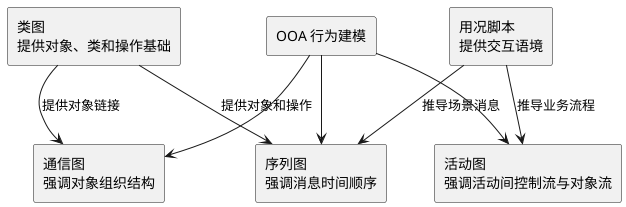
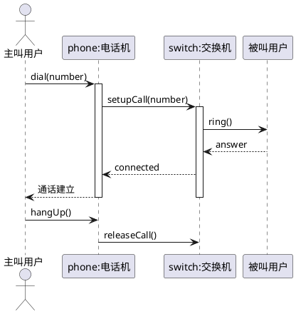
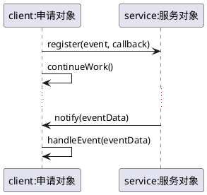
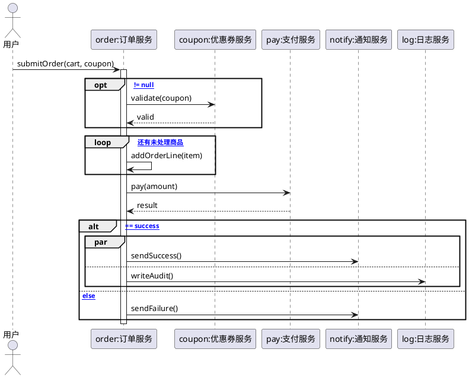
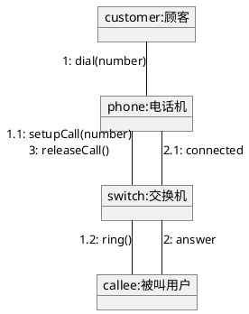
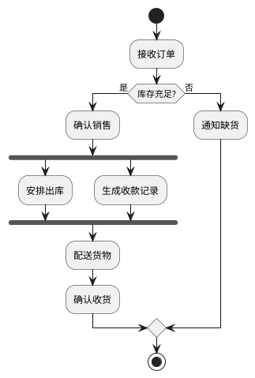
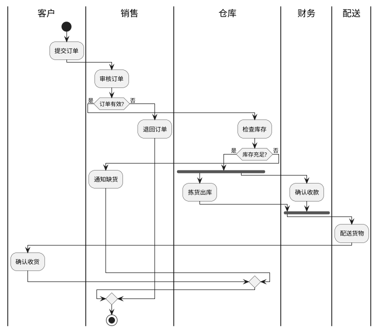
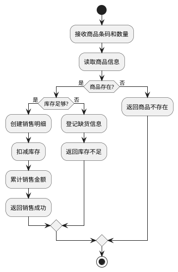

## 对象交互建模的主线

### 交互图在面向对象分析中的位置

**定义**：交互图是用于表示对象之间、对象与参与者实例之间如何通过消息协作完成系统行为的行为模型，本课重点讨论 **序列图（Sequence Diagram）** 和 **通信图（Communication Diagram）**。[PPT p.1-p.3, p.22-p.23]

**核心思想**：类图说明系统中有哪些类以及类之间存在什么静态关系，但它没有详述对象在一次业务执行中如何互相作用。也就是说，交互图把“类之间可能有关联”进一步落实为“某个场景里，哪些对象按什么顺序向哪些对象发送消息”。[PPT p.3]

**背景与目的**：OOA 阶段需要检查每个用况中的用户需求是否已经落实到对象职责中，单靠类图很容易漏掉操作、主动对象或中间协作对象。交互图可以通过模拟一条用况脚本的执行路线，提醒分析员补充遗漏类和操作，并理解对象群体的动态方面。[PPT p.19]

**生活类比**：类比一下，类图像通讯录，说明有哪些联系人以及他们之间有什么稳定关系；序列图像一次通话记录，说明谁先拨给谁、谁等待返回、谁继续下一步；通信图像联系人关系图上标出通话编号，说明同一组协作对象围绕哪些连接交换消息。

**PPT 原文关联**：PPT 的目录将本课分为顺序图、通信图和活动图三部分，先用序列图表达消息顺序，再用通信图表达对象组织结构，最后用活动图表达动作或活动之间的控制流与对象流。[PPT p.2, p.22, p.27]



**解读说明**：图中把本课三类图放回 OOA 过程。用况脚本提供“发生什么”的语境，类图提供“由哪些对象承担”的结构基础，序列图和通信图关注对象协作，活动图关注业务或算法流程。

#### 本节 Q&A

**问**：为什么已经有类图，还要画交互图？

**答**：类图只能说明对象之间有静态联系，不能说明一次业务请求中消息怎样传递。交互图能检查操作是否放在合适对象中，也能发现类图中遗漏的控制对象、边界对象或实体对象。[PPT p.3, p.19]

**问**：序列图、通信图和活动图是不是互相替代？

**答**：不是。序列图和通信图在语义上可以相互转换，但表达重点不同；活动图描述的是动作或活动之间的流程，不等同于对象之间的消息轨迹。[PPT p.26, p.28]

## 序列图的概念与基本表示

### 序列图

**定义**：**序列图（Sequence Diagram）** 是一种交互图，用于详细表示对象之间以及对象与参与者实例之间的交互，由一组协作对象或参与者实例以及它们之间可发送的消息组成，并强调消息之间的顺序。[PPT p.3]

**核心思想**：序列图把一次交互沿时间方向展开，通常横向排列对象，纵向表示时间推进。也就是说，读者从上到下阅读时，可以看到系统行为如何由一个消息触发，并逐步传递到其他对象。[PPT p.3-p.4]

**背景与目的**：在类图中，即使两个类之间有**关联（Association）**，也无法看出一次操作执行时谁先调用谁、谁等待谁、哪个对象被创建或销毁。序列图正是系统行为建模工具，它把对象间的行为相互作用具体化，帮助分析人员验证用况是否可由对象协作实现。[PPT p.3, p.19]

**直观理解**：例如“顾客打电话”不是只有顾客、电话机、交换机这些对象，还包含拨号、建立连接、振铃、接听和挂断等消息顺序。值得注意的是，序列图不只是流程图，它的每一步都必须落在某个对象或参与者实例之间的消息上。[PPT p.20]

**PPT 原文关联**：PPT 将序列图的元素概括为对象、参与者、消息、生命线和执行规约，并说明它用于系统行为或交互建模。[PPT p.3-p.5]



**解读说明**：这张图用 PlantUML 重绘了“打电话”类场景。对象位于图上方，生命线向下延伸，消息从发送者指向接收者；`activate` 表示执行规约，对应对象正在执行某段行为的时间区间。

### 对象与参与者

**定义**：序列图中的对象表示参与某次交互的对象实例，常用 `[对象名]:类名` 的形式表示；参与者表示系统边界外与系统发生交互的角色或外部实体。[PPT p.4]

**核心思想**：对象和参与者都可以放在序列图顶部，作为消息的发送者或接收者。PPT 特别提示类名前有冒号，这说明序列图画的是实例层面的协作，而不是类定义本身。[PPT p.4]

**背景与目的**：如果不区分实例和类，很容易把类图中的类型直接当成运行中的对象，导致消息接收方不明确。OOA 中应先确定当前交互语境，再列出本次场景实际需要的对象角色，而不是把类图中的所有类都放进图里。[PPT p.18]

**直观理解**：例如 `order:Order` 表示某一个订单对象，而不是所有订单类；`customer:Customer` 表示当前参与下单的顾客实例。若发起交互的是外部用户，可以把它画成参与者，并让第一个消息从参与者进入系统内部对象。

**PPT 原文关联**：PPT 在“概念及表示法”中把对象、参与者和生命线放在同一页讲解，并指出生命线代表对象在特定时间内的存在。[PPT p.4]

### 生命线与析构

**定义**：生命线表示一个对象在特定时间内的存在，通常画成对象下方的垂直虚线；若对象在图中被销毁，则在生命线末端用大的 `X` 标记析构。[PPT p.4]

**核心思想**：生命线让读者看到对象何时存在、何时参与消息、何时退出当前交互。本质上，它把对象的“存在时间”与消息顺序放到同一个坐标系中，使创建和销毁不再只是文字说明。[PPT p.4, p.18]

**背景与目的**：某些对象不是交互一开始就存在，例如订单行、临时会话、支付记录可能由某条消息创建；某些对象也可能在交互中被撤销。若序列图不显式表示创建与销毁，读者就无法判断对象生命周期与业务步骤之间的关系。[PPT p.4, p.18]

**直观理解**：例如用户提交订单后，系统才创建 `order:Order`；支付取消后，临时支付会话可能被销毁。生命线也可以分裂成两条或更多条，以表示条件分支，并在后续位置重新合并，这适合表达对象在不同条件路径下的存在情况。[PPT p.4]

```plantuml
@startuml
actor User as "用户"
participant Service as "orderService:订单服务"
create Order
User -> Service : submit(cart)
Service -> Order : <<create>> new(cart)
activate Order
Order --> Service : created
Service -> Order : cancel()
destroy Order
@enduml
```

**解读说明**：`create Order` 和 `destroy Order` 分别表达对象被创建和被销毁。图中的订单对象不是从交互开始就存在，而是由订单服务收到提交消息后创建。

### 执行规约

**定义**：执行规约表示一个对象直接或者通过从属例程执行一个行为的时期，它既表示行为执行的持续时间，也表示调用者与被调用者之间的控制关系。[PPT p.5]

**核心思想**：执行规约通常画成生命线上的窄长矩形，矩形顶端与开始时刻对齐，末端与结束时刻对齐。当对象处于执行规约期时，说明该对象的操作正在执行，并且能够继续发送或响应消息。[PPT p.5]

**背景与目的**：没有执行规约时，序列图只能看出消息顺序，较难看出哪个对象在何时掌握控制权。执行规约能帮助分析调用栈、同步等待和嵌套调用，尤其适合检查同一个控制线程中的调用是否合理。[PPT p.5, p.19]

**直观理解**：例如订单服务收到 `createOrder()` 后开始执行，在执行期间它可能调用库存服务和支付服务。若一个对象递归调用自己，或调用本对象的另一个操作，第二个执行规约应画在第一个执行规约稍微靠右的位置，表示嵌套执行。[PPT p.5]

### 消息

**定义**：消息是对象之间通信的规格说明，用于传输将发生的活动所需要的信息，包括控制信息和数据规格说明；消息执行可能引发操作执行、信号发送、对象创建或对象消除。[PPT p.6]

**核心思想**：序列图中的消息不仅是箭头，也代表“接收方需要承担某项行为”。也就是说，消息名通常应能对应到接收对象的操作、可接收信号或对象生命周期动作，否则模型只是画出了流程而没有落实对象职责。[PPT p.6, p.18]

**背景与目的**：OOA 需要通过消息检查类图中的操作是否完整。若某个用况步骤在序列图中找不到接收对象，说明可能缺少类；若接收对象没有相应操作，说明类的特征层可能需要补充。[PPT p.19]

**直观理解**：例如 `reserveItems()` 是发送给库存对象的消息，它不仅表示“下一步去库存”，还暗示库存对象应该提供预留商品的操作。消息也可以携带参数和返回值，帮助在分析阶段明确对象协作需要哪些信息。

## 序列图中的消息类型与时间表达

### 同步消息

**定义**：同步消息表示普通过程调用，发送者发出请求后需要等待接收者完成整个嵌套序列，外层控制才能恢复。[PPT p.7-p.8]

**核心思想**：同步消息强调等待和返回。也就是说，发送方在调用期间通常被阻塞，接收方完成操作后再把控制权交回发送方，这与普通函数调用或方法调用的直觉一致。[PPT p.7]

**背景与目的**：很多业务操作要求明确结果，例如付款、校验库存和查询账户余额。若发送方必须得到结果才能继续下一步，就应在序列图中使用同步消息，并根据需要显式画出返回箭头和返回值。[PPT p.7-p.8]

**直观理解**：例如去食堂窗口排队打饭时，你在拿到饭之前不会去做别的事，这就是同步等待。PPT 说明返回箭头可以省略，因为每个调用都有配对返回；但如果需要标识返回值，就应显式地把返回值标在返回箭头上。[PPT p.7-p.8]

### 异步消息

**定义**：异步消息表示异步通信，发送者发出消息后立即继续执行下一步，不等待接收者完成处理。[PPT p.8]

**核心思想**：异步消息强调发送与继续执行之间没有等待关系。若接收方响应后需要返回信息，通常再使用另一个异步消息表达回传，而不是把它画成同步调用的返回箭头。[PPT p.8]

**背景与目的**：异步消息适合通知、事件、队列、后台任务和回调等场景。OOA 阶段虽然不必直接决定线程或消息队列实现，但必须表达“发送后是否等待”这一行为语义，因为它会影响控制流、错误处理和对象主动性判断。[PPT p.8, p.19]

**直观理解**：PPT 用打饭取号说明异步：你拿号后可以继续做别的事，食堂叫到号时再去取饭。这个例子说明异步返回可能很快，也可能很久以后才发生，关键是请求方不会停在原地等待。[PPT p.8]

| 维度 | 同步消息 | 异步消息 | 建模影响 |
| :--- | :--- | :--- | :--- |
| 发送方行为 | 发送后等待接收方完成 | 发送后立即继续执行 | 决定执行规约和控制权是否嵌套 |
| 返回表达 | 可省略返回箭头，也可显式标返回值 | 需要返回信息时通常另发异步消息 | 决定返回是否属于同一调用栈 |
| 典型场景 | 普通过程调用、查询、校验 | 通知、事件、后台处理 | 决定对象是否可能主动响应事件 |
| 时间关系 | 期望即时或短暂等待后返回 | 可即时、短暂或长时间后返回 | 决定是否需要时间约束或回调 |

### 收发消息时间差

**定义**：收发消息时间差是指消息从发送到接收之间存在不可忽略的传播或处理延迟时，在序列图中对时间间隔进行显式表达的建模方式。[PPT p.9-p.10]

**核心思想**：一般情况下，序列图认为消息发送和接收的时间差可以忽略，所以消息箭头通常画成水平线。只有当时间差本身影响需求、约束或理解时，才需要用约束、构造标记或向下倾斜的箭线表达。[PPT p.9]

**背景与目的**：某些场景对时间敏感，例如 30 秒内重复输入号码、网络传输延迟、设备响应超时等。若不表达时间差，读者会误以为所有消息都瞬时到达，从而遗漏超时、等待和重试条件。[PPT p.9-p.10]

**直观理解**：例如“在 30s 内可以一直输入号码”不是普通循环次数，而是带时间窗口的交互约束。值得注意的是，时间表达应服务于需求，不应把所有消息都标上时间，否则序列图会失去可读性。

**PPT 原文关联**：PPT 给出三种方法：使用约束指示时间间隔，用构造标记指明时间差数值，或把消息箭线向下倾斜表示消息需要一段时间到达。[PPT p.9-p.10]

### 消息分支与消息循环

**定义**：消息分支用于对含有分支的控制流建模，消息循环用于对重复发送的消息建模，常见循环表示法为 `*消息[条件表达式]`。[PPT p.11]

**核心思想**：消息分支把多个带监护条件的箭头从同一点发出，表达条件路径或并发可能性；消息循环则表达同一消息在条件成立期间重复发生。本质上，它们让序列图能描述非线性控制，而不仅是直线式消息列表。[PPT p.11]

**背景与目的**：真实用况通常包含条件和重复，例如登录失败后重新输入、库存不足时走补货路径、付款超时时取消订单。若所有分支都改写成自然语言，交互图无法支持对象职责审查；若所有分支都展开成多张图，又会增加阅读成本。[PPT p.11, p.13]

**直观理解**：例如输入电话号码时，系统可能在号码未完整且未超时的条件下反复接收数字；如果号码有效则建立连接，否则提示错误。监护条件要写成可判断的布尔表达式，而不是含糊的说明文字。

### 回调机制

**定义**：回调机制是申请对象预先在服务对象处登记自己关心的事件，然后继续执行自己的工作；当服务对象监控到该事件发生时，再通知申请对象，由申请对象进行处理。[PPT p.12]

**核心思想**：回调把“立即得到结果”改成“以后由服务对象反向通知”。也就是说，申请对象先发送登记消息，服务对象在事件发生后再向申请对象发送通知消息，控制流呈现出异步和反向调用特征。[PPT p.12]

**背景与目的**：如果某个事件发生时间不可预测，申请对象一直同步等待会浪费控制权，也会使交互图误导读者。回调机制能表达事件驱动系统中的责任分配：服务对象负责监控事件，申请对象负责处理通知后的业务行为。[PPT p.12]

**直观理解**：例如用户订阅“库存到货提醒”，商品服务在库存变化时再通知用户或通知服务。类比一下，这像留下电话号码等通知，而不是一直站在柜台前等货到。



**解读说明**：申请对象先登记事件，然后继续自己的工作。服务对象发现事件后再通知申请对象，这种反向通知就是回调在序列图中的核心形态。

## 序列图的结构控制

### 结构化控制操作符

**定义**：结构化控制操作符是在序列图中用带标签的矩形片段表示高层控制结构的机制，用于表达选择、条件、并发和迭代等非线性消息组织。[PPT p.13-p.17]

**核心思想**：普通消息序列适合表达单一线性流程，但复杂场景往往需要展示条件、循环和多个序列的并行执行。结构化控制操作符把这些控制结构封装在子顺序图区域中，使读者能同时理解消息细节和控制范围。[PPT p.13]

**背景与目的**：如果没有结构化控制，复杂序列图只能靠大量分叉箭头和文字注释表达逻辑，既难读也难审查。PPT 要求可用封闭矩形表示顺序图边界，并在左上角小五边形中写 `sd` 和图名；对子顺序图也使用矩形区域，在左上角写控制操作符类型。[PPT p.13]

**直观理解**：例如支付流程中可能有“可选优惠券校验”“成功或失败分支”“库存通知与日志记录并发”“重试三次”等结构。结构化控制就像给序列图加上清晰的代码块边界，让控制范围不会和普通消息混在一起。

### 选择执行

**定义**：选择执行是一种标签为 `opt` 的控制结构，只有当进入控制操作子时监护条件为真，该控制操作子的体才会执行。[PPT p.14]

**核心思想**：`opt` 表达“可发生，也可不发生”的单分支可选行为。监护条件是布尔表达式，可以出现在控制片段中任意生命线顶端的方括号内，并且可以引用对应对象的属性。[PPT p.14]

**背景与目的**：很多业务步骤不是主路径必然发生，例如有优惠券才校验、有备注才保存、有异常才通知管理员。如果把这些步骤画成普通消息，读者会误以为它们每次都执行；使用 `opt` 可以保留主流程，同时标明条件性。[PPT p.14]

**直观理解**：例如订单提交时，只有 `coupon != null` 才调用优惠券服务。这个片段只有一个可选体，没有多个互斥分支，因此比 `alt` 更合适。

### 条件执行

**定义**：条件执行是一种标签为 `alt` 的控制结构，其体通过水平线分成多个部分，每个部分表示一个带监护条件的条件分支，最多一个部分被执行。[PPT p.15]

**核心思想**：`alt` 表达互斥路径选择。若某个部分的监护条件为真，该部分执行；若多个条件为真，执行哪一部分属于非确定性问题；若没有条件为真，控制绕过该控制操作子继续执行，也可以使用 `[else]` 表示默认分支。[PPT p.15]

**背景与目的**：业务流程常常出现成功、失败、异常和默认处理。使用 `alt` 可以把这些路径放在同一张序列图里比较，避免为每个分支都画一张独立图而丢失整体关系。[PPT p.15]

**直观理解**：例如银行支票处理时，账户余额足够则兑付，余额不足则拒绝或转入异常处理。值得注意的是，`alt` 的监护条件应尽量互斥，否则非确定性会让模型含义不稳定。

### 并发执行

**定义**：并发执行是一种标签为 `par` 的控制结构，其体通过水平线分为多个部分，每个部分表示一个并行计算；进入该控制操作子时，所有部分并发执行。[PPT p.16]

**核心思想**：`par` 表达多个消息序列可以同时推进。每个并行部分内部的消息发送和接收仍有次序，但整个并发片段中不同部分之间的消息次序是任意的。[PPT p.16]

**背景与目的**：实际系统中存在许多可分解为独立并发活动的情况，例如发送通知和写日志、同时请求多个外部服务、并行处理多个设备事件。OOA 阶段用 `par` 不是为了指定线程实现，而是为了表达这些活动之间不存在严格先后依赖。[PPT p.16]

**直观理解**：例如订单支付成功后，系统可以并发发送短信、更新积分和写审计日志。若这些操作互不依赖，就不应在序列图中强行画成固定顺序，否则后续设计可能误以为必须串行执行。

### 迭代执行

**定义**：迭代执行是一种标签为 `loop` 的控制结构，只要每次迭代前监护条件为真，循环体就反复执行；当条件为假时，控制绕过该控制操作子。[PPT p.17]

**核心思想**：`loop` 表达一段消息序列的重复执行，而不是单条消息的重复。它比 `*消息[条件表达式]` 更适合包含多条消息的循环片段，因为循环范围由矩形边界明确限定。[PPT p.11, p.17]

**背景与目的**：复杂交互中经常需要重试、轮询、逐项处理集合或等待条件变化。若不用 `loop`，模型可能只能重复画相似消息，既冗长又容易遗漏边界条件。[PPT p.17]

**直观理解**：例如系统逐项处理购物车项目时，每个项目都需要检查库存、计算金额并加入订单行。循环条件可以写成 `[还有未处理商品]`，读者就能知道这组消息会按集合元素反复发生。



**解读说明**：该图集中展示 `opt`、`loop`、`alt` 和 `par`。可选片段用于优惠券校验，循环片段用于逐项处理商品，条件片段用于支付结果分支，并发片段用于成功后的通知和日志记录。

## 建立序列图

### 建立序列图的策略

**定义**：建立序列图是根据当前交互意图和相关材料，识别参与对象、设置生命线、决定消息序列、安排执行规约并补充约束的建模过程。[PPT p.18-p.19]

**核心思想**：建立序列图不是把需求句子机械改成箭头，而是模拟对象之间如何协作完成当前语境中的行为。也就是说，要从发起交互的对象开始，追踪它需要哪些对象提供操作，又向哪些对象提供操作，直到分析完当前语境相关的全部对象。[PPT p.18]

**背景与目的**：序列图的用途包括检查用况需求是否落实到对象中、补充遗漏类或操作、理解对象群体的动态方面，以及发现主动对象。它既是表达工具，也是分析工具，画图过程本身会暴露对象职责分配中的问题。[PPT p.19]

**直观理解**：例如从“用户提交订单”开始，不能只写“系统处理订单”，而要追踪界面对象、订单服务、库存对象、支付对象和通知对象之间的消息。若某个步骤找不到负责对象，就说明分析模型还没有完成。

**建立序列图**的步骤如下：

1. **设置交互语境**
   - 输入：有关用况、系统一次执行、对象协作说明或其他需求材料。
   - 操作：明确当前图只描述哪一次交互，排除与该语境无关的对象和路径。
   - 输出：当前交互的范围、前提和可能需要的对象集合。
   - 目的：防止一张序列图试图覆盖所有场景，导致消息过多、边界模糊。[PPT p.18]
2. **识别对象角色**
   - 输入：用况脚本中的参与者、领域对象、控制职责和边界对象。
   - 操作：识别对象在交互中扮演的角色，在图上部列出对象并给出类名，为每个对象设置生命线。
   - 输出：对象和生命线的横向布局。
   - 目的：把自然语言中的角色落实到对象实例，通常把发起交互的对象放在左边。[PPT p.18]
3. **标明创建与撤销**
   - 输入：交互期间才产生或结束生命周期的对象。
   - 操作：在适当时刻用消息箭线显式指出创建和撤销，并相应调整生命线起止位置。
   - 输出：对象生命周期与业务步骤之间的对应关系。
   - 目的：让读者知道对象是否从一开始存在，以及何时不再参与当前交互。[PPT p.18]
4. **决定消息序列**
   - 输入：当前场景中的事件顺序、对象职责和可调用操作。
   - 操作：从首先发出消息的对象开始，沿对象提供和请求的操作逐步追踪，画出带箭头的消息并注明消息名。
   - 输出：按时间组织的消息链。
   - 目的：检查每个业务步骤是否有对象负责，并用适当箭头区分同步、异步、创建、返回等消息。[PPT p.18]
5. **安排执行规约**
   - 输入：每个对象操作被调用和完成的时刻。
   - 操作：在对象生命线上按操作执行先后排列棒形条；若图需要简化，可以不画棒形条，或针对一个对象用一个棒形条代表所有操作执行。
   - 输出：调用者和被调用者之间的控制关系。
   - 目的：表达哪些对象正在执行行为，以及同一控制线程中的嵌套调用关系。[PPT p.19]
6. **补充约束与结构控制**
   - 输入：时间约束、空间约束、条件、循环、并发和复杂结构。
   - 操作：按需要增加约束说明、时间标记、`opt`、`alt`、`par` 或 `loop` 等结构化控制。
   - 输出：更完整的序列图语义。
   - 目的：让复杂交互能够被审查，而不是隐藏在文字说明或不明确箭头中。[PPT p.19]

#### 本节 Q&A

**问**：序列图中的对象应该来自类图吗？

**答**：通常应与类图保持一致，但画序列图也可能发现类图缺失对象或操作。PPT 明确指出序列图能提醒分析员补充遗漏的类或操作，因此二者应迭代修正，而不是单向依赖。[PPT p.19]

**问**：执行规约一定要画吗？

**答**：不一定。PPT 说明若出于简化目的，可以不画棒形条，或对一个对象只画一个棒形条；但当需要理解控制关系、同步等待或嵌套调用时，执行规约很有价值。[PPT p.19]

## 通信图

### 通信图的概念

**定义**：**通信图（Communication Diagram）** 是一种交互图，强调发送和接收消息的对象结构组织，展示围绕对象以及对象之间连接器而组织的交互。[PPT p.23]

**核心思想**：通信图和序列图表达的是同一类交互语义，但它把对象组织结构放在视觉中心。也就是说，通信图更关心哪些对象通过哪些链相互可达，再用消息编号表达时间顺序。[PPT p.23-p.24]

**背景与目的**：当对象之间的连接关系比时间轴更重要时，通信图更直观。例如需要检查中心对象周围有哪些邻近对象、消息是否都沿合法连接传递、一个对象是否承担过多协作职责时，通信图比序列图更紧凑。[PPT p.23, p.25]

**直观理解**：类比一下，序列图像按时间排列的聊天记录，通信图像群聊成员关系图加消息编号。两者都能表达消息，但一个把时间放在纵轴，另一个把对象网络放在平面结构中。[PPT p.26]

**PPT 原文关联**：PPT 说明通信图由对象或参与者、连接器或链以及连接器上的消息构成，这些概念及表示法与序列图中的相同。[PPT p.23]



**解读说明**：PlantUML 没有专门的通信图语法，这里用对象图形式表达通信图的结构。对象之间的线表示连接器或链，线上的编号消息表示时间顺序和嵌套关系。

### 连接器与消息编号

**定义**：通信图中的连接器包括由关联实例化而来的链，以及通过过程参数、局部变量或全局变量产生的对象之间的临时连接；消息编号用于表示消息时间顺序。[PPT p.23-p.24]

**核心思想**：通信图不依赖纵向时间轴，因此必须给消息加数字前缀。控制流中的新消息编号单调增加，如 `1`、`2`、`3`；为了显示嵌套，可使用带小数点的编号，如 `1.1`、`1.2`。[PPT p.24]

**背景与目的**：没有编号时，通信图只能说明对象之间有消息，却无法说明消息先后。编号还能表达嵌套深度，使读者知道某个消息是在另一个消息执行过程中触发的，而不是独立发生的后续消息。[PPT p.24]

**直观理解**：例如 `1: submit()` 表示第一条外部消息，`1.1: checkInventory()` 表示在处理 `submit()` 时触发的内部消息。值得注意的是，沿同一条链可以显示多个消息，消息方向可以不同，但每个消息都应有唯一顺序号。[PPT p.24]

### 建立通信图

**定义**：建立通信图是设置交互语境、识别对象角色、布置对象顶点、说明对象连接器，并把消息及其编号附着到相应连接器上的过程。[PPT p.25]

**核心思想**：通信图的重点是把对象角色作为图的顶点组织起来，较重要的对象放在中央，邻近对象围绕它布置。也就是说，它通过空间布局表达对象结构，通过消息编号表达交互顺序。[PPT p.25]

**背景与目的**：通信图适合从结构视角审查协作，例如中心对象是否承担过多消息、某些对象之间是否缺少必要连接、某些临时连接是否需要在类图中转化为稳定关系。它也能表达循环、分支、时间约束和空间约束，只是表现形式与序列图不同。[PPT p.25]

**建立通信图**的步骤如下：

1. **设置交互语境**
   - 输入：系统、子系统、类或用况脚本。
   - 操作：明确当前通信图描述哪个交互，不把无关对象加入图中。
   - 输出：图的范围和参与对象候选。
   - 目的：让通信图围绕一个清晰场景组织，而不是变成全系统对象关系图。[PPT p.25]
2. **布置对象顶点**
   - 输入：对象在交互中扮演的角色和重要程度。
   - 操作：将对象作为顶点放在图中，较重要对象放在中央，再放置邻近对象。
   - 输出：对象网络的空间布局。
   - 目的：突出核心协作对象和邻近对象之间的关系。[PPT p.25]
3. **说明连接器**
   - 输入：对象之间可能传递消息的路径。
   - 操作：若对象之间可能传递消息，就画出连接器或链。
   - 输出：消息可以附着的对象连接结构。
   - 目的：确保消息不是悬空发生，而是沿对象之间的可达关系传递。[PPT p.25]
4. **附加消息与编号**
   - 输入：引起交互的初始消息和后续消息。
   - 操作：从初始消息开始，把每条消息附到适当连接器上，并设置顺序号；嵌套消息使用小数点编号。
   - 输出：带编号的对象协作图。
   - 目的：在平面对象结构中保留时间顺序和调用嵌套。[PPT p.25]
5. **补充循环、分支和约束**
   - 输入：重复消息、条件路径、时间约束或空间约束。
   - 操作：使用相应表示法修饰消息，并附上合适约束。
   - 输出：语义完整的通信图。
   - 目的：让通信图能覆盖复杂交互，而不仅是线性消息列表。[PPT p.25]

### 通信图与序列图的关系

**定义**：通信图与序列图在语义上等价，可以从一种形式转换为另一种形式，但二者强调的可读重点不同。[PPT p.26]

**核心思想**：序列图把时间顺序作为主视觉轴，通信图把对象组织结构作为主视觉形态。也就是说，同一组对象和消息可以用序列图检查时间逻辑，也可以用通信图检查对象连接和职责分布。[PPT p.26]

**背景与目的**：选择哪种图取决于当前分析风险。若用况步骤长、消息嵌套多、同步异步关系复杂，序列图更容易阅读；若对象连接关系复杂、想观察中心对象和邻近对象，通信图更合适。[PPT p.23-p.26]

**直观理解**：例如打电话场景既可以画成序列图，也可以画成通信图。序列图更容易看到拨号、振铃、接听、通话建立的先后，通信图更容易看到主叫电话机、交换机和被叫用户之间的连接结构。

| 维度 | 序列图 | 通信图 | 选择建议 |
| :--- | :--- | :--- | :--- |
| 主要关注点 | 消息时间次序和控制嵌套 | 对象组织结构和连接器 | 关注步骤先后用序列图，关注对象网络用通信图 |
| 时间表达 | 通过纵向位置天然表达 | 通过消息编号表达 | 流程较长时序列图更直观 |
| 结构表达 | 对象横向排列，结构关系较弱 | 对象作为顶点，链作为边 | 结构复杂时通信图更紧凑 |
| 嵌套表达 | 通过执行规约和消息位置表达 | 通过 `1.1`、`1.2` 等编号表达 | 调用栈复杂时序列图更清楚 |
| 可转换性 | 可转换为通信图 | 可转换为序列图 | 两者语义等价但阅读重点不同 |

#### 本节 Q&A

**问**：通信图中的消息编号为什么可以有小数点？

**答**：小数点编号用于表达嵌套关系，例如 `1.1` 表示嵌套在消息 `1` 中的第一条消息。这样通信图即使没有纵向时间轴，也能表达调用层次。[PPT p.24]

**问**：通信图是不是类图？

**答**：不是。通信图中的对象是交互中的实例角色，连接器是当前交互中可传递消息的链或临时连接；类图表达的是类及其静态关系，二者层次和目的不同。[PPT p.23]

## 活动图的概念与基本表示

### 活动图

**定义**：**活动图（Activity Diagram）** 是展示动作或活动之间控制流和对象流的图，其中结点描述动作、活动或对象，边描述控制流或对象流。[PPT p.28]

**核心思想**：活动图关注“活动之间怎样流转”，而不是“哪个对象给哪个对象发消息”。也就是说，它适合描述业务过程和操作算法，可以把流程中的条件、并发、对象流和泳道责任清楚地组织起来。[PPT p.28, p.34-p.35]

**背景与目的**：有些需求首先表现为流程，例如货物销售与配送业务过程、审批流程或某个复杂操作的算法。此时直接画序列图可能过早进入对象消息细节，活动图可以先澄清动作顺序、分支并发和对象流动，再决定由哪些类的操作实现这些活动。[PPT p.28, p.36]

**直观理解**：例如“销售与配送”可以先描述接收订单、检查库存、收款、安排发货、配送和确认收货这些活动，再考虑每一步由销售部门、仓库或配送方完成。值得注意的是，活动可能由不同类中的不同操作实现，所以活动图与序列图的关注点不同。[PPT p.28]

**PPT 原文关联**：PPT 明确说明活动图一般用于对计算过程中的步骤建模，也可对步骤间数值流动建模；用途包括描述业务过程和描述操作算法。[PPT p.28]



**解读说明**：该图用活动图表达销售与配送的流程骨架。菱形条件表达分支，`fork` 表达可并行进行的活动，流程重点是动作之间的推进，而不是对象之间的消息。

### 动作和活动

**定义**：动作是行为规约的基础单元，用以描述系统中的活动，它在当前抽象层次上是原子的和即时的；活动由一系列动作构成，也称为动作表达式，用于描述系统的一项行为。[PPT p.30]

**核心思想**：动作不可再分，活动可以由多个动作或其他活动组成。PPT 指出在活动图中，动作和活动具有相同的图形表示法，因此区分二者主要依赖建模抽象层次和文字语义。[PPT p.30]

**背景与目的**：如果把所有细节都拆成动作，活动图会过细，失去业务流程视角；如果把所有步骤都写成大活动，又无法审查控制流。OOA 中应根据当前目的决定粒度，例如业务过程可用较粗活动，复杂操作算法可进一步拆为动作。[PPT p.28, p.30, p.35]

**直观理解**：调用另一个操作、发送一个信号、创建或撤销对象、对表达式求值，都可以作为动作。活动则像“处理订单”，里面可能包含校验、计价、生成订单行和保存记录等多个动作。[PPT p.30]

### 控制流

**定义**：控制流表示当一个动作或活动结束后，马上进入下一个动作或活动的转移，一系列动作和活动的执行构成控制流。[PPT p.31]

**核心思想**：控制流用箭头表达流程推进方向。它可以是顺序的，也可以通过分支与合并表达条件路径，通过分岔与汇合表达并发控制流。[PPT p.31-p.32]

**背景与目的**：业务流程通常不是简单直线，可能存在审批通过与驳回、库存充足与不足、并行准备材料和通知客户等情况。控制流符号让这些路径在图中显式可见，避免把关键条件藏在段落描述中。[PPT p.31-p.34]

**直观理解**：PPT 用“开幕式、比赛、闭幕式”展示顺序控制流，这种流程从一个活动自然进入下一个活动。若比赛是否延期取决于天气，就需要分支；若开幕式后多个项目同时进行，就需要分岔和汇合。[PPT p.31-p.32]

### 对象流

**定义**：对象流表示对象或数据在活动之间的流动，用于说明活动的输入、输出以及某个对象如何被一个活动产生并被另一个活动使用。[PPT p.28-p.32]

**核心思想**：控制流说明“下一步做什么”，对象流说明“什么对象或数据被传递”。本质上，对象流把流程和业务对象联系起来，使活动图不仅表达控制顺序，也能表达步骤之间数值或对象的传递。[PPT p.28, p.32]

**背景与目的**：很多业务流程的关键不只是顺序，而是订单、申请单、货物、付款记录等对象如何从一个活动流向另一个活动。若不画对象流，读者可能知道流程顺序，却不知道每步处理的输入和产出是什么。[PPT p.28-p.32]

**直观理解**：例如“定购”产出“订单”，“订单”再流入“销售”活动。对象流中的对象可以在图中显示属性值或状态，尤其当这些状态影响后续分支时很有帮助。[PPT p.32, p.34]

### 泳道

**定义**：泳道是在业务过程建模时，把活动或动作按履行者分组的表示方式，每个组由特定人员、组织或其他业务实体执行。[PPT p.33]

**核心思想**：泳道把流程责任显式分配给履行者。也就是说，活动图不仅能说明事情先后，还能说明每一步由谁执行，从而帮助识别业务边界、职责交接和潜在对象职责。[PPT p.33-p.34]

**背景与目的**：业务过程往往跨人员、组织和系统实体，例如销售、仓库、财务和配送方共同完成订单处理。若没有泳道，流程看起来连续，但读者无法判断责任转移发生在哪里，也难以发现跨组织交接的风险。[PPT p.33-p.34]

**直观理解**：例如报销流程中，申请人提交单据，主管审批，财务审核并付款。把这三类履行者分别作为泳道，可以清楚看到流程在哪些边界发生移交。



**解读说明**：该图用泳道表达业务履行者。客户、销售、仓库、财务和配送分别承担不同活动，流程跨泳道的位置就是责任交接点。

## 建立活动图

### 对业务过程建模

**定义**：对业务过程建模是用活动图表示特定业务语境中的履行者、业务实体、前置条件、后置条件、动作活动、对象流、分支并发和子活动的过程。[PPT p.34]

**核心思想**：业务过程活动图先确定语境和履行者，再从初始状态沿时间顺序放置动作或活动。也就是说，它把“业务如何完成”转化为可审查的流程结构，并通过泳道、对象流和分支并发补充业务责任与数据流动。[PPT p.34]

**背景与目的**：业务过程通常由多个角色共同完成，如果只写文字，很容易遗漏前置条件、后置条件、异常路径或并发步骤。活动图能帮助分析人员先在 OOA 阶段理解流程，再决定哪些对象和操作需要承载这些行为。[PPT p.34]

**对业务过程建模**的步骤如下：

1. **设置业务语境**
   - 输入：要分析的业务过程、业务履行者和业务实体。
   - 操作：确定在特定语境中要对哪些人员、组织、系统或实体建模。
   - 输出：业务过程边界和参与元素。
   - 目的：避免把其他业务流程或无关履行者混入当前活动图。[PPT p.34]
2. **建立泳道**
   - 输入：重要业务履行者列表。
   - 操作：为每个重要履行者建立泳道，并把对应活动放入相应泳道。
   - 输出：按责任分组的活动区域。
   - 目的：清楚表达谁执行了哪个动作，暴露跨角色交接点。[PPT p.33-p.34]
3. **确定起止与约束**
   - 输入：业务过程的触发条件、完成条件和业务规则。
   - 操作：建立初始状态和终止状态，并识别前置条件和后置条件。
   - 输出：流程入口、出口和约束说明。
   - 目的：让活动图有明确边界，而不是只有中间步骤。[PPT p.34]
4. **按时间放置动作或活动**
   - 输入：业务过程随时间发生的动作和活动。
   - 操作：从初始状态开始，依次说明并绘制动作或活动。
   - 输出：业务流程主路径。
   - 目的：先建立可读的主流程，再补充异常路径和对象流。[PPT p.34]
5. **加入重要对象**
   - 输入：流程中被创建、修改、传递或检查的重要对象。
   - 操作：把对象加入活动图，必要时展示对象属性值和状态。
   - 输出：控制流与对象流结合的流程图。
   - 目的：说明活动之间传递的业务对象，而不仅是控制顺序。[PPT p.34]
6. **连接流并补充控制结构**
   - 输入：活动之间的顺序、条件、循环和并发关系。
   - 操作：连接动作和活动结点；用分支与合并表达条件路径和迭代，用分岔与汇合表达并发流。
   - 输出：完整控制流和对象流。
   - 目的：让所有重要路径都能在图中被追踪和审查。[PPT p.34]
7. **建立子活动图**
   - 输入：过于复杂或可独立展开的活动结点。
   - 操作：针对该活动建立另一张活动图进行详述。
   - 输出：主活动图与子活动图的层次结构。
   - 目的：保持主图清晰，同时保留复杂活动的细节。[PPT p.28, p.34]

### 对操作建模

**定义**：对操作建模是用活动图描述某个对象操作内部算法或处理步骤的过程，通常只用于关键的复杂操作。[PPT p.35]

**核心思想**：操作活动图从操作的参数、返回类型、所属类、邻近类特征、前置条件、后置条件和不变式出发，再按时间顺序组织动作或活动。也就是说，它不是业务流程图，而是对一个操作如何完成的分析级算法说明。[PPT p.35]

**背景与目的**：有些操作内部逻辑复杂，仅靠操作名和文字规约不足以说明算法。PPT 特别提醒，OOA 阶段仅用活动图对关键复杂操作建模，用以展示算法信息；除非想直接从模型生成代码，即使在 OOD 阶段也不要求给每个操作都建立活动图。[PPT p.35]

**对操作建模**的步骤如下：

1. **收集操作相关事物**
   - 输入：操作参数、可能返回类型、所属类和邻近类的特征。
   - 操作：整理操作执行时需要读取、修改或协作的对象与信息。
   - 输出：操作建模的上下文。
   - 目的：明确算法依赖哪些输入和对象状态，避免活动图脱离类模型。[PPT p.35]
2. **识别条件与不变式**
   - 输入：操作规约、类约束和业务规则。
   - 操作：识别操作前置条件、后置条件以及操作执行期间必须保持的不变式。
   - 输出：活动图的约束基础。
   - 目的：保证流程不仅“能走通”，还满足对象状态和业务规则。[PPT p.35]
3. **设置动作或活动**
   - 输入：操作算法或处理步骤。
   - 操作：从操作初始状态开始，按时间顺序设立活动或动作，并在活动图中表示。
   - 输出：操作内部主流程。
   - 目的：把复杂操作拆成可审查的处理步骤。[PPT p.35]
4. **描述条件路径和迭代**
   - 输入：判断条件、循环条件和异常路径。
   - 操作：使用分支和合并描述条件路径与迭代。
   - 输出：包含分支与循环的操作流程。
   - 目的：表达算法中的非线性控制，而不是把它藏在说明文字中。[PPT p.35]
5. **谨慎描述并发**
   - 输入：操作是否属于主动类，以及是否存在并发控制流。
   - 操作：仅当该操作属于主动类时，才在必要时使用分岔和汇合描述并发控制流。
   - 输出：符合 OOA 抽象层次的操作活动图。
   - 目的：避免在分析阶段过早引入实现层面的线程和并发细节。[PPT p.35]



**解读说明**：该图把“售出商品”这类复杂操作拆成算法步骤。它适合放在操作规约中说明关键逻辑，但不意味着 OOA 阶段要为每个普通 getter、setter 或简单查询都画活动图。

### 活动图与序列图的区别

**定义**：活动图强调活动间的控制流，序列图强调对象间的控制流和消息顺序；活动可能由不同类中的不同操作实现。[PPT p.28]

**核心思想**：活动图先问“流程如何推进”，序列图先问“对象如何互相发消息”。本质上，活动图更接近业务过程或算法结构，序列图更接近对象职责分配和交互实现。[PPT p.28]

**背景与目的**：如果把业务流程都画成序列图，可能过早引入对象协作细节；如果把对象消息都画成活动图，又会丢失谁给谁发消息、谁等待谁、哪个对象承担操作这些信息。两种图应根据建模目的配合使用。[PPT p.28, p.19]

**直观理解**：例如“处理订单”可以先用活动图表示接单、校验、付款、发货等活动，再用序列图展开“付款”这一步中订单对象、支付服务和银行接口之间的消息。值得注意的是，活动图中的一个活动结点可以用另一张活动图详述，也可以在后续分析中用序列图细化对象协作。[PPT p.28]

| 维度 | 活动图 | 序列图 | 建模建议 |
| :--- | :--- | :--- | :--- |
| 关注对象 | 动作、活动、对象流和控制流 | 对象、参与者、消息和生命线 | 流程优先用活动图，对象协作优先用序列图 |
| 时间表达 | 通过控制流箭头表达先后 | 通过纵向时间轴表达先后 | 消息顺序复杂时序列图更清楚 |
| 责任表达 | 可用泳道表达履行者 | 通过消息接收对象表达职责 | 需要检查类操作时用序列图 |
| 并发表达 | 分岔与汇合 | `par` 结构片段 | 并行业务活动用活动图更直观 |
| 适用场景 | 业务过程、复杂操作算法 | 用况场景、对象群体协作 | 两者可在不同粒度上互补 |

#### 本节 Q&A

**问**：OOA 阶段要不要给每个操作画活动图？

**答**：不要。PPT 明确说明 OOA 阶段仅用活动图对关键复杂操作建模，用来展示算法信息；普通操作可以通过操作规约说明，不必全部画成活动图。[PPT p.35]

**问**：泳道是不是等同于类？

**答**：不等同。泳道表示业务履行者，可以是人员、组织或业务实体；它有助于理解责任分组，但不一定直接对应类图中的类。[PPT p.33]

## 盲区与复习提示

### 盲区处理

**定义**：盲区是指 PPT 或 OCR 中只给出图示、箭头样式或局部说明，但缺少完整可复制文字的内容，需要在笔记中明确标记并谨慎补足。

**核心思想**：补充内容只能用于恢复图示语义，不应伪装成 PPT 原文。也就是说，若某处来自对 UML 常见符号的合理解释，应保留在示例和解读说明中，而不是扩展成本课没有讲的设计细节。

**本课盲区**：

- [盲区：PPT p.4-p.8 的部分箭头样式和对象图形在 OCR 文本中不可见。] 笔记根据相邻文字恢复对象、生命线、执行规约、同步消息、异步消息、创建和销毁的核心含义，并用 PlantUML 示例表达这些语义。
- [盲区：PPT p.10 的时间差示例只保留“方法一、方法二、方法三”和局部说明。] 笔记保留三种表达策略，不强行复原每个图形细节，只说明约束、构造标记和倾斜箭线各自表达什么。
- [盲区：PPT p.20 和 p.36 主要是示例图，OCR 没有完整对象名和消息名。] 笔记没有逐像素复刻示例，而是用“打电话”和“货物销售与配送业务过程”的等价 PlantUML 图恢复教学意图。

### 复习主线

**定义**：本课复习主线是从类图无法表达动态协作这一问题出发，分别掌握序列图的时间顺序、通信图的对象组织结构和活动图的流程控制。[PPT p.3, p.23, p.28]

**核心思想**：不要把本课记成符号清单，而要把三类图看成三个问题的答案：序列图回答“消息按什么顺序发生”，通信图回答“哪些对象通过哪些连接协作”，活动图回答“活动和对象流如何推进”。本质上，它们都服务于 OOA 中对需求、对象职责和复杂行为的检查。[PPT p.19, p.25, p.34]

**背景与目的**：考试或建模实践中常见错误是把活动图当普通流程图，或把序列图画成没有对象职责的步骤列表。更稳的复习方式是先从用况选定场景，再决定需要对象消息还是业务流程；若要检查操作落在哪些对象上，用序列图或通信图；若要检查业务过程和算法结构，用活动图。

**最终检查口诀**：序列图看时间，通信图看连接，活动图看流程；对象要有生命线，消息要有接收者，活动要有控制流，复杂路径要有条件、循环或并发说明。

#### 本节 Q&A

**问**：序列图中所有消息都要标返回吗？

**答**：不需要。PPT 说明同步消息的返回箭头可以省略，因为每个调用都有配对返回；只有需要标识返回值或强调返回时，才显式画出返回箭头。[PPT p.7]

**问**：通信图和序列图既然语义等价，为什么还要学两种？

**答**：因为它们优化的是不同阅读任务。序列图适合看消息顺序和控制嵌套，通信图适合看对象组织结构和连接器；同一交互在不同审查目标下可能需要不同视图。[PPT p.23-p.26]

**问**：活动图中的分岔和序列图中的 `par` 有什么关系？

**答**：二者都可以表达并发，但层次不同。活动图分岔表达活动流并发，序列图 `par` 表达消息序列并发；前者强调业务或算法步骤，后者强调对象间消息。[PPT p.16, p.32]
