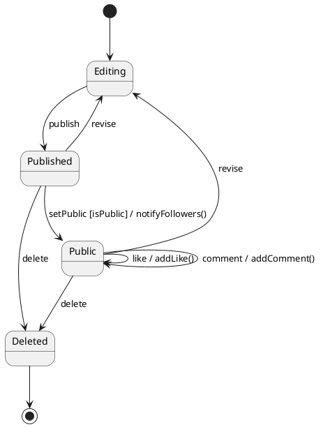
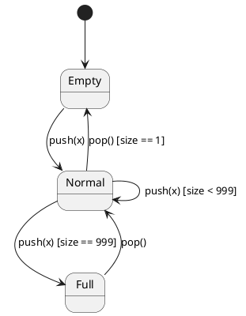
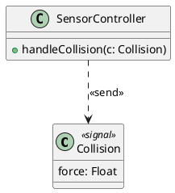
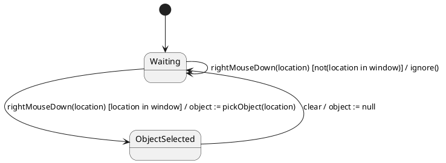
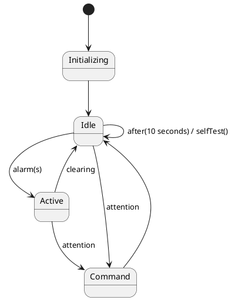
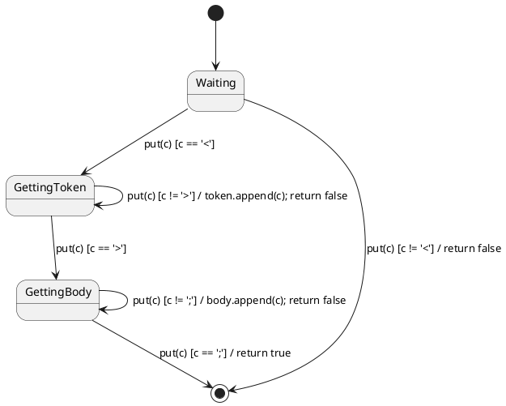
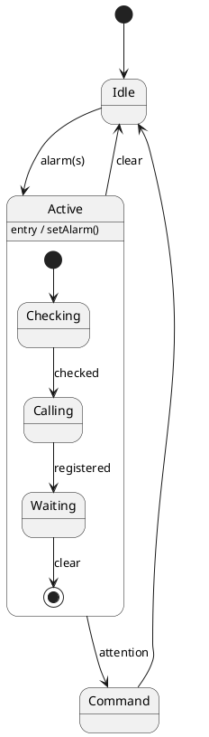
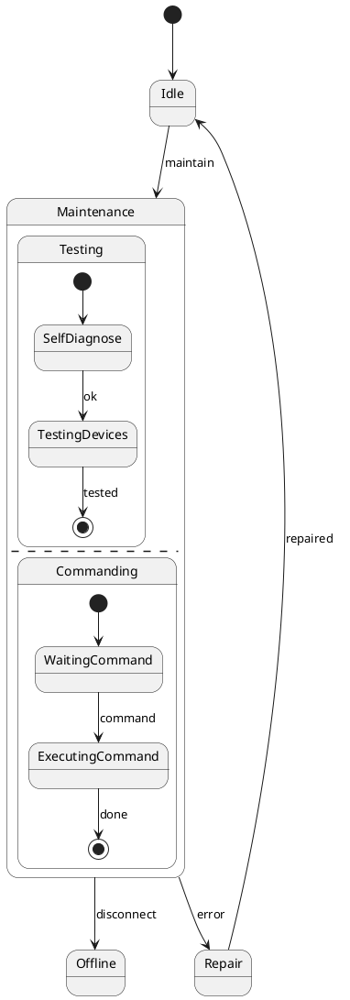

## 生命周期建模

### 状态图

**定义**：**状态图（State Diagram）** 是显示一个状态机的图，用来规约对象在其生存期内因响应事件而经历的状态序列，以及对象对这些事件所作出的响应。[PPT p.1-p.3]

**核心思想**：状态图把对象行为理解为“当前状态 + 事件 + 条件 + 动作 -> 下一个状态”。也就是说，同一事件在不同状态下可能产生不同结果，同一对象在不同生命期阶段也可能承担不同作用。[PPT p.2-p.4]

**背景与目的**：类图可以说明对象有哪些属性和操作，但很难说明操作在什么状态下合法、某个事件发生后对象应该进入哪个阶段。对于人员、系统、控制器、事务、设备、博文等复杂对象，如果它们在不同状态下发挥不同作用，就需要建立状态机图来认识对象的复杂性。[PPT p.3-p.4]

**生活类比**：例如，博文可以处于编辑中、已发布、已公开和已删除状态；“发布”只有在编辑中状态才有意义，“删除博文”可以从已发布或已公开状态触发。类比一下，状态图像一张对象生命期地图，它不只是列出对象会做什么，还说明对象什么时候能做、做完后会变成什么状态。

**数学表达**：
$$
\delta(s, e, g) = (s', a)
$$

**符号说明**：
- $s$：当前状态，表示对象此刻满足的一组条件或行为规则。
- $e$：触发事件，表示现实世界或系统内部发生了有意义的事情。
- $g$：监护条件，也称守卫条件，是决定转移能否触发的布尔表达式。
- $s'$：目标状态，表示事件被接受并完成转移后对象所处的新状态。
- $a$：动作，表示转移过程中或进入、退出状态时执行的即时操作。

**含义解释**：这个公式表达状态机的核心语义：对象处在状态 $s$ 时，如果接收到事件 $e$，并且监护条件 $g$ 为真，就执行动作 $a$，再进入目标状态 $s'$。如果条件不满足，事件可能不会触发任何转移，模型中应明确这种事件是被忽略、丢失还是延迟处理。

**物理/几何意义**：直观上，状态是图中的节点，转移是节点之间的边，事件和条件决定沿哪条边移动。动作像边上的即时操作，进入动作和退出动作则像经过状态边界时必须执行的开关。

**PPT 原文关联**：PPT 开头连续三页说明状态图是系统行为和生命周期建模工具，并强调状态机图规约对象在生存期内响应事件所经历的状态序列。[PPT p.1-p.3]



**解读说明**：这张图用课程最后的博文示例说明状态图的读法。圆角矩形表示状态，箭头表示转移，箭头上的 `事件 [条件] / 动作` 表示转移标签；`like` 和 `comment` 不改变博文状态，因此建模为已公开状态上的自转移或内部转移。

### 状态建模的适用对象

**定义**：适合建立状态机图的对象，是指具有明确生命期阶段，并且需要通过状态分析理解其复杂性的对象。[PPT p.3-p.4]

**核心思想**：并不是所有对象都需要状态图。值得注意的是，PPT 明确说实际系统中往往无法给出所有对象的状态机图，因此状态图应优先用于状态影响行为、非法状态风险高、事件响应复杂的对象。[PPT p.4]

**背景与目的**：如果一个对象只有简单增删改查，状态图会变成额外负担；如果对象的状态会决定能否执行操作，缺少状态图就容易把规则散落到代码中的大量 `if` 语句里。本质上，状态图把这些分散的状态规则集中成可审查的行为模型。

**直观理解**：人员可以有在职、离职、休假等状态，事务可以有开始、提交、回滚等状态，设备可以有空闲、工作、故障、维修等状态。例如微波炉门开、门关、烹饪中、烹饪完成这些状态会直接影响按钮事件的结果，所以它比一个普通值对象更值得画状态图。[PPT p.3, p.25]

**PPT 原文关联**：PPT 说明可具有状态机图的事物包括人员、系统、控制器、事务、设备等，并强调状态机图用于复杂对象。[PPT p.3]

| 维度 | 适合画状态图 | 不适合优先画状态图 | 判断依据 |
| :--- | :--- | :--- | :--- |
| 生命期阶段 | 有清晰阶段，例如订单、事务、设备 | 只有静态数据或简单 CRUD | 状态是否影响对象语义 |
| 事件响应 | 同一事件在不同状态下响应不同 | 事件与状态关系很弱 | 是否存在状态相关业务规则 |
| 风险程度 | 非法状态会造成业务错误或安全问题 | 非法状态容易由简单约束处理 | 是否需要显式禁止某些迁移 |
| 建模收益 | 能澄清生命周期和操作合法性 | 图比文字更复杂 | 图是否减少理解成本 |

#### 本节 Q&A

**问**：所有类都需要状态图吗？

**答**：不需要。只有生命周期复杂、状态影响行为、非法状态风险高的对象才值得画状态图；PPT 也明确指出实际系统中通常无法给出所有对象的状态机图。[PPT p.4]

**问**：状态图和活动图都描述变化，它们有什么区别？

**答**：状态图围绕一个对象的状态变化展开，核心问题是“对象现在处于什么状态，收到事件后变成什么状态”。活动图围绕流程步骤展开，核心问题是“活动之间如何流转”，所以两者关注点不同。

## 状态图的基本元素

### 状态

**定义**：状态是一个对象生命期中的一个阶段，在该阶段中对象满足一些特定条件、执行特定活动，或等待某个事件。[PPT p.6]

**核心思想**：状态不是随意给对象取一个标签，而是按照某种规定把对象属性值划分成等价类。也就是说，一个状态通常代表一组使对象呈现共同规则的属性值组合，而不是某一个孤立属性值。[PPT p.6]

**背景与目的**：如果把每个属性值组合都画成一个状态，状态图会爆炸；如果状态划分太粗，又无法表达关键行为差异。状态建模的关键是找到“行为规则相同”的分组，例如容量为 1000 的栈通常不需要区分 0 到 1000 的每个元素个数，而需要区分空栈、普通非空栈、满栈等行为不同的状态。[PPT p.6]

**直观理解**：例如栈在空栈状态下不能执行普通 `pop`，在满栈状态下不能执行普通 `push`，在普通状态下二者都可能有效。这个例子说明状态划分不是为了记录所有数据，而是为了表达操作约束和事件响应。

**PPT 原文关联**：PPT 在状态定义页用“容量为 1000 的栈需要区分几种状态”启发状态等价类的思想，并说明每一种状态是一组属性值组合。[PPT p.6]



**解读说明**：这个栈状态图没有把 1001 种容量值都画出来，而是按行为规则划分为空、普通和满三类状态。空栈和满栈之所以值得单独建模，是因为它们会改变 `pop` 或 `push` 事件的合法性。

### 状态表示法

**定义**：**统一建模语言（UML）** 中状态通常表示为四角圆角的矩形，状态名放在名称分栏中，内部转移、进入动作、退出动作、活动和延迟事件可放在内部转移分栏中。[PPT p.7-p.9, p.19-p.21]

**核心思想**：状态框不仅能写状态名称，还能表达对象停留在该状态期间发生的内部行为。也就是说，状态图并不要求所有行为都画成离开状态的箭头；不会改变状态的事件，可以写进状态内部，避免图上出现大量无意义自循环。[PPT p.7-p.9]

**背景与目的**：如果只使用箭头，状态图会把“留在原状态处理某事件”和“退出再进入同一状态”混在一起。PPT 特别区分内部转移和状态间自转移，因为后者会触发退出动作和进入动作，而内部转移不会离开该状态。[PPT p.9, p.22]

**直观理解**：例如输入密码时，用户按数字键只是在当前状态内处理字符，不应该退出再重新进入输入密码状态；但如果一次自转移代表重新开始某个状态，则可能需要先执行退出动作，再执行进入动作。值得注意的是，这两种建模方式会影响动作执行顺序。

**PPT 原文关联**：PPT 用 `Typing Password` 和 `EnterPassword` 示例展示状态名称、`entry`、`exit`、普通内部转移、`defer` 和 `do` 活动的写法。[PPT p.7, p.21]

```plantuml
@startuml
skinparam shadowing false
state "EnterPassword" as EnterPassword {
  entry / password.reset()
  exit / password.test()
  digit / handleCharacter()
  clear / password.reset()
  help / displayHelp()
  print / defer
  do / suppressEcho()
}
[*] --> EnterPassword
EnterPassword --> [*] : passwordAccepted
@enduml
```

**解读说明**：状态内部的 `digit`、`clear` 和 `help` 都表示事件发生后仍留在 `EnterPassword` 状态；`print / defer` 表示打印事件暂不处理，推迟到后续状态排队处理；`do / suppressEcho()` 表示进入状态后持续执行的活动。

### 伪状态

**定义**：伪状态是状态机中用于表达控制语义的特殊节点，本课重点涉及初始状态、终止状态、分支、结合、历史状态等，其中初始状态表示缺省开始点，终止状态表示状态机执行后的结束点。[PPT p.5, p.9]

**核心思想**：伪状态本身不是对象稳定停留的业务状态，而是为了组织状态机控制流。也就是说，初始状态不表示对象“处于初始”这个业务阶段，它只是说明状态机启动时第一条缺省转移从哪里出发。[PPT p.9]

**背景与目的**：没有初始伪状态，读者无法判断对象创建后默认进入哪个状态；没有终止状态，读者无法判断对象生命周期是否结束。PPT 的控制器示例没有终止状态，这不是遗漏，而是表示该控制器不断运行。[PPT p.23]

**直观理解**：例如一个传感器控制器从初始化开始，随后进入空闲、命令或警报活动状态，并不一定会进入终止状态。类比一下，它像一个常开设备，只要系统运行，它的状态机就持续响应外部事件。

**PPT 原文关联**：PPT 在状态表示法中列出初态和终态，并在控制器示例中特别说明没有终止状态意味着控制器不间断运行。[PPT p.9, p.23]

#### 本节 Q&A

**问**：状态是不是等同于某个属性值？

**答**：不等同。状态通常是一组属性值组合形成的等价类，关键是这些对象实例在该阶段具有相同或相近的行为规则；例如栈的空、普通和满，比 0 到 1000 的每一个元素数量更适合作为状态。[PPT p.6]

**问**：内部转移为什么不直接画成返回自身的箭头？

**答**：因为内部转移不离开当前状态，不会触发 `exit` 和 `entry`。返回自身的状态间转移会先退出再进入，语义不同，尤其在状态包含入口动作、出口动作或资源管理时不能混用。[PPT p.9, p.22]

## 事件与动作

### 动作与活动

**定义**：动作是在状态内或状态转化时执行的原子、即时操作；活动是在对象处于某个状态的整个阶段执行的动作或动作集合，活动不是原子的，可以被事件打断。[PPT p.11]

**核心思想**：动作和活动的根本区别在于可中断性和持续时间。动作不可中断、执行时间视为零；活动会持续一段时间，执行过程中可能因为事件出现而被离开该状态的转移打断。[PPT p.11]

**背景与目的**：如果把长时间处理都写成动作，模型会暗示它不可中断，这在设备控制、用户输入、网络等待等场景中通常不真实。相反，如果把即时属性修改都写成活动，又会模糊转移发生时的原子语义。

**动作可包括的操作**：动作可以设置或修改本对象属性、向对象发送信号、调用另一个对象的公共操作、创建或撤销对象，以及返回一个值或值集。每一种动作都应能在分析层说明对象响应事件后的即时效果，而不是变成实现代码细节。[PPT p.11]

**活动的中断语义**：活动可以在进入动作之后开始，并与其他动作或活动并行。如果活动完成而对象仍留在当前状态，可能产生一个完成事件；如果状态先退出，活动就被中断，这一点在建模设备运行、加载过程和用户等待时尤其重要。[PPT p.20]

**PPT 原文关联**：PPT 强调动作不可中断、执行时间为零，动作序列在两个动作之间可能因事件出现而中断；同时说明 `do` 活动可能被事件打断。[PPT p.11, p.20]

| 维度 | 动作 | 活动 | 建模影响 |
| :--- | :--- | :--- | :--- |
| 执行时间 | 即时，通常视为零 | 持续一段时间 | 长任务应建模为活动 |
| 可中断性 | 原子，不可中断 | 可以被外部事件中断 | 影响转移触发后的行为 |
| 出现位置 | 转移、入口、出口、内部转移 | 状态内部的 `do` 分栏 | 决定动作与状态边界的关系 |
| 典型例子 | 设置属性、发送信号、调用操作 | 监控、打印、烹饪、等待输入 | 决定是否需要完成事件 |

### 事件

**定义**：事件是对一个有意义发生的规约，具有自己的时间和空间；在状态机语境下，事件是一种激励，可以引发状态转移。[PPT p.12]

**核心思想**：事件不是动作本身，而是“发生了什么”的信号；动作是对象对此事件的响应。也就是说，`buttonPressed` 是事件，`startCooking()` 是动作或被调用的操作，二者不应混写。[PPT p.12]

**背景与目的**：状态图需要把外部刺激、内部时间、条件变化和调用请求统一到事件机制中，否则对象生命周期就会退化成普通流程图。PPT 将 UML 事件分为信号、调用、时间事件和变化事件四类，这四类覆盖了异步消息、同步调用、时间推移和条件变真等常见触发来源。[PPT p.12-p.17]

**事件格式**：事件格式为 `事件名(参数列表)`，参数格式为 `参数名: 类型表达式`。事件参数可以被转移上的监护条件和动作使用，也可以被源状态退出动作和目标状态进入动作使用，因此参数命名应清楚表达业务含义。[PPT p.12, p.18]

**PPT 原文关联**：PPT 在事件页给出四类事件，并说明事件可以引发状态转移；在转移页进一步说明事件参数可被条件和动作使用。[PPT p.12, p.18]

### 信号事件

**定义**：信号事件是对象接收到某个信号实例后产生的事件；信号是一类消息类型，可以有属性和操作，也可以在信号之间建立泛化关系。[PPT p.13-p.14]

**核心思想**：信号通常表达异步通知，发送者发出后不必等待接收者像同步调用那样立即完成处理。本质上，信号把事件驱动系统中的外部刺激模型化为可命名、可带数据、可在状态机转移上使用的元素。[PPT p.13-p.14]

**背景与目的**：设备告警、碰撞通知、传感器上报、用户注意信号等事件往往不是普通方法调用。用信号建模可以避免把所有外部刺激都误写成同步操作，也能在类模型中说明对象可能接收哪些有名信号。[PPT p.14]

**表示方式**：在 UML 中，可将信号模型化为带有 `<<signal>>` 衍型的类，也可以用 `<<send>>` 依赖表示一个操作发送特定信号。值得注意的是，衍型可以看作元类型，它扩展了 UML 元模型中的元素语义。[PPT p.13]

**PPT 原文关联**：PPT 使用 `Collision` 信号示例，展示 `<<signal>>` 和属性 `force: Float`，并说明信号可作为状态机转移动作或交互消息发送。[PPT p.13-p.14]



**解读说明**：`Collision` 被建模为信号，而不是普通实体类。控制器对该信号有发送或处理依赖，状态机中也可以把 `collision(c)` 作为触发事件使用。

### 调用事件

**定义**：调用事件表示对象接收到一个操作调用请求，它可以使用类定义中的操作来规约。[PPT p.15]

**核心思想**：调用事件通常对应同步调用，但也可以被规约为异步调用。也就是说，调用事件与信号事件的区别不只是箭头样式，更关系到接收方是在执行一个操作请求，还是接收一类异步消息。[PPT p.15]

**背景与目的**：在状态机中，某些事件来自对象公开操作，例如 `open()`、`close()`、`publish()`、`delete()`。把这些操作作为调用事件建模，可以直接连接类图的操作规约和状态图的生命周期约束。

**直观理解**：例如博文对象收到 `publish()` 调用时，如果当前处于编辑中，可以转到已发布；如果已经删除，则该调用应被禁止或忽略。状态图使同一个操作在不同状态下的合法性变得清楚。

**PPT 原文关联**：PPT 说明调用事件或触发状态机中的状态转移，或调用目标对象的一个方法，并指出对象可能接收的调用事件可模型化为该对象类的一个操作。[PPT p.15]

### 时间事件与变化事件

**定义**：时间事件表示一段时间推移或某个时间点到达而发生的事件，常用关键词 `after` 和 `at`；变化事件表示某个布尔表达式的值由假变真时发生的事件，使用关键词 `when`。[PPT p.16-p.17]

**核心思想**：时间事件把“多久以后”或“到某个时刻”变成显式触发条件，变化事件把“条件变真”变成事件。也就是说，状态图既能响应离散按钮点击，也能响应时间和连续条件变化。[PPT p.16-p.17]

**背景与目的**：实时控制和设备系统经常依赖时间与阈值，例如进入某状态 2 秒后超时、每天固定时间执行测试、温度低于阈值后切换模式。如果不使用时间事件和变化事件，这些规则会被隐藏在文字说明或实现代码中。

**示例展开**：`after(2 seconds)` 表示进入某状态 2 秒之后触发事件；`at(1 Jan 2007, 12:00)` 表示在指定时间点触发事件；`when(altitude < 1000)` 表示持续测试高度条件，直到表达式由假变真时触发事件。值得注意的是，变化事件强调“变为真”的瞬间，而不是条件一直为真时不断触发。[PPT p.16-p.17]

**PPT 原文关联**：PPT 给出 `after`、`at` 和 `when(altitude < 1000)` 的例子，并在控制器示例中使用 `after(10 秒) selfTest` 表达周期性自测试。[PPT p.16-p.17, p.23]

#### 本节 Q&A

**问**：事件和动作为什么要分开？

**答**：事件说明“发生了什么”，动作说明“对象如何响应”。如果把二者混在一起，状态图就无法清楚表达对象是被什么触发的，也无法检查某个事件在不同状态下是否有不同响应。

**问**：`after` 和 `when` 有什么区别？

**答**：`after` 或 `at` 是时间触发，关注时间推移或时间点到达；`when` 是条件触发，关注布尔表达式从假变真。二者都能触发转移，但触发来源不同。[PPT p.16-p.17]

## 转移语义

### 状态转移

**定义**：状态转移是两个状态之间的一种关系，表示当特定事件出现且满足一定条件时，对象从源状态进入目标状态，并执行一定动作；转移本身是原子的。[PPT p.18]

**核心思想**：转移把“什么时候变”和“变的时候做什么”写在同一条边上。也就是说，转移不只是箭头，它同时包含触发事件、监护条件和动作表达式三层信息。[PPT p.18]

**背景与目的**：缺少转移语义时，状态图容易变成状态清单，无法说明对象为什么从一个状态到另一个状态。PPT 给出标准格式，帮助建模者把事件参数、条件判断和动作序列写清楚。[PPT p.18-p.19]

**转移格式**：
```text
事件名(用逗号分隔的参数表)[监护条件] / 动作表达式
```

**含义解释**：事件名和参数说明触发源，监护条件说明是否允许触发，动作表达式说明触发成功后的即时响应。动作表达式可以由一组动作组成，例如 `op1(a); op2(b); op3(c)`，但动作序列之间可能在动作边界处被事件打断。[PPT p.11, p.18-p.19]

**PPT 原文关联**：PPT 用 `object.highlight` 和 `right-mouse-down(location)[location in window]/object:=pick_object(location)` 展示简单与复杂转移标签。[PPT p.19]



**解读说明**：同一个 `rightMouseDown(location)` 事件在不同监护条件下产生不同结果。如果点击位置在窗口内，就选择对象并进入已选择状态；如果条件不满足，可以显式建模为忽略并留在等待状态。

### 监护条件

**定义**：监护条件是写在转移上的布尔表达式，当事件要触发转移时对它求值；表达式为真则触发转移，为假则不触发。[PPT p.18]

**核心思想**：监护条件解决“同一事件可能有多个候选转移”的选择问题。也就是说，同一个事件名可以出现多次，只要监护条件不同，状态机就能根据当前参数和对象属性决定走哪条边。[PPT p.18, p.24]

**背景与目的**：很多业务规则并不是由不同事件区分，而是由同一事件中的参数或当前对象状态区分。例如字符流解析中，`put(c)` 可以因为 `c == '<'` 进入取标记状态，也可以因为 `c != '<'` 直接返回失败。[PPT p.24]

**失败语义**：如果没有转移被事件触发，PPT 说明该事件会丢失。值得注意的是，这和延迟事件不同；延迟事件会排队到以后处理，而未被任何转移接受的事件通常不再保留。[PPT p.18]

**PPT 原文关联**：PPT 在字符流解析示例后再次强调，同样的事件名可以出现多次，当事件发生时根据监护条件决定触发哪个转移。[PPT p.24]

### 状态内转移与状态间转移

**定义**：状态内转移是在一个状态内部由事件引起动作或活动执行后仍处于该状态的情况；状态间转移是从源状态进入目标状态，并执行相应动作或活动的情况。[PPT p.20-p.22]

**核心思想**：二者的区别不只是目标状态是否相同，而是是否真正离开状态边界。状态内转移不执行该状态的退出动作和进入动作；状态间转移即使源状态和目标状态相同，也会先退出再进入，因此会触发 `exit` 和 `entry`。[PPT p.22]

**背景与目的**：如果把内部事件都画成自转移，会导致进入动作和退出动作被错误执行。例如输入密码状态中按下数字键只应处理字符，不应重置密码再测试密码；因此应使用内部转移而不是状态间自转移。[PPT p.21-p.22]

**直观理解**：内部转移像人在房间里处理一个小动作，没有走出房间；状态间自转移像走出房间再回来，会触发离开和进入房间的规则。类比一下，两者看似都回到同一位置，但经过门槛与否会改变附带动作。

**PPT 原文关联**：PPT 在状态内转移页列出 `entry`、`exit`、`do` 三个 UML 内置关键字，并特别说明这些关键字不能用作事件名。[PPT p.20]

| 维度 | 状态内转移 | 状态间转移 | 建模后果 |
| :--- | :--- | :--- | :--- |
| 是否离开状态 | 不离开当前状态 | 离开源状态并进入目标状态 | 决定是否触发边界动作 |
| `entry` / `exit` | 不执行当前状态的进入和退出动作 | 执行源状态退出动作和目标状态进入动作 | 影响副作用和资源管理 |
| 事件参数使用 | 内部动作可使用事件参数 | 监护条件、动作、退出和进入动作都可使用参数 | 决定参数传播范围 |
| 典型场景 | 输入字符、帮助提示、清空字段 | 发布、删除、开门、关门 | 决定图的简洁性和语义准确性 |

### 入口动作、出口动作与持续活动

**定义**：`entry` 表示进入状态时首先执行的动作，`exit` 表示退出状态时最后执行的动作，`do` 表示对象处于该状态期间持续进行的活动。[PPT p.20]

**核心思想**：这三个关键字把状态边界和状态停留期间的行为分开。也就是说，进入状态的初始化、离开状态的清理、停留状态期间的持续处理，不应都混在转移动作里。[PPT p.20-p.21]

**背景与目的**：状态机经常需要表达资源打开、资源关闭、持续监控、持续加热等行为。如果每条进入状态的转移都重复写初始化动作，模型会冗余；如果每条离开状态的转移都重复写清理动作，也容易遗漏。`entry` 和 `exit` 把这些共同动作集中在状态内部。[PPT p.20-p.21]

**`do` 活动结束情况**：第一种情况是活动一直执行到对象离开该状态。第二种情况是活动执行完毕后对象仍处于当前状态，此时会导致一个完成事件，如果存在外出的完成转移就退出当前状态。第三种情况是活动未完成时状态退出，活动被中断。[PPT p.20]

**PPT 原文关联**：PPT 用打印机管理器的待机恢复状态说明 `entry/password.reset()`、`exit/password.test()`、`do/suppress echo`、内部转移和延迟事件的组合表示。[PPT p.21]

#### 本节 Q&A

**问**：转移标签里是不是必须同时写事件、条件和动作？

**答**：不必须。事件可以单独出现，条件和动作按需要补充；但如果同一事件有多条候选转移，就应写清监护条件，否则读者无法判断哪条转移会被触发。[PPT p.18-p.19]

**问**：状态内转移和状态间自转移的考试区分点是什么？

**答**：核心看是否触发退出动作和进入动作。状态内转移执行内部动作后仍在原状态，状态间自转移虽然目标还是自己，但会按“退出当前状态、执行转移动作、重新进入状态”的顺序执行。[PPT p.21-p.22]

## 状态图示例

### 传感器控制器

**定义**：传感器控制器状态图描述一个负责监视传感器的控制器如何在初始化、空闲、命令和激活等状态之间响应事件。[PPT p.23, p.36-p.37]

**核心思想**：该示例强调反应型对象的事件驱动行为。也就是说，控制器不是按一次性流程运行，而是持续等待 `alarm(s)`、`attention`、`clearing` 和周期性 `selfTest` 等事件，并根据当前状态作出响应。[PPT p.23]

**背景与目的**：控制器没有终止状态，这意味着它要不间断地运行。PPT 特别指出空闲状态上有一个由时间事件触发的自转移，表示每隔 10 秒接收或执行传感器的 `selfTest` 事件，这体现了状态图对长期运行对象的表达能力。[PPT p.23]

**直观理解**：例如设备上电后先初始化，然后进入空闲；如果传感器报警，就进入激活状态；如果收到用户注意信号，可以进入命令状态；如果警报清除，再回到空闲。这个模型比普通流程图更适合，因为系统可能长期循环运行并被外部事件打断。

**PPT 原文关联**：PPT 的控制器示例图包含 `initializing`、`idle`、`Command`、`Active` 等状态，空闲状态上有 `after(10 秒) selfTest` 自转移，并说明没有终止状态代表不间断运行。[PPT p.23]



**解读说明**：该图保留了 PPT 示例的主要控制结构。`Idle` 上的时间自转移不会结束控制器生命期，而是表示周期性自检；没有终止节点说明该控制器作为反应型对象持续运行。

### 字符流解析

**定义**：字符流解析状态图用于分析形如 `<标记串>字母串;` 的输入流，并根据字符事件 `put(c)` 的不同监护条件在等待、获取标记和获取正文状态间迁移。[PPT p.24]

**核心思想**：该示例展示了相同事件名配合不同监护条件的建模方式。也就是说，`put(c)` 事件反复出现，但当 `c == '<'`、`c != '<'`、`c == '>'`、`c != '>'`、`c == ';'` 或 `c != ';'` 时，状态机采取完全不同的响应。[PPT p.24]

**背景与目的**：解析器类对象常常具有明显状态，例如等待起始符、读取标记、读取正文、成功结束或失败返回。状态图可以把隐含在代码中的解析控制逻辑提前表达出来，帮助检查边界字符和失败路径是否完整。

**直观理解**：例如输入 `deFC<ejb-name>Account;` 时，解析器在看到 `<` 之前应拒绝无效前缀或继续等待，进入标记后不断追加字符，看到 `>` 后开始读取正文，看到 `;` 后返回成功。值得注意的是，PPT 示例的 OCR 对引号略有混乱，但状态转移语义是清楚的。[PPT p.24]

**PPT 原文关联**：PPT 在该页强调“如果监护条件不同，相同的事件名可以出现多次”，并以 `Put(c)` 的多个条件分支说明这一点。[PPT p.24]



**解读说明**：图中的核心不是三个状态本身，而是同一个 `put(c)` 事件在不同状态和不同条件下的不同含义。这个示例适合复习监护条件、动作表达式和事件参数的配合。

### 简易微波炉

**定义**：简易微波炉状态图描述只有一个按钮的微波炉如何根据门开关、按钮和定时器事件，在空闲、烹饪、延长烹饪、中断和完成等状态之间转换。[PPT p.25]

**核心思想**：该示例说明状态图非常适合设备控制，因为同一个按钮事件在不同状态下含义不同。也就是说，门关空闲时按按钮可能开始烹饪，烹饪时按按钮可能延长烹饪，门开时按钮则不应启动功率管。[PPT p.25]

**背景与目的**：如果用普通流程描述微波炉，会很容易遗漏门开时不能加热、烹饪完成要关灯关功率管并发提示音、烹饪中断要清除计时器等安全规则。状态图把这些规则放到状态和转移中，使非法迁移更容易被发现。

**直观理解**：例如门开状态的入口动作是开灯，门关空闲状态的入口动作是关灯；初始烹饪状态的入口动作包括设置定时器、开功率管和开灯。值得注意的是，这些入口动作不是按钮事件本身，而是进入状态后必须发生的效果。[PPT p.25]

**PPT 原文关联**：PPT 的微波炉图包含“空闲、门开”“空闲、门关”“初始烹饪”“延长烹饪”“烹饪中断”“烹饪完成”等状态，并标出开门、关门、按按钮和定时器时间到等事件。[PPT p.25]

```plantuml
@startuml
skinparam shadowing false
[*] --> DoorClosedIdle
state "空闲、门关" as DoorClosedIdle {
  entry / light.off()
}
state "空闲、门开" as DoorOpenIdle {
  entry / light.on()
}
state "初始烹饪" as Cooking {
  entry / timer.set()
  entry / powerTube.on()
  entry / light.on()
}
state "延长烹饪" as ExtendedCooking {
  entry / timer.addOneMinute()
}
state "烹饪中断" as Interrupted {
  entry / powerTube.off()
  entry / timer.clear()
}
state "烹饪完成" as Completed {
  entry / light.off()
  entry / powerTube.off()
  entry / beep()
}
DoorClosedIdle --> DoorOpenIdle : openDoor
DoorOpenIdle --> DoorClosedIdle : closeDoor
DoorClosedIdle --> Cooking : pressButton
Cooking --> ExtendedCooking : pressButton
ExtendedCooking --> Completed : timerExpired
Cooking --> Completed : timerExpired
Cooking --> Interrupted : openDoor
ExtendedCooking --> Interrupted : openDoor
Interrupted --> DoorOpenIdle : openDoor
Interrupted --> DoorClosedIdle : closeDoor
Completed --> DoorOpenIdle : openDoor
Completed --> Cooking : pressButton
@enduml
```

**解读说明**：这张图按 PPT 的教学意图重绘了微波炉示例，具体转移标签做了分析级整理。它展示了入口动作、设备安全约束和同一事件在不同状态下的不同响应。

#### 本节 Q&A

**问**：为什么控制器示例没有终止状态？

**答**：因为该控制器被建模为长期运行的反应型对象。没有终止状态表示它不会在普通业务路径中结束生命期，而是持续响应传感器和用户事件。[PPT p.23]

**问**：字符流示例为什么反复出现同一个 `put(c)` 事件？

**答**：因为真正决定转移的是“当前状态 + 事件 + 监护条件”的组合。相同事件在不同状态或不同条件下可以触发不同转移，这正是状态图比线性流程更有表达力的地方。[PPT p.24]

## 组合状态

### 组合状态

**定义**：**组合状态（Composite State）** 是由两个或多个子状态构成的状态，子状态可以是顺序的，也可以是并发的，而且子状态还可以继续嵌套组合状态。[PPT p.26]

**核心思想**：组合状态用层次化方式管理复杂生命周期。也就是说，当一个大状态内部还包含多个细分阶段时，不必把所有状态都摊平成一张巨大平面图，而可以把内部状态机嵌套在高层状态里。[PPT p.26]

**背景与目的**：复杂对象常常既有高层阶段，又有阶段内部细节。例如控制器处于 `Active` 状态时，内部还可能先检查警报、再呼叫警报公司、最后等待清除或注意信号。组合状态可以保留高层图的清晰度，同时允许在局部展开内部行为。[PPT p.37]

**直观理解**：类比一下，大学生的“在校”状态内部还可以分为上课、考试、实习、休假等子状态；从外部看都是在校，从内部看行为规则又不同。组合状态正是把这种“外部统一、内部细分”的结构画出来。

**PPT 原文关联**：PPT 说明新创建对象从最外层初始伪状态开始，执行最外层缺省转移；若对象转移到最外层终结状态，则对象生命期终止。[PPT p.26]



**解读说明**：该图重绘了 PPT 中“细化 Active 状态”的思路。进入 `Active` 时先执行 `setAlarm()`，然后内部依次经过 `Checking`、`Calling` 和 `Waiting`；当清除或注意信号出现时，可以退出整个组合状态。

### 非正交子状态机

**定义**：非正交子状态机是组合状态内部的顺序子状态机，同一时刻最多只有一个子状态处于活动状态，并且最多有一个子初态和一个子终态。[PPT p.27-p.29]

**核心思想**：非正交组合状态表达“内部状态按顺序推进”。也就是说，进入组合状态时控制流只能落到一个内部子状态，随后沿内部转移移动，而不是同时激活多个区域。[PPT p.27]

**背景与目的**：当一个高层状态内部有明确阶段顺序时，非正交子状态机比并发区域更合适。PPT 说明从组合状态外部转入有两种情况：可以转移到组合状态本身，也可以直接转移到组合状态内部某个子状态；两种情况的进入动作执行顺序不同。[PPT p.27-p.28]

**进入语义**：如果目标是组合状态本身，那么内部子状态机必须有一个初态，以便执行组合状态进入动作后把控制交给初态。如果目标直接是某个子状态，则执行完组合状态进入动作和该子状态进入动作后，控制直接传给该子状态。[PPT p.27-p.28]

**离开语义**：离开组合状态的转移，其源可以是组合状态本身，也可以是内部子状态。不论哪种情况，控制都先离开被嵌套状态并执行其退出动作，再离开组合状态并执行组合状态退出动作；如果转移源是组合状态，本质上是在终止被嵌套状态机的活动。[PPT p.29]

**PPT 原文关联**：PPT 用 “Idle” 转入组合状态的两种情况说明非正交子状态机的进入方式，并用离开组合状态的说明强调退出动作顺序。[PPT p.27-p.29]

### 正交子状态机

**定义**：正交子状态机是组合状态中并发执行的一组子状态区域，每个正交区域都可以有自己的初态和终态。[PPT p.30-p.32]

**核心思想**：正交状态用多个区域表达并发控制流。也就是说，进入含多个正交区域的组合状态时，控制会分岔成多个并发流；离开时，多个区域可能需要汇合成一个控制流。[PPT p.31]

**背景与目的**：有些对象同时处在多个相互独立但相关的子状态中，例如维护状态下既进行测试，又接收命令。把这些并发方面强行拉平成一个状态集合，会产生组合爆炸；正交区域可以把并发维度分开表达。[PPT p.30-p.32]

**进入和离开语义**：当转移到达具有多个正交区域的组合状态时，控制被分成多个并发流，相当于存在多个嵌套状态机。如果某个区域先到达终态，它会在终态等待，直到其他区域也到达终态后再汇合；如果存在一个指示离开组合状态的转移，也可以使控制汇成一个流并退出组合状态。[PPT p.31]

**直观理解**：例如设备维护时，一条并发线执行自诊断，另一条并发线处理命令；只有测试和命令区域都满足条件并发生断开事件时，才转到离线。值得注意的是，一个错误事件也可能触发隐式汇合，使所有活动区域退出并进入修复状态。[PPT p.32]

**PPT 原文关联**：PPT 的正交子状态示例使用 Testing 和 Commanding 两个区域，并说明显式分岔、隐式分岔、隐式汇合和显式汇合的差异。[PPT p.30-p.32]



**解读说明**：PlantUML 中的 `--` 表示组合状态内部的正交区域分隔。`Testing` 和 `Commanding` 并发执行；`error` 可以退出整个 `Maintenance` 组合状态，`disconnect` 则表达汇合后离线的高层转移。

| 维度 | 非正交子状态机 | 正交子状态机 | 选择建议 |
| :--- | :--- | :--- | :--- |
| 同时活动子状态 | 同一时刻最多一个 | 多个区域可同时活动 | 顺序阶段用非正交，并发方面用正交 |
| 初态和终态 | 最多一个子初态和一个子终态 | 每个区域可有自己的初态和终态 | 并发区域需要独立起止点 |
| 控制流语义 | 进入后沿单条内部路径移动 | 进入后分岔，离开时可能汇合 | 根据对象是否存在并发状态维度决定 |
| 建模风险 | 可能隐藏并发行为 | 可能过早引入并发复杂度 | OOA 阶段只对确有并发语义的对象使用 |

#### 本节 Q&A

**问**：组合状态是不是只是把图画得好看一点？

**答**：不是。组合状态有明确语义，包括进入动作、退出动作、内部初态、内部终态、完成转移以及嵌套状态机的终止。它确实能让图更清晰，但更重要的是表达层次化生命周期。[PPT p.26-p.29]

**问**：正交状态是不是等同于多线程实现？

**答**：不等同。正交状态表达模型语义上的并发控制流，说明对象同时具有多个活动状态维度；实现时可以用线程、事件循环或其他机制完成，OOA 阶段不应直接把它等同于某种代码结构。

## 建立状态机模型

### 反应型对象

**定义**：反应型对象，也称事件驱动对象，是行为特征表现为响应外部语境中出现的事件，并作出相应反应的对象。[PPT p.34]

**核心思想**：状态图的一般用法通常是对反应型对象的行为建模。也就是说，状态图关注的是对象在事件序列中如何改变状态，而不是一次性算法从第一步执行到最后一步。[PPT p.34]

**背景与目的**：PPT 给出两类一般用途：建立系统动态方面的模型，以及针对 **用例（Use Case）** 给出相应状态图来建立场景模型。不论是哪一种，核心都是以事件定序的行为建模。[PPT p.34]

**直观理解**：例如控制器、交易、订单、博文和设备都可能长期等待外部事件；它们的行为不是简单函数调用结束就完，而是会在生命周期中多次响应事件。状态图帮助分析员确认这些响应是否完整、合法和可达。

**PPT 原文关联**：PPT 明确说明状态图用于建立系统动态方面的模型，也可建立场景模型，并通常对反应型对象建模。[PPT p.34]

### 建模步骤

**定义**：为反应型对象建立状态机模型，是从语境、起止状态、候选状态、状态偏序、触发事件、动作、简化结构和一致性检查逐步构造状态机的过程。[PPT p.35-p.36]

**核心思想**：状态建模不是先画箭头，而是先确定建模语境和对象生命周期边界。也就是说，只有明确是类、用况还是子系统的状态机，才能判断哪些状态和事件属于当前模型。[PPT p.35]

**背景与目的**：很多状态图错误来自过早画细节，例如把系统流程、对象生命周期和用户界面状态混在一起。PPT 给出十个步骤，目的就是让建模者先定边界，再找状态和事件，最后检查可达性、死状态和事件次序。[PPT p.35-p.36]

**为反应型对象建立状态机模型**的步骤如下：

1. **选择状态机语境**
   - 输入：待分析的类、用况或子系统。
   - 操作：确定状态图描述的是哪个对象或哪个场景，不把不同层次混在一起。
   - 输出：状态机边界和命名对象。
   - 目的：保证后续状态和事件都属于同一个建模视角。[PPT p.35]
2. **确定初始状态和最终状态**
   - 输入：对象创建或场景开始时的条件，以及对象生命期结束或场景结束时的条件。
   - 操作：为初始状态和最终状态给出前置条件和后置条件。
   - 输出：状态机的入口、出口和边界约束。
   - 目的：指导后续状态识别，避免状态图没有明确起点和结束语义。[PPT p.35]
3. **识别候选状态**
   - 输入：对象在可用时间段内存在的条件。
   - 操作：先考虑高层状态，再考虑这些高层状态可能包含的子状态。
   - 输出：候选状态列表和可能的组合状态。
   - 目的：用分层方式控制复杂度，而不是一次性罗列所有细节。[PPT p.35]
4. **判断状态偏序**
   - 输入：对象整个生存周期内的状态变化关系。
   - 操作：判断哪些状态必须先于哪些状态出现，哪些状态可以循环或并发。
   - 输出：状态之间的有意义顺序。
   - 目的：为后续转移绘制提供骨架，避免非法顺序混入模型。[PPT p.35]
5. **判断触发事件**
   - 输入：相邻状态之间可能发生的业务事件、时间事件、调用事件和变化事件。
   - 操作：从合理定序的一个状态到另一个状态逐一建模事件。
   - 输出：触发状态转移的事件清单。
   - 目的：让每条转移都有明确触发源，而不是只有含糊的流程箭头。[PPT p.35]
6. **添加动作**
   - 输入：转移发生时或状态停留期间需要执行的响应。
   - 操作：把动作添加到转移上，或把进入、退出、内部动作和 `do` 活动添加到状态中。
   - 输出：带动作语义的状态机。
   - 目的：说明对象响应事件时做了什么，而不只是变成什么状态。[PPT p.36]
7. **简化状态机**
   - 输入：过于复杂的平面状态图。
   - 操作：使用子状态、分支、合并和历史状态等机制简化模型。
   - 输出：层次更清楚、阅读成本更低的状态图。
   - 目的：避免状态数量和转移数量失控。[PPT p.36]
8. **检查可达性**
   - 输入：状态图中的所有状态和组合事件。
   - 操作：检查在某一组合事件下所有状态是否可达。
   - 输出：不可达状态清单或确认结果。
   - 目的：发现永远无法进入的状态，这类状态通常意味着事件或转移遗漏。[PPT p.36]
9. **检查死状态**
   - 输入：每个状态的外出转移和可能事件。
   - 操作：检查是否存在没有任何组合事件能离开的状态。
   - 输出：死状态清单或确认结果。
   - 目的：避免对象被困在非终止状态中，导致模型或需求错误。[PPT p.36]
10. **跟踪状态机**
    - 输入：典型事件序列和期望响应。
    - 操作：沿状态机逐步走查事件次序和动作结果。
    - 输出：符合或不符合期望行为的检查结论。
    - 目的：验证状态图是否真正表达了业务需求和对象生命周期。[PPT p.36]

### 博文状态图

**定义**：博文 `Post` 状态图是在个人技术博客系统语境下，对博文对象从创建、编辑、发布、公开、互动到删除的生命周期进行建模。[PPT p.38-p.40]

**核心思想**：该课堂实践题把需求描述压缩为对象状态机：用户可以创建并编辑博文，可以设置是否公开，公开发布时通知关注作者的人，发布过的博文也可以重新编辑或删除。也就是说，状态图要围绕 `Post` 对象本身，而不是把用户注册、浏览、评论系统等全部画进同一张图。[PPT p.38-p.39]

**背景与目的**：博客系统需求包含浏览、查询、评论、点赞、收藏、关注和跨平台支持等大量内容，但第 39 页明确要求分析的是博文 `Post` 在 OOA 阶段的状态。状态图应去噪提纯，只保留影响博文生命周期的事件和状态；评论、点赞和收藏会作用于已公开博文，但它们不必改变博文主状态。[PPT p.38-p.40]

**直观理解**：例如用户创建博文后进入编辑中；执行发布后进入已发布；如果权限设置为公开，则进入已公开，并在入口动作中给粉丝发邮件；已发布或已公开的博文都可以修改回编辑中，也可以删除。值得注意的是，“被点赞、收藏、评论”在 PPT 图中画在已公开状态上，表示它们是公开博文可接受的互动事件，而不是生命周期终点。[PPT p.40]

**PPT 原文关联**：PPT 第 38 页给出博客系统背景，第 39 页列出 Post 状态图的四条建模要求，第 40 页给出最终状态图，包含编辑中、已发布、已公开、已删除四个核心状态和 `entry/给粉丝发邮件`。[PPT p.38-p.40]

```plantuml
@startuml
skinparam shadowing false
[*] --> Editing : createPost
state "编辑中" as Editing
state "已发布" as Published
state "已公开" as Public {
  entry / sendEmailToFollowers()
}
state "已删除" as Deleted

Editing --> Published : publish
Published --> Editing : revisePost
Public --> Editing : revisePost
Published --> Public : setPermissionPublic
Public --> Public : like
Public --> Public : collect
Public --> Public : comment
Published --> Deleted : deletePost
Public --> Deleted : deletePost
Deleted --> [*]
@enduml
```

**解读说明**：图中 `Editing` 对应用户创建后编辑博文，`Published` 对应已经发布但不一定公开，`Public` 对应权限为公开且会通知粉丝的状态。点赞、收藏和评论不改变公开状态，因此用自转移表达；删除后进入 `Deleted`，再结束该博文对象的有效生命周期。

```python
from enum import Enum, auto


class PostState(Enum):
    EDITING = auto()
    PUBLISHED = auto()
    PUBLIC = auto()
    DELETED = auto()


class Post:
    def __init__(self) -> None:
        self.state = PostState.EDITING
        self.followers_notified = False
        self.likes = 0
        self.comments = []

    def publish(self) -> None:
        if self.state != PostState.EDITING:
            raise ValueError("only editing posts can be published")
        self.state = PostState.PUBLISHED

    def set_permission_public(self) -> None:
        if self.state != PostState.PUBLISHED:
            raise ValueError("only published posts can become public")
        self.state = PostState.PUBLIC
        self.send_email_to_followers()

    def revise(self) -> None:
        if self.state not in (PostState.PUBLISHED, PostState.PUBLIC):
            raise ValueError("only published posts can be revised")
        self.state = PostState.EDITING

    def delete(self) -> None:
        if self.state not in (PostState.PUBLISHED, PostState.PUBLIC):
            raise ValueError("only published posts can be deleted")
        self.state = PostState.DELETED

    def like(self) -> None:
        if self.state != PostState.PUBLIC:
            raise ValueError("only public posts can be liked")
        self.likes += 1

    def comment(self, text: str) -> None:
        if self.state != PostState.PUBLIC:
            raise ValueError("only public posts can be commented")
        self.comments.append(text)

    def send_email_to_followers(self) -> None:
        self.followers_notified = True


post = Post()
post.publish()
post.set_permission_public()
post.like()
post.comment("good note")
post.revise()
```

**代码说明**：PPT 原片段是 Post 状态图，没有直接给出代码；上面的 MCVE 是对图中状态和事件的最小实现补全。它用枚举表达状态，用方法表达调用事件，并用状态检查防止非法迁移，从而展示状态图如何指导对象操作约束。

#### 本节 Q&A

**问**：Post 状态图为什么不把评论对象、用户对象和标签对象都画进去？

**答**：因为当前状态图的语境是博文 `Post` 的生命周期，不是整个博客系统的对象交互。评论、用户、标签等对象可以在类图或交互图中展开，但在这张状态图中只需要保留会影响 Post 状态或可接受事件的内容。[PPT p.38-p.40]

**问**：已公开状态的 `entry/给粉丝发邮件` 为什么放在状态内部？

**答**：因为该动作是进入已公开状态时必须发生的共同效果，不依赖具体从哪条转移进入。放在 `entry` 中比在每条进入已公开的转移上重复写通知动作更清楚。[PPT p.40]

## 盲区与复习提示

### 盲区处理

**定义**：盲区是指 PPT 或 OCR 中只保留标题、局部文字或图示轮廓，无法完整复制所有图形细节的部分，需要在笔记中明确说明并谨慎补足。

**核心思想**：补充内容只能用于恢复图示语义，不应伪装成 PPT 原文。也就是说，若某处来自对 UML 常见语义和课堂图形的合理重绘，应在解读说明中标明其作用，而不是扩展成本课没有讲的设计细节。

**本课盲区**：

- [盲区：PPT p.7-p.10 的部分状态框、初态终态图形和内部转移排版在 OCR 中不可见。] 笔记根据 PDF 视觉结构和 OCR 文字恢复了状态分栏、内部转移、初态、终态、延迟事件等核心语义，并用 PlantUML 示例表达。
- [盲区：PPT p.23-p.25 的控制器、字符流和微波炉图在 OCR 中无法完整保留箭头方向与所有标签。] 笔记通过 PDF 页面图像恢复主要状态、事件和教学重点；个别实现风格标签以分析级名称规范化。
- [盲区：PPT p.30-p.32 的正交状态示例图细节在 OCR 中缺少完整图形。] 笔记保留 Testing、Commanding、分岔、汇合、Repair 和 Offline 的语义，PlantUML 图用于复习正交区域，不追求逐像素复刻。
- [盲区：PPT p.39 只有文字要求，p.40 才给出 Post 图。] 笔记以第 40 页 PDF 图为准恢复编辑中、已发布、已公开、已删除和 `entry/给粉丝发邮件`，并把第 39 页四条要求作为语义解释。

### 复习主线

**定义**：本课复习主线是从对象生命周期出发，掌握状态、事件、转移、动作、活动、组合状态和状态机建模步骤。[PPT p.1-p.40]

**核心思想**：不要把状态图记成符号清单，而要记成一个问题：对象在某个状态下收到某个事件时，能不能响应、怎样响应、响应后进入什么状态。本质上，状态图是把对象状态规则显式化的工具。

**背景与目的**：OOA 阶段需要同时考虑结构和行为，类图给出对象的静态关系，状态图补充对象对事件的动态响应。若一个操作在不同状态下效果不同，或某些事件只能在特定状态下发生，状态图就能直接服务于需求澄清、操作规约和测试用例设计。

**最终检查口诀**：先定语境，再找状态；事件触发，条件筛选；动作即时，活动可断；进入退出分清楚；组合状态管层次；最后查可达性、死状态和事件序列。

#### 本节 Q&A

**问**：状态图最容易画错的地方是什么？

**答**：最常见错误是把业务流程步骤当成对象状态，或者把不会改变状态的内部事件画成状态间自转移。更稳的做法是先问“对象在该状态下满足什么条件、等待什么事件、哪些操作合法”，再决定是否需要一个状态。

**问**：状态图如何帮助后续实现或测试？

**答**：状态图能直接导出合法迁移、非法事件和边界测试。例如 Post 对象在 `Deleted` 状态下不应再接受 `publish`，在 `Published` 状态下可以删除或修改，在 `Public` 状态下可以点赞、收藏和评论；这些都可以转化为单元测试或验收测试。
