## 控制驱动部分

### 控制驱动部分

**定义**：控制驱动部分是 OOD 模型中用于定义和表示并发系统中每个控制流的组成部分，它通常用主动对象表示进程或线程，并由所有主动类共同构成。[PPT p.3]

**核心思想**：本质上，控制驱动设计要回答“系统中哪些事情会主动发生、由谁启动、如何并发、怎样协作”。也就是说，问题域对象不一定都是主动执行者，有些对象只是被访问、被调用或被管理；控制驱动部分把主动对象和被动对象区分出来，避免把所有行为都混在普通类里。

**背景与目的**：PPT 把控制驱动部分放在 OOD 续篇开头，是因为前一课已经说明 OOD 会在问题域部分之外增补人机交互、控制驱动、数据管理、构件及部署等部分。[PPT p.2] 在现实系统中，多个窗口、多个用户、设备与计算机、多个子系统、单处理机多任务和多处理机环境都会产生并发行为；如果设计阶段没有明确控制流，编码阶段就容易出现线程职责不清、对象生命周期失控和通信机制随意选择的问题。[PPT p.10]

**生活类比**：类比一下，一个餐厅系统里厨师、收银员和外卖接单员都可能主动工作，而冰箱、菜单和账本通常只是被访问的资源。厨师并不会等待冰箱主动来通知自己，而是主动从订单队列中取任务；这就是主动对象和被动对象的差别。

**PPT 原文关联**：PPT 明确写到“控制流驱动部分，用于定义和表示并发系统中的每个控制流”，并说明“用主动对象表示每个控制流（进程、线程）”。这说明控制驱动部分不是泛泛讨论程序流程，而是专门把并发系统里的执行根、进程线程和主动类建模出来。[PPT p.3]

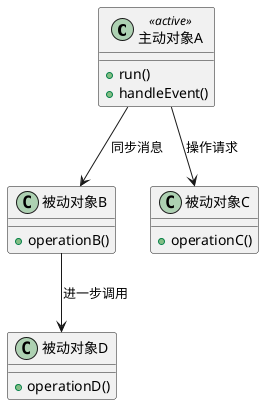

**解读说明**：图中 `主动对象A` 表示一个控制流的根，它主动启动并层层调用其他对象。`被动对象B`、`被动对象C` 和 `被动对象D` 只有在收到消息后才执行操作，符合 PPT 中“消息是向对象发出的操作请求”的描述。[PPT p.7]

### 进程和线程

**定义**：进程是一个具有一定独立功能的程序在一个数据集合上的一次动态执行过程；线程是在进程内部能够分别占用处理机、并可同时进行计算的执行单位。[PPT p.4]

**核心思想**：进程强调资源隔离和地址空间，线程强调同一进程内的并发执行。也就是说，进程通常拥有自己的地址空间和资源集合，而同一进程中的线程共享进程资源，但在处理器调度意义上又可以分别执行。

**背景与目的**：控制驱动设计必须理解进程和线程，因为 PPT 将控制流具体落到“进程或线程”上。[PPT p.3] 如果一个系统需要跨机器运行、隔离故障或独立部署，进程往往更合适；如果一个系统主要是在同一地址空间内并发处理多个任务，线程通常更轻量，但也更容易遇到共享状态同步问题。

**生活类比**：例如，多进程像几家公司各有办公室、账本和设备；多线程像同一家公司里的多个员工共用办公室和文件柜。前者隔离更强但沟通成本更高，后者沟通更快但要更小心资源冲突。

**PPT 原文关联**：PPT 指出大多数操作系统中每个程序都在自己的地址空间里作为一个进程运行，同时说明线程驻留在进程内部并共享进程资源。[PPT p.4] PPT 还用“单进程单线程、多进程单线程、单进程多线程、多进程多线程”展示组合情况，提醒我们并发结构不是只有一种形态。[PPT p.5]

| 维度 | 进程 | 线程 | 设计影响 |
| :--- | :--- | :--- | :--- |
| 资源边界 | 通常拥有独立地址空间和资源集合 | 位于进程内部并共享进程资源 | 进程更适合隔离，线程更适合轻量并发 |
| 调度意义 | 是处理机和其他计算机资源的分配单位 | 对处理器资源而言是独立分配单位 | 线程并发更细粒度，但共享资源要同步 |
| 通信成本 | 进程间通信通常需要专门机制 | 线程间可共享内存但要处理竞争 | 通信机制选择会影响复杂度和性能 |
| 典型风险 | 进程过多会带来资源开销和部署复杂度 | 线程过多会带来竞争、死锁和调试困难 | 控制流数量需要审查与筛选 |

### 控制流

**定义**：控制流是在处理机上顺序执行的动作序列，在当前实现技术中通常表现为一个进程或线程；在面向对象设计中，一个独立控制流用一个主动对象表示。[PPT p.3, PPT p.6]

**核心思想**：每个控制流都以一个表示独立进程或线程的主动对象为根。也就是说，创建主动对象就启动相关控制流，撤消主动对象就终止相关控制流；控制流的生命周期和主动对象的生命周期在设计模型中被绑定起来。[PPT p.9]

**背景与目的**：顺序程序只有一个控制流，因此一个时间点只有一件事情在发生，操作一个接一个执行。[PPT p.6] 并发程序存在多个控制流，控制线程内部可按顺序系统理解，但控制线程之间要考虑同步、异步、接收者数量、返回控制点和消息用途等更复杂的问题。[PPT p.8]

**生活类比**：例如，一个单窗口计算器像顺序系统，用户点一次按钮，程序按固定路径计算并显示结果。一个在线商城则像并发系统，用户浏览、库存扣减、支付确认、物流更新和后台统计可能同时推进，任何一个控制流设计不清都会影响其他控制流。

**PPT 原文关联**：PPT 的顺序系统示意图强调三点：消息是向对象发出的操作请求，消息都是同步的，每个消息只有唯一接收者。[PPT p.7] 并发系统示意图则强调消息有多种用途、消息有同步与异步之分、消息接收者可能不唯一，这些正是控制驱动设计要显式表达的差异。[PPT p.8]

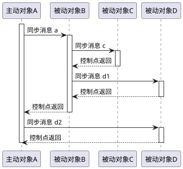

**解读说明**：这张 **序列图（Sequence Diagram）** 对应 PPT p.7 的顺序系统示意图。主动对象 A 发出同步消息后等待被调用方完成，控制点逐级返回，因此顺序系统的执行路径比较容易推理。

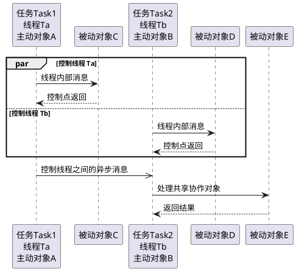

**解读说明**：这张图转译 PPT p.8 的并发系统示意图。线程内部仍可按顺序控制流理解，但线程之间可能出现异步消息、跨控制流协作和共享对象访问，因此需要额外定义通信机制与协调策略。

### 控制流的必要性

**定义**：控制流设计的必要性来自现实系统中固有的并发行为，以及实现环境对多任务、分布、硬件、操作系统和网络隔离的要求。[PPT p.10]

**核心思想**：控制流不是为了让系统“看起来复杂”，而是为了把确实需要同时推进、独立响应或隔离变化的工作分出来。值得注意的是，多任务设置既可以描述问题域固有的并发行为，也可以表达实现所需的设计决策。[PPT p.10]

**背景与目的**：当前大量系统都是并发系统，例如设备与计算机并发工作的系统、有多个窗口进行人机交互的系统、多用户系统、多个子系统并发工作的系统、单处理机多任务系统和多处理机系统。[PPT p.10] 如果不在设计阶段处理这些并发来源，代码层面往往只能临时增加线程、定时器或后台任务，最终导致系统结构失去可解释性。

**生活类比**：例如，超市收银系统中前台收款、后台账册更新、商品管理和库存查询都可能同时发生。若所有逻辑都塞进一个顺序流程，系统就很难响应多个收款机、后台统计和异常处理。

**PPT 原文关联**：PPT 还特别说明控制驱动设计可以隔离硬件、操作系统、网络变化对整个系统的影响。[PPT p.10] 这说明控制驱动部分不仅是并发建模，也承担实现平台变化的隔离职责。

### 控制驱动部分的建模

**定义**：控制驱动部分的建模是用包含主动类的 **类图（Class Diagram）** 捕捉控制流静态结构，并用包含主动对象的顺序图或通信图捕捉控制流动态行为。[PPT p.11]

**核心思想**：静态模型说明有哪些主动类、被动类和协作关系，动态模型说明这些对象在运行时如何发送消息、等待、并发和返回。也就是说，类图回答“有哪些执行主体”，交互图回答“它们怎样协作”。

**背景与目的**：只画类图不足以表达并发，因为类图不能完整说明消息时序、同步等待和跨线程通信。只画顺序图也不足以表达结构，因为它偏向一次场景而不是全局职责；因此 PPT 要求同时使用包含主动类的类图和包含主动对象的顺序图或通信图。[PPT p.11]

**生活类比**：类比一下，组织架构图告诉你有哪些部门和岗位，会议纪要或流程图告诉你它们在某个业务场景中如何传递任务。两类资料合在一起，才足以理解组织怎样运行。

**PPT 原文关联**：PPT 在设计控制驱动部分时先给出“识别控制流”，再给出“审查与筛选”“定义各控制流”“控制流间的通信”。这说明控制驱动设计不是只找线程，而是要经历识别、筛选、定义和通信建模四步。[PPT p.11-p.21]

### 控制流识别

**定义**：控制流识别是在设计阶段找出系统中需要独立进程或线程表示的主动执行源，并判断它们是否来自业务逻辑、并发需求、分布方案、优先级、实现方便、异常事件、并行计算或协调需求。[PPT p.11-p.14]

**核心思想**：控制流必须有明确理由，不能因为“可能并发”就随意增加线程。也就是说，每个控制流都应该对应一种真实的业务主动性、实现约束或协调职责，否则它只会增加调度、同步和通信成本。

**背景与目的**：PPT 给出八类识别来源。OOA 定义的主动对象来自业务逻辑；系统并发需求来自多项工作同时进行，例如销售与统计；分布方案要求每个分布站点至少有一个控制流；任务紧急程度可导致高优先、低优先和紧急控制流；实现方便可引入处理机之间通信的控制流；异常事件需要专门控制流处理不可预知控制点上的事件；并行计算通常用进程表示计算任务、用线程表示子任务；多个控制流交换信息时可增加协调者控制流。[PPT p.11-p.14]

**生活类比**：例如，医院系统里挂号、分诊、检查设备采集、医生诊断和药房发药可能分别需要独立控制流。若所有工作都由同一个控制流排队执行，设备数据和紧急病人无法及时处理；若为每个小动作都建线程，又会造成调度混乱和性能下降。

**PPT 原文关联**：PPT p.13 用“划分、通讯、组合、映射”的图示提示控制流识别会伴随问题分解、通信设计和组合映射。这里的视觉逻辑说明，控制流不是孤立产生的，它来自问题划分，也必须回到系统协作结构中。

**识别控制流**的步骤如下：

1. **寻找业务主动对象**
   - 输入：OOA 模型中的主动对象、外部设备、用户角色和业务事件。
   - 操作：判断哪些对象会主动启动行为，而不是只在被调用时响应。
   - 输出：由业务逻辑决定的候选控制流。
   - 目的：保证控制流首先服务于问题域真实并发，而不是只服务于技术偏好。

2. **检查并发和分布约束**
   - 输入：并发需求、分布站点、硬件节点、网络结构和性能目标。
   - 操作：将必须同时进行或必须部署在不同站点的工作拆成候选控制流。
   - 输出：由系统运行结构决定的候选控制流。
   - 目的：让设计模型能够反映实际运行环境。

3. **识别优先级和异常事件**
   - 输入：任务紧急程度、异常事件来源、不可预测触发条件。
   - 操作：为高优先级任务或异常处理设立独立控制流，避免它们被普通业务流程阻塞。
   - 输出：优先控制流、异常控制流和必要的监控控制流。
   - 目的：提高系统响应性和健壮性。

4. **判断是否需要协调者**
   - 输入：多个控制流之间的信息交换关系。
   - 操作：当点对点通信过于复杂时，引入协调者控制流进行调度、汇总或路由。
   - 输出：协调者控制流及其通信边界。
   - 目的：降低控制流之间的耦合，使协作结构更清晰。

### 控制流审查与筛选

**定义**：控制流审查与筛选是对候选控制流进行合理性检查，判断是否存在过度并发、职责不均衡、协作耦合过高或缺乏设立理由的问题。[PPT p.14]

**核心思想**：并发性不是越多越好，过度并发会带来执行效率损失。值得注意的是，PPT 明确要求每个控制流都应该有列举理由之一，除非存在明确的其他理由；这实际上是在要求设计者为每个线程或进程负责。[PPT p.14]

**背景与目的**：并发会引入上下文切换、同步等待、竞争条件、死锁风险和调试难度。审查与筛选的目标是让每个控制流高内聚，并与相关控制流保持松耦合；如果一个控制流承担过多职责，它会变成新的全局控制器，如果控制流拆得过细，通信成本又会吞掉并发收益。

**生活类比**：例如，超市不需要为每个商品建立一个收银线程，但可能需要为每台收款机建立独立控制流。前者只会增加管理负担，后者能反映真实的并发收银场景。

**PPT 原文关联**：PPT 的审查条件包括“过度并发性意味着执行效率的损失”“考虑控制流之间职责的均衡分布情况”“保证每个控制流高内聚且与相关控制流松耦合”。这几条可以直接作为控制驱动模型评审清单。[PPT p.14]

| 维度 | 控制流过少 | 控制流适中 | 控制流过多 |
| :--- | :--- | :--- | :--- |
| 响应性 | 多任务互相阻塞，紧急任务可能等待 | 关键任务可并行推进 | 线程调度和同步开销上升 |
| 职责分配 | 一个控制流承担过多职责 | 每个控制流职责清晰 | 职责被切得过碎，理解成本变高 |
| 协作复杂度 | 局部简单但全局流程拥挤 | 通信边界可控 | 消息、锁和共享状态显著增加 |
| 可维护性 | 改动容易影响主流程 | 变化可被限制在相关控制流 | 调试、测试和复现问题更困难 |

### 控制流定义

**定义**：控制流定义是在识别和筛选之后，为每个控制流命名、说明职责、指定操作归属、描述触发条件和数据流向，并定义控制流之间协调关系的设计活动。[PPT p.15]

**核心思想**：识别控制流只是知道“有这些线程或进程”，定义控制流才知道“每个线程或进程具体做什么”。也就是说，控制流定义要把候选项落成可实现、可检查、可沟通的设计规格。

**背景与目的**：PPT 要求对设计部分的每个操作指定它属于哪个控制流，并保证每个操作属于一个控制流。[PPT p.15] 这条要求很关键，因为同一个操作若被多个控制流随意执行，就会产生所有权不清、同步策略不统一和状态一致性问题。

**生活类比**：类比一下，项目经理不能只说“需要几个小组同时工作”，还要说明每个小组负责哪些任务、何时开始、从哪里拿输入、把结果交给谁。否则小组之间会重复做事或互相等待。

**PPT 原文关联**：PPT 对定义控制流列出四项：描述控制流、为控制流指定操作、定义各控制流细节、定义控制流协调情况。[PPT p.15] 若控制流由事件驱动，要描述触发条件；若由时钟驱动，要描述触发前经历的时间间隔；还要考虑数据从哪里取、往哪里送。

```plantuml
@startuml
skinparam shadowing false
class "SalesWorker" <<process>> {
  +startShift()
  +recordSale()
  +closeShift()
}

class "StatisticsWorker" <<thread>> {
  +collectSaleEvent()
  +updateSummary()
}

object "cashierWorker:SalesWorker" <<process>>
object "statWorker:StatisticsWorker" <<thread>>

"cashierWorker:SalesWorker" --> "statWorker:StatisticsWorker" : 发送销售事件
@enduml
```

**解读说明**：图中使用 `<<process>>` 和 `<<thread>>` 表示进程和线程对应的主动类或主动对象，转译了 PPT p.16 的表示法。类名表示主动类，对象名加类名表示具体主动对象，便于在类图和交互图之间保持一致。

### 控制流间通信

**定义**：控制流间通信是不同进程或线程中的对象为了协作而交换请求、信号、数据或远程调用结果的机制，PPT 主要列出操作调用、邮箱、共享存储器和远程过程调用四种方式。[PPT p.17-p.19]

**核心思想**：通信机制决定发送者是否等待、接收者何时处理、数据如何传递以及双方耦合程度。也就是说，同样是“通知另一个控制流”，同步调用、异步邮箱、共享内存和 RPC 的语义完全不同，不能混为一谈。

**背景与目的**：并发系统中控制流之间必须协作，但协作会引入阻塞、队列、共享数据一致性、网络失败和协议兼容等问题。设计阶段提前选择通信机制，可以把这些问题显式暴露出来，并帮助后续编码选择锁、消息队列、数据库事务、网络协议或进程间通信工具。

**生活类比**：例如，当面询问同事并等待回答像同步操作调用；把纸条放进对方信箱后继续工作像邮箱；多人共同编辑一张白板像共享存储器；打电话给外地办公室请求他们执行某项事务像远程过程调用。

**PPT 原文关联**：PPT 将操作调用描述为同步消息，并列出调用者调用、等待接收、接收者操作唤醒、结果返回、调用者继续执行的步骤。[PPT p.17] 邮箱强调请求者发送信号后继续执行，接收者准备好时再取信号；共享存储器强调多个控制流使用公共存储区域且必须注意同步；远程过程调用用于不同计算机中的并发进程。[PPT p.18-p.19]

| 通信方式 | 同步特征 | 典型适用场景 | 主要风险 |
| :--- | :--- | :--- | :--- |
| 操作调用 | 通常同步，调用者等待结果 | 需要立即返回计算结果或确认处理完成 | 调用链阻塞，跨控制流耦合较强 |
| 邮箱 | 通常异步，也可约定为同步 | 事件通知、任务队列、削峰处理 | 队列堆积、消息丢失、处理顺序复杂 |
| 共享存储器 | 通信本身不规定等待语义 | 传输复杂或较大数据结构 | 竞态条件、锁粒度、数据一致性 |
| 远程过程调用 | 常表现为远程同步请求，也可扩展异步 | 跨计算机进程调用对象操作 | 网络失败、序列化成本、远程异常处理 |

**操作调用**的步骤如下：

1. **发起调用**
   - 输入：调用者对象、目标对象和要执行的操作。
   - 操作：调用者向另一个控制流中的对象发送同步消息。
   - 输出：目标操作被请求。
   - 目的：让另一个控制流执行明确的对象操作。

2. **等待接收**
   - 输入：同步消息和调用者控制点。
   - 操作：调用者等待接收者接收调用，接收者被唤醒后开始执行。
   - 输出：调用者进入等待状态，接收者进入执行状态。
   - 目的：保证调用者不会在结果未确定时继续依赖后续状态。

3. **返回结果**
   - 输入：接收者的计算结果或执行状态。
   - 操作：接收者执行完毕后把结果返回给调用者。
   - 输出：调用者继续它自己的执行。
   - 目的：完成同步协作，维持调用语义的确定性。[PPT p.17]

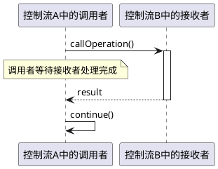

**解读说明**：这张图表示操作调用的同步语义。发送者在接收者执行期间等待，因此设计者要关注阻塞时间、调用链长度和是否可能发生循环等待。

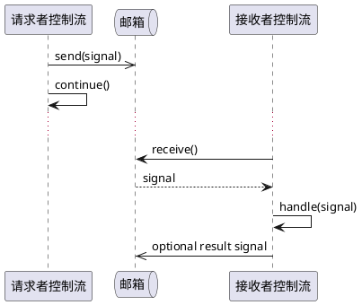

**解读说明**：邮箱机制把发送和处理解耦。发送者发出信号后继续执行，接收者在准备好或适当时机取信号处理，因此它适合任务异步化，但必须设计消息持久性、顺序和失败处理。[PPT p.18]

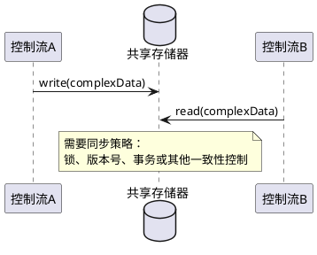

**解读说明**：共享存储器适合传输复杂或较大的数据结构，但共享并不自动安全。PPT 明确提示“使用此方式，要注意同步问题”，因此设计中必须说明谁能写、谁能读、何时加锁、冲突如何处理。[PPT p.18]

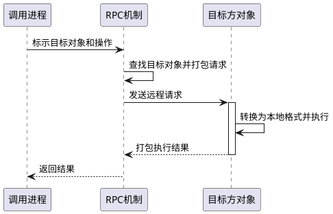

**解读说明**：远程过程调用用于不同计算机中的并发进程。它把远程对象操作包装成类似本地调用的形式，但设计时不能忽略网络查找、请求打包、本地格式转换和远程失败。[PPT p.19]

### 线程间和进程间通信建模

**定义**：线程间和进程间通信建模是用顺序图或通信图描述控制流之间怎样通过邮箱、共享存储器、操作调用等机制交换消息。[PPT p.20-p.21]

**核心思想**：建模的重点不是把所有实现细节画完，而是让设计者看清通信边界、参与对象、消息方向和等待关系。值得注意的是，线程间通信和进程间通信都可以使用邮箱、共享存储器或操作调用，但进程间通信往往额外涉及地址空间隔离、网络或进程间通信机制。

**背景与目的**：PPT 分别给出“黑板系统”的线程间通信示例和“旅游计划系统”的进程间通信示例。[PPT p.20-p.21] 这说明控制驱动设计需要把抽象通信方式落到具体系统场景中，避免只停留在“使用多线程”或“使用多进程”的口号。

**生活类比**：例如，多个老师在同一块黑板上写解题步骤，更接近共享存储器；不同城市旅行社之间请求酒店、机票和路线信息，更接近进程间或远程过程通信。两者都在通信，但约束条件完全不同。

**PPT 原文关联**：PPT p.20 指出表示进程或线程的一种方法是用顺序图，并以黑板系统展示线程间通信；PPT p.21 以旅游计划系统展示进程间通信。OCR 对图中对象名不完整，因此下面的图保留课程图示意图的通信语义，并用 `[盲区]` 标明细节缺失。

**盲区**：[盲区：PPT p.20-p.21 的图中部分对象名和消息名在 OCR 文本中不完整，无法逐字恢复黑板系统与旅游计划系统的所有参与者。以下 PlantUML 依据页面标题、可辨认的线程/进程表示法和通信机制进行结构化转译。]

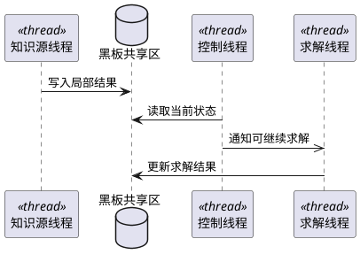

**解读说明**：黑板系统强调多个线程围绕同一共享信息空间协作。图中的黑板共享区对应共享存储器思想，控制线程负责协调，知识源或求解线程负责写入和读取局部结果。[PPT p.20]

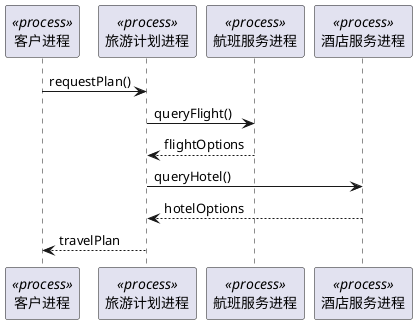

**解读说明**：旅游计划系统适合表示进程间通信，因为计划进程需要向多个外部服务进程请求信息。若这些进程分布在不同计算机上，通信机制可以进一步实现为 RPC 或网络消息。[PPT p.21]

### 控制驱动部分问答

**问**：控制驱动设计是不是只有多线程项目才需要？

**答**：不是。并发项目最典型，但普通系统也有主动执行源，例如 Web 请求、定时任务、消息消费者、外部设备回调和用户界面事件。只要系统中存在“谁主动运行、何时运行、如何协作”的问题，就需要控制驱动设计。

**问**：为什么不能把每个业务对象都设计成主动对象？

**答**：因为主动对象通常意味着进程或线程语义，会带来调度、同步和通信成本。大多数业务对象更适合作为被动对象，由明确的控制流调用；只有具备业务主动性、并发需求、分布约束或协调职责的对象，才适合作为主动对象。

**问**：同步消息和异步消息的主要区别是什么？

**答**：同步消息中发送者通常要等待接收者完成处理并返回结果，执行路径更确定，但可能阻塞。异步消息中发送者发送后继续执行，系统吞吐量和解耦性更好，但需要处理消息顺序、失败重试和最终一致性问题。

---

## 数据管理部分

### 数据管理部分

**定义**：数据管理部分是负责在特定数据管理系统中存储和检索持久对象的 OOD 组成部分，它封装持久对象的查找、保存和恢复机制，并隔离数据管理方案变化对其他部分的影响。[PPT p.23]

**核心思想**：数据管理部分把“对象怎样长期存在”从普通问题域逻辑中分离出来。也就是说，问题域模型关心对象的业务身份、属性、关系和操作，而数据管理部分关心这些对象怎样落到文件系统、关系数据库系统或面向对象数据库系统中。

**背景与目的**：PPT 指出不同数据管理系统会对数据管理部分设计产生不同影响，包括文件系统、R-DBMS 和 OO-DBMS。[PPT p.23] 如果不隔离这些影响，一旦数据库类型、表结构、存储格式或查询机制变化，问题域部分就会被迫大面积修改。

**生活类比**：类比一下，问题域对象像图书馆里的书、读者和借阅记录，数据管理部分像图书馆的编目和仓储制度。读者并不需要知道书架编号如何编码，但系统必须有稳定机制把书的位置、状态和借阅关系保存下来。

**PPT 原文关联**：PPT 明确说数据管理部分的目的是存储问题域的持久对象、封装这些对象的查找和存储机制，以及隔离数据管理方案影响。[PPT p.23] 它还强调问题范围包括对象在永久性存储介质上的存储、只存储对象属性值部分、可能只有一部分对象需要长久存储。

```plantuml
@startuml
skinparam shadowing false
package "问题域部分" {
  class "销售事件" {
    +amount
    +time
    +save()
  }
}

package "数据管理部分" {
  class "ObjectStorage" {
    +store(object)
    +restore(id)
    +query(criteria)
  }
}

database "R-DBMS" as DB

"销售事件" --> "ObjectStorage" : 请求存储/检索
"ObjectStorage" --> DB : SQL / 映射
@enduml
```

**解读说明**：图中 `ObjectStorage` 表示集中式数据管理对象，负责把问题域对象转换为数据库可存储形式。这样问题域对象不必直接依赖具体数据库 API，符合 PPT 中“隔离数据管理系统影响”的目的。[PPT p.24, PPT p.45]

### 数据管理部分的必要性

**定义**：数据管理部分的必要性在于隔离数据管理系统对其他部分的影响，并使选择不同数据管理系统时问题域部分基本相同。[PPT p.24]

**核心思想**：持久化设计应尽量让业务对象的概念稳定，而把文件、关系表、对象数据库等实现差异封装在数据管理层。值得注意的是，“问题域部分基本相同”不等于完全不受影响，而是把不可避免的影响限制在明确位置。

**背景与目的**：PPT p.24 的图示把问题域部分放在中间，外围可能连接文件系统、关系数据库或面向对象数据库，视觉上强调数据管理系统不应直接污染所有业务对象。若没有这一隔离，换数据库就会变成修改业务规则，系统维护成本会明显上升。

**生活类比**：例如，一个博客系统从 MySQL 迁移到 PostgreSQL 时，文章、评论、用户这些业务概念不应该被重写。真正需要变化的是表结构差异、SQL 方言、连接配置和对象存储器中的映射代码。

**PPT 原文关联**：PPT 将“为了隔离数据管理系统对其它部分的影响”和“使选用不同的数据管理系统时，问题域部分基本相同”作为数据管理部分的两条原因。[PPT p.24] 这两条共同说明数据管理设计的核心目标是稳定问题域模型。

### 数据管理系统选择

**定义**：数据管理系统选择是在进行数据存储设计之前，决定使用文件系统、关系数据库系统或面向对象数据库系统等持久化基础设施的设计决策。[PPT p.25]

**核心思想**：先选数据管理系统，再做数据存储设计，因为不同系统的数据模型、查询能力、事务能力和映射成本不同。也就是说，R-DBMS 要重点处理对象到表的映射，OO-DBMS 更强调对象模型一致性，文件系统则需要自己定义文件结构和读写机制。

**背景与目的**：PPT 在“如何设计数据管理部分”中先列出“首先选择数据管理系统”，再列出“进行数据存储设计”。[PPT p.25] 这说明持久化不是单纯编码问题，而是会影响类设计、关系存储、对象标识和数据管理类设计的架构决策。

**生活类比**：类比一下，保存资料可以选择纸质档案柜、电子表格或专业档案系统。不同方案都能保存资料，但检索速度、权限控制、版本管理和迁移成本完全不同。

**PPT 原文关联**：PPT 后续分别展开 R-DBMS、OO-DBMS 和文件系统的数据存储设计，表明本课并不是只讲关系数据库，而是把关系数据库作为最需要映射设计的重点场景。[PPT p.26-p.48]

| 维度 | 文件系统 | R-DBMS | OO-DBMS |
| :--- | :--- | :--- | :--- |
| 数据组织 | 文件、记录、字节流或自定义结构 | 表、行、列、主键、外键 | 对象、类、对象标识和对象关系 |
| 映射成本 | 需要自行定义结构和解析规则 | 需要对象关系映射 | 应用对象模型与数据库模型较一致 |
| 查询能力 | 依赖自定义索引或文件扫描 | SQL 查询成熟，事务能力强 | 依赖对象数据库提供的查询语言 |
| 适用场景 | 简单持久化、配置、日志或特定格式数据 | 业务系统中结构化数据和关系查询 | 对象结构复杂且希望减少关系映射的系统 |

### 关系数据库概念映射

**定义**：关系数据库概念映射是把面向对象模型中的类、对象、属性、操作和关系，对应到实体联系模型和关系数据库模型中的实体类型、实体实例、表、行、列、键和表间关系。[PPT p.26]

**核心思想**：对象模型和关系模型不是同一种表达方式，必须建立概念对应关系才能持久化对象。也就是说，对象中的身份、引用和行为不能原封不动塞进表，设计者要决定哪些属性存储、哪些关系转成外键或关联表、哪些操作留在程序中。

**背景与目的**：R-DBMS 是常见持久化方案，但它以关系表为核心，而面向对象模型以类和对象为核心。若没有映射，开发人员会在代码里临时拼凑表结构，导致数据库设计和领域模型互相牵制、难以维护。

**生活类比**：例如，一个“学生”对象在程序里可以有姓名、学号、选课集合和计算绩点的方法。落到关系数据库时，姓名和学号变成列，选课集合可能变成选课表，计算绩点的方法不直接存入数据库，而由程序或查询逻辑计算。

**PPT 原文关联**：PPT p.26 给出三列对应关系：面向对象、实体-联系、关系数据库。类对应实体类型和表，对象对应实体实例和行，属性对应属性和列，关联/聚合/泛化也要进一步映射到数据库结构。

| 面向对象概念 | 实体-联系概念 | 关系数据库概念 | 设计含义 |
| :--- | :--- | :--- | :--- |
| 类 | 实体类型 | 表 | 一个持久类通常导出一个或多个表 |
| 对象 | 实体实例 | 行 | 一个对象实例的持久状态通常是一行或多行 |
| 属性 | 属性 | 列 | 只存储需要持久化的属性值 |
| **关联（Association）** | 联系 | 外键或关联表 | 需根据一对一、一对多、多对多选择映射 |
| **聚合（Aggregation）** | 整体-部分联系 | 外键或关联表 | 一般遵循关联映射规则 |
| **继承（Inheritance）** / 泛化 | 泛化层次 | 父表、子表或单表 | 需权衡查询、冗余和扩展成本 |

### 数据存储示意

**定义**：数据存储示意描述问题域部分通过创建、修改、查询和删除等操作与数据库交互，并由数据管理部分负责把对象状态转换成可持久化的数据结构。[PPT p.27]

**核心思想**：数据存储不是把对象“整体冻住”，而是存储对象的持久属性值和必要标识。也就是说，系统运行时对象有行为、引用和临时状态，但数据库通常只保存能够恢复对象业务状态的数据。

**背景与目的**：PPT p.23 已指出“只存储对象的属性值部分”，p.27 又用数据存储示意图展示问题域部分与 CREATE、查询、修改等数据库动作之间的关系。设计者必须明确哪些对象是持久对象、哪些属性需要保存、何时创建、何时修改、何时查询。

**生活类比**：例如，购物车对象在内存中可能有计算总价的方法、临时优惠上下文和界面选择状态，但数据库可能只保存购物车编号、用户编号、商品项、数量和更新时间。方法和临时界面状态不需要作为持久数据保存。

**PPT 原文关联**：PPT p.27 的图把问题域部分和数据存储动作连接起来，说明数据库操作应该服务于问题域对象的生命周期。页面中的 CREATE、查询、修改等字样提示我们要考虑对象从创建到更新再到检索的完整路径。

### 对象标识

**定义**：对象标识是在程序运行时或永久存储中区分对象身份的机制；运行时对象标识通常唯一且对程序员不可直接访问，永久对象在表中的标识通常由主关键字承担。[PPT p.28]

**核心思想**：对象身份和数据库主键相关但不完全相同。也就是说，程序中可能通过对象引用或对象名访问对象，数据库中则需要用主关键字稳定定位某一行或某组关联行。

**背景与目的**：PPT 指出由类导出的表用一个主关键字作为表中所存储对象的唯一标识，由关联导出的表用相关联表的主关键字组合作为主关键字。[PPT p.28] 若对象标识设计不清，系统就无法可靠恢复对象、维护关联，也无法判断两个内存对象是否代表同一个持久对象。

**生活类比**：例如，现实中两个人可能同名，但身份证号可以唯一标识某个人。程序里的变量名像临时称呼，数据库主键像长期档案编号；两者服务于不同上下文。

**PPT 原文关联**：PPT 还说明“在应用中使用对象名，在表中使用主关键字”。[PPT p.28] 这提醒我们不要把数据库主键随意暴露为业务对象的唯一表达，也不要忽略主键在持久化中的不可替代作用。

```plantuml
@startuml
skinparam shadowing false
class "Order" {
  +orderId
  +createdAt
  +total
}

database "ORDER 表" as T {
  order_id PK
  created_at
  total
}

"Order" ..> T : orderId 映射为主关键字
@enduml
```

**解读说明**：图中 `orderId` 在对象中是业务可见的标识，在表中对应主关键字。设计时要区分运行时引用、对象名、业务编号和数据库主键的不同语义。

### 永久类的存放设计

**定义**：永久类的存放设计是确定每个需要长期保存的类应保存哪些属性、如何规范化这些属性、以及如何定义对应数据库表的过程。[PPT p.29]

**核心思想**：每个永久类使用一个数据库表是基本思路，但不是机械规则。也就是说，设计者先列出需要存储的属性，再按时间和空间要求进行规范化；如果属性不满足范式，可以拆分类，也可以不修改类而让一个类对应两个或多个表。[PPT p.29]

**背景与目的**：对象类通常按业务职责组织，关系表则要求属性结构满足一定规范。若直接把类的所有属性塞进一张表，可能出现重复数据、更新异常或非原子字段；若过度拆表，又可能导致查询复杂和性能下降。

**生活类比**：例如，用户对象中有地址列表，直接把多个地址拼成一个字符串放在用户表中不利于查询和更新。更合理的设计可能是用户表保存用户基本属性，地址表保存多条地址记录，并用用户编号关联。

**PPT 原文关联**：PPT 把永久类存放设计分为三步：确定要存储哪些属性值，按时间与空间要求权衡并规范化，定义数据库表；表的列是规范化后的属性，行是对象实例。[PPT p.29]

**永久类存放设计**的步骤如下：

1. **列出持久属性**
   - 输入：永久类、业务规则和恢复对象所需状态。
   - 操作：区分需要长期保存的属性、可计算属性和临时运行状态。
   - 输出：候选持久属性清单。
   - 目的：避免把方法、临时状态或可推导数据错误存入数据库。

2. **进行规范化权衡**
   - 输入：候选持久属性、查询频率、更新频率和存储空间要求。
   - 操作：检查属性是否满足至少第一范式，并根据需要拆分属性或拆分表。
   - 输出：规范化后的属性集合或表结构方案。
   - 目的：减少重复数据和更新异常，同时兼顾性能。

3. **定义数据库表**
   - 输入：规范化属性、对象标识和关系映射策略。
   - 操作：把属性定义为列，把对象实例定义为行，并设置主关键字和必要约束。
   - 输出：表结构和主键方案。
   - 目的：让对象状态能稳定保存、查询和恢复。[PPT p.29]

### 关系数据库范式

**定义**：关系数据库范式是衡量关系表规范化程度的一组约束，用于减少数据冗余、更新异常和不合理依赖。[PPT p.30]

**核心思想**：范式不是越高越绝对正确，而是在数据一致性、查询性能、表结构复杂度之间做权衡。值得注意的是，PPT 在永久类存放设计之后补充范式，是为了说明对象属性落表时不能忽略关系数据库自身的规范。

**背景与目的**：关系数据库要求存入其中的数据符合一定规范。第一范式要求属性值原子；第二范式要求非关键字属性依赖于整个关键字；第三范式要求非关键字属性只依赖于关键字；BCNF 要求每个决定因素都是候选关键字；第四范式和第五范式继续处理多值依赖和连接依赖问题。[PPT p.30]

**生活类比**：例如，一张订单表若把多个商品编号写在同一个字段中，就违反第一范式；若订单明细表中商品名称只依赖商品编号却反复存储在每条明细里，就可能产生更新异常。规范化的目的就是把这些隐藏问题提前整理清楚。

**PPT 原文关联**：PPT p.30 将第一范式到第五范式逐条列出，但课程语境下重点是提醒永久类属性至少满足第一范式，并在需要时进一步规范化。设计者不一定每次追求最高范式，但必须知道违反范式会带来什么代价。

| 范式 | 核心要求 | 直观问题 | OOD 中的影响 |
| :--- | :--- | :--- | :--- |
| 第一范式 | 每个属性值必须是原子的 | 一个字段塞多个值 | 需要把集合属性拆成多行或新表 |
| 第二范式 | 非关键字属性依赖于整个关键字 | 只依赖复合主键的一部分 | 关联表设计要避免局部依赖 |
| 第三范式 | 非关键字属性只依赖于关键字 | 非关键字之间互相决定 | 需要拆分可独立维护的信息 |
| BCNF | 每个决定因素都是候选关键字 | 决定关系不规范 | 复杂业务键需要重新审查 |
| 第四/第五范式 | 处理多值依赖和连接依赖 | 多组独立事实混在一表 | 高复杂关系可能需要进一步拆表 |

### 关联和聚合的存储

**定义**：关联和聚合的存储是把对象模型中的对象关系映射到关系数据库中的外键、独立关联表或合并表结构的设计活动。[PPT p.31-p.37]

**核心思想**：不同多重性的关系需要不同映射策略。也就是说，一对一关联可以独立建表、用外键隐含或把两个对象和关联放在同一表中；一对多关联可以独立建表，也可以在“多”的一方表中放外键；多对多关联通常映射到独立表，并用两个相关表的主关键字组合为主关键字。[PPT p.31]

**背景与目的**：对象之间的关系在内存中可以表现为引用、集合或导航属性，但关系数据库需要通过键和表表示。映射策略会影响查询性能、约束表达、更新复杂度和数据冗余；因此 PPT 用多页示意一对一、一对多、多对多关联，以及关联或聚合映射到表格的不同形式。[PPT p.32-p.36]

**生活类比**：例如，员工和办公室若是一对一关系，可以在员工表中放办公室编号，也可以单独建“员工办公室分配”表。公司和人员是一对多关系时，通常在人员表中放公司编号；用户和工作站若是多对多关系，则更适合建立“用户工作站”关联表。

**PPT 原文关联**：PPT p.32-p.36 分别展示一对一关联只映射到一个表、一对一关联映射到多个表、一对多关联单独建表、一对多关联在对象较多的类中建表、多对多关联等方案。PPT p.37 说明聚合遵循与关联同样的规则，这意味着 **聚合（Aggregation）** 在存储层不一定需要特殊表结构，关键仍是多重性和生命周期约束。

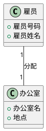

**解读说明**：这张图表示一对一关联。落到关系数据库时，可以把办公室外键放入雇员表，也可以单独建立分配表；PPT 说明一对一关联只映射到一个表使用较多，通常能提高性能。[PPT p.32]

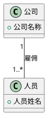

**解读说明**：这张图表示一对多关联。关系数据库中可以为关联单独建表，也可以在人员表中增加公司主键作为外键；后者通常更直接，但如果关联本身有属性，独立关联表更清晰。[PPT p.34-p.35]

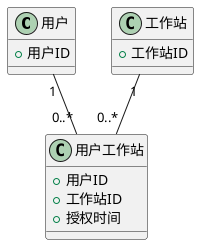

**解读说明**：这张图表示多对多关联转为独立关联表。`用户工作站` 的主关键字可由用户 ID 和工作站 ID 组合而成，也可以在有额外业务属性时增加独立主键。[PPT p.36]

| 关系类型 | 常见映射方式 | 适用条件 | 代价 |
| :--- | :--- | :--- | :--- |
| 一对一 | 合并表、外键或独立关联表 | 关系稳定且查询常一起发生时可合并 | 合并会降低独立演化能力 |
| 一对多 | 在“多”的一方放外键，或单独建表 | “多”的一方天然归属某个“一”方 | 关联有属性时外键方式表达不足 |
| 多对多 | 独立关联表 | 双方都可能对应多个对方对象 | 查询需要连接，表数量增加 |
| 聚合 | 通常遵循关联映射规则 | 整体-部分关系需要持久化 | 还需额外考虑删除和生命周期规则 |

### 泛化的存储

**定义**：泛化的存储是把面向对象模型中的父类和子类继承层次映射到关系数据库表结构的设计活动，常见方案包括为父类和子类各建表、为每个子类建表、只对应父类一张表等。[PPT p.37-p.43]

**核心思想**：**继承（Inheritance）** 在对象模型里表达“是一个”的类型层次，但关系数据库没有直接等价机制。也就是说，设计者必须选择把父类属性放在哪里、子类属性放在哪里、查询时如何恢复完整对象、增加子类时如何维护表结构。

**背景与目的**：PPT 以“设备”及其子类为例展示泛化映射。[PPT p.38] 方案一为父类和子类各设计一张表，查询完整子类对象时需要根据设备 ID 在子类表和父类表中查找；方案二为每个子类各设计一张表，把父类属性下推到子类表；方案三只对应父类一张表，把不同子类属性集中到一张表中。[PPT p.39-p.42]

**生活类比**：例如，“设备”是父类，“打印机”和“显示器”是子类。可以建立设备表保存共同属性，再建立打印机表和显示器表保存特有属性；也可以只建打印机表和显示器表，把设备名称、价格等共同属性复制到每个子类表中；还可以只建一张设备表，用设备类型和可空字段保存不同子类信息。

**PPT 原文关联**：PPT p.43 总结了下推、上拉和分割表三种策略：下推为每个子类定义单独表，简单但新增子类或修改父类时维护麻烦；上拉去掉继承网格结构，把一个层次的实例放入同一表；分割表将父类和子类状态存储在不同表中，整体效果较好但查询需要组合。[PPT p.43]

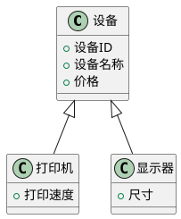

**解读说明**：这张类图转译 PPT 的设备泛化层次。数据库映射时的关键问题是：父类共同属性、子类特有属性和对象类型信息分别放入哪些表。

| 映射策略 | 表结构 | 优点 | 缺点 |
| :--- | :--- | :--- | :--- |
| 父类和子类各建表 | 父表保存共同属性，子表保存特有属性 | 结构清晰，冗余少，接近对象继承 | 查询完整对象需要连接父表和子表 |
| 每个子类各建表 | 每个子表同时保存共同属性和特有属性 | 查询某个子类对象简单 | 父类属性重复，新增子类或修改父类维护麻烦 |
| 只对应父类一张表 | 一张表保存所有层次属性和类型字段 | 查询所有设备简单，表数量少 | 子类字段可能大量为空，约束表达较弱 |

### 数据管理类设计

**定义**：数据管理类设计是在确定存储结构后，决定由问题域对象自己负责保存和检索，还是由专门的数据管理对象集中负责对象存储与检索的设计活动。[PPT p.44-p.46]

**核心思想**：存储责任可以分散到每个永久类，也可以集中到对象存储器等数据管理对象。也就是说，方案一让每个对象知道如何保存自己，方案二让对象通过消息使用数据管理部分对象的操作，由后者负责所有对象的存储与检索。

**背景与目的**：方案一简单直接，但会把数据库表名、主键、查询和保存逻辑放进问题域类，导致业务对象和存储机制耦合。[PPT p.44] 方案二隔离更好，但对象存储器需要处理不同类的不同属性、不同参数类型、不同主关键字，以及保存和恢复对象的时机。[PPT p.45-p.46]

**生活类比**：例如，方案一像每个员工都自己去档案室归档资料，方案二像公司设立档案管理员统一归档。前者每个人都要懂归档制度，后者职责集中但档案管理员要支持各种资料格式。

**PPT 原文关联**：PPT p.44 的方案一包括“告诉一个对象自己存储自己”“每个对象知道如何保存自己”“检索被存储的对象”，并提醒永久类的属性和操作是新增加的，原有属性和操作仍要保存。PPT p.45-p.46 的方案二则设立对象存储器，系统保存和恢复对象的时机包括系统启动、系统停止、首次使用未恢复对象、业务规则要求保存对象、与其他系统共享对象数据时根据一致性策略保存。[PPT p.44-p.46]

```plantuml
@startuml
skinparam shadowing false
class "永久类对象" {
  +businessOperation()
  +save()
  +restore(id)
}

database "数据库表" as DB
"永久类对象" --> DB : 自己保存/检索
@enduml
```

**解读说明**：这是方案一。优点是调用路径短，缺点是业务类知道太多存储细节，数据库方案变化时问题域类会受到影响。[PPT p.44]

```plantuml
@startuml
skinparam shadowing false
class "问题域对象" {
  +businessOperation()
}

class "ObjectStorage" {
  +store(object)
  +restore(className, id)
  +query(criteria)
}

database "数据库表集合" as DB

"问题域对象" --> "ObjectStorage" : 请求保存/恢复
"ObjectStorage" --> DB : 统一访问
@enduml
```

**解读说明**：这是方案二。问题域对象通过消息使用数据管理对象的操作，数据管理对象统一处理映射、主键和查询，因此更符合隔离数据管理系统影响的目标。[PPT p.45-p.46]

| 维度 | 对象自己存储自己 | 对象存储器集中管理 | 设计影响 |
| :--- | :--- | :--- | :--- |
| 职责分配 | 每个永久类包含存储操作 | 数据管理对象负责存储与检索 | 集中管理更利于隔离变化 |
| 耦合程度 | 业务类依赖数据库细节 | 业务类依赖存储接口 | 集中管理可降低问题域污染 |
| 实现复杂度 | 单个类实现简单 | 存储器要处理多类多参数 | 集中管理需要更强抽象 |
| 维护成本 | 表结构变化影响多个业务类 | 表结构变化集中在数据管理部分 | 大系统更适合集中封装 |

### 面向对象数据库和文件系统

**定义**：针对 OO-DBMS 的数据存储设计，是在应用系统和数据库数据模型一致的前提下，标识需要长期保存的对象，并利用 OO-DBMS 提供的存储能力、数据定义语言和查询语言完成持久化；针对文件系统的设计，则类似 R-DBMS，需要定义文件结构或串读写方式。[PPT p.47-p.48]

**核心思想**：OO-DBMS 可以减少对象到关系表的映射成本，但仍需标识持久对象并考虑查询和操作语言。文件系统更灵活也更原始，设计者必须自己承担结构化、范式、读写和恢复机制。

**背景与目的**：PPT 说明 OO-DBMS 本身提供“存储自己”的功能，使每个对象能自己保存；只要把需要长期保存的对象标识出来，如何保存和恢复由数据库管理系统处理。[PPT p.47] 文件系统则要根据需要存储的属性值列出永久类属性，使属性列表符合需要的范式定义，再把符合范式的属性定义为文件，之后按文件结构或按串读写文件。[PPT p.48]

**生活类比**：OO-DBMS 像一个能直接理解对象档案结构的档案系统，R-DBMS 像需要把档案拆成标准表格的系统，文件系统像给你一堆文件夹和纸张，具体分类、索引和查找规则都要自己设计。

**PPT 原文关联**：PPT p.47 提到 OO-DBMS 的 ODL、查询语言和操作语言，说明即使模型一致，也需要学习数据库提供的定义、查询和操作机制。PPT p.48 则把文件系统设计与关系数据库设计类比，强调文件持久化也要进行属性选择和结构定义，而不是随意写文件。

### 数据管理部分问答

**问**：为什么对象模型不能直接等同于关系表模型？

**答**：对象模型有身份、行为、引用、集合和继承，而关系表模型以表、行、列、主键和外键表达数据。两者可以映射，但不能简单等同；特别是关联、聚合和继承都需要额外设计。

**问**：对象标识和数据库主键有什么区别？

**答**：对象标识用于在运行时区分对象，可能由引用或运行时系统维护；数据库主键用于在持久化存储中唯一定位记录。二者可以通过业务 ID 或持久化 ID 建立对应，但语义和生命周期不同。

**问**：什么时候适合引入对象存储器？

**答**：当系统中持久类较多、数据库方案可能变化、表结构映射复杂，或希望问题域类尽量不依赖数据库细节时，适合引入对象存储器。它会增加一层抽象，但能把存储与检索职责集中管理。

---

## 构件与部署部分

### 构件与部署设计

**定义**：构件与部署设计是在面向对象系统设计后期，描述、构造和组织系统构件，并说明构件如何分布到运行节点上的设计活动。[PPT p.50]

**核心思想**：构件设计关注软件单元的接口、内部结构、动态行为和实现制品，部署设计关注这些制品运行在哪些物理或执行节点上。也就是说，类图和对象图说明了软件逻辑结构，但构件图和部署图进一步说明系统怎样被打包、集成、发布和运行。

**背景与目的**：当系统进入实现和交付阶段，设计者必须明确哪些模块相对独立、哪些接口作为契约公开、哪些制品由构件实现、哪些节点承担计算资源，以及节点之间如何连接。PPT 从 p.50 开始引入构件与部署，正是为了把 OOD 从对象级设计推进到系统级实现结构。

**生活类比**：例如，个人博客系统可以有前端构件、后端 API 构件、对象存储构件和数据库制品。部署时，前端可能运行在浏览器或静态服务器上，后端运行在应用服务器上，数据库运行在数据库服务器上。

**PPT 原文关联**：PPT p.50 写到“当前的一种主流的做法是在面向对象的系统设计阶段的后期，考虑如何对系统的构件进行描述、构造和组织，以及构件如何在节点上进行分布”。这句话说明构件与部署是 OOD 后期连接实现和运行环境的关键内容。

### 构件

**定义**：构件是在构建软件系统中具有相对独立功能、可以明确辨识、接口由契约指定、语境有明显依赖关系、可独立部署的组成单元；在 UML 2.0 中，构件是一种类，因此也具有属性、操作和可见性。[PPT p.51-p.52]

**核心思想**：构件比普通类更强调部署、替换和接口契约。也就是说，一个构件不只是代码文件集合，而是对外提供明确服务、对内可以隐藏实现细节、并能在系统组装中被识别和管理的单元。

**背景与目的**：大型系统不能只依靠类来组织，因为类粒度太细，难以直接表达模块边界、可部署单元和接口契约。构件提供了更粗粒度的设计视角，使设计者能讨论“订单构件”“账册构件”“商品构件”等系统组成，而不仅是内部类。

**生活类比**：类比一下，类像机器里的零件，构件像可替换的功能模块。你可以更换一个支付构件，只要它遵守接口契约，系统其他部分就不必关心内部是调用银行接口还是第三方支付接口。

**PPT 原文关联**：PPT p.51-p.52 从构件含义讲到 UML 2.0 中构件是一种类，并说明构件可以拥有属性、操作和可见性。PPT p.53 展示了 `<<component>>` 和构件图标等表示法。

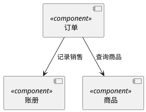

**解读说明**：图中每个 `component` 表示一个构件。箭头表示构件之间的依赖或调用关系，强调系统级功能单元之间的协作，而不是某个类的内部实现。[PPT p.53]

### 构件接口

**定义**：**接口（Interface）** 由一组操作组成，用来指定一个契约，这个契约必须由实现和使用该接口的构件共同遵循；除非用于表示常量，接口通常不需要属性。[PPT p.54]

**核心思想**：接口把“构件能提供什么服务”和“构件需要什么服务”以契约形式表达出来。值得注意的是，一个构件可以实现多个接口，也可以请求多个接口，一个接口也可以由多个不同构件实现；只要构件服从提供和请求接口表达的约束，就能协作。[PPT p.55]

**背景与目的**：没有接口的构件只是一个封闭模块，其他构件很难知道如何正确使用它。接口把构件协作从实现依赖转化为契约依赖，使构件替换、复用和并行开发更可控。

**生活类比**：例如，插座接口规定电压、插孔形状和连接方式，电器只要遵守接口就能使用电源。不同厂商可以生产不同内部结构的插座，但只要契约一致，使用者不必关心内部接线。

**PPT 原文关联**：PPT p.54-p.56 展示构件接口、提供接口和请求接口的表示法。它强调构件可以实现多个接口、请求多个接口，接口也可由多个构件实现，这正是构件组装的基础。

```plantuml
@startuml
skinparam shadowing false
interface "IOrderService" as IOrder {
  +createOrder()
  +cancelOrder()
}

interface "IProductQuery" as IProduct {
  +findProduct()
}

component "订单构件" as Order
component "商品构件" as Product

Order - IOrder
Order ..> IProduct : 请求接口
Product - IProduct
@enduml
```

**解读说明**：`订单构件` 提供 `IOrderService`，同时请求 `IProductQuery`。`商品构件` 提供商品查询接口，因此订单构件可以通过接口契约依赖商品构件，而不是依赖其内部类。[PPT p.54-p.56]

### 构件端口

**定义**：端口是构件的一部分，用于进一步控制构件通过哪些边界与外部通信；构件可以通过特定端口同另一个构件通信，通信完全由端口支持的接口描述。[PPT p.57-p.59]

**核心思想**：接口说明构件总的行为，端口说明这些行为通过哪个具体交互点暴露或请求。也就是说，端口把构件的外部通信边界细分出来，能够提升构件的 **封装（Encapsulation）**，避免外部直接接触构件内部实现。

**背景与目的**：PPT 指出接口对声明构件总行为有用，构件实现只需保证实现全部提供接口中的操作，但使用端口可以进一步控制这种实现。[PPT p.57] 当构件有多个通信角色、多个协议或多个实例化连接点时，端口能更精确表达构件外部边界。

**生活类比**：例如，一台电脑有 USB 端口、网口和电源口，都是电脑的外部交互点。每个端口支持不同接口和协议，外设不能随意从电脑内部接线，而必须通过对应端口通信。

**PPT 原文关联**：PPT p.58 说明端口提供接口表示通过端口提供服务，请求接口表示通过端口需要从其他构件获得服务。PPT p.59 还说明端口实例随所属构件实例一起创建和撤消，端口可以具有多重性，表示构件实例中特定端口的可能数目。

```plantuml
@startuml
skinparam shadowing false
component "订单构件" as Order {
  port "api" as ApiPort
  port "payment" as PaymentPort
}

interface "IOrderApi" as IOrderApi
interface "IPayment" as IPayment

ApiPort - IOrderApi
PaymentPort ..> IPayment
@enduml
```

**解读说明**：`api` 端口提供订单服务接口，`payment` 端口请求支付接口。端口让构件的不同通信边界分开表达，适合描述复杂构件的外部交互结构。[PPT p.57-p.59]

### 连接件

**定义**：连接件用于描述构件端口或接口之间的连接关系；如果一个端口提供特定接口，另一个端口需要该接口且二者兼容，那么这两个端口可连接。[PPT p.60]

**核心思想**：连接件表达“谁使用谁的服务”以及请求如何被转发或装配。也就是说，端口和接口说明可连接条件，连接件说明实际系统结构中这些服务关系如何建立。

**背景与目的**：PPT 将连接件分为装配连接件和委托连接件。[PPT p.61-p.62] 装配连接件用于两个构件实例之间，把请求接口或端口连接到提供接口或端口；委托连接件用于把外部对构件端口的请求分发给构件内部部件实例处理，或把内部部件向外部的请求分发出去。

**生活类比**：装配连接件像把电器插头插到插座上，一个设备使用另一个设备提供的服务。委托连接件像公司前台把外部来电转给内部部门，外部只知道总机号码，内部由合适部门处理。

**PPT 原文关联**：PPT p.60 说明连接端口意味着请求端口调用提供端口中的操作以得到服务，并指出设立端口和连接件能更精确地控制构件协作。PPT p.61-p.62 分别定义装配连接件和委托连接件，是构件结构建模的核心。

```plantuml
@startuml
skinparam shadowing false
component "订单构件实例" as Order
component "支付构件实例" as Pay
interface "IPayment" as IPayment

Order ..> IPayment : 请求接口
Pay - IPayment : 提供接口
Order --> Pay : 装配连接件
@enduml
```

**解读说明**：装配连接件把订单构件的请求接口连接到支付构件的提供接口，表示构件实例之间的服务使用关系。[PPT p.61]

```plantuml
@startuml
skinparam shadowing false
component "订单构件" as Order {
  [OrderFacade] as Facade
  [OrderRepository] as Repo
}

interface "IOrderApi" as IApi
IApi - Order
Order --> Facade : 委托连接件
Facade --> Repo : 内部调用
@enduml
```

**解读说明**：委托连接件把构件外部接口收到的请求转发给内部部件处理。外部调用者只依赖 `IOrderApi`，内部究竟由 Facade、Repository 还是其他部件处理，是构件封装的内容。[PPT p.62]

| 维度 | 装配连接件 | 委托连接件 | 设计作用 |
| :--- | :--- | :--- | :--- |
| 连接位置 | 构件实例之间 | 构件外部端口与内部部件之间 | 分别表达组装关系和内部转发关系 |
| 服务方向 | 一个构件使用另一个构件提供的服务 | 外部请求被分发到内部，或内部请求被分发到外部 | 明确服务调用边界 |
| 封装效果 | 说明构件间协作 | 隐藏构件内部实现 | 共同提升系统结构可理解性 |
| 典型问题 | 接口兼容性、依赖方向 | 内部职责划分、请求路由 | 需要与接口和端口共同建模 |

### 构件内部结构

**定义**：构件内部结构是实现构件的一个或多个部件及其关系，通常可通过组合结构图、交互图和活动图展示外部行为如何在内部实现。[PPT p.63-p.65]

**核心思想**：构件对外表现为接口和端口，对内由部件实例、连接件和实现制品构成。也就是说，构件不是黑盒到不可讨论，而是在外部契约稳定的前提下，可以用内部结构说明职责分配和实现协作。

**背景与目的**：PPT p.63 说明构件由实现它的一个或多个部件组成，构件实例中有相应部件实例。PPT p.64-p.65 进一步展示构件与实现制品、分栏展示、同类型部件处理等内容，说明构件图可以从抽象接口逐步细化到内部组成。

**生活类比**：例如，一个订单构件对外只提供创建订单和取消订单接口，但内部可能包含订单服务、价格计算、库存检查和订单仓储部件。外部不需要知道这些部件，但设计团队需要知道它们如何协作。

**PPT 原文关联**：PPT p.63 明确把“构件的内部结构”称为组成结构图，并指出组合结构图、交互图、活动图都可用于展示如何在内部实现外部行为。PPT p.65 则说明若需要详细描述角色或实例级内容，可以为构件定义由部件实例和连接件组成的内部结构。

```plantuml
@startuml
skinparam shadowing false
component "订单构件" as Order {
  [OrderService] as Service
  [PriceCalculator] as Price
  [InventoryClient] as Inventory
  [OrderRepository] as Repo

  Service --> Price : 计算金额
  Service --> Inventory : 检查库存
  Service --> Repo : 保存订单
}
@enduml
```

**解读说明**：图中外层是构件，内部方框是实现构件行为的部件。这样的图能在不破坏构件边界的情况下说明内部实现协作。[PPT p.63-p.65]

### 构件动态行为

**定义**：构件动态行为描述构件、接口、端口或连接件在运行时的行为约束和交互过程，可通过协议状态机、调用顺序约束、用况、活动或交互规约来表达。[PPT p.66-p.69]

**核心思想**：构件接口不仅有“有哪些操作”，还可能有“这些操作必须按什么顺序调用”。也就是说，若只写接口签名而不写动态约束，使用者可能以错误顺序调用构件，导致状态非法或事务失败。

**背景与目的**：PPT p.66 说明可以在接口、端口和构件本身上附属协议状态机，也可以通过显式给出调用操作的顺序来较精确定义外部行为。PPT p.67-p.68 还用构件间交互图对事务建模，用顺序图对分布式旅游计划系统体系结构的进程交互建模；PPT p.69 则展示用状态图描述构件状态行为。

**生活类比**：例如，支付构件可能要求先创建支付单，再发起支付，再查询结果或取消支付。若直接调用退款操作而没有成功支付记录，虽然接口方法存在，但行为上是不合法的。

**PPT 原文关联**：PPT 对构件动态行为的描述覆盖交互图、顺序图和状态图，说明构件图不是静态结构的终点。构件的外部契约还需要动态层面的补充，尤其在事务系统、分布式系统和状态敏感构件中更重要。[PPT p.66-p.69]

```plantuml
@startuml
skinparam shadowing false
participant "订单构件" as Order
participant "支付构件" as Payment
participant "账册构件" as Ledger

Order -> Payment : createPayment(order)
Payment --> Order : paymentId
Order -> Payment : confirm(paymentId)
Payment --> Order : paid
Order -> Ledger : recordSale(order)
Ledger --> Order : recorded
@enduml
```

**解读说明**：这张顺序图展示构件间事务交互。订单构件必须在支付成功后记录账册，调用顺序本身就是构件动态行为的一部分。[PPT p.67-p.68]

```plantuml
@startuml
skinparam shadowing false
[*] --> Created
Created --> Paid : confirm()
Created --> Canceled : cancel()
Paid --> Recorded : recordSale()
Recorded --> [*]
Canceled --> [*]
@enduml
```

**解读说明**：这张状态图说明构件相关业务对象或接口协议的状态约束。它强调有些操作只能在特定状态之后发生，例如 `recordSale()` 应在支付完成后执行。[PPT p.69]

### 构件实现制品

**定义**：构件实现建模是对具体物理构件进行建模，直到能够对所产生制品进行部署；制品是实现、承载或体现构件的物理文件或工作产品。[PPT p.70-p.73]

**核心思想**：构件是逻辑和部署意义上的软件单元，制品是实际交付和部署的物理产物。也就是说，构件可以由源代码文件、配置文件、可执行文件、库文件、文档或其他工作产品实现。

**背景与目的**：PPT p.70 将制品分为工作产品制品和部署制品等类别，随后要求对构件源代码建模、对构件实现制品建模，并决定构件由哪些制品实现以及可执行制品之间的关系。[PPT p.71-p.72] 对实现制品建模可以帮助团队追踪源代码、版本、作者、最后修改日期和部署依赖。

**生活类比**：例如，“订单构件”是设计上的模块，而 `order-service.jar`、`order-service.exe`、`schema.sql` 和配置文件是实现或部署时看到的制品。设计者需要说明这些制品如何承载构件，否则部署人员无法从设计模型走到实际发布。

**PPT 原文关联**：PPT p.73 提到利用承载依赖对构件和实现它的部署制品建模。这里的“承载”表示制品实现或承载某个构件，是从构件图过渡到部署图的重要连接。

```plantuml
@startuml
skinparam shadowing false
component "订单构件" as Order
artifact "order-service.jar" as Jar
artifact "order-schema.sql" as Sql
artifact "application.yml" as Config

Jar ..> Order : manifest
Sql ..> Order : 数据库结构
Config ..> Order : 运行配置
@enduml
```

**解读说明**：图中制品表示实际构建和部署时的文件。`order-service.jar` 承载订单构件的可执行实现，SQL 和配置文件支撑其运行环境。[PPT p.70-p.73]

### 部署图和节点

**定义**：部署图通常包含节点、节点间的关联关系、构件和节点间的部署关系，多用于对系统运行于其上的硬件拓扑结构建模；节点是在运行时存在并代表一项计算资源的物理元素，通常拥有存储空间和执行代码能力。[PPT p.74-p.79]

**核心思想**：构件是参与系统执行的软件事物，节点是执行构件的计算资源。也就是说，构件代表逻辑元素的物理打包，部署图则说明这些构件或制品实际部署到哪些处理器、设备或服务器上。[PPT p.75]

**背景与目的**：部署图可以表达单机式、嵌入式和分布式系统拓扑结构中的处理器和设备。[PPT p.76] 节点之间常用关联关系表示物理连接，例如以太网、串口连接或卫星通信；复杂系统还可以用包组织节点。[PPT p.76-p.78]

**生活类比**：例如，一个博客系统的前端静态文件部署在 Web 服务器，后端 API 部署在应用服务器，数据库部署在数据库服务器，三者通过网络连接。没有部署图时，团队可能只知道有哪些模块，却不知道它们运行在哪里、如何通信、故障边界在哪里。

**PPT 原文关联**：PPT p.74 给出节点定义和立方体表示法，p.75 区分节点和构件，p.76-p.78 展示节点间连接和包组织，p.79 说明部署图通常用于硬件拓扑结构建模，并可对嵌入式系统建模。PPT 将部署图标为“选读”，但其内容仍是本课构件及部署部分的完整组成。

```plantuml
@startuml
skinparam shadowing false
node "浏览器节点" as Browser {
  artifact "web-ui.js" as Web
}

node "应用服务器" as App {
  artifact "blog-api.jar" as Api
}

database "数据库服务器" as Db {
  artifact "blog-schema" as Schema
}

Browser --> App : HTTPS / Ethernet
App --> Db : SQL / TCP
@enduml
```

**解读说明**：这张部署图展示运行节点、部署制品和节点连接。浏览器节点执行前端制品，应用服务器执行后端制品，数据库服务器保存数据库结构和数据。[PPT p.74-p.79]

| 维度 | 构件 | 节点 | 制品 |
| :--- | :--- | :--- | :--- |
| 关注点 | 软件功能单元和接口契约 | 运行时计算资源和物理拓扑 | 实际文件、可执行物或工作产品 |
| 表示内容 | 提供接口、请求接口、端口、连接件 | 处理器、设备、服务器、连接协议 | 源代码、库、可执行文件、配置、脚本 |
| 生命周期 | 随软件设计和模块演化 | 随部署环境和硬件拓扑演化 | 随构建、版本和发布流程演化 |
| 典型图 | 构件图、组合结构图 | 部署图 | 构件实现图、部署图 |

### 构件与部署问答

**问**：构件和类有什么区别？

**答**：类是对象的类型描述，重点在属性、操作和对象关系；构件是更粗粒度的软件组成单元，重点在接口契约、部署、替换和组装。UML 2.0 中构件是一种类，但建模目的明显不同。

**问**：为什么有接口还需要端口？

**答**：接口说明构件提供或请求哪些操作，端口说明这些操作通过哪个具体交互点发生。对于复杂构件，端口可以把不同协议、不同角色和不同通信边界分开表达，提高封装性和可理解性。

**问**：部署图是不是只画服务器？

**答**：不是。部署图画的是运行时计算资源及其连接关系，既可以是服务器，也可以是嵌入式设备、处理器、移动设备、浏览器节点或其他执行环境。它还可以表示制品部署到节点上的关系。

---

## 综合示例

### 超级市场销售管理系统

**定义**：超级市场销售管理系统示例是把问题域部分、人机交互部分、控制驱动部分、数据管理部分和构件部署部分串联起来的 OOD 综合设计示例。[PPT p.80-p.89]

**核心思想**：综合示例的价值在于展示 OOD 各部分不是彼此孤立的图，而是围绕同一系统逐步补充实现相关结构。也就是说，问题域类提供业务核心，人机交互类提供用户界面，控制驱动类说明主动执行者，数据管理对象负责持久化，构件图和部署图说明系统如何组装与运行。

**背景与目的**：PPT p.80-p.87 逐页扩展超级市场销售管理系统，从问题域对象开始，逐步加入登录界面、商品管理界面、销售事件、账册、商品列表等元素。PPT p.88-p.89 进一步给出构件图和部署图，说明该示例覆盖了 OOD 模型的多个部分。

**生活类比**：例如，收款机处理销售事件，账册记录前班结余、收入累计和上交款，商品管理界面维护商品列表。这个系统既有业务对象，也有界面对象、持久化对象和部署节点，因此适合展示 OOD 的完整过程。

**PPT 原文关联**：OCR 中 p.80-p.87 的图形文字可辨认出收款机、本班收款员、销售事件、账册、前班结余、购物清单、登录界面、商品管理界面、商品列表、销售事件表、收入累计和上交款等元素。[PPT p.80-p.87] 由于 OCR 对图中连线和多重性提取不完整，以下图以可辨认元素为主进行结构化转译。

**盲区**：[盲区：PPT p.80-p.89 的原始图较密集，OCR 无法完整恢复所有关联名称、多重性和部署节点细节。以下 PlantUML 保留可辨认的核心对象和设计层次，未强行补造不可确认的细节。]

```plantuml
@startuml
skinparam shadowing false
class "收款机" {
  +本班收款员
  +开始时间
  +结束时间
}

class "销售事件" {
  +销售时间
  +收入金额
}

class "账册" {
  +前班结余
  +销售事件表
  +收入累计
  +上交款
}

class "购物清单" {
  +明细
}

class "商品" {
  +商品编号
  +商品名称
}

"收款机" "1" --> "0..*" "销售事件" : 产生
"销售事件" "1" --> "1" "购物清单" : 包含
"购物清单" "0..*" --> "1..*" "商品" : 记录
"账册" "1" --> "0..*" "销售事件" : 汇总
@enduml
```

**解读说明**：这张类图把可辨认的问题域对象组织起来。收款机产生销售事件，销售事件包含购物清单，账册汇总销售事件；这对应 PPT 中问题域部分的设计线索。[PPT p.80-p.84]

```plantuml
@startuml
skinparam shadowing false
class "登录界面" <<boundary>>
class "商品管理界面" <<boundary>>
class "收款机" <<active>>
class "账册"
class "商品列表"

"登录界面" --> "收款机" : 验证本班收款员
"商品管理界面" --> "商品列表" : 维护商品
"收款机" --> "账册" : 更新销售数据
@enduml
```

**解读说明**：这张图补入人机交互和控制驱动线索。登录界面和商品管理界面是边界类，收款机可视为主动执行销售流程的对象，账册和商品列表是被访问和维护的问题域/数据对象。[PPT p.85-p.87]

```plantuml
@startuml
skinparam shadowing false
component "超级市场销售" as Sales
component "商品" as Product
component "账册" as Ledger
component "供货" as Supply
component "账单" as Bill
component "商品一览表" as Catalog

Sales --> Product : 查询/销售
Sales --> Ledger : 记录收入
Supply --> Product : 更新商品
Product --> Catalog : 生成清单
Ledger --> Bill : 生成账单
@enduml
```

**解读说明**：这张构件图转译 PPT p.88 中可辨认的构件名称。它说明销售、商品、账册、供货、账单和商品一览表之间的系统级协作关系。

### 个人博客系统

**定义**：个人博客系统示例是用具体技术选择展示 OOD 各部分如何受编程语言、硬件、操作系统、网络、复用支持、数据库和界面框架影响的综合示例。[PPT p.90-p.100]

**核心思想**：个人博客示例强调 OOD 会把实现环境决策纳入设计模型，但不应让这些决策无边界地污染问题域部分。也就是说，Java、JavaScript、Ubuntu、MySQL、Vue 等选择会影响数据管理、人机交互和部署设计，但文章、用户、评论等问题域概念仍应保持稳定。

**背景与目的**：PPT p.90-p.94 逐项说明编程语言、硬件操作系统网络设施、复用支持、数据管理系统和界面支持系统对问题域部分的影响。PPT p.95-p.97 继续说明人机交互、控制驱动和数据管理部分，例如为访客和注册用户添加界面类，控制驱动由系统中全部主动类构成，数据管理部分选择关系型数据库并增加 `ObjectStorage`。[PPT p.95-p.97]

**生活类比**：例如，博客业务可以理解为访客阅读文章、注册用户发布或管理文章、系统保存文章和评论。选用 Vue 影响界面类设计，选用 MySQL 影响对象存储器和表结构设计，但不会改变“访客”和“注册用户”这两个角色本身。

**PPT 原文关联**：PPT 中可辨认的技术选择包括 Java、Javascript、12 代 Intel Core i7-12700F、Ubuntu 22.04 jammy、10M 以太网、MySQL 关系型数据库和 Vue 图形界面框架。[PPT p.90-p.94] 示例还说明控制驱动部分由 `RegisteredUser` 类和 `Visitor` 类等主动类构成，并增加 `ObjectStorage` 负责所有对象存储与检索操作。[PPT p.96-p.97]

**盲区**：[盲区：PPT p.98-p.100 在 OCR 中只保留了“构件图”“部署图”等少量文字，缺少完整图中节点和构件名称。以下图依据 p.90-p.97 已明确的技术选择进行保守转译。]

```plantuml
@startuml
skinparam shadowing false
class "Visitor" <<active>> {
  +browsePost()
  +searchPost()
}

class "RegisteredUser" <<active>> {
  +login()
  +publishPost()
  +editPost()
}

class "ObjectStorage" {
  +store(object)
  +restore(id)
}

class "Post" {
  +title
  +content
}

class "Comment" {
  +content
}

"RegisteredUser" --> "Post" : 创建/修改
"Visitor" --> "Post" : 浏览
"Post" "1" --> "0..*" "Comment" : 包含
"Post" --> "ObjectStorage" : 持久化
"Comment" --> "ObjectStorage" : 持久化
@enduml
```

**解读说明**：图中 `Visitor` 和 `RegisteredUser` 作为主动类，对应 PPT p.96 的控制驱动部分说明。`ObjectStorage` 对应 PPT p.97 的数据管理对象，用于集中处理对象存储和检索。

```plantuml
@startuml
skinparam shadowing false
component "Vue 前端" as Vue
component "博客后端" as Backend
component "ObjectStorage" as Storage
database "MySQL" as MySQL

Vue --> Backend : HTTP API
Backend --> Storage : 存储/检索对象
Storage --> MySQL : SQL
@enduml
```

**解读说明**：这张构件图把 Vue 界面框架、博客后端、对象存储器和 MySQL 数据库组织起来。它对应 PPT p.94-p.97 中界面支持系统、控制驱动和数据管理部分的设计线索。

```plantuml
@startuml
skinparam shadowing false
node "客户端浏览器" as Browser {
  artifact "Vue UI" as UI
}

node "Ubuntu 22.04 应用服务器\nIntel Core i7-12700F" as Server {
  artifact "Java 后端服务" as JavaService
}

database "MySQL 数据库" as DB

Browser --> Server : 10M 以太网 / HTTP
Server --> DB : SQL
@enduml
```

**解读说明**：这张部署图保守使用 PPT 明确给出的 Ubuntu、Intel Core i7、10M 以太网、Java、Javascript/Vue 和 MySQL 信息。[PPT p.90-p.94] 由于 OCR 未提供 p.100 原图细节，节点和制品名称以课程文字可确认内容为准。

### 综合示例问答

**问**：综合示例为什么要从问题域部分开始？

**答**：因为问题域部分承载系统最稳定的业务概念，是后续界面、控制、数据和部署设计的核心。若问题域对象没有先整理清楚，后续构件和部署很容易围绕技术结构而不是业务结构展开。

**问**：个人博客系统中的技术选择会不会改变问题域模型？

**答**：一般不应改变核心问题域概念，但会影响问题域部分周边的设计。MySQL 会引入对象存储器和表映射，Vue 会引入界面类，部署环境会影响构件和节点划分；这些影响应被隔离在相应 OOD 部分。

**问**：为什么示例图需要标记盲区？

**答**：因为 OCR 文本没有完整保留原 PPT 图中的所有线条、多重性和对象名。标记盲区可以区分“素材可确认内容”和“根据课程上下文作出的保守转译”，避免把推断内容误当成 PPT 原文。
