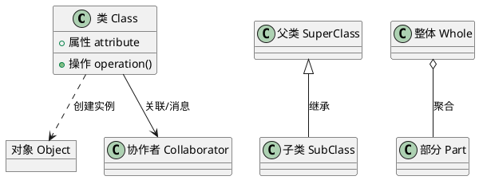
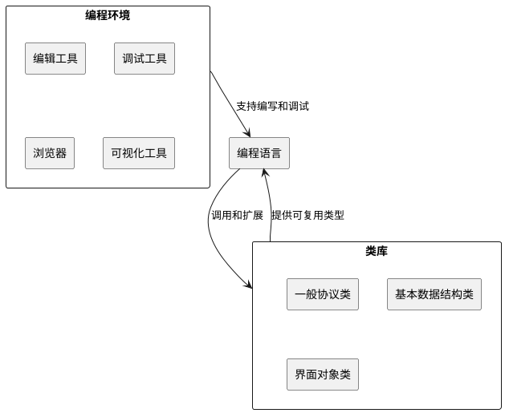
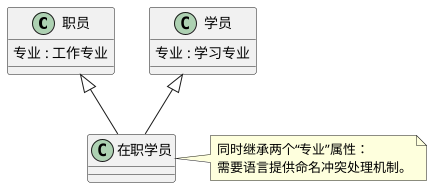
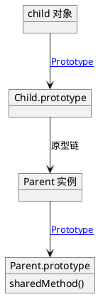
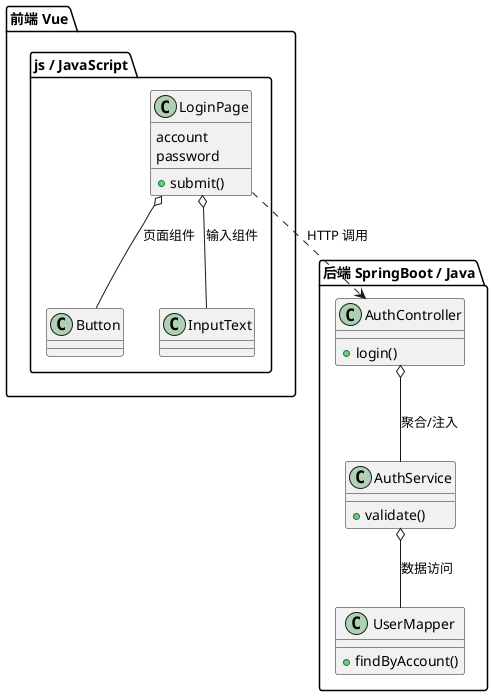

## 编程范型

### 程序设计范型

**定义**：**程序设计范型（Programming Paradigm）** 是程序员理解计算系统、组织程序结构和描述执行过程的基本方式模型。[PPT p.3]

**核心思想**：范型不是某一种语法细节，而是一整套看待程序的方式。也就是说，同一个问题可以被看成过程调用的组合、对象之间的协作、函数变换的序列，或者逻辑规则的推导。不同范型会影响语言提供什么机制，也会影响开发者如何分解问题。

**背景与目的**：PPT 同时引用了“关于计算机系统的思考方法”“程序设计时采用的基本方式模型”和“典型编程风格”三个定义，说明范型的重点在思维方式而不是语言品牌。[PPT p.3] 如果不先理解范型，就容易把面向对象误解为“写 class”，而忽略对象、职责、消息、关系和复用这些更本质的问题。理解范型的目的，是在 OOD 模型进入 OOP 实现时，知道语言机制和设计模型之间是否匹配。

**生活类比**：类比一下，组织一次校园活动可以按“先申请场地、再通知同学、再布置现场”的流程来理解，也可以按“组织者、志愿者、参与者、场地管理员”这些角色之间的互动来理解。前者更接近面向过程，后者更接近面向对象。两种方式都能完成任务，但它们强调的结构完全不同。

**PPT 原文关联**：PPT 指出，在面向对象编程中，程序员认为程序是一系列相互作用的对象；在函数式编程中，程序会被看作无状态函数计算的序列。[PPT p.3] 这正好说明范型决定了程序员“看到”的程序形态。

| 范型 | 组织中心 | 典型机制 | 适合场景 | 主要风险 |
| :--- | :--- | :--- | :--- | :--- |
| 面向过程 | 过程和算法步骤 | 过程调用、参数、返回值 | 算法流程稳定、数据结构简单 | 数据和操作分离后，状态修改点容易分散 |
| 模块化 | 模块和信息隐藏 | 模块接口、内部实现隔离 | 相关数据结构和算法可以封装成单元 | 模块之间协议若设计不清，会形成隐式耦合 |
| 面向对象 | 对象、类和消息 | **封装（Encapsulation）**、**继承（Inheritance）**、**多态（Polymorphism）** | 问题域中存在稳定实体、关系和职责 | 过度继承或对象职责不清会使设计复杂化 |
| 函数式 | 函数和数据变换 | 不可变数据、高阶函数 | 数据转换、并发计算、表达式组合 | 对状态丰富的业务对象表达不一定自然 |
| 逻辑式 | 事实和规则 | 规则匹配、推理 | 约束求解、专家系统 | 执行路径不直观，性能控制较难 |

### 面向过程范型

**定义**：面向过程范型把程序设计的中心放在过程设计上，开发者先决定需要哪些过程，再为每个过程设计算法。[PPT p.4]

**核心思想**：它强调“做什么步骤”和“按什么顺序做”。本质上，数据通常被过程读取、修改和传递，关键机制是过程调用以及向过程传送变元和返回值。Pascal 是 PPT 中给出的典型例子，因为它很适合表达清晰的控制流程和过程结构。

**背景与目的**：面向过程范型适合算法主导的问题，例如计算、转换、批处理和步骤固定的任务。[PPT p.4] 但是，当系统中对象种类很多、对象状态长期存在、对象之间关系复杂时，只围绕过程组织代码会让数据结构和操作分散在多个函数里。后续维护者要同时追踪状态在哪里保存、由哪些过程修改、调用顺序如何保证，这会增加理解成本。

**生活类比**：例如，写一份烹饪菜谱时，面向过程会写成“洗菜、切菜、热锅、下油、翻炒、装盘”。这种写法对一次性完成任务很直观。可是如果要长期管理餐厅里的厨师、库存、订单和顾客评价，单纯的步骤表就不够表达各个实体的职责。

**PPT 原文关联**：PPT 明确写到面向过程的中心思想是“程序设计主要是过程设计”，关键是“过程调用”。[PPT p.4] 这说明它并不是没有结构，而是结构主要围绕过程而不是对象建立。

### 模块化范型

**定义**：模块化范型把相关的数据结构与算法结合在一个模块中，并通过信息隐藏把模块内部实现与其他模块隔离。[PPT p.4]

**核心思想**：模块化的核心是把“需求”和“求解方法”分开，把“能被外部使用的接口”和“只在内部知道的实现”分开。也就是说，外部模块只应依赖公开协议，不应随意访问内部数据。PPT 特别说明模块化已经有了封装的思想，这使它成为面向对象范型的重要前奏。

**背景与目的**：没有模块化时，程序容易变成全局变量和函数互相穿透的结构，任何修改都可能影响远处代码。[PPT p.4] 模块化通过边界控制降低耦合，使局部修改更可控。它还提醒我们，封装并不是 OOP 才突然出现的概念，而是在软件工程中逐步发展出来的基本原则。

**生活类比**：类比一下，学校教务系统可以把选课、成绩、学籍和通知做成不同模块。学生端只看到提交选课、查询成绩这些接口，不需要知道数据库表如何设计。这样的隔离让每个模块可以独立演进。

**PPT 原文关联**：PPT 以 Modula-2 为例说明模块化范型，强调“信息隐蔽”“需求与求解方法分离”和“与其它模块隔离”。[PPT p.4] 这些关键词后来在面向对象的封装机制中继续存在。

### 面向对象范型

**定义**：面向对象范型是在已有范型基础上发展出来的程序设计范型，它通过类创建对象实例，并使用对象、类、继承、封装、聚合、关联、消息和多态等概念组织程序。[PPT p.5]

**核心思想**：面向对象从客观存在的事物出发构造软件系统，尽量让软件结构接近人们日常理解问题域的方式。[PPT p.5] 也就是说，它不是先问“程序第一步执行什么”，而是先问“系统里有哪些对象、对象承担什么职责、对象之间如何协作”。这使 OOA、OOD 和 OOP 可以形成较自然的映射。

**背景与目的**：复杂系统的难点往往不只是算法，而是长期存在的业务实体、状态变化、对象关系和职责边界。面向对象引入类和继承后，可以把共同属性与操作抽取到更一般的类中，把变化部分放在特殊类中。本质上，它试图用语言机制支撑分析模型和设计模型，而不是让实现阶段完全靠程序员自觉维护结构。

**生活类比**：例如，游乐园系统里有游客、门票、项目、排队队列、路线推荐器和设备控制器。面向过程会把它们拆成许多流程函数，而面向对象会先识别这些实体及其职责，再让对象之间通过消息协作。这样做更容易把现实问题域映射为代码结构。

**PPT 原文关联**：PPT 明确把面向对象称为“一种新的程序设计范型”，并指出它“增加了类和继承，用类创建对象实例”。[PPT p.5] PPT 同时列出对象、类、继承、封装、聚合、关联、消息、多态等核心概念，说明 OOP 是概念体系而不是单一语法。



**解读说明**：图中 `Class` 创建 `Object`，说明类是对象实例的模板。`Super` 到 `Sub` 表示一般-特殊结构，`Whole` 到 `Part` 表示整体-部分结构，`Class` 到 `Collaborator` 表示对象之间通过关联和消息协作；这些正对应 PPT 在 p.5 和 p.6 列出的 OO 基本概念。

### 编程范型问答

**问**：面向对象是否完全替代了面向过程？

**答**：不是。面向对象更适合组织复杂领域对象和长期演化的结构，但对象内部的方法仍然需要过程化算法。值得注意的是，好的 OOP 往往是在对象边界上体现职责，在方法内部仍然使用清晰的步骤和控制流。

**问**：模块化和封装有什么关系？

**答**：模块化已经包含信息隐藏思想，而封装把这种思想进一步落实到类、对象、属性、方法和可见性控制上。也就是说，封装是面向对象中的核心语言机制，但它继承了模块化设计的基本目标。

## 面向对象编程语言

### 基本特性

**定义**：**面向对象编程语言（Object-Oriented Programming Language, OOPL）** 是能够直接支持类、对象、属性、操作、继承、聚合、关联、消息以及多态等 OO 概念的编程语言。[PPT p.6]

**核心思想**：OOPL 的价值在于让 OOD 模型能够比较自然地落到源程序中。也就是说，设计里的类可以变成语言里的类，设计里的属性和操作可以变成成员变量与方法，设计里的关系可以通过继承、引用、指针或集合表达。语言机制越贴合模型，程序员越不需要用约定去模拟本该由语言保障的结构。

**背景与目的**：PPT 把 OOPL 的基本特性分成语言元素、语言机制和高级特性三个层次。[PPT p.6] 语言元素负责表达类、对象、属性和操作；语言机制负责封装、继承和类的组织；高级特性负责多态、多继承等复杂关系的表达。这个分层说明评价一种 OOPL 不能只看有没有 `class`，还要看它是否支持可见性、动态绑定、多重性和关系建模。

**生活类比**：类比一下，OOD 模型像建筑图纸，OOPL 像施工材料和工具。只有砖块没有测量工具，施工会很粗糙；只有工具没有合适材料，也难以实现图纸。OOPL 需要把语言、类库和环境结合起来，才能真正支撑工程实践。

**PPT 原文关联**：PPT 列出 OOPL 应支持类定义、对象静态声明或动态创建、属性和操作定义，以及继承、聚合、关联和消息表示。[PPT p.6] 它还强调类机制、封装机制、继承机制，以及多态和多继承的支持机制。

| 能力层次 | PPT 中的要求 | 技术含义 | 设计到实现的影响 |
| :--- | :--- | :--- | :--- |
| 语言元素 | 类、对象、属性、操作 | 能直接声明领域对象和职责 | OOA/OOD 类图更容易映射为代码 |
| 语言机制 | 类机制、封装机制、继承机制 | 能控制可见性并表达一般-特殊结构 | 减少靠命名约定模拟设计关系的成本 |
| 高级特性 | 多态、多继承 | 能让同一消息在不同对象上表现不同 | 支撑可替换性、复用和扩展 |
| 工程支撑 | 类库、编程环境、权限管理 | 能降低重复实现基础设施的成本 | 影响开发效率、维护效率和项目风险 |

### 语言谱系

**定义**：语言谱系是从历史演化角度观察编程语言之间的继承、影响和分化关系，用来理解 OOPL 是如何从早期高级语言、过程语言和模拟语言中发展出来的。[PPT p.7-p.14]

**核心思想**：OOPL 不是凭空出现的，它吸收了 Fortran 的高级语言思想、Algol 的局部性和递归、Simula 的对象和类、Smalltalk 的纯对象世界、C++ 的兼容与扩展路线，以及 Java 的平台独立与类库生态。也就是说，语言历史本身解释了为什么不同 OOPL 的风格差异很大。

**背景与目的**：PPT 从 Fortran、Algol、Basic、Simula、Pascal、Prolog、C、Smalltalk、C++、Python、Java、JavaScript、C# 等语言讲起，是为了说明 OOPL 既有“纯面向对象”路线，也有“在原有语言上扩展 OO 成分”的路线。[PPT p.7-p.14] 这种历史差异会直接影响语言的封装强度、类型系统、运行方式、继承机制和生态定位。

**生活类比**：例如，同样是交通工具，自行车、汽车和高铁都能把人从一个地方带到另一个地方，但它们的历史来源、结构约束和适用路线不同。语言也是如此，C++ 保留 C 的效率和底层控制，Java 更强调统一对象模型和平台独立，Python 则强调解释执行、动态类型和快速开发。

**PPT 原文关联**：PPT 指出 Simula 1967 是最早的面向对象程序设计语言，引入对象、类和继承等基础概念；Smalltalk 是纯面向对象语言，并把 OO 思想从语言级提高到程序员接口级；C++ 在 C 上引入类，是混合型 OOPL；Java 去掉 C++ 的非 OO 成分并适合分布式环境。[PPT p.8-p.11]

| 时间线 | 代表语言 | PPT 强调点 | 与 OOP 的关系 |
| :--- | :--- | :--- | :--- |
| 1956 | Fortran | 第一个被正式推广使用的高级语言，长期用于数值计算 | 体现高级语言对机器细节的抽象 |
| 1960 | Algol 60 | 引入局部性、动态、递归、BNF 等概念 | 影响后续结构化语言和语法描述 |
| 1967 | Simula | 最早的面向对象程序设计语言 | 引入对象、类、继承等基础概念 |
| 1980 | Smalltalk | 纯 OO、交互式环境 | 把 OO 思想扩展到编程环境和用户界面 |
| 1983 | C++ | 在 C 基础上扩充类和 OO 特征 | 形成兼顾效率与 OO 的混合型路线 |
| 1991 | Python | 面向对象、解释型、动态类型 | 支持面向过程和面向对象，强调快速开发 |
| 1995 | Java | 纯 OO、平台独立、分布式环境 | 通过类库和虚拟机支撑大型工程 |
| 1995 | JavaScript | 函数优先、脚本语言、基于原型支持 OO | 形成基于原型而非传统类的 OO 风格 |
| 2000 | C# | 面向 .NET 的 OO 语言 | 结合 C/C++ 语法传统和托管运行时 |

### 语言类别

**定义**：OOPL 可以按支持 OO 概念的完整程度和实现路线，分为纯面向对象语言、混合型面向对象语言，以及结合人工智能的面向对象语言。[PPT p.16]

**核心思想**：不同类别的语言对 OO 概念的表达强度不同。纯面向对象语言通常更全面地支持 OO 概念并强调严格封装；混合型语言在非 OO 语言基础上扩充 OO 成分，通常更灵活但也可能允许绕开 OO 结构。结合人工智能的语言则把 OO 与知识表示、推理或 Lisp 系语言传统结合起来。

**背景与目的**：分类的目的不是给语言排高低，而是帮助项目根据模型和约束选择合适工具。[PPT p.16] 如果系统需要强封装、严格类型和大型工程生态，Java 可能更自然；如果系统需要底层控制和高性能，C++ 的混合特征反而有价值。值得注意的是，PPT 把 Python 放入混合型面向对象语言，是因为它既支持过程式编程也支持面向对象编程，并且封装主要依赖命名约定。

**生活类比**：类比一下，纯 OO 语言像一套规定很明确的实验室流程，所有东西都必须按对象规则处理。混合型语言像综合工坊，既有面向对象工具，也允许直接使用过程式或底层机制。两者都能完成工程任务，但对纪律和约束的依赖不同。

**PPT 原文关联**：PPT 给出的纯 OO 语言包括 Smalltalk、Eiffel、Java；混合型 OOPL 包括 C++、Objective-C、Object Pascal、Python；结合人工智能的语言包括 Flavors、LOOPS、CLOS。[PPT p.16]

| 类别 | 代表语言 | OO 支持方式 | 优点 | 代价 |
| :--- | :--- | :--- | :--- | :--- |
| 纯面向对象语言 | Smalltalk、Eiffel、Java | 较全面支持 OO 概念，强调严格封装 | 模型一致性强，设计概念更容易落地 | 可能牺牲部分底层灵活性 |
| 混合型面向对象语言 | C++、Objective-C、Object Pascal、Python | 在非 OO 或多范型基础上扩充 OO 成分 | 兼容旧代码或多种风格，适应面广 | 团队需要自觉维持 OO 风格 |
| 结合人工智能的 OO 语言 | Flavors、LOOPS、CLOS | OO 与 Lisp/AI 系统结合 | 适合知识表示和动态系统 | 工程生态和主流应用范围较窄 |

### 语言类库和编程环境

**定义**：语言、类库和编程环境共同构成 OOP 的实际生产力基础，其中语言提供表达机制，类库提供通用类和协议，编程环境提供编辑、调试、浏览和可视化工具。[PPT p.17]

**核心思想**：单独的语言语法并不足以支撑复杂项目。也就是说，类库让开发者不用重复实现基本数据结构、界面对象和常用协议；编程环境让开发、调试和浏览对象结构更高效。PPT 用“语言 + 类库 + 编程环境”的图说明，这三者结合会对编程形成更强有力的支持。[PPT p.17]

**背景与目的**：OOD 到 OOP 的过程中，很多设计类并不是从零写出来的，而是继承、组合或调用已有类库中的类。如果语言没有成熟类库，程序员会把大量精力花在基础设施上；如果环境缺少调试和浏览工具，复杂对象关系就很难排查。现代 OOPL 的竞争力常常来自生态，而不只是语法。

**生活类比**：例如，建游乐园不只是选择钢材，还要有标准零件、施工机械、安全检测设备和维护工具。编程语言像材料，类库像标准零件，编程环境像施工和检测设备。缺少任一部分，项目成本都会上升。

**PPT 原文关联**：PPT 在图中写到编程环境提供编辑工具、可视化编程工具、调试工具和浏览器等；类库提供定义共同协议的一般类、基本数据结构类和界面对象类。[PPT p.17]



**解读说明**：图中编程语言位于中间，类库向语言提供可复用类，编程环境围绕语言提供编辑、调试和浏览能力。这个结构对应 PPT p.17 的视觉逻辑：OOP 的工程能力来自三者协同，而不是孤立语法。

### 语言选择练习

**定义**：语言选择练习是把实际业务场景映射到语言特性、生态和运行约束的训练，例如 PPT 中的网红游乐园和智能机器猫案例。[PPT p.18-p.19]

**核心思想**：语言选择应从任务需求出发，而不是从个人偏好出发。也就是说，AI 推荐、后台稳定性、硬件控制、VR 游戏、网页小程序、海量并发、安全防护和数据分析分别需要不同的语言特性与生态。一个项目里也可能同时使用多种语言。

**背景与目的**：PPT 用问号让学生为不同任务选择语言，目的在于训练“需求到技术栈”的映射能力。[PPT p.18-p.19] 例如，控制电机和底层设备更关注实时性、内存和硬件接口；官网和扫码小程序更关注浏览器生态；数据分析更关注统计库和可视化工具。语言选择不是抽象排名，而是成本、进度、效率、安全和生态的综合判断。

**生活类比**：类比一下，游乐园里检票系统、过山车控制系统、VR 项目和官网并不是同一种工程。它们都属于同一个业务系统，但不同子系统对性能、安全、交互和生态的要求不同。合理做法是让每种语言负责它擅长的部分，再通过接口把系统连接起来。

**PPT 原文关联**：PPT p.18 和 p.19 分别用“开一家网红游乐园”和“打造一只智能机器猫”列出任务，包括智能检票、后台系统、硬件电机、VR 游戏、网页小程序、大流量服务器、安全系统和数据统计等。[PPT p.18-p.19]

| 场景 | 更看重的能力 | 可选语言倾向 | 原因 |
| :--- | :--- | :--- | :--- |
| 智能推荐和聊天“大脑” | AI 库、快速实验、数据处理 | Python | 生态完整，适合模型调用、数据处理和原型验证 |
| 稳定后台和会员系统 | 工程规范、框架生态、并发服务 | Java、C#、Go | 适合服务端架构、类型约束和长期维护 |
| 设备电机和底层控制 | 性能、内存、硬件接口 | C、C++、Rust | 能更精细控制资源和底层交互 |
| VR 和高清模拟游戏 | 图形性能、实时响应 | C++、C# | 游戏引擎和图形生态成熟 |
| 官网和扫码小程序 | 浏览器生态、前端交互 | JavaScript、TypeScript | Web 平台原生支持，部署和交互方便 |
| 海量访问服务 | 并发、部署、资源效率 | Go、Java | 适合高并发服务和云端部署 |
| 数据统计画图 | 数据分析、可视化 | Python、R | 统计、绘图和数据处理库丰富 |

### 面向对象编程语言问答

**问**：有 `class` 关键字的语言一定是严格 OOPL 吗？

**答**：不一定。JavaScript 的 ES6 `class` 在 PPT 中被解释为语法糖，本质仍然基于函数和原型。[PPT p.59] 因此判断语言的 OO 支持程度，要看对象模型、封装、继承、多态和绑定机制，而不只是关键字。

**问**：为什么类库和开发环境也算 OOPL 讨论的一部分？

**答**：因为设计模型最终要在工程环境中实现。类库决定基础类和协议能否复用，开发环境决定对象结构能否被高效编辑、调试和浏览；缺少这些支撑，语言机制再完整也会增加项目成本。[PPT p.17]

## 为实现设计模型选择语言

### 一般原则

**定义**：为实现 OOD 模型选择编程语言，是在设计完成后，根据实际约束和语言表达能力决定用哪种语言把模型落实为源程序的过程。[PPT p.20-p.21]

**核心思想**：语言选择完全从实际出发，主要考虑成本、进度、效率等实际因素。[PPT p.20] 本质上，OOPL 是实现 OOD 的理想语言，因为它能使源程序很好地对应 OOD 模型；但如果现实条件要求使用非 OO 语言，也可以通过自觉遵循原则保持某些 OO 风格。[PPT p.20]

**背景与目的**：OOD 关注类、关系、职责、对象协作和设计结构，而 OOP 关注代码、语法、运行时和工程生态。选择语言时，着眼点是语言捕捉问题域语义的能力，也就是它对 OO 概念的表达能力和对 OOD 模型的实现能力。[PPT p.21] 目标则包括分析、设计和编程的一致性，以及最终系统的可复用性和可维护性。[PPT p.21]

**生活类比**：例如，一份精细的家具设计图可以用不同木材和工具实现。好的材料能自然表达设计结构，差的材料也许能做出外形，但连接处要靠大量临时加固。语言选择也是如此，越能自然表达 OOD 模型，实现阶段越不容易扭曲设计。

**PPT 原文关联**：PPT 明确写到“语言的选择完全从实际出发”，同时指出“带有类库、编程环境、权限管理的 OOPL 更好”。[PPT p.20] 这说明课程并不主张脱离成本和生态做纯理论选择。

### 评价标准

**定义**：编程语言的评价标准，是检查语言能否表达 OOD 模型中类、对象、一般-特殊结构、整体-部分结构、属性、操作、关联、消息以及运行时绑定等要素的一组问题。[PPT p.22-p.24]

**核心思想**：评价语言时要沿着 OOD 的模型元素逐项检查。也就是说，先看能否描述类和对象，再看能否实现一般-特殊结构、整体-部分结构、属性操作、关联消息，最后再看类库、可视化环境和对象永久存储等工程能力。这样的评价方式比“我熟悉哪门语言”更可靠。

**背景与目的**：如果语言不支持封装，设计中的私有属性和受控操作就只能靠命名约定实现；如果语言不支持继承，设计中的一般-特殊结构就需要用组合、嵌入结构或手写分发模拟；如果语言不支持动态绑定，多态消息就难以自然表达。[PPT p.22-p.24] 评价标准的目的，是在编码前识别这些映射成本。

**生活类比**：类比一下，审核一座桥的施工方案不能只看施工队名气，而要逐项看材料、承重结构、连接方式、防护措施和维护条件。语言评价也是工程审核，需要把 OOD 的每种结构都问一遍。

**PPT 原文关联**：PPT 将评价标准列为“能否描述类和对象”“能否实现一般-特殊结构”“如何实现整体-部分结构”“如何实现属性和操作”“如何实现关联和消息通讯”“其它因素”。[PPT p.22-p.24]

| 评价维度 | 需要追问的问题 | 对应 OOD 元素 | 若支持不足的影响 |
| :--- | :--- | :--- | :--- |
| 类和对象 | 是否提供封装机制，是否有可见性控制 | 类、对象、封装 | 对象边界变弱，内部状态容易被任意修改 |
| 一般-特殊结构 | 支持单继承、多继承还是不支持继承，是否支持多态 | 继承、泛化、特化 | 复用和可替换性需要靠约定或手写分发实现 |
| 命名冲突 | 多继承下同名属性或方法如何解析 | 多继承、作用域 | 子类引用成员时可能语义不明确 |
| 整体-部分结构 | 用对象、引用、指针还是集合表达，如何表示多重性 | 聚合、组合 | 多重性和生命周期关系容易失真 |
| 属性和操作 | 用什么表示属性和操作，有无可见性和约束 | 属性、操作、约束 | 设计中的约束难以在代码中体现 |
| 动态绑定 | 方法调用是否基于运行时对象决定 | 多态、重写 | 同一消息难以对不同对象产生不同实现 |
| 关联和消息 | 用什么实现关联，如何实现消息通讯 | 关联、依赖、消息 | 对象协作可能退化为全局函数或硬编码调用 |
| 工程因素 | 是否有可视化环境、类库、永久存储 | 类库、工具、持久化 | 项目开发和维护成本上升 |

### 命名冲突

**定义**：命名冲突是指一个类通过多继承等机制同时获得多个同名成员时，引用该名称无法直接判断目标成员来源的情况。[PPT p.22]

**核心思想**：命名冲突暴露的是“模型语义”和“语言解析规则”之间的矛盾。PPT 用“职员”和“学员”都具有“专业”属性，而“在职学员”同时继承二者的例子说明，同一个属性名在不同父类中可能表示不同含义。[PPT p.22] 如果语言没有解析机制，子类中的 `专业` 到底是工作专业还是学习专业就不明确。

**背景与目的**：多继承可以提高复用能力，但也会带来成员来源、方法覆盖和语义冲突问题。[PPT p.22] 命名冲突的处理方式直接影响语言是否适合表达复杂的一般-特殊结构。C++ 可以通过作用域限定和命名空间处理，Eiffel 可以通过 `rename` 处理，Java 则通过单继承类和多接口设计避免一部分状态继承冲突。

**生活类比**：例如，一个人同时是“公司员工”和“学校学生”。两边档案里都有“专业”字段，但前者可能指工作方向，后者可能指学习专业。系统如果只写一个“专业”，就会丢失语义；更好的做法是明确区分“工作专业”和“学习专业”。

**PPT 原文关联**：PPT 在 p.22 右侧图示中给出“职员”“学员”“在职学员”的继承关系，并说明“在职学员”同时继承两个“专业”属性时，引用时无法判断指的是哪一个。[PPT p.22]



**解读说明**：图中 `在职学员` 同时继承 `职员` 和 `学员`，两个父类都有 `专业`。这不是简单的名称重复，而是两个同名成员承载不同语义，因此语言必须提供作用域限定、重命名或其他冲突解决机制。

### 绑定机制

**定义**：绑定是一个对象或事物与某种属性建立联系的过程，例如变量与类型或值建立联系、进程与处理器建立联系等。[PPT p.25]

**核心思想**：静态绑定发生在程序执行之前，通常在编译期确定函数调用对应的函数主体，不能利用运行期信息。[PPT p.25] 动态绑定发生在运行期，方法调用或属性访问会基于运行期对象而不是静态访问范围决定。[PPT p.25] 在 OOP 中，动态绑定是实现多态的重要基础。

**背景与目的**：OOD 中经常希望“同一个消息发送给不同对象时执行不同实现”。如果语言只支持静态绑定，调用目标在编译期就固定，继承层次中的重写和多态表达会受限。动态绑定的目的，是让代码依赖抽象类型，同时在运行时根据实际对象选择具体方法。

**生活类比**：例如，系统对不同支付方式都发送 `pay()` 消息。静态绑定像提前写死“调用银行卡支付”，动态绑定则像收银台只要求“能支付”，到运行时根据用户选择的微信、银行卡或校园卡执行对应流程。

**PPT 原文关联**：PPT 的注释页引用《计算机科学技术百科全书》解释绑定，并区分静态绑定与动态绑定。[PPT p.25] 附录页再次说明 LISP 和 Smalltalk 等语言有动态绑定，而大多数程序设计语言选择静态绑定。[PPT p.64]

```java
// PPT 原片段：动态绑定说明“声明为 virtual 或运行期决定哪个方法被调用”。
// 补全部分：用 Java 给出可运行的最小多态示例。
class Animal {
    void speak() {
        System.out.println("animal");
    }
}

class Cat extends Animal {
    @Override
    void speak() {
        System.out.println("meow");
    }
}

public class Demo {
    public static void main(String[] args) {
        Animal a = new Cat();
        a.speak(); // 运行期对象是 Cat，因此调用 Cat.speak()
    }
}
```

**代码说明**：变量 `a` 的静态类型是 `Animal`，但运行期对象是 `Cat`。调用 `speak()` 时执行的是子类重写后的方法，这体现动态绑定与多态的关系。

### 语言选择问答

**问**：为什么说 OOPL 是实现 OOD 的理想语言，但不是唯一选择？

**答**：因为 OOPL 能直接表达类、对象、封装、继承和多态，源程序更容易对应 OOD 模型。[PPT p.20] 但在现实项目中，成本、进度、性能、平台或遗留系统可能要求使用非 OO 语言，此时可以用结构体、函数指针、模块约束或命名规范模拟一部分 OO 风格。

**问**：动态绑定一定比静态绑定好吗？

**答**：不一定。动态绑定提升了多态和扩展能力，但会引入运行时分派和理解成本；静态绑定通常更直接、更容易优化。设计时要看是否真的需要运行时替换行为，而不是盲目追求动态。

## 典型面向对象编程语言

### 语言概览

**定义**：典型 OOPL 是课程用来观察不同 OO 机制实现方式的代表语言，包括 C++、Object Pascal/Delphi、Smalltalk、Objective-C、Eiffel、Java 和 Python，其中 PPT 重点讨论 C++、Smalltalk、Eiffel、Java 和 Python。[PPT p.26]

**核心思想**：不同语言表达同一 OOD 模型时，术语映射和机制细节会不同。也就是说，OOA/OOD 中的对象、类、属性、操作、一般-特殊、整体-部分、消息和关联，在不同语言中可能分别映射为对象、类、成员变量、成员函数、基类/派生类、嵌套对象、方法调用、对象引用等。理解这些映射，是从设计模型进入代码实现的关键。

**背景与目的**：PPT 对每种语言都按“类和对象、一般-特殊、整体-部分、属性操作、关联消息、术语对照”的结构介绍。[PPT p.27-p.55] 这种结构不是语言教程，而是在训练学生比较不同语言实现 OOD 模型的方式。重点不是记住所有语法，而是知道设计元素在语言里落到哪里。

**生活类比**：同一张地图可以用中文、英文或符号系统标注，路线本身不变，但标注方式不同。OOD 模型也是地图，C++、Java、Smalltalk、Eiffel、Python 是不同标注系统。实现时要保证语义不丢失。

**PPT 原文关联**：PPT p.26 列出典型语言并标明重点：C++、Smalltalk、Eiffel、Java、Python。[PPT p.26]

### C++

**定义**：C++ 是 AT&T Bell 实验室在 C 语言基础上扩充 OO 特征得到的混合型 OOPL，1983 年推出产品，兼容 C，支持封装、继承、多态、强类型和动态绑定。[PPT p.27]

**核心思想**：C++ 的特点是把 C 的效率、可移植性和底层控制能力与 OO 机制结合起来。也就是说，它可以用类和对象表达 OOD 模型，也可以保留指针、手动资源管理和过程式风格。正因为它是混合型语言，C++ 项目特别依赖开发者对对象生命周期、所有权和接口边界的工程纪律。

**背景与目的**：PPT 强调 C++ 是 C 的超集、保持 C 的高效率并容易被广大程序员接受。[PPT p.27] 这解释了 C++ 在系统软件、性能敏感程序和大型工程中的地位。它对 OOD 的支持比较直接，但一些机制如多继承、指针和手动删除对象也会带来复杂性。

**生活类比**：类比一下，C++ 像一套既能做精密机械加工又能做普通木工的工具。工具能力很强，但错误使用也容易造成结构问题。对 OOD 实现来说，C++ 的优势和风险都来自它的自由度。

**PPT 原文关联**：PPT 指出 C++ 支持 `private`、`protected`、`public`、`friend` 可见性控制，提供构造函数和析构函数，支持静态对象与动态对象，支持单继承和多继承，并用命名空间解决命名冲突。[PPT p.28-p.31]

| OOA/OOD 概念 | C++ 映射 | 说明 |
| :--- | :--- | :--- |
| 对象 object | 对象 object | 可以静态声明，也可以用 `new` 动态创建 |
| 类 class | 类 class | 用 `class` 定义，包含成员变量和成员函数 |
| 属性 attribute | 成员变量 member variable | 可使用 `private`、`protected`、`public`、`friend` 控制可见性 |
| 操作 operation | 成员函数 member function | 构造函数与类名相同，析构函数为 `~类名()` |
| 一般/特殊 | 基类/派生类 base/derived class | 支持单继承和多继承 |
| 整体/部分 | 嵌套对象或嵌入指针 | 可用对象成员、指针、指针数组或链表表达多重性 |
| 消息 message | 函数调用 function call | 参数采用强类型机制 |
| 关联 association | 对象指针 object pointer | 多重关联可用指针数组等结构表示 |

```cpp
// PPT 原片段：C++ 用构造函数、析构函数、virtual 支持对象和动态绑定。
// 补全部分：最小示例展示对象创建、继承和多态。
#include <iostream>
#include <memory>

class Ticket {
public:
    virtual ~Ticket() = default;
    virtual double price() const {
        return 100.0;
    }
};

class StudentTicket : public Ticket {
public:
    double price() const override {
        return 50.0;
    }
};

int main() {
    std::unique_ptr<Ticket> ticket = std::make_unique<StudentTicket>();
    std::cout << ticket->price() << std::endl;
    return 0;
}
```

**代码说明**：`Ticket` 是基类，`StudentTicket` 是派生类，`price()` 被声明为虚函数后支持运行期动态绑定。`std::unique_ptr` 用来管理动态对象生命周期，避免 PPT 中 `new`/`delete` 手动配对带来的泄漏风险。

### Smalltalk

**定义**：Smalltalk 是 Xerox PARC 在 Alan Kay 研究基础上开发的早期、代表性 OOPL，Smalltalk-72 正式使用“面向对象”术语，Smalltalk-80 成为完善的面向对象语言。[PPT p.33]

**核心思想**：Smalltalk 是纯 OO 语言，除对象之外没有其他形式的数据，全部属性严格封装，全部方法对外可见。[PPT p.33] 本质上，它把“一切皆对象”和“对象之间通过消息交互”贯彻得非常彻底。它还是弱类型语言，不声明变量类型，不做传统静态类型检查，而是生成虚拟机代码并解释执行。

**背景与目的**：PPT 强调 Smalltalk 不仅是语言，还带有类库、多窗口图形用户界面和编程工具，形成集成化、交互式的编程环境。[PPT p.34] 这说明 Smalltalk 对 OO 的贡献不只是语法，而是把对象思想扩展到程序员接口和开发环境。它的类库、浏览器和交互式环境影响了后来的 IDE 和 GUI 系统。

**生活类比**：类比一下，Smalltalk 像一个所有工作人员、文件、工具和窗口都按同一套对象规则运转的办公室。你不是在外部编辑一堆孤立文本文件，而是在对象系统内部浏览、修改和运行对象。这样的环境让“对象世界”非常统一。

**PPT 原文关联**：PPT 指出 Smalltalk 的类定义通过浏览器填写模板，包括类名、父类、实例变量、类变量、共享变量和类方法等；它采用单继承，以 Object 为根类，整体-部分可用集合类表达。[PPT p.35-p.37]

| OOA/OOD 概念 | Smalltalk 映射 | 说明 |
| :--- | :--- | :--- |
| 对象 object | 一般讨论中为 object，编程中为 instance | Smalltalk 更常说实例 |
| 类 class | 类 class | 通过浏览器模板定义 |
| 属性 attribute | 实例变量 instance variable | 只在本类内部可见 |
| 操作 operation | 方法 method | 方法对外可见 |
| 一般/特殊 | 超类/子类 superclass/subclass | 单继承，以 Object 为根 |
| 整体/部分 | 嵌套对象 nested object | 常借助集合类表达多重部分 |
| 消息 message | 消息发送 message send | 对象通过消息触发方法 |
| 关联 association | 嵌入对象指针 nested object pointer | 用对象引用建立连接 |

### Eiffel

**定义**：Eiffel 是 B. Meyer 等人在 1985 年开发的纯 OO 语言，全面支持 OO 概念，支持多继承、强类型、动态绑定和通过断言表达约束。[PPT p.39-p.42]

**核心思想**：Eiffel 的突出特点是把 OO 结构和契约式设计结合起来。也就是说，它不仅关心类、对象、继承和多态，还关心操作执行前后的条件是否明确。通过前置条件、后置条件和循环不变式，Eiffel 可以把设计中的约束更直接地写入程序。

**背景与目的**：OOD 模型不仅包含结构，也包含约束和操作语义。如果语言只能写属性和方法，却不能清楚表达“这个操作在什么条件下可调用、调用后必须保证什么”，设计信息会在实现阶段丢失。PPT 把 Eiffel 的约束机制单独列出，说明它对实现 OOD 约束很有代表性。[PPT p.42]

**生活类比**：例如，借书操作的前置条件是读者账号有效、图书可借；后置条件是借阅记录增加、图书状态变为已借出。Eiffel 的断言就像把这些业务契约写进代码中，而不是只写在文档里。

**PPT 原文关联**：PPT 说明 Eiffel 用 `inherit` 列出所有父类，通过 `rename` 解决命名冲突，用 `redefine` 允许特征重定义，并用 `require`、`ensure`、`invariant` 表示前置条件、后续条件和循环不变式。[PPT p.40-p.42]

| OOA/OOD 概念 | Eiffel 映射 | 说明 |
| :--- | :--- | :--- |
| 对象 object | 对象 object | 一般讨论中的对象 |
| 类 class | 类 class | 用 `class` 定义 |
| 属性 attribute | 变量 variable | 可见性由移出表控制 |
| 操作 operation | 例程 routine | 可见性由移出表控制 |
| 一般/特殊 | 祖先/子孙 ancestor/descendant | 支持多继承 |
| 整体/部分 | 嵌套对象 nested object | 也可使用嵌入指针 |
| 消息 message | 例程调用 routine call | 方法式调用 |
| 关联 association | 嵌入对象指针 nested object pointer | 用引用关系表达 |

### Java

**定义**：Java 是 Sun 公司 1995 年推出的适合分布式环境、独立于平台的 OOPL，语法与 C++ 基本一致，但去掉了 C++ 的部分非 OO 成分，不使用指针并采用解释执行/虚拟机运行方式。[PPT p.44]

**核心思想**：Java 的目标是用相对统一的对象模型、丰富类库和开发环境支撑大型工程、分布式系统和客户/服务器结构。也就是说，Java 通过 `class`、访问控制、对象引用、垃圾回收、多线程和同步原语，把 OOD 模型转化为可维护的服务端或应用程序结构。它牺牲了一些 C++ 的底层自由度，换取更强的平台独立性和运行时管理能力。

**背景与目的**：PPT 强调 Java 不使用指针，采用自动垃圾回收，并提供语言级多线程、同步原语和并发控制。[PPT p.44-p.45] 这些机制让开发者更少关注裸内存管理，把更多注意力放在类、接口、服务、线程和对象协作上。值得注意的是，Java 的 `finalize()` 不是 C++ 析构函数的等价物，对象回收时不保证一定按开发者期望调用。[PPT p.45]

**生活类比**：类比一下，Java 像有严格规章和统一后勤的工程团队。它不允许随意碰底层指针，很多资源管理交给运行时处理。这样做会减少某些低级错误，但也要求开发者理解虚拟机、垃圾回收和框架生命周期。

**PPT 原文关联**：PPT 指出 Java 用 `class` 定义类，有封装机制，属性分为实例变量和类变量，操作分为实例方法和类方法，可见性包括 `private`、`protected`、`public` 和默认可见性，继承采用超类/子类，支持重载和多态，关联和聚合可用对象引用实现。[PPT p.45-p.47]

| OOA/OOD 概念 | Java 映射 | 说明 |
| :--- | :--- | :--- |
| 对象 object | 对象 object | 通过对象引用访问 |
| 类 class | 类 class | 用 `class` 定义 |
| 属性 attribute | 属性 attribute | 实例变量或类变量 |
| 操作 operation | 方法 method | 实例方法或类方法 |
| 一般/特殊 | 基类/派生类 base/derived class | PPT 使用该对照，Java 实际常说超类/子类 |
| 整体/部分 | 嵌套引用 nested reference | 通过字段保存其他对象引用 |
| 消息 message | 方法调用 method call | 对象间通过方法调用协作 |
| 关联 association | 对象引用 object reference | 关联和聚合都可用引用表达 |

```java
// PPT 原片段：Java 使用 class、对象引用和 extends 实现 OOD 类。
// 补全部分：最小示例展示聚合、继承和方法调用。
class AuthService {
    boolean login(String account, String password) {
        return "pku".equals(account) && "123456".equals(password);
    }
}

class AuthController {
    private final AuthService authService;

    AuthController(AuthService authService) {
        this.authService = authService;
    }

    String login(String account, String password) {
        return authService.login(account, password) ? "success" : "failed";
    }
}

public class Demo {
    public static void main(String[] args) {
        AuthController controller = new AuthController(new AuthService());
        System.out.println(controller.login("pku", "123456"));
    }
}
```

**代码说明**：`AuthController` 通过字段保存 `AuthService` 的对象引用，体现聚合或依赖关系在 Java 中的常见实现方式。`login()` 方法调用则体现对象之间的消息通讯。

### Python

**定义**：Python 是 Guido van Rossum 在八十年代末和九十年代初设计的解释型、交互式、动态类型语言，既支持面向过程编程，也支持面向对象编程。[PPT p.48]

**核心思想**：Python 的 OO 风格强调简洁、动态和约定。也就是说，它支持 `class`、对象、实例变量、类变量、继承和方法，但可见性主要通过命名约定表达，而不是像 Java/C++ 那样由编译器严格控制。Python 的多态往往通过鸭子类型实现：关注对象能做什么，而不是它继承自哪个类。

**背景与目的**：PPT 指出 Python 是弱类型语言，拥有广泛的跨平台标准库，开发过程中无需编译，可以在交互式环境直接执行输入代码。[PPT p.48] 这使 Python 很适合快速验证、数据分析、脚本化和 AI 相关任务。代价是部分设计约束需要通过测试、类型注解、抽象基类和团队规范补强。

**生活类比**：例如，门禁系统只要求对象能执行 `open()`，并不关心它到底是 IC 卡、手机二维码还是人脸识别设备。Python 的鸭子类型就像这种“看行为不看血统”的规则。只要对象提供需要的方法，就可以参与同一套协作。

**PPT 原文关联**：PPT 说明 Python 用 `__init__(self)` 初始化对象，用 `__del__(self)` 在对象销毁时调用，双下划线开头近似 private，单下划线开头近似 protected，正常命名为 public；Python 不支持传统重载，可用默认参数模拟参数个数差异；Python 通过鸭子类型实现形式上的多态。[PPT p.49-p.54]

| OOA/OOD 概念 | Python 映射 | 说明 |
| :--- | :--- | :--- |
| 对象 object | 对象 object | 一切值基本都以对象方式使用 |
| 类 class | 类 class | 用 `class` 定义 |
| 属性 attribute | 属性 attribute | `self.x` 为实例变量，类体中变量为类变量 |
| 操作 operation | 方法 method | 方法必须显式接收 `self` 参数 |
| 一般/特殊 | 基类/派生类 base/derived class | 子类需要主动调用 `super()` 复用父类初始化 |
| 整体/部分 | 嵌套引用 nested reference | 字段保存其他对象引用 |
| 消息 message | 方法调用 method call | 运行时查找对象方法 |
| 关联 association | 对象引用 object reference | 通过引用连接对象 |

```python
# PPT 原片段：Python 通过鸭子类型实现形式上的多态。
# 补全部分：最小示例展示无继承关系对象的同名方法协作。
class Duck:
    def quack(self) -> str:
        return "quack"

class Person:
    def quack(self) -> str:
        return "I can imitate a duck"

def make_it_quack(obj) -> None:
    print(obj.quack())

make_it_quack(Duck())
make_it_quack(Person())
```

**代码说明**：`Duck` 和 `Person` 没有继承关系，但都提供 `quack()` 方法，因此都能被 `make_it_quack()` 使用。也就是说，Python 在这个例子中不依赖继承层次实现多态，而是依赖对象当前方法集合。

### 典型语言对比

**定义**：典型语言对比是把不同 OOPL 在类型系统、封装、继承、绑定、对象生命周期和 OOD 映射方式上的差异放在同一张表中审查。[PPT p.27-p.55]

**核心思想**：同样的 OOD 模型，在不同语言中的实现成本不同。C++ 表达能力强但资源和指针复杂；Smalltalk 模型统一但类型约束弱；Eiffel 契约表达强；Java 工程生态和运行时管理成熟；Python 快速灵活但依赖约定维护封装。选择语言时要看这些差异如何影响项目目标。

**背景与目的**：PPT 逐个介绍典型语言，不是为了让学生记忆历史，而是为了建立比较框架。[PPT p.27-p.55] 例如，如果设计中大量依赖多继承和命名冲突处理，Eiffel 和 C++ 的机制值得关注；如果设计强调远程服务和大型类库，Java 更自然；如果任务强调快速实验，Python 更合适。

**生活类比**：类比一下，同一套家具设计可以用实木、金属、塑料或复合材料实现。每种材料都能做成桌子，但连接方式、承重、维护和加工成本不同。语言对 OOD 模型也是类似关系。

| 维度 | C++ | Smalltalk | Eiffel | Java | Python |
| :--- | :--- | :--- | :--- | :--- | :--- |
| 语言类别 | 混合型 OOPL | 纯 OO | 纯 OO | 纯 OO 倾向 | 多范型/混合型 |
| 类型特征 | 强类型 | 弱类型 | 强类型 | 强类型 | 动态类型、弱类型倾向 |
| 封装方式 | `private/protected/public/friend` | 属性严格封装，方法可见 | 移出表控制 | `private/protected/public/default` | 命名约定为主 |
| 继承能力 | 单继承和多继承 | 单继承 | 多继承 | 类单继承，接口多实现 | 支持多继承 |
| 命名冲突处理 | 作用域、命名空间等 | 单继承降低冲突 | `rename` | 主要通过模型限制规避 | MRO 和显式调用 |
| 动态绑定 | `virtual` 函数 | 支持 | 支持 | 默认方法分派支持 | 运行时方法查找 |
| 对象生命周期 | 构造/析构，静态与动态对象 | 虚拟机管理 | 运行时管理 | 垃圾回收 | 垃圾回收和引用计数实现 |
| 典型优势 | 性能和底层控制 | 纯对象环境 | 契约式设计 | 工程生态和平台独立 | 快速开发和数据生态 |

### 典型语言问答

**问**：Python 不支持传统重载，会不会影响 OOD 实现？

**答**：会影响一部分接口设计。PPT 指出 Python 参数没有类型，参数类型重载没有意义，可用默认参数模拟参数个数重载。[PPT p.52] 因此在 Python 中更常通过默认值、可选参数、类型检查或不同方法名表达接口变化。

**问**：为什么 Eiffel 的断言机制值得关注？

**答**：因为 OOD 模型不只有类结构，还有操作约束。Eiffel 的 `require`、`ensure` 和 `invariant` 能把前置条件、后置条件和不变式写入程序，使设计契约不容易在实现阶段丢失。[PPT p.42]

## 用非面向对象语言实现设计模型

### Ada

**定义**：Ada 是面向程序包的基于对象语言，它有把变量和过程打包的结构，但不是 OOPL，主要原因是 PPT 所述版本不支持继承。[PPT p.56]

**核心思想**：Ada 可以在形式上描述类和对象，因为程序包能够把数据和操作组织到一起。也就是说，它具备一定封装能力，却缺少一般-特殊结构的直接语言机制。用 Ada 实现 OOD 模型时，需要用程序包、私有类型、有限私有类型、集合或指针来模拟对象、属性、操作和整体-部分关系。

**背景与目的**：PPT 把 Ada 放在“用非 OO 编程语言实现 OOD 模型”下，目的在于说明即使不是 OOPL，也可能表达部分 OO 风格。[PPT p.56-p.57] 但是，一旦设计模型包含大量继承和多态，Ada 的表达就会变得间接。它更适合把变量和过程封装起来，而不是自然表达类层次。

**生活类比**：类比一下，Ada 的程序包像一个带门的工具箱，能把工具和材料放在一起并控制谁能打开。可是它没有天然的“父工具箱”和“子工具箱”继承关系。要表达一般-特殊结构，需要人为约定或额外结构。

**PPT 原文关联**：PPT 指出 Ada 中类和对象“无”，但可以把变量和过程打包；一般-特殊“无”；整体-部分可用集合或指针；属性是变量，操作是过程和函数；可用私有和有限私有控制可见性，并支持显式约束和异步执行任务。[PPT p.56-p.57]

### JavaScript

**定义**：JavaScript 是通过原型支持面向对象概念的语言，传统上没有基于类的对象模型；ES6 之后虽然可以用 `class` 创建类，但 PPT 强调它本质上仍是特殊函数和原型机制的语法糖。[PPT p.58-p.61]

**核心思想**：JavaScript 的 OO 基础是对象、构造函数、`prototype` 和原型链。也就是说，不同对象实例可以通过共同构造函数共享同一个原型对象，原型对象中放置共享属性和方法；把父类实例设置为子类构造函数的原型，就能形成类似继承的原型链。它不是传统类继承模型，而是基于对象和原型委托的模型。

**背景与目的**：PPT 把 JavaScript 放在“基于原型的语言”中，是为了提醒我们，OO 不一定只有类继承这一种实现路线。[PPT p.58-p.62] 在前端开发中，JavaScript 仍然可以表达对象、属性、方法、关联、聚合和消息调用，只是类的概念需要理解为语法层面的便利形式。对 OOD 模型而言，页面类、组件对象和后端服务调用都可以落到 JavaScript 对象与函数中。

**生活类比**：类比一下，传统类继承像按模具生产零件，所有零件都来自明确的类模板。原型机制更像拿一个现成对象当样板，新对象找不到某个能力时就沿着样板链继续查找。两者都能复用行为，但思考方式不同。

**PPT 原文关联**：PPT 说明 JavaScript 对象可通过构造函数创建，也可在 ES6 后用 `class` 关键字创建；每个函数都有 `prototype` 属性，指向一个对象；通过同一构造函数创建的对象拥有相同原型对象；原型链继承的缺点包括创建子类实例时无法向父类构造函数传参，以及新增原型属性方法必须在设置好原型链之后执行。[PPT p.58-p.61]



**解读说明**：图中对象查找属性或方法时，会先查自身，再沿 `[[Prototype]]` 指向的原型对象继续查找。PPT p.60-p.61 的“构造函数 + 原型 + 原型链”可以用这个链式结构理解。

```javascript
// PPT 原片段：JavaScript 通过构造函数和原型创造对象。
// 补全部分：最小示例展示共享方法和原型链调用。
function User(name) {
  this.name = name;
}

User.prototype.sayHello = function () {
  return `hello, ${this.name}`;
};

const user = new User("Ming");
console.log(user.sayHello());
```

**代码说明**：`name` 是每个对象自己的属性，`sayHello` 放在 `User.prototype` 上供所有实例共享。也就是说，JavaScript 可以用原型对象达到类似“类中共享方法”的效果。

### C 语言

**定义**：C 是过程语言，不直接提供类、对象、继承和封装机制，但可以用结构体、指针和函数模拟 OOD 模型中的一部分结构。[PPT p.63]

**核心思想**：用 C 实现 OOD 模型时，类和对象没有直接语言机制，通常用 `struct` 表示对象数据，用函数表示操作，用函数指针模拟可替换行为，用嵌入结构模拟一般-特殊，用指针和嵌套结构表达整体-部分与关联。也就是说，结构可以模拟，但语言不会自动保障封装和多态语义。

**背景与目的**：PPT 以 C 为过程语言例子，说明“用非 OO 语言也能实现 OOD 模型”并不意味着成本相同。[PPT p.63] 在 C 中，任何模块都可能直接访问结构体字段，除非通过头文件组织、不透明指针和命名规范进行约束。缺乏语言级保证时，设计一致性更依赖团队纪律。

**生活类比**：类比一下，C 像一堆基础零件和螺丝，什么都能搭，但很多安全结构要自己设计。OOPL 像带有标准连接件的套件，某些关系由工具天然支持。两者都能造出系统，但维护成本差异很大。

**PPT 原文关联**：PPT 指出 C 中类和对象“无”，可以用结构定义对象并通过指针说明应该有哪些函数但不封装；一般-特殊“无”，可把一般结构嵌入特殊结构；整体-部分用指针或嵌套结构；属性与操作对应变量和函数；关联用指针，消息用函数调用。[PPT p.63]

```c
// PPT 原片段：C 可用结构定义对象，用函数表示操作。
// 补全部分：最小示例用函数指针模拟多态消息。
#include <stdio.h>

typedef struct Ticket Ticket;

struct Ticket {
    double (*price)(Ticket *self);
};

double normal_price(Ticket *self) {
    return 100.0;
}

double student_price(Ticket *self) {
    return 50.0;
}

int main(void) {
    Ticket ticket = { student_price };
    printf("%.1f\n", ticket.price(&ticket));
    return 0;
}
```

**代码说明**：`Ticket` 结构体中保存函数指针，调用 `ticket.price(&ticket)` 时可以执行不同价格算法。这个例子模拟了多态消息，但封装、继承和生命周期管理都需要程序员自己维护。

### 非面向对象语言问答

**问**：用非 OO 语言实现 OOD 模型是否违背面向对象设计？

**答**：不一定。PPT 明确说用非 OO 语言也能实现 OOD 模型，但缺乏 OO 机制的保证和支持，需要自觉遵循一定原则。[PPT p.20] 因此问题不在于“绝对不能用”，而在于实现成本、风险和团队纪律是否可接受。

**问**：JavaScript 为什么不算传统 OOPL？

**答**：因为它的核心对象模型基于原型，而不是传统的类实例化模型。即使 ES6 加入了 `class`，PPT 也指出这只是语法糖，本质仍是特殊函数和原型机制。[PPT p.59]

## 设计到编程实例

### 北大知道项目

**定义**：“北大知道”是 PPT 给出的 OOP 项目实例，一个 Web 端北京大学校内问答社区，用于连接校园用户并构建信息共享平台。[PPT p.65]

**核心思想**：项目实例展示 OOD 模型如何进入 OOP 实现，而不是只停留在类图上。也就是说，需求中的提问、回答、浏览、关注、搜索和通知推送，会在 OOA 中形成问题域对象，在 OOD 中进一步拆分为控制器、服务、数据访问和页面类，在 OOP 中落实为 Java 后端类、JavaScript/Vue 前端组件和 HTTP 远程调用。[PPT p.65-p.75]

**背景与目的**：PPT 把项目从需求、OOA 类图、OOD 类图讲到 OOP 实现，是为了串起本课程从分析到设计再到编码的完整路径。[PPT p.66-p.75] 特别是项目采用前后端分离和后端微服务结构后，一个 OOA 中的 `User` 操作不会简单变成一个巨大类，而会被拆分到不同 Controller、Service、Mapper 中。这样的拆分体现了实现架构对设计类的再组织。

**生活类比**：类比一下，校园问答社区像一个线上服务大厅。用户提出问题、别人回答、系统通知相关人、搜索模块帮助定位内容。实现时，前台页面负责交互，服务层负责业务逻辑，数据层负责保存和查询；它们共同完成同一个 OOD 模型。

**PPT 原文关联**：PPT 说明该项目让用户通过应用提问、回答、浏览问题、关注问题、搜索问题，并得到即时通知推送。[PPT p.65] 需求用况图和 OOA 类图在文字稿中没有可识别细节，因此此处标记为盲区：`[盲区：PPT p.66-p.67 的用况图和 OOA 类图在 OCR 文本中没有提取出具体类名和关系，以下只依据后续 OOD/OOP 页面的文字描述整理。]`

### 架构拆分

**定义**：架构拆分是把 OOD 中的问题域类和操作，根据前后端分离、微服务和分层职责拆分为 Controller、Service、Mapper、Page 等实现类的过程。[PPT p.68-p.72]

**核心思想**：OOD 类图中的一个领域对象，在实现中可能被拆成多个技术职责类。也就是说，Controller 负责消息处理，Service 负责逻辑执行，Mapper 负责数据管理，Page 负责人机交互；这些类并不是凭空增加的业务对象，而是为满足实现架构、部署节点和职责分离而加入的设计实现层对象。[PPT p.68-p.70]

**背景与目的**：PPT 明确说明项目采用前后端分离架构，后端是分布在多个节点的多个微服务，因此 `User` 中一系列操作在 OOD 中被分为不同 Controller、Service、Mapper，并分布在不同节点。[PPT p.68-p.69] 这样做可以降低单类职责过重的问题，也方便服务部署、权限控制、测试和数据访问隔离。前端的人机交互部分则由 Page 类构成，并依赖后端 Controller。[PPT p.70]

**生活类比**：例如，用户登录看起来只是“输入账号密码并判断是否正确”，但实现上会拆成页面收集输入、控制器接收请求、服务校验业务规则、数据层查询账号密码。每个角色只负责一段职责。这样系统更容易维护，也更适合前后端协作开发。

**PPT 原文关联**：PPT p.71 说明后端采用 SpringBoot 框架、Java 实现，前端采用 Vue.js 框架、JavaScript 实现；后端直接使用 Java `class` 声明 OOD 中的类，属性和操作用 Java 属性与方法声明。[PPT p.71]



**解读说明**：图中 `LoginPage` 位于前端，通过按钮和输入框组合页面，并通过 HTTP 依赖后端 `AuthController`。后端 `AuthController` 聚合 `AuthService`，`AuthService` 聚合 `UserMapper`，这对应 PPT 对 Controller、Service、Mapper 三类职责的说明。[PPT p.68-p.75]

### 前端页面类实现

**定义**：前端页面类实现，是把 OOD 中的人机交互页面类落实为 Vue.js 单文件组件和 JavaScript 对象的过程。[PPT p.72]

**核心思想**：PPT 指出每个页面类的对象都是单例的，系统内只有一个该类的对象，因此只需为每个页面类实现一个 JavaScript 对象。[PPT p.72] 也就是说，前端页面类不像后端实体类那样频繁创建多个业务对象，而是更像一个长期存在的界面对象，聚合按钮、输入框等组件，并通过方法响应用户操作。

**背景与目的**：Vue 单文件组件把 JavaScript 对象、HTML 布局代码和 CSS 样式代码放在同一文件中实现。[PPT p.72] 这种结构把页面对象的状态、行为和视图放在一个组件边界内，符合 OOD 中人机交互对象的实现思路。页面类与后端 Controller 的依赖通过 HTTP 请求实现，而不是直接引用后端内存对象。

**生活类比**：类比一下，登录页面像一个固定服务窗口。窗口上有输入框和按钮，工作人员点击按钮后把请求送到后台柜台处理。页面本身是一个对象，按钮和输入框是它聚合的部件。

**PPT 原文关联**：PPT 说明前端部分主要实现人机交互中的页面类，并且 Vue.js 单文件组件最终导出一个 JavaScript 对象，对应页面类的单例对象。[PPT p.72]

```vue
<!-- PPT 原片段：Vue 单文件组件导出一个 JavaScript 对象，对应页面类单例对象。 -->
<!-- 补全部分：最小登录页面组件示意。 -->
<template>
  <form @submit.prevent="submit">
    <input v-model="account" />
    <input v-model="password" type="password" />
    <button type="submit">Login</button>
  </form>
</template>

<script>
export default {
  data() {
    return {
      account: "",
      password: ""
    };
  },
  methods: {
    async submit() {
      await fetch("/api/login", {
        method: "POST",
        headers: { "Content-Type": "application/json" },
        body: JSON.stringify({
          account: this.account,
          password: this.password
        })
      });
    }
  }
};
</script>
```

**代码说明**：`data()` 中的 `account` 和 `password` 对应页面对象的状态，`submit()` 对应页面对象的操作。`fetch()` 通过 HTTP 向后端发送消息，体现前端对象对后端 Controller 的远程依赖。

### 继承聚合和依赖实现

**定义**：继承、聚合和依赖实现，是把 OOD 类图中的关系分别落实为 Java `extends`、对象引用/组件包含和方法调用或 HTTP 调用的过程。[PPT p.73-p.75]

**核心思想**：继承在 Java 后端中可以用 `extends` 关键字直接表达；聚合在后端常用“一个类把另一个类的对象引用作为属性”实现，在前端常用页面组件模板中声明子组件实现；依赖在同一端内部可用方法/函数调用实现，跨前后端时通过 HTTP 协议发送消息并远程调用后端方法。[PPT p.73-p.75]

**背景与目的**：OOD 类图中的关系如果在代码中没有清晰映射，设计就会在实现阶段失真。例如，`AuthController` 与 `AuthService` 的聚合关系如果被写成到处直接创建服务对象，会造成生命周期和测试问题；前端页面对后端方法的依赖如果没有统一 API 边界，会造成接口混乱。明确映射规则能让设计类图和代码结构互相解释。

**生活类比**：例如，前台窗口不能直接翻数据库档案，而是向后台业务员发送办理请求；后台业务员再找档案管理员查询数据。前台和后台之间的 HTTP 就像跨部门申请单，方法调用则像同一办公室内的直接沟通。

**PPT 原文关联**：PPT p.74 说明后端通过一个类的对象引用作为另一个类的属性实现聚合，前端通过 Vue 模板中声明 Button、InputText 等组件实现聚合；PPT p.75 说明前端对象通过 HTTP 协议向后端发送消息，后端监听特定路径并调用相应对象方法，再将返回值返回给前端。[PPT p.74-p.75]

| OOD 关系 | 后端 Java 实现 | 前端 Vue/JavaScript 实现 | 跨端实现 |
| :--- | :--- | :--- | :--- |
| 类 | `class` 声明 | 单文件组件导出的对象或类 | API 文档保持概念一致 |
| 属性 | Java 字段 | `data`、`props`、对象属性 | JSON 字段 |
| 操作 | Java 方法 | `methods`、函数 | HTTP 路由对应远程操作 |
| 继承 | `extends` | 组件继承较少，常用组合 | 通常不跨进程继承 |
| 聚合 | 对象引用作为字段 | 模板中包含组件标签 | 前端页面聚合远程服务代理 |
| 依赖 | 方法调用或依赖注入 | 函数调用、模块导入 | HTTP 请求/响应 |

### 登录逻辑多语言实现

**定义**：登录逻辑多语言实现，是 PPT 用同一“设账号密码、读输入、判断、输出结果”的流程，对比不同语言表达方式的收束练习。[PPT p.76-p.81]

**核心思想**：所有语言的业务逻辑完全一样，但语法、运行环境和工程风格不同。[PPT p.81] 也就是说，Python 简单，JavaScript 浏览器能跑，Java 结构严谨，C# 清爽，C++ 经典，C 更底层也更麻烦，Go 快且简洁，R 偏统计，Rust 强调安全但更啰嗦，Smalltalk 古老且写法特殊。这个练习提醒我们，语言选择影响表达成本，但不应改变业务逻辑本身。

**背景与目的**：PPT p.76-p.80 的 OCR 只保留了“用户登录（输入账号密码，判断是否正确）”，具体代码片段未被提取出来，因此需要按 p.81 的总结恢复其教学意图。[PPT p.76-p.81] `[盲区：PPT p.76-p.80 的多语言代码细节在 OCR 文本中缺失，无法逐行还原；此处只保留可确认的共同逻辑和语言对比结论。]`

**生活类比**：类比一下，同一句“请核对账号密码”可以用中文、英文或日文表达，含义相同但表达形式不同。登录逻辑也是如此，核心判断不变，语言只是表达工具。好的工程实践要求我们先确认逻辑，再选择适合场景的表达方式。

**PPT 原文关联**：PPT 最后一页总结“所有语言逻辑完全一样：设账号密码 → 读输入 → 判断 → 输出结果”，并给出不同语言的简短评价。[PPT p.81]

```python
# PPT 原片段：用户登录（输入账号密码，判断是否正确）。
# 补全部分：用 Python 表达共同业务逻辑的最小版本。
EXPECTED_ACCOUNT = "pku"
EXPECTED_PASSWORD = "123456"

account = input("account: ")
password = input("password: ")

if account == EXPECTED_ACCOUNT and password == EXPECTED_PASSWORD:
    print("login success")
else:
    print("login failed")
```

**代码说明**：这段代码只表达 PPT p.81 的共同逻辑：设定账号密码、读取输入、判断、输出结果。换成 Java、JavaScript、C++ 或 Go 后，业务判断仍然相同，变化的是输入输出 API、类型声明和程序结构。

### 项目实例问答

**问**：为什么 OOD 中的一个 `User` 操作到实现时会被拆成 Controller、Service、Mapper？

**答**：因为实现架构引入了前后端分离、微服务和分层职责。[PPT p.68-p.69] Controller 处理消息入口，Service 执行业务逻辑，Mapper 管理数据访问；这样拆分能让职责更清晰，也更适合部署、测试和维护。

**问**：前端页面类为什么可以实现为单文件组件？

**答**：因为页面类通常对应一个界面对象，Vue 单文件组件可以把该对象的状态、操作、布局和样式放在同一组件边界内。[PPT p.72] 它不是把 OOD 模型丢掉，而是用前端框架提供的对象组织方式实现人机交互部分。

## 总结

### 从范型到实现

**定义**：从范型到实现，是指先理解程序组织思想，再选择 OOPL 或其他语言机制，把 OOA/OOD 中的对象模型落实为可运行代码的完整过程。[PPT p.2-p.81]

**核心思想**：本课的主线是“范型决定思考方式，语言提供实现机制，工程环境决定落地成本”。也就是说，OOP 不是孤立的语法学习，而是把对象、类、关系、消息和职责从分析设计阶段延续到编码阶段。语言选择越能保持分析、设计和编程的一致性，系统越容易复用和维护。

**背景与目的**：PPT 从程序设计范型讲到 OOPL 历史和类别，再讲语言选择标准、典型语言、非 OO 语言实现方式和项目实例，实际上构成了一条完整链路。[PPT p.2] 这条链路告诉我们，写代码前要知道自己处在什么范型中，选择语言前要检查它能否表达 OOD 模型，实现项目时要让代码结构忠实反映设计结构。

**生活类比**：类比一下，软件开发像把城市规划变成真实道路和建筑。OOA/OOD 是规划图，OOPL 是材料和施工工具，类库与环境是施工设备，最终项目代码是落成的城市。任何一环脱节，都会让系统难以维护。

**PPT 原文关联**：PPT 第一部分列出课程主要内容：程序设计范型、面向对象编程语言、为实现 OOD 模型选择编程语言、典型 OOPL、由 OOD 到 OOP 实例。[PPT p.2] 本笔记按这一视觉逻辑展开，并对 OCR 缺失的图示页进行了盲区标记。

### 复习问答

**问**：本课最重要的判断标准是什么？

**答**：最重要的是看语言能否自然表达 OOD 模型，并在成本、进度、效率、生态和维护性之间取得平衡。[PPT p.20-p.24] 不要只问“哪门语言最好”，而要问“这个模型、这个团队、这个平台和这个项目约束下，哪门语言映射成本最低”。

**问**：OOP 实现时如何避免设计模型失真？

**答**：要为类、属性、操作、继承、聚合、关联、依赖和消息建立清晰的代码映射。后端可以通过类、字段、方法、对象引用和依赖注入实现，前端可以通过组件、状态、方法和 HTTP 请求实现；跨端调用要明确 API 边界。[PPT p.71-p.75]

**问**：本课有哪些素材盲区？

**答**：PPT p.66-p.67 的用况图和 OOA 类图、p.68-p.70 的大规模类图片段、p.76-p.80 的多语言代码细节，在 OCR 文本中没有完整提取。笔记已基于后续可读文字补充最可能的结构，但没有编造具体类图细节或逐行代码。
